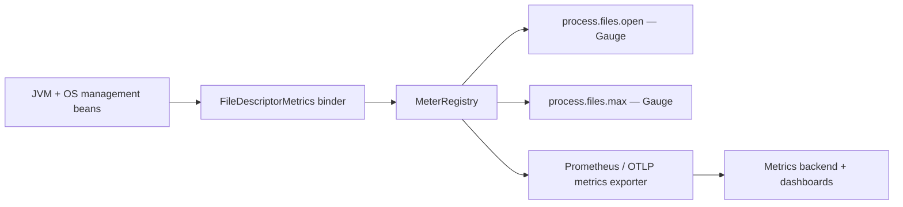
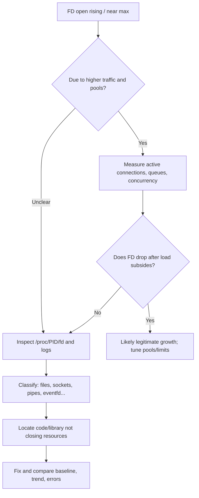

# File Descriptor Metrics in Spring Boot

## 1. Learning objectives

A Spring Boot service may have plenty of free heap and low CPU yet still fail to open a new TCP connection, log file, or configuration file. The cause often lies in **file descriptors (FDs)**: a finite resource granted by the operating system to a process when opening files, sockets, pipes, and other I/O objects.

Within the **Application metrics** chapter of the **SPRING_BOOT_OBSERVABILITY** module, this lesson explains how to use two Micrometer metrics:

- `process.files.open`: number of currently open file descriptors of the **Java process**.
- `process.files.max`: maximum file descriptors the process can open according to the JVM/OS data source.

After this lesson, you will be able to:

1. Explain what an FD is and why a Spring Boot application can encounter `Too many open files` errors.
2. Recognize file descriptor metrics as **process-level gauges** rather than counters or latency metrics.
3. Read `process.files.open` and `process.files.max` via Spring Boot Actuator, Prometheus, and Micrometer.
4. Calculate FD utilization ratios and design dashboards and alerts that guard against missing or invalid data.
5. Distinguish FD leaks, legitimate connection growth, OS limit changes, and container environment discrepancies.
6. Combine metrics, logs, traces, and Linux tools to isolate failures.
7. Avoid tag cardinality, sampling, exporter, and duplicate instrumentation pitfalls in production.

Configuration examples target **Spring Boot 3.5.x, Java 17+, Linux**. Spring Boot 4.x and other JVMs/OSes may differ in auto-configuration or meter availability; always verify against your runtime and version documentation.

## 2. What is a file descriptor?

On Unix-like operating systems, each process maintains a table of small integers (FDs) representing I/O resources the process has opened. Examples:

| Resource | Can consume an FD? | Situation in Spring Boot |
| --- | --- | --- |
| Regular file | Yes | Reading config files, CSVs, temp uploads, logs |
| TCP socket | Yes | Connections to PostgreSQL, Redis, other HTTP services |
| Unix-domain socket | Yes | Communicating with a service on the same host |
| Pipe | Yes | Communicating with child processes |
| Log file/stdout/stderr | Yes | Application log streams |
| epoll/eventfd and internal I/O | Possibly | Netty event loop and underlying libraries |
| Java heap memory | Not an FD | Object memory, caches |
| CPU thread | Not an FD by default | A thread alone does not imply an extra open file |

Every open socket can consume an FD, even when idle and not exchanging data. An application may hold many open sockets due to HTTP connection pools, database pools, retries, or long-lived connections like WebSockets.

**FDs are not the same as physical files on disk.** Thus `disk.free`, `jvm.memory.used`, `process.cpu.usage`, and `process.files.open` measure completely different things. You cannot infer remaining FDs from disk space or heap size.

### 2.1. FD limits and common errors

On Linux, a process's FD limit is tied to **RLIMIT_NOFILE** (soft/hard limits). Applications generally cannot open additional FDs once the effective limit is reached, causing OS API failures; on the Java side you may see:

```text
java.net.SocketException: Too many open files
java.io.FileNotFoundException: ... (Too many open files)
java.nio.file.FileSystemException: ... Too many open files
```

The exact message depends on the I/O operation, JVM, and OS. `EMFILE` reflects the **process** FD limit; system-wide resource errors like `ENFILE` have a different meaning and require inspecting the entire host.

Consequences can include: inability to accept new HTTP connections, failures creating outbound connections, file access failures, flaky health checks, or interrupted logging. **Raising the FD limit without fixing the underlying leak** usually only delays the outage.

## 3. What do the two `process.files.*` metrics measure?

Micrometer Core provides `io.micrometer.core.instrument.binder.system.FileDescriptorMetrics`. On supported JVM/OS environments, the binder uses JVM management info to register two **Gauges**:

| Micrometer name | Type | Unit | Meaning |
| --- | --- | --- | --- |
| `process.files.open` | Gauge | FD count | Open FDs of the JVM process at measurement time |
| `process.files.max` | Gauge | FD count | Maximum FD limit reported for the process |

A **Gauge** reflects the current value. Opening connections can make `process.files.open` rise; closing connections can make it drop. It is not a Counter, so **never** apply `rate(process_files_open[5m])` as with cumulative request counts.



When the OS/JVM **does not provide** a compatible API, these meters may be absent. That is not automatically a Spring Boot bug; pay particular attention when running on Windows or JVMs without the corresponding Unix management interface.

### 3.1. Where do the values come from?

On JVMs supporting `com.sun.management.UnixOperatingSystemMXBean`, the two relevant methods are:

```java
long open = unixMxBean.getOpenFileDescriptorCount();
long max = unixMxBean.getMaxFileDescriptorCount();
```

They report information about the **running process**, not the total open files/sockets across the whole node, container namespace, or Kubernetes cluster. On Linux, the reported max usually reflects the process's `nofile` limit. After changing OS/container configuration, verify the actual reported value rather than assuming it matches `ulimit -n` in a different shell.

Illustrative snapshot at one point in time:

```text
process.files.open = 768
process.files.max  = 1024
```

Utilization ratio:

\[
\text{FD utilization} = \frac{\text{open}}{\text{max}} \times 100\%
= \frac{768}{1024}\times100\%=75\%
\]

This measures **limit utilization** at a moment in time, not an error rate or CPU percentage. If `max` is missing, zero, or an invalid sentinel value, never divide blindly.

### 3.2. Not every increase in open FDs is a leak

FD growth can be completely normal when:

- The HTTP server is serving high concurrent connections.
- JDBC/Redis/HTTP connection pools expand under higher traffic.
- The application initializes files/sockets, frameworks, or exporters for the first time.
- A batch job opens many legitimate files and closes them upon completion.

The suspicious sign of an **FD leak** is when `open` continues climbing across multiple load cycles and **fails to return to baseline** after work finishes—especially once traffic, active connections, and in-flight tasks have dropped. A single rising metric curve is not enough to conclude a leak.

## 4. Enabling file descriptor metrics in Spring Boot

Spring Boot Actuator auto-configures many **system metrics**, including file descriptor metrics, via Micrometer when supported by the environment. For Spring Boot **3.5.x**, use the Spring Boot parent/BOM to manage Maven versions:

```xml
<dependencies>
    <dependency>
        <groupId>org.springframework.boot</groupId>
        <artifactId>spring-boot-starter-actuator</artifactId>
    </dependency>
    <dependency>
        <groupId>io.micrometer</groupId>
        <artifactId>micrometer-registry-prometheus</artifactId>
    </dependency>
</dependencies>
```

If this is a web MVC application, `spring-boot-starter-web` will usually already be present, though it is **not required** for the FD binder itself. The Prometheus registry is only needed if you want to expose Prometheus format; Actuator can display metrics from other suitable registries.

Illustrative `application.yml`:

```yaml
spring:
  application:
    name: checkout-service

management:
  endpoints:
    web:
      exposure:
        include: health,info,metrics,prometheus
  metrics:
    tags:
      application: checkout-service
      environment: local
```

When running on a development machine, you can inspect:

```bash
curl -s http://localhost:8080/actuator/metrics
curl -s http://localhost:8080/actuator/metrics/process.files.open
curl -s http://localhost:8080/actuator/metrics/process.files.max
curl -s http://localhost:8080/actuator/prometheus
```

**On the Actuator endpoint, use the dot-separated Micrometer name**: `process.files.open`. Exported names for Prometheus are typically normalized to `process_files_open` and `process_files_max`, plus registry/scrape labels.

Protect these endpoints according to network and authorization policies in real environments. Never expose all of Actuator to the Internet just to monitor FDs.

### 4.1. Example Actuator response

Illustrative response for `/actuator/metrics/process.files.open`:

```json
{
  "name": "process.files.open",
  "description": "The open file descriptor count",
  "baseUnit": "files",
  "measurements": [
    { "statistic": "VALUE", "value": 768.0 }
  ],
  "availableTags": [
    { "tag": "application", "values": ["checkout-service"] },
    { "tag": "environment", "values": ["local"] }
  ]
}
```

This is a **JSON structure example**, not actual measurements from a specific JVM: descriptions, baseUnits, and tag sets may differ depending on Micrometer/registry/version. The `VALUE` field represents the current gauge reading. For `process.files.max`, read the value the same way.

### 4.2. Why might the metric not appear?

Check in order:

1. Is Actuator on the classpath and is the `metrics` endpoint exposed?
2. Does `/actuator/metrics` list `process.files.open` and `process.files.max`?
3. Does the JVM/OS support the corresponding FD telemetry? Usually yes on Linux with a compatible JDK.
4. Is a `MeterFilter` or `management.metrics.enable.process.files=false` blocking the meter name?
5. Was a custom registry configured or the system metrics binder disabled, preventing Actuator from recording it?
6. If missing only in Prometheus: is `micrometer-registry-prometheus` present, is `prometheus` exposed, and is Prometheus scraping successfully?

**Avoid outdated property names.** Some early Spring Boot 2.x docs mention `management.metrics.binders.files.enabled`; do not copy that property to Boot 3.5 without checking your exact version's metadata/docs. When you want to **hide meters from the registry**, use the per-meter property supported in Boot 3.5 docs:

```properties
management.metrics.enable.process.files=false
```

That rule suppresses metrics prefixed with `process.files` in the configured registry. It removes FD monitoring visibility and must never be treated as a fix for FD exhaustion.

## 5. Reading the gauge in Java for diagnostics

In a **Spring Boot application with Actuator**, prefer the injected `MeterRegistry` and Boot-registered meters. You can read the existing gauges without instantiating the binder manually:

```java
import io.micrometer.core.instrument.Gauge;
import io.micrometer.core.instrument.MeterRegistry;
import org.springframework.stereotype.Component;

import java.util.OptionalDouble;

@Component
public class FileDescriptorSnapshot {
    private final MeterRegistry registry;

    public FileDescriptorSnapshot(MeterRegistry registry) {
        this.registry = registry;
    }

    public OptionalDouble utilization() {
        Gauge openGauge = registry.find("process.files.open").gauge();
        Gauge maxGauge = registry.find("process.files.max").gauge();

        if (openGauge == null || maxGauge == null) {
            return OptionalDouble.empty(); // Measurement unavailable on this OS/JVM.
        }

        double open = openGauge.value();
        double max = maxGauge.value();
        if (!Double.isFinite(open) || !Double.isFinite(max) || max <= 0) {
            return OptionalDouble.empty();
        }
        return OptionalDouble.of(open / max);
    }
}
```

`utilization()` returns a fraction typically in `0.0`–`1.0`, not multiplied by 100. In applications with multiple tag series sharing the same meter name, `find(...).gauge()` may be ambiguous; filter by tags belonging to the exact process/registry. Do not expose a custom endpoint for this when Actuator/dashboards already cover the need.

### 5.1. Using plain Micrometer without Spring Boot

Micrometer exposes the public binder `FileDescriptorMetrics`:

```java
import io.micrometer.core.instrument.Gauge;
import io.micrometer.core.instrument.Tags;
import io.micrometer.core.instrument.binder.system.FileDescriptorMetrics;
import io.micrometer.core.instrument.simple.SimpleMeterRegistry;

public class StandaloneFdMetrics {
    public static void main(String[] args) {
        SimpleMeterRegistry registry = new SimpleMeterRegistry();
        try {
            new FileDescriptorMetrics(Tags.of("source", "manual"))
                    .bindTo(registry);

            Gauge open = registry.find("process.files.open")
                    .tags("source", "manual").gauge();
            Gauge max = registry.find("process.files.max")
                    .tags("source", "manual").gauge();

            if (open == null || max == null) {
                System.out.println("FD metrics are unavailable");
            } else {
                System.out.printf("open=%s max=%s%n",
                        open.value(), max.value());
            }
        } finally {
            registry.close();
        }
    }
}
```

This is a **standalone Micrometer** example to understand the binder, not a bean to add to an already auto-instrumented Spring Boot app. Registering the binder a second time on the same registry with the same name/tags causes duplication or reuses the existing meter without adding monitoring value.

### 5.2. Cross-checking directly with the JDK

To verify the underlying data source on a Java 17+ JVM supporting the Unix MXBean:

```java
import java.lang.management.ManagementFactory;
import com.sun.management.UnixOperatingSystemMXBean;

var osBean = ManagementFactory.getOperatingSystemMXBean();

if (osBean instanceof UnixOperatingSystemMXBean unix) {
    System.out.println("open=" + unix.getOpenFileDescriptorCount());
    System.out.println("max=" + unix.getMaxFileDescriptorCount());
} else {
    System.out.println("Unix file descriptor MXBean not available");
}
```

This relies on `jdk.management` and does not apply identically across all JVMs/OSes. Readings from the JDK and Micrometer may differ slightly because they are sampled at two different instants.

## 6. Dashboards and PromQL for FD metrics

Suppose `/actuator/prometheus` exports:

```text
process_files_open{application="checkout-service",instance="10.0.0.5:8080"} 768
process_files_max{application="checkout-service",instance="10.0.0.5:8080"} 1024
```

The data is illustrative only. Actual labels such as `job`, `instance`, `pod`, and `service` are added by the exporter/Prometheus/OTLP backend depending on the pipeline.

### 6.1. Open FD count

```promql
process_files_open
```

View this chart **per instance/pod**. A cluster-wide `sum(process_files_open)` shows overall scale, but does not tell you whether *one specific process* is about to hit its own limit.

### 6.2. Utilization ratio

```promql
100 * (process_files_open / process_files_max)
```

The result is a percentage when both metrics exist with matching label sets and `process_files_max > 0`. To filter out series with invalid max values in alert queries:

```promql
(100 * process_files_open / process_files_max)
  and (process_files_max > 0)
```

If an exporter alters labels between `open` and `max`, adjust vector matching (`on(...)` or `ignoring(...)`) to match the schema. Never divide total open FDs across a cluster by a single pod's `max` when alerting on **per-process** limit exhaustion.

### 6.3. Trend analysis, without using `rate` like a Counter

Because `process_files_open` is a gauge, Prometheus `rate()` (designed for counters) is not the right way to interpret open FDs. Instead:

```promql
max_over_time(process_files_open[15m])
```

Returns the highest FD count **among scraped samples** within 15 minutes; brief spikes between scrapes can still be missed.

```promql
deriv(process_files_open[30m])
```

Estimates the linear slope of the gauge over time (FDs/second) over a 30-minute window. A sustained positive slope under steady load is a sign worth investigating, though **not standalone proof of a leak**: active connections may be legitimately growing.

### 6.4. Illustrative alert rule

```yaml
groups:
  - name: spring-boot-file-descriptors
    rules:
      - alert: SpringBootFDCapacityHigh
        expr: (process_files_open / process_files_max > 0.8) and (process_files_max > 0)
        for: 10m
        labels:
          severity: warning
        annotations:
          summary: "File descriptors above 80% of process limit"
          description: "Investigate FD use on {{ $labels.instance }}"
```

This alert is a **Prometheus configuration sample**; the 80% threshold and 10-minute window are starting points to tune against your real baseline and traffic. If `max` is very high while a slow FD leak climbs steadily, percentage-only alerts may fire too late; add an **abnormal upward open trend** alert and alerts on actual I/O errors.

If `process_files_max` is absent, ratio alerts will not fire. Add a separate alert for **missing telemetry**, such as an appropriately scoped `absent(process_files_open{job="checkout"})`, combined with `up` checks and application target availability.

## 7. Workflow for diagnosing an FD leak on Linux

Suppose a dashboard shows `process_files_open` climbing from 350 to 900 while `process_files_max` is 1024. First confirm it is **FD growth in the exact process**, then classify the resources.



### 7.1. Identify the Java process PID

Inside the host/container where Java actually runs, identify the application PID using an appropriate tool (e.g., `ps`, `jcmd -l` when JDK is available). On Kubernetes, the PID inside the container may differ from the PID seen from the host. The examples below assume you have **correctly set** `PID`.

```bash
# Run on Linux; replace 12345 with the actual PID.
PID=12345

# Count entries in the current FD table (requires read permissions).
ls -1 "/proc/$PID/fd" | wc -l

# View the limit the process received from the OS.
grep 'Max open files' "/proc/$PID/limits"

# Sample some FD types (avoid printing all when counts are huge).
ls -l "/proc/$PID/fd" | head -n 30

# If lsof is available, inspect FD types and targets; do not treat lsof
# line count as exact FD count since output includes other entries.
lsof -nP -p "$PID" | head -n 40
```

`/proc/<pid>/fd` is a Linux interface; access depends on user permissions, procfs mounts, and security policy. Running `ls` or `lsof` creates a few FDs for **the inspection tool process itself**, without directly causing long-term FD growth in the JVM.

On Kubernetes, you can use `kubectl exec` into the app container to inspect from inside if the image includes tools and you have permission. Many minimal images lack `lsof`, `ps`, or a shell; use appropriate diagnostic tooling rather than arbitrarily installing packages into a production container.

### 7.2. Classifying symptoms

| Observation | Hypothesis to verify |
| --- | --- |
| Many `socket:[inode]` | HTTP keep-alive, JDBC/Redis/HTTP pools, unclosed connections, or higher load |
| Many file paths | Unclosed stream/reader, log/file upload handling, unclosed directory stream |
| Many `pipe:[inode]` | Unreclaimed child processes or IPC streams |
| Many `anon_inode` (eventpoll/eventfd...) | Event loops, native libraries, uncleaned internal resources |
| FDs drop sharply when traffic drops | Likely legitimate pool/concurrency scaling |
| FDs climb over hours even after traffic drops | Suspicious leak or overly long resource retention |
| `process.files.max` dropped after deploy | Limit changed by runtime/container/service manager |

Seeing many `socket` entries alone does not prove an HTTP client leak: connection pools are designed to keep sockets open for reuse. Cross-check pool active/idle metrics, `ESTABLISHED`/`CLOSE_WAIT` sockets, request rates, timeouts, and application lifecycle.

### 7.3. Java idioms to prevent FD leaks

**Broken resource management:** opening a stream and returning without guaranteed closing:

```java
// Anti-pattern: if an exception is thrown before close(), the stream may remain open.
InputStream in = Files.newInputStream(path);
byte[] bytes = in.readAllBytes();
in.close();
return bytes;
```

Proper cleanup even when reading fails:

```java
import java.io.IOException;
import java.io.InputStream;
import java.nio.file.Files;
import java.nio.file.Path;

public byte[] loadFile(Path path) throws IOException {
    try (InputStream in = Files.newInputStream(path)) {
        return in.readAllBytes();
    }
}
```

Similarly, APIs returning `Stream<Path>` or `Stream<String>` can hold open I/O resources:

```java
import java.io.IOException;
import java.nio.file.Files;
import java.nio.file.Path;
import java.util.stream.Stream;

public long countRegularFiles(Path directory) throws IOException {
    try (Stream<Path> paths = Files.list(directory)) {
        return paths.filter(Files::isRegularFile).count();
    }
}
```

For HTTP clients, database drivers, Reactor Netty, or connection pools, **do not manually close sockets after every request** when the library manages a pool. Instead, follow the library's response close/release lifecycle, configure pool limits properly, and ensure resource shutdown when the application stops.

## 8. Differences between host, container, and Kubernetes

A Spring Boot service may run on a Linux host, in Docker, or on Kubernetes. FD limits can be affected by:

- `RLIMIT_NOFILE` that the process **inherits** from the shell, service manager (systemd), or container runtime.
- `ulimit` configuration at container creation, runtime policies, and privilege to raise limits.
- Network connections, log/temporary files, and sidecars/other processes.
- Actual state of `/proc/<pid>/limits` in the relevant namespace/cgroup.

Common points of confusion:

1. `ulimit -n` in a host terminal **does not necessarily equal** the limit of a Java process inside a container or a systemd-managed service.
2. `process.files.max` usually reflects the **JVM process** limit, while the host OS has separate system-wide limits. It does not measure total FDs across an entire pod/cluster.
3. In multi-pod deployments, **each pod/instance** has its own gauge. Summing `open` across pods and dividing by one pod's `max` produces an invalid ratio.
4. Different JRE images or Windows environments may lack these binders/gauges; verify availability.
5. When max FDs is raised very high, fixed percentage thresholds become less sensitive to slow leaks; combine with trend alerts and I/O error alerts.

Raising the FD limit helps when **legitimate** concurrency exceeds the old cap. Still check memory limits, connection pools, backend databases, and real socket counts; raising `nofile` without capacity planning can simply push the bottleneck to another layer.

## 9. How FD metrics and logs/traces should work together

File descriptor metrics are **aggregate process resource indicators**. They do not tell you which request owns FD #82 or which line of code is keeping a file open. During an incident:

1. **Metrics:** detect rising `process.files.open` and compare against `max`, deploy timeline, request counts, active connections, and error rates.
2. **Logs:** search for `Too many open files`, `SocketException`, `FileSystemException`, connection pool exhaustion, retries, and event loop warnings.
3. **Traces:** if tracing/sampling/exporter are enabled, inspect which requests/spans dragged on, which backends were called, and where timeouts happened. Analyze multiple traces; a single failed trace does not prove an FD leak.
4. **OS/JVM:** use `/proc/<pid>/fd`, `/proc/<pid>/limits`, `lsof`, and pool metrics to identify which resource group is growing.
5. **Fix the root cause:** close I/O properly, tune timeouts/pools, or fix retries; verify FDs return to baseline after load subsides.

For instance, users report payment failures; `process_files_open` is near its limit, logs show `Too many open files`, and outbound `payment.authorize` traces fail. The right conclusion is **investigate FD exhaustion causing I/O failures**, not yet claiming `payment.authorize` leaked FDs. The code opening/retaining resources could live elsewhere.

### 9.1. Sampling and exporters do not replace FD metrics

- `process.files.open` and `process.files.max` are gauge system metrics; they **do not depend** on whether a request was sampled for tracing.
- Lowering `management.tracing.sampling.probability` does not reduce open FDs and does not cause the gauge to sample only 10% of FDs.
- Prometheus needs to scrape `/actuator/prometheus`; OTLP Metrics needs an exporter/collector. Tracing spans use a separate pipeline.
- `traceparent` links traces across services; it does not carry a process's FD table or tie a specific FD to a request.
- Logs containing `traceId`/`spanId` depend on tracing context and logging configuration; finding an FD leak still requires process telemetry and resource ownership analysis.

**Exemplars** on latency histograms can jump to matching traces when supported by backend and tracing. However, an FD gauge itself does not point to a single request; linking FD pressure to traces typically relies on **time, service, instance/pod**, and error signals.

## 10. Metric labels and cardinality

The two FD meters naturally have low cardinality. They measure **per process**, so there is no reason to label by:

- open filename,
- FD number,
- full file path,
- URL, user ID, order ID, or trace ID,
- remote IP address of each connection.

Example of a metric you **should not** create:

```java
// Anti-pattern: varying the tag per socket/file => many time series.
Gauge.builder("process.files.by.path", holder, ValueHolder::count)
        .tag("path", filePathFromRequest)
        .register(meterRegistry);
```

`holder` and `ValueHolder` merely illustrate the anti-pattern and are not Micrometer classes. Even if paths look helpful, near-unbounded values consume registry and backend resources. Moreover, path details can leak sensitive data.

Appropriate labels for grouping FD metrics include `application`, `environment`, `region`, or backend-assigned `instance`/`pod`. Keep them stable and consistent. If you need FD counts by resource type (socket/file), use **OS tools or specialized instrumentation**; the two standard gauges do not include an `fdType` label by default.

## 11. Troubleshooting by symptom

| Symptom | Possible cause | Verification action |
| --- | --- | --- |
| `process.files.open` missing in Actuator | OS/JVM unsupported, meter disabled, different registry | Check runtime and `management.metrics.enable.*` |
| Present in Actuator, missing in Prometheus | Prometheus registry/exposure/scrape/network/auth | Read `/actuator/prometheus`, check target `up` |
| `open` gauge rises with traffic then drops | Normal pool/concurrency behavior | Compare baseline after load subsides |
| `open` gauge climbs steadily, never drops | Leak or unusually long-lived resources | Check `/proc/<pid>/fd`, `lsof`, resource lifecycles |
| `max` differs from shell `ulimit -n` | Process limit differs from shell/container/session | Check `/proc/<pid>/limits` for the exact PID |
| Alert didn't fire despite `Too many open files` log | Missing max metric, missed scrapes, surge between scrapes, non-EMFILE error | Check logs, uptime/scrapes, and exact process limit |
| CPU/heap normal yet HTTP timeouts occur | Socket/file FD exhaustion, pool, backend, or network error | Analyze open/max alongside HTTP, pools, and logs |
| `rate(process_files_open[5m])` yields strange values | Applying a counter function to a gauge | Use current value, `deriv`/range functions as appropriate |
| Most pods healthy, one pod failing | Only one JVM hit its FD limit | Use panels/alerts per `instance` or `pod` |
| Open FDs drop suddenly after deploy | Process restart, pool reset, or leak temporarily masked | Compare `process.start.time` and restart timestamps |
| Traces don't show request causing leak | Sampling, missing propagation, or leak not tied to a single request | Use logs, OS/JVM tools, and pool metrics to trace resources |
| Numerous `path`/ID labels | Custom metric added high cardinality | Remove dynamic tags; use dedicated diagnostic tools |

## 12. Hands-on practice and verification criteria

Run exercises on an authorized test application—never intentionally exhaust FDs in production:

1. **Baseline:** start Spring Boot Actuator on Linux, read `process.files.open` and `process.files.max`, and record idle utilization.
2. **Valid load:** send moderate requests to an HTTP/database endpoint, observe `open` rising or staying stable and returning to baseline afterward.
3. **OS verification:** inside the same container/process namespace, inspect `/proc/<pid>/fd` and `/proc/<pid>/limits`, and explain why counts may differ slightly from the gauge due to sampling timing.
4. **Classification:** inspect a sample of FDs with `ls -l /proc/<pid>/fd` or `lsof -p`; classify sockets, files, and pipes.
5. **Backend data:** if Prometheus is available, query `process_files_open`, `process_files_max`, utilization percentage, and `max_over_time`.
6. **Prevention:** audit `Files.lines`, `Files.list`, `InputStream`, outbound HTTP, and connection pools; ensure cleanup on error/timeout paths.
7. **Signal correlation:** induce a controlled test I/O error (without exhausting host quota), inspect exception logs and any request trace, and explain the informational scope of FD gauges.

A short operational checklist:

- [ ] Both gauges exist for **each target process/instance** with fresh data.
- [ ] `max > 0` is verified before computing ratios.
- [ ] Dashboards show per-pod metrics rather than masking a near-limit pod behind a cluster aggregate.
- [ ] Baselines exist for idle and peak traffic; changes after deploy/restart are recognized.
- [ ] Alerts combine utilization, trend, and I/O errors; thresholds reflect real workload.
- [ ] Team can locate PIDs and inspect `/proc/<pid>/fd` and limits during incidents.
- [ ] Code manages resource lifecycles cleanly and omits dynamic paths/IDs from metric tags.
- [ ] Metrics, logs, and tracing have independently verified export and retention paths.

## 13. Self-practice questions

1. A service still has 70% free heap, yet logs report `Too many open files`. Why won't raising `-Xmx` alone solve it?
2. How does `process.files.open` differ from `process.files.max`? Are they Counters or Gauges?
3. With `open=768` and `max=1024`, what is the FD utilization percentage?
4. Why is `rate(process_files_open[5m])` not an appropriate way to measure open FDs?
5. One pod has `open/max=950/1024` and another has `100/1024`. Why can a cluster-wide average hide the endangered pod?
6. If `process.files.open` keeps climbing even after traffic drops, which FD types and resource lifecycles should you inspect?
7. In a Linux container, why might `ulimit -n` in a host shell differ from `process.files.max`?
8. Why might these two FD gauges not appear on Windows?
9. If code creates a metric with each file's `path` as a tag, what happens to cardinality?
10. Does sampling 10% of distributed traces make `process.files.open` record only 10% of FDs? Why?
11. `process.files.open` rises right as `http.server.requests` latency spikes and logs show `SocketException`. What evidence is still missing before concluding a leak?
12. If a Prometheus target remains `up=1` yet `process_files_max` disappears, how will ratio alerts behave and what check should be added?

## References

- [Spring Boot 3.5 — Metrics, System Metrics](https://docs.spring.io/spring-boot/3.5/reference/actuator/metrics.html)
- [Spring Boot 3.5 — Common Application Properties](https://docs.spring.io/spring-boot/3.5/appendix/application-properties/index.html)
- [Micrometer — System File Descriptor Metrics](https://docs.micrometer.io/micrometer/reference/reference/system.html)
- [Micrometer — Gauges](https://docs.micrometer.io/micrometer/reference/concepts/gauges.html)
- [Java Platform — UnixOperatingSystemMXBean](https://docs.oracle.com/en/java/javase/25/docs/api/jdk.management/com/sun/management/UnixOperatingSystemMXBean.html)
- [Linux — /proc/pid/fd](https://man7.org/linux/man-pages/man5/proc_pid_fd.5.html)
- [Linux — getrlimit / RLIMIT_NOFILE](https://man7.org/linux/man-pages/man2/getrlimit.2.html)
- [Prometheus — Querying Functions](https://prometheus.io/docs/prometheus/latest/querying/functions/)
