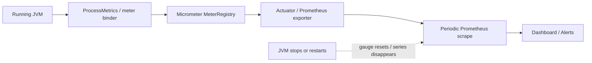
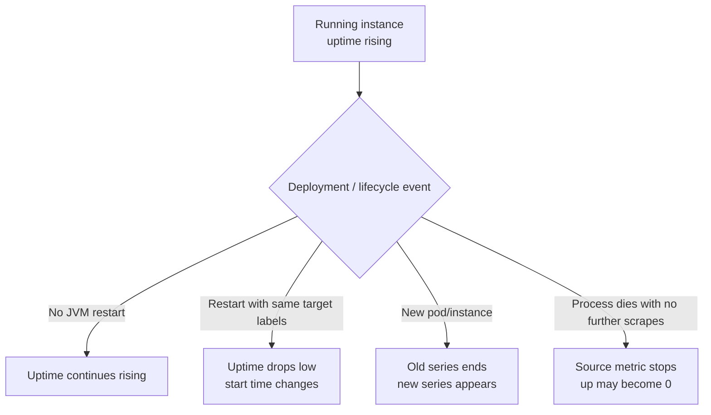

# Process Uptime Metrics in Spring Boot

A Spring Boot application just restarted due to out-of-memory, a container is repeatedly replacing its process, or a service has been running for days yet customers still hit HTTP 503. These situations raise two distinct questions: **how long has the process been running?** and **is the service actually serving requests successfully?** In Micrometer Metrics, **process uptime metrics** answer the first question and supply foundational context for investigating the second.

This is the **Process uptime metrics** lesson in the **Application metrics** chapter of the **SPRING_BOOT_OBSERVABILITY** module. The module covers setting up observability for Spring Boot using Micrometer Observation, metrics, logs, and distributed tracing; learning context propagation, tags/cardinality, exporters, sampling, and signal correlation to investigate errors, latency, and application behavior in real environments. This lesson focuses on the meaning, collection, and interpretation of **application process lifetime** alongside other operational signals.

## 1. Learning objectives

After this lesson, you will be able to:

- Explain the meaning of `process.uptime` and `process.start.time` in Micrometer/Spring Boot.
- Distinguish **process uptime**, **application readiness**, **scrape availability**, **service availability**, and container/pod lifetime.
- Enable and inspect process metrics via Spring Boot Actuator and Prometheus.
- Read units accurately, understand Gauge semantics, before/after restart state, and the limits of inferences drawn from uptime.
- Write basic PromQL queries to find newly started processes and compare across instances.
- Recognize the effects of tags/cardinality, exporters, scrape intervals, and churn in multi-pod deployments.
- Combine uptime metrics with logs, distributed tracing, and error/latency metrics to investigate production incidents.

## 2. What does process uptime actually measure?

**Process uptime** is the elapsed time since the monitored process started. For a Spring Boot application running on the JVM, this information is typically obtained from the runtime/JVM and registered in Micrometer as metrics.

Two key meter names:

| Micrometer meter | Meaning | Characteristics |
| --- | --- | --- |
| `process.uptime` | Seconds the process has been running at read time | Usually a **Gauge**: rises over time while the process lives and drops low when a new process starts |
| `process.start.time` | Process start timestamp expressed relative to the Unix epoch | Usually a **Gauge**: nearly constant over a process's lifetime, shifting when a new process replaces it |

With the standard Prometheus registry, these names are typically exported as **`process_uptime_seconds`** and **`process_start_time_seconds`**. Final names depend on Micrometer, registry, version, and naming conventions; always check actual output rather than assuming.

### Interpretation example

Suppose a JVM starts at 10:00:00 UTC:

| Sample time | `process.uptime` (seconds) | `process.start.time` (epoch seconds) |
| --- | ---: | --- |
| 10:00:30 | ~30 | Nearly constant |
| 10:05:00 | ~300 | Nearly constant |
| 10:30:00 | ~1,800 | Nearly constant |
| After a **new JVM** starts | Near 0 | Shifts to the new start timestamp |

**Uptime is not the number of seconds the application has been ready to receive traffic.** A JVM may run for a while before the Spring context finishes initialization and readiness probes pass. Likewise, a JVM can keep running while thread pools, database connections, or dependencies are failing.

### Process, application, container, and pod

A typical container runs one main JVM, so process uptime often correlates closely with container uptime. However, the concepts are not identical:

- **Process:** start time and lifetime of the specific JVM Micrometer is measuring.
- **Spring ApplicationContext:** can be refreshed/re-initialized without replacing the whole JVM; process uptime does not necessarily reset then.
- **Container:** can restart, get replaced, or run additional processes; restart counts live in runtime/orchestrator telemetry.
- **Pod/instance:** can be created fresh during rolling deployments or autoscaling. One JVM's uptime does not describe the full lifecycle of a replicated service.
- **Service to users:** may remain available via other instances even while one JVM restarts; or may be unavailable even while all processes remain running.

Never use a single uptime gauge to claim overall system uptime SLA.

## 3. Uptime metrics are Gauges

A `Gauge` reflects a value at **read time**. Unlike a `Counter`, a Gauge can go up or down, and it disappears from scrape output when the source object or process is no longer scraped.



**Operational implications:**

1. While the process lives, `process.uptime` rises over time.
2. When the JVM restarts, a **new process** has a small uptime again; if labels stay the same, charts show a sharp drop.
3. If a new pod has a different `instance` or `pod` label, Prometheus starts a **new series**. The old series stops and a new one begins, rather than showing a continuous line dropping to 0.
4. When the app dies and the endpoint stops responding, no new uptime samples arrive; the scrape system marks target health failed.
5. Samples are collected periodically, so very brief restarts or crashes between scrapes may not show clearly in uptime charts.

**Do not apply `rate(process_uptime_seconds[5m])` to calculate requests/sec or "uptime ratio."** Even though uptime increases roughly 1 second per second while alive, it is a Gauge representing duration, not an event counter. Applying `increase` or `rate` as for a Counter produces invalid or misleading results on restarts.

## 4. How process uptime differs from availability

| Signal | Question it answers | What it cannot prove |
| --- | --- | --- |
| `process.uptime` | How long has the current JVM been alive? | Is the API serving requests successfully? |
| `process.start.time` | When did the current JVM start? | When did the service become ready? |
| Prometheus `up` | Did scraping the target succeed at sample time? | Are user business operations succeeding? |
| Liveness probe | Should the container be kept or restarted per liveness check? | Is the service ready to handle traffic? |
| Readiness probe | Is the instance considered ready for traffic per probe policy? | Are all business code paths working properly? |
| HTTP 5xx / success rate | Are recorded requests succeeding or failing per contract? | Why failures occurred from aggregate numbers alone |
| Synthetic check | Is an external test journey working? | Do all users in every region see identical behavior? |

Prometheus `up=1` means a target was scraped successfully, **not** a guarantee of 100% API availability. Likewise, `process.uptime=86400` means the JVM is roughly one day old; the application could still have returned 500s for part of that day.

### Uptime percentage cannot be taken directly from the Gauge

If you need an availability SLI, explicitly define **what counts as success** and **what samples belong in the denominator**. For example:

\[
\text{Request availability} =
\frac{\text{successful valid requests}}
{\text{total valid requests}}
\]

External probe-based SLIs may use another formula, such as the ratio of successful probes over a window. Never compute `process.uptime / 86400` to claim daily availability: that division ignores dead processes, missing metric intervals, failed requests, and redundancy provided by other replicas.

## 5. Enabling process uptime metrics with Spring Boot Actuator

In Spring Boot 3.x with Actuator and compatible Micrometer setup, JVM/process meters are normally registered automatically via auto-configured meter binders. For a Gradle Kotlin DSL project:

```kotlin
dependencies {
    implementation("org.springframework.boot:spring-boot-starter-actuator")
    runtimeOnly("io.micrometer:micrometer-registry-prometheus")
}
```

`spring-boot-starter-actuator` provides management/metrics mechanics, while `micrometer-registry-prometheus` exports metrics in Prometheus format. Manage versions via the Spring Boot BOM to avoid library mismatches.

Example `application.yml`:

```yaml
spring:
  application:
    name: order-service

management:
  endpoints:
    web:
      exposure:
        include: health,info,metrics,prometheus
  metrics:
    tags:
      application: ${spring.application.name}
      environment: ${APP_ENV:local}
```

Meaning:

- `/actuator/metrics` inspects meters registered in the application and their measurements.
- `/actuator/prometheus` serves Prometheus scrape data when the Prometheus registry is present and accessible.
- `application` and `environment` are **common metrics tags** for filtering across services or environments. Values must be managed at deployment level, not per request.

In production, apply proper authentication, authorization, or network restrictions to management endpoints. **Exposing an endpoint** does not configure Prometheus scraping automatically; Prometheus or a collector must still target and reach the endpoint.

### Why shouldn't you create a custom Gauge here?

Micrometer already provides standard collection for process uptime. If Spring Boot already registers `process.uptime` and `process.start.time`, adding your own Gauge with the same meaning can:

- Create duplicate meter names and cause registration conflicts.
- Measure the lifetime of a **Spring bean** or workflow while mislabeling it as process uptime.
- Confuse dashboards about which value represents the running JVM.

Only add a custom meter when measuring **a different lifecycle**, such as time since last successful data sync, and give it a clearly distinct name like `business.sync.last.success.time`.

## 6. Inspecting via Actuator

After starting the application with Actuator configured, query over HTTP:

```http
GET /actuator/metrics
GET /actuator/metrics/process.uptime
GET /actuator/metrics/process.start.time
```

*Illustrative* response example for `process.uptime`:

```json
{
  "name": "process.uptime",
  "description": "The uptime of the Java virtual machine",
  "baseUnit": "seconds",
  "measurements": [
    { "statistic": "VALUE", "value": 542.3 }
  ],
  "availableTags": [
    { "tag": "application", "values": ["order-service"] },
    { "tag": "environment", "values": ["local"] }
  ]
}
```

On this illustrative instance, ~**542.3 seconds** means the JVM had been running for roughly 9 minutes and 2 seconds at read time. Descriptions, precision, field names, and tags can vary by version/config; this is not captured output from a specific live app.

If the endpoint does not return `process.uptime`, check:

1. Are Actuator and metrics auto-configuration present in the application?
2. Is the process binder enabled or excluded/disabled via configuration?
3. Is `/actuator/metrics` reachable and what are the actual meter names?
4. Were meters rejected by a `MeterFilter` or managed by a different registry?
5. Does the metric exist in the registry yet remain hidden due to exposure, security, or pipeline settings?

### Reading uptime in Java for diagnostics

You can read the registry-managed Gauge through Micrometer's API **without creating a new Gauge**:

```java
import io.micrometer.core.instrument.Gauge;
import io.micrometer.core.instrument.MeterRegistry;
import java.util.OptionalDouble;
import org.springframework.stereotype.Component;

@Component
public class ProcessUptimeReader {

    private final MeterRegistry registry;

    public ProcessUptimeReader(MeterRegistry registry) {
        this.registry = registry;
    }

    public OptionalDouble uptimeSeconds() {
        Gauge gauge = registry.find("process.uptime").gauge();
        if (gauge == null) {
            return OptionalDouble.empty();
        }
        return OptionalDouble.of(gauge.value());
    }
}
```

If the Gauge is not registered, the method returns `OptionalDouble.empty()`; the application should not treat 0 seconds as a default for "missing metric." If the pipeline is broken, registry values and backend data will diverge.

## 7. Viewing data in Prometheus

When using Micrometer's Prometheus registry, `/actuator/prometheus` typically looks like:

```text
# HELP process_uptime_seconds The uptime of the Java virtual machine
# TYPE process_uptime_seconds gauge
process_uptime_seconds{application="order-service",environment="prod"} 542.3

# HELP process_start_time_seconds Start time of the process since unix epoch
# TYPE process_start_time_seconds gauge
process_start_time_seconds{application="order-service",environment="prod"} 1.7953266E9
```

These lines **only illustrate format and meaning**, not live measurements. The epoch timestamp in the sample is hypothetical. Metrics may carry extra labels like `job`, `instance`, or `pod` when collected by Prometheus/collectors. Metric names, types, and exporter formatting depend on registry/version; verify directly on your application's endpoint.

### Distinguishing meter name from exported metric name

| API/inspection point | Example name | Meaning |
| --- | --- | --- |
| Micrometer Java/Actuator | `process.uptime` | Meter name inside the application |
| Micrometer Java/Actuator | `process.start.time` | Meter name inside the application |
| Prometheus classic text | `process_uptime_seconds` | Exported name after naming convention and time unit |
| Prometheus classic text | `process_start_time_seconds` | Exported name for start timestamp |

Do not use dots directly in PromQL once the metric has been renamed. Before writing queries or alerts, verify the **actual series name** and inspect instance labels to avoid mixing multiple JVMs.

## 8. Useful PromQL queries

The queries below assume Prometheus collects `process_uptime_seconds` and `process_start_time_seconds` with labels `application`, `environment`, and `instance`. If your backend uses different names, adjust to match scraped data.

### 8.1. Current uptime per instance

```promql
process_uptime_seconds{application="order-service", environment="prod"}
```

Each series corresponds to one label set. With multiple replicas, display per `instance` or `pod` where available, because an aggregated service-wide number can hide a single replica restarting repeatedly.

### 8.2. Finding processes running for less than 5 minutes

```promql
process_uptime_seconds{application="order-service", environment="prod"} < 300
```

This query retains series whose uptime is under 300 seconds at evaluation time. It helps identify newly started processes **while still being scraped**, though it does not prove a restart was abnormal. Rolling deployments and autoscaling legitimately create new processes too.

### 8.3. Minimum uptime across replicas

```promql
min by (application, environment) (
  process_uptime_seconds{application="order-service", environment="prod"}
)
```

The minimum indicates the **youngest replica among currently scraped series**. If a new pod starts, this value is small; if a pod dies and disappears from scrapes, `min` only evaluates remaining series. Do not treat it as uptime of the entire service.

### 8.4. Cross-checking against start time

```promql
time() - process_start_time_seconds{
  application="order-service",
  environment="prod"
}
```

Because `time()` is evaluation time in epoch seconds and `process_start_time_seconds` is also an epoch timestamp, subtracting yields **approximate process age in seconds**. Results may differ slightly from `process_uptime_seconds` due to sample timing, scrape delay, clock skew, or how the binder computes uptime.

Do not rely on this calculation as sole absolute proof when host clocks are out of sync.

### 8.5. Checking scrape target health

```promql
up{job="order-service"}
```

`up` is a metric generated by **Prometheus** for each scrape target, not the `process.uptime` meter emitted by Spring Boot. `up=0` indicates the target scrape failed; causes include dead process, network error, authentication failure, service discovery, or collector issues. `up=1` also does not prove the application is ready to serve business traffic.

In practice, an "instance continuously restarting" alert should combine orchestrator metadata or sufficiently long history. A single low uptime sample cannot distinguish an unexpected crash-restart from a fresh rollout.

## 9. Identifying restarts from uptime and start time

When a JVM is replaced by a new process, operators may see one of these patterns:



### A reference check using start time

When **the exact same label set** is preserved across restarts and scrapes occur before/after, you can observe start timestamp changes:

```promql
changes(process_start_time_seconds{application="order-service"}[1h])
```

`changes` counts how many times sample values changed within the window **per series**. It helps detect process start time changes when labels remain identical and samples are consistently scraped.

However, this query **is not an exact restart counter for every environment**:

- If a new pod gets a different `pod` or `instance` label, the new series has no "change" continuing from the old series.
- If multiple restarts happen between two scrapes, intermediate restarts may be missed.
- New series or collector/network data gaps leave incomplete history.
- Reused labels can mislead if the underlying target changed.

When you need reliable **container restart counts** in Kubernetes, use metrics from `kube-state-metrics` or your orchestrator, such as `kube_pod_container_status_restarts_total` when available. Match pods/containers cleanly to deployments and verify the metric is actually collected.

### Rolling deployment scenario

A deployment has 6 replicas; during a new rollout, 2 newly created pods have `process.uptime` under 2 minutes while 4 older pods have run for hours. This can be **normal behavior** if the service maintains enough ready replicas and error rates stay flat.

Conversely, a pod repeatedly showing low uptime, rising container restart counts, failing readiness, and rising HTTP 5xx warrants investigation. Base conclusions on multiple signals over the same time window.

## 10. Uptime alongside logs, tracing, and other metrics

Process uptime is an **application metric** describing JVM lifetime. It does not explain the cause of a failure, yet it anchors incidents on a timeline.

| Data | Operational question | Example |
| --- | --- | --- |
| Process uptime/start time | Did the process just start or has it lived long? | `process.uptime < 300` |
| JVM memory/GC | Is the JVM under resource pressure? | High heap usage, rising GC pauses |
| HTTP metrics | Did 5xx rates or latency shift? | `http.server.requests` |
| Container/orchestrator | Were there OOM kills, restarts, or liveness failures? | Container restart reason |
| Logs | What exceptions or startup/shutdown events happened? | `OutOfMemoryError`, connection pool timeouts |
| Distributed traces | Which call step slowed down the request? | HTTP → payment → database |

### Investigation example: service restarting during peak hours

Suppose dashboards show that over the past 10 minutes, several `order-service` instances have low uptime, rising HTTP 5xx, and degraded p95 latency.

**Step 1 — Confirm restart pattern.** Inspect `process_uptime_seconds`, `process_start_time_seconds`, and `up` per series; check labels to distinguish new pods from in-place process restarts in the same pod.

**Step 2 — Check infrastructure telemetry.** Check container restart counts, OOM kills, CPU throttling, memory limits, readiness/liveness probes, and rollout events. Low process uptime right after a deploy is not proof of a JVM bug.

**Step 3 — Scope user impact with metrics.** Filter HTTP throughput, 5xx rates, latency, and queue backlogs in that exact time range. Compare healthy replica counts and load on surviving instances.

**Step 4 — Read logs.** Look for shutdown/startup events, bean creation errors, database connection failures, or exceptions right before the process disappeared. If stdout/log pipelines didn't flush before termination, final logs may be missing.

**Step 5 — Inspect sampled traces.** A slow trace can reveal requests stuck on dependencies or thread pools. Not every trace is saved; exporters or collectors can also drop buffered spans during process restarts.

**Step 6 — Verify remediation.** After fixing the root cause, verify restart counts stop rising outside normal deploys, readiness stays stable, HTTP error rates fall, and latency returns to acceptable levels.

**Only draw conclusions after signals align.** "Uptime reset" only proves a new process started; it does not explain why or how wide the impact was.

### How does context propagation relate?

`process.uptime` carries no request context, `traceId`, or `spanId`. Propagating trace context over HTTP, queues, or executors belongs to **Micrometer Tracing/Context Propagation** and corresponding instrumentation. Common metric tags like `application` or `environment` filter metrics by service, while trace IDs in logs/traces locate specific requests. Never put trace IDs into metric labels to link individual requests directly to uptime; that creates massive cardinality.

## 11. Cardinality, labels, and instance churn

Process metrics are emitted by **each running process**. When multiple JVMs export data, preserve instance separation without creating unbounded dynamic labels.

| Tag/label | Where should it normally be managed? | Notes |
| --- | --- | --- |
| `application` | Common tags from Spring Boot or backend label | Stable set of service names |
| `environment` | Common tags or deployment metadata | Standardize `dev`, `staging`, `prod` |
| `region` | Infrastructure or controlled common tags | Avoid conflicting values from two sources |
| `instance` / `pod` | Prometheus service discovery/orchestrator | Distinguishes replicas; changes on rollouts normally |
| `version` | Deployment/resource label if needed | Changes per release; watch churn on frequent rollouts |
| `requestId`, `userId`, `traceId` | Log/trace context where appropriate | Never attach to process uptime metrics |

With one Gauge per process, series counts scale roughly with instance count per deployment label set, multiplying needlessly if overly granular common tags are added.

Both **cardinality** and **churn** matter: cardinality is the number of distinct label sets, while churn is how fast new series appear and old ones vanish. Autoscaling, rolling deployments, and rapidly changing ID labels can drive heavy churn even when active instance counts are modest.

### Do not mis-aggregate uptime

Taking `sum(process_uptime_seconds)` across 10 replicas produces no meaningful definition of "how long the service has been running." Likewise, `avg(process_uptime_seconds)` is merely the **average age of observed processes**, not user success rate.

To spot a recently restarted replica, inspect per-instance series or `min by (...)` with a clear definition. For overall service availability, use success/failure metrics, synthetic probes, and proper SLI/SLO definitions.

## 12. Alerting: using uptime in its proper role

Good alerts distinguish **cause signals**, **symptom signals**, and **user-impact signals**.

| Situation | Usable signal | Notes |
| --- | --- | --- |
| A process recently started | `process_uptime_seconds < 300` | Supporting info, not an incident by itself |
| Target scrape failed | `up == 0` | Could be network/collector issue, not necessarily dead app |
| Repeated restarts | Orchestrator restart counter + process start time | Must distinguish planned rollouts |
| Instance unready | Readiness probe / availability state | Process may still be running |
| Users impacted | HTTP error rate, request latency, synthetic checks | Priority signals for SLO/availability alerts |

Example PromQL filtering instances with uptime under 5 minutes:

```promql
process_uptime_seconds{environment="prod"} < 300
```

Use this result as **supporting context for investigation or dashboards**, because normal deployments trigger it routinely. To alert on crash loops, combine restart counters, pod status, and windows outside active rollouts.

An `up == 0` alert also needs a **`for` duration** and rules excluding gracefully decommissioned targets aligned with Prometheus service discovery. If a series disappears entirely when a target is removed from discovery, `up == 0` may **not** match it; track desired vs. available replicas or appropriate presence checks.

## 13. Self-verifiable hands-on exercise

**Task:** run a small Spring Boot application with Actuator and the Prometheus registry. Run the app, observe uptime, intentionally restart it, compare values, and distinguish normal lifecycle events from operational incidents.

### Part A — Collect process metrics

1. Add the Actuator starter and compatible Prometheus registry from the Spring Boot BOM.
2. Expose `metrics` and `prometheus` endpoints with appropriate access controls.
3. Start the app with `spring.application.name=order-service`.
4. Call `/actuator/metrics/process.uptime` twice separated by a short wait and observe the value rising.
5. Call `/actuator/metrics/process.start.time`; verify the timestamp stays nearly constant within the same process lifecycle.
6. Inspect `/actuator/prometheus` to observe actual series names, units, and labels.

### Part B — Simulate a restart

1. Record uptime and start time on the running instance.
2. Stop the JVM cleanly in development, then start it again.
3. Observe the low new uptime and updated start time.
4. Compare Prometheus data: did the target keep the same labels or receive a new `instance`/`pod`?
5. If running multiple replicas, verify that restarting one replica does not mean the entire service went down.

### Part C — Expectation matrix

| Case | Simulated event | Expected data |
| --- | --- | --- |
| A — Steady running | No JVM restart | `process.uptime` climbs across reads |
| B — Restart on same target endpoint | JVM stops and starts fresh | Uptime drops low; start time shifts |
| C — Rolling deployment | Old pod replaced by new pod | New series may appear due to label change |
| D — Network failure to Actuator | Process runs yet scrape fails | `up` may become 0; backend lacks fresh uptime |
| E — Service unready | JVM alive, readiness failing | Uptime keeps climbing; readiness shows separate state |
| F — Rising 500s while process stays alive | Dependency or business logic bug | Uptime keeps climbing; inspect HTTP metrics/logs/traces |

### Part D — Self-assessment questions

1. A JVM reports `process.uptime=604800`. Can you claim 100% application availability over those 7 days? Why or why not?
2. Why does `process.start.time` stay steady while `process.uptime` climbs?
3. When a new pod is created during a rollout, why might charts begin a new series instead of showing a drop on the old line?
4. Does `up=1` in Prometheus guarantee the checkout API is working?
5. When a request has a trace ID yet the uptime metric has no trace ID, is that an instrumentation bug?
6. Why might `changes(process_start_time_seconds[1h])` miss restarts in Kubernetes?
7. If you need to know how many times a container was OOM-killed, which orchestrator metrics and logs/events should you inspect?
8. In a 10-replica service, why doesn't summing uptime across all 10 processes give service uptime?

## 14. Key takeaways

**Process uptime metrics** describe application process age: `process.uptime` reports how long the process has been running, while `process.start.time` records when it started. In Spring Boot, they are typically collected by Micrometer meter binders and inspected via Actuator/Prometheus. Because they are **Gauges**, how you read them, how they reset on restarts, and how rollouts spawn new series differ from Counters.

Low uptime may suggest a recent restart without proving a bug; high uptime does not guarantee readiness or request success. Combine process metrics with readiness, scrape status, container restart counts, HTTP error rates/latency, logs, and distributed tracing. Manage common tags/cardinality, exporters, sampling, and context propagation according to each signal's role to investigate Spring Boot incidents in production.
