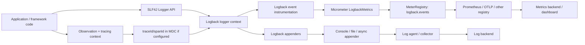

# Logback Metrics

A Spring Boot service is handling normal traffic when dashboards suddenly show a spike in `ERROR` events. Operations needs to know when the error log rate began rising, whether it correlates with a recent deployment, and whether users are impacted or a dependency is merely retrying. **Logback metrics** quantify **how many log events are emitted per severity level**, helping select the time window and components to inspect further with logs and distributed tracing.

The **Logback metrics** lesson belongs to the **Application metrics** chapter in the **SPRING_BOOT_OBSERVABILITY** module. The module aims to set up observability in Spring Boot using **Micrometer Observation, metrics, logs, and distributed tracing**, covering context propagation, tags/cardinality, exporters, sampling, and signal correlation to investigate errors, latency, and application behavior in real environments. Here we focus on a specialized application metric: **counting Logback logging events**, distinguishing it from detailed log records, HTTP 5xx rates, and business outcomes.

> **Keep in mind:** When Spring Boot uses Logback with compatible Micrometer/Actuator configuration, auto-configuration can register the **`logback.events`** metric with a **`level`** tag. This metric reports **log event counts** by level; it does not directly tell you how many distinct exceptions occurred, how many requests failed, how many users were affected, or whether logs were successfully stored by a log collector.

## 1. Learning objectives

After this lesson, you will be able to:

1. Explain how Logback, SLF4J, Micrometer `LogbackMetrics`, `MeterRegistry`, and Spring Boot Actuator work together.
2. Distinguish **log event count** from HTTP error rate, business failure rate, exception count, and records delivered to a backend.
3. Read and interpret `logback.events` across `level=trace/debug/info/warn/error`.
4. Configure logging levels and metrics endpoints appropriately, and verify the metric via Actuator and Prometheus.
5. Write PromQL queries to calculate `WARN/ERROR` log rates, choose alert thresholds from baselines, and correlate against traffic.
6. Avoid duplicate `LogbackMetrics` registration, high-cardinality ID tags, and sensitive data leaks via logging.
7. Distinguish Logback, Log4j2, and other logging backends so you do not search for the wrong metric name.
8. Investigate an `ERROR` log spike by combining metrics, logs, traces, dependencies, and exporter/collector health.

## 2. Where do Logback metrics sit in the logging flow?



There are **two output branches** from the same logging call:

- **Metrics branch:** instrumentation counts log events by level and stores them in `MeterRegistry`. The metrics backend provides totals, rates, and trends.
- **Logs branch:** Logback appenders format and write event payloads; a collector or agent forwards records to a log backend for querying by timestamp, service, trace ID, and message.

Seeing `logback.events{level="error"}` counts **does not prove** the log backend received those records. A collector could fail, an async buffer could overflow, file rotation could misbehave, or records could expire due to retention.

Conversely, seeing no metric does not prove no logs exist: the registry might lack instrumentation, the metrics endpoint might be disabled, or the exporter might be failing. Verify each branch independently.

### 2.1 Roles of components

| Component | Role | Notes |
|---|---|---|
| **SLF4J** | Logging API typically called by application code. | Not a metrics registry. |
| **Logback** | Default logging implementation in Spring Boot when keeping default logging starter. | Has logger hierarchy, effective levels, filters, and appenders. |
| **`LogbackMetrics`** | Micrometer binder observing and counting Logback events. | Auto-configured by Spring Boot when conditions are met. |
| **`MeterRegistry`** | Manages the `logback.events` metric and passes it to exporters. | Does not store messages or stack traces of events. |
| **Actuator `metrics`** | Diagnostic endpoint for meter names and measurements in the app. | Must be exposed and secured. |
| **Prometheus/metrics backend** | Samples/stores time series for rate calculation and alerting. | Can miss data if scraping fails. |
| **Log collector/backend** | Stores and searches detailed log records. | Independent transport path from Prometheus. |

## 3. What exactly does `logback.events` count?

`logback.events` represents **the number of log events passing through Logback instrumentation** measured by Micrometer, grouped by `level`. Common Logback levels include:

| Level | Typical meaning | When is it useful? |
|---|---|---|
| `TRACE` | Very granular diagnostic details. | Reproducing issues in controlled environments. |
| `DEBUG` | Detailed development/troubleshooting info. | Inspecting execution branches or dependency interactions. |
| `INFO` | Normal, noteworthy operational events. | Startup, shutdown, job outcomes, or meaningful state transitions. |
| `WARN` | Unusual conditions, retries, fallbacks, or risks to watch. | Spotting system degradation before major failures occur. |
| `ERROR` | Notable failures recorded by code or framework. | Selecting timestamps/log sources to inspect exceptions and dependency failures. |

**Logback has no separate `FATAL` level like Log4j2**. When an application uses Log4j2, the auto-instrumented metric is typically named `log4j2.events` instead of `logback.events` and may have a different set of levels. Never guess the logging implementation solely from web dependency names; check the classpath and runtime.

### 3.1 Effective logging level determines which events are produced

Suppose package `com.example.checkout` has effective level `INFO`:

```java
logger.trace("trace details");        // Disabled at INFO level.
logger.debug("debug details");        // Disabled at INFO level.
logger.info("checkout started");      // Recorded.
logger.warn("payment is slow");       // Recorded.
logger.error("payment failed");      // Recorded.
```

Per Micrometer documentation, when a Logback logger is at `INFO`, `WARN` and `ERROR` logs are counted, whereas `DEBUG` is filtered out by level configuration and does not increment its counter. Actual behavior can also depend on how loggers, filters, and instrumentation are configured in your version.

**Do not compare event counts across two releases if log levels changed without noting it.** Simply enabling `DEBUG` can spike total logs sharply even when business traffic and error rates are unchanged.

### 3.2 One request can emit multiple log events

A single failed HTTP request might log:

```text
WARN  - Retrying payment authorization after timeout
WARN  - Retrying payment authorization after timeout
ERROR - Payment provider unavailable after all retries
ERROR - Checkout operation failed
```

For this one request, instrumentation may increment **2 WARN + 2 ERROR**. Therefore:

- **4 log events** does not mean 4 failed requests.
- **2 ERROR events** does not mean 2 independent exceptions.
- If errors are re-logged at multiple layers, counts can exceed the number of affected transactions.

Conversely, a service can return HTTP 500 without logging `ERROR` if handlers/frameworks are configured differently, or a valid business rejection can occur without any exception. Treat `logback.events` as a **supporting signal**.

### 3.3 The counter does not store messages or stack traces

`logback.events` does not contain:

- Message text, stack traces, method arguments, or request bodies.
- Which downstream service actually caused an error.
- `traceId`, `spanId`, or any individual transaction ID.
- How many logs Elasticsearch/Loki/OTLP collectors actually ingested.
- Request processing time or span duration.

To answer those questions, use the appropriate logging, tracing, or metrics systems.

## 4. Micrometer `LogbackMetrics` and meter type

Micrometer provides the `io.micrometer.core.instrument.binder.logging.LogbackMetrics` binder. When `bindTo(MeterRegistry)` is called, it integrates Logback logging events with the metrics registry.

Per current Micrometer API/documentation, `logback.events` measurements can be read via **`FunctionCounter`**:

```java
double warn = registry.get("logback.events")
        .tag("level", "warn")
        .functionCounter()
        .count();
```

Some older docs/versions illustrate looking it up via `counter()`. Choose the API matching your application's **actual dependency version**; never register a new Counter named `logback.events` merely to make a `counter()` lookup succeed. Check the meter type first.

**Why does `FunctionCounter` make sense?** It reads a cumulative count function from the instrumented object. Micrometer exports this measurement in the appropriate format for each backend, such as a cumulative counter for Prometheus. It differs from a `Gauge` (which can rise or fall) and a `Timer` (which measures durations).

### 4.1 `LogbackMetrics` is a `MeterBinder` with a lifecycle

`LogbackMetrics` implements `MeterBinder` and supports lifecycle cleanup. Per Micrometer docs, the binder can be instantiated in standalone environments:

```java
LogbackMetrics logbackMetrics = new LogbackMetrics();
logbackMetrics.bindTo(registry);
```

If code manages the binder manually outside Spring's lifecycle, call `close()` when done to detach related resources/listeners/registrations. **Do not add this manual binder creation into a Spring Boot app that already has Logback metrics auto-configured.**

In Spring Boot, the binder is normally created and managed by the application context, so prefer configuring and using the default metric. Binding twice onto the same logger context risks double-counting or unpredictable state across registries.

### 4.2 The default tag is typically `level`

The `logback.events` meter can have series for these level values:

```text
logback.events{level="trace"}
logback.events{level="debug"}
logback.events{level="info"}
logback.events{level="warn"}
logback.events{level="error"}
```

Logback level/tag values in Micrometer are typically lowercased. Some levels may have `count=0` or be absent depending on timing, backend, and version. Read **`availableTags`** from Actuator rather than assuming every series is always created.

By default, `logback.events` is **not a separate counter per logger class, request, user, or trace ID**. This keeps series counts bounded. To analyze logs from a specific package, query log records by logger name in the log backend or design a separate business metric instead of arbitrarily adding dynamic `loggerName` tags to all counters.

## 5. Enabling Logback metrics in Spring Boot

Spring Boot Actuator can **auto-configure logger event metrics** for Logback or Log4j2 when the required framework and dependencies are present. In a Spring Boot application using default Logback and Micrometer, you normally **do not need a manual `LogbackMetrics` bean**.

### 5.1 Gradle dependencies

Assuming the project already has the Spring Boot plugin, dependency management, and appropriate web starter:

```groovy
dependencies {
    implementation 'org.springframework.boot:spring-boot-starter-actuator'
    runtimeOnly 'io.micrometer:micrometer-registry-prometheus'
}
```

- Actuator/Micrometer provides instrumentation and `MeterRegistry`.
- The Prometheus registry exposes metrics at `/actuator/prometheus`.
- Spring Boot normally uses Logback with the default logging starter; if the project switches to Log4j2 or another logging backend, the metric name and binder change.
- These dependencies **do not automatically provision a trace backend or log collector**.

Web/tracing starters may differ between Spring Boot 3.x and 4.x; this section focuses only on metrics-related dependencies and assumes a working base application.

### 5.2 Configuration for a learning environment

```yaml
spring:
  application:
    name: checkout-service

logging:
  level:
    root: INFO
    com.example.checkout: INFO

management:
  endpoints:
    web:
      exposure:
        include: "health,info,metrics,prometheus,loggers"
  metrics:
    tags:
      application: checkout-service
      environment: local
```

In real environments, only expose `health`, `metrics`, `prometheus`, and `loggers` when genuinely needed. In particular, `/actuator/loggers` can alter runtime logging configuration if write access is enabled; protect it with proper network and authorization controls and never expose this control endpoint publicly.

`management.metrics.tags.*` adds stable labels like application/region/environment. Never put `traceId`, `userId`, `orderId`, or raw URLs in common tags.

### 5.3 Actuator metrics endpoint

Once the application is running:

```bash
# Inspect the list of meter names.
curl http://localhost:8080/actuator/metrics

# View aggregate measurements and availableTags for Logback.
curl http://localhost:8080/actuator/metrics/logback.events

# Filter specifically for WARN and ERROR levels.
curl "http://localhost:8080/actuator/metrics/logback.events?tag=level:warn"
curl "http://localhost:8080/actuator/metrics/logback.events?tag=level:error"

# View series after the exporter applies naming conventions.
curl http://localhost:8080/actuator/prometheus
```

`/actuator/metrics` uses the Micrometer meter name **`logback.events`**. Prometheus may display the converted series name **`logback_events_total`**, though you should verify directly from exporter output since names/suffixes depend on version and implementation.

### 5.4 An illustrative Actuator response

```json
{
  "name": "logback.events",
  "measurements": [
    { "statistic": "COUNT", "value": 123.0 }
  ],
  "availableTags": [
    {
      "tag": "level",
      "values": ["info", "warn", "error", "debug", "trace"]
    }
  ]
}
```

This is **illustrative JSON showing data semantics**, not live output from a project. Actual tags, measurements, and counts depend on registry, version, and emitted events. Adding `tag=level:error` returns measurements for that filtered subset.

## 6. Logging example in Spring Boot business code

A payment service might log milestones and error branches as follows:

```java
import org.slf4j.Logger;
import org.slf4j.LoggerFactory;
import org.springframework.stereotype.Service;

@Service
public class PaymentApplicationService {

    private static final Logger log =
            LoggerFactory.getLogger(PaymentApplicationService.class);

    private final PaymentGateway gateway;

    public PaymentApplicationService(PaymentGateway gateway) {
        this.gateway = gateway;
    }

    public boolean authorize(PaymentRequest request) {
        log.debug("Starting provider authorization");

        try {
            boolean accepted = gateway.authorize(request);
            if (!accepted) {
                log.info("Authorization declined by provider");
            }
            return accepted;

        } catch (ProviderTemporarilyUnavailableException failure) {
            log.warn("Provider temporarily unavailable; request may retry");
            throw failure;

        } catch (RuntimeException failure) {
            log.error("Unexpected authorization failure", failure);
            throw failure;
        }
    }
}

// The types below are illustrative contracts for this example.
interface PaymentGateway {
    boolean authorize(PaymentRequest request);
}

record PaymentRequest(String orderReference) {}

class ProviderTemporarilyUnavailableException extends RuntimeException {
    ProviderTemporarilyUnavailableException(String message) {
        super(message);
    }
}
```

When the effective level is `INFO`:

- `log.debug(...)` normally emits no event, so `level=debug` does not increment.
- A business-contract payment decline may emit `INFO`, **not necessarily `ERROR`**.
- `ProviderTemporarilyUnavailableException` emits `WARN` because the service expects to retry or handle it per policy.
- Unexpected errors emit `ERROR`; if an upstream caller also logs the same exception at ERROR level, one request can increment multiple error events.

The sample omits `request.orderReference()` from logs because it may be a controlled business identifier. To correlate an incident, rely on trace context and logging policies, collecting only permitted data.

**Operations:** Never intentionally throw fake exceptions or spam `ERROR` logs in production just to "test metrics." Test locally or through narrowly scoped tests.

## 7. Standalone experiment with `LogbackMetrics`

To clearly observe the binder and `FunctionCounter` in action, you can use `SimpleMeterRegistry` in a **separate standalone test program**, outside Spring Boot auto-configuration.

The snippet below assumes a JVM with only one active `LogbackMetrics` binder during the test:

```java
import ch.qos.logback.classic.Level;
import ch.qos.logback.classic.Logger;
import io.micrometer.core.instrument.binder.logging.LogbackMetrics;
import io.micrometer.core.instrument.simple.SimpleMeterRegistry;
import org.slf4j.LoggerFactory;

public final class LogbackMetricsDemo {

    public static void main(String[] args) {
        try (SimpleMeterRegistry registry = new SimpleMeterRegistry();
             LogbackMetrics binder = new LogbackMetrics()) {

            binder.bindTo(registry);

            Logger logger = (Logger) LoggerFactory.getLogger(
                    "sample.logback.metrics");
            Level previous = logger.getLevel();
            logger.setLevel(Level.INFO);

            try {
                double before = registry.get("logback.events")
                        .tag("level", "warn")
                        .functionCounter()
                        .count();

                logger.debug("This is below INFO");
                logger.warn("One demonstration warning");

                double after = registry.get("logback.events")
                        .tag("level", "warn")
                        .functionCounter()
                        .count();

                System.out.println("New WARN events: " + (after - before));
                // In an isolated test environment, expected increase is approximately 1.
            } finally {
                logger.setLevel(previous);
            }
        }
    }
}
```

**Takeaways:**

1. `LogbackMetrics` registers per-level meters with `SimpleMeterRegistry`.
2. Code takes the delta `after - before` rather than assuming the counter starts at 0 in a logger context that may already have logged events.
3. `DEBUG` is filtered out because the logger is at `INFO`; `WARN` is recorded.
4. `close()` on both the binder and registry is called at the end of `try-with-resources`.
5. If other threads concurrently emit `WARN`, the delta may exceed 1; isolate logging context for exact assertions.

**Version note:** Recent Micrometer docs demonstrate reading `logback.events` with `functionCounter()`; some older examples use `counter()`. This code targets the current binder/`FunctionCounter` API. Never cast awkwardly or register a duplicate counter in your app just to satisfy a test.

## 8. Reading trends via Prometheus and PromQL

Assume the exporter exposes `logback_events_total` with tag `level`. This is a **cumulative counter**; when the app restarts, the counter can reset. Use `rate(...)` or `increase(...)` rather than subtracting two arbitrary readings.

### 8.1 WARN/ERROR emission rate

```promql
# ERROR events/second across all selected instances.
sum(rate(logback_events_total{level="error"}[5m]))

# WARN events/second.
sum(rate(logback_events_total{level="warn"}[5m]))

# Estimated ERROR events over 10 minutes.
sum(increase(logback_events_total{level="error"}[10m]))

# ERROR rate by application, when the application tag exists.
sum by (application) (
  rate(logback_events_total{level="error"}[5m])
)
```

`logback_events_total` is an **illustrative name following Prometheus conventions**: before using in production, inspect actual series in `/actuator/prometheus`. If the backend exports `log4j2.events`, this query will be empty even while logging works.

### 8.2 Share of ERROR across all log events

```promql
sum(rate(logback_events_total{level="error"}[5m]))
/
sum(rate(logback_events_total[5m]))
```

This is the **ratio of ERROR events among log events**, **not** HTTP error rate or business failure rate. It can rise when:

- The app reduces INFO/DEBUG logs while ERROR count stays flat.
- A single error gets logged repeatedly due to retries.
- Log level changes alter total event volume.
- A third-party library suddenly logs more ERRORs.

Use this ratio only to observe logging composition or aid investigation, never as a default user-facing SLO. When the denominator is zero or tiny, the ratio becomes unstable; check absolute event rates and traffic.

### 8.3 Cross-checking HTTP 5xx and ERROR logs

With HTTP server metrics following Micrometer conventions, series may be named `http_server_requests_seconds_count`:

```promql
# HTTP 5xx request rate.
sum(rate(http_server_requests_seconds_count{status=~"5.."}[5m]))

# Ratio of HTTP 5xx to all requests.
sum(rate(http_server_requests_seconds_count{status=~"5.."}[5m]))
/
sum(rate(http_server_requests_seconds_count[5m]))
```

**The two charts answer different questions.** If `ERROR` logs climb while HTTP 5xx stays flat, it could be a background job, message consumer, handled retries, or newly added logging. If HTTP 5xx rises while Logback ERROR stays flat, the app might not log errors at that layer or the framework handles exceptions under a different policy.

Do not divide "ERROR logs / HTTP requests" as a standard error ratio unless you have established how many ERROR events one request produces.

## 9. Alerting: when is log rate alarming?

An alert based solely on `logback_events_total{level="error"} > 0` is usually far too noisy. Many systems have known operational errors, retries, or noisy third-party library logs. Define a **baseline**, evaluation window, and desired severity.

Example alert expression on **ERROR event rate**:

```promql
# Example: > 2 ERROR events/second over a 5-minute window.
sum by (application) (
  rate(logback_events_total{level="error"}[5m])
) > 2
```

The threshold `2` is **illustrative only**, not a universal target. A service handling 100,000 requests/sec has completely different log volume and requirements than one handling 5 requests/minute.

Good alert design usually considers simultaneously:

- **Rate and absolute increase:** did WARN/ERROR rate exceed baseline?
- **Blast radius:** one instance or the whole service? Does it coincide with a rollout?
- **Service quality:** are 5xx, p95/p99 latency, queue backlog, timeouts, or error budget affected?
- **Business signals:** did payment declines, job failures, dead-letter messages, or transaction success rates shift?
- **Telemetry health:** are collectors/scrapers recording properly, or is data missing due to pipeline failures?

A team may emit a WARNING when log events spike without affecting SLOs, and escalate more urgently when HTTP 5xx/latency/business failures degrade at the same time. Tune this operational policy to your system.

### 9.1 Raising DEBUG/INFO should not trigger an ERROR incident

When switching `logging.level` from INFO to DEBUG during investigation, higher total log volume is not necessarily an incident. If an alert watches ERROR ratio over **total log events**, surging DEBUG logs can artificially depress the error ratio even while ERROR counts stay unchanged. Track absolute ERROR rate alongside traffic for context.

## 10. Log levels, Logback filters, and countability

Logback logging is shaped by multiple configuration layers:

1. Logger hierarchy and **effective logging level**.
2. SLF4J API and log-event construction logic.
3. Any configured TurboFilters or appender filters.
4. Appenders and async appenders with filtering, discarding, or buffering behavior.
5. Collectors/agents and ingest/retention policies.

**Do not equate counted events with stored records.** An appender can drop an event already observed by instrumentation. Conversely, a collector may re-ingest/duplicate records on retries, making backend log record counts higher than in-process emitted events.

### 10.1 Configuring levels in `application.yml`

```yaml
logging:
  level:
    root: INFO
    com.example.checkout: DEBUG
    org.springframework.web: WARN
```

- Root `INFO` keeps most DEBUG logs off.
- Package `com.example.checkout` enables DEBUG for targeted troubleshooting.
- Loggers under `org.springframework.web` emit only WARN and above per this configuration.

Never leave DEBUG/TRACE enabled indefinitely in production, as it increases I/O, CPU, network, ingestion cost, and risks logging sensitive data.

### 10.2 Actuator `loggers` vs. `metrics`

`/actuator/loggers` displays **configured levels** and **effective levels** of loggers and can mutate levels at runtime if write access is enabled:

```bash
# Inspect loggers (when endpoint is exposed and authorized).
curl http://localhost:8080/actuator/loggers

# Inspect a specific logger/package.
curl http://localhost:8080/actuator/loggers/com.example.checkout
```

`/actuator/loggers` is not where you read `logback.events`; it is used to verify why DEBUG emits no events or why log volume jumped after a change. Protect the loggers control endpoint carefully, because enabling DEBUG can expose sensitive internal data.

### 10.3 Async appenders and discarding

Logback's `AsyncAppender` has buffers, discard thresholds/policies, and varying behavior per configuration. Logback metrics are **not an acknowledgment** that records were durably written or reached the centralized backend. When suspecting missing logs:

- Check appender buffer pressure and discard policy.
- Check disk/stdout and file rotation.
- Check collector queues, parsing errors, retries, and export status.
- Compare timestamps and ingress/egress stats if the log pipeline exposes its own metrics.

Relying solely on `logback.events` to claim "no logs were lost" lacks evidence.

## 11. How Logback metrics, logs, and traces complement each other

Suppose checkout throws many errors after a rollout:

```text
Metrics:
  logback.events{level="error"} spikes at 10:05
  http.server.requests{status="500"} spikes at the same time
  hikaricp.connections.pending also rises

Logs:
  ERROR - SQLTransientConnectionException: connection unavailable
  traceId=4bf92f3577b34da6a3ce929d0e0e4736

Trace:
  HTTP POST /checkout
    └── inventory.reserve
         └── JDBC request / database access
```

How to combine them:

1. **Logback metrics** pinpoint when error log volume spiked.
2. **HTTP/connection pool metrics** show which API and resource are affected.
3. **Logs** provide the exact exception and message, if collected.
4. **Distributed tracing** reveals the call path and slow/incomplete spans, if tracing instrumentation is active and sampling retained a trace.
5. **Post-remediation metrics** confirm errors, latency, and pool pressure returned to acceptable levels.

`traceId` can appear in logs when Micrometer Tracing and MDC correlation are configured, yet `logback.events` **does not automatically carry trace IDs**; never add trace ID as a tag to link individual events, as cardinality will explode.

### 11.1 Sampling does not reduce log event counters proportionally

Suppose trace sampling is 10%: only a fraction of traces are kept. Logback metrics still count logging events passing through instrumentation according to logging rules, rather than dropping to 10% because of the tracing sampler. However, separate application or collector **logging sampling/rate-limiting** policies can affect event/record counts at different stages.

### 11.2 Logback counters are not business exception counters

An exception that is thrown and caught without logging produces no ERROR event. A business decline that throws no exception may emit only INFO or nothing at all. To measure contract-level business failures, create a dedicated Counter or Observation:

```java
Counter.builder("checkout.authorization.result")
        .tag("outcome", "declined")
        .register(meterRegistry)
        .increment();
```

This measures the **exact business event**, while `logback.events` only measures logging events. The two complement each other during incident triage without replacing one another.

## 12. Controlling cardinality and security

By default, grouping `logback.events` by `level` produces a small, useful tag set. Risk arises when teams extend metrics with arbitrary dimensions.

| Metadata | Attach to metrics? | Notes |
|---|---|---|
| `level=warn/error/info` | Yes | Small, stable set. |
| `application=checkout-service` | Yes, as common tag | Distinguishes services. |
| `environment=prod/staging` | Yes | Bounded set. |
| `region=ap-southeast-1` | Yes, when needed | Keep region set controlled. |
| `logger=...` | Caution | Logger class count can be large and shifts with dependencies. |
| `exception.class` | Caution | Can raise cardinality; not a default Logback metrics tag. |
| `traceId` / `spanId` | No | Nearly unique per request. |
| `userId` / `orderId` | No | Explodes series and may be sensitive. |
| Raw `message` / exception string | No | May contain personal data or dynamic IDs. |

Never embed message text, stack traces, or raw exception strings in metric names or tags. If you want error counts grouped by failure category, build a **business counter with a bounded `reason` set** such as `db_unavailable`, `timeout`, `validation`; keep detailed diagnostics in logs/traces under proper access controls.

### 12.1 Sensitive data in logs remains an independent risk

Having Logback metrics only count events **does not protect** log payloads themselves. Never log:

- Passwords, access tokens, API keys, session cookies.
- Payment card numbers or personal identifiers without a valid need.
- Sensitive full request/response bodies.
- Query strings/URLs containing secrets.

Design log masking, retention, access controls, and data classification separately. Metrics are aggregates; logs contain specific details requiring independent governance.

## 13. Avoid recreating `logback.events` and avoid logging loops

Spring Boot already wires the Logback binder when auto-configuration applies. Do not add:

```java
// Do not do this in an application with Logback auto-instrumentation.
registry.counter("logback.events", "level", "error").increment();
```

because:

- This is a manual counter rather than the Logback binder's meter; it can conflict on meter ID/type.
- If both the binder and a custom counter record the same event, dashboards double-count.
- Business code cannot capture every framework/library logger reliably.

If you want to count business failures under a dedicated name, use `checkout.authorization.failure` or `order.processing.result` with clear semantics.

### 13.1 Distinguishing `LoggingMeterRegistry` from `LogbackMetrics`

Similar names, **opposite data flow**:

| Component | Data flow | Purpose |
|---|---|---|
| **`LogbackMetrics`** | **Logging events → metrics** | Counts Logback events by level. |
| **`LoggingMeterRegistry`** | **Metrics → logger output** | Periodically logs metric values, handy locally/for debugging without a backend. |

Combining them without understanding the loop means logs emitted by `LoggingMeterRegistry` can also affect Logback event counts measured by `LogbackMetrics`, polluting stats. In production, use proper metric exporters rather than sending all metrics back into logs and counting logs again.

### 13.2 Auto-configuration and custom binders

If you need to alter how Logback is instrumented in a special application, check:

1. Did Spring Boot already register a `LogbackMetrics` binder bean?
2. Is the runtime logging backend actually Logback or Log4j2?
3. Is a shared library or test config registering a manual binder?
4. Do registries share the same logging context and meter IDs?
5. Is binder lifecycle closing managed cleanly?

Do not disable auto-instrumentation or register duplicate beans without proof that the default setup falls short.

## 14. Investigation workflow: “ERROR logs jumped after deploy”

**Scenario:** After a 14:00 deploy, the ERROR rate jumped 8x. HTTP 5xx barely changed.

### Step 1 — Confirm a genuine rate increase

Query `sum(rate(logback_events_total{level="error"}[5m]))` and compare against at least one baseline window with similar load. Check for log level changes, logging implementation changes, metric names, and instance counts; never treat a single data point as a trend.

### Step 2 — Isolate service and deployment

If labels like `application`, `environment`, `region`, version, or instance exist, pinpoint which group rose. Align with rollout timestamps; avoid confusing scaled-out instance counts with higher per-request ERROR rates.

### Step 3 — Classify log types in the log backend

Search `ERROR` in that time window; group by exception class, controlled message templates, or logger class. Read the **content** to tell whether it is retries, timeouts, validation, cache misses, or database exceptions. `logback.events` alone cannot classify causes.

### Step 4 — Correlate with quality metrics

Inspect 5xx, request rate, p95/p99, HTTP client duration, pool pending counts, queue backlogs, and business metrics. If all remain healthy, error noise may stem from new logging or handled retries. If they degrade too, prioritize user impact.

### Step 5 — Trace specific executions

When logs carry `traceId`, open matching traces if retained by sampling and exporters. Inspect slow/errored spans and check propagation across HTTP clients, executors, or messaging; a missing trace does not prove the request never ran.

### Step 6 — Check log and metrics pipelines

When ERROR metrics climb yet log searches turn up empty, check Logback appenders, async queues, files/stdout, collector parsing/ingestion, and retention. When logs exist yet metrics stay flat, check the binder, effective level, meter filters, and metrics exporter.

### Step 7 — Verify after remediation

After rollback or code/config fixes, monitor ERROR rate, HTTP errors, latency, business outcomes, and saturation over the same scope. Never declare recovery just because DEBUG/ERROR logs dropped after silencing a log level.

## 15. Common troubleshooting table

| Symptom | Causes to check | Action |
|---|---|---|
| `/actuator/metrics/logback.events` returns 404 | Not using Logback, binder unregistered, endpoint not exposed, meter filtered. | Check logging backend, Actuator, registry, filters, and security. |
| Only `log4j2.events` appears | App runs Log4j2. | Use the exact meter name for the active implementation. |
| `level=debug` stays at 0 | Effective level is INFO/WARN/ERROR. | Inspect `logging.level.*` and `/actuator/loggers`. |
| ERROR ratio rises after enabling DEBUG | Log level changed while ERROR count may be unchanged. | Check absolute ERROR rate and traffic, not ratio alone. |
| Error logs exist, ERROR metrics missing | Missing binder, exporter error, logs from another process, or mismatched scope. | Verify same instance, binder, endpoint, and time range. |
| ERROR metric rises, logs missing | Appender/collector drop, filter, retention, or wrong query. | Check the log pipeline independently. |
| Actuator has `logback.events`, Prometheus missing | Registry/prometheus exposure/scrape target/wrong query name. | Check `/actuator/prometheus`, then Prometheus target. |
| Same event counted multiple times | Duplicate binder or multiple logger layers logging the same error. | Check binder ownership, logging stack, and double logging. |
| ERROR logs rise, HTTP 5xx stays flat | Background jobs, retries, handled exceptions, or changed log policy. | Cross-check logs/traces and business metrics rather than assuming HTTP failure. |
| Log metric has high series count | Custom tags with IDs, dynamic logger/message, uncontrolled common tags. | Standardize bounded tags; remove IDs from metrics. |
| PromQL lacks `logback_events_total` | Different naming convention/exporter or different backend. | Inspect actual exposition output rather than guessing. |
| Counter drops on restart | In-process counter reset. | Use `rate`/`increase` and watch per-instance labels. |
| Logs have trace ID, trace backend lacks trace | Sampling, exporter, retention, propagation, or query. | Debug the tracing pipeline; Logback metrics do not solve this. |

## 16. Hands-on verification and exercises

### 16.1 Controlled local verification

1. Run a Spring Boot app using Logback and Actuator.
2. Check `/actuator/metrics/logback.events` before emitting events.
3. In a local/test environment, invoke code that intentionally emits one `log.warn(...)` and one `log.error(...)`.
4. Query the endpoint again with `tag=level:warn` and `tag=level:error` to verify the count increased.
5. Change effective level from INFO to WARN in test, trigger `log.info(...)` and `log.warn(...)`, and observe the difference.
6. Open `/actuator/prometheus` to verify actual series names, then compute `rate` after multiple scrapes.
7. Trigger a test business error with a trace ID and compare log messages/traces to see how metrics omit payload details.

**Note while testing:** Logback counts may include events emitted concurrently by Spring or other framework threads. Do not require the total count to increase by **exactly one** in an app serving concurrent requests; use an isolated test context or contextual deltas.

### 16.2 Exercises

**Exercise 1 — What is counted?** A request logs 2 `WARN` and 3 `ERROR` events, yet the final HTTP response is 200. How does `logback.events` change? Must HTTP error rate necessarily rise?

**Exercise 2 — Effective level.** A logger is at `INFO`. Code calls `debug`, `info`, `warn`, and `error` once each. Which events can be counted, and why?

**Exercise 3 — Metric name.** An app includes Spring Boot Actuator but replaced Logback with Log4j2. Should you look for `logback.events` or `log4j2.events`? If neither appears, what should you check next?

**Exercise 4 — PromQL.** Write queries for ERROR events/second and ERROR events over 15 minutes, assuming `logback_events_total` exists. Explain why `rate/increase` should be used instead of subtracting counter values across restarts.

**Exercise 5 — Logs vs. requests.** ERROR log rate rises while HTTP 5xx ratio remains steady. List at least four hypotheses and how to test them using log records, business metrics, or tracing.

**Exercise 6 — Cardinality.** A developer wants to add a `traceId` tag to `logback.events` to locate every error log per request. Why is that dangerous? What correlation technique makes more sense?

**Exercise 7 — Log delivery.** Micrometer counts 100 new ERROR events, yet the log backend shows only 70 lines. Can we conclude Micrometer is wrong? Which log transport components must be checked?

**Exercise 8 — Binder ownership.** Spring Boot already auto-configures `LogbackMetrics`, yet a shared library also calls `new LogbackMetrics().bindTo(registry)`. What can happen, and what is a cleaner ownership model?

### 16.3 Answer hints

- Exercise 1: increments by 2 WARN and 3 ERROR events per instrumentation; HTTP 200 can still be counted as HTTP success.
- Exercise 2: INFO/WARN/ERROR are eligible; DEBUG is suppressed by the effective level.
- Exercise 3: look for Log4j2 metrics; verify Actuator, registry, logger implementation, security, exporters, and filters.
- Exercise 4: `sum(rate(logback_events_total{level="error"}[5m]))` and `sum(increase(logback_events_total{level="error"}[15m]))`.
- Exercise 5: background jobs, handled retries, log policy changes, double logging, non-HTTP library errors, or traffic timing differences.
- Exercise 6: nearly unique trace IDs explode cardinality; query the log backend by MDC trace ID and the trace backend by trace ID when available.
- Exercise 7: no, because the metric counts logging events rather than confirming pipeline delivery and storage; inspect appenders, buffers, collectors, parsing, retention, and time ranges.
- Exercise 8: risks duplicate instrumentation; let Spring Boot own the binder in the application context or configure a single explicit custom binder without leaving auto-binding active.

## 17. References

- [Spring Boot — Metrics / Logger Metrics](https://docs.spring.io/spring-boot/reference/actuator/metrics.html): logger event metrics auto-configuration, `logback.events`, and `log4j2.events`.
- [Micrometer — Logging Metrics Instrumentation](https://docs.micrometer.io/micrometer/reference/reference/logging.html): `LogbackMetrics`, `Log4j2Metrics`, levels, `FunctionCounter`, and lifecycle.
- [Micrometer — Counters](https://docs.micrometer.io/micrometer/reference/concepts/counters.html): counter semantics, rates, and function-tracking counters.
- [Micrometer — Registry](https://docs.micrometer.io/micrometer/reference/concepts/registry.html): `MeterRegistry`, simple/composite registries, and export.
- [Micrometer — Logging Meter Registry](https://docs.micrometer.io/micrometer/reference/implementations/logging.html): distinguishing `LoggingMeterRegistry` from `LogbackMetrics`.
- [Spring Boot — Loggers Endpoint](https://docs.spring.io/spring-boot/reference/actuator/loggers.html): viewing and managing configured/effective log levels.
- [Spring Boot — Logging](https://docs.spring.io/spring-boot/reference/features/logging.html): logging system, log levels, Logback config, and structured logging.
- [Spring Boot — Actuator Endpoints](https://docs.spring.io/spring-boot/reference/actuator/endpoints.html): endpoint exposure and security.
- [Prometheus — Query Functions](https://prometheus.io/docs/prometheus/latest/querying/functions/): `rate`, `increase`, and working with counters.

**Key takeaway:** `logback.events` answers **"how many Logback events did the application emit per level?"**. It does not directly answer "how many requests failed?", "which exception caused it?", or "how many lines did the log collector store?". Use log event metrics to spot trends, cross-check HTTP/business metrics to gauge impact, and open logs and traces to identify the root cause. Control logging levels, avoid duplicate binders, keep tags low-cardinality, and monitor both metrics export and log delivery pipelines.
