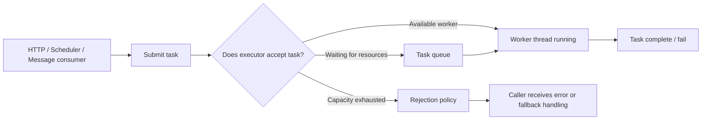
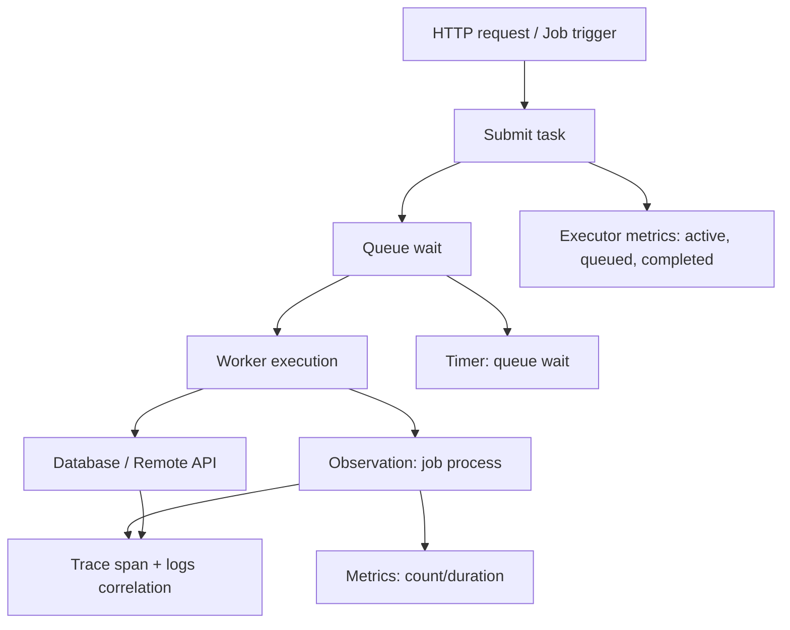

# Executor Metrics

A Spring Boot API receives report-generation requests and hands off work to `@Async`. Initially the API responds fast, yet as traffic climbs, the queue grows, some jobs take minutes just to start, and eventually `TaskRejectedException` appears. The dashboard only shows ~45% CPU, leading operations to think the server still has plenty of headroom. In reality, the bottleneck may sit in the **executor's thread pool and queue**, not necessarily in CPU.

**Executor metrics** provide visibility into worker thread busyness, completed tasks, queued tasks, and pool capacity/configuration. Within the **Application metrics** chapter of the **SPRING_BOOT_OBSERVABILITY** module, they add an important observability layer alongside HTTP metrics, logs, and distributed tracing. Executor telemetry is especially helpful for separating **queue wait time** from **execution time**, isolating saturation, rejections, deadlocks, timeouts, and context propagation issues in production.

After this lesson, you will be able to:

1. Explain common metrics such as `executor.active`, `executor.queued`, `executor.completed`, `executor.pool.size`, `executor.pool.core`, `executor.pool.max`, and `executor.queue.remaining`.
2. Understand when Spring Boot Actuator automatically instruments a `ThreadPoolTaskExecutor` and when you need to bind metrics manually for another `ExecutorService`.
3. Configure a clearly named executor with bounded threads and queue, then inspect metrics via Actuator or Prometheus.
4. Measure **queue wait time**, **execution time**, and **rejected tasks** separately when default metrics do not answer enough questions.
5. Write queries and design dashboards/alerts that account for pool size, queue capacity, throughput, and workload type.
6. Avoid pitfalls with `@Async`, unbounded queues, `CallerRunsPolicy`, virtual threads, and lost trace context across threads.
7. Correlate executor metrics with HTTP metrics, logs, and traces to investigate user-facing latency.

## 1. What is an executor and why monitor it?

In Java, an **executor** accepts a unit of work (task) and decides where and when to execute it. `ExecutorService` provides lifecycle management, task submission, and result retrieval; `ThreadPoolExecutor` is an implementation backed by a set of worker threads and a queue.

In Spring, `ThreadPoolTaskExecutor` is a common adapter for using `ThreadPoolExecutor` in applications. `@Async` can route method invocations to an executor, provided async support is enabled and calls pass through an appropriate proxy.

Conceptual execution flow:



For a `ThreadPoolExecutor` with a bounded queue, the flow is usually:

1. While workers are fewer than `corePoolSize`, the pool creates workers to execute tasks.
2. Once core workers exist, new tasks are typically placed in the queue.
3. When the queue is full, the pool scales workers up to `maximumPoolSize`.
4. When both queue and worker capacity are exhausted, the **rejection policy** decides what happens.

This is the fundamental `ThreadPoolExecutor` model; details vary by queue type, configuration, and executor implementation. Specifically, **`maxPoolSize` does not mean the pool will immediately spin up that many threads under load**. While the queue still accepts tasks, the pool may stay at core size. This explains why `maxPoolSize=32` can show `pool.size=4` while the queue grows steadily.

### 1.1. Which questions do executor metrics answer?

| Operational question | Useful metric | Meaning |
| --- | --- | --- |
| How many tasks are currently running? | `executor.active` | Busyness at measurement time |
| How many tasks are waiting? | `executor.queued` | Backlog pressure in the queue |
| How many workers currently exist in the pool? | `executor.pool.size` | Actual pool size, which may scale |
| What are core/maximum worker counts? | `executor.pool.core` / `executor.pool.max` | Configuration/capacity |
| How many more tasks can the queue accept? | `executor.queue.remaining` | Remaining queue capacity, if meaningful for the queue type |
| How many tasks have finished? | `executor.completed` | Cumulative completions; use rate of increase to estimate throughput |
| How long did tasks wait before starting? | **Custom queue-wait Timer** | Queueing time; not present by default on every executor |
| How many tasks were rejected? | **Custom rejection Counter** | Real overload policy impact; do not infer from a full queue |

Do not treat the names above as an exhaustive contract across every `Executor`. They are **common names** when Micrometer binders instrument eligible implementations. Exact names, tags, and Prometheus export depend on version, executor type, registry, and configuration.

## 2. Distinguishing Gauge, Counter, and Timer in executor metrics

Not all executor metrics have the same data semantics.

| Metric | Typical meter type | How to read | Pitfalls |
| --- | --- | --- | --- |
| `executor.active` | Gauge | Worker threads executing at scrape time | Instantaneous snapshot; can miss bursts |
| `executor.queued` | Gauge | Tasks waiting in the queue | Does not tell you how long each task has waited |
| `executor.pool.size` | Gauge | Existing worker threads | Not the count of busy workers |
| `executor.pool.core` | Gauge or configured measurement | Core thread level | Not the count of executing tasks |
| `executor.pool.max` | Gauge or configured measurement | Maximum thread limit | Not guaranteed throughput capacity |
| `executor.queue.remaining` | Gauge | Remaining slots in a bounded queue | May not be useful with unbounded queues |
| `executor.completed` | Counter/FunctionCounter | Cumulative completed tasks | Do not use raw value as throughput |
| `orders.task.queue.wait` | Custom Timer | Distribution of wait time before starting | Only measures tasks that reach execution start |
| `orders.task.execution` | Custom Timer | Execution time of the wrapped `Runnable` | Excludes wait time if started after dequeue |
| `orders.task.rejected` | Custom Counter | Rejected submissions per defined logic | `CallerRunsPolicy` may not throw a rejection exception |

### 2.1. A Gauge is a snapshot, not a history of every task

`executor.queued=20` at one instant means roughly 20 tasks were waiting when the queue was read. It does not reveal whether they waited 5 ms or 30 seconds. If tasks arrive and drain between two scrapes, you may **miss** queue peaks on the chart completely.

Therefore, seeing queue depth equal to 0 does not prove **no queueing occurred**. For latency-sensitive workflows, measure queue-wait distribution directly using a Timer or histogram across submit/start boundaries.

### 2.2. Completed does not mean successful

`executor.completed` normally counts tasks that finished running per executor semantics, including tasks that ended with an error depending on how the executor records completion. It does not represent **successful business orders**.

For a business success rate, create a dedicated semantic signal such as `orders.processing.outcome` via Micrometer Observation or a Counter/Timer tagged with `outcome=success|failure|rejected`. Never use `completed` as a success SLO numerator without verifying its definition.

### 2.3. Never use a Counter for queue depth

Queue depth goes up and down, so use a Gauge. Counters belong to monotonically increasing event totals, such as tasks submitted or tasks rejected. For completion totals, applying `rate(...)` to the counter yields tasks/second over a window—provided the metric is exported with proper counter semantics.

## 3. Configuring an explicit executor in Spring Boot

This example targets **Spring Boot 3.x** on Java 17+, with Spring AOP/async infrastructure and `spring-boot-starter-actuator`.

### 3.1. Creating a named `ThreadPoolTaskExecutor`

```java
import java.util.concurrent.ThreadPoolExecutor;
import org.springframework.context.annotation.Bean;
import org.springframework.context.annotation.Configuration;
import org.springframework.scheduling.annotation.EnableAsync;
import org.springframework.scheduling.concurrent.ThreadPoolTaskExecutor;

@Configuration
@EnableAsync
public class AsyncExecutorConfig {

    @Bean("ordersExecutor")
    public ThreadPoolTaskExecutor ordersExecutor() {
        ThreadPoolTaskExecutor executor = new ThreadPoolTaskExecutor();
        executor.setThreadNamePrefix("orders-");

        executor.setCorePoolSize(4);
        executor.setMaxPoolSize(8);
        executor.setQueueCapacity(50);
        executor.setKeepAliveSeconds(30);

        executor.setRejectedExecutionHandler(
                new ThreadPoolExecutor.AbortPolicy());

        return executor;
    }
}
```

These parameters are **lab examples**, not optimal values for every production system.

- `corePoolSize=4`: pool maintains/creates core workers per core policy.
- `maxPoolSize=8`: maximum worker limit for this pool configuration.
- `queueCapacity=50`: bounded waiting tasks; surfaces overload rather than accumulating an unbounded backlog.
- `AbortPolicy`: when no more tasks fit, submission fails with an exception; handle at the call boundary.
- `ordersExecutor`: stable bean name, useful for identifying the executor in metrics.
- `orders-`: thread prefix makes thread dumps and logs easier to read.

With `ThreadPoolTaskExecutor`, remember that the queue takes priority once core threads are busy. Until the queue fills up, `pool.size` may not expand toward `maxPoolSize` even while `queued` climbs. Do not misinterpret that as a metrics bug.

### 3.2. Using it in an `@Async` service

```java
import java.util.concurrent.CompletableFuture;
import org.springframework.scheduling.annotation.Async;
import org.springframework.stereotype.Service;

@Service
public class OrderExportService {

    private final OrderExportGateway gateway;

    public OrderExportService(OrderExportGateway gateway) {
        this.gateway = gateway;
    }

    @Async("ordersExecutor")
    public CompletableFuture<String> export(String orderType) {
        String location = gateway.generateExport(orderType);
        return CompletableFuture.completedFuture(location);
    }
}

interface OrderExportGateway {
    String generateExport(String orderType);
}
```

Calls to `export(...)` passing through an appropriate Spring proxy are dispatched to `ordersExecutor`. `gateway.generateExport(...)` runs on an executor worker thread.

Notes:

1. `@EnableAsync` and a properly named executor bean are required; writing `@Async` alone does not guarantee async execution.
2. Self-invocation (`this.export(...)`) inside the same class can **bypass the proxy**, running synchronously and leaving executor metrics unchanged.
3. `CompletableFuture.completedFuture(...)` here wraps the result computed **inside the async method**, not synchronous execution from the caller's viewpoint.
4. Do not rely solely on `@Async` for backpressure. If the queue fills, callers may get rejected on submission.
5. Task errors, cancellations, and timeouts must be handled at the business/caller layer and cannot be fully inferred from `executor.completed`.

## 4. How Spring Boot Actuator collects executor metrics

With Micrometer/Actuator present, Spring Boot can automatically bind metrics for supported executor beans such as `ThreadPoolTaskExecutor` or `ThreadPoolTaskScheduler`. In that case, the **bean name** is typically used to distinguish executors via a tag.

Practical prerequisites to verify:

- The executor bean exists and is Spring-managed.
- The executor type has metrics instrumentation in your active version.
- Micrometer `MeterRegistry` and auto-configurations are present.
- No `MeterFilter` drops or renames the meters.
- Metrics/scrape endpoints are enabled and reachable.

**Do not assume any `ExecutorService` created with `Executors.newFixedThreadPool(...)` is automatically instrumented by Boot**, especially when instantiated inline in business code or not registered as a recognized bean.

### 4.1. Dependencies and measurement config in Spring Boot 3.x

Maven, when the project uses Spring Boot dependency management:

```xml
<!-- Actuator, Micrometer metrics, and operational endpoints -->
<dependency>
    <groupId>org.springframework.boot</groupId>
    <artifactId>spring-boot-starter-actuator</artifactId>
</dependency>

<!-- Add only when exporting metrics to Prometheus -->
<dependency>
    <groupId>io.micrometer</groupId>
    <artifactId>micrometer-registry-prometheus</artifactId>
</dependency>
```

Example `application.yml`:

```yaml
management:
  endpoints:
    web:
      exposure:
        include: health,info,metrics,prometheus
  metrics:
    tags:
      application: order-service
      environment: lab
```

This is a **lab** configuration. Spring Boot auto-instruments eligible executors when conditions are met, though exact meter lists depend on implementation and Micrometer version. The Prometheus exporter only exposes data; a Prometheus server or compatible backend is required to scrape and retain history.

If the service uses Spring Boot 4.x, check the reference documentation for that exact version: some starters, auto-configurations, and properties differ from 3.x.

### 4.2. Checking meter names with Actuator

After running the app and submitting a few tasks:

```bash
curl -fsS http://localhost:8080/actuator/metrics
curl -fsS http://localhost:8080/actuator/metrics/executor.active
curl -fsS http://localhost:8080/actuator/metrics/executor.queued
curl -fsS http://localhost:8080/actuator/metrics/executor.completed
curl -fsS http://localhost:8080/actuator/prometheus
```

This assumes Actuator listens on port `8080` and the endpoints are exposed. If meters exist, `/actuator/metrics/executor.active` shows measurements and available tags, letting you identify the pool tag (e.g., executor name). Read exact tag keys/values from the response—**never guess**.

`/actuator/metrics` uses **Micrometer meter names**; `/actuator/prometheus` outputs names/units per Prometheus naming conventions. For example, `executor.active` may export as `executor_active_threads` when carrying the base unit `threads`; verify exact names in raw output.

**Security:** Operational endpoints can leak system configuration and load details; restrict network exposure, require authentication and authorization in production instead of exposing metrics publicly to the Internet.

## 5. Manually binding metrics to an `ExecutorService`

If you construct a `ThreadPoolExecutor` standalone, you can monitor it with **Micrometer `ExecutorServiceMetrics`**. There is no need to recreate individual Gauges if the binder already supports the implementation.

Example:

```java
import io.micrometer.core.instrument.MeterRegistry;
import io.micrometer.core.instrument.binder.jvm.ExecutorServiceMetrics;
import java.util.concurrent.ArrayBlockingQueue;
import java.util.concurrent.ExecutorService;
import java.util.concurrent.ThreadPoolExecutor;
import java.util.concurrent.TimeUnit;
import org.springframework.context.annotation.Bean;
import org.springframework.context.annotation.Configuration;

@Configuration
public class BackgroundExecutorConfig {

    @Bean(destroyMethod = "shutdown")
    public ExecutorService indexingExecutor(MeterRegistry registry) {
        ThreadPoolExecutor delegate = new ThreadPoolExecutor(
                4,
                8,
                30,
                TimeUnit.SECONDS,
                new ArrayBlockingQueue<>(50)
        );

        return ExecutorServiceMetrics.monitor(
                registry, delegate, "indexingExecutor");
    }
}
```

Meaning:

- Creates a `ThreadPoolExecutor` with a bounded queue for explicit resource limits.
- `ExecutorServiceMetrics.monitor(...)` instruments the executor appropriately and returns the wrapped executor for callers.
- The name `indexingExecutor` distinguishes it from `ordersExecutor`.
- The bean specifies `destroyMethod="shutdown"` so it stops accepting tasks cleanly on Spring context shutdown.

**Instrument each executor only once.** If Spring Boot already binds metrics to that bean, adding a manual binder under another name/tag creates duplicate metrics and skews dashboard counts. For specialized executor implementations, available metrics vary; never assume every executor has a queue or pool size.

### 5.1. ThreadPoolExecutor and schedulers do not share identical semantics

`ScheduledThreadPoolExecutor` schedules tasks by trigger time, and `ScheduledExecutorService` can periodically enqueue tasks itself. A scheduler's queue depth does not necessarily mean "how many business requests are backed up"; it can also hold tasks **waiting for their scheduled run time**.

A `ForkJoinPool` uses work-stealing mechanics distinct from `ThreadPoolExecutor`. When active, queued, and pool-size gauges are instrumented, interpret them according to the exact implementation. Do not build a dashboard using one universal utilization formula assuming every executor behaves identically.

## 6. Turning executor metrics into an operational narrative

Suppose an executor is configured with core=4, max=8, queue capacity=50. The dashboard reports:

| Observation | Illustrative value |
| --- | ---: |
| `executor.pool.core` | 4 |
| `executor.pool.max` | 8 |
| `executor.pool.size` | 8 |
| `executor.active` | 8 |
| `executor.queued` | 48 |
| `executor.queue.remaining` | 2 |
| `executor.completed` | Still climbing slowly |

This is a **strong sign of saturation**: all current workers are busy, the queue is nearly full, and throughput may be falling behind submission rate.

Still, do not conclude from a single snapshot. Ask further:

- How long has this state persisted? Is it just a multi-second spike?
- Is input rate exceeding completion rate over the same window?
- Are tasks running slowly due to CPU, I/O, locks, connection pools, or dependency timeouts?
- Are tasks being rejected, clients timing out, or latency SLOs breaching?
- Did deployment, thread/queue config, connection pools, or resource limits change?
- Is the pool using `CallerRunsPolicy`, pushing work onto HTTP threads?

### 6.1. Active/pool size is not “CPU utilization”

With 8 active threads in a pool, all 8 may be blocked waiting on database connections or network I/O. Overall CPU at 45% does not rule out thread pool saturation.

A reference ratio:

```text
worker occupancy ≈ active threads / current pool size
```

If `active=8` and `pool.size=8`, occupancy is 100% at read time. Yet that is **not** CPU utilization, nor directly "100% of business service capacity."

`active / maxPoolSize` is sometimes used to detect proximity to maximum workers, yet it is **insufficient** when the pool can still scale or the queue is congested. Always view queue depth, remaining capacity, throughput, and queue-wait latency together.

### 6.2. Relationship between input rate, completion rate, and queue

Over a long enough window, if average submission rate exceeds average completion rate, queued tasks tend to grow (ignoring rejections, cancellations, or offloaded work).

Example:

```text
Input rate        = 100 tasks/s
Completion rate   = 80 tasks/s
Difference        = 20 tasks/s
After ~2 seconds  = ~40 additional queued tasks
```

This is a simplified illustrative calculation, not an exact formula for every executor. Account for task cancellations, rejections, shifting task durations, batching, shutdowns, and metric sampling.

Steady growth in `executor.queued` is an early warning sign, whereas `rejected` may only spike after the queue is already full and the policy stops accepting tasks. By the time rejections surge, user experience may already have degraded.

### 6.3. Wait time can dominate end-to-end latency

An HTTP request might incur:

```text
Total request latency ≈
    HTTP processing
  + task queue wait
  + actual task execution
  + downstream waits
  + serialization / response overhead
```

Components can overlap if running concurrently, so the formula is a visual breakdown rather than an exact additive identity for every program.

If you place a Timer **inside** `Runnable.run()`, it typically measures only execution duration, excluding queue wait. When HTTP p95 climbs while task execution timers stay flat, **queue wait** is a primary hypothesis to test.

## 7. Measuring queue wait and execution time separately with Micrometer

Default executor metrics show **how many tasks are waiting**, not necessarily **how long each task waited**. To measure accurately, record timestamps at submission and when a worker actually starts.

Example dispatcher wrapping the `ThreadPoolTaskExecutor` declared in Section 3. It records three measurements:

- `orders.task.queue.wait`: duration from submission until the wrapped `Runnable` begins running.
- `orders.task.execution`: duration inside the `Runnable`.
- `orders.task.rejected`: count of submissions rejected under the active `AbortPolicy`.

```java
import io.micrometer.core.instrument.Counter;
import io.micrometer.core.instrument.MeterRegistry;
import io.micrometer.core.instrument.Timer;
import java.time.Duration;
import java.util.concurrent.TimeUnit;
import org.springframework.beans.factory.annotation.Qualifier;
import org.springframework.core.task.TaskRejectedException;
import org.springframework.scheduling.concurrent.ThreadPoolTaskExecutor;
import org.springframework.stereotype.Component;

@Component
public class MeasuredOrderDispatcher {
    private final ThreadPoolTaskExecutor executor;
    private final Timer queueWaitTimer;
    private final Timer executionTimer;
    private final Counter rejectedCounter;

    public MeasuredOrderDispatcher(
            @Qualifier("ordersExecutor") ThreadPoolTaskExecutor executor,
            MeterRegistry registry) {

        this.executor = executor;

        this.queueWaitTimer = Timer.builder("orders.task.queue.wait")
                .description("Time spent waiting in the executor queue")
                .publishPercentileHistogram()
                .serviceLevelObjectives(
                        Duration.ofMillis(50),
                        Duration.ofMillis(200))
                .register(registry);

        this.executionTimer = Timer.builder("orders.task.execution")
                .description("Time spent executing an order task")
                .register(registry);

        this.rejectedCounter = Counter.builder("orders.task.rejected")
                .description("Order tasks rejected during submission")
                .register(registry);
    }

    public void dispatch(Runnable task) {
        long submittedAtNanos = System.nanoTime();

        try {
            executor.execute(() -> {
                long waitingNanos =
                        System.nanoTime() - submittedAtNanos;
                queueWaitTimer.record(
                        waitingNanos, TimeUnit.NANOSECONDS);

                long startedAtNanos = System.nanoTime();
                try {
                    task.run();
                } finally {
                    executionTimer.record(
                            System.nanoTime() - startedAtNanos,
                            TimeUnit.NANOSECONDS);
                }
            });
        } catch (TaskRejectedException rejected) {
            rejectedCounter.increment();
            throw rejected;
        }
    }
}
```

**Branch breakdown:**

1. On successful submit, the task captures the initial timestamp. Once a worker starts executing, the Timer records wait duration.
2. The wrapper starts measuring execution right before `task.run()` and records duration in `finally` even if the task throws an exception.
3. If `ThreadPoolTaskExecutor` rejects submission with `TaskRejectedException` per policy, the Counter increments and the exception still propagates to the caller.
4. `System.nanoTime()` is suited for elapsed duration; never use `System.currentTimeMillis()` as the primary duration clock because wall-clock time can jump.

**Boundaries of this example:**

- The queue-wait Timer only records samples for **tasks that started running**. Rejected tasks never produce a queue-wait sample, hence the separate rejection Counter.
- `TaskRejectedException` is a Spring `TaskExecutor`-layer exception. With plain Java executors or other policies, catch the appropriate exception type and define rejection clearly.
- With `CallerRunsPolicy`, tasks may execute immediately on the submitter's thread; queue wait stays near 0 with no rejection exception. That does not mean the system is not overloaded.
- This example records duration for failed tasks as well, yet **does not count task failures**. For failure rates, add a bounded business outcome via a dedicated Observation/Counter.
- If tasks spawn further futures/async chains, the wrapper measures only **the submitted `Runnable`'s run time**, not necessarily the entire downstream async work. Choose instrumentation boundaries to match your goal.
- Never attach `orderId`, `userId`, or `traceId` as metric tags just to debug individual tasks.

### 7.1. Why use histograms for queue wait?

If most tasks wait 2 ms while 1% wait 3 seconds, average queue wait still looks low. Histograms expose p95/p99 and the fraction exceeding budgets like 200 ms.

`50ms`/`200ms` buckets fit workloads with tight latency budgets; for batch jobs lasting minutes, those thresholds make little sense. Choose buckets based on real workload SLAs and series cost.

With classic Prometheus histograms, example series may be named `orders_task_queue_wait_seconds_bucket`, `_sum`, and `_count`. Inspect raw `/actuator/prometheus` to verify exact names and bucket boundaries, as exporters normalize names differently.

## 8. Executor metrics in Prometheus and dashboards

With the Prometheus registry, Micrometer converts canonical meter names and base units per Prometheus conventions. Names below **illustrate** one common export format; always inspect raw series before building dashboards.

Typical series you might see:

```text
executor_active_threads{name="ordersExecutor", ...}
executor_queued_tasks{name="ordersExecutor", ...}
executor_pool_size_threads{name="ordersExecutor", ...}
executor_completed_tasks_total{name="ordersExecutor", ...}
```

The label name identifying the executor can vary by configuration/version. If `/actuator/metrics/executor.active` shows tag `name=ordersExecutor`, verify the matching label in Prometheus output.

### 8.1. Minimum dashboard

An executor dashboard should show together in one view:

| Group | Charts | Goal |
| --- | --- | --- |
| **Capacity** | Core, max, current pool size | Understand configured capacity and actual scaling |
| **Concurrency** | Active threads and active/pool size ratio | See busyness at sample time |
| **Backlog** | Queued tasks, queue remaining | Spot work accumulation |
| **Throughput** | Rate of completed tasks if counter | Compare against arrival rate |
| **Saturation** | Rejected tasks/sec | Know when tasks are turned away |
| **Latency** | p50/p95/p99 queue wait and execution time | Separate waiting from execution |
| **Service impact** | HTTP latency, `5xx`/timeouts, business failure rate | Know whether executor load impacts users |

### 8.2. Illustrative PromQL queries

**Active pool workers** when the actual series is named `executor_active_threads`:

```promql
executor_active_threads{name="ordersExecutor"}
```

**Completion rate**, if `executor_completed_tasks_total` exists with counter semantics:

```promql
sum(
  rate(
    executor_completed_tasks_total{name="ordersExecutor"}[5m]
  )
)
```

**Rejection rate** when the custom counter exports as `orders_task_rejected_total`:

```promql
sum(rate(orders_task_rejected_total[5m]))
```

**p95 queue wait** if the Timer has classic histogram buckets:

```promql
histogram_quantile(
  0.95,
  sum by (le) (
    rate(orders_task_queue_wait_seconds_bucket[5m])
  )
)
```

Result units for such timers are typically **seconds**. Remember to filter by `application`, `environment`, pool, and workload when one Prometheus server scrapes multiple services. Mixing different environments or pools produces a meaningless p95.

**Distribution note:** never average per-pod p95 values. When instances emit compatible histogram buckets, **sum bucket rates first**, then apply `histogram_quantile()` to estimate group p95.

## 9. When is an executor genuinely overloaded?

An executor should never be evaluated solely by a worker count threshold. Combine **saturation, backlog, latency, and user impact**.

### 9.1. Four classic scenarios

| Symptom | Hypothesis to verify | Next checks |
| --- | --- | --- |
| High active, high and rising queued, rising rejections | Clear saturation | Submit/completion rates, task duration, rejection policy |
| High active, low CPU, high task duration | Threads waiting on I/O/locks/dependencies | Traces, DB connection pools, HTTP client timeouts, thread dumps |
| Low active, high queued | Pool not scaling as expected or different scheduling/queue behavior | Core/max, queue type, thread factory, worker states |
| Low active, low queued, requests still slow | Bottleneck lies outside this pool | Gateway, network, DB, HTTP client, GC, other executors |

These are **hypotheses**, not automatic conclusions. In real systems with multiple thread pools, one pool may be completely healthy while another is congested.

### 9.2. Backpressure and rejection policies

When the queue is full, `ThreadPoolExecutor` invokes `RejectedExecutionHandler`. Common choices:

- **`AbortPolicy`:** rejects with an exception. Easy to detect and count cleanly if callers handle it properly.
- **`CallerRunsPolicy`:** the submitter runs the task itself while the executor stays active. Creates backpressure, yet can stretch HTTP request threads or message consumer threads without throwing rejection exceptions.
- **`DiscardPolicy` / `DiscardOldestPolicy`:** risks silently dropping work. Avoid for business workflows requiring delivery guarantees unless compensating reliability mechanisms exist.

Never treat raising `maxPoolSize` as a universal cure for overload. If tasks wait on a 10-connection database pool, raising workers to 200 merely queues 190 threads on the database while increasing memory, GC, and context-switching overhead.

### 9.3. Unbounded queues hide real limits

If an executor uses a virtually unbounded queue, it keeps accepting tasks even when throughput cannot keep up. Then:

- Rejections do not appear early.
- `executor.queued` climbs over time.
- Queue wait grows before explicit failures appear.
- Memory can exhaust as task objects and payloads pile up in the queue.

In production, size queue capacity, timeouts, retries/backoff, rejection handlers, and backpressure based on **downstream capacity** and task cost. Never use a "huge queue" as a substitute for capacity planning.

## 10. Connecting executor metrics with Micrometer Observation and tracing

Executor metrics describe **pool health**, while Micrometer Observation describes **an individual unit of work**. The two complement each other.



Suppose HTTP p95 latency climbs from 300 ms to 2 seconds. One possibility is:

1. `executor.queued` rises at the same time.
2. `orders.task.queue.wait` p95 jumps to 1.4 seconds.
3. `orders.task.execution` p95 stays around 200 ms.
4. A sample trace shows a long gap before the task begins executing.
5. Lowering input rate or fixing a downstream bottleneck restores both queue wait and HTTP latency.

This chain of evidence **narrows down the likely cause**: instead of optimizing a 200 ms handler function, inspect backpressure sources or executor capacity. However, traces only retain full context when instrumentation propagates properly across thread boundaries.

### 10.1. Trace context does not automatically follow tasks to worker threads

An `Observation.Scope` or active trace/span context on an HTTP thread is **not automatically** present on an executor worker thread. Without propagation, worker logs lack `traceId`, and custom task spans start brand-new traces disconnected from the parent HTTP span.

With Spring Framework 6.1+ (matching Spring Boot 3.2+ versions), consider `ContextPropagatingTaskDecorator` along with appropriate context propagation dependencies:

```java
import org.springframework.core.task.support.ContextPropagatingTaskDecorator;
import org.springframework.scheduling.concurrent.ThreadPoolTaskExecutor;

ThreadPoolTaskExecutor executor = new ThreadPoolTaskExecutor();
executor.setCorePoolSize(4);
executor.setMaxPoolSize(8);
executor.setQueueCapacity(50);
executor.setTaskDecorator(new ContextPropagatingTaskDecorator());
```

This snippet illustrates configuring `TaskDecorator`, not a standalone complete bean. `TaskDecorator` adds overhead; use it when context propagation is needed and verify compatible integration. On other framework stacks/versions, use corresponding Micrometer Context Propagation, Reactor Context, or built-in instrumentation mechanisms.

**Note:** Propagating trace context **does not** make the executor faster; it preserves accurate parent-child span relationships and log correlation. Never stuff tokens or entire domain objects into baggage just to "carry context."

### 10.2. Which boundaries should custom Observations measure?

There are two distinct measurements:

- **Wait time in the executor queue:** starts at submit, ends when the worker starts. Use a dedicated queue-wait Timer if needed.
- **Business execution time:** starts when the task actually runs, ends when defined work completes. You can create an Observation `orders.export.process` and wrap the synchronous worker body with `observe(...)`.

Example:

```java
Observation.createNotStarted("orders.export.process", observationRegistry)
        .lowCardinalityKeyValue("job.type", "order-export")
        .observe(() -> exportGateway.generate());
```

This example wraps **synchronous work inside the worker**. If `generate()` returns a `CompletableFuture` or `Mono`, `observe(...)` finishes as soon as the future/publisher is created rather than measuring the underlying async execution. Stop the observation at actual completion/cancellation matching the intended boundary.

If Spring Boot/the framework already instruments the HTTP request and HTTP client, avoid wrapping the exact same boundary in a redundant observation just to "have more spans." Pick meaningful business steps with stable names and low-cardinality key-values.

## 11. Virtual threads and executors without fixed pool sizes

In Java 21, **virtual threads** enable an execution model very different from traditional fixed thread pools. For example, `Executors.newVirtualThreadPerTaskExecutor()` can spawn a dedicated virtual thread per task rather than capping concurrency via platform worker counts in a `ThreadPoolExecutor`.

With Spring Boot 3.2+ and Java 21, configuring:

```yaml
spring:
  threads:
    virtual:
      enabled: true
```

can switch certain Spring Boot auto-configured executors/schedulers to virtual threads, depending on stack, version, and bean overrides.

**Do not mechanically apply traditional thread pool metrics like `executor.pool.core`, `executor.pool.max`, and `executor.queued` to a virtual-thread-per-task executor.** There is no bounded platform worker pool under the old semantics for those metrics to describe.

When using virtual threads, track metrics reflecting **real resource limits**:

- In-flight tasks (`inflight`) and application/transport-layer queues if any.
- Success/failure/rejection rates at real system boundaries.
- End-to-end latency from request arrival to completion.
- Connection pool usage, DB/HTTP client saturation, lock contention, and bounded resources.
- Java virtual-thread/runtime metrics supported by your JDK and instrumentation.

Virtual threads avoid tying up platform threads for eligible I/O workloads, yet **they do not make databases, downstream APIs, or memory infinite**. Enforce concurrency limits, timeouts, and backpressure at the actual bottleneck resources.

## 12. Designing useful alerts

An alert based solely on `executor.active > 5` creates noise: pools handle brief bursts and recover normally. Combine **sustained pressure duration**, **queue wait**, and **service impact**.

Example strategy:

| Alert goal | Illustrative condition | Action |
| --- | --- | --- |
| Sustained backlog | `queued` climbs steadily for 10 minutes | Check input rate, completion rate, and downstreams |
| Pool near capacity | `active` near `pool.size/max`, very little queue remaining | Check busyness, thread dumps, capacity |
| Active rejections | Rejected rate > 0 over a short window on a critical pool | Identify policy and caller impact |
| User-facing latency | Queue-wait p95 rises and HTTP latency SLO breaches | Prioritize triage due to customer impact |
| Stalled executor | Queue > 0 for an extended period with completed rate near 0 | Check deadlocks, dependencies, thread liveness |

Appropriate thresholds depend on workload. A batch executor handling multi-minute jobs cannot share the same p95 queue-wait threshold as a payment endpoint budgeted at 500 ms.

Additional notes:

1. Scope alerts by **pool name and application/environment** to avoid mixing unrelated executors.
2. Apply `rate(...)` only to metrics with counter semantics; never apply `rate` to a queue-depth Gauge.
3. Debounce with an appropriate evaluation window without making it so long that overload reactions come too late.
4. Alert on **missing/stale metrics pipeline**; never confuse absent series from a broken scrape with an idle pool.
5. Link directly to dashboards, traces/logs, and incident runbooks.

## 13. Runbook for investigating a congested executor

**Hypothetical scenario:** After deploying a report-export feature, `POST /reports/export` p99 climbs from 400 ms to 4 seconds. Users report slow jobs while CPU stays near 40%.

### Step 1 — Verify external impact

Inspect gateway/HTTP server latency, request rate, timeouts, and error rates. Never rely solely on executor metrics to decide whether user experience is degraded.

If the endpoint **immediately returns a job ID**, HTTP latency may stay low even while jobs sit in the queue for minutes; track **time from job submission to completion**, not just HTTP handler time.

### Step 2 — Select the exact executor

List executor beans in your architecture or dashboard and isolate `ordersExecutor` or the export pool. Do not aggregate all `executor.*` series together when pools differ in configuration and purpose.

Inspect:

- `pool.core`, `pool.max`, `pool.size`.
- `active` and `queued`.
- `queue.remaining` if bounded.
- `completed` rate and custom rejection rate.

### Step 3 — Separate waiting from running

If queue-wait p95 = 3 seconds and execution p95 = 200 ms, prioritize checking submission rate, capacity, and backpressure. If queue wait is low while execution p95 = 3 seconds, inspect dependencies, locks, blocking I/O, GC, or CPU.

Cross-check saved job traces and correlated logs. If worker traces are disconnected from parent HTTP spans, check task context propagation.

### Step 4 — Inspect downstreams and rejection policies

An exhausted HTTP client connection pool or saturated database pool can keep executor threads blocked waiting. Growing the executor may fail to relieve the bottleneck.

If `CallerRunsPolicy` is active, work may execute on request threads, degrading HTTP latency without throwing `TaskRejectedException`. If `AbortPolicy` is used, check whether callers retry too aggressively and trigger a **retry storm**.

### Step 5 — Verify after adjustments

After throttling input, optimizing downstreams, adjusting timeouts, or tuning pool/queue settings safely, confirm:

- Queue wait and queue depth drop.
- Rejection rate returns to acceptable levels.
- Completion throughput keeps pace with input.
- End-to-end HTTP/job latency improves.
- Business success/error SLIs and synthetic checks stabilize.

This is **multi-signal verification**, not merely seeing "fewer active threads than before."

## 14. Hands-on exercise: controlled load testing in a lab

Use a Spring Boot application with `ordersExecutor` as shown earlier. Never intentionally overload production or shared uncontrolled systems.

### Steps

1. **Setup:** Add Actuator and the Prometheus registry; expose endpoints in a safe lab environment. Confirm `executor.*` has the name/tag matching the `ordersExecutor` bean.
2. **Baseline:** Submit a few small tasks. Observe `active`, `queued`, `pool.size`, and `completed`; record idle and active values.
3. **Induce queueing:** Send a burst of simulated I/O tasks with short sleeps in the lab, exceeding core size and queue capacity. Watch the pool scale and queue depth climb.
4. **Test rejection:** With `AbortPolicy`, submit beyond capacity to observe exceptions and incrementing `orders.task.rejected` if wrapped as in Section 7.
5. **Measure queue wait:** Compare `orders.task.queue.wait` p95 with `orders.task.execution` p95. Explain why they diverge.
6. **Test policy:** Switch `AbortPolicy` to `CallerRunsPolicy` in the lab; confirm rejection exceptions disappear while caller threads stretch in duration.
7. **Verify context:** Trigger via a traced HTTP request, dispatch to the executor, and check worker logs for `traceId`/`spanId`; if missing, check `TaskDecorator`/context propagation.
8. **Simulate downstream bottleneck:** Constrain a simulated dependency connection pool and observe high active workers alongside modest CPU.
9. **Compare pool choices:** Increase max size while the queue is not yet full; explain why the pool does not immediately jump to max. Vary bounded queue capacity and observe the effect.
10. **Build a dashboard:** Create panels for capacity, concurrency, backlog, throughput, rejections, and queue-wait p95; add HTTP latency/errors for user perspective.

### Short analysis exercise

Suppose a dashboard over 5 minutes records:

```text
executor.pool.core     = 4
executor.pool.max      = 8
executor.pool.size     = 8
executor.active        = 8
executor.queued        = 50
executor.queue.remaining = 0
executor.completed rate  = 40 tasks/s
input rate               = 60 tasks/s
orders.task.rejected rate = 12 tasks/s
orders.task.queue.wait p95 = 2.5 seconds
CPU                     = 38%
```

**Question:** Can we conclude "CPU is low, so just add more threads"?

**Answer:** No. A full pool, full queue, rising rejections, and 2.5 s queue wait show the system **cannot keep up with incoming tasks**. Low CPU may happen because workers are waiting on I/O, locks, or dependencies. Inspect thread dumps, traces, downstream connection pools, timeouts, and retry policies before acting. Adding threads can overload dependencies even further.

**Question:** Why does `executor.completed` keep rising while users experience many errors?

**Answer:** Executor task completion does not equal business transaction success. Tasks can end via exceptions or fallbacks. Measure business success/error rates separately with domain semantics.

**Question:** Why might `executor.queued` read 0 on a dashboard even when occasional requests wait a long time?

**Answer:** Gauges are snapshots at scrape time and can miss short bursts. Inspect the queue-wait Timer/histogram, scrape frequency, and latency at request boundaries.

**Question:** If the application uses a virtual-thread-per-task executor, what should you monitor instead?

**Answer:** Do not apply `ThreadPoolExecutor` core/max/pool-size metrics directly. Track in-flight work, throughput, latency, errors/backpressure, and real resource caps like connection pools, CPU, and memory.

## 15. Principles to remember

- **Executor metrics report task-execution infrastructure health**, complementing HTTP request metrics and business metrics.
- **`active`, `queued`, `pool.size`, and `queue.remaining` are mostly snapshots**; read alongside time windows, completion rates, and rejections to understand trends.
- **Queue depth does not show queue wait time.** Where latency matters, measure submit-to-start and start-to-finish with dedicated Timers.
- **Do not confuse completed with success.** Completed tasks differ from successful business transactions; track business outcomes separately.
- **Spring Boot can auto-instrument eligible `ThreadPoolTaskExecutor` beans**, while standalone executors may need `ExecutorServiceMetrics`. Avoid instrumenting a pool twice.
- **Core/max and queue type govern scaling behavior.** Never assume max pool size equals active workers created immediately or solves every bottleneck.
- **Rejection policies shape overload symptoms.** `CallerRunsPolicy` slows callers; `AbortPolicy` throws rejection exceptions; monitor both properly.
- **Trace context must be propagated to workers.** Opening a scope on the request thread does not automatically preserve spans and log correlation on executor threads.
- **Use bounded tags—never attach IDs/PII/secrets to metrics.** Exporting via Actuator/Prometheus/OTLP must follow security policies.
- **Do not force legacy pool models onto virtual threads.** Measure real resource caps and actual executor workload.
- **Verify across multiple signals:** executor queues, task timers, HTTP latency, dependency metrics, logs, and distributed tracing separate root causes from symptoms.

### References

- [Spring Boot — Metrics (Actuator Reference)](https://docs.spring.io/spring-boot/reference/actuator/metrics.html)
- [Spring Boot — Observability](https://docs.spring.io/spring-boot/reference/actuator/observability.html)
- [Spring Framework — Task Execution and Scheduling](https://docs.spring.io/spring-framework/reference/integration/scheduling.html)
- [Micrometer — JVM and executor metrics](https://docs.micrometer.io/micrometer/reference/reference/jvm.html)
- [Micrometer — Timers](https://docs.micrometer.io/micrometer/reference/concepts/timers.html)
- [Micrometer Context Propagation — Reference](https://docs.micrometer.io/context-propagation/reference/)
- [Java SE — ThreadPoolExecutor](https://docs.oracle.com/en/java/javase/21/docs/api/java.base/java/util/concurrent/ThreadPoolExecutor.html)
- [Prometheus — Querying Functions](https://prometheus.io/docs/prometheus/latest/querying/functions/)
