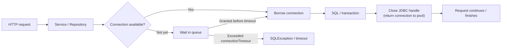
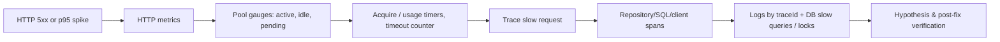
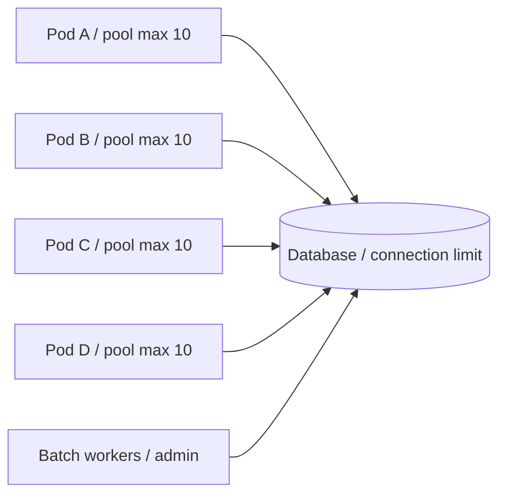

# Data Source Pool Metrics in Spring Boot

> **Chapter:** Application metrics  
> **Module:** `SPRING_BOOT_OBSERVABILITY` — setting up observability for Spring Boot using Micrometer Observation, metrics, logs, and distributed tracing; practicing context propagation, tags/cardinality, exporters, sampling, and signal correlation to investigate errors, latency, and application behavior in real environments.  
> **Focus:** Measuring and interpreting **JDBC DataSource connection pools**, especially HikariCP: active, idle, pending, pool limits, acquisition/usage duration, and timeouts; using Actuator, Prometheus, tracing, and logs to separate pool bottlenecks from database bottlenecks.

## 1. Learning objectives

After this lesson, you will be able to:

1. Describe the role of a JDBC `DataSource` and connection pool in a Spring Boot application; distinguish **active**, **idle**, **total**, **pending**, **maximum**, and **minimum** connections.
2. Recognize common `jdbc.connections.*` and `hikaricp.connections.*` meters; distinguish **Gauge**, **Timer**, and **Counter** along with unit semantics.
3. Enable Actuator and Prometheus, assign stable pool names, and inspect `/actuator/metrics` and `/actuator/prometheus` to verify actual meters.
4. Write PromQL queries for pool utilization ratio, threads waiting for connections, timeout rate, and mean/p95 acquisition time when histograms exist.
5. Distinguish waiting to borrow a connection, holding a connection, creating a connection, and SQL/database latency; avoid treating a single metric as conclusive proof of root cause.
6. Calculate connection budgets as replicas scale; handle common scenarios such as pool exhaustion, connection leaks, long transactions, lock contention, DB connection limits, and network issues.
7. Correlate pool metrics with HTTP latency/errors, traces, logs, and database metrics to form hypotheses, test them, and verify fixes.

## 2. Why monitor the DataSource connection pool?

Spring Boot applications using JDBC, `JdbcTemplate`, or JPA/Hibernate typically access databases through a `DataSource`. When the `DataSource` is pooled, the application **reuses** a pool of JDBC connections rather than opening a new TCP socket, authenticating, and initializing a session on every query.

A request needing the database typically flows through:



A **full pool** does not necessarily mean the database is out of CPU. A connection may be held by a slow query, a lock, a long transaction, code waiting on a remote API inside a transaction, or code failing to return the connection. Conversely, high active connections can be normal when traffic climbs and DB operations remain fast.

Monitoring the pool helps answer:

- How many connections are borrowed and how many remain ready?
- Are requests/threads waiting to borrow a connection?
- Is connection acquisition time rising, or are connections acquired fast and held too long?
- Are requests exceeding `connectionTimeout`, failing before SQL even runs?
- After scaling replicas, will total maximum connections exceed DB limits?
- Do pool bottleneck symptoms align in time with rising HTTP p95, SQL latency, and errors?

### 2.1. A pool is a bounded resource, not an infinite queue

HikariCP maintains connections up to `maximumPoolSize`. When all connections are borrowed, additional threads requesting a connection must wait. If `connectionTimeout` elapses with no connection available, borrowing fails.

**Distinct stages:**

| Stage | What happens | Measurable via |
|---|---|---|
| Before borrowing | Business code prepares to access the DB | HTTP/application observation |
| Waiting for pool | Pool may be full or creating/validating a connection | Connection acquisition timer, pending connections |
| Holding connection | JDBC code/transaction uses or holds the connection | Active connections, connection usage timer |
| Executing SQL | DB runs query/transaction/locks | DB query metrics, SQL instrumentation, traces, slow query logs |
| Returning connection | Code calls `close()` on pooled JDBC handle; pool reclaims it | Active decreases, idle may increase |
| Failed to acquire | Wait exceeded `connectionTimeout` | Hikari timeout counter, exceptions/logs |

In a pool, calling `Connection.close()` on the proxy normally **returns the connection to the pool** rather than closing the underlying TCP connection. This distinction is vital when investigating connection leaks and writing `try-with-resources` Java code.

## 3. Metric types to distinguish

Not every pool metric shares the same type. An accurate dashboard must match calculations to meter types.

| Type | Reflects | Pool examples | Common PromQL |
|---|---|---|---|
| **Gauge** | State at sample time; can go up or down | `active`, `idle`, `pending`, `max` | Current value, `avg_over_time`, `max_over_time` |
| **Counter** | Cumulative event count, rising over time and resetting on restart | `hikaricp.connections.timeout` | `rate()`, `increase()` |
| **Timer** | Duration distribution and measurement count | `hikaricp.connections.acquire`, `.usage`, `.creation` | `rate(_sum) / rate(_count)`, histogram p95 if present |
| **Application Timer** | Duration of a business operation | `http.server.requests` or custom `Observation` | HTTP/app p95, error/route dimensions |

A **Timer already includes count**; do not create a redundant Counter just to count acquires. A current Gauge is not a Counter, so never run `rate(active)` to infer requests/sec.

## 4. Connection pool gauges

For HikariCP, common Micrometer meters use the `hikaricp.connections` prefix. Spring Boot can also expose generic JDBC pool meters prefixed with `jdbc.connections`. **Exact meter availability depends on Spring Boot/Micrometer version, `DataSource` implementation, configuration, and platform access.**

### 4.1. Semantic mapping table

| Common Micrometer meter | Type | Meaning |
|---|---|---|
| `hikaricp.connections.active` | Gauge | Connections **currently borrowed** by the application |
| `hikaricp.connections.idle` | Gauge | Available connections not currently borrowed |
| `hikaricp.connections` | Gauge | Total connections currently managed by the pool at read time |
| `hikaricp.connections.pending` | Gauge | Threads currently waiting for a connection |
| `hikaricp.connections.max` | Gauge | Maximum connection limit reported by the pool |
| `hikaricp.connections.min` | Gauge | Minimum idle connections the pool targets |
| `jdbc.connections.active` | Gauge, if binder supports | Active metric via `DataSource` pool abstraction |
| `jdbc.connections.idle` | Gauge, if binder supports | Idle metric via `DataSource` pool abstraction |
| `jdbc.connections.max` | Gauge, if binder supports | Max limit via `DataSource` pool abstraction |
| `jdbc.connections.min` | Gauge, if binder supports | Min level via `DataSource` pool abstraction |

**Important note:** `hikaricp.connections` is *total currently existing connections*, which does not always equal `maximumPoolSize`. Right after startup, when idle connections shrink, or while scaling up, total connections can sit below the maximum.

At a roughly consistent instant:

\[
\text{total connections} \approx \text{active connections} + \text{idle connections}
\]

The `≈` reminds us that Gauges may be sampled at slightly different moments, the pool changes concurrently, and scrape pipelines have slight timing differences. Never trigger rigid alerts merely because the two sides differ by one connection in a sample.

### 4.2. Active: borrowed does not mean executing SQL

`active=8` means eight connections are checked out from the pool; it does not prove the DB is running eight queries simultaneously. A request may open a transaction and wait on a remote API, holding the connection the entire time. A connection may also wait on locks, network, or I/O.

When active stays near max frequently, cross-check:

- Is `pending` rising?
- Is `acquire` duration rising?
- Is `usage` duration unusually long?
- Does the DB have long-running queries, locks, or pool waits?
- How did traffic or replica counts change?

### 4.3. Idle: zero is not automatically an error

`idle=0` can happen during a brief burst. It shows the pool is utilizing all existing connections; it becomes actionable pressure when paired with rising `pending`, rising acquisition latency, timeouts, or degraded p95/error rates.

Conversely, sustained `idle=max` may indicate excess pool capacity or low traffic; weigh connection overhead against DB limits and scaling needs. Never tune a pool from a single gauge snapshot.

### 4.4. Pending: the queue in front of the pool

`hikaricp.connections.pending` is usually the clearest direct indicator of **pool contention**. `pending=12` means 12 threads were waiting for a connection at sample time, though one scrape does not reveal how long they waited.

Evaluate alongside `acquire` duration and `timeout`:

- Brief pending spikes during bursts with zero timeouts: pool may still be keeping up.
- Sustained high pending with rising acquire p95: pressure at connection checkout.
- Rising pending followed by rising timeout counter: tasks are failing to obtain connections in time.

### 4.5. Min and max are configuration targets, not borrow counts

`min` and `max` reflect pool capacity/targets, not active checkouts. In HikariCP, `minimumIdle` typically controls idle connection targets; if left unset, defaults may aim for a fixed-size pool depending on version/defaults.

A larger `maximumPoolSize` does not automatically raise throughput: too many concurrent queries can increase DB contention, memory pressure, and locking, lengthening connection usage times and making **the entire system slower**.

## 5. Connection acquisition, usage, creation, and timeouts

Beyond gauges, HikariCP provides timers and a counter to track the **borrow/return lifecycle**.

| Common Micrometer meter | Type | What it captures | Common misconception |
|---|---|---|---|
| `hikaricp.connections.acquire` | Timer | Time taken to acquire a connection from the pool | Not SQL query latency |
| `hikaricp.connections.usage` | Timer | How long the app holds a connection before returning it | Can include non-SQL wait time inside code |
| `hikaricp.connections.creation` | Timer | Time to create a new physical connection | Not incurred on every request |
| `hikaricp.connections.timeout` | Counter | Times acquiring a connection timed out | Not JDBC query timeout or socket timeout |

### 5.1. Acquire latency

When a request calls `dataSource.getConnection()`, the pool either hands out an idle connection immediately or makes the caller wait. High acquire time often points to pool contention, though it can also reflect creating a new connection, connection validation, DB/network health, or instrumentation behavior.

**Distinguish two cases:**

- High `acquire p95`, rising `pending`: callers are queueing for pool connections.
- High `acquire p95` with low `pending`: inspect traffic patterns, connection creation, DB/network handshakes, and sampling intervals rather than assuming pool exhaustion.

### 5.2. Usage latency

The usage timer measures how long **the application holds a connection**. It typically starts when borrowing succeeds and stops when the connection returns to the pool.

Long usage can be caused by:

- Slow SQL/queries.
- Lock waits or transaction contention.
- Calling a remote service inside an active transaction holding a connection.
- Processing large datasets while JDBC resources stay open.
- Code forgetting or delaying returning the connection.
- A legitimately long business transaction.

**Usage is not pure SQL execution time.** Analyzing query latency requires JDBC/repository/DB spans or metrics; slow query logs and DB wait events often provide stronger evidence.

### 5.3. Creation latency

When the pool opens a physical connection, it may perform TCP connect, TLS handshake, authentication, session initialization, and validation. Slow creation can appear during startup/warm-up, pool scaling, or DB/network degradation.

Raising `maximumPoolSize` will not fix anything if opening new connections is failing due to DB max sessions, DNS, TLS, credentials, or network issues.

### 5.4. Timeout counter

If a connection cannot be borrowed within `connectionTimeout`, Hikari records a timeout and throws an appropriate `SQLException`.

Distinguish:

| Timeout type | Where it occurs | Meaning |
|---|---|---|
| **Pool connection timeout** | Waiting on `getConnection()` | Failed to borrow a connection in time |
| **SQL query timeout** | Statement/database execution | Query exceeded configured time limit |
| **Network/socket timeout** | Transport I/O with DB | Connect or network read/write took too long |
| **HTTP request timeout** | API/gateway/client | Entire request exceeded its deadline |

An HTTP 500 can be caused by a connection timeout, yet seeing 500 alone does not tell you which timeout occurred. Combine exception logs, pool metrics, and tracing.

## 6. Integration in Spring Boot 3.x

Examples target **Spring Boot 3.x, Java 17+, and Spring Boot Maven parent/BOM**. Starter or property names may vary in other major versions; verify against your exact deployment version.

### 6.1. Dependencies

With Spring JDBC, HikariCP is typically included via `spring-boot-starter-jdbc`; the Spring Data JPA starter also pulls in DataSource infrastructure.

```xml
<dependencies>
    <dependency>
        <groupId>org.springframework.boot</groupId>
        <artifactId>spring-boot-starter-jdbc</artifactId>
    </dependency>

    <dependency>
        <groupId>org.springframework.boot</groupId>
        <artifactId>spring-boot-starter-actuator</artifactId>
    </dependency>

    <dependency>
        <groupId>io.micrometer</groupId>
        <artifactId>micrometer-registry-prometheus</artifactId>
    </dependency>

    <!-- Only for running the local example with an in-memory database. -->
    <dependency>
        <groupId>com.h2database</groupId>
        <artifactId>h2</artifactId>
        <scope>runtime</scope>
    </dependency>
</dependencies>
```

For PostgreSQL, MySQL, or another real DB, add the matching JDBC driver and configure its URL/credentials instead of H2. Use the Spring Boot BOM to keep versions aligned; avoid manually adding a duplicate Micrometer binder when Actuator already auto-configures it.

### 6.2. Local configuration with a fixed pool name

Example `application-local.yml`:

```yaml
spring:
  datasource:
    url: jdbc:h2:mem:observability_demo;DB_CLOSE_DELAY=-1
    username: sa
    password: ""
    driver-class-name: org.h2.Driver
    hikari:
      pool-name: checkout-primary
      maximum-pool-size: 8
      minimum-idle: 2
      connection-timeout: 2500
      validation-timeout: 1000
      max-lifetime: 1800000

management:
  endpoints:
    web:
      exposure:
        include: health,info,metrics,prometheus
  metrics:
    tags:
      application: checkout-service
      environment: local
```

These values are **for lab exercises**, not optimal production defaults:

- `pool-name: checkout-primary`: clear, stable pool name; avoid dynamic names containing pod IDs, request IDs, or startup timestamps.
- `maximum-pool-size: 8`: max eight connections managed per Hikari policy.
- `minimum-idle: 2`: targets keeping two idle connections per pool policy; does not guarantee two exist instantaneously at all times.
- `connection-timeout: 2500`: max wait time to borrow a connection, in **milliseconds** (2.5 seconds).
- `validation-timeout: 1000`: connection validation timeout, also in milliseconds.
- `max-lifetime: 1800000`: maximum physical connection lifetime in milliseconds, tuned below DB/proxy lifetimes; not a SQL query execution limit.
- `management.endpoints.web.exposure.include` exposes the listed endpoints; it does not add authentication.

**Never set `connection-timeout` extremely short just to "fail fast" without SLOs and capacity planning.** Too low a timeout turns normal bursts into cascading failures.

Run the app with the local profile:

```bash
./mvnw spring-boot:run -Dspring-boot.run.profiles=local
```

Or from a packaged JAR:

```bash
java -jar app.jar --spring.profiles.active=local
```

If the app uses a non-default HTTP port or separate management port, adjust test URLs accordingly.

### 6.3. When are metrics registered?

With Spring Boot Actuator and auto-configured HikariCP, the application exposes JDBC gauges and HikariCP-specific metrics once the pool and metrics tracker are initialized. Exact names/tags depend on the instance and binder registration.

Sometimes a pool initializes lazily on **first use**. If `hikaricp.*` does not appear immediately at startup in `/actuator/metrics`, trigger a connection borrow/return or DB-backed endpoint call, then check again. That differs from ignoring dependency/registry issues when metrics remain missing even after traffic.

Never create a standalone `MeterRegistry` inside a service just to measure the pool. A registry disconnected from Spring Boot's exporter prevents data from reaching Prometheus.

## 7. Building a demo API to observe pool changes

The example below is for **local experimentation only**. It intentionally holds a connection for a few hundred milliseconds to make `active` and `pending` easy to observe. **Never deploy a connection-stalling endpoint like this to production.**

```java
package com.example.observability;

import java.sql.Connection;
import java.sql.SQLException;
import javax.sql.DataSource;

import org.springframework.web.bind.annotation.GetMapping;
import org.springframework.web.bind.annotation.RequestParam;
import org.springframework.web.bind.annotation.RestController;

@RestController
public class PoolDemoController {

    private final DataSource dataSource;

    public PoolDemoController(DataSource dataSource) {
        this.dataSource = dataSource;
    }

    @GetMapping("/demo/db-pool")
    public String usePool(
            @RequestParam(defaultValue = "150") long holdMillis)
            throws SQLException {

        long delay = Math.max(0, Math.min(holdMillis, 1000));

        try (Connection connection = dataSource.getConnection()) {
            try {
                // Only to simulate holding a connection in a local environment.
                Thread.sleep(delay);
            } catch (InterruptedException exception) {
                Thread.currentThread().interrupt();
                throw new IllegalStateException(
                        "Interrupted while simulating pool usage", exception);
            }

            return connection.isValid(1) ? "OK" : "UNAVAILABLE";
        }
    }
}
```

This uses Spring MVC, so include the compatible web starter if absent (e.g., `spring-boot-starter-web`). The H2 driver comes from `com.h2database:h2` in the sample dependencies. `try (Connection connection = ...)` guarantees the handle closes/returns to the pool even on exceptions.

**Observation:** a single request bumps `active` briefly. Sending more concurrent requests than `maximum-pool-size` pushes `pending` up; some requests may time out if waiting longer than `connection-timeout`.

Use any local load tool available; if `hey` is installed, test **locally only**:

```bash
hey -n 80 -c 16 "http://localhost:8080/demo/db-pool?holdMillis=700"
```

During traffic, inspect pool metrics via Actuator or Prometheus. With 8 connections, 16 concurrent requests, and each holding up to 700 ms, you will see queued threads. Exact numbers depend on OS scheduling, actual in-flight arrival, pool config, and scrape intervals; do not expect `pending` to equal exactly 8.

**Experiment limit:** `Thread.sleep` simulates holding a connection; it does not simulate DB CPU, locks, or real SQL query latency. Use it to learn pool/queue mechanics, then switch to controlled DB workloads to investigate real SQL causes.

## 8. Inspecting metrics with Actuator

Once the app is running and the pool has been exercised:

```bash
curl -s http://localhost:8080/actuator/metrics
curl -s http://localhost:8080/actuator/metrics/jdbc.connections.active
curl -s http://localhost:8080/actuator/metrics/hikaricp.connections.active
curl -s http://localhost:8080/actuator/metrics/hikaricp.connections.pending
curl -s http://localhost:8080/actuator/metrics/hikaricp.connections.acquire
curl -s http://localhost:8080/actuator/prometheus
```

Open `/actuator/metrics` first to check **actual meter names present in your version**. Then query individual meter URLs; some names may be absent if not using HikariCP, if metrics are disabled, or if the binder is inactive.

Illustrative Actuator response for a gauge:

```json
{
  "name": "hikaricp.connections.active",
  "measurements": [
    {
      "statistic": "VALUE",
      "value": 3.0
    }
  ],
  "availableTags": [
    {
      "tag": "pool",
      "values": ["checkout-primary"]
    }
  ]
}
```

A timer like `hikaricp.connections.acquire` reports count, total time, and max or histograms depending on config. **Never compare a Gauge's `VALUE` against a Timer's `COUNT`**; they have different units and meanings.

### 8.1. Filtering the exact pool

When multiple DataSources or pools exist, the endpoint aggregates meters sharing the same name. To filter a specific pool via its `pool` tag:

```bash
curl -G http://localhost:8080/actuator/metrics/hikaricp.connections.active --data-urlencode "tag=pool:checkout-primary"
```

With the generic JDBC binder, the tag may be `name` (e.g., DataSource bean name) instead of `pool`. Do not assume `name=dataSource` and `pool=checkout-primary` automatically match for joins in PromQL.

### 8.2. Use built-in meters before adding custom instrumentation

Pool meters are usually already auto-configured. Never write a custom Counter `db.connections.active` incremented on `getConnection()` and decremented on `close()`: Counters cannot decrement, and wrapping every connection manually risks double-counting and altering JDBC behavior. For borrowed connection counts, **use the built-in Gauge**. To measure DB-backed business steps, create a dedicated Observation/Timer for the business operation instead of duplicating pool metrics.

## 9. Prometheus: series names and units

With Micrometer's Prometheus registry, dot-separated names normalize to underscores; timers carry suffixes like `_seconds_count`, `_seconds_sum`, and `_seconds_bucket` when histograms are exported. Counters carry `_total`. **Final names depend on registry version, naming conventions, and actual export format.**

*Illustrative* example, not measured from a specific app:

```text
hikaricp_connections_active{pool="checkout-primary",application="checkout-service"} 7
hikaricp_connections_idle{pool="checkout-primary",application="checkout-service"} 1
hikaricp_connections_pending{pool="checkout-primary",application="checkout-service"} 5
hikaricp_connections_max{pool="checkout-primary",application="checkout-service"} 8
hikaricp_connections_acquire_seconds_count{pool="checkout-primary"} 437
hikaricp_connections_acquire_seconds_sum{pool="checkout-primary"} 12.6
hikaricp_connections_timeout_total{pool="checkout-primary"} 3
```

Prometheus typically attaches labels like `job`, `instance`, `namespace`, and `pod` during scraping; application common tags may appear or vary by config.

The PromQL examples below use the series names and `pool` label shown above. **Before copying, verify exact series names in `/actuator/prometheus` or the Prometheus explorer.** If multiple apps share a pool name, always filter by `job`, `namespace`, or `application`.

### 9.1. Pool checkout utilization ratio

```promql
100 *
hikaricp_connections_active{
  job="checkout-service",
  pool="checkout-primary"
}
/
clamp_min(
  hikaricp_connections_max{
    job="checkout-service",
    pool="checkout-primary"
  },
  1
)
```

This shows **active connections as a percentage of maximum** per series. It remains per-instance if the `instance` label is kept. Do not average percentages across differently sized pools and call that total capacity usage; weighted calculations with matching labels are needed for aggregate ratios.

### 9.2. Connection waits over 5 minutes

Current value:

```promql
hikaricp_connections_pending{
  job="checkout-service",
  pool="checkout-primary"
}
```

5-minute peak pending:

```promql
max_over_time(
  hikaricp_connections_pending{
    job="checkout-service",
    pool="checkout-primary"
  }[5m]
)
```

5-minute average pending:

```promql
avg_over_time(
  hikaricp_connections_pending{
    job="checkout-service",
    pool="checkout-primary"
  }[5m]
)
```

Because `pending` is a Gauge, **never use `rate(pending[5m])` as waiting requests per second**. Gauges move up and down and are not event counters.

### 9.3. Connection timeout rate

```promql
sum by (pool) (
  rate(hikaricp_connections_timeout_total{
    job="checkout-service"
  }[5m])
)
```

This yields average pool timeouts **per second** across filtered instances. To estimate timeouts over 15 minutes:

```promql
sum by (pool) (
  increase(hikaricp_connections_timeout_total{
    job="checkout-service"
  }[15m])
)
```

Counters can reset on JVM/pool restarts. `rate` and `increase` handle resets across scraped samples, though missing samples or disappeared targets can still lose data. Check database/application logs when exact error audit history is required.

### 9.4. Average connection acquisition wait time

If `hikaricp.connections.acquire` exports `_seconds_sum` and `_seconds_count`:

```promql
sum by (pool) (
  rate(hikaricp_connections_acquire_seconds_sum{
    job="checkout-service"
  }[5m])
)
/
clamp_min(
  sum by (pool) (
    rate(hikaricp_connections_acquire_seconds_count{
      job="checkout-service"
    }[5m])
  ),
  1e-9
)
```

The result is **mean acquisition time** in seconds, not p95. Multiply by 1000 if dashboards display milliseconds.

If a pool has very few acquires, the mean can swing sharply; show count/rate alongside to judge sample size. If zero observations occur in the window, the expression may return 0 or no data depending on series presence; never treat 0 as proof of "zero contention."

### 9.5. p95 acquisition latency when histograms are enabled

Default Timers do not necessarily expose histogram buckets. Where series budgets permit, enable histograms on the target meter, for example in Spring Boot 3.x:

```yaml
management:
  metrics:
    distribution:
      percentiles-histogram:
        hikaricp.connections.acquire: true
```

Once `hikaricp_connections_acquire_seconds_bucket` is verified:

```promql
histogram_quantile(
  0.95,
  sum by (le, pool) (
    rate(hikaricp_connections_acquire_seconds_bucket{
      job="checkout-service"
    }[5m])
  )
)
```

**Prerequisites:** histogram buckets exist with enough samples. Enabling histograms increases time series counts, especially across many pools, pods, and tags. Never compute cluster-wide p95 by averaging per-replica p95s; aggregate along `le` and retained labels before calling `histogram_quantile`.

### 9.6. Cross-checking connection hold time

If the `hikaricp.connections.usage` timer exists:

```promql
sum by (pool) (
  rate(hikaricp_connections_usage_seconds_sum{
    job="checkout-service"
  }[5m])
)
/
clamp_min(
  sum by (pool) (
    rate(hikaricp_connections_usage_seconds_count{
      job="checkout-service"
    }[5m])
  ),
  1e-9
)
```

Rising mean usage can signal long transactions or slow queries. It does not identify the exact SQL statement. When observed, inspect transaction/repository traces, DB execution metrics, lock waits, and logs to isolate it.

### 9.7. Never combine two binders without checking

An application may expose both `jdbc_connections_active` and `hikaricp_connections_active`. They may describe **the exact same pool** from two instrumentation layers. Never sum them as "total active connections" or you will double-count. Pick one consistent meter family for dashboards and use the other only for cross-checks.

## 10. Minimum dashboard for a DataSource pool

A useful dashboard aligns **capacity**, **pressure**, and **request impact** on the same time window:

| Panel | Meter | How to read |
|---|---|---|
| Active / max per instance | `hikaricp.connections.active` / `.max` | How much of pool capacity is occupied? |
| Idle / total | `.idle` / `hikaricp.connections` | How many connections exist and how many are free? |
| Current / 5m peak pending | `.pending` | Are callers queueing for connections? |
| Acquire mean/p95 | `.acquire` Timer | Is borrowing connections slow? |
| Usage mean/p95 | `.usage` Timer | How long are connections held? |
| Connection creation latency | `.creation` Timer | Are new connections opening fast? |
| Pool timeout rate | `.timeout` Counter | Are connection checkouts timing out? |
| HTTP RPS, error ratio, p95 | HTTP server metrics | Are users impacted? |
| DB latency, active sessions, locks | DB exporter/SQL instrumentation | Is the database bottlenecked? |
| JVM GC/threads and container CPU | JVM/container metrics | Is pool pressure tied to GC, executors, or other resources? |
| Scrape/telemetry pipeline health | `up` and exporter metrics | Are we losing observability data? |

**Design dashboards by pool and instance.** Averaging across all pods lets one severely degraded pod hide behind healthy peers. Include both per-replica views and purposeful aggregates.

### 10.1. Reference alert rule

Example suspecting pool congestion when active nears max **and** pending persists:

```promql
(
  hikaricp_connections_active{
    job="checkout-service",
    pool="checkout-primary"
  }
  /
  clamp_min(
    hikaricp_connections_max{
      job="checkout-service",
      pool="checkout-primary"
    },
    1
  ) > 0.9
)
and on (job, instance, pool)
(
  hikaricp_connections_pending{
    job="checkout-service",
    pool="checkout-primary"
  } > 0
)
```

This is an **example**; Prometheus vector matching must align with actual labels, especially when `namespace`/`pod` and custom tags exist. Production alerts normally add a sustained duration (`for: 5m`), timeout rates, HTTP impact, and noise reduction. Brief busy periods are not necessarily incidents.

Avoid blanket alerts like "active > 80%": many healthy workloads run steadily near pool capacity with zero pending/timeouts while meeting latency SLOs.

## 11. Sizing pools against demand and database budgets

### 11.1. Total connections can be larger than expected

Suppose `checkout-service` has:

- 6 replicas;
- each replica sets Hikari `maximumPoolSize=12`;
- a database also serves scheduled jobs, migration tools, admin consoles, and other services.

Maximum connections from checkout alone can reach:

\[
6 \times 12 = 72
\]

That 72 excludes other clients, other DataSource pools, and extra connections during rolling deployments. If the DB caps sessions at 80, this configuration is risky even while individual pods report moderate `active/max`.

During rolling updates, **old and new pods coexist temporarily**. Budget capacity for deployment surges, autoscaling, and failover—not just steady-state replica counts.

### 11.2. Little's Law: a mental model for concurrency

In steady state, Little's Law states:

\[
L = \lambda W
\]

Where:

- \(L\): average concurrent tasks in the stage;
- \(\lambda\): average throughput (tasks/second);
- \(W\): average time spent in the stage (seconds).

If a service performs 80 DB operations/second and each operation **holds a connection** for 100 ms on average, average active connections will be roughly:

\[
80 \times 0.1 = 8
\]

This is an educational estimate for visualizing concurrency, **not a direct formula prescribing `maximumPoolSize=8`**. Bursts, long-tail latency distributions, connection creation, nested transactions, parallel queries, per-replica skew, and DB limits may require different sizing.

A larger pool can cut pending wait while the DB has spare capacity, yet it can also increase query concurrency, lock contention, and DB resource pressure. When a pool slows down, examine **why connections are held long** before raising max.

### 11.3. Settings to evaluate together

| Hikari property | Effect | What to weigh |
|---|---|---|
| `maximumPoolSize` | Max physical connections in pool | DB capacity, replicas, bursts, contention |
| `minimumIdle` | Idle level the pool targets | Startup/warm-up, cost of holding idle connections |
| `connectionTimeout` | Max wait to borrow a connection | End-to-end deadlines, queueing, timeout errors |
| `idleTimeout` | Idle duration before eviction under certain conditions | Only meaningful depending on `minimumIdle` and pool config |
| `maxLifetime` | Max lifetime of a pooled connection | Set below DB/proxy connection lifetimes as appropriate |
| `keepaliveTime` | Checks/maintains idle connections when configured | Align with `maxLifetime` and network idle timeouts |
| `validationTimeout` | Timeout for validating a connection | Not a full SQL timeout |
| `leakDetectionThreshold` | Logs a warning when a connection is held too long | Diagnostic aid; does not fix leaks automatically |

**Evidence-based tuning:** check acquire/usage timers, pending, timeouts, DB max connections, CPU/IO/locks, and HTTP SLOs. Measure before and after each change under representative traffic. Raising pool size without checking the DB often just shifts the bottleneck from the app to the database.

## 12. Common scenarios and distinguishing root causes

### 12.1. Pool exhausted due to overly long transactions

Suppose `active≈max`, `idle≈0`, `pending` rises, and `usage p95` climbs.

An anti-pattern:

```java
@Transactional
public void payAndNotify(PaymentRequest request) {
    jdbcTemplate.update("UPDATE orders SET status=? WHERE id=?",
            "PAID", request.orderId());

    // Anti-pattern example: outbound HTTP call inside a DB transaction.
    // If the remote call is slow, the transaction can hold the connection.
    notificationClient.send(request.orderId());
}
```

Error handling is omitted above to focus on transaction boundaries. If a JDBC connection is already bound to the transaction, waiting on remote HTTP stretches connection hold time.

**Remediation:** shorten transactions where business logic allows; use an outbox/event or send notifications post-commit with consistent design; configure downstream timeouts; review thread pools and retries. Never pull side effects out of a transaction blindly if doing so breaks business consistency—design transactional semantics deliberately.

### 12.2. Connection leaks or unclosed JDBC resources

Code manually borrows a connection without returning it:

```java
// AVOID: fails to guarantee closing handles on exceptions.
Connection connection = dataSource.getConnection();
PreparedStatement statement = connection.prepareStatement(
        "SELECT status FROM orders WHERE id = ?");
statement.setLong(1, orderId);
ResultSet rows = statement.executeQuery();
// Missing close for ResultSet, Statement, and Connection.
```

Proper direct JDBC usage:

```java
try (Connection connection = dataSource.getConnection();
     PreparedStatement statement = connection.prepareStatement(
             "SELECT status FROM orders WHERE id = ?")) {

    statement.setLong(1, orderId);

    try (ResultSet rows = statement.executeQuery()) {
        if (rows.next()) {
            return rows.getString("status");
        }
        return null;
    }
}
```

**Note:** when using `JdbcTemplate`, Spring transaction management, or an ORM, let the framework manage acquisition and release according to its lifecycle. Never manually close a connection inside a Spring-managed transaction when the framework owns the connection.

Hikari's `leakDetectionThreshold` logs a warning when a connection is held beyond the threshold; that **does not prove a leak**, because a valid long transaction can also trigger it. Conversely, zero warnings does not prove zero leaks if the threshold is disabled or set too high.

### 12.3. Slow database queries or locks

Observations:

- `usage` climbs sharply;
- active stays near max;
- pending/acquire climb afterward;
- timeouts may appear eventually;
- traces show one or more SQL calls taking most of the time.

Likely causes: bad query plans, lock contention, missing indexes, DB CPU/IO pressure, or slow transaction commits/rollbacks.

Check DB wait events, active sessions, slow query logs, query plans, and pool timings. **Never blame the pool as the root cause just because requests ran out of connections**; the pool may simply be where pressure surfaced first.

### 12.4. DB rejects new connections

Observations:

- `creation` latency spikes or connection creation fails;
- logs contain SQLStates/exceptions tied to max connections, auth, or network;
- total connections never grow up to max despite demand;
- pending and acquire latency may climb.

Check DB max sessions, credentials/TLS, network, proxies, DNS, DB readiness, and pool sizes across **all** replicas and services.

### 12.5. Too many threads competing for too small a pool

Traffic grows rapidly, individual queries stay fast, the DB has spare capacity, yet active sits at max and pending rises. Here pool capacity may be the bottleneck.

Measure real concurrency, acquisition p95, usage duration, and DB headroom before raising max. Queueing/rate limits at the request/job layer can also help during traffic spikes instead of letting queues grow unbounded into cascading timeouts.

### 12.6. Timeouts without visible pending

If Hikari's timeout counter rises while the `pending` Gauge rarely goes above 0, consider long scrape intervals missing short bursts, pool failing to initialize connections, unreachable DB/network, or inspecting a different instance/label set than where errors occur. Check acquisition/creation times, per-instance logs, and scrape resolution before concluding metrics contradict each other.

## 13. Correlating pool metrics with Observation, traces, and logs

Pool metrics are **aggregates per pool/instance** and do not carry individual request trace IDs. To find which request held a connection too long, use application and DB tracing/logs properly.



### 13.1. Example custom Observation around a business step

When a checkout step queries the database, create a custom Observation to link business context into the HTTP trace:

```java
import io.micrometer.observation.Observation;
import io.micrometer.observation.ObservationRegistry;
import org.springframework.stereotype.Service;

@Service
public class CheckoutLookupService {
    private final ObservationRegistry observations;
    private final OrderRepository repository;

    public CheckoutLookupService(
            ObservationRegistry observations, OrderRepository repository) {
        this.observations = observations;
        this.repository = repository;
    }

    public OrderSummary load(long orderId) {
        return Observation
                .createNotStarted("checkout.order.lookup", observations)
                .contextualName("load order")
                .lowCardinalityKeyValue("operation", "lookup")
                .observe(() -> repository.findSummary(orderId));
    }
}
```

`OrderRepository` and `OrderSummary` are illustrative domain types. Never add `orderId` as a low-cardinality tag because every order differs. With a tracing bridge and exporter, the business span appears inside the parent trace; detailed SQL spans require JDBC/ORM instrumentation compatible with your framework version.

**Do not create a manual Observation on every Hikari connection checkout if the pool is already instrumented.** That doubles event volume and adds overhead. Create spans at meaningful boundaries like service/repository/dependency, and use standard pool metrics for aggregate pressure.

### 13.2. How do trace IDs in logs help?

A slow trace may point to a service method taking 1.8 seconds. Logs sharing the same `traceId` may reveal:

- `SQLTransientConnectionException` when failing to borrow a connection;
- query execution timeouts;
- retries or rollbacks;
- a business fallback when the DB was unavailable.

MDC correlation only works when tracing context and logging layouts support it; pool Gauges themselves do not populate MDC. Never put `traceId`, `userId`, or `orderId` into `pool` tags or meter labels.

### 13.3. Distinguishing types of latency

| Signal | What it measures | Reasonable conclusion |
|---|---|---|
| HTTP p95 rises | End-to-end request time increases | Users experience slowness |
| Pool acquire p95 rises | Waiting to check out a connection increases | Pressure on connection checkout |
| Pool usage p95 rises | Connections are held longer | Long-running work holds connections |
| SQL span duration rises | Instrumented DB step takes longer | Inspect queries, locks, network, and instrumentation details |
| DB active sessions/lock waits rise | DB is processing/waiting on more resources | Likely database bottleneck |
| Timeout counter rises | Connection checkouts are failing | Incident directly impacts callers |

One request can execute multiple DB operations, each with its own acquisition. Thus acquire events do not always equal HTTP request counts. Matching traces found can also be lower than request counts due to **sampling**. Compare quantities according to their exact semantics.

## 14. Multi-DataSource and multiple pools in one application

An application may configure:

- `ordersDataSource` for the transactional database;
- `reportingDataSource` for aggregate queries;
- `auditDataSource` for business audit logging.

Give each pool a distinct static name, such as `orders-primary`, `reporting-read`, and `audit-write`, so dashboards can filter cleanly by pool.

**Checklist:**

1. Is every DataSource actually HikariCP? If another pool is used, `hikaricp.*` will not be its meter name.
2. Is the auto-configured `MeterRegistry` bean wired with a metrics tracker on every pool?
3. Has each pool been initialized or received traffic?
4. Which `name` tag does `jdbc.connections.*` use vs. `pool` on `hikaricp.*`? They do not necessarily match.
5. Can one request touch **two DataSources** and hold two connections concurrently? If so, DB pressure can involve both pools.
6. During a release, could renaming a bean/pool break dashboards or alerts?

Never derive pool names from user input, tenant IDs, or URLs containing credentials. Pool names must come from controlled config with predictable values. Multi-tenant apps with one DataSource/pool per tenant need dedicated observability and capacity designs, as pool counts scale rapidly.

## 15. Containers/Kubernetes: pool capacity per replica

In Kubernetes, each pool lives **inside each JVM/pod**, while the database enforces session limits at the cluster/instance level.



With 4 pods × max 10, this service alone can open **40 connections**, excluding batch workers, admin tools, and other services. If HPA scales from 4 to 12 replicas, theoretical max jumps to **120 connections**, even though each pod's `maximumPoolSize` stayed unchanged.

Coordinate three limits:

- **Application:** pool size, request concurrency, transaction duration.
- **Deployment:** max pods/replicas, rolling update surge, batch jobs, rollout overlap.
- **Database:** max connections, CPU/IO, per-session memory, connection proxies, and tenant/role limits.

Large systems may introduce a DB connection proxy/pooler suited to their architecture to decouple app connections from backend sessions; still verify transaction semantics, prepared statements, session state, and pooler compatibility. Never assume a proxy solves everything automatically.

### 15.1. Labels to keep when scraping

`job`, `application`, `environment`, `namespace`, `pod`, `instance`, and `pool` can all be needed for triage. Yet every extra label multiplies series across value combinations.

- Use `pool` with fixed logical names.
- Use `pod`/`instance` from service discovery to distinguish replicas.
- Keep `environment`/`namespace` sets tightly managed.
- Never put transaction names, raw SQL, request IDs, or user IDs in pool metric tags.
- Monitor series counts before and after autoscaling or deployments.

## 16. Security and pipeline reliability

Pool metrics can reveal database role/pool names, capacity, and load profiles; never expose Actuator publicly.

- Allow only authorized Prometheus servers or agents to reach `/actuator/prometheus` over protected networks with authentication.
- Do not enable sensitive Actuator endpoints (`env`, `heapdump`, `configprops`, etc.) publicly just to inspect pools.
- Never log JDBC passwords, credential-bearing URLs, sensitive SQL parameters, or full request bodies into traces/logs.
- Monitor `up` and scrape failures; a Gauge missing samples is not `0`.
- When collectors or metrics backends fail, the app must continue normal business execution; avoid synchronous network I/O inside metric callbacks.
- If enabling leak detection or debug logging, scope duration and verbosity carefully to avoid I/O overhead and cost.

Every trace/pool dashboard should have an owner, retention policy, metric lookup guide, and triage path from alert to logs and DB diagnostics.

## 17. Testing metrics for HikariCP

### 17.1. Integration test in a Spring Boot context

When the test project configures H2 and Spring Boot Actuator, a test can verify that borrowing a connection initializes the pool and registers expected meters.

```java
import io.micrometer.core.instrument.MeterRegistry;
import java.sql.Connection;
import java.sql.SQLException;
import javax.sql.DataSource;
import org.junit.jupiter.api.Test;
import org.springframework.beans.factory.annotation.Autowired;
import org.springframework.boot.test.context.SpringBootTest;

import static org.junit.jupiter.api.Assertions.assertNotNull;

@SpringBootTest
class HikariPoolMetricsIntegrationTest {

    @Autowired
    private DataSource dataSource;

    @Autowired
    private MeterRegistry meterRegistry;

    @Test
    void poolMetricsAreRegisteredAfterBorrowingConnection()
            throws SQLException {

        try (Connection ignored = dataSource.getConnection()) {
            assertNotNull(
                    meterRegistry.find("hikaricp.connections.active")
                            .gauge());
        }
    }
}
```

This test assumes the `DataSource` is indeed HikariCP and metrics auto-configuration is active in the test context. In some test setups, observability or exporters may be disabled by default; configure test properties matching your version when testing wiring. If the test context disables Hikari metrics, a failing test **does not automatically prove production lacks them**.

**Avoid asserting `active == 1` in all cases**: health checks, pool warmup, or concurrent test threads can also borrow connections; gauges are point-in-time reads. Checking that the meter is registered and observable is the right level of verification for a wiring test.

### 17.2. Local end-to-end verification

Proceed in order:

1. Start the app with JDBC/HikariCP, Actuator, the Prometheus registry, and a valid DataSource.
2. Call a DB-backed API so the pool initializes.
3. Inspect `/actuator/metrics` and record actual `jdbc.*`/`hikaricp.*` names.
4. Query `active`, `idle`, `pending`, `acquire`/`usage`, and `timeout`; inspect the `pool` or `name` tag.
5. Generate a controlled local burst; watch `pending`/`acquire` rise (given enough load).
6. Verify `/actuator/prometheus` exposes expected series and units.
7. Configure Prometheus scraping; verify target `UP` with `up`.
8. With tracing enabled, inspect a slow request and correlate application spans, SQL spans, and logs with pool metrics over time.

**Never intentionally congest pools in production.** Connection-holding and ultra-short-timeout experiments belong only in isolated, recoverable environments.

## 18. Troubleshooting by symptom

| Symptom | Causes to check | How to verify |
|---|---|---|
| `/actuator/metrics` or `/actuator/prometheus` returns 404 | Missing Actuator/registry, unexposed endpoint, different base path/management port | Check dependencies, properties, access |
| Missing `hikaricp.*` | Not using Hikari, pool not initialized yet, tracker not attached, metrics disabled | Verify `DataSource` type, trigger a DB call, check registry/binders |
| `jdbc.*` exists, `hikaricp.*` missing | Generic binder active while Hikari instrumentation inactive | Check version/auto-configuration and pool metrics tracker |
| Active near max, pending = 0 | Pool busy without callers waiting at scrape time | Check acquisition latency, bursts, and traffic window |
| Pending rises, acquisition p95 rises | Threads waiting for connections | Inspect usage, DB queries/locks, pool size, backlog |
| Timeouts rise while DB CPU is low | Connections held long, network/creation issues, or locks rather than DB CPU | Inspect traces, DB sessions, locks, usage timer, and logs |
| Usage timer rises | Long transactions, slow queries, code holding connections | Inspect SQL spans/slow queries and transaction boundaries |
| Creation timer rises or connection errors occur | DB max sessions, DNS/TLS/network/auth | Check DB logs, pool logs, connection limits, network |
| Raising `maxPoolSize` didn't improve throughput | DB contention or bottleneck at another layer | Check DB CPU/locks/IO, saturation, response times |
| Old tags missing after deploy | Renamed `pool-name`/bean name, relabeling, wrong query | Compare names/tags before and after |
| Total DB connections exceed expectations | Multiple replicas, rollout surge, or other services | Budget across the full cluster and DB sessions |
| Timeout alert mismatches HTTP 5xx | Exception handled/fallback or multiple attempts per request | Check business logic, logs, and tracing |
| Metrics missing during errors | Prometheus target DOWN, scrape interval missed brief state, or exporter bug | Check `up`, scrape errors, time range |

### 18.1. Incident investigation sequence

Suppose at 14:05, checkout error ratio spikes and logs report "connection is not available."

1. **Quantify impact:** inspect HTTP RPS, 5xx, and p95 by route and instance between 14:00 and 14:15.
2. **Verify pool state:** inspect `active/max`, `idle`, `pending`, `timeout_total`, and `acquire` duration per `pool`/`pod`.
3. **Classify the bottleneck:** if `usage` rose, inspect long transactions/queries; if `creation` rose, inspect DB/network/auth; if `pending` rose with short `usage`, examine concurrency and sizing.
4. **Cross-check the DB:** inspect active sessions, locks, query latency, CPU/IO, DB connection limits, and other apps sharing the DB.
5. **Follow a trace:** find a slow/errored request in that window; read repository/downstream spans, trace IDs in logs, exceptions, and retry behavior.
6. **Verify fixes:** after tuning SQL, shortening transactions, or adjusting the pool, compare p95, pending, acquisition time, timeout rate, DB health, and throughput under equivalent traffic.

A shift in one signal is grounds for a hypothesis. Conclusions require corroborating evidence across at least two related layers, especially around a shared database.

## 19. Comprehensive hands-on exercise

**Scenario:** `checkout-service` runs 4 replicas, each with `maximumPoolSize=10`. After a deploy, traffic grows. One pod reports `active=10`, `idle=0`, `pending=6`, acquisition p95 climbs to 900 ms, and the timeout counter increments. A trace shows `checkout.order.lookup` took 1.5 seconds.

### Part A — Reading the numbers

1. Explain the meaning of `active`, `idle`, and `pending` gauges.
2. Why does `active=10` not prove the database is executing 10 SQL statements simultaneously?
3. What is the maximum connection count from this service's 4 replicas? Why must you also factor in rolling deployments and other services?
4. Can you conclude the root cause is "the pool is too small" from these numbers alone? What additional evidence is needed?

### Part B — Using PromQL

1. Write a query showing `active/max` ratio per `instance`.
2. Write a query computing `max_over_time` for `pending` over 5 minutes.
3. Write a query computing `rate` of `hikaricp_connections_timeout_total`.
4. Write a query computing mean acquisition latency from `_seconds_sum` and `_seconds_count`.
5. Assuming histograms are enabled, write `histogram_quantile(0.95, ...)` for `hikaricp_connections_acquire_seconds_bucket`.
6. Explain why `rate(hikaricp_connections_active[5m])` cannot measure connection checkout requests/second.

### Part C — Tracing the root cause

Suppose tracing shows `repository.findOrder` took 1.2 seconds and DB logs show heavy lock waits. Order these steps:

- Inspect query plans/lock contention and transaction boundaries.
- Check whether connection usage duration climbed alongside SQL latency.
- Evaluate shortening transactions or resolving contention.
- Consider raising pool size only after proving the DB has spare capacity.
- Verify before/after with HTTP p95/errors, acquisition latency, and timeout rates.

**Alternative scenario:** SQL is fast, usage is short, DB has spare capacity, yet pending persists during bursts. Explain when tuning pool size/concurrency/rate limits makes sense and why representative load testing is required.

### Completion criteria

You have mastered this lesson when you can:

- Identify the exact meters and units in use without confusing Gauge, Timer, and Counter.
- Read pool/tag/instance data accurately and compute pool pressure and timeout rates.
- Explain the differences between acquisition time, usage time, and SQL duration.
- Calculate connection budgets across replicas and DB capacity.
- Follow an evidence chain **HTTP metrics → pool metrics → traces/logs → DB metrics** to identify root causes and validate fixes.

## 20. Production readiness checklist for DataSource pool metrics

- [ ] `DataSource` actually uses the intended pool with a static name free of dynamic data.
- [ ] Actuator, `MeterRegistry`, and Prometheus endpoints are configured with restricted access.
- [ ] Real meter names and labels (`jdbc.*`/`hikaricp.*`, `name`/`pool`) are verified.
- [ ] Dashboards cover active/max, idle, pending, acquire/usage durations, and timeout rates.
- [ ] HTTP traffic/latency/errors and DB query/lock/session metrics are available for correlation.
- [ ] Connection budgets account for replicas, autoscaling, rolling surges, and other clients.
- [ ] Pool sizing and timeouts are grounded in traffic/SLO, DB capacity, and transaction duration.
- [ ] High-cardinality request IDs and secrets are excluded from pool metric tags/logs.
- [ ] Connection leaks/long transactions can be inspected via logs and tracing when needed.
- [ ] Burst, timeout, and DB-unavailable behavior has been tested in a controlled environment.
- [ ] Alerts and runbooks exist for sustained pending, rising acquire p95, and timeouts.
- [ ] `up`/scrape failures are monitored, distinguishing missing data from zero values.

---

## Key takeaways

**Data source pool metrics reveal connection checkout and hold pressure; they do not replace DB query metrics.** In Spring Boot using JDBC/HikariCP, `active`, `idle`, `total`, `pending`, and `max` are typically Gauges; `acquire`, `usage`, and `creation` are Timers; `timeout` is a Counter. In Prometheus, use direct values and over-time functions for Gauges, `rate/increase` for Counters, and histograms or `rate(_sum)/rate(_count)` for Timers as appropriate.

When facing pool exhaustion, inspect **pending, acquisition duration, usage duration, timeout rate, DB sessions/locks, request p95, and logs/traces together over the same time window**. Pooled connections can be held long by slow databases, long transactions, or resource leaks. Raising `maximumPoolSize` only helps when the database and rest of the system have capacity to handle more concurrent work. Use stable names/tags, budget connections across replicas, and verify telemetry pipelines to investigate errors, latency, and Spring Boot behavior in production.
