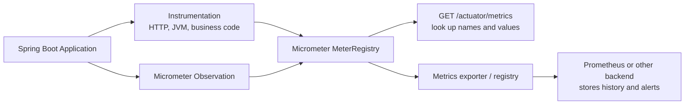

# The /actuator/metrics Endpoint

> **Chapter:** Actuator metrics endpoint  
> **Module:** `SPRING_BOOT_OBSERVABILITY` — set up observability for Spring Boot using Micrometer Observation, metrics, logs, and distributed tracing; understand context propagation, tags/cardinality, exporters, sampling, and how to correlate signals to investigate errors, latency, and application behavior.

## Lesson Objectives

After this lesson, you will be able to:

- Explain what `/actuator/metrics` is, where its data comes from, and the difference between a **metric name** in Micrometer and an exporter's series name.
- Configure Spring Boot Actuator to access the endpoint according to security policies; use HTTP requests to **list**, **inspect details**, and **filter by tags**.
- Read the JSON fields `name`, `description`, `baseUnit`, `measurements`, and `availableTags`; interpret `COUNT`, `TOTAL_TIME`, `MAX`, and `VALUE` with the right semantics.
- Create a counter and a timer in Spring Boot, then verify the data via the endpoint without embedding dynamic IDs in names or labels.
- Distinguish `/actuator/metrics` from `/actuator/prometheus`; understand the limitations when historical time series, histograms, alerting, and request tracing are needed.
- Diagnose issues such as missing meters, endpoints returning 404/403, mismatched tags, or metrics with excessive cardinality.

## 1. What Is `/actuator/metrics`?

In a Spring Boot application, **Spring Boot Actuator** provides operational endpoints. When metrics are configured, the `/actuator/metrics` endpoint lets you **look up meters currently registered in the Micrometer system**.

For example, an operations team might want to know:

- Does the application record HTTP request metrics?
- What count, total time, and tags does the `http.server.requests` timer have?
- Can measurements be filtered by `method=POST` or `status=500`?
- Is a counter added by the development team actually being recorded?

`/actuator/metrics` is a **diagnostic and meter discovery API**, not a historical time-series database. It returns a **snapshot of current aggregated measurements** and metadata from the meter registry, rather than a series of data points over time.

Three layers should be distinguished:



Conceptual flow diagram: `ObservationRegistry` can have a handler that records metrics into `MeterRegistry`, though not every observation automatically creates a meter. Instrumentation can also use `MeterRegistry` directly.

**Key takeaway:** seeing a meter through `/actuator/metrics` proves the measurement data is present in the registry the endpoint reads from; it **does not guarantee** that a metrics exporter or external backend has received the data.

## 2. Prerequisites for the Endpoint to Work

### 2.1. Dependencies

A typical Spring Boot application needs Actuator. For example, with Gradle when Spring Boot dependency management is already configured:

```groovy
dependencies {
    implementation 'org.springframework.boot:spring-boot-starter-web'
    implementation 'org.springframework.boot:spring-boot-starter-actuator'
}
```

`spring-boot-starter-web` only represents an HTTP application using Spring MVC in this example. If the application uses WebFlux, choose the appropriate web stack; do not add the MVC starter just to enable metrics.

Actuator together with compatible Micrometer integrations typically provides a `MeterRegistry` and default metrics such as JVM/process/system/HTTP when the corresponding binders or instrumentations are active.

**Not every meter appears immediately at startup.** A meter registered by business code when a request runs for the first time might not exist before the endpoint is called. Meter names and counts also vary depending on Spring Boot, Micrometer, runtime, and dependencies.

### 2.2. Exposing the Endpoint over HTTP

A typical `application.yml` configuration:

```yaml
management:
  endpoints:
    web:
      exposure:
        include: health,info,metrics
```

In many Spring Boot configurations, Actuator's base path is `/actuator`, so the corresponding HTTP endpoint is:

```http
GET /actuator/metrics
```

**Exposure does not mean authorization.** The `include` configuration determines which endpoints are exposed over HTTP; access permissions also depend on Spring Security configuration, endpoint access settings, and the network layer. When a user lacks permission, the endpoint may return 401 or 403.

The illustrative configuration above does not inherently make the endpoint safe on the public Internet. In production, expose only the necessary endpoints, restrict network access, use appropriate authentication/authorization, and avoid leaking operational data across tenants.

### 2.3. When the URL Is Not `/actuator/metrics`

The path can change if the application customizes the base path or uses a separate management server:

```yaml
management:
  endpoints:
    web:
      base-path: /manage
  server:
    port: 9001
```

In this illustrative configuration, for an application running locally with no additional context path, the URL is typically:

```text
http://localhost:9001/manage/metrics
```

If a management context path, reverse proxy, routing, or web application context path is also configured, the actual path must be verified in that environment. Do not conclude the endpoint is broken just because the default URL returns 404.

## 3. Listing Metric Names

Call:

```bash
curl -i http://localhost:8080/actuator/metrics
```

With an accessible endpoint and the corresponding meters registered, the JSON response may look like:

```json
{
  "names": [
    "application.ready.time",
    "http.server.requests",
    "jvm.memory.used",
    "jvm.threads.live",
    "process.cpu.usage",
    "system.cpu.usage"
  ]
}
```

This is an **illustrative example**, not a mandatory default list. Each application and version may have different names, additional meters, or omit `http.server.requests` before serving requests.

Meaning:

- `names` is the list of **logical meter names** known to Micrometer/Actuator.
- Each name can represent **multiple meter IDs** with different tag combinations.
- `names` does not yet include measurement values, descriptions, units, or tag value details.
- A name may be registered when traffic arrives or when a component creates the meter for the first time.

You can use this list to quickly verify whether instrumentation is working. If you want to inspect the HTTP timer, take the exact name from the list and call the detail endpoint.

## 4. Inspecting Details of a Metric

URL pattern:

```http
GET /actuator/metrics/{metricName}
```

Example:

```bash
curl -s http://localhost:8080/actuator/metrics/http.server.requests
```

Assuming the application has served multiple HTTP requests, the returned JSON might look like:

```json
{
  "name": "http.server.requests",
  "description": null,
  "baseUnit": "seconds",
  "measurements": [
    { "statistic": "COUNT", "value": 240.0 },
    { "statistic": "TOTAL_TIME", "value": 62.5 },
    { "statistic": "MAX", "value": 1.34 }
  ],
  "availableTags": [
    { "tag": "method", "values": ["GET", "POST"] },
    { "tag": "status", "values": ["200", "500"] },
    { "tag": "uri", "values": ["/orders", "/orders/{id}"] }
  ]
}
```

**All tag names and numbers above are hypothetical for reading the JSON structure.** In a real environment, the response depends on the recorded meters, actual tags, Spring Boot version, and how handlers/conventions produce measurements.

| JSON Field | Meaning | How to Use |
| --- | --- | --- |
| `name` | Requested logical name | Match against the meter name in code or the `names` list |
| `description` | Meter description if available | Understand what the metric measures; may be `null` |
| `baseUnit` | Base unit if available | Read `TOTAL_TIME` in the right unit; may be `null` |
| `measurements` | List of statistics and corresponding values | Read count, sum, max, or current value depending on meter type |
| `availableTags` | Tag keys and values present across matching meters | Find dimensions available for filtering and spot anomalous labels |

In the example, `COUNT=240` is 240 recordings by the timer, and `TOTAL_TIME=62.5` is the total of 62.5 seconds across those measurements. The **illustrative average duration** is:

\[
\frac{62.5}{240} \approx 0.2604\ \text{seconds/recording}
\]

`MAX=1.34` indicates the maximum value currently reported by the timer according to its corresponding window/statistic. For timers using time-window maxima, `MAX` is not necessarily the highest value since process startup; it may expire or decay periodically. Do not use a single `MAX` value to infer p95/p99.

### 4.1. The Detail Endpoint Can Aggregate Multiple Meter IDs

For example, under the same name `http.server.requests` there are two combinations:

```text
{method=GET,  status=200, uri=/orders}
{method=POST, status=500, uri=/orders}
```

When calling `GET /actuator/metrics/http.server.requests` without tag filters, the endpoint typically **aggregates measurements** across meter IDs with the same name matching the query. Therefore, the returned `COUNT` is the sum of counts across those combined groups, not the count for `GET /orders` alone.

`availableTags` helps identify existing values to narrow the query. Items in this array do not exhaustively describe every **combination** of tags that actually occurred; you cannot assume with certainty that every pairing of values exists.

## 5. Filtering by Tags in `/actuator/metrics/{name}`

The detail query supports the `tag` parameter in the form:

```text
tag=<key>:<value>
```

For example, viewing only GET requests:

```http
GET /actuator/metrics/http.server.requests?tag=method:GET
```

To combine multiple conditions, repeat the `tag` parameter:

```http
GET /actuator/metrics/http.server.requests?tag=method:GET&tag=status:200
```

If you need to filter complex values such as a route template containing `/`, `{`, or `}`, let the HTTP client **URL-encode** the parameter. For example:

```bash
curl -G "http://localhost:8080/actuator/metrics/http.server.requests" \
  --data-urlencode "tag=method:GET" \
  --data-urlencode "tag=uri:/orders/{id}"
```

This syntax is for shells that support backslash line continuation; on PowerShell/Windows, you can enter the command on **one line** or use line continuation appropriate for your current shell.

**Things to check:**

1. `tag` must match the **actual key name**. Do not assume `route` instead of `uri` or `http.method` instead of `method` if the endpoint emits a different key.
2. Values must match the meter's convention/normalization. A route may be stored as `/orders/{id}`, not the raw URL `/orders/42`.
3. When using multiple conditions, only meter IDs satisfying all conditions contribute measurements to the result.
4. When no meter matches, the response may omit the expected data or return an error depending on the API/version behavior. Go back to `availableTags` and verify what data has been recorded.
5. The endpoint does not support historical queries with `from`/`to` or PromQL-like aggregation syntax; tag filters only select **current** data from the registry.

### 5.1. Filter Only by Meaningful Dimensions

For example, `http.server.requests` has tags `method`, `status`, `uri`, and `outcome`. You can check the count of `POST /checkout` requests returning HTTP 5xx using the appropriate tag filters.

Do not add `traceId`, `requestId`, `orderId`, or `tenantId` to metric tags just to filter at the endpoint. Per-request values create high cardinality, increasing the number of meter IDs and time series; looking up a specific request should rely on logs/traces via proper correlation mechanisms.

## 6. Interpreting `measurements` by Meter Type

`/actuator/metrics` does not have a single value structure for every measurement. The `measurements` field contains different `statistic` types depending on the meter type.

| Meter Type | Common Statistics | How to Interpret |
| --- | --- | --- |
| **Counter** | `COUNT` | Cumulative count over the meter's lifetime; not requests/second. |
| **Timer** | `COUNT`, `TOTAL_TIME`, `MAX` | Number of recordings, total duration, and max value according to timer semantics. |
| **Gauge** | `VALUE` | Value at the time of measurement, which can go up/down; may become unavailable if the observed object loses its reference. |
| **DistributionSummary** | `COUNT`, `TOTAL`, `MAX` | Sample count, total amount, and max for measurements that are not necessarily durations. |
| **LongTaskTimer** | Measurements for active tasks and duration, depending on registry | Suitable for tracking long-running tasks, not an ordinary HTTP request count. |

Some implementations or versions may return other statistics. Do not write a rigid parser relying on the position of the first element in `measurements`; read by the `statistic` name instead.

### 6.1. Distinguishing `COUNT` from Rate

If a counter returns `COUNT=10_000`, that number only indicates the count at query time. To compute a **per-second rate**, you need two or more samples over time or a time-series backend computing `rate`/`increase`.

For example, two readings of the same counter:

```text
12:00:00  COUNT = 10,000
12:01:00  COUNT = 10,120
```

Assuming **no process restart/reset** and the same tag scope, the approximate average rate over one minute is:

\[
\frac{10{,}120-10{,}000}{60}=2\ \text{events/second}
\]

But this is only a manual calculation from two snapshots. In production, a backend like Prometheus is usually more suitable because it manages multiple samples, accounts for counter resets, and supports windowed `rate`/`increase`.

### 6.2. Distinguishing Mean from p95

A timer with `COUNT` and `TOTAL_TIME` lets you calculate the **mean duration**. It is **not enough to derive p95**. To view percentiles, you need distribution data (histogram buckets, or an appropriate percentile mechanism in the registry/backend). Do not call `MAX` the p95 or average.

If you want to find "how long the slowest 5% of requests take", use histograms or an appropriate distribution on a backend capable of time-based queries; `/actuator/metrics` does not replace that capability.

### 6.3. Meaning of `Gauge.VALUE`

A gauge may reflect the number of live threads or queue depth **right at read time**. If the value drops after a request, it does not mean there is a "negative" event to add to a counter. For some gauges tracking objects via weak references, if the object is no longer properly retained, the value may no longer be as expected.

Therefore, identify the meter type before interpreting measurement values from the endpoint.

## 7. Spring Boot Example: Creating Metrics to Inspect

The following code lets you see a **Counter** and **Timer** on `/actuator/metrics` after business activity occurs. It is intended for a **synchronous** operation using a bounded set of tag values.

```java
package example.observability;

import java.util.function.Supplier;

import io.micrometer.core.instrument.MeterRegistry;
import io.micrometer.core.instrument.Timer;
import org.springframework.stereotype.Service;

@Service
public class CheckoutMeterService {
    private final MeterRegistry registry;

    public CheckoutMeterService(MeterRegistry registry) {
        this.registry = registry;
    }

    public <T> T measure(String clientChannel, Supplier<T> action) {
        String channel = normalizeChannel(clientChannel);

        Timer timer = Timer.builder("checkout.processing")
                .description("Duration of synchronous checkout processing")
                .tag("channel", channel)
                .register(registry);

        try {
            T result = timer.record(action);

            registry.counter(
                    "checkout.attempts",
                    "channel", channel,
                    "result", "success"
            ).increment();

            return result;
        } catch (RuntimeException | Error failure) {
            registry.counter(
                    "checkout.attempts",
                    "channel", channel,
                    "result", "error"
            ).increment();
            throw failure;
        }
    }

    private static String normalizeChannel(String value) {
        return "web".equals(value) || "mobile".equals(value)
                ? value
                : "other";
    }
}
```

Explanation:

- `checkout.processing` is the **logical timer name**, measuring the synchronous duration of `action`, including cases that throw an exception per `Timer.record(...)` behavior.
- `checkout.attempts` is a counter **counting completed business invocations classified** as `success` or `error` in this example; this meaning should be kept consistent.
- `channel` only has three values—`web`, `mobile`, and `other`—preventing extra labels from arbitrary input.
- `result` has two fixed values for the counter, supporting success/failure analysis.
- If `action` returns an incomplete `CompletableFuture`, the timer only measures the time to create/return the future, **not** until async processing finishes.
- `MeterRegistry` is a bean provided by Spring Boot's metrics infrastructure when properly configured. This code does not require you to create a second registry manually.

This code does not by itself guarantee that the business outcome has **committed a database transaction**. If you need to count payments or orders completed after commit, choose the counter recording point according to the business definition.

### 7.1. Invoking the Sample Business Logic

Example usage in an application controller or test driver:

```java
String response = checkoutMeterService.measure("web", () -> "ok");

try {
    checkoutMeterService.measure("mobile", () -> {
        throw new IllegalStateException("Payment service unavailable");
    });
} catch (IllegalStateException expected) {
    // Test failure scenario, not mandatory HTTP handling.
}
```

After these statements run and the meters are recorded, try querying:

```http
GET /actuator/metrics/checkout.processing
GET /actuator/metrics/checkout.attempts
GET /actuator/metrics/checkout.attempts?tag=result:error
GET /actuator/metrics/checkout.processing?tag=channel:web
```

For `checkout.processing`, expect `COUNT`, `TOTAL_TIME`, and possibly `MAX` depending on how the timer is represented. For `checkout.attempts`, expect the counter to have `COUNT` and `availableTags` for `channel`/`result`, provided those meters were registered and not excluded by filters or system conditions.

Do not expect the endpoint to return identical numbers per request if multiple instances run in parallel. `/actuator/metrics` reflects the **MeterRegistry of the queried process**, and does not aggregate across all replicas of the service.

## 8. From Micrometer Observation to `/actuator/metrics`

An observability-enabled application may use `Micrometer Observation` instead of registering individual timers separately. For example:

```java
import java.util.function.Supplier;

import io.micrometer.observation.Observation;
import io.micrometer.observation.ObservationRegistry;

public class ObservedCheckout {
    private final ObservationRegistry registry;

    public ObservedCheckout(ObservationRegistry registry) {
        this.registry = registry;
    }

    public <T> T submit(Supplier<T> action) {
        return Observation.createNotStarted("checkout.submit", registry)
                .lowCardinalityKeyValue("operation", "submit")
                .observe(action);
    }
}
```

If `ObservationRegistry` has an appropriate **metrics ObservationHandler**, the observation can contribute a timer with a logical name related to `checkout.submit`. If no handler is present or the meter is filtered out, you will not see a metric just because you created an observation.

Distinction:

- `ObservationRegistry` coordinates the observation lifecycle and handlers.
- `MeterRegistry` stores/registers meters and is queried by the Actuator metrics endpoint.
- An `ObservationHandler` can turn an observation into a measurement such as a timer when that handler is configured.
- A **tracing handler** can create a corresponding span; however, seeing an observation in the metrics endpoint does not prove tracing is enabled or that traces have been exported.

In real code, avoid accidentally measuring the same activity with **two overlapping timers**: one registered manually on `MeterRegistry` and another via an ObservationHandler unintentionally. That can cause dashboards to double-count or mislead readers.

## 9. How Does `/actuator/metrics` Differ from `/actuator/prometheus`?

The two endpoints are related but **do not replace each other**.

| Attribute | `/actuator/metrics` | `/actuator/prometheus` |
| --- | --- | --- |
| Purpose | Discover and inspect the state of registered meters | Export metric exposition formatted for Prometheus scraping |
| Data format | Actuator JSON: `names`, `measurements`, `availableTags` | Prometheus/OpenMetrics exposition text format, depending on configuration and negotiation |
| Metric name | Logical name such as `http.server.requests` | Series name converted by convention/unit, e.g. `http_server_requests_seconds_count` |
| Filtering | `?tag=key:value` on the detail endpoint | Typically collects series per export format; filter/analyze on the backend using PromQL |
| Multi-point history | No | The scrape endpoint is also just a snapshot; the **Prometheus backend** stores history |
| Histograms/percentiles | Returns statistics presented by Actuator, not a historical histogram query API | Can export distribution buckets/series if the registry and distribution are configured |
| Dependencies | Actuator and Micrometer metrics infrastructure | Requires adding the appropriate Prometheus registry/endpoint |
| Used for | Debugging meter existence, metadata, tags, current values | Collecting time series for dashboards, SLOs, and alerts |

For example, to enable the Prometheus registry (with Spring Boot dependency management):

```groovy
dependencies {
    implementation 'org.springframework.boot:spring-boot-starter-actuator'
    runtimeOnly 'io.micrometer:micrometer-registry-prometheus'
}
```

And expose the corresponding endpoint according to environment policy:

```yaml
management:
  endpoints:
    web:
      exposure:
        include: health,info,metrics,prometheus
```

**Merely adding `prometheus` to the exposure list does not create the Prometheus endpoint if the registry dependency is missing.** Moreover, an endpoint returning data is different from a Prometheus server having successfully scraped and stored the time series.

### 9.1. Example of Logical Name vs. Physical Series Name

Micrometer Timer:

```text
http.server.requests
```

In a corresponding Prometheus exporter, you may see:

```text
http_server_requests_seconds_count
http_server_requests_seconds_sum
http_server_requests_seconds_bucket
```

`_bucket` only exists when appropriate histogram data is present and supported by export; not every timer has bucket series. Do not use the string `http_server_requests_seconds_count` as the path for `/actuator/metrics/{name}` if the actual logical name in the registry is `http.server.requests`.

When you need rate, historical latency, or p95, a time-series backend with PromQL is more suitable:

```promql
sum(rate(http_server_requests_seconds_count[5m]))
```

And when classic histogram buckets are available:

```promql
histogram_quantile(
  0.95,
  sum by (le) (rate(http_server_requests_seconds_bucket[5m]))
)
```

These are illustrative queries; check actual series names, label keys, histogram format, and real data before using them for production alerts.

## 10. Security: Operational Endpoints Are Not Public APIs

`/actuator/metrics` can expose dependency names, route structures, client pool names, indirect runtime versions, or the existence of customer groups through labels.

To operate safely:

1. **Expose only required endpoints.** Do not use `include: "*"` by default in production without a thorough security review.
2. **Enforce authorization.** Apply Spring Security/management authorization and appropriate network restrictions; unauthorized users should not view internal structure.
3. **Separate the management network/port** where architecture permits; avoid confusing "different port" with "automatically secure".
4. **Control tags.** Do not put emails, tokens, raw URL query strings, order IDs, user IDs, tenant IDs, or trace IDs into metric labels/names due to cardinality and data exposure risks.
5. **Verify security configuration by version.** In Spring Boot, endpoint exposure, endpoint access, and Spring Security authorization can be separate configuration layers.
6. **Do not use metric labels for authorization decisions.** Metrics serve observability, not tenant or principal authentication.

An `HTTP 403` when calling `/actuator/metrics` is not a Micrometer bug; check access permissions and endpoint protection policies first.

## 11. Workflow for Investigating HTTP 5xx and Latency Spikes

**Scenario:** users report that `POST /orders` is slow and occasionally returns `500`.

A practical workflow using `/actuator/metrics`:

### Step 1 — Verify the endpoint and meter

Access `GET /actuator/metrics` and check whether `http.server.requests` is in `names`. If not, check whether the application has received traffic and has proper instrumentation; then check actuator/metrics configuration.

### Step 2 — Check aggregated measurements

Call `GET /actuator/metrics/http.server.requests`. Inspect `measurements`, `baseUnit`, and `availableTags`; keep in mind that measurements may be aggregating all routes/statuses.

### Step 3 — Narrow scope by tags

Based on actual `availableTags` values, filter `method=POST`, `uri=/orders`, and `status=500` if those keys/values exist. With sparse data, a low `COUNT` is not enough to prove you have found a systemic issue.

### Step 4 — Cross-check historical metrics

In Prometheus/backend, inspect HTTP error rate, request rate, p95 latency if histograms are available, and dependency metrics. `/actuator/metrics` does not store time series to compare "before and after deploy".

### Step 5 — Use traces to pinpoint slowness

Using the affected time range and route, find sampled distributed traces in the tracing backend. Inspect DB, HTTP client, thread pool, or business operation spans. If trace sampling skipped a request, not seeing a trace **does not prove** the request did not happen.

### Step 6 — Use logs to verify errors

Inspect logs with timestamps, service, trace ID, and span ID (when logging correlation is configured). Look for timeouts, exceptions, retries, and corresponding HTTP outcomes. The `/actuator/metrics` endpoint **does not return per-request trace IDs**; use tracing/logging context and, if supported by the backend, metric exemplars to jump from metrics to traces.

### Step 7 — Verify after remediation

Check that error rate and latency return to expected levels, meters keep stable names/tags, and the exporter/collector is delivering data. If there are multiple replicas, inspect data across the entire service, not just the single instance an Actuator endpoint happens to point to.

## 12. Common Pitfalls When Using the Endpoint

| Symptom | Possible Cause | How to Check |
| --- | --- | --- |
| `GET /actuator/metrics` returns 404 | Endpoint not exposed, disabled, different base path/management port, or wrong reverse proxy route | Check `management.endpoints.web.exposure`, endpoint access, base path, and actual port |
| Returns 401 or 403 | Authentication/authorization protects management endpoints | Check Spring Security/management access; do not disable security for a "quick test" in production |
| `names` list lacks a custom metric | Meter not registered yet or code hasn't run; registry differs from the one Actuator reads | Trigger the business operation, check the injected `MeterRegistry` and filters |
| `http.server.requests` is missing | No traffic yet, instrumentation inactive, or meter filtered/renamed | Check Actuator, runtime stack, version, and HTTP instrumentation |
| `tag=method:POST` filter returns no expected measurements | Wrong tag key/value, no matching requests yet, or route/status differs from expected | Check `availableTags` and filter with actual values |
| `COUNT` does not increase as expected | Looking at another instance, different tag filters, counter reset due to restart, or measurement not recorded on error branch | Check instance, meter lifecycle, and instrumentation point |
| Timer shows `MAX=0` despite earlier slowness | MAX may be a time-window statistic that expired | Check read timing and historical histogram/backend data |
| Need p95 but only `COUNT/TOTAL_TIME` available | Endpoint does not provide sufficient distribution to compute p95 | Enable appropriate histograms and query the exporter/backend |
| Prometheus name differs from Actuator metrics name | Naming conventions, metric type suffixes, and units applied by exporter | Compare `/actuator/metrics` with `/actuator/prometheus` |
| Backend has no data even though Actuator does | Exporter/collector/scrape misconfigured or network/quota error | Check exporter, scrape targets, pipelines, and retention |
| Number of meters grows rapidly | Metric name or tags contain dynamic IDs/raw URLs | Normalize tags, avoid high cardinality, and use logs/traces for specific IDs |
| Metrics exist but logs/traces are not linked | Missing tracing bridge, context lost across async, or logging MDC not configured | Check ObservationRegistry handlers, propagation, sampler, and logging pipeline |

### 12.1. Do Not Conflate Endpoint Access Errors with Metric Recording Errors

An HTTP 404 from `/actuator/metrics` may be caused by the path or exposure; whereas an HTTP 404 from `/actuator/metrics/my.metric` may mean **the meter name does not exist yet**. The two situations require different troubleshooting.

Similarly, HTTP 403 is about **access permissions**, and does not tell you whether `MeterRegistry` contains data. Before modifying instrumentation code, inspect the HTTP status and response body.

## 13. Hands-On Exercise: Exploring Meters and Analyzing Tags

In a test Spring Boot application, perform the following steps in order:

1. Add Actuator and expose `metrics` over HTTP **only in a protected environment**. Call `GET /actuator/metrics` and confirm you receive the `names` JSON.
2. Send at least one HTTP request to the application; open `/actuator/metrics/http.server.requests` if that meter exists. Record the actual `name`, `baseUnit`, `measurements`, and `availableTags`.
3. Filter by `method=GET` and another tag key present in the response. Note how `COUNT` differs between the unfiltered query and the filtered query.
4. Run the `CheckoutMeterService` example for both `web` and `mobile` channels; call `GET /actuator/metrics/checkout.processing` and `GET /actuator/metrics/checkout.attempts`. Check count, total time, and tags.
5. Pass an arbitrary channel input such as `partner-987`; verify the code normalizes it to `other` instead of creating a new high-cardinality tag.
6. Trigger an exception in `action`; verify whether the `checkout.attempts` counter records `result=error` and the timer records the failure duration.
7. If the Prometheus registry is installed, compare the logical meter name with the series name at `/actuator/prometheus`. Try a `rate` query on the backend, avoiding confusing cumulative count with requests/second.
8. Check the responses when calling an invalid metric name, an invalid tag value, and without access permissions. Distinguish 404, 401, and 403 errors from a meter with a value of 0.
9. If Micrometer Tracing is enabled, log inside the business logic with a trace ID, open a collected trace, and explain why `/actuator/metrics` cannot list trace IDs.
10. Write short notes for each metric: **definition, type, unit, allowed tags, where it is emitted, and the operational question it answers**.

**Pass criteria:** You can use the endpoint to prove a meter exists, read statistics accurately, filter tags by real keys/values, identify limitations regarding historical time series, and connect anomalous metric scenarios with logs/traces through the corresponding pipeline.

## 14. Self-Check

**Question 1.** Does `GET /actuator/metrics` return all historical data of the system?  
**Hint:** No. It lists meter names in the registry the endpoint reads from; detail responses show aggregated measurements at lookup time, not time-series history.

**Question 2.** Why can `GET /actuator/metrics/http.server.requests` have a larger `COUNT` than when filtering with `tag=method:GET`?  
**Hint:** The unfiltered query aggregates multiple tag combinations; after filtering, only meter IDs matching the condition remain.

**Question 3.** Does `availableTags` guarantee that every combination of tag values has occurred?  
**Hint:** No. Each key displays the values present; not every pairing across keys necessarily has a meter.

**Question 4.** Can p95 be calculated solely from `COUNT` and `TOTAL_TIME`?  
**Hint:** No. You can calculate the mean, but you cannot derive the p95 percentile without appropriate distribution data.

**Question 5.** Does a counter returning `COUNT=1200` mean 1200 requests/second?  
**Hint:** No. It is a cumulative count per counter semantics; computing a rate requires samples over time.

**Question 6.** What is the main difference between `/actuator/prometheus` and `/actuator/metrics`?  
**Hint:** One endpoint provides JSON to look up meter names/measurements/tags; the other exports data in a format for Prometheus scraping, using names with naming conventions applied.

**Question 7.** If `/actuator/metrics` returns 403, should you immediately fix the counter-creation code?  
**Hint:** No. Check access permissions and exposure/management security first.

**Question 8.** Why should `traceId` not be added as a metric tag to find a request on `/actuator/metrics`?  
**Hint:** Trace IDs have very high cardinality; use logs/traces and exemplars if supported by the backend, instead of creating huge numbers of meter IDs.

**Question 9.** Why might a meter not appear immediately after the application starts?  
**Hint:** It may be registered only when instrumented code is invoked or first traffic arrives, or it may require the corresponding binder/instrumentation.

**Question 10.** If an application runs multiple replicas, does `/actuator/metrics` on one replica represent the entire service?  
**Hint:** No. It reflects the registry of the queried instance; service-wide statistics require an exporter/backend collecting all replicas and aggregating with proper semantics.

**Key takeaway:** `/actuator/metrics` is the **discovery and diagnostic window into Micrometer meters in Spring Boot**: listing names, viewing measurements, inspecting tags, and filtering by key/value. For historical analysis, rates, p95/SLOs, or alerting, you need an appropriate metrics exporter and time-series backend. When investigating incidents, read types/units accurately, limit cardinality, secure the endpoint, and combine metrics with logs, distributed traces, context propagation, and sampling to find evidence-based root causes.
