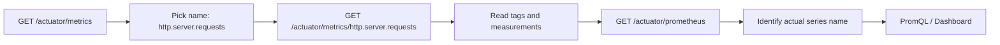
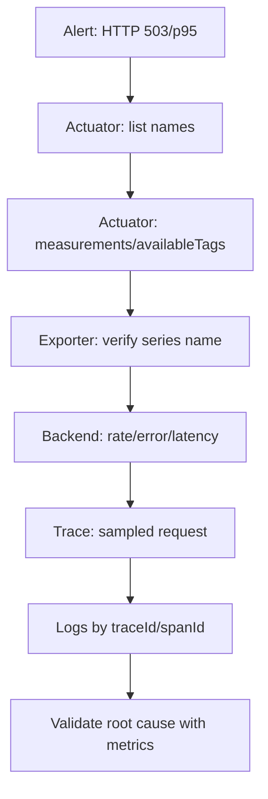
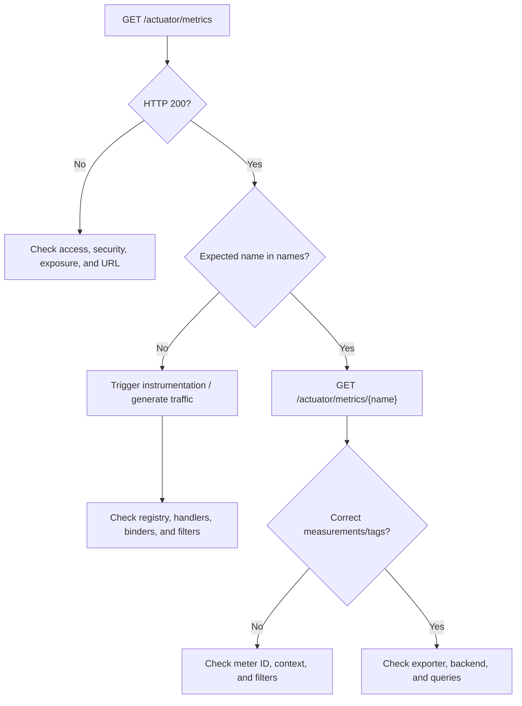

# Listing Metric Names with Spring Boot Actuator

When a Spring Boot application is running but dashboards show no data for requests, JVM memory, or a business operation, the first question is: **which metrics has the application registered?** The `GET /actuator/metrics` endpoint of Spring Boot Actuator lets you list **metric names** currently managed by Micrometer. From this list, an operator can inspect a specific name, view its measurements and tags, and only then look for data in the exporter or backend.

The lesson **"Listing Metric Names"** belongs to the **Actuator metrics endpoint** chapter in the **SPRING_BOOT_OBSERVABILITY** module. The module's goal is to set up observability for Spring Boot using Micrometer Observation, metrics, logs, and distributed tracing; this lesson uses name listing as the starting point to verify instrumentation, tags/cardinality, exporters, sampling, propagation, and the connections among signals when investigating errors and latency in practice.

## 1. A Metric Name Is Neither a Sample Nor a Time Series

Micrometer manages **Meter** objects such as `Counter`, `Timer`, `Gauge`, and `DistributionSummary`. Each meter has a `Meter.Id`, consisting of a name, type, tags, and related metadata.

Example:

```text
Meter A:
  name   = http.server.requests
  type   = TIMER
  tags   = method=GET, uri=/orders/{id}, status=200

Meter B:
  name   = http.server.requests
  type   = TIMER
  tags   = method=GET, uri=/orders/{id}, status=404

Meter C:
  name   = jvm.memory.used
  type   = GAUGE
  tags   = area=heap, id=G1 Eden Space
```

Here, A and B share **the same name** but have **different tag combinations**. The metric names list only needs to list `http.server.requests` **once**.

| Concept | Example | Role |
| --- | --- | --- |
| Meter name | `http.server.requests` | Identifies what is being measured |
| Tag key | `method`, `uri`, `status` | Identifies a grouping dimension |
| Tag value | `GET`, `/orders/{id}`, `404` | Identifies a specific group |
| Measurement | `COUNT=10` or `TOTAL_TIME=0.8` | Measured value |
| Time series | Values over time for a name and label set | Used for trend analysis on the backend |

**A meter name alone does not tell you how many tag combinations exist, how many requests occurred, or whether a timer has a histogram.** Those are questions to check in the next step.

## 2. What Does `GET /actuator/metrics` Return?

With Actuator enabled and properly exposed:

```http
GET /actuator/metrics HTTP/1.1
Host: localhost:8080
Accept: application/json
```

Illustrative response:

```json
{
  "names": [
    "http.server.requests",
    "jvm.memory.used",
    "jvm.threads.live",
    "process.cpu.usage",
    "process.uptime"
  ]
}
```

The JSON contains a `names` array listing the meter names visible to the metrics endpoint at the time of the request. **This is illustrative data**; another application may lack some names or have hundreds more from libraries, binders, datasources, and custom instrumentation.

Distinguish between:

| URL | Purpose | Output |
| --- | --- | --- |
| `/actuator/metrics` | List metric names | JSON `{"names":[...]}` |
| `/actuator/metrics/{name}` | Inspect a specific meter name | Measurements and available tags |
| `/actuator/prometheus` | Expose data in Prometheus format when the corresponding registry is present | Text-based series/samples |
| Metrics backend / dashboard | Query collected metric history | Graphs, rates, percentiles, alerts |

The `/actuator/metrics` endpoint **is not a Prometheus scrape endpoint**, and you cannot run PromQL directly against it.

## 3. Prerequisites for the Endpoint to Work

Gradle Groovy example for a Spring MVC application:

```groovy
dependencies {
    implementation 'org.springframework.boot:spring-boot-starter-web'
    implementation 'org.springframework.boot:spring-boot-starter-actuator'
}
```

Actuator provides metric discovery/inspection when Micrometer and an appropriate `MeterRegistry` are configured. To export data to Prometheus, add the appropriate dependency:

```groovy
runtimeOnly 'io.micrometer:micrometer-registry-prometheus'
```

The Prometheus registry is not required **just to view Actuator's JSON names**, if the application already has an appropriate registry/metrics endpoint. Dependencies must use versions compatible with Spring Boot; prefer the project's BOM or dependency management.

### Exposing `metrics` over HTTP

In `application.yml` for a test environment:

```yaml
spring:
  application:
    name: order-service

management:
  endpoints:
    web:
      exposure:
        include: health,info,metrics
  metrics:
    tags:
      application: order-service
      environment: local
```

The configuration above exposes `metrics` over HTTP, provided the endpoint is enabled/available and auto-configuration conditions are met.

Distinguish three states:

1. **Endpoint available:** dependencies and configuration instantiate the endpoint.
2. **Endpoint exposed:** HTTP/JMX allows access to that endpoint.
3. **Caller authorized:** Spring Security, proxies, and network policies allow access.

`exposure.include` does not bypass authorization by itself. In production, do not open Actuator metrics publicly just for debugging convenience.

### Port and Base Path May Differ

The default URL is usually `/actuator/metrics` on the application port. However:

- `server.port` can change the application port.
- `management.server.port` can place Actuator on a separate management port.
- `management.endpoints.web.base-path` can replace `/actuator`.
- Reverse proxies/ingress can rewrite paths or restrict access.

Therefore, when encountering a 404, first verify **the exact management context and actual URL**.

## 4. Listing Names with curl and PowerShell

When the application runs locally on `localhost:8080`:

```bash
curl -i http://localhost:8080/actuator/metrics
```

Print only JSON:

```bash
curl -sS http://localhost:8080/actuator/metrics
```

If `jq` is available, print one name per line:

```bash
curl -sS http://localhost:8080/actuator/metrics | jq -r '.names[]'
```

On Windows PowerShell, you can use `Invoke-RestMethod`:

```powershell
$response = Invoke-RestMethod -Uri "http://localhost:8080/actuator/metrics"
$response.names | Sort-Object
```

Example output:

```text
http.server.requests
jvm.memory.used
jvm.threads.live
process.uptime
```

The order in `names` is not an operational signal. When comparing two environments, sort them and compute the intersection/difference rather than comparing order.

If the endpoint requires authentication, use authorized credentials and administrative tools. Avoid recording credentials in terminal history, such as command lines containing unmasked passwords or tokens.

## 5. From Name to Measurements and AvailableTags

When `jvm.memory.used` is in the list, query:

```bash
curl -sS http://localhost:8080/actuator/metrics/jvm.memory.used
```

Illustrative JSON:

```json
{
  "name": "jvm.memory.used",
  "description": "The amount of used memory",
  "baseUnit": "bytes",
  "measurements": [
    { "statistic": "VALUE", "value": 25165824.0 }
  ],
  "availableTags": [
    { "tag": "area", "values": ["heap", "nonheap"] },
    { "tag": "id", "values": ["G1 Eden Space", "G1 Old Gen"] }
  ]
}
```

The actual response depends on the JVM, registry, binders, and version. Meaning:

- `name`: meter name in Micrometer.
- `description` and `baseUnit`: metadata if provided by the meter.
- `measurements`: aggregated values corresponding to the measurement.
- `availableTags`: tag values that can be used to filter meters with the same name.

**This is not a per-sample history with timestamps.** To compute RPS over a window or p95 over 5 minutes, you need a time-series backend and a supporting exporter.

### Filtering by Tag

The Actuator metrics endpoint supports the `tag=key:value` parameter, for example:

```bash
curl -sS 'http://localhost:8080/actuator/metrics/jvm.memory.used?tag=area:heap'
```

Or filter HTTP request metrics with multiple tags:

```bash
curl -sS 'http://localhost:8080/actuator/metrics/http.server.requests?tag=method:GET&tag=status:404'
```

If a tag value contains special characters, URL-encode it. For example, the route template `/orders/{id}` can use the encoded query string:

```text
/actuator/metrics/http.server.requests?tag=uri:%2Forders%2F%7Bid%7D
```

Query the detail endpoint **without filters** first to inspect `availableTags`. Not all applications use the same keys or values for method, status, uri, or outcome.

### Interpreting Timer Measurements

For an HTTP server Timer, the response may contain:

- `COUNT`: total number of recordings across the selected set of meters.
- `TOTAL_TIME`: total duration.
- `MAX`: maximum value according to how the registry manages it, which may be within a time window.

Adding `tag=status:404` typically restricts aggregation to meters with `status=404`. Do not infer `TOTAL_TIME/COUNT` as p95: that is the **mean** when count is non-zero. Do not treat `MAX` as an all-time historical max or a percentile.

## 6. A Metric Name Only Appears Once Registered

Some meters, especially custom Counters/Timers, are only registered **when the corresponding code path runs**. Therefore, right after startup, the `names` list may contain many JVM/process metrics while missing a custom business metric.

For HTTP, once a server request completes, HTTP instrumentation can record the `http.server.requests` Timer. If no requests have arrived yet or an unsuitable registry/handler is used, that name may not appear yet.

Spring MVC controller example:

```java
import org.springframework.http.ResponseEntity;
import org.springframework.web.bind.annotation.GetMapping;
import org.springframework.web.bind.annotation.PathVariable;
import org.springframework.web.bind.annotation.RequestMapping;
import org.springframework.web.bind.annotation.RestController;

@RestController
@RequestMapping("/orders")
public class OrderController {

    @GetMapping("/{id}")
    public ResponseEntity<String> find(@PathVariable long id) {
        if (id == 42L) {
            return ResponseEntity.ok("paid");
        }
        return ResponseEntity.notFound().build();
    }
}
```

Send two test requests:

```bash
curl -i http://localhost:8080/orders/42
curl -i http://localhost:8080/orders/43
curl -sS http://localhost:8080/actuator/metrics
curl -sS http://localhost:8080/actuator/metrics/http.server.requests
```

With proper instrumentation, we expect the HTTP meter to have two status groups, 200 and 404, usually sharing the route tag `uri=/orders/{id}`. Using a **route template** is crucial: if raw paths were used, every order ID could create a new series.

Not every meter waits for a request to appear. JVM/process binders may register at startup. The accurate conclusion is: **`names` at a point in time reflects only the meters present at that point in time**.

### Three Situations to Distinguish

| Symptom | Possible Meaning |
| --- | --- |
| Name not present in the list | Meter not yet registered, filtered/disabled, or in a different registry |
| Name exists, COUNT = 0 | Meter is registered, but no measurement has been recorded for that combination |
| Name present in Actuator, missing in backend | Data may be lost at the exporter, scrape, relabeling, or backend query |

Do not conclude an instrumentation bug solely from an empty `names` response or a missing name, especially right after startup.

## 7. Listing a Custom Metric Name

A business metric for counting retries can be registered in a service:

```java
import io.micrometer.core.instrument.Counter;
import io.micrometer.core.instrument.MeterRegistry;
import org.springframework.stereotype.Service;

@Service
public class PaymentRetryMetrics {
    private final MeterRegistry meterRegistry;

    public PaymentRetryMetrics(MeterRegistry meterRegistry) {
        this.meterRegistry = meterRegistry;
    }

    public void recordRetry(String reason) {
        String safeReason;
        if ("timeout".equals(reason)) {
            safeReason = "timeout";
        } else if ("unavailable".equals(reason)) {
            safeReason = "unavailable";
        } else {
            safeReason = "other";
        }

        Counter.builder("payment.gateway.retries")
                .description("Payment gateway retry attempts")
                .tag("reason", safeReason)
                .register(meterRegistry)
                .increment();
    }
}
```

When `recordRetry("timeout")` executes against the `MeterRegistry` that Actuator reads from, the name `payment.gateway.retries` can appear:

```bash
curl -sS http://localhost:8080/actuator/metrics/payment.gateway.retries
```

The value set for `reason` is bounded to three groups. Do not attach a retry ID or user ID directly as a label, as that can create huge numbers of series and leak metadata.

### Listing Names via Java When Cross-Checking a Registry

If debugging a specific registry:

```java
import io.micrometer.core.instrument.Meter;
import io.micrometer.core.instrument.MeterRegistry;
import java.util.List;

public final class MetricNames {
    public static List<String> list(MeterRegistry registry) {
        return registry.getMeters().stream()
                .map(Meter::getId)
                .map(Meter.Id::getName)
                .distinct()
                .sorted()
                .toList();
    }
}
```

This snippet uses Java 16+ for `Stream.toList()`. It lists names from **the passed-in registry**. If the application has multiple `MeterRegistry` instances or a `CompositeMeterRegistry`, a child registry's list may differ from Actuator's list. Verify that custom code and Actuator go through the proper meter registration path.

Do not build a new public endpoint just to dump the entire registry if Actuator already provides a secured access mechanism.

## 8. Micrometer Names Differ from Prometheus Series Names

A common confusion: Actuator shows `http.server.requests`, while in Prometheus people look for `http_server_requests_seconds_count`.

| Where Viewed | Illustrative Name | Meaning |
| --- | --- | --- |
| Micrometer / Actuator | `http.server.requests` | Timer name |
| Prometheus | `http_server_requests_seconds_count` | Timer count in seconds |
| Prometheus | `http_server_requests_seconds_sum` | Normalized total duration |
| Prometheus with histogram | `http_server_requests_seconds_bucket` | Bucket series for histogram |
| Micrometer / Actuator | `jvm.memory.used` | Gauge name |
| Prometheus | `jvm_memory_used_bytes` | Unit-normalized gauge |

The exact name depends on meter type, naming convention, registry, and exporter version. Other registries may not use the same series names as Prometheus.

**Do not use a Prometheus series name directly to call `/actuator/metrics/{name}` if the name in Actuator is still the dotted Micrometer name.** Conversely, do not write PromQL using Micrometer names without checking how the exporter converts them.

Proper verification workflow:



The `/actuator/prometheus` endpoint is only available when the Prometheus registry, endpoint, and appropriate access permissions are configured. A meter name appearing in Actuator does not guarantee the exporter is emitting it or that Prometheus has scraped it.

## 9. Common Metric Name Groups

| Group | Example Micrometer Name | Main Prerequisite |
| --- | --- | --- |
| JVM memory | `jvm.memory.used` | Memory binder present |
| JVM threads | `jvm.threads.live` | Thread binder |
| JVM garbage collection | `jvm.gc.pause` | GC instrumentation/binder |
| Process | `process.uptime`, `process.cpu.usage` | Process binder |
| HTTP server | `http.server.requests` | HTTP observation/metrics handler |
| HTTP client | `http.client.requests` | Corresponding HTTP client instrumentation active and invoked |
| Connection pool | `hikaricp.connections.active` | HikariCP and metrics binder present |
| Business Counter | `payment.gateway.retries` | Code registers Counter explicitly |
| Business Observation | `checkout.process` | Observation passes through an appropriate metrics handler |

These are typical examples rather than a mandatory list. Exact names and whether a meter appears depend on versions, configuration, dependencies, workload, and filters.

For instance, a missing `http.client.requests` may happen because the outbound client is not instrumented, no requests have been made yet, or a custom convention renamed the meter. Missing `hikaricp.connections.active` may happen because HikariCP is not used or the corresponding binder is missing.

## 10. A Single Name Can Still Contain Many Series: Cardinality

Suppose `http.server.requests` has the following label dimensions:

| Tag | Assumed Value Count |
| --- | ---: |
| `method` | 4 |
| `uri` route template | 20 |
| `status` | 6 |
| `environment` | 2 |

Theoretical maximum combinations under a simple model:

\[
4 \times 20 \times 6 \times 2 = 960
\]

This is only the theoretical combination count; not all combinations occur. If `user.id` with 10,000 values is added, the theoretical combination count becomes:

\[
960 \times 10\,000 = 9\,600\,000
\]

In `GET /actuator/metrics`, even with many series, the name `http.server.requests` still appears only **once**. Therefore, **counting metric names does not measure cardinality**, nor does it evaluate sample volume or backend cost.

### Tags to Use

- Bounded values: `method`, `status`, `outcome`, and `http.route` as a template.
- Stable common tags: `application`, `environment`, or `region` where meaningful.
- Normalized business categories: `payment.method=card|wallet|bank_transfer|other`.

### Tags to Avoid

- `user.id`, `order.id`, `session.id`, `traceId`, or `spanId`.
- Full URLs with path IDs and query strings, raw IPs, emails, tokens, or unbounded exception messages.
- Any arbitrary value that can generate thousands or millions of labels.

When you need to look up a specific transaction, use business/audit data sources, logs, and traces with proper access control rather than creating per-user or per-request metric series.

## 11. Listing Names in Systems Using Micrometer Observation

Micrometer Observation models the lifecycle of an operation, while handlers decide which signals are produced.

```java
import io.micrometer.observation.Observation;
import io.micrometer.observation.ObservationRegistry;

public final class CheckoutOperation {
    private final ObservationRegistry registry;

    public CheckoutOperation(ObservationRegistry registry) {
        this.registry = registry;
    }

    public void execute(Runnable work) {
        Observation.createNotStarted("checkout.process", registry)
                .lowCardinalityKeyValue("checkout.channel", "web")
                .observe(work);
    }
}
```

When `execute(...)` runs:

- Registry has an appropriate **metrics ObservationHandler**: can create Timer `checkout.process` and make that name appear in Actuator.
- Registry only has a **tracing handler**: can create a span, though not necessarily a custom metric.
- Registry lacks handlers: business code still runs, but may emit neither metrics nor spans.
- Using `ObservationRegistry.NOOP`: the callback still runs, but the no-op Observation path creates no metrics/spans.

Creating a new `ObservationRegistry.create()` does not automatically inherit handlers, conventions, filters, and configuration from the Spring Boot-managed registry. If a custom name is missing, check which registry is actually injected.

### Trace Sampling Does Not Determine the `names` Array

An HTTP metric `http.server.requests` can exist even if no corresponding trace exists in the backend. The tracing bridge, sampler, exporter, and collector operate independently of the metrics pipeline. Sampling 10% of traces does not mean the HTTP Timer only measures 10% of requests in standard configurations.

High-cardinality data on an Observation, such as a business reference, can become a span attribute when permitted and tracing is configured. It does not automatically become a metric label, automatically appear in logs, or automatically propagate via the `traceparent` header.

## 12. From the Names List to Investigating Errors and Latency

Suppose an alert reports elevated HTTP 503s and high p95 for `POST /checkout`.

1. **Check the application:** call `/actuator/metrics` to verify `http.server.requests` and checkout/payment-related custom names exist.
2. **Inspect the meter:** call `/actuator/metrics/http.server.requests` to read `availableTags` and see the actual `uri`/`status` names.
3. **Filter:** try `tag=method:POST` and `tag=status:503` to confirm the error group's meter has measurements.
4. **Check exporter/backend:** verify the Prometheus series name or equivalent, scrape job, relabeling, sampling (distinct from metrics), and data over the time range.
5. **Query time series:** calculate throughput, HTTP 5xx rate, mean latency, or p95 if histogram buckets exist.
6. **Find a distributed trace:** inspect a slow or failing request if tracing is instrumented and the sampler kept the trace.
7. **Find logs by trace ID:** cross-check exceptions, retries, and timeouts when log correlation/MDC is configured.
8. **Return to metrics:** validate hypotheses against service/route-wide trends rather than generalizing from a single trace.

Diagram:



PromQL examples **run only on Prometheus/compatible backends**, not on Actuator:

```promql
sum by (uri) (
  rate(http_server_requests_seconds_count{status=~"5.."}[5m])
)
```

If histogram buckets for the HTTP Timer are actually enabled:

```promql
histogram_quantile(
  0.95,
  sum by (uri, le) (
    rate(http_server_requests_seconds_bucket[5m])
  )
)
```

From Count and Total Time you can only calculate the **mean**, never p95. Trace sampling can cause spans to be absent even when metric Count increases; never treat the absence of a trace as proof that a request never occurred.

## 13. Diagnosing Unexpected Names Lists

| Symptom | Possibilities to Check | Action |
| --- | --- | --- |
| `404` at `/actuator/metrics` | Wrong port/path, not exposed, endpoint unavailable | Check dependencies, management port/base-path, exposure, and access |
| `401` or `403` | Rejected by security | Use an authorized identity, review security filter chain |
| Cannot connect | Service/port/proxy/network | Verify service, ingress route, and management server |
| JSON returns a list with few names | No traffic yet, meters not registered, or filtered out | Send test requests, check registry/binders |
| Custom name missing | Code not instrumented or using a different registry | Check execution path and dependency injection |
| Name exists but tags are missing | Instrumentation/convention/filter, or tag values haven't occurred yet | Inspect `availableTags` and runtime meter IDs |
| Name in Actuator, missing in backend | Exporter/scrape/relabel/ingestion | Check `/actuator/prometheus` and backend |
| Metrics exist, no traces | Metrics-only handler, sampling, or tracing pipeline issue | Check tracing independently |

### Decision Tree



Each layer has a different output. Avoid changing instrumentation code when the meter is already correct in Actuator and the problem lies in the scraper, exporter, or backend.

## 14. Security When Using the Actuator Metrics Endpoint

`/actuator/metrics` reveals system metadata: service names, queues, pools, caches, routes, or internal jobs. Therefore:

- Expose only operational endpoints that are genuinely needed.
- Use Spring Security, a management network, mTLS, or equivalent access policies where appropriate.
- Do not put access tokens/passwords into URLs, metric names, or tags.
- Restrict permissions of support tools and operators according to need.
- Use authorized inspection paths; do not turn off production security to debug.
- If there are multiple instances, check the right instance; a newly started instance may have a different list than an instance that has processed many business flows.
- Do not write your own public endpoint listing the entire registry without matching requirements and protections.

`/actuator/health` and `/actuator/metrics` serve two different purposes. A healthy application is not necessarily fully instrumented; an appearing meter does not prove exporters/tracing are working.

## 15. Practice: Comparing Names Before and After Traffic

### Step 1 — Initial Listing

Expose `metrics` in a local/test environment. Use PowerShell to save the list:

```powershell
$before = (Invoke-RestMethod -Uri "http://localhost:8080/actuator/metrics").names | Sort-Object
$before
```

### Step 2 — Generate Traffic

Call `/orders/42` and `/orders/43` using the controller in Section 6. If `PaymentRetryMetrics` is present, call `recordRetry("timeout")` via an appropriate test to create the custom meter.

### Step 3 — Compare

```powershell
$after = (Invoke-RestMethod -Uri "http://localhost:8080/actuator/metrics").names | Sort-Object
Compare-Object -ReferenceObject $before -DifferenceObject $after
```

Some new names may appear, though it is not guaranteed that an HTTP metric will always appear only after the first test call: this depends on prior requests and instrumentation.

### Step 4 — Explore Tags

Call `/actuator/metrics/http.server.requests`. Inspect `availableTags` and filter by `status:404`, `method:GET`. Ask yourself why **`COUNT` can change while the metric name does not**.

### Step 5 — Cross-Check the Exporter

If a Prometheus registry is present, check `/actuator/prometheus`. Confirm the `http_server_requests_seconds_count`/`_sum` names if the exporter uses that convention. Only run histogram queries when `_bucket` actually exists.

### Step 6 — Test the Missing-Metric Scenario

Create a Counter that is only registered when entering a retry branch. Restart the application, check `names` before and after the retry branch runs. Explain the difference between an unregistered meter and a registered meter with Count=0.

## 16. Self-Check Questions

1. What does `GET /actuator/metrics` return, and what does it not return?
2. If `http.server.requests` has 20 tag combinations, how many times does it appear in `names`?
3. Why must you use `/actuator/metrics/{name}` to learn Count or available tags?
4. Does a name appearing in Actuator guarantee Prometheus has scraped it?
5. Why can `http.server.requests` become `http_server_requests_seconds_count` in Prometheus?
6. Does a name missing right after startup prove instrumentation is missing?
7. What is the difference between a 404 endpoint, a 403 endpoint, and a `names` JSON that does not contain the meter you are looking for?
8. How do you filter the HTTP Timer by `method=GET` and `status=404`?
9. Why is counting `names` insufficient to evaluate cardinality?
10. If you create your own `MeterRegistry`, will custom meters appear in Actuator if Actuator reads from a different registry?
11. Why can an HTTP metric exist when its trace was dropped by sampling?
12. Does the common tag `application` automatically create `service.name` in a trace backend or log MDC?
13. Can you compute p95 from Count/Total Time in Actuator metrics detail?
14. What steps are needed to confirm the issue is in the exporter/backend rather than in the code?
15. Why should the metrics endpoint be protected in production?

## Conclusion

**`GET /actuator/metrics` is the simple starting point to list metric names registered in Micrometer and visible to Actuator.** Once you know the name, use `GET /actuator/metrics/{name}` to inspect measurements and tags, then verify the exporter/backend to query time series. A present name does not mean every request was measured; an absent name does not by itself prove instrumentation code is broken.

In Spring Boot, metrics help identify trends and incident scope; distributed tracing shows the path of recorded requests; logs supply error context. Registries, handlers, cardinality, exporters, sampling, context propagation, and Actuator security all need to be verified to turn listing names into a valuable investigative step.
