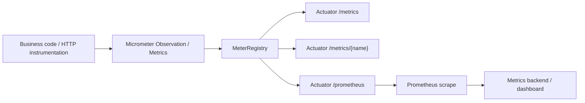
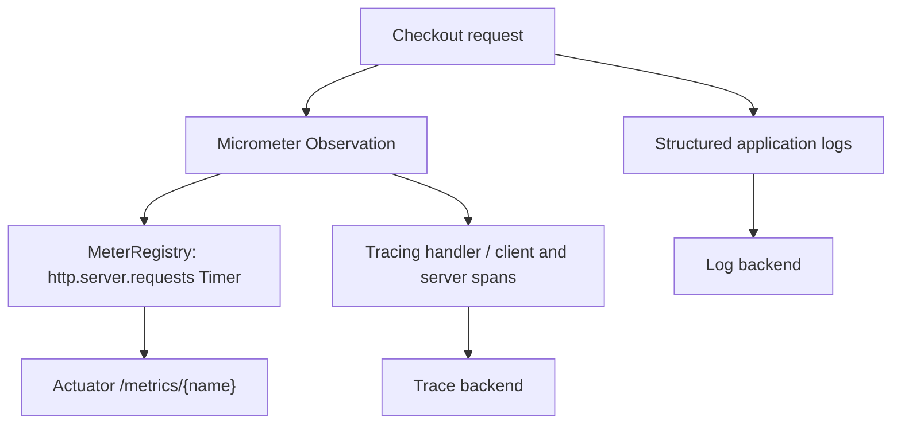

# Reading a Metric via the Spring Boot Actuator Metrics Endpoint

When operating a Spring Boot application, you may see a dashboard reporting that `/checkout` is slow or failed payments are rising. Before investigating Prometheus, exporters, or a tracing collector, a useful first question is: **is the application recording the expected metric directly in `MeterRegistry`?** Spring Boot Actuator provides the `/actuator/metrics/{metricName}` endpoint to look up a metric by name, inspect its measured values, and view available tag groups.

The lesson **Reading a Metric** belongs to the **Actuator metrics endpoint** chapter of the **SPRING_BOOT_OBSERVABILITY** module. In this system, Micrometer Observation records operations, metrics aggregate throughput and latency, logs provide events, and distributed tracing links request paths; context propagation, tags/cardinality, exporters, and sampling determine data quality across layers.

**Lesson objectives:** know how to open the endpoint to view *one* metric, interpret the returned JSON accurately, filter by tag, understand the limits of snapshot values, distinguish the Actuator Metrics Endpoint from the Prometheus endpoint, handle common errors, and keep management endpoints secure.

## 1. Two Easily Confused Paths

In a typical web Actuator configuration, there are two important URLs:

| URL | Function | Data Received |
| --- | --- | --- |
| `GET /actuator/metrics` | List metric names currently in the registry | JSON containing `names` |
| `GET /actuator/metrics/{metricName}` | Read information about **one** metric with a specific name | JSON containing name, description, unit, `measurements`, and `availableTags` |

Another endpoint is `GET /actuator/prometheus`: it serves the **Prometheus scrape** format when the Prometheus registry is installed and the endpoint is exposed. This endpoint is not the same as `/actuator/metrics/{name}` and is not the default way to filter a single metric using a `tag` parameter.

Basic flow:



**Reading a metric via Actuator does not prove it has reached the backend.** A measurement can exist inside the JVM while the Prometheus endpoint is disabled, the scrape target is failing, or the collector/exporter cannot deliver data.

## 2. Preparing Actuator and Accessing the Endpoint

In Spring Boot 3.x, the common starting point is adding Spring Boot Actuator:

```groovy
dependencies {
    implementation 'org.springframework.boot:spring-boot-starter-actuator'
}
```

Example configuration in `application.yml`:

```yaml
management:
  endpoints:
    web:
      exposure:
        include: health,info,metrics
```

When configured and permitted, an application on port 8080 can serve:

```text
http://localhost:8080/actuator/metrics
http://localhost:8080/actuator/metrics/jvm.memory.used
```

These are **illustrative paths and ports**. Actual results depend on Spring Boot version, endpoint access settings, Spring Security, `management.server.port`, `management.endpoints.web.base-path`, reverse proxies, and deployment configuration.

**Distinguish three concepts:**

1. **Endpoint available:** Actuator and auto-configuration create the endpoint.
2. **Endpoint exposed over HTTP:** `management.endpoints.web.exposure.include` enables web routing.
3. **Caller authorized to read:** the authentication/authorization layer or network restrictions can still return `401` or `403`.

Do not fix a `403` error by exposing every actuator endpoint publicly. In production, restrict management endpoints to an internal network or management interface, enable proper authentication/authorization, grant only needed read permissions, and audit access when required. Newer Spring Boot versions may support additional access policies at the Actuator layer; verify configuration for your exact version.

## 3. First Step: Find the Metric Name

To see which metrics the application currently has, call:

```bash
curl --fail-with-body http://localhost:8080/actuator/metrics
```

Illustrative response, abbreviated:

```json
{
  "names": [
    "application.ready.time",
    "http.server.requests",
    "jvm.memory.used",
    "process.cpu.usage",
    "system.cpu.usage"
  ]
}
```

`names` is simply **the list of meter names visible to the endpoint**. This is not a fixed catalog: binders, dependencies, JVM, traffic, Metrics configuration, and framework version all affect the list.

Some metrics are registered right at application startup; others appear only after real activity occurs. For example, `http.server.requests` might not exist yet when no HTTP request has been recorded or instrumentation is not enabled.

If the list does not include the name you need, do not immediately conclude the exporter is broken. First check whether the meter has been registered, whether code executed the recording branch, whether the application uses the right `MeterRegistry`, and whether any filter rejects the meter.

## 4. Reading a Specific Metric

Suppose the list includes `jvm.memory.used`. Call:

```bash
curl --fail-with-body http://localhost:8080/actuator/metrics/jvm.memory.used
```

**Illustrative** response, not real JVM measurements:

```json
{
  "name": "jvm.memory.used",
  "description": "The amount of used memory",
  "baseUnit": "bytes",
  "measurements": [
    {
      "statistic": "VALUE",
      "value": 184549376.0
    }
  ],
  "availableTags": [
    {
      "tag": "area",
      "values": ["heap", "nonheap"]
    },
    {
      "tag": "id",
      "values": ["G1 Eden Space", "G1 Old Gen", "Metaspace"]
    }
  ]
}
```

The response above is **abbreviated and hypothetical** to explain the format. Memory pools in the `id` field differ depending on the running JVM/GC; the actual value set may be larger, have different names, or differ from the example.

### Interpreting the JSON Fields

| Field | Meaning | How to Read Properly |
| --- | --- | --- |
| `name` | Logical meter/metric name in Micrometer | Name used to query via Actuator |
| `description` | Definition description of the measurement, if present | Helps clarify what is measured, not dynamic data |
| `baseUnit` | Base unit, if declared by the meter | E.g., `bytes`, `seconds`, or `null` |
| `measurements` | Statistical values provided by the meter | Read `statistic` together with `value`; do not guess meaning from the number alone |
| `availableTags` | Tag names and values available for filtering in the current registry | Helps discover dimensions, **not a table of individual records** |

Key point: if multiple meters share the same name with different tags, the endpoint may return an **aggregated result across measurements** when no tag filter is applied. Reading `jvm.memory.used` without tags can sum values across multiple areas/pools, depending on the metric and measurement. Thus saying "the JVM is using 184 MB of heap" would be **inaccurate** if that figure includes nonheap or aggregates multiple regions.

Reading a metric must be paired with the question: **"Do I want the value for the entire metric or for a specific tag group?"**

## 5. `measurements` Is Not Identical for Every Metric

Common statistics:

| Meter | Common Statistics | How to Interpret |
| --- | --- | --- |
| **Gauge** | `VALUE` | Current value when the endpoint is read; can go up or down |
| **Counter** | `COUNT` | Cumulative event count over the meter/registry lifetime |
| **Timer** | `COUNT`, `TOTAL_TIME`, `MAX` | Number of recordings, total duration, and maximum duration per the timer's time-window mechanism |
| **DistributionSummary** | `COUNT`, `TOTAL`, `MAX` | Number of recordings, total amount, and maximum value |
| **LongTaskTimer** | Statistics for in-progress tasks such as active tasks/duration | Should not be interpreted like a Timer for completed operations |

Not every meter emits all statistics. Available statistics can vary by meter implementation, histogram/percentile configuration, and Micrometer version.

For a Timer, an example response contains:

```json
{
  "name": "http.server.requests",
  "description": null,
  "baseUnit": "seconds",
  "measurements": [
    {"statistic": "COUNT", "value": 80.0},
    {"statistic": "TOTAL_TIME", "value": 12.0},
    {"statistic": "MAX", "value": 0.7}
  ],
  "availableTags": []
}
```

Numbers are hypothetical. If within the same observation set `COUNT = 80` and `TOTAL_TIME = 12 seconds`, the average duration **across the entire recorded set** is approximately:

\[
\frac{12}{80} = 0.15 \text{ seconds/recording}
\]

However:

- This is a calculation from the **current cumulative snapshot**, not average latency over the last 5 minutes.
- `MAX` usually follows **time-window maximum** semantics and can drop to 0 after a period with no data; do not assume it is the slowest request since startup.
- `COUNT` does not indicate requests/second from a single sample. You need samples over time and proper handling of counter resets.
- `TOTAL_TIME / COUNT` is not **p95** or p99.
- If the endpoint aggregates multiple tags, values may be sums across meters. An aggregated `MAX` is not necessarily a system-wide maximum.

For reliable p95/p99 across multiple instances, configure appropriate histograms/timers and query histograms through a supporting backend, rather than trying to infer p95 from `COUNT`, `TOTAL_TIME`, and `MAX` in a single JSON snapshot.

## 6. Filtering by Tag to Read the Right Data Group

The endpoint supports query parameters of the form:

```text
GET /actuator/metrics/{metricName}?tag=key:value
```

For example, viewing only **heap memory**:

```bash
curl --get \
  --data-urlencode 'tag=area:heap' \
  http://localhost:8080/actuator/metrics/jvm.memory.used
```

For multiple conditions, pass **multiple `tag` parameters**:

```bash
curl --get \
  --data-urlencode 'tag=method:GET' \
  --data-urlencode 'tag=status:200' \
  http://localhost:8080/actuator/metrics/http.server.requests
```

Here the conditions perform **exact matching** on tag/value pairs. Two conditions mean "method is GET **and** status is 200", not OR, wildcards, or regular expressions. Do not assume `tag=status:5xx` will automatically match all 5xx statuses; grouping 5xx over time is typically done via backend queries such as PromQL.

If a value contains spaces, braces, `:`, or special characters, use URL encoding instead of manual string concatenation. For example, to match the exact URI template:

```bash
curl --get \
  --data-urlencode 'tag=uri:/orders/{id}' \
  --data-urlencode 'tag=method:GET' \
  http://localhost:8080/actuator/metrics/http.server.requests
```

`curl --data-urlencode` encodes each query parameter safely for URL syntax. It **does not replace data security policies**: do not put secrets or identifying information in URLs, as access logs and proxies can record query strings.

### Example Response After Filtering

```json
{
  "name": "http.server.requests",
  "baseUnit": "seconds",
  "measurements": [
    {"statistic": "COUNT", "value": 28.0},
    {"statistic": "TOTAL_TIME", "value": 4.2},
    {"statistic": "MAX", "value": 0.35}
  ],
  "availableTags": [
    {"tag": "uri", "values": ["/orders/{id}", "/health"]}
  ]
}
```

This is also a simplified example. Which remaining tags appear in `availableTags`, as well as exact names and values, depend on registered meters and applied filters. `availableTags` helps discover selectable tag sets; **it does not mean the result is a list of 28 requests** or 28 traces.

When a filter matches nothing, the endpoint may find no matching meter and return an error (typically `404`); verify actual tag names and values rather than guessing.

## 7. Testing with PowerShell on Windows

In PowerShell, the command name `curl` in some environments can be an alias for `Invoke-WebRequest`, so flag syntax does not always match real `curl`. You can use `Invoke-RestMethod`:

```powershell
$base = "http://localhost:8080"

# List names:
Invoke-RestMethod -Uri "$base/actuator/metrics"

# Read a single metric:
Invoke-RestMethod -Uri "$base/actuator/metrics/jvm.memory.used"

# Filter area=heap:
Invoke-RestMethod -Uri "$base/actuator/metrics/jvm.memory.used?tag=area%3Aheap"
```

If using `curl.exe` on Windows, you can use `--get` and `--data-urlencode` flags just like the Bash examples. These commands are only for verification in authorized environments; for production management endpoints, use secure protocols and valid authorization.

## 8. Creating a Business Metric and Reading It via Actuator

To see the entire process, let's create a counter tracking processed checkouts by `outcome`. Distinguish between **registering a meter** and **incrementing its value**.

```java
import io.micrometer.core.instrument.Counter;
import io.micrometer.core.instrument.MeterRegistry;
import org.springframework.stereotype.Service;

@Service
public class CheckoutMetrics {
    private final Counter accepted;
    private final Counter rejected;

    public CheckoutMetrics(MeterRegistry registry) {
        accepted = Counter.builder("checkout.orders.processed")
            .description("Completed checkout operations by outcome")
            .baseUnit("orders")
            .tag("outcome", "accepted")
            .register(registry);

        rejected = Counter.builder("checkout.orders.processed")
            .description("Completed checkout operations by outcome")
            .baseUnit("orders")
            .tag("outcome", "rejected")
            .register(registry);
    }

    public void recordAccepted() {
        accepted.increment();
    }

    public void recordRejected() {
        rejected.increment();
    }
}
```

This is an instrumentation class, not a complete API. In the business processing layer, call `recordAccepted()` or `recordRejected()` **exactly once when the final outcome is determined**. Do not count both a retry and the final success if the goal is "processed checkouts". If there is concurrency or transactions requiring strong consistency, a meter cannot replace the business database.

Because the two Counters are registered with two different tag values, they are two distinct meters in the registry:

```text
checkout.orders.processed{outcome="accepted"}
checkout.orders.processed{outcome="rejected"}
```

After three calls to `recordAccepted()` and one call to `recordRejected()`, query:

```bash
curl http://localhost:8080/actuator/metrics/checkout.orders.processed
```

Example result:

```json
{
  "name": "checkout.orders.processed",
  "description": "Completed checkout operations by outcome",
  "baseUnit": "orders",
  "measurements": [
    {"statistic": "COUNT", "value": 4.0}
  ],
  "availableTags": [
    {"tag": "outcome", "values": ["accepted", "rejected"]}
  ]
}
```

**`COUNT = 4` is the sum** from the two meters across both outcomes in this example. To see only successful checkouts:

```bash
curl --get \
  --data-urlencode 'tag=outcome:accepted' \
  http://localhost:8080/actuator/metrics/checkout.orders.processed
```

Then `COUNT` will be 3 if no new calls occurred and the registry has not reset. A result of 4 or 3 only describes the current state of the registry/application; a restart usually causes cumulative counters to start over.

**Tag design:** `outcome` only has two known values, suitable for low cardinality. Do not add `orderId`, `customerEmail`, or `traceId` to the Counter because they can create huge numbers of time series and leak data.

## 9. Unit Testing Before Reading the Real Endpoint

When you need to verify `CheckoutMetrics` works without starting the Spring Boot web server, use `SimpleMeterRegistry`:

```java
import io.micrometer.core.instrument.Counter;
import io.micrometer.core.instrument.simple.SimpleMeterRegistry;
import org.junit.jupiter.api.Test;
import static org.junit.jupiter.api.Assertions.*;

class CheckoutMetricsTest {
    @Test
    void recordsAcceptedAndRejectedCounts() {
        try (SimpleMeterRegistry registry = new SimpleMeterRegistry()) {
            CheckoutMetrics metrics = new CheckoutMetrics(registry);

            metrics.recordAccepted();
            metrics.recordAccepted();
            metrics.recordRejected();

            Counter accepted = registry.find("checkout.orders.processed")
                .tag("outcome", "accepted").counter();
            Counter rejected = registry.find("checkout.orders.processed")
                .tag("outcome", "rejected").counter();

            assertNotNull(accepted);
            assertNotNull(rejected);
            assertEquals(2.0, accepted.count());
            assertEquals(1.0, rejected.count());
        }
    }
}
```

The test above proves the code registers and increments the Counter in `MeterRegistry` properly. It **does not prove** Actuator has exposed the endpoint, security permits access, Prometheus can scrape it, or an exporter delivered numbers to a collector. To verify those, you need a Spring context test or integration test with the respective components.

A minimal integration test step is starting the application in a test environment, triggering the operation that creates the metric, then reading `/actuator/metrics/checkout.orders.processed` and verifying `COUNT` and `availableTags`. If Spring Boot tests disable observability auto-configuration in the test context depending on config/version, enable the needed parts; for a business Counter registered directly as here, the bean/registry and execution path must still be correct.

## 10. HTTP Request Metric: Reading Method, URI, and Status Properly

A common metric in Spring Boot is `http.server.requests`, representing a Timer measuring **inbound** HTTP requests. When handling `GET /orders/123`, the `uri` tag value should be a template like `/orders/{id}` if the framework recognizes the route, rather than the raw path `/orders/123`.

Verification example after generating requests:

```bash
curl --get \
  --data-urlencode 'tag=method:GET' \
  --data-urlencode 'tag=uri:/orders/{id}' \
  --data-urlencode 'tag=status:200' \
  http://localhost:8080/actuator/metrics/http.server.requests
```

Tag names such as `method`, `uri`, `status`, `outcome`, and `exception` are common in Spring HTTP server instrumentation, **but are not an immutable contract across all versions**. Before using them, read the metric without filters to see the actual `availableTags`.

From the response you can learn:

- `COUNT`: how many HTTP requests **were recorded by the Timer** with the filtered tags.
- `TOTAL_TIME`: total duration of that group in `baseUnit`.
- `MAX`: maximum measurement according to meter/time-window semantics.
- `availableTags`: other groups you can inspect further, such as 4xx/5xx statuses or other methods.

Do not read `COUNT` and treat it as the number of *users*, *orders*, or *successful business transactions*. HTTP metrics count HTTP requests, including retries, errors, and responses that do not generate a transaction.

If a project uses a different convention or instrumentation, the name `http.server.requests` can also differ. **Outbound** HTTP client metrics typically use `http.client.requests`; the two measure different boundaries.

## 11. Reading a Metric Is Not Querying Time-Series Data

`GET /actuator/metrics/{name}` is a **diagnostic** tool to read a current snapshot inside the application. It does not return multi-minute charts, does not store history, and does not compute cluster-wide aggregated percentiles.

| Want to Know | Is Actuator Metrics Endpoint Suitable? | What to Do When Deeper Insight Is Needed |
| --- | --- | --- |
| Does the meter exist? | Very suitable | `GET /actuator/metrics` then pick the name |
| Current Counter value on an instance | Suitable | `GET /actuator/metrics/{name}` |
| Currently available tag values | Suitable | Inspect `availableTags` |
| Count for a route and status | Suitable if those tags exist | Add multiple `tag` query parameters |
| Error rate over 5 minutes | **Insufficient from a single snapshot** | Use a backend with history, e.g., PromQL `rate(...)` |
| Multi-instance p95 latency | **Insufficient from COUNT/TOTAL_TIME/MAX alone** | Histogram buckets and aggregated queries |
| Which specific request timed out | No per-request detail | Traces + correlated logs |
| Monthly trend analysis | Not this endpoint's purpose | Metrics backend with retention and dashboards |

If you need **RPS** and error rate over time, a common deployment path is Prometheus registry + scrape + PromQL. For example, with a Timer metric exported as `http_server_requests_seconds_count`:

```promql
sum(rate(http_server_requests_seconds_count[5m]))
```

Ratio of requests with status 5xx:

```promql
sum(rate(http_server_requests_seconds_count{status=~"5.."}[5m]))
/
sum(rate(http_server_requests_seconds_count[5m]))
```

These queries are **illustrative**: exported metric names, labels, and encoding depend on registry, version, and instrumentation. A ratio filtering only HTTP 5xx does not cover all business errors, connection errors, or cancellations.

In Prometheus, counters can reset when an application restarts; use `rate` or `increase` to handle counter resets properly. Taking two snapshots manually and subtracting directly is unreliable across restarts, missed samples, or multiple instances.

## 12. Differences from `/actuator/prometheus`

After adding the Prometheus registry and exposing the appropriate endpoint:

```groovy
dependencies {
    implementation 'org.springframework.boot:spring-boot-starter-actuator'
    runtimeOnly 'io.micrometer:micrometer-registry-prometheus'
}
```

```yaml
management:
  endpoints:
    web:
      exposure:
        include: health,info,metrics,prometheus
```

Comparing the two outputs:

| Attribute | `/actuator/metrics/{name}` | `/actuator/prometheus` |
| --- | --- | --- |
| Format | Friendly JSON to inspect one metric | Prometheus exposition format |
| Metric selection | By path name and `tag` parameters | Usually returns all series exported by the registry |
| Metric name | Micrometer logical name like `http.server.requests` | Standardized Prometheus name, e.g. `http_server_requests_seconds_count` |
| Values | Aggregated statistics such as `COUNT`, `TOTAL_TIME`, `MAX` | Time series/samples and histogram buckets if enabled |
| Purpose | Per-instance debugging, verifying names/tags | Automated scraping and storage over time |
| Prerequisites | Actuator metrics endpoint enabled, exposed, and authorized | Add Prometheus registry, expose endpoint, configure scrape/permissions |

**Do not immediately treat differences in numbers between Actuator JSON and Prometheus as a bug.** The two paths may differ in naming rules, collection timestamps, time windows, histograms, and registry filters. Compare the same instance, same tag set, and same point in time when verifying.

## 13. Troubleshooting 404, 401, 403, or Unexpected JSON

| Symptom | Possible Cause | How to Check |
| --- | --- | --- |
| `GET /actuator/metrics` returns 404 | Endpoint not exposed, different base path/port, disabled, or Actuator missing | Check dependencies, web exposure config, management port/base path |
| Names list exists, reading one name returns 404 | Wrong name, not registered yet, meter filtered, or no traffic yet | Copy exact name from `names`, trigger code, and read again |
| Reading with `tag` returns 404 | No meter with that name matches all conditions | Check `availableTags`, key names, values, and URL encoding |
| Returns 401 or 403 | Authentication/authorization denies access | Check access policy; do not carelessly disable security |
| `COUNT=0` | Counter not incremented, Timer hasn't recorded, or post-restart | Check instrumentation point, invocation, and lifecycle |
| `availableTags` empty | No other dimensions to list in that result or already filtered | Check registry, filters, and meter purpose |
| `MAX` is 0 despite previous slow requests | Time-window maximum expired or different registry | Check Timer config, time window, and historical data |
| No p95 visible | Endpoint only returns certain statistics; histogram not enabled | Check metrics distribution config and backend histograms |
| Metric on Actuator, missing in backend | Registry/exporter/scrape/collector failure | Check `/actuator/prometheus`, targets, and pipeline |
| Value higher than expected request count | Aggregating multiple tags, counting attempts/retries, or metric measures different logic | Filter specific tags, review meter definition |

Troubleshoot in the order **path → access permissions → metric name → tags → registry/handler → export/backend**. Jumping straight to editing dashboards without verifying the source endpoint wastes time and easily misses the root cause.

### Avoiding the "Reading the Endpoint Changes the Metric" Trap

A request calling Actuator is also an HTTP request to the application/management server; depending on instrumentation, it may be counted in HTTP server metrics. Because a Timer usually records when a request completes, numbers at the exact moment of reading may **not yet include the current read**. In tests, measure a specific business counter/Timer rather than expecting overall HTTP metrics to increment cleanly per management endpoint call.

## 14. Metrics Are Aggregated Data, Not Traces or Logs

A `POST /checkout` request can produce:



When querying `/actuator/metrics/http.server.requests`, you see **aggregated** numbers such as COUNT and TOTAL_TIME. You **do not see** the request body, detailed exception, stack trace, individual request timestamps, or individual trace IDs. That limitation is by design so metrics can group with bounded cardinality.

To track down the root cause of a slow request:

1. Use metrics to identify the **route/status/time window** with anomalous latency or error rate.
2. Use distributed tracing to inspect **client/server spans** and which dependency took time.
3. Use logs correlated with `traceId`/`spanId` to read error codes, retries, or business events.
4. Cross-check multiple requests and downstream metrics before concluding root cause.

**Sampling:** unsampled or unexported traces can still contribute to metrics. Hence from a Timer's COUNT you cannot deduce how many traces exist in the backend. **Propagation:** tracing only connects spans across HTTP/async/messaging when context is properly propagated and extracted; querying metrics will not fix broken propagation.

Do not put `traceId`, `userId`, token, email, or order ID into metric tags. If you need per-request correlation, use secure tracing/logging rather than creating a separate time series per person or transaction.

## 15. Cardinality and Security Rules When Reading the Endpoint

Which values appear in `availableTags` depends on **which tags instrumentation created**. If raw URLs, customer IDs, or arbitrary exception messages appear there, the problem lies in the telemetry design itself, not in the read command.

Rules to apply:

- **Use route templates** like `/orders/{id}` instead of `/orders/92817` to keep cardinality low.
- **Keep value sets bounded** for `outcome`, `status`, `method`, `region`, and business categories.
- **Do not include sensitive data** in metric names, tag keys/values, or debug query URLs.
- **Do not treat high-cardinality avoidance as permission to log PII**: logs/traces also need appropriate policies.
- **Restrict access to management endpoints**, because even non-secret data can reveal topology, aggregate user behavior, or service activity.
- **Assess scale:** each tag combination can create a separate meter/time series. For instance, 3 outcomes × 4 regions × 5 methods equals up to 60 combinations from just those three labels.

If you only want to check checkout outcomes, use `tag=outcome:accepted`; do not add `orderId` to the metric to look up a single order. Individual business data needs different query/authorization mechanisms.

## 16. Illustrative Scenario: Checkout p95 Rises While Dashboard Is Empty

**Hypothetical context:** after a deploy, users report `POST /checkout` is slow. The Prometheus dashboard shows no updates from a new instance, while developers believe Actuator was enabled.

A sound troubleshooting workflow:

1. **Right address?** Find the actual management port and base path, and confirm access to `/actuator/metrics`.
2. **Metric exists?** Does `names` contain `http.server.requests`? If not, trigger a controlled checkout request and check instrumentation.
3. **Read one metric:** call `/actuator/metrics/http.server.requests` to inspect `COUNT`, `TOTAL_TIME`, `MAX`, and `availableTags`.
4. **Filter the right route:** use `tag=uri:/checkout` and `tag=method:POST`, and verify whether count increases after test requests. Exact route labels must come from `availableTags`.
5. **Check metric export:** if Actuator has data while Prometheus is empty, inspect the Prometheus registry, `/actuator/prometheus`, scrape target, network, TLS/authentication, relabeling, and collector if present.
6. **Analyze trends:** once data reaches the backend, use rates and histograms to compute throughput, error ratio, and p95 over an appropriate window; do not compute p95 from a single JSON snapshot.
7. **Find application root cause:** if p95 genuinely increased, open sampled traces and logs sharing the same trace ID to identify payment timeouts, slow inventory, or retries.

If step 3 shows good values while step 5 fails, that points the investigation toward the **export/scrape pipeline**, rather than claiming the application lacks instrumentation. If the metric does not exist in step 2, check the registry and code before changing dashboards.

## 17. Self-Check Exercises

**Exercise 1.** `GET /actuator/metrics` returns a list containing `jvm.memory.used`. To view only heap, what do you call?

*Hint:* `GET /actuator/metrics/jvm.memory.used?tag=area:heap`, URL-encoding special characters when writing real requests.

**Exercise 2.** `/actuator/metrics/http.server.requests` returns `COUNT=200` and `TOTAL_TIME=40` (baseUnit seconds). Can you conclude p95 is 200 ms?

*Hint:* No. `40/200=0.2s` is only the mean across the measured set. p95 requires an appropriate distribution/histogram, and a snapshot does not automatically reflect a 5-minute window.

**Exercise 3.** You add `tag=status:500` and receive 404. Can you conclude the entire application no longer has the `http.server.requests` metric?

*Hint:* No. The metric may exist while no request has matched that exact condition yet. Read without tags and inspect `availableTags`.

**Exercise 4.** A `checkout.orders.processed` Counter has two outcomes: accepted 7 and rejected 3. What will you see when reading without tags?

*Hint:* Typically an aggregated COUNT of 10. Add `tag=outcome:accepted` to retrieve only accepted counts, assuming no changes occur between the two reads.

**Exercise 5.** An instance shows metrics on Actuator, but Prometheus receives none. What do you check?

*Hint:* Prometheus registry, `/actuator/prometheus`, scrape target, endpoint security, networking, relabeling, and collector/exporter; Actuator JSON does not prove the export path succeeded.

**Exercise 6.** Why should `traceId` or `orderId` not be placed in a low-cardinality tag just to query a single request?

*Hint:* Nearly unique IDs create many time series and can expose data; use tracing/log correlation or properly authorized business data systems.

**Exercise 7.** A metric has a COUNT of 500 requests, yet the trace backend only has 20 traces. Is the data contradictory?

*Hint:* Not necessarily. Metrics and tracing sampling/exporters are separate. A request can contribute to metrics even when its trace is not sampled or stored.

**Exercise 8.** Requests to `/actuator/metrics` cause `http.server.requests` values to change. Can that happen?

*Hint:* Yes, if management endpoints are recorded by HTTP instrumentation. Identify routes/tags and note that measurements typically complete after the response.

## 18. Key Takeaways

- **`GET /actuator/metrics`** lists metric names; **`GET /actuator/metrics/{name}`** reads **one** metric and its current statistics/tags.
- The JSON contains `name`, `description`, `baseUnit`, `measurements`, and `availableTags`. Always read `statistic` together with `value` and check when meters are aggregated.
- Use **`tag=key:value`** to filter; repeat `tag` for multiple conditions and URL-encode special values. Do not confuse exact tag filters with regex/wildcards.
- Actuator snapshots **do not replace** historical data: do not infer windowed RPS or p95 from `COUNT`, `TOTAL_TIME`, and `MAX` of a single read.
- `/actuator/prometheus` serves Prometheus scrape format and requires the corresponding registry; having a metric in the JVM **does not guarantee** the exporter/backend received it.
- Protect Actuator endpoints and **keep metric tags low-cardinality and free of secrets/PII**. When troubleshooting, verify from registry to exporter/backend, then combine metrics with logs and traces to find root cause.
