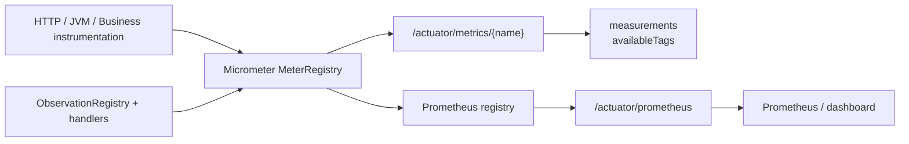
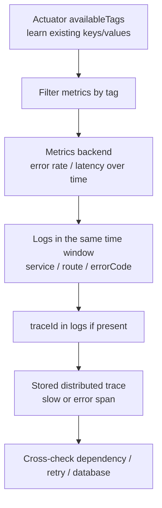

# Available Tags List in the Spring Boot Actuator Metrics Endpoint

Suppose a Spring Boot system returns an unusual spike in HTTP 5xx responses and the operations team wants to know **which HTTP method, which route, and which status** the errors come from. On an application with Actuator enabled, `/actuator/metrics/http.server.requests` can return **`availableTags`**: the tag names and tag values currently present across meters with that name. This is a convenient starting point for identifying which dimensions can be filtered before building dashboards or querying Prometheus.

The lesson **Available Tags List** belongs to the **Actuator metrics endpoint** chapter of the **SPRING_BOOT_OBSERVABILITY** module. The module aims to set up observability for Spring Boot using Micrometer Observation, metrics, logs, and distributed tracing; understand context propagation, tags/cardinality, exporters, sampling, and how to correlate signals to investigate errors, latency, and application behavior in production. This lesson focuses on **the `availableTags` structure, tag-based filtering, and interpreting results** to avoid mistaken conclusions about metric data.

## 1. Learning Objectives

After this lesson, you will be able to:

- Distinguish the endpoint that lists **meter names** from the endpoint that returns **measurements and available tags** of a specific meter.
- Explain accurately what `availableTags[].tag` and `availableTags[].values` mean.
- Use `tag=key:value` queries, including multiple tag conditions, to filter measurements.
- Read Actuator JSON responses for `Timer` and `Counter` and distinguish statistics such as `COUNT`, `TOTAL_TIME`, and `MAX`.
- Create a simple custom metric with bounded tags, then observe the values appearing in `availableTags`.
- Recognize limitations: the value list does not prove every label combination exists, contains no time history, and is not a replacement for PromQL.
- Identify why the endpoint might lack a tag, lack a meter, or display unexpected values; address cardinality and security issues.
- Correlate metric tags with logs, distributed tracing, and trace context during incident investigation.

## 2. Two Actuator Endpoints to Distinguish

Spring Boot Actuator provides an HTTP interface to inspect meters registered in `MeterRegistry`. The default paths in a web application are:

| Endpoint | Function | Example |
| --- | --- | --- |
| `GET /actuator/metrics` | List **existing meter names** | `http.server.requests`, `jvm.memory.used`, `process.uptime` |
| `GET /actuator/metrics/{metricName}` | View measurements and **availableTags** for a meter name | `/actuator/metrics/http.server.requests` |
| `GET /actuator/metrics/{metricName}?tag=key:value` | Filter measurements by a specific tag | `?tag=method:POST` |
| `GET /actuator/prometheus` | Export metrics in Prometheus scrape format if the corresponding registry is present | `http_server_requests_seconds_count` and its labels |

**Important:** `/actuator/metrics` is an interface for **inspecting application metrics**. `/actuator/prometheus` serves the scrape/exporter system. The two endpoints have different data structures and naming conventions. A Micrometer meter name such as `http.server.requests` may be exported to Prometheus as series names like `http_server_requests_seconds_count` or `http_server_requests_seconds_sum` depending on version, configuration, and meter type.

The `/actuator/metrics/{metricName}` endpoint uses the **Micrometer-side meter name**, such as `http.server.requests`, not the series name converted for Prometheus.

### Data Flow



The `availableTags` list reflects meters **known to the registry at query time**. It is neither a consolidated catalog across all backends nor a query against historical data already stored by Prometheus.

## 3. JSON Response Structure

Example query:

```http
GET /actuator/metrics/http.server.requests
```

Assuming the application has received a few HTTP requests, an **illustrative** response looks like:

```json
{
  "name": "http.server.requests",
  "description": "Duration of HTTP server requests",
  "baseUnit": "seconds",
  "measurements": [
    { "statistic": "COUNT", "value": 48.0 },
    { "statistic": "TOTAL_TIME", "value": 7.2 },
    { "statistic": "MAX", "value": 0.85 }
  ],
  "availableTags": [
    { "tag": "method", "values": ["GET", "POST"] },
    { "tag": "status", "values": ["200", "400", "500"] },
    { "tag": "uri", "values": ["/orders", "/orders/{id}"] },
    { "tag": "exception", "values": ["None", "IllegalStateException"] }
  ]
}
```

This is **hypothetical data for learning how to read the JSON**, not a guaranteed output across every Spring Boot application. Tag names like `method`, `status`, `uri`, `exception`, how a "no error" value is represented, meter names, and actual measurements depend on version, framework instrumentation, `ObservationConvention`/`MeterFilter`, and recorded requests.

### Explaining Each Field

| Field | Meaning |
| --- | --- |
| `name` | Requested Micrometer meter name |
| `description` | Meter description, if available |
| `baseUnit` | Base unit, e.g. `seconds` for a timer |
| `measurements` | Statistics and aggregated values for matching meters |
| `availableTags` | List of **tag names** and **available/observed values** across the matching meter set |
| `availableTags[].tag` | Name of a classification dimension, such as `method` |
| `availableTags[].values` | Distinct known values for that dimension, such as `GET`, `POST` |

With the sample data, `method` has two values `GET` and `POST`. That **does not say each method had 24 requests**, nor does it prove both appeared on every route. Likewise, `status` containing `500` does not mean every method or uri returned 500.

### Distinguishing Available Tags from Request Counts

In the response above:

- `COUNT=48`: number of timer recordings across the inspected meter set, not the number of tag values.
- `TOTAL_TIME=7.2` seconds: total duration of the recordings included in the aggregation.
- `MAX=0.85` seconds: maximum per the timer's statistical window/implementation; not necessarily the highest value since application startup.
- `availableTags[].values`: set of **distinct values**, carrying no per-value count.

To learn the count specifically for `POST` requests, you must **filter by tag**. To see the requests/second trend over 5 minutes, you need backend time-series data, not just an Actuator snapshot.

## 4. Why availableTags Does Not Show Every Label Combination

Suppose the registry holds three actual tag sets:

| Method | Status | URI | Count |
| --- | --- | --- | ---: |
| `GET` | `200` | `/orders` | 20 |
| `POST` | `200` | `/orders` | 10 |
| `POST` | `500` | `/orders` | 2 |

The list of distinct values is:

- `method`: `GET`, `POST`.
- `status`: `200`, `500`.
- `uri`: `/orders`.

If you take the Cartesian product of values, you might assume `GET + 500 + /orders` exists, yet in the example **that label set does not exist**. `availableTags` only presents value sets per dimension; it does not represent exact relationships across all dimensions.

To check whether a combination has data, query with **multiple tag filters**:

```http
GET /actuator/metrics/http.server.requests?tag=method:GET&tag=status:500
```

The example query can only return measurements for meters matching **both conditions simultaneously**. Do not infer from the independent presence of `GET` and `500` in `availableTags`. Exact behavior when no meter matches depends on endpoint version; inspect the response/status and distinguish it from access errors.

## 5. Filtering Metrics with `tag=key:value`

The Actuator Metrics endpoint accepts a query parameter in the form:

```text
/actuator/metrics/{metricName}?tag=<tag-name>:<tag-value>
```

For example, filtering the HTTP server timer by method:

```http
GET /actuator/metrics/http.server.requests?tag=method:POST
```

Only meters with `method=POST` are included in the measurement aggregation of the filtered result.

### 5.1. Multiple Conditions: Repeating the `tag` Parameter

```http
GET /actuator/metrics/http.server.requests?tag=method:POST&tag=status:500
```

Conditions in the standard form narrow the meter set using **logical AND**: the same meter must match method `POST` and status `500`. With a third tag:

```http
GET /actuator/metrics/http.server.requests?tag=method:POST&tag=status:500&tag=uri:/orders
```

The result contains measurements of meters matching all three conditions; it does not mean the endpoint returns logs or a list of individual requests.

### 5.2. Case Sensitivity and Exact Values

Tag values can be case-sensitive. For example, `method=POST` is usually not equivalent to `method=post`. If the system records `status=500`, do not query `status=5xx` unless instrumentation actually creates a `5xx` tag. If routes are recorded as templates `uri=/orders/{id}`, use the exact template value instead of the concrete URL `/orders/123`.

To avoid mistakes, **inspect `availableTags` first**, then use the exact values from the response for needed filters.

### 5.3. URL Encoding and Special Characters

Tag values may contain spaces, `&`, `#`, `/`, or `:`. When sending URLs, URL-encode query parameters properly. Using `curl -G --data-urlencode` reduces errors:

```bash
curl -sG 'http://localhost:8080/actuator/metrics/http.server.requests' \
  --data-urlencode 'tag=method:POST' \
  --data-urlencode 'tag=uri:/orders/{id}'
```

In PowerShell, you can use `curl.exe` instead of the `curl` alias for `Invoke-WebRequest` in some versions:

```powershell
curl.exe -sG 'http://localhost:8080/actuator/metrics/http.server.requests' --data-urlencode 'tag=method:POST' --data-urlencode 'tag=status:500'
```

The URLs above assume the application runs locally on port 8080, the base path has not changed, and the caller is authorized. In production, paths, management port, and authentication may differ.

## 6. Preparing Spring Boot Actuator

For a Spring Boot 3.x project using Gradle Kotlin DSL, the minimal dependency for the metrics endpoint is:

```kotlin
dependencies {
    implementation("org.springframework.boot:spring-boot-starter-actuator")
}
```

If you want to run the REST Controller example in the next section, the application also needs the web starter:

```kotlin
dependencies {
    implementation("org.springframework.boot:spring-boot-starter-web")
}
```

Let the Spring Boot BOM manage compatible dependency versions. Actuator/Micrometer can provide `/actuator/metrics` **without** the Prometheus registry. Only when `/actuator/prometheus` is needed should you add the Prometheus export registry, for example:

```kotlin
dependencies {
    runtimeOnly("io.micrometer:micrometer-registry-prometheus")
}
```

### Enabling the Metrics Endpoint

Example `application.yml`:

```yaml
spring:
  application:
    name: order-service

management:
  endpoints:
    web:
      exposure:
        include: health,info,metrics
  metrics:
    tags:
      application: ${spring.application.name}
      environment: ${APP_ENV:local}
```

Notes:

1. `management.endpoints.web.exposure.include` determines which endpoints are allowed to be **exposed over HTTP**. In many default configurations, `metrics` is not exposed to the web, so it must be declared if you want to call it externally.
2. `management.metrics.tags` adds **common tags** to meters managed by Spring Boot's registry. The `application` and `environment` tags describe the source of metrics.
3. Actuator endpoints may be protected by Spring Security or organizational security policies; an exposed endpoint does not mean everyone can access it.
4. Management server port or base path configuration can change the actual URL; check deployment configuration before testing.

For example, `APP_ENV=prod` sets `environment=prod`; if the environment variable is unset, it falls back to `local`. Operations teams should standardize values, avoiding `prod`, `production`, and `prd` all referring to the same environment.

## 7. Example: Creating a Meter with Easily Verifiable `availableTags`

To intentionally produce several tag values, let's build a demo endpoint recording a `Counter` for checkout attempts. The goal is **getting familiar with `availableTags`**; the "success/error" logic is simulated via parameters, not how payment outcomes are determined in a real product.

### 7.1. REST Controller and Counter

```java
import io.micrometer.core.instrument.MeterRegistry;
import org.springframework.http.ResponseEntity;
import org.springframework.web.bind.annotation.PostMapping;
import org.springframework.web.bind.annotation.RequestMapping;
import org.springframework.web.bind.annotation.RequestParam;
import org.springframework.web.bind.annotation.RestController;

@RestController
@RequestMapping("/demo/checkouts")
public class CheckoutDemoController {

    private final MeterRegistry registry;

    public CheckoutDemoController(MeterRegistry registry) {
        this.registry = registry;
    }

    @PostMapping
    public ResponseEntity<String> checkout(
            @RequestParam(defaultValue = "web") String channel,
            @RequestParam(defaultValue = "success") String result) {

        String safeChannel = switch (channel) {
            case "web", "mobile", "partner" -> channel;
            default -> "unknown";
        };
        String outcome = "error".equals(result) ? "error" : "success";

        registry.counter(
            "business.checkout.attempts",
            "channel", safeChannel,
            "outcome", outcome
        ).increment();

        if ("error".equals(outcome)) {
            return ResponseEntity.status(503).body("simulated failure");
        }
        return ResponseEntity.ok("simulated success");
    }
}
```

Explanation:

- Counter `business.checkout.attempts` counts demo operations processed; `channel` and `outcome` are **meter-specific** tags.
- `channel` values are mapped to the bounded set `web`, `mobile`, `partner`, `unknown`.
- `outcome` only accepts `success` or `error` in the example. This avoids creating a new meter for every arbitrary input string.
- Do not place request ID, email, `orderId`, or payload in metric labels because they have very high cardinality and may be sensitive.
- If `management.metrics.tags.application` and `environment` are configured, common tags are applied alongside `channel` and `outcome` on the Boot-configured registry.

### 7.2. Generating Data

Call the demo endpoint a few times:

```bash
curl -s -X POST 'http://localhost:8080/demo/checkouts?channel=web&result=success'
curl -s -X POST 'http://localhost:8080/demo/checkouts?channel=web&result=success'
curl -s -X POST 'http://localhost:8080/demo/checkouts?channel=mobile&result=error'
```

After these three requests, assuming the application just started, no prior demo requests occurred, and every request reached the Controller, the Counter has total `COUNT=3`; tag `channel` has `web` and `mobile`, and `outcome` has `success` and `error`.

### 7.3. Reading the Available Tags List

```http
GET /actuator/metrics/business.checkout.attempts
```

Illustrative response:

```json
{
  "name": "business.checkout.attempts",
  "measurements": [
    { "statistic": "COUNT", "value": 3.0 }
  ],
  "availableTags": [
    { "tag": "channel", "values": ["web", "mobile"] },
    { "tag": "outcome", "values": ["success", "error"] },
    { "tag": "application", "values": ["order-service"] },
    { "tag": "environment", "values": ["local"] }
  ]
}
```

The ordering of elements and values in `availableTags` **does not need to match** the example. Fields such as `description` or `baseUnit` may be absent if the meter does not provide them. If you run another request with `channel=partner`, the value `partner` can appear in `availableTags` once the Counter is recorded with that new tag combination.

Do not infer from the two value sets that `mobile + success` must have occurred: in the simulated requests above, only `mobile + error` ran.

### 7.4. Filtering an Exact Combination

```http
GET /actuator/metrics/business.checkout.attempts?tag=channel:web
GET /actuator/metrics/business.checkout.attempts?tag=channel:mobile&tag=outcome:error
```

With clean demo data, filtering `channel=web` yields `COUNT=2`; filtering `channel=mobile AND outcome=error` yields `COUNT=1`. This is the **cumulative counter count in the process**, not a per-minute request rate, and provides no history across process restarts.

If a filter matches no meter, results can differ by endpoint version. Inspect the actual HTTP status and JSON; do not treat missing numbers as conclusive proof that the application has never handled a matching request.

## 8. Where Do `availableTags` Values Come From?

A meter can receive tags from multiple layers. When inspecting `availableTags`, understand **where each tag originates**:

| Source | Example Tag | Characteristics |
| --- | --- | --- |
| Application-authored meter | `channel=web`, `outcome=error` | Passed by code when creating/registering Counter, Timer, Gauge |
| Spring HTTP instrumentation | `method=POST`, `status=503`, `uri=/demo/checkouts` | Generated by framework conventions, depending on version |
| Micrometer Observation | `operation=reserve`, `outcome=success` | Low-cardinality key-values can become meter tags via a handler |
| Common tags | `application=order-service`, `environment=prod` | Configured on `MeterRegistry`, applied broadly |
| `MeterFilter` | Rename, drop, or limit meters or tags | Can alter what the registry actually registers |
| Exporter/Prometheus labels | `job`, `instance`, `pod` | May appear **after** the Actuator stage via scrape/collector |

**Not every label in Prometheus appears in Actuator `availableTags`.** Prometheus may add `job` and `instance` during scraping, while Micrometer inside the application knows nothing about those labels. Conversely, a tag present in Actuator is not guaranteed to keep the same name in the backend after mapping, relabeling, or filtering.

### Tag Conventions and HTTP Paths

For HTTP server metrics, `uri` should normally be a **route template** with a bounded value set, such as `/orders/{id}`. If actual URLs like `/orders/123456` or query strings containing request IDs are placed into a low-cardinality tag, every order can generate a new value.

When `availableTags` reveals thousands of distinct `uri` values, this may indicate:

1. Concrete URLs were recorded into metrics instead of templates.
2. Routes were not recognized by instrumentation, emitting an undesired label form.
3. An `ObservationConvention`/custom meter is adding dynamic tags.
4. Framework or instrumentation version changed normalization behavior.

Find the source generating the tag and fix it at the source rather than merely hiding values in dashboards.

## 9. Available Tags and Cardinality

**Cardinality** is the number of distinct values for a tag dimension. A tag with 3 `outcome` values sounds tiny; however, the number of label sets can grow as the product of multiple dimensions.

Suppose a Timer has:

| Tag | Value Count |
| --- | ---: |
| `method` | 4 |
| `uri` | 20 |
| `status` | 5 |
| `region` | 3 |
| `application` | 2 |

Assuming **every combination occurs**, the potential number of label sets is:

\[
4 \times 20 \times 5 \times 3 \times 2 = 1\,200
\]

If `userId` with 100,000 values is added, the theoretical figure jumps to **120 million combinations**. In practice, how many meters actually exist depends on real request combinations, instance count, and exporter behavior; the multiplication above is a **risk assessment**, not the exact count of series guaranteed to exist.

For Timer histograms, each label set can create additional series for buckets, count, and sum. A single high-cardinality tag can cause heavy storage and processing overhead even when only one metric family is affected.

### How `availableTags` Helps Check Cardinality

`availableTags` helps with initial discovery: which tag has many values, which values look unexpected, and which value groups are unnormalized. However, it **does not tell the full story**:

- How many tag combinations actually exist, when viewing only individual value lists.
- How many time series exist after the exporter adds instance/pod labels and histogram buckets.
- Churn over time as new series appear and old series vanish.
- Request counts per tag value without filtering measurements accordingly.
- Historical data after process restarts or once no longer scraped.

To manage production cardinality, combine tag checks at the source with series counts, metadata, and retention statistics from the metrics backend.

## 10. Comparing Actuator `availableTags` with Prometheus

| Need | Closest Tool |
| --- | --- |
| Which meter names currently exist in the process? | `GET /actuator/metrics` |
| Which tag names and observed values does a meter have? | `GET /actuator/metrics/{name}` and `availableTags` |
| Read current count/total duration filtered by tag | `GET /actuator/metrics/{name}?tag=...` |
| Inspect scrape-formatted data and exported series names | `GET /actuator/prometheus` |
| Compute rate/throughput over 5 minutes | PromQL `rate(...)` |
| View error rate or p95 over 1 hour | Prometheus/metrics backend with historical data, histograms if needed |
| Identify which series disappeared after restart/scale | Backend time series and infrastructure metadata |

### Example PromQL Queries from the Same Demo Counter

Suppose `business.checkout.attempts` is exported as counter series `business_checkout_attempts_total` in the active Prometheus registry. After confirming the exact name at `/actuator/prometheus`, you can calculate throughput by channel and outcome:

```promql
sum by (channel, outcome) (
  rate(business_checkout_attempts_total[5m])
)
```

Technical error ratio of the demo:

```promql
sum(rate(business_checkout_attempts_total{outcome="error"}[5m]))
/
sum(rate(business_checkout_attempts_total[5m]))
```

These queries require a backend with **multiple samples over time**; `/actuator/metrics/business.checkout.attempts` only returns a snapshot at the moment of the call. A zero denominator when there are no requests should be handled explicitly in dashboards.

### A Common Reasoning Pitfall

Seeing `status=500` in `availableTags` does not prove 5xx errors are rising **right now**: it could be a tag on a meter recorded earlier since process startup. To know whether errors increased in the past 5 minutes, look at the rate of increase of the counter or corresponding time-series metric in the backend.

## 11. Security When Exposing `availableTags`

The metrics endpoint can reveal **service names, routes, tags, and observed values**, sometimes including internal implementation details. If instrumentation accidentally records `userId`, email, or paths containing IDs as tags, `availableTags` can directly expose those values to callers.

Practical principles:

1. Expose only endpoints genuinely needed; use authentication/authorization or network restrictions for Actuator.
2. Keep common tags within a stable value set; do not put tokens, secrets, or per-request IDs into metric tags.
3. Fix dynamic tags in code or observation conventions; do not rely on an endpoint being non-public to ignore data issues.
4. Do not grant public users arbitrary access to `/actuator/metrics/{name}` if the system handles sensitive data.
5. Audit the full export path—`/actuator/prometheus`, collectors, and backends—because a sensitive tag can flow through multiple systems.

**Securing the endpoint does not replace cardinality control.** A tag with millions of values can still overwhelm the registry/backend even when Actuator is restricted to administrators.

## 12. Troubleshooting Unexpected `availableTags`

| Symptom | Causes to Check | How to Verify |
| --- | --- | --- |
| `GET /actuator/metrics` returns 404 | Endpoint not exposed, missing dependency, or different base path | Check Actuator, exposure, management URL |
| Returns 401/403 | Security policy requires authentication/authorization | Use an authorized identity, check security config |
| `http.server.requests` missing from list | HTTP instrumentation inactive, no requests yet, or renamed | Send a valid request, check actual meter names |
| Business Counter does not appear | Code hasn't called `increment()`, wrong registry, or meter filtered out | Check code path and injected `MeterRegistry` |
| `application` tag missing | Common tags not configured or meter registered in another registry | Check `management.metrics.tags`/customizers |
| Filtering `method:POST` returns empty set | No POST requests yet, different tag name, or wrong casing | Read `availableTags` before filtering |
| Expected `uri` value missing | Instrumentation uses route templates or changed convention | Inspect actual `uri` values |
| `availableTags` has too many `uri` values | Real routes logged instead of templates, dynamic tags | Find tag source and normalize |
| Tag exists in Prometheus but not Actuator | Label added by scrape/collector after registry | Compare Actuator with scrape target/relabel config |
| Tag in Actuator missing in Prometheus | Exporter renamed/dropped label, filter, or scrape failure | Inspect `/actuator/prometheus` and pipeline |
| Count from Actuator differs from PromQL | Process snapshot vs. multi-instance rate/history aggregation | Compare scope, timing, and label sets |
| `/actuator/prometheus` unavailable | Missing Prometheus registry, not exposed, or blocked by security | Check dependencies and endpoint config |

### Troubleshooting Sequence

1. **Verify endpoint:** URL, management port, base path, security, and HTTP status.
2. **Verify meter name:** inspect `/actuator/metrics` and find the exact name in the application.
3. **Inspect unfiltered `availableTags`:** determine which keys/values **actually exist**.
4. **Filter one condition at a time:** start with one `tag=...` then add the next condition to isolate differences.
5. **Identify tag source:** framework convention, business code, common tags, `MeterFilter`, or exporter.
6. **Cross-check backend:** verify Prometheus series names, added labels, and time-series data if the goal is dashboards/alerts.

This sequence helps avoid modifying business logic when the real issue is simply **querying the wrong tag name**, using a Prometheus series name instead of a Micrometer meter name, or lacking endpoint permissions.

## 13. Connecting Available Tags with Logs and Distributed Tracing

`availableTags` explains **metric grouping dimensions**. When metrics show `http.server.requests` with `method=POST` and `status=500` increasing in count, we still need to find **which requests were affected and which step failed**.

A sound investigation workflow:



**Trace ID is not a low-cardinality metric tag.** Each request or trace can have a different ID; putting `traceId` into metrics causes time-series counts to explode. Trace context travels across HTTP or messaging via propagation mechanisms when supported by instrumentation; it does not automatically appear in `availableTags`.

Micrometer Observation can produce metrics and tracing spans via separate handlers, whereas logs require configured loggers/structured logging and MDC. Tracing exporters or sampling can cause some traces to be absent from the backend. `availableTags` remains useful for identifying which request group to investigate, even when a matching trace is not found.

### Production Scenario

**Symptom:** the checkout API has rising errors in region `ap-southeast-1`, while other regions are stable.

1. Open `/actuator/metrics/http.server.requests` on an affected instance and confirm tags `method`, `status`, `uri`, and common tag `region` if configured.
2. Filter `method=POST`, `status=500`, `uri=/api/checkout` using **observed values** to verify the corresponding meter on that instance.
3. Use the metrics backend to compute 5xx rate and latency by `region` over a time window; an Actuator snapshot is insufficient to establish trends.
4. Search application logs in the same time range and read `errorCode` and `traceId` when present.
5. Open stored traces to pinpoint latency or exceptions in payment, inventory, or database calls; cross-check downstream system health.

If Actuator reveals the `uri` tag has excessive values due to dynamic IDs, fix the convention before expanding dashboards further; this affects both metric stability and potential data exposure.

## 14. Verification Lab

**Goal:** read the available tags list, filter with single and multiple tags, catch misconceptions about tag combinations, and verify differences between Actuator and Prometheus.

### Steps

1. Prepare a Spring Boot application with `spring-boot-starter-actuator` and the web starter; expose the `metrics` endpoint.
2. Run `CheckoutDemoController` from Section 7; send two success requests on the web channel and one error request on the mobile channel.
3. Call `/actuator/metrics` to find `business.checkout.attempts`; confirm it is the Micrometer meter name.
4. Call `/actuator/metrics/business.checkout.attempts` and record each `availableTags[].tag` and `values`.
5. Add `?tag=channel:web` and read `COUNT`; then add `?tag=outcome:success` and check the result.
6. Try `?tag=channel:mobile&tag=outcome:success`. Observe the actual response to verify that the independent presence of two values does not mean that combination was recorded.
7. Enable common tag `application=order-service`, restart, and generate new data; verify the tag appears in the meter response.
8. If a Prometheus registry is present, inspect `/actuator/prometheus` and compare meter names, series names, and added labels; use PromQL to calculate rate.
9. Try passing an arbitrary channel such as `channel=anything` and verify only `unknown` appears in the meter, with no dynamic tag from the request.

### Expected Results Table

| Case | Query/Action | What to Verify |
| --- | --- | --- |
| A | `GET /actuator/metrics` | Registered meter name is present |
| B | `GET /actuator/metrics/business.checkout.attempts` | Contains `measurements` and `availableTags` |
| C | `?tag=channel:web` | Count is only for the web channel |
| D | `?tag=channel:mobile&tag=outcome:error` | Count of the matching combination |
| E | `?tag=channel:mobile&tag=outcome:success` | Do not misinfer data for an unrecorded combination |
| F | Add application common tag | `application` appears in tag values after creating new meters |
| G | Send arbitrary channel | Only normalized `channel=unknown` is created |
| H | Inspect Prometheus series | Distinguish meter name, application labels, and scrape labels |

### Self-Assessment Questions

1. How do `GET /actuator/metrics` and `GET /actuator/metrics/http.server.requests` differ in the type of information they return?
2. If `availableTags` contains `method=POST` and `status=500`, can you conclude a `POST 500` request occurred? Why or why not?
3. To measure `POST 500` specifically, what query parameters must you add?
4. Why does `availableTags[].values` not tell you the request count per value?
5. In what scenario do `job` or `instance` exist in Prometheus but not in Actuator?
6. Why can `uri=/orders/123456` create a cardinality risk, while `uri=/orders/{id}` is usually safer?
7. Does seeing `status=500` in available tags mean the error rate has been rising over the last 5 minutes?
8. If metrics show many errors but no corresponding traces are found, how should you check sampling, exporters, logs, and context propagation?

## 15. Key Takeaways

**`availableTags`** in `/actuator/metrics/{metricName}` shows the **tag names** and **distinct tag values** currently known to the registry for the queried meter. Use `?tag=key:value` and repeat the `tag` parameter to narrow measurements to the dimensions under analysis. Do not treat each value as a request, do not assume every tag combination has data, and do not use Actuator snapshots in place of Prometheus time series.

In Spring Boot, available tags are useful for inspecting instrumentation, common tags, and low-cardinality key-values produced by Micrometer Observation. Normalize routes, channels, outcomes, and other labels to avoid high cardinality; protect Actuator endpoints because tag lists can reveal internal metadata. When investigating real incidents, combine tag/metric data with logs and distributed tracing, while keeping in mind the limits of exporters, sampling, and context propagation.
