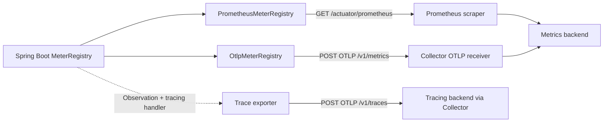

# Content Types of the Metrics API in Spring Boot Actuator

When building observability for Spring Boot, developers often start with `GET /actuator/metrics`. This endpoint provides metrics data in JSON format for **inspection and diagnosis**. Yet when configuring Prometheus, the same application exports metrics via `GET /actuator/prometheus` in **text exposition format**, not JSON. If using OTLP, the application can **push** metrics to a Collector over HTTP with a protobuf or JSON payload depending on the configured protocol.

The difference lies in the **media type (MIME type)** and API contract. Understanding `Content-Type` and `Accept` properly prevents common mistakes such as trying to parse Prometheus text as JSON, pointing a scraper at the wrong endpoint, or confusing data shown by Actuator with data stored by the backend.

This lesson belongs to the **Actuator metrics endpoint** chapter of the **SPRING_BOOT_OBSERVABILITY** module. Its content focuses on *content types of the metrics API*, connecting to Micrometer Observation, `MeterRegistry`, tags/cardinality, exporters, sampling, and combining metrics, logs, and distributed traces to investigate errors and latency in production environments.

## 1. What Is a Content Type, and Why Does It Matter?

In HTTP, the **media type** indicates the data representation of a request or response. A body containing JSON must be processed differently from Prometheus text or a binary protobuf payload.

Example of two responses that both return HTTP 200:

```http
HTTP/1.1 200 OK
Content-Type: application/vnd.spring-boot.actuator.v3+json

{"names":["jvm.memory.used","jvm.threads.live"]}
```

```http
HTTP/1.1 200 OK
Content-Type: text/plain;version=0.0.4;charset=utf-8

# HELP jvm_threads_live_threads The current number of live threads
# TYPE jvm_threads_live_threads gauge
jvm_threads_live_threads 42.0
```

Both describe metrics, yet they have different structures and purposes. The header values and measurements above are **illustrative of a compatible configuration**, not a claim that every Spring Boot/registry version always returns those exact bytes.

| Data Path | Endpoint or Target | Common Media Type | Purpose |
| --- | --- | --- | --- |
| Spring Boot Actuator metrics | `GET /actuator/metrics` | `application/vnd.spring-boot.actuator.v3+json` or compatible JSON | List known meters |
| Single meter detail | `GET /actuator/metrics/{name}` | JSON | View measurements and available tags |
| Prometheus exposition | `GET /actuator/prometheus` | `text/plain;version=0.0.4` or other compatible media type | Allow scraper to collect time series |
| OpenMetrics exposition if supported and negotiated | `GET /actuator/prometheus` | `application/openmetrics-text;version=1.0.0` | OpenMetrics text representation |
| OTLP/HTTP metrics export | `POST /v1/metrics` to Collector | `application/x-protobuf` or `application/json` depending on encoding | Send metrics via OTLP |
| OTLP/gRPC metrics export | RPC to Collector | gRPC protocol, typically `application/grpc` | Send metrics over HTTP/2 + gRPC |

**You cannot convert JSON to Prometheus text simply by setting an arbitrary header.** The server must support that representation on the called endpoint. Likewise, an OTLP receiver's `/v1/metrics` is a **data ingestion target**, not a default Spring Boot Actuator GET path.

## 2. Distinguishing `Accept` and `Content-Type`

The two HTTP headers play different roles:

- **`Accept`** is sent in the **request**, stating which media types the client accepts in the **response**.
- **`Content-Type`** describes the media type of the **body being sent**. On a response, it is the data format the server actually returned. On a POST with a body, the request `Content-Type` specifies the payload format the client sends to the server.

Example HTTP GET:

```http
GET /actuator/metrics HTTP/1.1
Host: localhost:8080
Accept: application/json
```

A supporting server may respond:

```http
HTTP/1.1 200 OK
Content-Type: application/vnd.spring-boot.actuator.v3+json

{"names":["jvm.memory.used","jvm.threads.live"]}
```

Clients should **read the actual `Content-Type`** and recognize that a subtype ending with `+json` is a JSON representation, rather than strictly comparing against the exact string `application/json`.

### Common Misconceptions

| Misconception | Accurate Understanding |
| --- | --- |
| "GET metrics must send `Content-Type: application/json`." | A GET without a request body generally needs no request `Content-Type`; use `Accept` for response negotiation. |
| "Sending `Accept: application/json` makes every endpoint return JSON." | Only when the endpoint supports it and negotiation succeeds. |
| "Actuator v3 JSON is Prometheus format v3." | `v3+json` is Actuator's representation version; Prometheus/OpenMetrics have their own media types/versions. |
| "`text/plain` is an error because metrics data must be JSON." | Prometheus exposition is normally specialized formatted text. |
| "HTTP 200 means the payload has the right format for the parser." | You must inspect `Content-Type` and the response contract. |
| "Adding an Accept header enables Prometheus." | You need the registry dependency, endpoint exposure, and the right URL. |

### Media Types with Parameters and Suffixes

A header may consist of **type/subtype** and semicolon-separated parameters:

```text
application/vnd.spring-boot.actuator.v3+json
text/plain;version=0.0.4;charset=utf-8
application/openmetrics-text;version=1.0.0;charset=utf-8
```

- `application` or `text`: top-level type.
- `vnd.spring-boot.actuator.v3+json`: vendor subtype, with the `+json` structured syntax suffix.
- `version=...`: version parameter of the **corresponding format**, not necessarily the Spring Boot library version.
- `charset=utf-8`: declares character encoding when that parameter is present.

Do not perform exact string comparisons including whitespace, parameter order, and casing. Media types follow their own parsing rules; a proper parser should split components or use a standard HTTP library.

## 3. Content Type of `GET /actuator/metrics`

`/actuator/metrics` is a **diagnostic endpoint of Spring Boot Actuator**. It lists names of meters registered by the application in `MeterRegistry`; it is not a full time-series API like the Prometheus query API.

Example:

```bash
curl -i -H 'Accept: application/json' \
  http://localhost:8080/actuator/metrics
```

Illustrative response body:

```json
{
  "names": [
    "http.server.requests",
    "jvm.memory.used",
    "jvm.threads.live",
    "process.cpu.usage",
    "orders.completed"
  ]
}
```

In Spring Boot 3.x, Actuator responses commonly use the vendor media type **`application/vnd.spring-boot.actuator.v3+json`**. How negotiation with `application/json` behaves and which media types are accepted depend on version and endpoint configuration. Therefore, when precision matters, inspect response headers at runtime.

### 3.1. What Does "v3" Mean Here?

The `v3` marker belongs to **Actuator's HTTP representation contract**, not metric names, Prometheus schema, or OpenTelemetry versions. When using Spring Boot versions with a different Actuator representation, the header can change. Long-lived integration clients should manage compatibility by application version rather than assuming every environment returns the same media type.

JSON clients can recognize:

- `application/json`.
- Application media types with the structured suffix `+json`, if the client and API policy allow it.

However, being able to parse JSON **does not mean every version shares an identical schema**. You still need to verify that fields and measurement statistics have the expected meaning.

### 3.2. Which Meters Appear?

The list depends on:

1. Spring Boot/Micrometer dependencies and auto-configuration.
2. Active meter binders (JVM, CPU, HTTP, connection pool...).
3. Meters created by business code or Observation handlers.
4. Whether any `MeterFilter` rejects or renames meters.
5. Whether the activity has occurred yet; some meters are only registered when the corresponding request/job runs.

If a custom meter has not appeared yet, **do not blame `Content-Type`** before checking its instrumentation and lifecycle.

## 4. Content Type of `GET /actuator/metrics/{name}`

The single-meter detail endpoint returns **JSON**, typically containing fields such as `name`, `description`, `baseUnit`, `measurements`, and `availableTags`.

Example:

```bash
curl -i -H 'Accept: application/json' \
  http://localhost:8080/actuator/metrics/http.server.requests
```

Illustrative body after the application has handled requests:

```json
{
  "name": "http.server.requests",
  "description": null,
  "baseUnit": "seconds",
  "measurements": [
    { "statistic": "COUNT", "value": 12.0 },
    { "statistic": "TOTAL_TIME", "value": 2.7 },
    { "statistic": "MAX", "value": 0.55 }
  ],
  "availableTags": [
    { "tag": "method", "values": ["GET", "POST"] },
    { "tag": "status", "values": ["200", "500"] },
    { "tag": "uri", "values": ["/orders", "/orders/{id}"] }
  ]
}
```

The JSON above is a **constructed example to explain the structure**, not real measurement results. Actual statistics, units, and tags may differ depending on meter type and version.

### 4.1. Key Fields

| Field | Meaning | Note |
| --- | --- | --- |
| `name` | Meter name in Micrometer | May differ from series name after Prometheus naming conventions |
| `description` | Meter description, may be null | Should not be used as a logical key |
| `baseUnit` | Base unit, may be null | Timers typically report duration values in the corresponding unit |
| `measurements` | Current/aggregated measurements | Not a sequence of samples over time |
| `statistic` | Measurement type such as COUNT, TOTAL_TIME, MAX, VALUE | Depends on meter type |
| `availableTags` | Currently present tag names and values | Useful for discovering filterable dimensions |

**Important boundary:** the JSON of `/actuator/metrics/http.server.requests` is neither the Prometheus histogram buckets format nor a set of spans. If you need system-wide p95 over 30 minutes, you need a metrics backend with distribution/histogram data and appropriate queries; an Actuator JSON response cannot replace time-series storage.

### 4.2. What Do `COUNT`, `TOTAL_TIME`, and `MAX` Mean?

For an HTTP Timer:

- **COUNT:** number of recordings captured by the timer within the scope of registry data being inspected.
- **TOTAL_TIME:** total measured duration.
- **MAX:** maximum value according to the registry's measurement mechanism and statistical window; not necessarily the maximum "since application startup".

A `Gauge` such as `jvm.threads.live` may use the `VALUE` statistic to represent a snapshot. Never derive an event rate by taking the difference of two Gauge readings and treating it like a Counter.

## 5. Filtering by Tags Does Not Change the Content Type

The detail endpoint supports the `tag=key:value` parameter to filter meter measurements by labels. You can pass multiple `tag` parameters, for example to inspect only GET requests with status 200.

```bash
curl -i --get \
  --data-urlencode 'tag=method:GET' \
  --data-urlencode 'tag=status:200' \
  http://localhost:8080/actuator/metrics/http.server.requests
```

The output remains **Actuator JSON**. Tag-filtered queries do not turn the response into Prometheus format, nor do they create a new time series in `MeterRegistry`.

In another case, if the `uri` tag has the route template value `/orders/{id}`:

```bash
curl -i --get \
  --data-urlencode 'tag=uri:/orders/{id}' \
  http://localhost:8080/actuator/metrics/http.server.requests
```

Use `--data-urlencode` to prevent errors when tag values contain spaces, braces, or special characters. **The shell syntax above is for Bash/Unix-like terminals**; in PowerShell, use appropriate tooling or URL/header escaping.

### 5.1. Why Check `availableTags`?

Values such as `uri`, `method`, `outcome`, and `status` can vary by instrumentation type or version. Do not query a tag the application does not produce and conclude the metric is missing. Read `availableTags` from an unfiltered response first.

When building service-wide dashboards, polling the Actuator endpoint repeatedly across all tag values is far less efficient than using a dedicated metrics backend; this endpoint is designed for diagnosis.

## 6. Content Type of `/actuator/prometheus`

The `GET /actuator/prometheus` endpoint exports data from **`PrometheusMeterRegistry`** in an exposition format supported by Prometheus. This format can be Prometheus text format or OpenMetrics text when components and content negotiation support it.

### 6.1. Prometheus Text Format

Example:

```bash
curl -i http://localhost:8080/actuator/prometheus
```

Common headers in a text-export configuration:

```http
HTTP/1.1 200 OK
Content-Type: text/plain;version=0.0.4;charset=utf-8
```

Example body:

```text
# HELP http_server_requests_seconds HTTP request duration
# TYPE http_server_requests_seconds summary
http_server_requests_seconds_count{method="GET",status="200",uri="/orders"} 12.0
http_server_requests_seconds_sum{method="GET",status="200",uri="/orders"} 2.7

# HELP jvm_threads_live_threads The current number of live threads
# TYPE jvm_threads_live_threads gauge
jvm_threads_live_threads 42.0
```

This example is illustrative. Actual names, units, metric types, present tags, and HELP text depend on Micrometer, registry, distribution configuration, and applied `MeterFilter`s.

Lines:

- **`# HELP`**: describes the metric family.
- **`# TYPE`**: metric family type in exposition.
- **Sample lines**: time-series name, labels, and value.
- With histograms, `_bucket`, `_count`, and `_sum` series may appear, depending on configuration.

**Do not parse this output with a JSON parser.** A valid text body usually begins with `# HELP` or a sample name, not an opening curly brace.

### 6.2. OpenMetrics Text Format

Some Prometheus client/registry versions support negotiating the OpenMetrics text format. A test request might look like:

```bash
curl -i \
  -H 'Accept: application/openmetrics-text;version=1.0.0' \
  http://localhost:8080/actuator/prometheus
```

If the server supports this representation and negotiation succeeds, the response may have media type:

```text
application/openmetrics-text;version=1.0.0;charset=utf-8
```

In OpenMetrics text, an easily recognizable marker is the terminating line:

```text
# EOF
```

**Not every Spring Boot/Micrometer setup supports OpenMetrics identically.** If the response lacks this media type, check the exporter's actual capabilities; do not assume changing `Accept` always produces OpenMetrics. The `version=1.0.0` parameter here is the OpenMetrics format version, not Spring Boot 1.0.0.

### 6.3. When a Scraper Calls the Wrong Endpoint

If Prometheus is configured to scrape `/actuator/metrics` instead of `/actuator/prometheus`, it receives a JSON object instead of valid sample lines. The scraper cannot parse the data, even when the server returns HTTP 200.

Therefore, when seeing exposition parse errors or content-type errors, check the **URL first**, followed by response status, `Content-Type`, body, and registry.

## 7. Comparing `/actuator/metrics` and `/actuator/prometheus`

| Characteristic | `/actuator/metrics` | `/actuator/prometheus` |
| --- | --- | --- |
| Purpose | Discover/inspect meters inside the application | Export time series for Prometheus scraping |
| Response format | Actuator JSON | Prometheus/OpenMetrics exposition |
| Extra dependency needed? | Actuator and corresponding Micrometer | Prometheus `MeterRegistry` |
| Can inspect `availableTags`? | Yes, on the detail endpoint | Not in this JSON schema |
| Used for production scraping? | Not a standard Prometheus scrape target | Yes, when configured properly |
| Meter name | Micrometer name, usually dotted | Normalized per exporter naming conventions |
| Histogram | Corresponding JSON measurements, not full time series | Can export buckets/count/sum per format |
| Prerequisites to appear | Meter registered and not filtered out | Meter in Prometheus registry, valid endpoint/export |
| Suitable client | HTTP/JSON client, diagnostic scripts | Prometheus scraper/OpenMetrics parser |

**A measurement may appear in Actuator without yet being collected by Prometheus.** That usually points to scrape target, port, service discovery, authentication, firewall, or path issues, rather than Micrometer Observation failing to create the metric.

Conversely, if Actuator does not show the metric name, inspect instrumentation code, registry, `MeterFilter`, and executed operations before blaming `Content-Type`.

## 8. Dependencies and Practical Configuration with Spring Boot 3.x

The examples below apply to **Spring Boot 3.x** with the Spring Boot BOM/parent managing dependency versions. With other major versions, starter names or properties may differ.

### 8.1. Maven

```xml
<dependencies>
    <dependency>
        <groupId>org.springframework.boot</groupId>
        <artifactId>spring-boot-starter-actuator</artifactId>
    </dependency>

    <!-- Use when /actuator/prometheus is needed -->
    <dependency>
        <groupId>io.micrometer</groupId>
        <artifactId>micrometer-registry-prometheus</artifactId>
    </dependency>
</dependencies>
```

To receive HTTP request metrics, the application also needs an appropriate web stack and instrumentation. Do not manually instantiate a new `MeterRegistry` inside a controller to get a different format; Spring Boot can auto-configure `PrometheusMeterRegistry` when the dependency is present.

### 8.2. `application.yml`

```yaml
spring:
  application:
    name: order-service

management:
  endpoints:
    web:
      exposure:
        include: health,info,metrics,prometheus
  metrics:
    tags:
      application: order-service
      environment: development
```

When running in a lab environment, verify:

```bash
curl -i http://localhost:8080/actuator/metrics
curl -i http://localhost:8080/actuator/metrics/jvm.memory.used
curl -i http://localhost:8080/actuator/prometheus
```

The examples assume the default management port matches application port 8080 and the Actuator base path is `/actuator`. Actual paths may differ if management server port, context path, or base path is configured.

### 8.3. Configuring Port and Base Path

Example intentionally placing Actuator on a separate management port:

```yaml
management:
  server:
    port: 9090
  endpoints:
    web:
      base-path: /manage
      exposure:
        include: health,info,metrics,prometheus
```

In this illustrative configuration, management URLs take the form `http://localhost:9090/manage/metrics` and `http://localhost:9090/manage/prometheus`, unless other path configs or security rules change them.

**A 404 on `/actuator/metrics` does not necessarily mean a missing dependency**; the request may be hitting the wrong port or base path.

## 9. Checking `Content-Type` Properly with curl

To diagnose HTTP APIs, read the **status line and response headers**, not only the body.

### 9.1. View Both Headers and Body

```bash
curl -i -H 'Accept: application/json' \
  http://localhost:8080/actuator/metrics
```

`-i` shows status, `Content-Type`, and other headers.

### 9.2. View Only Response Headers

```bash
curl -sS -D - -o /dev/null \
  http://localhost:8080/actuator/prometheus
```

This example is for Unix-like terminals. On Windows PowerShell, you can call `curl.exe` or use `Invoke-WebRequest`, depending on your environment.

### 9.3. Try a Supported Media Type

```bash
curl -i \
  -H 'Accept: application/vnd.spring-boot.actuator.v3+json' \
  http://localhost:8080/actuator/metrics
```

In Spring Boot 3.x, this is a media type commonly supported by Actuator. Compare the result against `Accept: application/json` to observe actual negotiation behavior.

### 9.4. When Does `406 Not Acceptable` Occur?

If the client accepts only a media type the endpoint cannot produce, the server **may** return 406 via content negotiation. For example, forcing a JSON-only endpoint to return `application/openmetrics-text` may fail to be served.

Not every server/library returns the same status for every mismatch. Use the actual status, response `Content-Type`, and configuration logs to draw conclusions.

**Do not expect `Content-Type: application/json` in a GET request to fix 406.** The header to check first is `Accept`.

## 10. OTLP Metrics Content Type Is Not Actuator JSON

In addition to Prometheus pull/scrape, Spring Boot can export metrics via **OTLP** to an OpenTelemetry Collector or compatible backend.

Typical data flow:



With **OTLP/HTTP**, the exporter typically POSTs metrics to `/v1/metrics`:

- When using protobuf encoding, the request `Content-Type` is typically **`application/x-protobuf`**.
- When using OTLP JSON encoding, the request `Content-Type` is typically **`application/json`**.
- With **OTLP/gRPC**, the protocol uses gRPC/HTTP2 and a related content type `application/grpc`, not a GET JSON API.

Do not open `http://collector:4318/v1/metrics` in a browser expecting to see a metrics list. That is normally a **POST receiver endpoint**, not a data viewer page. When the exporter receives 404/405/415, inspect HTTP method, path, protocol, encoding, and receiver configuration.

### Illustrative OTLP/HTTP Metrics Configuration

Add the corresponding registry:

```xml
<dependency>
    <groupId>io.micrometer</groupId>
    <artifactId>micrometer-registry-otlp</artifactId>
</dependency>
```

Example configuration for Spring Boot 3.x:

```yaml
management:
  otlp:
    metrics:
      export:
        enabled: true
        url: http://collector:4318/v1/metrics
        step: 30s
```

Port `4318` is commonly used for OTLP/HTTP; `4317` is commonly used for OTLP/gRPC. The Collector may use custom ports. Inside containers, `collector` must be a reachable hostname; `localhost` refers only to the application container itself.

This configuration only illustrates **metrics export**. For traces, the Micrometer Tracing bridge and exporter are a separate branch; in Spring Boot 3.x, `management.otlp.tracing.endpoint` can be used in appropriate configurations. **Do not mistakenly use the metrics URL for tracing.**

## 11. Relationship with Micrometer Observation

In Spring Boot, there are two ways to produce metrics:

1. Use Micrometer's `MeterRegistry` directly, e.g., Counter/Timer/Gauge.
2. Create an **Observation** representing a business operation; a metrics observation handler can record a corresponding Timer, while a tracing handler can create a span.

Example:

```java
import io.micrometer.observation.Observation;
import io.micrometer.observation.ObservationRegistry;
import org.springframework.stereotype.Service;

@Service
public class CheckoutService {

    private final ObservationRegistry registry;

    public CheckoutService(ObservationRegistry registry) {
        this.registry = registry;
    }

    public void checkout(String channel, Runnable action) {
        String channelGroup = "mobile".equals(channel)
                ? "mobile"
                : "web";

        Observation.createNotStarted("checkout.process", registry)
                .lowCardinalityKeyValue("channel", channelGroup)
                .observe(action);
    }
}
```

When appropriate handlers/registries exist, this Observation can contribute the `checkout.process` Timer to metrics and a span to traces. Yet the **response format** is still decided by the endpoint and exporter:

- On `/actuator/metrics/checkout.process`: Actuator JSON.
- On `/actuator/prometheus`: Prometheus/OpenMetrics exposition depending on backend.
- Via OTLP metrics exporter: OTLP payload per configured encoding.
- Via tracing exporter: span data, not `/actuator/metrics` JSON schema.

### Content Type Does Not Govern Sampling

If tracing sampling is 10%, spans are only retained for a fraction of requests per tracer policy, while Timer metrics can still record every operation processed by the metrics handler. Changing `Accept: application/json` or switching Prometheus/OpenMetrics format **does not increase the tracing sampling rate**.

Similarly, using Micrometer Observation **does not by itself guarantee trace context propagation** across HTTP, async, or messaging. To stitch traces across services, you need tracing instrumentation and appropriate headers such as W3C `traceparent`.

## 12. Tags, Cardinality, and Schema When Parsing the Metrics API

Actuator JSON returns an `availableTags` list; Prometheus exposition returns labels for each time series. The two representations differ, yet both can reflect meter metadata.

For example, a `checkout.process` timer has:

- `channel=web/mobile`.
- `outcome=success/error`.

The maximum number of combinations for these two tags is:

\[
2 \times 2 = 4
\]

Adding `request.id` with thousands of values can make series counts grow with request counts. **Content type does not protect the system from high cardinality**: JSON, Prometheus text, and OTLP can all carry expensive or sensitive dimensions.

### 12.1. Do Not Assume Every Tag in JSON Exists in Prometheus

Some information exists only at the Actuator layer; the Prometheus registry and filters may rename metrics/tags or append unit suffixes. In addition, scrape targets may add `job`, `instance`, and infrastructure labels.

Therefore, for a production PromQL query:

1. Check the **actually exported** series name.
2. Verify labels in the actual output rather than hardcoding from JSON.
3. Group by useful dimensions, avoiding dynamic IDs.
4. Check relabeling rules and the Collector if labels are transformed after export.

### 12.2. Do Not Put Sensitive Information in Any Format

Do not store passwords, access tokens, emails, card numbers, or raw payloads in metric tags, logs, span attributes, or baggage. Switching from JSON to protobuf **does not encrypt data in a security sense**; protobuf is merely a serialization format. Data protection still requires TLS, authentication, authorization, access control, data filtering, and retention policies.

## 13. Client Integration Reading JSON Metrics

A Java client inspecting Actuator can read the response as a string and check `Content-Type` before parsing JSON. Example using `RestClient` in Spring Framework 6.1+ / Spring Boot 3.2+:

```java
import org.springframework.http.MediaType;
import org.springframework.http.ResponseEntity;
import org.springframework.web.client.RestClient;

public class ActuatorMetricsClient {

    private final RestClient client;

    public ActuatorMetricsClient(String baseUrl) {
        this.client = RestClient.builder()
                .baseUrl(baseUrl)
                .build();
    }

    public String readJvmLiveMetric() {
        ResponseEntity<String> response = client.get()
                .uri("/actuator/metrics/jvm.threads.live")
                .accept(MediaType.APPLICATION_JSON)
                .retrieve()
                .toEntity(String.class);

        MediaType type = response.getHeaders().getContentType();

        if (type == null ||
            !("application".equalsIgnoreCase(type.getType()) &&
              ("json".equalsIgnoreCase(type.getSubtype()) ||
               type.getSubtype().endsWith("+json")))) {
            throw new IllegalStateException(
                    "Unexpected Content-Type: " + type);
        }

        return response.getBody();
    }
}
```

This snippet illustrates media-type checking, **not a complete production client**. For real services, handle timeouts, authentication, HTTP errors, null response bodies, JSON schema/versioning, and disabled endpoints. If an endpoint uses vendor JSON with a `+json` subtype suffix, the example above accepts it.

**Do not use this JSON client to call `/actuator/prometheus`.** That endpoint serves text exposition requiring its own parser. If you need continuous metrics for monitoring, prefer a scrape/export pipeline designed for a backend rather than having an application poll Actuator JSON to build a custom time-series store.

## 14. Endpoint Security and Content Negotiation

Management endpoints can expose operation names, route structures, pool names, infrastructure details, and resource utilization. Do not expose all Actuator endpoints to the Internet just for convenient `Content-Type` testing.

Principles:

- Expose only required endpoints. For production applications, set `management.endpoints.web.exposure.include` according to security policy.
- Use Spring Security, internal networks, service identity, TLS, or appropriate reverse proxies.
- If Prometheus needs to scrape, allow only the authorized scraper to access the endpoint; this does not mean making the endpoint public.
- Restrict CORS, raw response logging, and sharing diagnostic snapshots externally.
- Do not treat `Accept` or `Content-Type` as an authentication mechanism.
- Check whether a reverse proxy/gateway alters response `Content-Type`, redirects to a login page, or improperly caches metrics data.
- Maintain cardinality budgets and data policies across all three signals: metrics, logs, and traces.

For APIs requiring authentication, the HTTP response may be `401 Unauthorized` or `403 Forbidden`, **not a JSON serialization error**.

## 15. Troubleshooting Unexpected `Content-Type` or Bodies

| Symptom | Possible Cause | Resolution Steps |
| --- | --- | --- |
| `/actuator/metrics` returns JSON, Prometheus parser fails | Accidentally scraping Actuator JSON | Use `/actuator/prometheus` with the Prometheus registry |
| `/actuator/prometheus` returns 404 | Missing registry, not exposed, wrong management port/base path | Check dependencies, config, and URL |
| Header shows `application/vnd...+json` instead of `application/json` | Actuator uses vendor JSON | Parser should support JSON-compatible media types |
| HTTP 406 when forcing `Accept` | Endpoint cannot produce the requested response type | Use a media type supported by the endpoint |
| Response is login HTML | Security/reverse proxy redirect or error page | Check HTTP status/Location/authentication |
| `/actuator/metrics/{name}` reports meter not found | Meter not created yet, filtered out, or wrong name | Call `/actuator/metrics` and trigger the corresponding operation |
| JSON has COUNT/TOTAL_TIME but no histogram | JSON endpoint is not a histogram exposition/time-series backend | Check distribution settings and registry/exporter |
| Prometheus scrape reports malformed exposition | Body/format mismatch, proxy interference, or buggy exporter output | Inspect raw response with curl and exporter version |
| Prometheus has series but dashboard is empty | Wrong PromQL, labels, or scrape window | Check actual metadata/series and target health |
| GET on OTLP receiver returns 405 | Receiver expects POST | Check HTTP method and exporter; do not open like a web page |
| OTLP/HTTP returns 415 | Payload encoding/`Content-Type` mismatches receiver | Check OTLP HTTP protobuf/JSON configuration |
| OTLP metrics URL points to `/v1/traces` | Mixed up signal/endpoint | Distinguish `/v1/metrics` and `/v1/traces` |
| JSON endpoint works but Collector has no metrics | OTLP exporter is a separate pipeline | Check `OtlpMeterRegistry`, URL, push step, Collector |
| Metrics exist but traces are missing | Different sampling/bridge/exporter/tracing context | Diagnose tracing separately; do not change response media type |
| Too many series | Dynamic ID labels / high cardinality | Fix naming/tags at source, check `MeterFilter` |

### 15.1. Checklist for Inspecting a Response

When an endpoint misbehaves, record all details:

1. **Actual URL:** host, port, base path, endpoint, and metric name.
2. **HTTP method:** GET for reading Actuator, whereas OTLP receivers typically expect POST.
3. **Request `Accept`:** which response format does the client expect?
4. **Response status:** 200, 401, 403, 404, 406, 415, or 5xx?
5. **Response `Content-Type`:** JSON, Prometheus text, OpenMetrics, or binary?
6. **Actual body:** does it match the schema/format of `Content-Type`?
7. **Instrumentation:** is the meter registered and populated with data?
8. **Exporter/backend:** are scrape/push, Collector, and queries receiving data?

Never try to fix a metrics API content error merely by changing `management.tracing.sampling.probability`: tracing sampling is not responsible for Actuator's JSON representation.

## 16. Hands-On Exercise: Verifying Media Types from Actuator to Backend

The objective is to observe **at least two HTTP metrics formats**, understand their differences, and identify the role of the exporter.

### Step 1 — Prepare the Project

Use a Spring Boot 3.x web application with Actuator and the Prometheus registry from Section 8. In a test environment, expose `metrics` and `prometheus`.

### Step 2 — Observe the JSON Response

Call `/actuator/metrics` and record:

- Status code.
- `Content-Type`.
- Body containing the `names` field.

Try `Accept: application/json` and the Actuator vendor media type if the environment supports it; compare response headers.

### Step 3 — Inspect a Timer

Send a few HTTP requests to a business endpoint of the application, then call:

```bash
curl -i http://localhost:8080/actuator/metrics/http.server.requests
```

Record `COUNT`, `TOTAL_TIME`, and `availableTags` if present. Do not be surprised if the meter name only appears after the first request completes.

### Step 4 — Filter Tags

Use `curl --get --data-urlencode` to filter `method=GET` or `status=200`. Confirm the **body remains JSON**, with only the scope of measurements changing.

### Step 5 — Compare Prometheus Exposition

Call:

```bash
curl -i http://localhost:8080/actuator/prometheus
```

Record `Content-Type` and locate series representing the HTTP timer or a JVM metric. Compare the dotted Micrometer name with the underscored exporter name. Explain why a Prometheus scraper needs this endpoint.

### Step 6 — Try `Accept` OpenMetrics

Send a request with media type `application/openmetrics-text;version=1.0.0`. If the system supports it, inspect `Content-Type` and the `# EOF` line. If unsupported, note that limitation explicitly without fabricating fake output.

### Step 7 — Try an Available OTLP Export Path

If the lab environment includes an OpenTelemetry Collector, configure `micrometer-registry-otlp` and confirm the Collector receives metrics. Distinguish the exporter's **POST** requests from the **GET** requests used to explore metrics in Actuator.

### Step 8 — Verify Independence from Traces

If Micrometer Tracing bridge and exporter are present, trigger a business Observation, observe the Timer on Actuator and the span on the tracing backend. Lower tracing sampling in the lab and confirm that change does not turn `/actuator/metrics` responses into another format.

### Step 9 — Assess Security and Cardinality

Verify the endpoint is not exposed publicly beyond authorized scope. Ensure labels have bounded value sets and contain no user/request IDs, tokens, or sensitive data. For routes with IDs, use route templates when supported by instrumentation.

### Acceptance Checklist

| Item to Verify | Expected Result |
| --- | --- |
| HTTP negotiation | Can distinguish request `Accept` and response `Content-Type` |
| Actuator JSON | `/actuator/metrics` returns JSON schema with `names` |
| Meter detail JSON | `/actuator/metrics/{name}` has matching `measurements`/`availableTags` |
| Tag filtering | Querying `tag=...` does not alter the endpoint's media type |
| Prometheus format | `/actuator/prometheus` outputs valid text exposition |
| OpenMetrics | Knows how to test support and content negotiation |
| OTLP | Distinguishes exporter HTTP POST/payload from Actuator GET |
| Security | Endpoint accessible only from authorized clients |
| Consistency | Exported names/tags are verified on the actual backend |
| Traces/logs | Understands correlation via context/IDs without treating Actuator JSON as a trace API |

## 17. Key Principles to Remember

1. **`Content-Type` describes the body being returned or sent; `Accept` describes response formats the client accepts.**
2. **`/actuator/metrics` and `/actuator/metrics/{name}` are JSON diagnostic APIs**, commonly using a vendor media type ending in `+json` in Spring Boot 3.x.
3. **`/actuator/prometheus` is for scraping metrics**, commonly using Prometheus text or OpenMetrics text when supported by the exporter and negotiation; it is not JSON.
4. **OTLP metrics are a separate export pipeline**, typically POST over OTLP/HTTP or gRPC, not Actuator JSON over GET.
5. **Do not hardcode every header and series name.** Versions, registries, `MeterFilter`s, and proxies can affect media types, tags, and naming.
6. **Check status, URL, `Accept`, `Content-Type`, and body before deep debugging.** Parser errors very often stem from calling the wrong endpoint.
7. **Content type does not replace security or cardinality control.** Every format requires bounded tags and avoiding sensitive data.
8. **Correlate metrics with logs/traces via context**, never by placing Trace IDs in metric labels; tracing sampling and propagation are independent mechanisms.

By properly understanding the media-type contracts of each metrics API, developers can integrate Spring Boot Actuator with monitoring tools without mistaking representations, avoid parser errors, and quickly pinpoint whether an issue lies in instrumentation, exporter, HTTP negotiation, or backend. This is foundational for operating a Spring Boot observability system with reliable metrics, logs, and distributed tracing.
