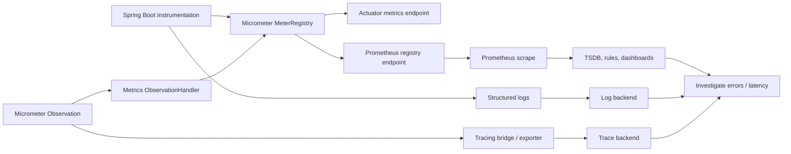

# Metric Endpoints in Production

A Spring Boot application runs smoothly in development. A developer opens `/actuator/metrics` and sees `http.server.requests`, `jvm.memory.used`, and `process.cpu.usage`. After deploying to production, the operations team wants Prometheus to collect data, set up alerts, and inspect error rates for each service. Is the simplest approach to expose all `/actuator/**` to the Internet and reuse `/actuator/metrics` for continuous scraping?

**No.** In Spring Boot, **`/actuator/metrics` is primarily a diagnostic endpoint to inspect existing meters and measurements**, whereas **`/actuator/prometheus`** is the endpoint meant for Prometheus scraping when the corresponding registry is present. More importantly, observability endpoints in production must be managed as an **operational surface with access permissions, network paths, load, and data requiring protection**, not as a public API for every user.

This lesson belongs to the **Actuator metrics endpoint** chapter of the **SPRING_BOOT_OBSERVABILITY** module. The module builds observability for Spring Boot using Micrometer Observation, metrics, logs, and distributed tracing; diving into context propagation, tags/cardinality, exporters, sampling, and signal correlation to investigate errors, latency, and real-world application behavior. This lesson focuses on how to **deploy, protect, query, and operate metric endpoints in production**.

## Learning Objectives

After this lesson, you will be able to:

1. Distinguish the roles of `/actuator/metrics`, `/actuator/metrics/{name}`, and `/actuator/prometheus`.
2. Understand the three required layers: **meter created**, **endpoint enabled/exposed**, and **network path and access permissions allowed**.
3. Configure Actuator/Prometheus appropriately for production environments, separating management from user traffic.
4. Query a metric by tag and interpret `COUNT`, `TOTAL_TIME`, `VALUE`, and `MAX` with proper semantics.
5. Understand the difference between a **current meter snapshot** and **time series collected by the backend**.
6. Prevent data leakage, high metric cardinality, endpoint abuse, and excessive collection costs.
7. Diagnose 401/403/404 errors, missing metrics on endpoints, scrape failures, or empty dashboards.
8. Combine metrics with structured logs, distributed traces, and deployment events to resolve incidents with evidence.

## 1. Metric Endpoints Serve Two Different Purposes

### 1.1. `/actuator/metrics`: Discovering Meters in the Application

`/actuator/metrics` is Spring Boot Actuator's endpoint for viewing **the names of meters managed by the registry**. It is very useful when checking whether the application has instrumented an HTTP route, JVM, or business operation.

Example call in an authorized environment:

```bash
curl -fsS 'http://127.0.0.1:9001/actuator/metrics'
```

Illustrative JSON response:

```json
{
  "names": [
    "http.server.requests",
    "jvm.memory.used",
    "jvm.threads.live",
    "process.cpu.usage",
    "checkout.orders.accepted"
  ]
}
```

The actual list depends on dependencies, binders, registry configuration, and operations that have occurred. A business metric is only registered when the corresponding code runs or when it is created during initialization; **not finding a metric name does not by itself prove the application is not running business logic**.

### 1.2. `/actuator/metrics/{name}`: Inspecting a Meter and Filtering by Tag

Example:

```bash
curl -fsS \
  'http://127.0.0.1:9001/actuator/metrics/http.server.requests'
```

Sample response:

```json
{
  "name": "http.server.requests",
  "description": null,
  "baseUnit": "seconds",
  "measurements": [
    { "statistic": "COUNT", "value": 1520.0 },
    { "statistic": "TOTAL_TIME", "value": 293.14 },
    { "statistic": "MAX", "value": 0.82 }
  ],
  "availableTags": [
    { "tag": "method", "values": ["GET", "POST"] },
    { "tag": "status", "values": ["200", "500"] },
    { "tag": "uri", "values": ["/checkout", "/actuator/health"] }
  ]
}
```

This is hypothetical data illustrating the response structure; `statistic` entries, `baseUnit` values, and tags can vary across meters and versions. For `http.server.requests`, many systems record duration units via a `Timer`; a gauge metric may return only `VALUE`.

You can filter by existing tags:

```bash
curl -fsS \
  'http://127.0.0.1:9001/actuator/metrics/http.server.requests?tag=method:POST&tag=status:500'
```

Each `tag=key:value` parameter adds a filter condition. When multiple `tag` parameters are supplied, the result considers only meters matching those conditions. Use the exact tag names and values from `availableTags`; `uri` tag values should normally be route templates like `/orders/{id}`, not raw URLs from individual requests.

**Limitation:** the endpoint returns measurements according to the registry's current semantics; it is **not a historical storage system** over 5-minute, 1-hour, or 7-day windows. To inspect changes over time, you need a system that collects and stores time series.

### 1.3. `/actuator/prometheus`: Output for Prometheus Scraping

When the Micrometer Prometheus registry is integrated, `/actuator/prometheus` serves data in Prometheus/OpenMetrics format depending on registry and content negotiation. Prometheus periodically **scrapes** this endpoint to build time series.

```bash
curl -fsS 'http://127.0.0.1:9001/actuator/prometheus'
```

Illustrative lines:

```text
# TYPE http_server_requests_seconds_count counter
http_server_requests_seconds_count{application="checkout-service",method="POST",status="200",uri="/checkout"} 1020.0

# TYPE jvm_memory_used_bytes gauge
jvm_memory_used_bytes{application="checkout-service",area="heap",id="G1 Old Gen"} 3.1e+08
```

This is a formatting example, **not a guarantee of exact names/labels**. Micrometer and exporters can convert dots to underscores, append units or suffixes, and values depend on registry/version.

Prometheus can scrape `/actuator/prometheus` **without exposing `/actuator/metrics`** to the collector. Conversely, having only `/actuator/metrics` does not turn it into a properly formatted Prometheus scrape endpoint.

### Quick Comparison

| Endpoint | Purpose | Common Format | Recommended Production Usage |
|---|---|---|---|
| `/actuator/metrics` | List meter names | JSON | Controlled diagnostics; do not use as a Prometheus scrape target |
| `/actuator/metrics/{name}` | View measurements and tags of a meter | JSON | Investigation with authentication/access restrictions |
| `/actuator/prometheus` | Export data for Prometheus scraping | Text exposition | Open only on management/monitoring networks with proper protection |
| `/actuator/health` | Health/readiness signals depending on config | JSON | Separate exposure policy; does not replace metrics |

## 2. From Meter to Dashboard: Every Condition Must Hold for Data to Appear

General flow:



For a metric to appear on a Prometheus dashboard, verify each condition:

1. **Instrumentation:** the application actually creates the meter and records samples. HTTP metrics, JVM metrics, and business metrics have different sources.
2. **Registry:** the meter is registered on the right `MeterRegistry`; not blocked by filters or created on a manual unexported registry.
3. **Endpoint:** Actuator and the `prometheus` endpoint have the required dependency, enablement, and exposure.
4. **Network/permissions:** Prometheus can reach the management endpoint over TLS and the chosen authentication mechanism.
5. **Scrape:** the target is configured, scrapes succeed consistently, and responses are not truncated by proxies or timed out.
6. **Backend:** time series are ingested/retained long enough; recording rules, dashboards, and alerts use matching names/tags/units.

A failure at any layer can leave charts blank. Do not modify instrumentation code before finding out which step dropped the data.

## 3. Configuring Spring Boot for Production

### 3.1. Dependencies

With Spring Boot 3.x and Gradle, a typical configuration:

```groovy
dependencies {
    implementation 'org.springframework.boot:spring-boot-starter-actuator'
    runtimeOnly 'io.micrometer:micrometer-registry-prometheus'
}
```

The Prometheus registry dependency is used when choosing the **Prometheus scrape** model. If the architecture uses an OTLP metrics exporter sending to an OpenTelemetry Collector or another backend, exporter/transport configuration differs and `/actuator/prometheus` is not necessarily required.

Do not enable every exporter simultaneously just because they are available. Decide where data is stored, scrape/push requirements, retention, and operational ownership.

### 3.2. Enable Only Genuinely Needed Endpoints

Example configuration for **a management endpoint serving an internal monitoring network**:

```yaml
spring:
  application:
    name: checkout-service

management:
  server:
    port: 9001
  endpoints:
    web:
      exposure:
        include: health,info,metrics,prometheus
  metrics:
    tags:
      application: checkout-service
      environment: production
```

This configuration illustrates moving the management HTTP server to a **separate port**. **A separate port is not a security boundary:** if port 9001 is publicly exposed, endpoints can still be accessed externally. Restrict listeners/routing, firewalls, or network policies and apply proper authentication/authorization.

In production, you may choose **not to expose `metrics` continuously**, exposing only `health` and `prometheus` on the internal observability network. When diagnosis is needed, enable `metrics` through an operational access procedure rather than leaving it open publicly.

**Configuration warning:** do not copy this example straight into a real environment without first configuring network isolation and security. Spring Boot changes endpoint `access`/`enabled` details across versions; verify corresponding properties and auto-configuration ordering in your running stack.

### 3.3. Separate Management Port and Bind Address

If you want management endpoints reachable only from within the same machine/pod, in some models you can configure a dedicated bind address, for example:

```yaml
management:
  server:
    port: 9001
    address: 127.0.0.1
```

Meaning: the management listener binds only to the loopback interface of the process/network namespace. This can **block Prometheus running on another pod/host** because it cannot connect over the network. Use this only if the architecture has a local agent/sidecar or secure proxy sharing the appropriate network namespace. Do not set `address: 127.0.0.1` and expect an external Prometheus to scrape it.

In Kubernetes, deployments typically use a management port and an **internal Service/ServiceMonitor/PodMonitor**, restricted by NetworkPolicy, authentication, and ingress rules; never route the management port through public ingress. Exact setup also depends on the Prometheus Operator, CNI, and cluster security policies.

### 3.4. Separating Permissions for `health`, `metrics`, and `prometheus`

Health checks used by orchestrators usually need a different policy from endpoints exposing detailed metrics:

- `health`/liveness/readiness: reachable from the control plane or load balancer as required, exposing only necessary detail.
- `prometheus`: allow **only** trusted scrapers/agents; combine a private network with TLS/mTLS or appropriate authentication.
- `metrics`: restrict to operators/diagnostics; it can reveal operation names and tag values that should not leak externally.
- Other Actuator endpoints like `environment`, `configprops`, `mappings`, `heapdump`, `loggers`, and `shutdown` vary widely in sensitivity; **never use `include: '*'` on public endpoints**.

In applications using Spring Security, declaring a custom `SecurityFilterChain` can disable Spring Boot's default actuator security rules. Check security matchers and chain ordering for both **management** and **application** endpoints; do not write a chain matching only `/actuator/**` and accidentally leave business routes uncovered.

Specific protection mechanisms depend on whether management uses the same or a different port/context, proxies/ingress, and Spring Security version. **Enabling exposure does not grant safe authorization; Prometheus authentication must be tested end-to-end.**

## 4. Reading `/actuator/metrics` with Proper Semantics in Production

A response from `/actuator/metrics/http.server.requests` may contain the following statistics:

| Statistic | Example Meter | Meaning | Warning |
|---|---|---|---|
| `COUNT` | Timer, DistributionSummary | Number of recorded samples/events | Accumulates while process runs; resets on restart |
| `TOTAL_TIME` | Timer | Total recorded duration | Unit defined by meter/registry; not single-call request latency |
| `MAX` | Timer/summary | Maximum value in the applicable statistical window | Can reset/expire; not always all-time max |
| `VALUE` | Gauge | Instantaneous value of a quantity | Not a counter; can go up or down |
| `TOTAL`/`TOTAL_AMOUNT` (meter/API dependent) | Summary/counter | Total recorded amount, depending on measurement and version | Cannot derive percentiles from total amount |

If an HTTP Timer has `COUNT=1000` and `TOTAL_TIME=300` seconds, the cumulative average across relevant samples is roughly `300/1000 = 0.3` seconds. However, **this figure does not tell you p95**, nor is it latency "over the last 5 minutes" unless differences were taken across that exact interval. To see error rates, rates of change, and distributions over a time window, a time-series backend is more suitable.

### Querying a Tag Group Is Not Querying History

```bash
curl -fsS \
  'http://127.0.0.1:9001/actuator/metrics/http.server.requests?tag=uri:/checkout&tag=method:POST'
```

The result shows measurements for meters matching `uri=/checkout` and `method=POST`. It does **not** return a list of individual requests, trace IDs, or intervals between requests.

Notes:

- If a URL/tag value contains special characters, URL-encode it properly so proxies/clients do not truncate parameters.
- Do not query by raw order ID or user ID because metric labels should not contain high-cardinality values in the first place.
- Know which configuration creates `http.server.requests`: the meter may not be registered yet if there has been no traffic or instrumentation is disabled.
- For HTTP metrics, `uri` is usually a **route template** or normalized label, not a raw path; values like `UNKNOWN` or `NOT_FOUND` may appear depending on version and situation.

## 5. Production Prometheus Scraping: Configuration, Load, and Queries

### 5.1. Sample Scraper Configuration

A simple Prometheus configuration illustrating the idea:

```yaml
scrape_configs:
  - job_name: checkout-service
    scheme: http
    metrics_path: /actuator/prometheus
    scrape_interval: 30s
    static_configs:
      - targets:
          - checkout-management.internal:9001
```

This is a **hypothetical internal network** example. In production, deployments typically use service discovery, TLS/mTLS or authentication, network policies, and per-instance target configs. When enabling HTTPS, change `scheme` and configure trust/authentication properly. Do not treat the `http` example as a recommendation to use plaintext over untrusted networks.

Scraping normally returns **every series exported by the registry**, not a selective query for a single metric. Thus, the following directly affect load:

- Number of meters and tag combinations.
- Number of buckets when histograms/percentiles are enabled.
- Response size and scrape frequency.
- HTTP serving capacity of the management endpoint.
- Time-series storage and retention costs in Prometheus/backend.

A short scrape interval does not make metrics "infinitely accurate"; it merely samples more frequently and increases data points. Gauges can still miss spikes occurring between scrapes. Counters require handling resets on process restarts.

### 5.2. Querying Throughput and Error Rate

If your exporter creates HTTP timer series in the form `http_server_requests_seconds_count`, you can use PromQL:

```promql
sum(
  rate(http_server_requests_seconds_count{
    application="checkout-service",
    uri="/checkout"
  }[5m])
)
```

The result is estimated requests/second over a 5-minute window, not the exact count in a single second. Verify series names and labels in the backend before applying.

HTTP 5xx ratio of the endpoint over the same window:

```promql
sum(
  rate(http_server_requests_seconds_count{
    application="checkout-service",
    uri="/checkout",
    status=~"5.."
  }[5m])
)
/
sum(
  rate(http_server_requests_seconds_count{
    application="checkout-service",
    uri="/checkout"
  }[5m])
)
```

This expression is meaningful only when the denominator has traffic. With zero requests, the ratio may be undefined; alert rules must handle missing/insufficient data rather than assuming "0% errors". SLI definitions must clarify whether HTTP 4xx counts as errors, whether probes/internal traffic are excluded, and whether retries count requests or business transactions.

### 5.3. p95 Latency When Histograms Exist

When a timer has compatible histogram buckets:

```promql
histogram_quantile(
  0.95,
  sum by (le) (
    rate(http_server_requests_seconds_bucket{
      application="checkout-service",
      uri="/checkout"
    }[5m])
  )
)
```

This is a **p95 estimate** from buckets. It works only when the exporter emits matching `_bucket` series and bucket boundaries can be aggregated. Not every Spring Boot HTTP timer enables histograms by default; missing `_bucket` series does not mean `/actuator/metrics` is broken.

**Never average per-pod p95 values** and treat that as service-wide p95. Use configured/backend-supported histograms or a statistical method accounting for distribution and sample counts.

### 5.4. Time and Retention

`/actuator/metrics` only shows current measurements; Prometheus or the backend stores time series. When asking "how were things 30 minutes before deploy?", you need:

1. Scraping to have occurred during that time.
2. Time series still within retention.
3. No schema changes to labels/metric names causing queries to miss data.
4. Targets not missing subsets of instances or failing scrapes.
5. Recording/downsampling rules not discarding needed resolution.

An endpoint returning 200 right now **does not prove** historical data was completely stored.

## 6. Securing Metric Endpoints in Production

Metrics may look like mere numbers, yet meter names, tags, and values can expose system architecture and state:

- Service names, versions, hosts/instances, or environments.
- HTTP routes, components, database pools, and dependencies.
- Request volumes, error ratios, traffic peaks, and response times.
- Business operation names or data-processing states.
- Sensitive data accidentally attached as tags, such as emails, user IDs, or raw URLs/queries.

Therefore, production deployments require **defense in depth**:

1. **No public exposure:** configure ingress, load balancers, Services, and firewalls so management endpoints reside strictly on permitted networks.
2. **Authentication/authorization:** allow only authorized scrapers/agents and operators to read required endpoints.
3. **TLS:** protect transport across untrusted boundaries and verify certificates.
4. **Least privilege:** separate health checks for probes from scrape permissions and detailed metrics inspection permissions.
5. **Do not leak sensitive IDs:** use route templates and bounded common tags; avoid `userId`, `orderId`, `traceId` as metric labels.
6. **Rate and load controls:** restrict access outside authorized scrapers, and enforce timeouts/concurrency limits where needed.
7. **Audit/configuration management:** track exposure changes, credential rotation, access policies, and target health.

**Do not treat `management.server.port` as a firewall**, and do not treat a 401/403 from a developer machine as sole proof that the endpoint is safe across the entire production network.

### Data That Should Not Go into Metric Tags

```text
Recommended:
  application=checkout-service
  environment=production
  method=POST
  uri=/orders/{id}
  status=500

Avoid:
  uri=/orders/9328471?token=...
  userId=283714
  email=customer@example.test
  traceId=...
  sessionToken=...
```

Total time series usually grow with combinations of tag values. With 5 methods × 30 routes × 6 status groups × 10 instances, combinatorially you can already have **9,000 series** for a single metric, before counting histogram buckets and extra tags. Attaching per-request IDs as labels makes series counts uncontrollable. Tag filtering must begin in instrumentation/conventions, not solely in backend filters.

## 7. Observing the Monitoring Endpoint Itself

The telemetry pipeline itself must be monitored. An application that stays up while losing all metrics can silently break SLOs and alerts.

Signals to watch:

| Signal | Question Answered | Anomaly Indicator |
|---|---|---|
| Prometheus target `up` | Is the scraper collecting data from the target? | `up=0` or target disappears from service discovery |
| Scrape duration | Is fetching all metrics taking too long? | Approaching or exceeding scrape timeout |
| Scrape samples / series | How many time series are being received? | Sudden spike or unexpected drop after deploy |
| Response size and HTTP status | Does the endpoint return complete data and allow access? | 401, 403, 404, 5xx, truncated response |
| Registry meter count / cardinality | Are unexpected tags/meters being added? | Series count jumps after schema change |
| Exporter/collector health | Are there send errors, full queues, or dropped data? | App has traffic while downstream signals are missing |
| Target version and deployment | Which release does the data belong to? | One instance group lacks a tag; query filters wrong version |

**`up=1` is not enough to prove every metric is right.** A target can scrape cleanly while missing a specific business meter, using wrong units, or getting blocked by a `MeterFilter`. Conversely, a service can serve normal requests even when `up=0` due to a monitoring network fault.

Alert when a critical monitoring target disappears or series counts shift abnormally. Account for each service's behavior and avoid alert noise when scaling/rolling deployments legitimately change instance counts.

## 8. Common Production Pitfalls

### 8.1. `/actuator/metrics` Returns 404

Possible causes include:

- Missing Actuator dependency/endpoint.
- Endpoint disabled or omitted from web exposure list.
- Actuator base path or management port changed.
- Reverse proxy/ingress routes only certain paths.
- Security/proxy intentionally masks unauthorized endpoints with 404.

**How to investigate:** verify exact host/port/path and Actuator config, and test the route from inside a permitted network; never fix this with `include: '*'` on public ingress.

### 8.2. Endpoint Returns 401 or 403

401 usually indicates missing/invalid authentication; 403 usually relates to denied authorization. With reverse proxies and security chains, exact meaning depends on where the response originates.

**How to investigate:** verify scraper identity, credentials, TLS, Spring Security filter chain, network policies, and per-endpoint authorization. **Never disable authentication in production just to make scraping succeed.**

### 8.3. `/actuator/metrics` Exists, `/actuator/prometheus` Does Not

Not an HTTP meter bug. The Prometheus registry dependency may be missing, the endpoint unexposed, the registry replaced, or auto-configuration disabled.

**How to investigate:** inspect the instantiated registry, web exposure config, security status, and endpoint path. If the architecture actually uses OTLP push, the Prometheus endpoint may **not be needed**.

### 8.4. `metrics` Lists Names, But `measurements` Is Empty or Tags Are Missing

Some meters are created without samples recorded yet; some meter types publish only semantically applicable statistics. Tags may differ due to customizers/filters or inconsistent registration across instances.

**How to investigate:** send a controlled valid request, inspect where code registers the meter, meter type, tag policy, and the actual `MeterRegistry`.

### 8.5. Prometheus Scrapes Successfully, Yet Dashboards Show No Data

Queries may use the wrong metric name/suffix, wrong labels, too short a time window, unpopulated series, or dashboard filters excluding an instance/version. Or the target scrapes fine while ingestion/recording rules fail.

**How to investigate:** search for the series directly in Prometheus, check `up`, exporter metric names, label values, timestamps, recording rules, and retention. Do not rename meters before knowing which layer is wrong.

### 8.6. Series Count Explodes After Deploy

`userId`/`orderId`/raw URLs may have been added to tags, excessive histogram buckets enabled, or a common tag varied per request. An application with steady traffic whose series count spikes will drive up backend costs.

**How to investigate:** compare tag schemas and distinct values before/after deploy; normalize URLs/labels, configure `MeterFilter` as a deliberate guardrail rather than relying solely on filtering after runaway series creation.

### 8.7. HTTP Latency Metrics Exist, But No Slow Trace Can Be Found

Metrics and traces have separate pipelines. Traces may be head/tail sampled out, lose context propagation, be dropped by collectors, or expire past retention. **Do not add trace IDs to metric tags** to find traces. Consider exemplars if supported by your stack; correlate logs by trace ID and inspect representative sampled traces.

## 9. Multi-Instance Deployments, Kubernetes, and Proxies

Production systems typically run multiple replicas, rolling deployments, and proxy/ingress layers. A `/actuator/prometheus` URL pointing to a **load balancer distributing randomly across pods** is not equivalent to scraping each JVM.

Why?

- Prometheus expects each **target to identify a stable set of metrics**.
- If consecutive scrapes hit different pods under **the same label set**, counters can appear to go backward/trigger false resets; histograms and gauges will mix data from different JVMs.
- During scaling, old and new pods have different versions, uptimes, and tag schemas.

**Proper design:** use service discovery to scrape each instance/pod with a stable identity for the target's lifetime; attach labels suitable for aggregating by service/environment in queries while retaining per-instance inspection capability.

### Things to Verify in Kubernetes

1. Management port is declared consistently in Pod/Service/PodMonitor/ServiceMonitor per deployment.
2. Probes and scraping do not have to share the same URL or same access permissions.
3. NetworkPolicy permits only the relevant monitoring namespace/agent.
4. Public Ingress does not route management endpoints unintentionally.
5. Scraping does not pass through a load-balanced Service that erases pod identity.
6. Labels like `pod`, `instance`, `namespace`, and `service` do not collide with application-supplied common tags.
7. Rolling deployments do not cause dashboards to blend versions without a way to distinguish them.
8. Prometheus and the application agree on path, port, scheme, and authentication.

When using `ServiceMonitor` or `PodMonitor`, CRD structure depends on operator version and organizational setup; verify on the real cluster rather than extrapolating from the simple `static_configs` example above.

## 10. Metric Endpoints in Relation to Logs and Traces

Metrics excel at showing **scale, trends, and SLOs**, but do not describe the full event sequence of a single request. An HTTP metric reporting rising p95 does not tell you whether requests slowed down due to DB, queues, network, or payment providers. To go from chart to root cause:

- **Metrics:** determine when the incident started, which route, error rate, and latency distribution.
- **Logs:** find error events, stack traces, or business decisions, when logging is properly structured.
- **Traces:** inspect the path of instrumented requests retained by sampling.
- **Deployment events and business data:** review code/config changes, traffic shifts, retries, or external conditions.

In Spring Boot, `ObservationRegistry` and handlers can produce both metrics and traces from the same observation. Yet `/actuator/metrics` only reflects the **metrics path**; it is not a trace query UI or log backend.

To correlate:

1. Use low-cardinality service/environment/route/tag names for metrics.
2. Set up `traceId`/`spanId` log correlation when supported by Micrometer Tracing and logging.
3. Ensure context propagation across HTTP clients, messaging, and async boundaries.
4. Understand sampling: metrics may record every instrumented request, whereas the trace backend retains only a subset.
5. If the backend supports **exemplars**, use them to jump from a metric data point to a trace without putting `traceId` as a label on every time series.

Not finding a trace for a failing request **does not prove that request never happened**. Check sampler, exporter/collector, TTL/retention, and propagation before drawing conclusions.

## 11. Real-World Scenario: Scraping Succeeds, Yet 5xx Alerts Vanish

A checkout application runs across four pods. After adding a custom `MeterRegistry` in the payment module, the SLO dashboard reports a 0% 5xx rate, while users report errors and logs show `payment_provider_timeout`.

Initial observations:

- Prometheus shows `up=1` for the targets.
- `/actuator/prometheus` returns JVM data.
- Some pods still have `http.server.requests` with the previous tags; other pods no longer have the corresponding series in the dashboard.
- Structured logs and sampled traces confirm requests still reach the service.

### Investigation Workflow

**Step 1 — Verify whether the chart reflects reality.** Inspect numerator, denominator, label selectors, and query window. If the denominator is 0 or the series is absent, a panel can display "0" due to how expressions handle missing data; that is not proof of zero errors.

**Step 2 — Check targets and source metrics.** On each pod, check `up`, `/actuator/metrics/http.server.requests`, and actual series at `/actuator/prometheus`. Determine whether the metric disappeared at the app/registry or was filtered out by the query.

**Step 3 — Check registry and tag policy.** If HTTP or business metrics go into a new registry not managed by the exporter, they will not appear in Prometheus. A `MeterRegistryCustomizer` or common tag applies only to eligible registries; do not assume manually instantiated registries receive them.

**Step 4 — Check rolling deployments.** Do all instances share the same `application` and `environment`? Did `uri` or `status` change names/schema across versions? Are new pods using a different registry/handler?

**Step 5 — Correlate signals.** Use timeout logs and stored traces to isolate the failing dependency; 5xx metrics show error scale once series are restored—do not substitute ERROR log counts for request counts, because retries can emit multiple logs per request.

**Step 6 — Restore and verify.** Fix registry/exporter wiring or dashboard selectors; re-check target-by-target, request counts, 5xx ratio, SLIs/SLOs, and alerts under controlled test errors.

**Conclusion:** "Scrape succeeded" only means the collection path works to some degree. It does not prove **each meter needed for SLOs** was properly registered, exported, and queried.

## 12. Production Readiness Checklist for Metric Endpoints

Before releasing or changing configuration, verify:

1. **Purpose:** do you need `/actuator/metrics` for diagnostics or `/actuator/prometheus` for scraping? Do both really need to be continuously exposed?
2. **Dependencies:** are Actuator and the right registry/exporter present for Prometheus or OTLP?
3. **Registry:** are HTTP/JVM/business meters created on the right `MeterRegistry`? Are any filters or secondary registries dropping data?
4. **Exposure:** enable only needed endpoints; verify base path, port, and access properties for your Spring Boot version.
5. **Network:** management port is not public, target discovery targets each instance/pod, never scraping via a random LB.
6. **Security:** TLS/authentication/authorization, `SecurityFilterChain`, and proxy/network policies verified end-to-end.
7. **Privacy:** no tokens, emails, user/order IDs, or raw URLs/queries in tags.
8. **Cardinality:** budgets exist for meter count, tag combinations, histogram buckets, response size, and ingestion?
9. **Scrape:** timeouts, intervals, target status, `up`, duration, and dropped-series monitoring configured?
10. **PromQL:** queries use exact names, tags, units, counter/gauge types, reset handling, and sampling windows?
11. **SLOs:** request/error/latency definitions are accurate, denominators valid, and no-data cases handled?
12. **Observability pipeline:** when a backend is blank, can you distinguish missing meter creation, blocked endpoint, and ingestion failure?
13. **Cross-signal:** are log/trace context, sampling, propagation, and deploy events available for root-cause investigation?
14. **Schema changes:** are dashboards, alerts, recording rules, and retention reviewed when renaming metrics/tags/routes?
15. **Verification:** have you generated controlled success, error, and slow requests and verified actual data points, alerts, and access control?

## 13. Anti-Patterns to Avoid

| Anti-Pattern | Problem | How to Improve |
|---|---|---|
| Public `/actuator/**` for monitoring convenience | Exposes management endpoints and sensitive metadata | Minimal exposure, dedicated network and access control |
| Scraping `/actuator/metrics` as Prometheus exposition | Wrong format/semantics, no time-series history via that API | Scrape `/actuator/prometheus` when using the Prometheus registry |
| Treating a separate management port as sufficient security | Port can still be publicly reachable | Network isolation + TLS/authentication/authorization |
| Relying solely on `up=1` to prove SLO metrics are complete | Target is up while specific meters may be missing | Monitor critical series and no-data alerts |
| Putting `traceId`/`userId` into metric tags | Explodes cardinality and leaks data | Bounded tags, separate trace/log correlation |
| Scraping through a load balancer hitting random pods | Mixes JVM counters/gauges, false resets | Per-pod/instance service discovery |
| Using `rate()` on gauge `jvm.memory.used` | Wrong measurement type | Query gauge directly or use appropriate delta/change operations |
| Using a point-in-time `COUNT` as "5-minute requests" | No historical window | Use backend `rate`/`increase` with proper semantics |
| Averaging per-pod p95 values | Not the system-wide percentile | Use aggregatable histograms |
| Setting `include: '*'` when seeing 404 | Unnecessarily widens attack surface | Check dependencies, endpoint access/exposure, and proxies |
| Disabling Spring Security to fix 403 | Removes endpoint protection | Fix credentials/roles and security chain config |
| Reading a 0% error dashboard with zero denominator | May be no-data disguised as 0 | Distinguish no-data, zero traffic, and zero errors |

## 14. Self-Assessment Questions

**Question 1.** Why should Prometheus scrape `/actuator/prometheus` instead of `/actuator/metrics`?

**Hint:** `metrics` returns diagnostic JSON of meter names and measurements; `prometheus` exports metrics in Prometheus format when the corresponding registry is present. History lives in the backend across scrapes.

**Question 2.** Can you inspect `COUNT` of `http.server.requests` in `/actuator/metrics` and conclude that is the number of requests in the last 5 minutes?

**Hint:** No. Count usually has cumulative semantics over the meter/process lifetime. You need backend time series and a windowed query to compute request volume over 5 minutes.

**Question 3.** Does setting `management.server.port: 9001` guarantee the endpoint is secure in production?

**Hint:** Not yet. A separate port only separates the listener; you still need a private network, firewall/network policies, and proper authentication/authorization/TLS.

**Question 4.** Prometheus shows `up=1`, yet the HTTP 5xx dashboard has no data. Can you conclude the service has no errors?

**Hint:** No. Check whether the metric is registered and exported, whether label selectors filter out series, and whether the SLI denominator exists.

**Question 5.** Why should management endpoints not be scraped through a load balancer distributing across multiple pods?

**Hint:** Each scrape can fetch numbers from a different JVM under the same target identity, causing false counter resets, fluctuating gauges, and faulty aggregation. Scrape each instance/pod.

**Question 6.** HTTP metrics show rising latency, yet the trace backend finds no specific slow request. Should you add `traceId` as a metric label?

**Hint:** No. Trace IDs have very high cardinality. Check tracing sampling, propagation, exporter, and log correlation; use exemplars if supported by infrastructure.

**Question 7.** `/actuator/prometheus` returns 404 after a deploy, while `/actuator/health` still works. What should you check?

**Hint:** Check the Prometheus registry dependency, endpoint status, web exposure, base path, management port, security, and proxy routing. Health does not prove the Prometheus endpoint is enabled.

## Conclusion

**Metric endpoints in production must be designed as part of a secured monitoring system**, not merely a URL to read a few numbers. `/actuator/metrics` is suited for diagnosing meters; `/actuator/prometheus` serves Prometheus scraping when the corresponding registry is present. For trustworthy data, create meters properly, ensure exporters/scrapers/backends operate reliably, isolate management access, control cardinality, and interpret counters, gauges, histograms, and percentiles properly over time windows. Finally, correlate metrics with structured logs, distributed traces, sampling, context propagation, and deployment events to turn an anomalous chart into an evidence-backed conclusion.
