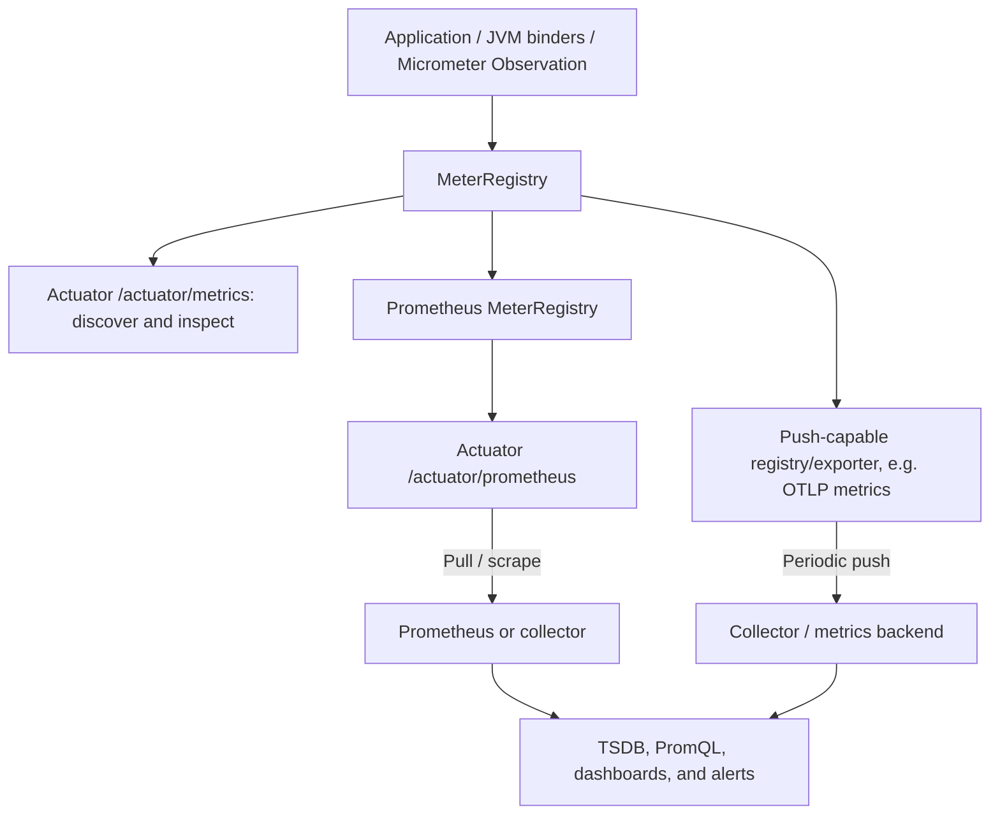
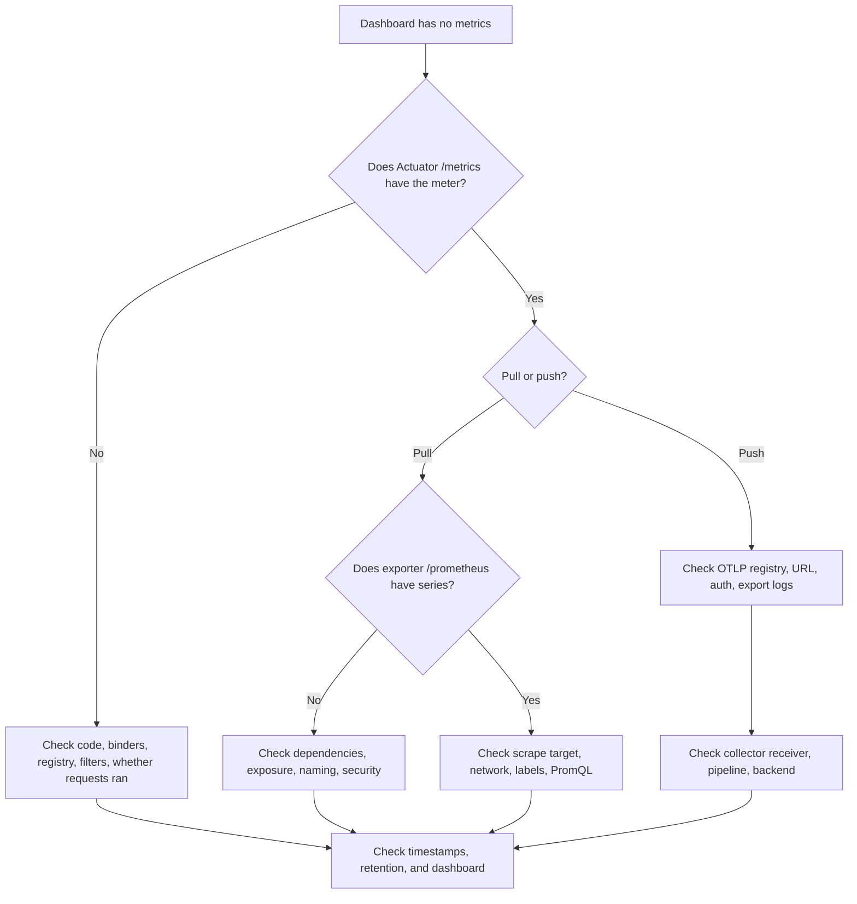

# Differences Between the Metrics Endpoint and Exporters in Spring Boot Actuator

A Spring Boot application receives many requests and has recorded the `http.server.requests` metric. A developer opens `http://localhost:8080/actuator/metrics/http.server.requests` and sees the request counter increasing. Yet when opening Grafana, the dashboard is still empty. The reverse also happens: Prometheus has historical HTTP request data, yet someone visiting `/actuator/metrics` receives HTTP 404 or 403.

These two situations are **not contradictory** because the **Actuator metrics endpoint** and a **metrics exporter** handle different responsibilities. The endpoint supports discovering and inspecting meters inside a single instance; the exporter delivers data in an appropriate protocol/format to an external monitoring system. To obtain charts over time, you usually also need a system that collects and stores the data.

This is the lesson **"Differences Between the Metrics Endpoint and Exporters"** in the **Actuator metrics endpoint** chapter of the `SPRING_BOOT_OBSERVABILITY` module. The module covers Micrometer Observation, metrics, logs, distributed tracing, context propagation, tags/cardinality, exporters, and sampling, in order to investigate errors, latency, and application behavior in production environments.

## 1. Quick Distinction: Metrics Endpoint, Exporter, and Backend

| Component | Primary Function | Consumer/Audience | Example |
| --- | --- | --- | --- |
| **Meter/MeterRegistry** | Registers and stores metric state inside the JVM process | Application, Micrometer binders and handlers | `Counter`, `Timer`, `Gauge`, `MeterRegistry` |
| **Actuator metrics endpoint** | Discovers meter names, measurements, and tags in the current instance | Developers, operators, diagnostic tools | `GET /actuator/metrics`, `GET /actuator/metrics/{name}` |
| **Metrics exporter/registry integration** | Translates metrics into a target format/protocol for external collection | Collector, metrics backend, monitoring agent | Prometheus registry, OTLP metrics registry, vendor registries |
| **Prometheus Actuator endpoint** | Publishes exposition format for Prometheus or an agent to scrape | Prometheus/collector in pull mode | `GET /actuator/prometheus` |
| **Collector/backend** | Collects, stores over time, queries, aggregates, computes rates, and supports alerts | SREs, dashboards, alerting | Prometheus, compatible metrics service, or another monitoring platform |

**Core takeaway:** `/actuator/metrics` **is not** a Prometheus exporter, is not a historical data store, and does not turn data into dashboards by itself. Conversely, a metrics exporter **is not necessarily an HTTP endpoint**; an exporter can actively push data periodically to a receiver.

### Two Common Paths



This diagram is logical: registries are configured and wired into the application via Spring Boot/Micrometer mechanisms; it does not imply one registry necessarily forwards data directly to another registry. When using multiple registries, Spring Boot can configure a composite registry or corresponding meter binding mechanism.

## 2. What Is Actuator `/actuator/metrics` Used For?

In Spring Boot Actuator, the endpoint with ID `metrics` provides an interface to inspect meters registered in `MeterRegistry`. When accessed:

```bash
curl -s http://localhost:8080/actuator/metrics
```

The application typically returns a list of existing meter names. **Illustrative** example response:

```json
{
  "names": [
    "http.server.requests",
    "jvm.memory.used",
    "jvm.gc.pause",
    "process.cpu.usage",
    "orders.confirmed"
  ]
}
```

The actual list varies by dependencies, Spring Boot version, JDK, server type, registry configuration, and operations that have occurred. A custom meter that has never been registered will not appear automatically just because the `metrics` endpoint exists.

To inspect a meter name:

```bash
curl -s http://localhost:8080/actuator/metrics/http.server.requests
```

The response typically includes `name`, `description`, `baseUnit` if available, `measurements`, and `availableTags`. **Hypothetical** example structure:

```json
{
  "name": "http.server.requests",
  "description": null,
  "baseUnit": "seconds",
  "measurements": [
    { "statistic": "COUNT", "value": 3.0 },
    { "statistic": "TOTAL_TIME", "value": 0.42 }
  ],
  "availableTags": [
    { "tag": "method", "values": ["GET", "POST"] },
    { "tag": "status", "values": ["200", "201"] },
    { "tag": "uri", "values": ["/api/orders/{id}", "/api/orders"] }
  ]
}
```

Do not assume every machine returns these exact fields, units, or values in this JSON. For a Timer, duration via Actuator is typically expressed in the unit provided by the endpoint/registry; read the actual response and understand what each statistic means.

### 2.1. Filtering by Tag

The endpoint lets you specify one or more `tag=key:value` query params. Filtering by `method` and route template:

```bash
curl -G 'http://localhost:8080/actuator/metrics/http.server.requests' \
  --data-urlencode 'tag=method:GET' \
  --data-urlencode 'tag=uri:/api/orders/{id}'
```

Use `--data-urlencode` instead of manually assembling query strings when route templates contain braces or special characters. `uri` values must match actual tags; they may differ for unmatched requests or across stacks/versions.

When multiple meters share a name with different tag sets, the metrics endpoint can aggregate measurements of the same kind matching the filter. For instance, a Timer's `COUNT` can reflect the number of recordings; yet you must not treat every statistic across all meter types identically. A Gauge's `VALUE` reflects an observed value, whereas a Timer's `TOTAL_TIME` is total duration.

### 2.2. What Does the Endpoint Not Do?

- Does not store **metric history by minute, hour, or day** like a time-series database.
- Has no built-in ability to run PromQL, `rate()`, `histogram_quantile()`, or fire alerts.
- Does not automatically export metrics to Prometheus merely because `/actuator/metrics` returns JSON.
- Does not automatically create tracing spans, record log correlation, or determine trace sampling.
- Does not guarantee an uncreated metric will appear; data must first be created and registered by binders/code/handlers.

The endpoint typically reflects **the state of one running instance**. When an application restarts, meters held in process memory can reset; keeping historical data requires an external backend to collect and store it.

## 3. What Is an Exporter and Why Is It Needed?

An exporter or registry integration is responsible for making Micrometer data **readable by an external collection system**, in an appropriate format and cadence. There are two common models:

| Model | How Collection Works | Component Scheduling Collection | Example |
| --- | --- | --- | --- |
| **Pull/scrape** | Backend or agent calls an application endpoint to fetch all current samples | Prometheus or collector | `/actuator/prometheus` backed by the Prometheus registry |
| **Push/export** | Application/registry periodically sends data to a receiving endpoint | Application-side registry/exporter; receiving endpoint | OTLP metrics over HTTP to an OpenTelemetry Collector |

A backend system may ingest from multiple sources or have a collector bridging pull to push. "Push or pull" refers to **a specific transport hop**, not necessarily the entire end-to-end architecture.

### 3.1. Prometheus Exporter and `/actuator/prometheus`

With the Prometheus registry dependency and exposed endpoint, `/actuator/prometheus` can return data in Prometheus exposition format. Example:

```text
# HELP orders_confirmed_total Number of confirmed orders
# TYPE orders_confirmed_total counter
orders_confirmed_total{channel="web"} 14.0
orders_confirmed_total{channel="mobile"} 7.0
```

This is a **formatting illustration**, not measured data or a guarantee of identical exported names across every version. The exporter can transform logical names, apply naming conventions, and add unit suffixes and labels by meter type.

Prometheus scrapes periodically and stores samples with timestamps in its datastore; that enables computing growth rates, trends, p95 from histograms, or error ratios over time.

Important: `/actuator/prometheus` is **an Actuator endpoint for Prometheus export format**, whereas `/actuator/metrics` is a meter diagnostic endpoint. Both can share the application's metric source yet **return different formats, serve different scopes, and use different query mechanisms**.

### 3.2. Push Exporters, Such as OTLP Metrics

With a compatible Micrometer OTLP registry, an application can **actively push metrics** to a receiver, such as an OpenTelemetry Collector. The backend then does not need to call an HTTP endpoint on the application to scrape:

```text
Spring Boot + MeterRegistry
  └── OTLP metrics registry / exporter
        └── HTTP OTLP /v1/metrics
              └── OpenTelemetry Collector
                    └── metrics backend
```

Distinguish **OTLP metrics** from **OTLP tracing**: the metric registry exports metrics, whereas the Micrometer Tracing bridge and tracing exporter handle spans. Configuring OTLP tracing alone does not automatically export Micrometer metrics, and vice versa.

Push exporters introduce their own operational concerns such as transport, timeouts, retries, backlogs, export intervals, and receiver authentication. Exact options depend on Micrometer/Spring Boot version and the collector system.

## 4. Configuring a Spring Boot Application with Both Metrics Endpoint and Prometheus

Example using **Spring Boot 3.x, Java 17+, and Maven** with Spring Boot parent/BOM managing dependency versions.

```xml
<dependencies>
    <dependency>
        <groupId>org.springframework.boot</groupId>
        <artifactId>spring-boot-starter-web</artifactId>
    </dependency>
    <dependency>
        <groupId>org.springframework.boot</groupId>
        <artifactId>spring-boot-starter-actuator</artifactId>
    </dependency>
    <dependency>
        <groupId>io.micrometer</groupId>
        <artifactId>micrometer-registry-prometheus</artifactId>
    </dependency>
</dependencies>
```

`application.yml` file:

```yaml
spring:
  application:
    name: order-service

management:
  endpoints:
    web:
      exposure:
        include: health,metrics,prometheus
  metrics:
    tags:
      application: order-service
```

The three entries `health`, `metrics`, and `prometheus` specify **the endpoints permitted to be published over HTTP**. Whether an endpoint actually works also depends on dependencies, endpoint enablement, and security policies. In many Spring Boot configurations, default web exposure includes only a small set of endpoints; therefore you must explicitly declare the endpoints you want to use.

After starting the application, verify:

```bash
# 1. Health: is the application responding?
curl -i http://localhost:8080/actuator/health

# 2. Metrics: which meters exist?
curl -i http://localhost:8080/actuator/metrics

# 3. Prometheus: is exposition format available for scraping?
curl -i http://localhost:8080/actuator/prometheus
```

If Actuator runs on a different management port or base path, update URLs to match the real configuration. The commands above illustrate unauthenticated access **only in a test environment**; operational environments require auth/network policies per design.

### 4.1. Creating a Business Metric to Observe the Difference

Example service recording confirmed orders across two bounded channels `web` and `mobile`:

```java
import io.micrometer.core.instrument.Counter;
import io.micrometer.core.instrument.MeterRegistry;
import org.springframework.stereotype.Service;

@Service
public class OrderMetricService {
    private final MeterRegistry meterRegistry;

    public OrderMetricService(MeterRegistry meterRegistry) {
        this.meterRegistry = meterRegistry;
    }

    public void orderConfirmed(String rawChannel) {
        String channel = "mobile".equals(rawChannel) ? "mobile" : "web";

        Counter.builder("orders.confirmed")
            .description("Number of successfully confirmed orders")
            .tag("channel", channel)
            .register(meterRegistry)
            .increment();
    }
}
```

The code uses only a small set of `channel` values instead of putting order IDs or user IDs into tags. Calling `register(...)` repeatedly with the same name and tags looks up/registers the appropriate meter in the registry; in hot paths, you can cache `Counter` references for a bounded tag set to reduce lookup overhead.

Suppose a controller called `orderConfirmed("web")` three times and `orderConfirmed("mobile")` twice. You can inspect in two ways:

```bash
curl -s http://localhost:8080/actuator/metrics/orders.confirmed
curl -G 'http://localhost:8080/actuator/metrics/orders.confirmed' \
  --data-urlencode 'tag=channel:web'

curl -s http://localhost:8080/actuator/prometheus
```

At `/actuator/metrics/orders.confirmed`, the response focuses on explaining the meter, statistics, and current tags. At `/actuator/prometheus`, look for the **actual series name** published by the Prometheus registry, commonly a counter with a `_total` suffix. They represent the same data source presented through two different interfaces.

### 4.2. Data Availability Can Differ After Startup

Not every meter has values right at startup:

- JVM binders typically provide many gauges/counters right after configuration.
- The HTTP server Timer has data only after a request is observed and its measurement completes.
- A custom Counter created inside a method may appear only after the first invocation.
- A metric may be dropped by an applicable `MeterFilter` or `ObservationPredicate`; know which filtering mechanisms are active.

A custom metric name missing from the list right at startup **is not enough to conclude the exporter is broken**.

## 5. Configuring Prometheus Scraping: What the Metrics Endpoint Does Not Do for You

Prometheus or an equivalent agent must be configured to know **which address to scrape**. A simple example of Prometheus configuration:

```yaml
scrape_configs:
  - job_name: order-service
    metrics_path: /actuator/prometheus
    scrape_interval: 15s
    static_configs:
      - targets:
          - order-service:8080
```

In this example, the hostname `order-service` must resolve in Prometheus's DNS/network environment, and Prometheus must have permission to connect. In Kubernetes or dynamic discovery systems, do not assume a single static target suffices for all pods; use service discovery or the corresponding operator.

If the exporter requires authentication/TLS, Prometheus must be configured with credentials/certificates per policy. Do not expose management endpoints publicly just so scraping works.

Data lifecycle:

1. Micrometer creates and maintains meters inside the JVM.
2. Prometheus calls `/actuator/prometheus` at each scrape interval.
3. Prometheus stores samples tagged with timestamps and labels.
4. PromQL computes rates, increases, histogram quantiles, and comparisons over time.
5. Grafana or dashboards display those queries; alerting evaluates rules against SLOs.

Key point: **a single successful `curl /actuator/prometheus` does not prove Prometheus has scraped successfully**. Inspect target status, scrape info, and actual series in the backend.

## 6. When to Use `/actuator/metrics` vs. Exporter/Backend?

| Scenario | Suitable Approach | Reason |
| --- | --- | --- |
| Just added a Timer and want to see if it registered | `/actuator/metrics` | Inspect the instance's meter list |
| Want to know which values `order.channel` has | `/actuator/metrics/{name}` | Read `availableTags` |
| Debugging wrong `baseUnit` or `COUNT` of a meter | `/actuator/metrics/{name}` | Check current metadata/measurements |
| Checking if the Prometheus exporter emits data | `/actuator/prometheus` | Inspect exposition and series names |
| Tracking 5-minute HTTP request rate | Prometheus/time-series backend | Needs data from multiple samples over time |
| Computing p95 latency by route | Backend with histograms and proper PromQL | Needs windowed distribution, not a single snapshot |
| Comparing before and after release over 24 hours | Backend/dashboards | Needs history and deployment labels |
| Viewing multiple replicas/pods | Backend aggregating labels | A single metrics endpoint only describes its own instance |
| Debugging why traces are missing | Tracing bridge/exporter/collector and logs | Tracing pipeline is separate from metrics endpoints |
| Reducing cost of high-cardinality labels | Convention/tag design, meter filters, and backend inspection | Cannot be solved simply by switching endpoints |

Do not use `/actuator/metrics` as a homemade "historical statistics API" by polling each metric. It is useful for diagnosis, but is not designed to replace a backend's time-series ingestion, retention, querying, and alerting capabilities.

## 7. Metric Names, Tags, and Units Can Differ Between the Two Interfaces

**Logical** names used in Micrometer, such as `http.server.requests` or `orders.confirmed`, can be transformed when entering the target registry. Prometheus commonly converts dots to underscores, standardizes unit suffixes, and distinguishes Counter, Gauge, or Timer output.

| In Micrometer/Actuator | Commonly in Prometheus | Meaning |
| --- | --- | --- |
| `http.server.requests` | `http_server_requests_seconds_count` | Number of requests recorded by the Timer |
| `http.server.requests` | `http_server_requests_seconds_sum` | Total duration in seconds |
| `http.server.requests` | `http_server_requests_seconds_bucket` when suitable histogram is enabled | Count of samples not exceeding bucket boundary |
| `jvm.memory.used` | `jvm_memory_used_bytes` | JVM memory used in bytes |
| `orders.confirmed` | Counter like `orders_confirmed_total` per applicable convention | Cumulative confirmed orders |

The names above are **examples per common conventions**, not guaranteed verbatim across all versions. Always inspect `/actuator/prometheus` or explore series in the backend when writing queries. Do not arbitrarily add `.seconds` or `.total` suffixes to meter names if the exporter expects to add them automatically, as that can cause inconsistent metric names.

### 7.1. Distinguishing Units and Statistics

A Timer has two important parts: **recording count** and **total duration**. When using a Prometheus Timer with `_seconds_count` and `_seconds_sum`, windowed mean latency can be computed by:

```promql
sum(rate(http_server_requests_seconds_sum{
  application="order-service"
}[5m]))
/
sum(rate(http_server_requests_seconds_count{
  application="order-service"
}[5m]))
```

The result has units of seconds/request. This is the **mean**, not p95. Using `COUNT` from a single metrics endpoint call to calculate "requests/second" without knowing the sampling interval is wrong in units.

### 7.2. 5xx Ratio by Endpoint

If HTTP meters carry a `status` label, a common Prometheus query is:

```promql
sum by (method, uri) (
  rate(http_server_requests_seconds_count{
    application="order-service", status=~"5.."
  }[5m])
)
/
sum by (method, uri) (
  rate(http_server_requests_seconds_count{
    application="order-service"
  }[5m])
)
```

This is the HTTP 5xx request ratio by method and route, not an arbitrary business failure rate. When the denominator is 0 or lacks data, dashboards must avoid misinterpretation.

### 7.3. p95 When Histograms Are Enabled

If histograms are enabled for the HTTP Timer and Prometheus has bucket series:

```promql
histogram_quantile(
  0.95,
  sum by (le, method, uri) (
    rate(http_server_requests_seconds_bucket{
      application="order-service"
    }[5m])
  )
)
```

In Spring Boot 3.x, this can commonly be configured as:

```yaml
management:
  metrics:
    distribution:
      percentiles-histogram:
        http.server.requests: true
```

**Not every Timer automatically has a histogram.** Check `_bucket` emitted by the exporter, bucket boundaries, and sample volume. Histograms increase the number of time series, especially when combined with many tags, so balance the cost.

## 8. Cardinality: Why Properly Exported Metrics Can Still Overload the Backend

Micrometer meters can attach low-cardinality tags for analysis, such as `method=GET`, `uri=/api/orders/{id}`, `status=200`, and `application=order-service`. When the exporter pushes/scrapes, each tag combination usually creates one or more series.

Theoretical maximum example: 20 route templates × 4 HTTP methods × 5 statuses × 3 replicas = **1,200 combinations**. Enabling histograms with many buckets creates additional series for each combination. Actual counts depend on which labels and samples occur; the formula illustrates how series grow when adding dimensions.

**Avoid using** high-cardinality values as metric tags: `orderId`, `userId`, `traceId`, raw URLs with IDs, query strings, tokens, or arbitrary exception messages.

| Data | Better Place | Why |
| --- | --- | --- |
| HTTP route template | Metric `uri` | Controllable route count |
| HTTP status or bounded outcome | Metric tag | Useful for error rates and grouping |
| Request ID/trace ID | Tracing/log correlation | Identifies a single request; too many values for a metric tag |
| Order ID | Logs/traces when policy permits | High cardinality and potentially sensitive |
| Raw payload/token | Never record in uncontrolled telemetry | Security and privacy risk |

**Both the metrics endpoint and the exporter suffer from bad tag design**, yet switching endpoints cannot fix cardinality. Normalize at the source when creating Observations/meters, using appropriate conventions, filters, or meter filters, while monitoring series counts in the backend.

## 9. OTLP Metrics Exporter: An Example Instead of Scraping

If the environment uses a collector supporting OTLP, Spring Boot 3.x can integrate `micrometer-registry-otlp` to send metric data over OTLP, using version-appropriate configuration:

```xml
<dependency>
    <groupId>io.micrometer</groupId>
    <artifactId>micrometer-registry-otlp</artifactId>
</dependency>
```

Example configuration for **a metrics push path**:

```yaml
management:
  otlp:
    metrics:
      export:
        url: http://otel-collector:4318/v1/metrics
        step: 30s
```

This sample belongs to the `management.otlp.metrics.export.*` configuration group used in Spring Boot 3.x versions supporting the OTLP metrics registry. Verify properties, protocol, authentication, headers, and retry/export semantics against your exact project version and collector. The example requires a compatible OTLP HTTP receiver at that endpoint.

**Do not confuse with OTLP tracing:** tracing configuration may belong to `management.otlp.tracing.*` and requires the appropriate tracing bridge/exporter. A trace sampler keeping 10% of traces **does not mean only 10% of metric samples are exported**; they are separate pipelines and policies.

When an application has only a push exporter, `/actuator/prometheus` may not exist if no Prometheus registry is installed; meanwhile `/actuator/metrics` can still work if Actuator and that endpoint are enabled. This illustrates that the metrics endpoint **does not strictly depend on the Prometheus exporter**.

## 10. Security and Operations: Do Not Let a Diagnostic Endpoint Become a Vulnerability

There are three separate questions when publishing telemetry:

1. **Does the endpoint exist and is it enabled?** Depends on dependencies and endpoint configuration.
2. **Is the endpoint exposed over the web?** Depends on `management.endpoints.web.exposure.include` or equivalent config.
3. **Who is authorized to access it?** Handled by Spring Security, gateways, network policies, firewalls, or mTLS.

**Being exposed does not mean being automatically protected by a policy suited to every environment.** When adding Spring Security, understand auto-configuration and explicitly define authorization for management endpoints. Never assume `/actuator/prometheus` should always be public because "it's just metrics".

Recommended practices:

- Prefer an internal management interface; consider a separate management port and clear network policies.
- Publish only genuinely needed endpoints; many systems only need `prometheus` for scrapers and restrict `metrics` to debugging personnel.
- If the exporter pushes to a collector, use appropriate TLS/auth and verify the delivery path.
- Avoid putting sensitive identifiers, secrets, or payloads in tags, even if the metrics backend is not directly user-facing.
- Size scrape intervals, timeouts, retention, and series counts to load and cost budgets.
- Monitor scrape/export status, connection errors, and lag between metric recording and dashboard visibility.
- Never share scraper credentials in documentation, logs, or URLs.

### Can the `metrics` Endpoint Be Enabled Without Prometheus?

Yes. For example, if an application has Actuator and web exposure for `metrics` without the Prometheus registry, `/actuator/metrics` still serves diagnostics for registered meters, while `/actuator/prometheus` may not exist. Conversely, if you add the Prometheus registry but forget to expose `prometheus`, metrics still exist in the registry, yet the scraper cannot reach the default web URL.

Another case: Prometheus successfully collects metrics from its endpoint, while direct requests to `/actuator/metrics` get 403 due to different permissions. An access difference does not mean the data has vanished.

## 11. Diagnosing: Local Metrics Exist, Yet Dashboard Is Empty

When troubleshooting, do not inspect every component haphazardly. Follow the path from source to destination:



| Symptom | Possible Cause | How to Verify |
| --- | --- | --- |
| `/actuator/metrics` returns 404 | Endpoint not exposed, not enabled, changed base path/port, missing Actuator | Check config and management URL |
| `/actuator/metrics` returns 401/403 | Authentication/authorization policy | Check `SecurityFilterChain`, credentials, network |
| Actuator works, custom meter missing | Code not invoked yet, meter not registered, rejected by filter | Trigger sample business flow and re-check |
| `/actuator/prometheus` returns 404 | Missing Prometheus registry, endpoint not enabled/exposed | Check dependencies and `management.endpoints.web.exposure` |
| Prometheus endpoint has data, backend is empty | Scrape failed, wrong target/port/path/TLS/auth | Check target status and scrape errors |
| Backend has series, query returns empty | Wrong metric name after rename, wrong labels, or time range | Inspect actual exposition and try a broader query |
| PromQL p95 returns empty | Timer does not export histogram buckets | Check `_bucket` and distribution config |
| Metric exported in wrong unit | Inconsistent name and base unit, or wrong unit conversion in dashboard | Compare meter metadata, exporter suffix, and math |
| Backend has too many time series | Raw ID/URL/high-cardinality tags, overly broad histograms | Count series and normalize tags |
| Metrics exist, tracing is empty | Missing tracing bridge, sampling, OTLP tracing exporter, or propagation | Check the tracing pipeline independently |
| Data disappears only after restart | Local counter reset, interrupted scraping, backend retention | Check restart timestamp and scrape history |

### 11.1. Three High-Value Checks

**Check 1 — Has the meter been created?**

```bash
curl -s http://localhost:8080/actuator/metrics
curl -s http://localhost:8080/actuator/metrics/orders.confirmed
```

**Check 2 — Can the exporter publish it?**

```bash
curl -s http://localhost:8080/actuator/prometheus
```

**Check 3 — Is the backend collecting successfully?** For Prometheus, check target status in the Prometheus UI and query the metric name identified from exposition. For OTLP push, check registry/export status, collector connectivity, receiver, and backend. Never rely on a single curl command to conclude the end-to-end pipeline is working.

## 12. The Metrics Endpoint Does Not Replace Logs and Tracing

Micrometer Observation can coordinate multiple handlers:

```java
Observation.createNotStarted("payment.authorize", observationRegistry)
    .lowCardinalityKeyValue("payment.channel", "card")
    .observe(() -> paymentGateway.authorize());
```

This illustration assumes `observationRegistry` and `paymentGateway` already exist, along with a synchronous `authorize()` method. With an appropriate metrics handler, Observation can create a Timer for the operation duration. With a tracing handler and exporter, Observation can also create a span. Log correlation requires corresponding logging and tracing configuration.

| Signal | Typical Data | Where to Investigate |
| --- | --- | --- |
| Metrics | Rates, errors, durations aggregated by bounded tags | Prometheus/metrics backend |
| Traces | A single request, spans, and parent–child relationships | Tracing backend |
| Logs | Messages, error codes, exceptions, `traceId`/`spanId` | Log backend |

If `POST /orders` p95 increases:

1. Use PromQL/dashboards to identify the endpoint and time window.
2. Find a matching trace within that window if retained by sampling.
3. Inspect which service, HTTP client, or business task has the slow span.
4. Use `traceId` to find related logs when correlation is configured.
5. Use JVM/CPU/GC metrics to verify whether runtime pressure occurred.

**Do not put `traceId` or `orderId` into low-cardinality metric tags** to try to link data; they multiply series by request. Linking metrics to traces relies on service, route, timestamp, and exemplar mechanisms if supported by your stack, not attaching a unique ID to every metric sample.

For work across executors, `CompletableFuture`, or Reactor, context propagation must be configured so trace/span and MDC do not break; a working metrics exporter alone does not guarantee propagation. Sampling mainly governs which traces are kept, while metric aggregation can operate independently.

## 13. Hands-On Exercise: From Actuator to Dashboard

Create a test Spring Boot application with an order-processing controller and a business metric `orders.confirmed` as in Section 4.

1. **Start the application:** add Actuator and the Prometheus registry, and configure web exposure for `health`, `metrics`, and `prometheus` in a test environment.
2. **Generate data:** call the business endpoint several times for each `channel=web/mobile`; confirm `orders.confirmed` is registered.
3. **Inspect the metrics endpoint:** access `/actuator/metrics` and `/actuator/metrics/orders.confirmed`; filter by `tag=channel:web`, and note statistics and `availableTags`.
4. **Inspect the exporter:** access `/actuator/prometheus`, find the actual Prometheus names of the Counter and HTTP Timer; compare the format with the JSON response from the metrics endpoint.
5. **Enable scraping:** configure Prometheus or a collector that can reach the application, verify the target succeeds, and confirm data is stored continuously.
6. **Query history:** use `rate(...[5m])` for request throughput and the business Counter; try HTTP 5xx rate. If histograms exist, compute p95 using `histogram_quantile()`.
7. **Test a controlled outage:** stop scraping for a period then restore it; observe the difference between values still shown by Actuator and the data gap in the backend.
8. **Compare push:** if an OTLP collector is available, configure the OTLP metrics registry in a separate environment; verify data reaches the backend without `/actuator/prometheus`.
9. **Add tracing:** instrument a business operation with Observation, configure the tracing bridge and logging correlation to investigate a slow request. Explain why a metrics exporter does not emit spans on its own.
10. **Security review:** restrict endpoints via network/auth, audit tag cardinality, data retention, and consistency of metric units/names.

### Self-Check Questions

1. Why does `/actuator/metrics/http.server.requests` display `COUNT` yet cannot directly return "request rate over 5 minutes"?
2. How do `/actuator/metrics` and `/actuator/prometheus` differ in format and intended consumers?
3. If `/actuator/prometheus` has data while Grafana is empty, which step should you check first?
4. Does an application using OTLP metrics push without the Prometheus registry have to provide `/actuator/prometheus`?
5. Why is a Timer not guaranteed to have bucket series for computing p95?
6. Is a metrics exporter alone sufficient for distributed tracing and log correlation? Why or why not?
7. Why should an order ID not be attached as a metric label to trace an individual error?

## 14. Production Deployment Checklist

- Clearly distinguish the **in-application diagnostic interface** from the **metrics export path to the backend**.
- Have the appropriate `MeterRegistry`/binders/`ObservationHandler` and verify meters are registered.
- For Prometheus pull, fully configure registry, endpoint, exposure, and scrape target/credentials.
- For OTLP push, properly configure registry/export URL/receiver/auth and monitor send failures.
- Verify metric names and units after the exporter; do not assume Micrometer names stay unchanged in the backend.
- Use a time-series backend to compute rates, histogram quantiles, alerts, and multi-instance comparisons.
- Manage tags/cardinality, route templates, and histogram series to control costs.
- Monitor scrape failures, exporter errors, restarts, data gaps, and retention.
- Protect management endpoints; publish only genuinely required endpoints.
- Correlate metrics with logs/traces by service, timestamp, trace context, and sampling/propagation policies.
- Validate dashboard accuracy using test requests, test errors, and end-to-end data checks.

## Conclusion

**Actuator `/actuator/metrics`** is a window into the meters currently present in a Spring Boot instance: it helps discover names, measurements, base units, and tags, yet does not store history or compute time-windowed queries on its own. A **metrics exporter** is the bridge to external collection systems: Prometheus typically scrapes `/actuator/prometheus`, while other registries can push data to a collector via OTLP or an equivalent protocol. Dashboards and alerts are trustworthy only when data actually reaches the backend with accurate timestamps, units, and cardinality. Combining a sound metrics pipeline with Micrometer Observation, logs, tracing, context propagation, and sampling turns incident investigation for errors, latency, and production behavior into an evidence-based process.
