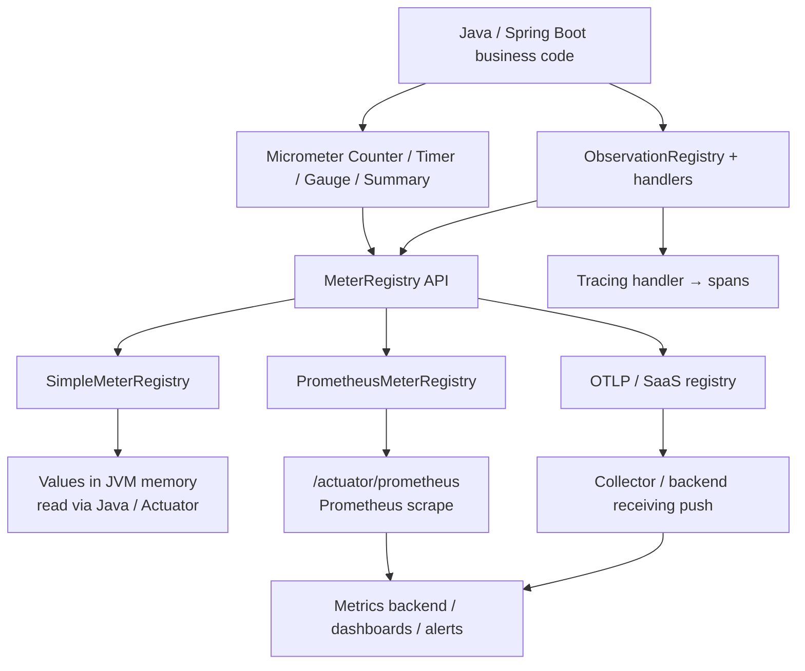
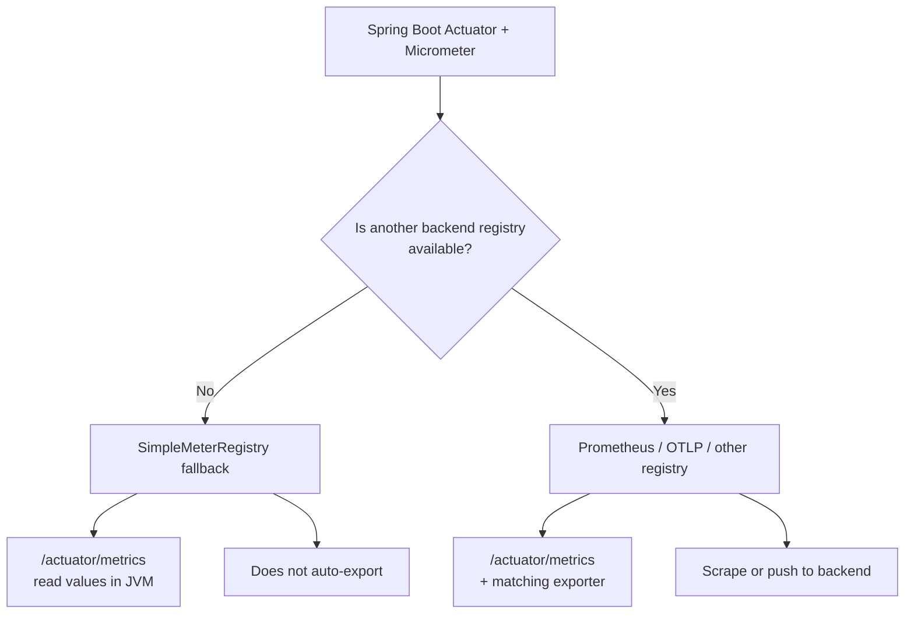
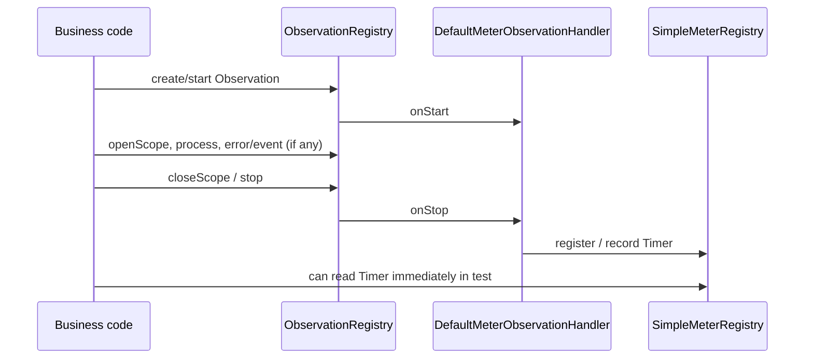

# SimpleMeterRegistry

A development team wants to measure failed orders and processing latency in a Spring Boot application, but does not yet have Prometheus, an OpenTelemetry Collector, or a paid metrics service. They can still write instrumentation, run tests, and inspect each meter right inside the JVM thanks to **`SimpleMeterRegistry`**. When the system moves to production, most of the same measurement code can be connected to an appropriate metrics-exporting registry without rewriting business logic.

The **SimpleMeterRegistry** lesson belongs to the **Meter registry and exporter** chapter of the **SPRING_BOOT_OBSERVABILITY** module. The module's overarching goal is to set up observability for Spring Boot using Micrometer Observation, metrics, logs, and distributed tracing; understand context propagation, tags/cardinality, exporters, sampling, and signal correlation to investigate errors, latency, and application behavior in real environments. Here, we focus on **the simplest metrics registry**, where it provides value, the limitations of in-memory data, and how to avoid confusing local results with telemetry exported to a backend.

> **Definition:** `SimpleMeterRegistry` is a `MeterRegistry` implementation in Micrometer Core. It keeps the current measurement values of meters in **process memory**, allowing them to be read directly from Java or via the appropriate Actuator mechanism. **It does not automatically send metrics to Prometheus, OTLP, or any external backend.** It is an excellent tool for learning and testing, but it is not a centralized monitoring system.

## 1. Learning Objectives

After this lesson, you will be able to:

1. Explain what `SimpleMeterRegistry` is and how it relates to `MeterRegistry`, `Meter`, `Meter.Id`, and backends/exporters.
2. Create a standalone `SimpleMeterRegistry`, and record and read `Counter`, `Timer`, `Gauge`, and `DistributionSummary`.
3. Distinguish between **in-JVM accumulated** data and a persistent time series stored in a monitoring system.
4. Write deterministic unit tests for metrics using `SimpleMeterRegistry` and `MockClock`.
5. Understand how Spring Boot Actuator selects the simple registry as a **fallback** and why that fallback can disappear when adding a Prometheus or OTLP registry.
6. Use `CompositeMeterRegistry` properly without assuming measurements recorded before attaching child registries will be replayed.
7. Limit cardinality, protect Gauge lifecycles, and avoid using personal data or per-request IDs as metric tags.
8. Establish a verification workflow from the Simple registry, Actuator, and exporter to the metrics backend; and combine metrics with logs and traces when investigating incidents.

## 2. Where Do MeterRegistry and SimpleMeterRegistry Fit?

In Micrometer, a `MeterRegistry` registers and manages meters. Depending on the implementation, these meters can be kept in memory, converted into Prometheus format, or periodically exported to another system.



A key distinction: **MeterRegistry is the interface/integration point**, while `SimpleMeterRegistry` is **one concrete implementation**. Well-structured business code should accept `MeterRegistry`, rather than creating a Simple registry inside each controller to record metrics on its own. That way, the application can switch backends per environment without changing business code.

| Component | Role | Limitations |
|---|---|---|
| `MeterRegistry` | Registers, looks up, and manages meters. | Does not decide what business behavior should be measured. |
| `SimpleMeterRegistry` | Keeps current measurements in memory for reading/testing. | Does not automatically export or persist history across restarts. |
| `PrometheusMeterRegistry` | Prepares metrics for Prometheus scraping. | Requires an endpoint/target and a working scrape process. |
| OTLP or push registry | Formats and sends metrics to a receiver/backend. | Requires network, endpoint, auth, and pipeline configuration. |
| `CompositeMeterRegistry` | Coordinates multiple child registries. | Does not backfill values recorded when no child registries were attached. |
| `ObservationRegistry` | Manages observation lifecycles and dispatches callbacks to handlers. | Does not replace `MeterRegistry`; a metrics handler can record into a meter registry. |

### 2.1 Why Use Simple Before Configuring an Exporter?

A team can verify instrumentation early:

- A successful transaction increments Counter `outcome=success` by exactly one.
- A call measured with Timer has `count=1` and a reasonable duration.
- A Gauge reads the exact queue depth at inspection time.
- No new meter is created per `orderId` or `traceId`.
- When an exception occurs, the Timer is still recorded via `finally` or the Observation lifecycle.

These checks verify **telemetry input inside the application**; they do not yet verify **the export process**, storage, alerting, or multi-instance querying.

## 3. Creating a Standalone SimpleMeterRegistry

`SimpleMeterRegistry` belongs to the `io.micrometer:micrometer-core` artifact. In a Spring Boot application that already includes Actuator, Micrometer Core is typically already present via dependency management. If you are building a standalone Java program, declare Micrometer Core at a compatible version.

```groovy
dependencies {
    implementation 'io.micrometer:micrometer-core'
}
```

Minimal Java example:

```java
import io.micrometer.core.instrument.Counter;
import io.micrometer.core.instrument.simple.SimpleMeterRegistry;

public class SimpleRegistryHello {
    public static void main(String[] args) {
        try (SimpleMeterRegistry registry = new SimpleMeterRegistry()) {
            Counter requests = Counter.builder("demo.requests")
                    .description("Total demonstration requests")
                    .tag("result", "ok")
                    .register(registry);

            requests.increment();
            requests.increment();

            double count = registry.get("demo.requests")
                    .tag("result", "ok")
                    .counter()
                    .count();

            System.out.println("Requests = " + count); // 2.0
        }
    }
}
```

**Explanation:**

1. `new SimpleMeterRegistry()` creates a **local** registry in the JVM.
2. `Counter.builder(...).register(registry)` creates or retrieves a Counter with a specific meter ID.
3. `increment()` updates the current count without performing any HTTP push.
4. `registry.get(...).counter().count()` reads the value back immediately from the registry.
5. `try-with-resources` calls `close()` when the example finishes. In a Spring Boot application, let the container manage the registry bean and its lifecycle.

Do not call `new SimpleMeterRegistry()` on every request. Each separate registry has its own set of meters and counts; if you create a new registry each time, the main dashboard/endpoint will not automatically see those values.

### 3.1 Store a Meter in a Field or Look It Up Every Time?

The example above uses a registry lookup to show how to read values; on a hot path, you typically keep a Counter/Timer reference in a field:

```java
public final class ReservationMetrics {
    private final Counter rejected;

    public ReservationMetrics(MeterRegistry registry) {
        this.rejected = Counter.builder("inventory.reservation.rejected")
                .tag("reason", "out_of_stock")
                .register(registry);
    }

    public void outOfStock() {
        rejected.increment();
    }
}
```

In real code, add the corresponding imports for `Counter` and `MeterRegistry`. A registry can cache meters by ID, but holding a reference reduces repeated lookups on frequently executed paths. If tag values are only known at processing time, look up the meter using a normalized set of tags.

## 4. Reading Counter, Timer, and DistributionSummary

Meters carry different semantics; the Simple registry holds their corresponding measurements according to the Micrometer API.

### 4.1 Counter: Number of Events That Have Occurred

```java
Counter approved = registry.counter(
        "checkout.authorization.result", "outcome", "approved");
Counter declined = registry.counter(
        "checkout.authorization.result", "outcome", "declined");

approved.increment();
approved.increment();
declined.increment();

System.out.println(approved.count()); // 2
System.out.println(declined.count()); // 1
```

A `Counter` only increases during the meter's lifetime. If the entire registry/process is destroyed, the accumulated count is not persisted; a new registry starts with fresh counters. In production, rate/counter resets must be interpreted by the backend according to proper semantics.

**Note:** `Counter` is not suitable for representing current queue state because a queue can grow or shrink. Use a Gauge for stateful values.

### 4.2 Timer: Count, Total Time, and Related Statistics

```java
import java.time.Duration;
import java.util.concurrent.TimeUnit;
import io.micrometer.core.instrument.Timer;

Timer latency = Timer.builder("checkout.authorization.duration")
        .description("Time spent authorizing payment")
        .register(registry);

latency.record(Duration.ofMillis(120));
latency.record(Duration.ofMillis(280));

System.out.println(latency.count());                  // 2
System.out.println(latency.totalTime(TimeUnit.MILLISECONDS)); // 400.0
```

**Timer count** and **total time** let you confirm the number of completions and total duration. The average latency across the two calls in the example is 200 ms. Some statistics such as max/percentiles/histograms have specific time-window behavior and configuration; do not assume every percentile or bucket is always available by default.

If you want to time a block of code instead of constructing a `Duration` manually, use:

```java
Timer.Sample sample = Timer.start(registry);
try {
    performCheckout();
} finally {
    sample.stop(latency);
}
```

`Timer.Sample` measures using the registry's clock. It lets you select the final Timer at `stop` time, for example grouping by `outcome` once the result is known. When an exception occurs, `stop` must still be called according to the application's measurement contract. In asynchronous programs, do not stop immediately when a method returns a `Future` if the work is still running.

### 4.3 DistributionSummary: Distribution of Non-Time Quantities

```java
import io.micrometer.core.instrument.DistributionSummary;

DistributionSummary batchSize =
        DistributionSummary.builder("orders.batch.size")
                .baseUnit("items")
                .description("Items in each order-processing batch")
                .register(registry);

batchSize.record(10);
batchSize.record(25);

System.out.println(batchSize.count());       // 2
System.out.println(batchSize.totalAmount()); // 35
```

`DistributionSummary` is suitable for bytes, item counts, or batch sizes. Timer is suitable for durations because Micrometer knows how to convert time units for backends. When enabling histograms on a summary, choose an appropriate value range and buckets; the Simple registry does not create a time-series database to store distribution history.

### 4.4 A Complete Runnable Example

```java
import java.time.Duration;
import java.util.concurrent.TimeUnit;

import io.micrometer.core.instrument.Counter;
import io.micrometer.core.instrument.DistributionSummary;
import io.micrometer.core.instrument.Timer;
import io.micrometer.core.instrument.simple.SimpleMeterRegistry;

public final class CheckoutMetricDemo {
    public static void main(String[] args) {
        try (SimpleMeterRegistry registry = new SimpleMeterRegistry()) {
            Counter result = Counter.builder("checkout.result")
                    .tag("outcome", "approved")
                    .register(registry);
            Timer latency = Timer.builder("checkout.latency")
                    .register(registry);
            DistributionSummary size = DistributionSummary
                    .builder("checkout.batch.items")
                    .register(registry);

            result.increment();
            latency.record(Duration.ofMillis(150));
            size.record(5);

            System.out.printf("approved=%s, count=%d, latency=%.0fms, items=%.0f%n",
                    result.count(),
                    latency.count(),
                    latency.totalTime(TimeUnit.MILLISECONDS),
                    size.totalAmount());
        }
    }
}
```

The values are printed from the Java process's memory. This snippet does not create a `/actuator/prometheus` endpoint and does not send data to a monitoring service.

## 5. Gauge: An Easy Mistake Even with the Simple Registry

A `Gauge` reads the **current state** of an object, not how many times an event occurred.

Example measuring the number of pending tasks:

```java
import java.util.concurrent.atomic.AtomicInteger;
import io.micrometer.core.instrument.Gauge;

AtomicInteger queued = new AtomicInteger(0);

Gauge.builder("orders.queue.pending", queued, AtomicInteger::get)
        .description("Current number of pending order jobs")
        .register(registry);

queued.set(7);

double pending = registry.get("orders.queue.pending")
        .gauge()
        .value(); // 7.0
```

### 5.1 The Weak Reference Trap

Micrometer typically holds a weak reference to the object observed by a Gauge. If you register a Gauge with a `new AtomicInteger(...)` that only lives in a local variable and let that reference go out of scope, the garbage collector can reclaim the object. When that happens, the measurement may become `NaN` or stop being useful.

For Spring Boot, store the object in a bean field:

```java
@Component
public final class QueueMetrics {
    private final AtomicInteger pending = new AtomicInteger();

    public QueueMetrics(MeterRegistry registry) {
        Gauge.builder("orders.queue.pending", pending, AtomicInteger::get)
                .register(registry);
    }

    public void setPending(int amount) {
        pending.set(Math.max(0, amount));
    }
}
```

This is an illustrative snippet; import `Component`, `AtomicInteger`, `Gauge`, and `MeterRegistry` in a real application. If you already have an actual queue, **reading the queue directly** is more accurate than maintaining a separate state copy that can drift.

### 5.2 Do Not "Update a Gauge" by Re-Registering It

Wrong:

```java
void queueChanged(MeterRegistry registry, int newSize) {
    AtomicInteger value = new AtomicInteger(newSize);
    Gauge.builder("orders.queue.pending", value, AtomicInteger::get)
            .register(registry);
}
```

The registry typically returns the meter for the already-registered ID rather than replacing the measured object on every call. Moreover, the newly created object may lose its strong reference. The right approach is to **register once** and mutate the actual underlying data source, or read the queue directly.

The Simple registry can expose these bugs right in unit tests; switching to another registry does not automatically fix Gauge mistakes.

## 6. SimpleMeterRegistry Does Not Store Time-Series History

A crucial difference between **the current value of a meter** and **a time series stored in a backend**:

```text
In SimpleMeterRegistry:
  checkout.result{outcome="approved"} = 25 at read time
  checkout.latency count = 25, totalTime = ...
  orders.queue.pending = 6 at read time

In metrics backend:
  10:00  checkout.result = 10
  10:01  checkout.result = 15
  10:02  checkout.result = 25
  can compute rate, increase, alerts, and historical comparisons
```

The Simple registry **does not record minute-by-minute value series on its own** and does not provide:

- History retention across process restarts.
- Week-over-week comparisons across multiple instances.
- Centralized alerting when an instance becomes unavailable.
- PromQL in an external system.
- Ensuring telemetry has left the JVM if the application crashes.
- Cluster-wide queries by service, region, or deployment.

You can sample values from the Simple registry yourself or let Spring Boot Actuator read them, but **historical storage and alerting belong to a separate pipeline**. For production observability, use the appropriate backend exporter/collector.

### 6.1 Can You Use the Simple Registry to Compute a Rate?

If you want to measure how many times an event occurred during a specific interval of **a single test**, you can take the difference in `Counter.count()` before and after and divide by the test duration. However, this is not a rate/aggregation system resilient to restarts, multiple instances, scrape gaps, or retention policies. For production, use a backend and an appropriate function like `rate(...)` on exported counters.

## 7. Why Does Spring Boot Have the Simple Registry Without Always Using It?

Spring Boot Actuator auto-configures Micrometer and any backend registries present on the runtime classpath. According to Spring Boot documentation, **the Simple in-memory registry is used as a fallback if no other backend registry is configured**. When another backend is available, the simple fallback is usually disabled automatically.



Examples:

| Classpath / Configuration | Likely Outcome | What to Remember |
|---|---|---|
| Actuator present, no backend registry added | Spring Boot uses the Simple fallback. | Meters can be viewed at `/actuator/metrics` if exposed. |
| Prometheus registry added | Prometheus registry is auto-configured; Simple fallback usually turns off. | `/actuator/prometheus` can output scrape format when the endpoint is enabled. |
| OTLP registry added | OTLP metrics exporter can be configured depending on dependencies/properties. | Requires a real receiver/collector; without a pipeline, the backend gets no data. |
| Multiple registry implementations | A composite registry containing child registries can be used. | Do not assume Simple is also a child once the fallback is disabled. |
| Simple disabled via property | Without another suitable registry, metrics may have no storage backend. | Know the reason and scope of the configuration. |

### 7.1 Property to Disable the Simple Fallback

In current Spring Boot reference documentation, you can use:

```yaml
management:
  simple:
    metrics:
      export:
        enabled: false
```

Equivalent to `management.simple.metrics.export.enabled=false`.

This is a **Spring Boot auto-configuration** setting, not a parameter passed to `new SimpleMeterRegistry()` in standalone code. Older Spring Boot versions may use a different property prefix (such as `management.metrics.export.simple.enabled`); consult the reference guide for your project's **exact major/minor version**.

**Do not disable the Simple registry just to "improve performance"** when no other metrics backend is configured: if the application has no active/available registry, you may lose visibility into metrics through Actuator altogether.

### 7.2 How Should Spring Boot Inject It?

Prefer writing:

```java
@Service
public class BusinessService {
    private final MeterRegistry meterRegistry;

    public BusinessService(MeterRegistry meterRegistry) {
        this.meterRegistry = meterRegistry;
    }
}
```

Do not cast:

```java
// Dangerous: no guarantee the bean is always SimpleMeterRegistry.
SimpleMeterRegistry simple = (SimpleMeterRegistry) meterRegistry;
```

Spring Boot may inject a `CompositeMeterRegistry` or a backend-specific registry. Unit tests that want Simple can instantiate it directly and pass it via the constructor, while the business service only depends on `MeterRegistry`.

### 7.3 `/actuator/metrics` Does Not Mean Simple Is Being Used

The Actuator metrics endpoint reads meters managed by the active registry. It works across many registry types. If `/actuator/metrics` returns metrics, **do not conclude** that the application is using the Simple registry. Inspect dependencies, the actual registry bean, and auto-configuration when in doubt.

## 8. From the Simple Registry to the Prometheus Exporter

Suppose business code is recording into an injected `MeterRegistry`. Changing the observability environment may only require adding a backend dependency and configuration.

### 8.1 Illustrative Dependencies

```groovy
dependencies {
    implementation 'org.springframework.boot:spring-boot-starter-actuator'
    runtimeOnly 'io.micrometer:micrometer-registry-prometheus'
}
```

This example is for a project that already has the Spring Boot plugin and appropriate dependency management. In an environment purely for learning Simple, there is no need to add the Prometheus registry; when you add this dependency, Spring Boot can switch from the simple fallback to the Prometheus registry.

### 8.2 Actuator Configuration for Local Use

```yaml
spring:
  application:
    name: order-service

management:
  endpoints:
    web:
      exposure:
        include: "health,metrics,prometheus"
  metrics:
    tags:
      application: order-service
      environment: local
```

After running at least one business operation that records a meter:

```bash
# List of Micrometer meter names.
curl http://localhost:8080/actuator/metrics

# A business meter if code has called increment().
curl http://localhost:8080/actuator/metrics/checkout.result

# Scrape endpoint when Prometheus registry is present and exposed.
curl http://localhost:8080/actuator/prometheus
```

**Distinguish the results:**

- `/actuator/metrics`: Diagnostic JSON keyed by Micrometer meter name.
- `/actuator/prometheus`: Prometheus exposition format, only present when the matching registry/endpoint is enabled.
- Seeing output at `/actuator/prometheus` **does not prove** the Prometheus server has scraped it successfully.
- A successful Prometheus scrape **does not prove** dashboards query the right names/labels or alerts are configured.

### 8.3 Prometheus Scrape

A sample `prometheus.yml` configuration:

```yaml
scrape_configs:
  - job_name: "order-service"
    metrics_path: "/actuator/prometheus"
    scrape_interval: 15s
    static_configs:
      - targets:
          - "order-service:8080"
```

The name `order-service:8080` is an illustrative host and must be replaced with a real target reachable from Prometheus. Production environments typically use service discovery, authentication, network policies, and appropriate access controls.

Do not expose management endpoints publicly on the internet just to collect metrics. Verify the scrape target's `up` status, scrape timestamps, labels, and metric names converted by the exporter from dot notation to Prometheus conventions.

## 9. CompositeMeterRegistry: Testing Multiple Backends and the Pre-Add Data Trap

`CompositeMeterRegistry` allows a single meter to publish to multiple child registries:

```java
import io.micrometer.core.instrument.Counter;
import io.micrometer.core.instrument.composite.CompositeMeterRegistry;
import io.micrometer.core.instrument.simple.SimpleMeterRegistry;

public class CompositeDemo {
    public static void main(String[] args) {
        try (CompositeMeterRegistry composite = new CompositeMeterRegistry();
             SimpleMeterRegistry simple = new SimpleMeterRegistry()) {

            Counter events = composite.counter("demo.events");
            events.increment();  // No child registry yet.

            composite.add(simple);
            events.increment();  // Child registry receives this call.

            double observed = simple.get("demo.events")
                    .counter().count();
            System.out.println(observed); // 1.0
        }
    }
}
```

**Why is it only 1?** In Micrometer, a composite with no child registries performs no-op measurements. After `add(simple)`, the corresponding meter is created in the child registry, but **the earlier increment is not replayed**.

Other things to keep in mind:

- With multiple child registries, each child has its own display/exposure mechanism; do not sum the results of two backends as if they were two separate sets of requests.
- When adding a child registry while the application is already running, historical values from before the child existed do not transfer over.
- A composite does not replace an exporter's job, even though it provides a single write point.
- If Spring Boot already auto-configures a composite, do not create another manual composite without a clear reason.

### 9.1 Why Not Manually Register Both Simple and Prometheus in Every App?

Advanced testing or setups may occasionally want an in-memory copy to inspect, but duplicate registries are usually unnecessary. Spring Boot already provides auto-configured registries; a custom composite with an improper lifecycle can cause duplicate meters, lost data, or confusion over which bean is injected. For unit tests, create a standalone Simple registry; for production, prefer the official exporter/backend.

## 10. Unit Testing Metrics with SimpleMeterRegistry

This is **one of the biggest practical benefits** of Simple: replacing a network-dependent exporter with an instrument store that can be read synchronously right inside the test suite.

### 10.1 Testing Business Outcomes with JUnit 5

A sample service depending on `MeterRegistry`:

```java
import io.micrometer.core.instrument.Counter;
import io.micrometer.core.instrument.MeterRegistry;

public final class PaymentResultMetrics {
    private final Counter approved;
    private final Counter declined;

    public PaymentResultMetrics(MeterRegistry registry) {
        approved = Counter.builder("payment.authorization.result")
                .tag("outcome", "approved")
                .register(registry);
        declined = Counter.builder("payment.authorization.result")
                .tag("outcome", "declined")
                .register(registry);
    }

    public void approved() {
        approved.increment();
    }

    public void declined() {
        declined.increment();
    }
}
```

And the test:

```java
import static org.junit.jupiter.api.Assertions.assertEquals;
import io.micrometer.core.instrument.simple.SimpleMeterRegistry;
import org.junit.jupiter.api.Test;

class PaymentResultMetricsTest {
    @Test
    void countsApprovedAndDeclinedSeparately() {
        try (SimpleMeterRegistry registry = new SimpleMeterRegistry()) {
            PaymentResultMetrics metrics = new PaymentResultMetrics(registry);

            metrics.approved();
            metrics.approved();
            metrics.declined();

            double approved = registry.get("payment.authorization.result")
                    .tag("outcome", "approved")
                    .counter()
                    .count();
            double declined = registry.get("payment.authorization.result")
                    .tag("outcome", "declined")
                    .counter()
                    .count();

            assertEquals(2.0, approved);
            assertEquals(1.0, declined);
        }
    }
}
```

The test requires no Prometheus, Collector, or trace backend. It verifies **instrumentation semantics** and outcome classification; it does not yet verify exporter output or scrapeability.

### 10.2 Testing Timers Independently of Wall-Clock Execution Time

If a test uses `Thread.sleep` to assert duration, results can fluctuate on CI. Micrometer provides `MockClock`:

```java
import static org.junit.jupiter.api.Assertions.assertEquals;

import java.time.Duration;
import java.util.concurrent.TimeUnit;

import io.micrometer.core.instrument.MockClock;
import io.micrometer.core.instrument.Timer;
import io.micrometer.core.instrument.simple.SimpleConfig;
import io.micrometer.core.instrument.simple.SimpleMeterRegistry;
import org.junit.jupiter.api.Test;

class TimerMetricTest {

    @Test
    void recordsExactly250Milliseconds() {
        MockClock clock = new MockClock();

        try (SimpleMeterRegistry registry =
                     new SimpleMeterRegistry(SimpleConfig.DEFAULT, clock)) {

            Timer timer = registry.timer("payment.provider.duration");
            Timer.Sample sample = Timer.start(registry);

            clock.add(Duration.ofMillis(250));
            sample.stop(timer);

            assertEquals(1L, timer.count());
            assertEquals(250.0,
                    timer.totalTime(TimeUnit.MILLISECONDS),
                    0.0001);
        }
    }
}
```

Here `MockClock` controls the time used by the timer, making tests deterministic and faster than sleeping. When testing histograms or time-window statistics, you also need to understand expiry/rolling-window mechanics rather than checking only a single fixed measurement.

### 10.3 Testing Metric Recording When Errors Occur

For a request-handling service:

```java
Timer.Sample sample = Timer.start(registry);
try {
    operation.run();
} catch (RuntimeException failure) {
    registry.counter("orders.processing.result",
            "outcome", "error").increment();
    throw failure;
} finally {
    sample.stop(registry.timer("orders.processing.duration"));
}
```

If a test throws an exception, verify that the error counter increments **once** and the Timer count also increments once; do not mistake those two values for two separate requests. Lifecycle instrumentation must cover success, failure, timeout, and cancellation according to business conventions.

### 10.4 More Meaningful Tests Than Searching for String Literals in Code

A test that only checks whether the source contains `"payment.authorization.result"` cannot catch wrong tags or code paths that fail to call `increment()`. Using an actual Simple registry verifies the **meter IDs and measurements** produced by instrumentation.

For critical metrics, you should have tests for:

- Fixed meter names and tag keys, containing no individual IDs.
- A single event being counted exactly once.
- Timers stopping only after the actual work completes, not prematurely in async jobs.
- Gauges keeping a strong reference and reading the right value.
- Measurements reflecting the defined policy when an error occurs.

## 11. MeterFilter and Cardinality Still Matter with the Simple Registry

The Simple registry does not export, yet it still retains meters in **process memory**. If every request creates a new meter name/tag combination, memory usage can grow rapidly and even impact the application without any backend connected.

Example:

```java
// Wrong: orderId changes per order.
registry.counter("checkout.orders", "orderId", orderId).increment();
```

Better approach:

```java
// Better: outcome belongs to a normalized set of values.
registry.counter("checkout.orders", "outcome", "approved").increment();
```

Hypothetical cardinality calculation:

| Tag | Expected Number of Values |
|---|---:|
| `outcome` | 3 |
| `channel` | 3 |
| `region` | 4 |
| Maximum combinations | 3 × 3 × 4 = **36** |
| Adding `orderId` with 100,000 values | Up to **3,600,000** potential combinations |

Actual combinations depend on the data, but the risk is substantial. **Dynamic meter names** cause large numbers of meter IDs just like dynamic tags. Never use emails, customer IDs, session IDs, trace IDs, tokens, or raw URLs containing identifiers as metric names or tags.

### 11.1 Guarding with MeterFilter

You can protect a registry with a `MeterFilter` in a test or Spring Boot configuration:

```java
import io.micrometer.core.instrument.config.MeterFilter;

registry.config().meterFilter(
        MeterFilter.maximumAllowableTags(
                "checkout.orders",
                "outcome",
                4,
                MeterFilter.deny()));
```

This configuration limits the number of `outcome` values for meters matching that name prefix. Denied meters may not record measurements; **a guard is not a substitute for fixing code that produces bad tags**. Apply filters before registering meters—do not expect them to repair IDs that were already created.

### 11.2 The Simple Registry Does Not Automatically "Clean Up" Meters Per Request

A `Counter` or `Timer` with a dynamic ID can remain in the registry even after the request that created it has finished. The Simple registry is not a cache with a default TTL for every meter. Therefore, bound meter IDs by design; do not generate timestamp-based names and expect the JVM to free everything on its own.

### 11.3 Telemetry Security

Even when metrics only reside in memory, exposing them via `/actuator/metrics` can still leak meter names and tags to callers. Secure Actuator endpoints and avoid collecting secrets/PII; when shipping metrics to a backend, apply appropriate access control and retention policies.

## 12. SimpleMeterRegistry and Micrometer Observation

`ObservationRegistry` manages the observation lifecycle; `MeterRegistry` manages meters. Metrics are produced from an Observation when an appropriate `ObservationHandler` is registered, such as `DefaultMeterObservationHandler`.



This is a simplified logical diagram; the exact way handlers read context and create meters depends on the Micrometer version and configuration.

### 12.1 Observing a Business Operation

```java
Observation.createNotStarted("inventory.reserve", observationRegistry)
        .contextualName("reserve inventory")
        .lowCardinalityKeyValue("operation", "reserve")
        .observe(() -> {
            reserveInventory();
        });
```

If the observation registry has a metrics handler pointing to `SimpleMeterRegistry`, the `inventory.reserve` Timer can be recorded when the work finishes. In Spring Boot, handlers are usually auto-configured; in **standalone unit tests using ObservationRegistry.create()**, you must register the appropriate handler yourself. Simply creating a separate `SimpleMeterRegistry` does not make Observation automatically send data to it.

### 12.2 Registering a Handler in a Standalone Test

```java
import io.micrometer.core.instrument.simple.SimpleMeterRegistry;
import io.micrometer.core.instrument.observation.DefaultMeterObservationHandler;
import io.micrometer.observation.Observation;
import io.micrometer.observation.ObservationRegistry;

try (SimpleMeterRegistry metrics = new SimpleMeterRegistry()) {
    ObservationRegistry observations = ObservationRegistry.create();
    observations.observationConfig()
            .observationHandler(new DefaultMeterObservationHandler(metrics));

    Observation.createNotStarted("inventory.reserve", observations)
            .lowCardinalityKeyValue("operation", "reserve")
            .observe(() -> { /* work */ });

    long count = metrics.get("inventory.reserve")
            .tag("operation", "reserve")
            .timer()
            .count(); // 1
}
```

Note that constructor/handler APIs may differ slightly across Micrometer versions; pin your dependencies and verify the signatures for your version. In principle, the key requirement is that **ObservationRegistry needs a metrics handler linked to MeterRegistry**, not merely having the two registries exist side by side.

### 12.3 Trace Sampling vs. Metric Counts

If an application has a tracing sampler that retains 10% of traces, metrics via the Simple registry can still count every single instrumented occurrence. **Trace sampling is not metric sampling**. If spans are missing while the Timer increments, inspect the tracing handler, exporter, sampling, and propagation; do not rush to conclude that the Simple registry is broken.

## 13. Limitations of Simple for Histograms, Percentiles, and Production SLOs

Reading `Timer.count()` and `Timer.totalTime(...)` from the Simple registry is enough to confirm a duration measurement was recorded. However:

- **Percentiles** such as p95 cannot be derived from count and totalTime.
- Histograms/percentiles are computed according to Micrometer's configured mechanics and time-window/expiry settings; do not assume they are always present just because you use a Timer.
- The Simple registry does not automatically emit `_bucket` series for Prometheus or maintain a multi-day time-series database.
- To compute SLOs across multiple instances, you need a backend that supports distributions/histograms and compatible bucket/unit configurations.
- If a test needs to verify histograms, inspect the snapshot/distribution statistics API with proper configuration rather than checking only the Timer count.

Example when moving to Prometheus:

```yaml
management:
  metrics:
    distribution:
      percentiles-histogram:
        checkout.authorization.duration: true
```

With the corresponding Prometheus classic histogram, once the exporter emits bucket series you can use:

```promql
histogram_quantile(
  0.95,
  sum by (le) (
    rate(checkout_authorization_duration_seconds_bucket[5m])
  )
)
```

This PromQL query **does not run on SimpleMeterRegistry**. It runs in Prometheus/the backend after a working scraper, `_bucket` series, and valid histogram statistics are in place. Never average p95 values across instances, because quantiles are not additive and cannot be linearly averaged.

## 14. Common Mistakes

| Symptom | Possible Cause | Recommended Action |
|---|---|---|
| Counter in test is always 0 | Business code did not call `increment()` or used a different registry. | Inject the exact Simple instance and assert meter ID/tags. |
| `registry.get(...)` reports meter not found | Meter not registered yet, wrong name/tag, or filtered out. | Use `find(...)` to diagnose; execute the right business branch. |
| Gauge test occasionally becomes `NaN` | Observed object lost its strong reference. | Hold the source in a field/fixture and register once. |
| `/actuator/metrics` returns 404 | Actuator missing, endpoint not exposed, or blocked by security. | Check dependencies, base path/port, and access permissions. |
| Spring Boot has metrics, but bean is not Simple | Another backend or composite is present. | Inject `MeterRegistry`; check auto-configuration, do not cast. |
| `/actuator/metrics` exists, `/actuator/prometheus` does not | Using Simple or missing Prometheus exporter/exposure. | Add the Prometheus registry and configure endpoint exposure if needed. |
| Created Simple in controller, Actuator does not see it | Controller uses a private registry outside the Spring context/composite. | Use the Spring-managed registry. |
| Composite increments counter before adding child | Initial measurements were no-ops. | Attach child registries before recording; do not expect replay. |
| Count values disappear after restart | Simple keeps data in memory. | Use an exporter/backend if history is required. |
| Meter IDs grow unbounded | Name/tag contains request IDs or business entity IDs. | Normalize names/tags, check cardinality, and add guards. |
| Timer exists, but p95 is missing | Distribution/histogram not enabled; Simple has no PromQL. | Configure appropriate histograms and backend queries. |
| Metrics exist, but no traces | Missing tracer, tracing handler/exporter, or dropped by sampling. | Inspect the tracing pipeline separately. |
| Double counting after adding instrumentation | Manual Timer overlaps with Observation/HTTP auto-timer. | Measure each boundary with one clear owner. |
| Sleep-based tests are flaky | Dependent on CI scheduler/CPU load. | Use `MockClock` for deterministic timer tests. |

## 15. Workflow from Local Testing to Production Operations

**Scenario:** `CheckoutService` has Counters and Timers verified with the Simple registry. The team wants to see rates, p95, and alerts in production.

### Phase A — Verify Instrumentation

1. Run unit tests with the Simple registry: success and failure paths produce the right counts.
2. Check that meter names and key-values do not vary per request.
3. Test that Timers stop right after processing finishes, not too early in async jobs.
4. Test that Gauges observe objects with sufficient lifetime.
5. Verify the same operation is not instrumented twice.

### Phase B — Add an Exporter and Backend

1. Choose Prometheus scrape or a push exporter such as OTLP matching your infrastructure.
2. Add the dependency/configuration for the exact registry; do not assume Simple will be exported too.
3. Configure endpoints, network/auth, service discovery, and access restrictions.
4. Generate real traffic in a staging environment.
5. Verify `/actuator/metrics`, then `/actuator/prometheus` or the collector and metrics backend.
6. Compare counts/rates between instrumentation and the backend once sufficient scrape intervals have elapsed, keeping in mind that step and scrape intervals introduce lag.

### Phase C — Build Dashboards and Alerts

1. Use `rate` for Counters; never subtract raw values across restarts.
2. Use histogram buckets for p95 when configured; avoid averaging p95s.
3. Pick bounded grouping labels, such as `service`, `route template`, `status`, `region`.
4. Set alert thresholds based on service SLOs/SLIs and baselines rather than one arbitrary number for every service.
5. Monitor scraper/collector health to distinguish "no data" from "value is 0".

### Phase D — Correlate Metrics with Logs and Traces

A metric showing `checkout.authorization.duration` increasing tells you what needs investigation, but not which specific request took too long. When proper tracing and propagation are in place, open a slow request's trace, inspect HTTP client/DB spans, and search logs by trace ID. Never attach trace IDs as metric tags because of extreme cardinality.

## 16. Self-Check Exercises

### Exercise 1 — Is Simple an Exporter?

A service only has `SimpleMeterRegistry`, with no Prometheus/OTLP configured. The code calls Counter increment 10 times. Can `count=10` be read inside the JVM? Why does an external Prometheus server not automatically receive those 10 events?

### Exercise 2 — Registry Scope

Every time a controller is called, it instantiates `new SimpleMeterRegistry()`, creates a Counter, and increments it. Actuator is configured to use the Spring-managed registry. Why might `/actuator/metrics` fail to show the Counter from the controller? Fix the design using constructor injection.

### Exercise 3 — Gauge Loses Its Value

A developer registers `Gauge.builder("jobs.pending", new AtomicInteger(5), AtomicInteger::get)`. After a while, a test reads `NaN`. What is the likely cause and how do you fix it?

### Exercise 4 — Testing Duration Without Sleep

Create a `SimpleMeterRegistry(SimpleConfig.DEFAULT, MockClock)`, start a `Timer.Sample`, advance the clock by 300 ms, and stop it; assert count and totalTime. Why is this more reliable than `Thread.sleep(300)`?

### Exercise 5 — Composite Does Not Replay

You create a `CompositeMeterRegistry`, call increment 5 times before any child registry is added, then call `add(new SimpleMeterRegistry())` and increment 3 times. What count will the Simple registry normally observe? Explain the no-op behavior prior to adding.

### Exercise 6 — Cardinality

A metric `payment.result` has 3 `outcome` values, 4 `channel` values, and 100,000 `orderId` values. What is the maximum number of potential ID combinations? How can you still investigate a specific order without using order ID as a metric tag?

### Exercise 7 — Exporter Debugging

`/actuator/metrics/checkout.result` has data, but `/actuator/prometheus` returns 404. List four distinct causes to check and clarify the Simple fallback case.

### Exercise 8 — Metrics and Tracing

A unit test records the `inventory.reserve` Timer via the Simple registry. Why won't the trace backend necessarily have a span? What components are missing for distributed tracing?

### Answer Hints

- Exercise 1: Readable in the JVM; Simple does not auto-export.
- Exercise 2: The controller is writing to a different registry than the one Actuator uses; inject the Spring-managed `MeterRegistry`.
- Exercise 3: The observed object may have been garbage collected due to lacking a strong reference; keep it in a field or read the real queue.
- Exercise 4: `MockClock` deterministically controls Micrometer's time without depending on the OS scheduler.
- Exercise 5: Normally **3**, because increments prior to adding a child registry are not replayed.
- Exercise 6: 3 × 4 × 100,000 = **1,200,000** combinations; remove order ID from metrics and use permitted logs/traces for lookups.
- Exercise 7: Missing Prometheus registry, endpoint not exposed, endpoint blocked by security/base path, or Simple-only without an exporter.
- Exercise 8: You need a tracer bridge/handler, tracing/exporter/backend, propagation, and suitable sampling; Simple is only a metrics registry.

## 17. Official References

- [Micrometer — Registry](https://docs.micrometer.io/micrometer/reference/concepts/registry.html): `SimpleMeterRegistry`, composite, and global registry.
- [Micrometer — Counters](https://docs.micrometer.io/micrometer/reference/concepts/counters.html): counters and interpreting event rates.
- [Micrometer — Gauges](https://docs.micrometer.io/micrometer/reference/concepts/gauges.html): weak references, current state.
- [Micrometer — Timers](https://docs.micrometer.io/micrometer/reference/concepts/timers.html): `Timer.Sample`, count, total duration.
- [Micrometer — Distribution Summaries](https://docs.micrometer.io/micrometer/reference/concepts/distribution-summaries.html): measuring non-time values.
- [Micrometer — Meter Filters](https://docs.micrometer.io/micrometer/reference/concepts/meter-filters.html): accept/deny, limiting tag cardinality.
- [Micrometer — Histograms and Percentiles](https://docs.micrometer.io/micrometer/reference/concepts/histogram-quantiles.html): histograms, percentiles, and distribution windows.
- [Micrometer — Observation](https://docs.micrometer.io/micrometer/reference/observation/introduction.html): `ObservationRegistry`, handlers, and metrics/tracing integration.
- [Spring Boot — Metrics](https://docs.spring.io/spring-boot/reference/actuator/metrics.html): auto-configured registries, Simple fallback, exporters/Actuator.
- [Spring Boot — Actuator Endpoints](https://docs.spring.io/spring-boot/reference/actuator/endpoints.html): exposing and securing metrics endpoints.
- [Prometheus — Query Functions](https://prometheus.io/docs/prometheus/latest/querying/functions/): `rate`, `increase`, `histogram_quantile`.

**Key takeaway:** `SimpleMeterRegistry` is an **in-memory laboratory** for Micrometer metrics: very useful for understanding meter semantics, writing unit tests, and debugging instrumentation without needing a backend. It **does not auto-export, does not retain history across restarts, and does not replace a production monitoring system**. In Spring Boot, Simple is typically the fallback when no other backend is present; when moving to Prometheus or OTLP, keep business code dependent on `MeterRegistry`, verify the export pipeline end to end, protect cardinality, and combine metrics with logs and traces when you need to explain an individual request's behavior.
