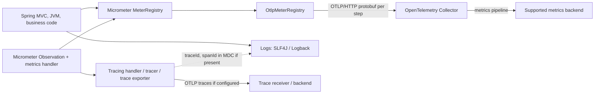

# OTLP Meter Registry in Spring Boot: Configuration and Exporting Metrics

## 1. Learning Objectives

A Spring Boot application can record **request counts, latency, JVM metrics, and business transactions** with Micrometer. However, data sitting inside a process only helps operations once it is reliably delivered to a monitoring system. **OTLP Meter Registry** is one way to do this: it converts Micrometer meters into **OpenTelemetry Protocol (OTLP) Metrics** data and periodically sends it to an OpenTelemetry Collector or compatible backend.

This lesson belongs to the **Meter registry and exporter** chapter in the **SPRING_BOOT_OBSERVABILITY** module. After this lesson, you will be able to:

- Distinguish `MeterRegistry`, `OtlpMeterRegistry`, `ObservationRegistry`, OTLP exporters, and the OpenTelemetry Collector.
- Add the `micrometer-registry-otlp` dependency to Spring Boot and use `management.otlp.metrics.export.*` to configure URL, step interval, timeouts, and headers.
- Send `Counter`, `Gauge`, `Timer`, and metrics produced from `Observation` to an OTLP/HTTP receiver.
- Explain **cumulative** vs. **delta** temporality, histograms, SLO buckets, resource attributes, and the consequences of process restarts.
- Read signs of export success or failure rather than checking only `/actuator/metrics`.
- Control tags/cardinality, diagnose missing metrics, and correlate metrics with logs and traces to investigate errors or latency.

**Primary version for examples:** Spring Boot 3.5.x, Java 17+, and the Micrometer version managed by the Spring Boot BOM. The final section highlights what to verify when using Spring Boot 4.x. `SPECIAL_NOTE` for this lesson imposes no additional constraints.

## 2. Architecture: Who Creates, Who Sends, Who Stores Metrics?



Each layer handles a distinct responsibility:

| Component | Function | What It Does **Not** Do Automatically |
| --- | --- | --- |
| `MeterRegistry` | Registers, measures, and reads `Counter`, `Timer`, `Gauge`, etc. | Does not automatically push data over the network if using only the simple registry |
| `OtlpMeterRegistry` | Micrometer registry that encodes metrics into OTLP and sends them periodically | Does not store long-term metrics or build dashboards |
| `ObservationRegistry` | Orchestrates observation lifecycles and handlers | Is not an exporter registry for all OTLP signals |
| `OtlpMetricsSender` | Transport component sending the registry's OTLP Metrics payloads | Does not decide which business operations to instrument |
| OpenTelemetry Collector | Receives, processes, and routes telemetry through pipelines | Is not by default a long-term storage database |
| Metrics backend | Stores, queries, graphs, and alerts on metrics | Does not automatically fix bad tag cardinality coming from the app |

**Key difference from Prometheus:** `OtlpMeterRegistry` typically **pushes periodically** over HTTP, whereas a Prometheus registry exposes an endpoint for Prometheus to **scrape**. Spring Boot can auto-configure multiple registries simultaneously into a composite registry when multiple dependencies are present, though doing so also sends data to multiple destinations.

### 2.1. OTLP Does Not Mean the OpenTelemetry Metrics SDK

Spring Boot uses Micrometer as its primary metrics façade. With `micrometer-registry-otlp`, the application exports OTLP **directly from the Micrometer registry**; you do not need to manually build an OpenTelemetry `SdkMeterProvider` to export these meters.

If another library writes metrics only to an **OpenTelemetry `MeterProvider`**, those meters do not automatically appear in Micrometer's `OtlpMeterRegistry`. Sharing the OTLP output standard does not mean the two instrumentation APIs share a single registry.

Similarly, adding the OTLP Metrics registry **does not automatically enable distributed tracing**. Traces require a tracing bridge/tracer, exporter, and appropriate sampler; logs have their own pipeline. Signals can only be correlated when context, service identity, and backends are configured properly.

## 3. Dependencies and Auto-Configuration on Spring Boot 3.5

With Maven and a Spring Boot parent or BOM managing versions, add:

```xml
<dependencies>
    <dependency>
        <groupId>org.springframework.boot</groupId>
        <artifactId>spring-boot-starter-web</artifactId>
    </dependency>
    <dependency>
        <groupId>org.springframework.boot</groupId>
        <artifactId>spring-boot-starter-actuator</artifactId>
    </dependency>
    <dependency>
        <groupId>io.micrometer</groupId>
        <artifactId>micrometer-registry-otlp</artifactId>
    </dependency>
</dependencies>
```

Or in Gradle when Spring Boot dependency management is applied:

```gradle
dependencies {
    implementation 'org.springframework.boot:spring-boot-starter-web'
    implementation 'org.springframework.boot:spring-boot-starter-actuator'
    runtimeOnly 'io.micrometer:micrometer-registry-otlp'
}
```

`starter-web` supports the example HTTP API; `starter-actuator` integrates Micrometer and system/application metrics. The key dependency for OTLP export is **`io.micrometer:micrometer-registry-otlp`**. Do not pin a Micrometer version different from the BOM without a specific compatibility reason.

When the registry is on the classpath and export is enabled, Spring Boot auto-configures `OtlpMeterRegistry`. Business code usually only injects `MeterRegistry` or `ObservationRegistry`; there is no need to manually instantiate `OtlpMeterRegistry` in every service.

### When Do You Instantiate It Manually?

If you are **not using Spring Boot auto-configuration**, Micrometer provides this API:

```java
import io.micrometer.core.instrument.Clock;
import io.micrometer.registry.otlp.OtlpConfig;
import io.micrometer.registry.otlp.OtlpMeterRegistry;

OtlpConfig config = OtlpConfig.DEFAULT;
OtlpMeterRegistry registry = new OtlpMeterRegistry(config, Clock.SYSTEM);
try {
    registry.counter("demo.events", "kind", "example").increment();
    // Registry exports metrics at the configured interval.
} finally {
    registry.close();
}
```

This is a **standalone API illustration**: in reality, the process lifecycle must last long enough for an export cycle to occur; do not assume the backend received metrics just because `increment()` ran. In a Spring Boot application, prefer the Boot-managed registry so you get common tags, filters, Actuator endpoints, and consistent shutdown behavior.

## 4. Configuring `management.otlp.metrics.export`

Example `application.yml` for a hands-on environment with an OTLP/HTTP Collector:

```yaml
spring:
  application:
    name: checkout-service

management:
  endpoints:
    web:
      exposure:
        include: health,info,metrics
  metrics:
    tags:
      application: checkout-service
      environment: local
  otlp:
    metrics:
      export:
        enabled: true
        url: http://localhost:4318/v1/metrics
        step: 10s
        batch-size: 1000
        aggregation-temporality: cumulative
        connect-timeout: 2s
        read-timeout: 5s
```

**`step: 10s` is only for hands-on exercises**; in Spring Boot 3.5, the default for the OTLP exporter is around **1 minute**. Too short a step increases request volume and backend cost; too long a step reduces granularity and increases display lag.

Key properties:

| Property | Role | What to Remember |
| --- | --- | --- |
| `management.otlp.metrics.export.enabled` | Enables/disables export via the OTLP registry | Disabling export is different from disabling instrumentation or Actuator |
| `...url` | **OTLP Metrics HTTP** address | e.g., `http://collector:4318/v1/metrics` inside a container network |
| `...step` | Metric publish interval | Not `management.tracing.sampling` |
| `...batch-size` | Number of meters/measurements grouped per publish batch | Not the number of business HTTP requests |
| `...aggregation-temporality` | How cumulative sums are represented | `cumulative` or `delta`; the backend must support it |
| `...connect-timeout` | Connection establishment timeout | Tune according to network and collector |
| `...read-timeout` | Timeout waiting for the collector response | Prevents the export worker from hanging indefinitely |
| `...headers.*` | Request headers when sending metrics | Useful for tokens, but secrets must be managed safely |
| `...histogram-flavor` | Default histogram type when percentile histograms are enabled | Depends on Micrometer/OTLP receiver |
| `...max-bucket-count`, `...max-scale` | Bounds for exponential histograms | Does not affect explicit buckets in the same way |

Use the **exact prefix `management.otlp.metrics.export`**. Easily confused groups:

- `management.metrics.*`: configures meter names, tags, filters, and distributions.
- `management.otlp.metrics.export.*`: **exports metrics** via OTLP.
- `management.otlp.tracing.*` in Boot 3.5: configures **trace export** via OTLP.
- `management.endpoints.web.exposure.*`: exposes **Actuator HTTP endpoints** for inspection/testing.

`/actuator/prometheus` is **not** an OTLP Metrics ingestion endpoint; you do not need to expose it just for `OtlpMeterRegistry` to push. `/actuator/metrics` is also not an OTLP receiver: it is an interface to read meters inside the application.

### 4.1. Endpoints, Ports, and Protocols

OTLP supports different transport modes. With Micrometer's default `OtlpMeterRegistry`, metrics are sent as **OTLP protobuf over HTTP** to the configured URL, commonly:

```text
http://localhost:4318/v1/metrics
```

In standard Collector configurations:
- **4318**: OTLP/HTTP port.
- **4317**: OTLP/gRPC port.

**Do not change the default URL to `http://collector:4317` just because the backend also supports OTLP.** Micrometer does not ship a built-in gRPC `OtlpMetricsSender` in the version described in Micrometer's OTLP documentation; using gRPC requires a custom compatible sender or an appropriate separate pipeline. An endpoint returning 404/415 usually points to the wrong path, protocol, or content type.

In Docker/Kubernetes, `localhost` points to the application's own network namespace/container (unless sharing network namespaces). Therefore, use a service DNS name or an address actually reachable from the application.

### 4.2. Authentication and Environment Configuration

If the backend requires a token, provide the corresponding header, for example:

```yaml
management:
  otlp:
    metrics:
      export:
        url: https://metrics.example.net/v1/metrics
        headers:
          Authorization: Bearer-REPLACE-IN-SECURE-CONFIG
```

The value here is only a **placeholder**, not a real credential. In production, load tokens from a secret store or environment variables via Spring configuration; never commit tokens to source control or print tokens in debug logs. Enable TLS and verify certificates when sending over untrusted networks.

Environment variables such as `OTEL_EXPORTER_OTLP_METRICS_ENDPOINT`, `OTEL_EXPORTER_OTLP_ENDPOINT`, and `OTEL_METRIC_EXPORT_INTERVAL` may be supported by Micrometer at the `OtlpConfig` layer. When setting both Spring Boot properties and environment variables, verify the **actual bound values** and precedence rules for your specific version rather than guessing.

## 5. Sample OpenTelemetry Collector for Verification

A minimal configuration for a **Collector running in a test environment**:

```yaml
receivers:
  otlp:
    protocols:
      http:
        endpoint: 0.0.0.0:4318

processors:
  batch: {}

exporters:
  debug:
    verbosity: detailed

service:
  pipelines:
    metrics:
      receivers: [otlp]
      processors: [batch]
      exporters: [debug]
```

Notes:

- The `otlp` receiver accepts metric requests on HTTP port 4318 at the standard `/v1/metrics` path. Using `0.0.0.0` illustrates a container/namespace setup; **restrict network access** so a test receiver is not exposed to the public internet.
- The `batch` processor groups data before export; the `debug` exporter writes telemetry to the **Collector logs** for inspection. It **does not store metrics long-term**.
- When running a Collector in production, replace or supplement the exporter with one targeting a real metrics backend, and configure authentication, TLS, retries, queues, and adequate resources.
- If the backend only supports Prometheus scraping or Prometheus Remote Write, use a compatible Collector exporter/pipeline to convert; do not assume every backend natively ingests OTLP Metrics.
- Before using a specific Collector version, check the documentation for **that exact version**; component names and capabilities can change across releases.

You can paste this YAML into a **separate Collector configuration** in your lab environment. This lesson does not require creating a Collector config file in the current repository.

### 5.1. End-to-End Test Procedure

1. Start a Collector with an OTLP/HTTP receiver listening on port 4318.
2. Start Spring Boot with `micrometer-registry-otlp` and `management.otlp.metrics.export.url` pointing to the Collector address.
3. Send a request to an API with business metrics or inspect JVM metrics registered by Actuator.
4. Check `GET /actuator/metrics` (if exposed) to verify the meter exists inside the application.
5. Wait at least **one publish interval** of the OTLP exporter and verify that the Collector's `debug` log contains the corresponding metric, names/tags, and `service.name`.
6. If using a real backend, additionally verify that metrics are **exported from the Collector to the backend**, ingested, and queryable. Receiving and storing are two separate steps.

Do not check immediately after a single request and conclude export is broken: `OtlpMeterRegistry` operates on the `step` interval and does not send an HTTP metrics request on every `counter.increment()`.

## 6. Spring Boot Practice: Counter, Gauge, and Timer over OTLP

Example controller using **Spring Boot 3.5.x and Actuator**; it only needs the dependencies from section 3. It produces small metrics with bounded tags so they are easy to spot in the Collector.

```java
package com.example.checkout;

import io.micrometer.core.instrument.Counter;
import io.micrometer.core.instrument.Gauge;
import io.micrometer.core.instrument.MeterRegistry;
import io.micrometer.core.instrument.Timer;
import java.util.concurrent.atomic.AtomicInteger;
import org.springframework.web.bind.annotation.GetMapping;
import org.springframework.web.bind.annotation.RequestParam;
import org.springframework.web.bind.annotation.RestController;

@RestController
public class CheckoutMetricsDemoController {
    private final MeterRegistry registry;
    private final AtomicInteger pending = new AtomicInteger();

    public CheckoutMetricsDemoController(MeterRegistry registry) {
        this.registry = registry;
        Gauge.builder("checkout.pending", pending, AtomicInteger::get)
                .description("Number of pending checkout operations")
                .register(registry);
    }

    @GetMapping("/demo/checkout")
    public String checkout(
            @RequestParam(defaultValue = "false") boolean fail) {

        // Meter name/tags remain stable across all requests.
        String outcome = fail ? "failure" : "success";
        Counter attempts = registry.counter(
                "checkout.attempts", "outcome", outcome);

        Timer timer = registry.timer("checkout.duration", "channel", "web");
        pending.incrementAndGet();
        try {
            return timer.record(() -> {
                if (fail) {
                    throw new IllegalStateException("Simulated checkout error");
                }
                return "ok";
            });
        } finally {
            attempts.increment();
            pending.decrementAndGet();
        }
    }
}
```

Breakdown of each meter:

| Meter | Measured Value | Common OTLP Data Point Type |
| --- | --- | --- |
| `checkout.attempts` (Counter) | Total checkout attempts by `outcome` | **Sum**, monotonic |
| `checkout.pending` (Gauge) | Checkouts currently in progress at sample time | **Gauge** |
| `checkout.duration` (Timer) | Invocation count and duration, optionally with buckets | **Histogram** or configured equivalent |

`Timer.record(Supplier<T>)` also records duration when the code throws an exception. In the example, `finally` increments the counter regardless of outcome so failed attempts are not missed, and `pending` is decremented even if processing fails. Anchoring the `Gauge` on an `AtomicInteger` field owned by the controller avoids the weak-reference issue where the observed object gets garbage collected.

When calling:

```text
GET /demo/checkout
GET /demo/checkout?fail=true
```

Spring MVC can also emit HTTP server metrics automatically. Never add `orderId`, customer email, raw URL, or `traceId` into `outcome` or `channel`: those values can cause time-series combinations to grow without bound.

### 6.1. Combining with Micrometer Observation

If the goal is to observe a business step to get both a **duration metric** and potentially a **span**, use `ObservationRegistry`:

```java
import io.micrometer.observation.Observation;
import io.micrometer.observation.ObservationRegistry;

String result = Observation.createNotStarted(
                "checkout.process", observationRegistry)
        .contextualName("process checkout")
        .lowCardinalityKeyValue("channel", "web")
        .observe(() -> performCheckout());
```

Here `observationRegistry` is injected by Spring and `performCheckout()` is the real business logic. Spring Boot's metrics handler can create a Timer in `MeterRegistry`, which `OtlpMeterRegistry` then exports. **If you also call `Timer.record()` for the exact same operation**, you will produce two duration measurements with overlapping meaning; choose boundaries and names intentionally so dashboards do not double-count.

When a separate tracing bridge/tracer and exporter are configured, this observation can also emit a span. The OTLP Metrics registry only receives **metrics**; an observation name showing up in metrics does not prove its trace reached the backend.

## 7. OTLP Data Points and Metric Types

Conceptual mapping in Micrometer OTLP:

| Micrometer Meter | OTLP Data Point | Things to Watch |
| --- | --- | --- |
| `Counter`, `FunctionCounter` | Sum | Can be emitted as cumulative or delta |
| `Gauge`, `TimeGauge` | Gauge | Point-in-time value at the sampling step |
| `Timer`, `DistributionSummary` | Histogram or Summary depending on config | Has count, sum, and optionally buckets |
| `LongTaskTimer` | Histogram/Summary as supported | Suitable for active long-running tasks; read semantics carefully |
| Timer with `publishPercentileHistogram` | Explicit or exponential Histogram per config | Bucket cost and backend capabilities |
| Timer with client-side `publishPercentiles` only | Summary | Local percentiles cannot be aggregated directly across instances |

Common misconceptions:

- **Counter** counts events; it does not split time into single-request samples per push. The registry aggregates in-process, and the exporter snapshots periodically.
- **Gauge** is a snapshot; if `checkout.pending` spikes and drains between two publish cycles, the backend may miss that brief peak. For queue depth or active operations, consider resolution and complementary counters.
- **Timer** measures duration; an OTLP receiver may receive it as a Histogram even without extra percentile histogram configuration. Meaningful bucket boundaries depend on configuration and implementation.
- **Summary** contains quantiles computed in-process; never average p95 across pods to get a system-wide p95.
- Metric metadata (type, unit, description), resource attributes, and data point attributes are distinct layers; displayed names in the backend may be converted per naming conventions.

## 8. Aggregation Temporality: Cumulative vs. Delta

`management.otlp.metrics.export.aggregation-temporality` controls how aggregated data is represented, especially for Sum/Histogram:

| Mode | Interpretation for a Counter | Example Over Three Publish Intervals |
| --- | --- | --- |
| `cumulative` | Total since the start of the process's accumulation cycle | 5 → 12 → 20 |
| `delta` | Increase during **each export interval** | 5 → 7 → 8 |

Both can represent **20 events** in this example, provided the backend understands the temporality. Never take `delta=8` from the last interval and treat it as the total since startup.

### 8.1. Choosing the Mode Based on Your Backend

- Micrometer OTLP defaults to `cumulative` in the documented configuration.
- Certain backends or pipelines work better with a specific temporality. Verify collector/backend documentation before switching to `delta`.
- When a pod restarts, a cumulative series starts a new accumulation cycle. OTLP data points include start/observation timestamps; the ingest system must handle resets rather than subtracting across different lifetimes blindly.
- Delta relies heavily on reliable delivery of every export interval. If a batch is lost, you cannot simply sum remaining batches to recover the exact total.
- Do not infer from `step=10s` that each data point represents a single request: it is merely the registry's publish cadence.

### 8.2. Example Delta Configuration for Testing

```yaml
management:
  otlp:
    metrics:
      export:
        aggregation-temporality: delta
        step: 30s
```

Switch the mode and compare increasing counter calls against Collector output. In real environments with active receivers, backends, and dashboards, evaluate the impact of changing time-series semantics and queries before switching.

## 9. Histograms and SLOs When Exporting OTLP

To investigate checkout latency, an average duration is usually insufficient. For a `Timer` or observation Timer, configure buckets at meaningful thresholds:

```yaml
management:
  metrics:
    distribution:
      slo:
        "[checkout.duration]":
          - 100ms
          - 300ms
          - 1s
```

The brackets are quoted so Spring's Binder preserves the dots in the meter name as a map key.

These SLO buckets help measure the share of operations under 100/300/1000 ms via an **explicit bucket histogram**, if supported by the registry, receiver, and backend. If you want histograms using Micrometer-generated buckets, you can configure an alternative:

```yaml
management:
  metrics:
    distribution:
      percentiles-histogram:
        "[checkout.duration]": true
      minimum-expected-value:
        "[checkout.duration]": 10ms
      maximum-expected-value:
        "[checkout.duration]": 3s
```

`OtlpMeterRegistry` can use an **explicit-bucket histogram** or an **exponential histogram** when percentile histograms are enabled. The histogram flavor and limits/cost are controlled via exporter and meter configuration. When **custom SLO boundaries** are defined, explicit buckets are used because exponential histograms do not represent arbitrary SLO boundaries directly this way.

### 9.1. Do Not Confuse Histograms with Pre-Computed Percentiles

| Configuration | Typical OTLP Export | Multi-Pod p95 Aggregation? |
| --- | --- | --- |
| Plain Timer | Histogram (may lack detailed buckets) | Needs adequate buckets and backend support |
| `percentiles-histogram` | Histogram / Exponential Histogram | Can be estimated using backend functions |
| `slo` buckets | Explicit Histogram | Aligned to SLO boundaries; p95 accuracy depends on bucket resolution |
| `percentiles` only | Summary with client-computed quantiles | **Never** average p95 across pods |

If your backend uses PromQL after converting OTLP Metrics into a Prometheus-compatible representation, **metric names and labels may be transformed**. For instance, `checkout.duration` may not appear under that exact name in the backend. Before copying a `histogram_quantile(...)` query, inspect the actual schema and histogram type (classic vs. native/exponential) in your backend.

### 9.2. Cost of Buckets and Tags

Suppose a timer has:
- 3 `channel` values,
- 2 `outcome` values,
- 6 instances.

The theoretical limit is `3 × 2 × 6 = 36` label combinations **before** other dimensions. If a histogram generates many buckets per combination, OTLP payload and backend storage scale accordingly. Adding `orderId` as a metric tag can multiply series counts by thousands or millions, even if `step` stays unchanged.

To stay in control:
- Use stable meter names and finite tag sets.
- Never put raw URIs, trace IDs, user IDs, exception messages, or SQL text into tags.
- Pick buckets matching actual SLOs and avoid enabling histograms on every meter.
- Use `MeterFilter.maximumAllowableTags(...)` as a defensive guard, knowing denied meters may omit measurements.

## 10. How Do Resource Attributes Differ from Metric Tags?

OTLP defines a **Resource** describing the entity emitting telemetry, such as service, version, environment, and instance. This metadata is shared across many metrics. Each OTLP metric data point can carry meter/tag **attributes** such as `channel=web` or `outcome=failure`.

| Layer | Example | Mental Model |
| --- | --- | --- |
| Resource attributes | `service.name=checkout-service`, `deployment.environment=staging` | Which service/environment emitted these metrics? |
| Metric data point attributes | `channel=web`, `outcome=success` | Which business category does this measurement belong to? |
| Tracing span attributes | `http.request.method`, `error.type` per semantic conventions | What characteristics did this execution/span have? |
| Correlation IDs | `traceId`, `spanId` | Ties an investigation together; **never** use as metric tags |

According to Micrometer documentation, without explicit identification, `service.name` may fall back to something like **`unknown_service`**. Do not assume `spring.application.name` always becomes OTLP `service.name` across all versions and configurations.

In compatible Spring Boot/Micrometer environments, you can set environment variables:

```text
OTEL_SERVICE_NAME=checkout-service
OTEL_RESOURCE_ATTRIBUTES=deployment.environment=staging,service.namespace=payments
```

`OTEL_SERVICE_NAME` identifies the service name and follows `OtlpConfig` precedence logic; `OTEL_RESOURCE_ATTRIBUTES` can be read when no corresponding resource attribute configuration overrides it. Inspect the **actual payload at the Collector** to confirm service name and resource attributes, since precedence between properties, environment variables, and auto-configuration can vary by version.

Within an organization, unify service identity across metrics, traces, and logs to simplify correlation. Even so, **the OTLP Metrics registry does not automatically unify Resource information across every log/trace pipeline**; those pipelines require their own configuration.

## 11. `OtlpMetricsSender` and Transport Customization

By default, `OtlpMeterRegistry` sends OTLP/HTTP through an HTTP sender. Micrometer provides the `OtlpMetricsSender` abstraction to swap the transport for special requirements (proxies, custom HTTP clients, authentication schemes, or testability).

In **Spring Boot 3.5**, if you declare an `OtlpMetricsSender` bean, Boot can wire that sender into the auto-configured `OtlpMeterRegistry`. This is a transport extension point; learners usually **do not need to write a custom sender** when default OTLP/HTTP works.

Micrometer also provides a standalone builder:

```java
OtlpConfig config = OtlpConfig.DEFAULT;
OtlpMeterRegistry registry = OtlpMeterRegistry.builder(config)
        .metricsSender(customSender)
        .build();
```

In this snippet, `customSender` is a **user-supplied** implementation of `OtlpMetricsSender`, not a predefined variable or bean. Do not copy this snippet verbatim into Spring Boot when Boot already auto-configures a registry; doing so can create a second registry, duplicate exports, or bypass Boot's common tags and filters.

If you only need to adjust the URL, step, timeouts, or headers, use `management.otlp.metrics.export.*` and avoid unnecessary custom code.

## 12. Layered Verification and Troubleshooting

A metric measurement must pass through these stages:

```text
Code/Instrumentation
  → MeterRegistry registers meter
  → OtlpMeterRegistry snapshots/publishes per step
  → OTLP/HTTP request and status
  → Collector OTLP receiver
  → Collector metrics pipeline/exporter
  → Metrics backend ingests and serves queries/dashboards
```

Checking layer by layer is much faster than staring at an empty dashboard.

### 12.1. Meter Exists in the App, Not Visible at the Collector

- Check `/actuator/metrics` to confirm the meter exists, keeping in mind that **the metrics endpoint is not proof of successful OTLP export**.
- Verify `micrometer-registry-otlp` is on the classpath and `management.otlp.metrics.export.enabled` is not disabled.
- Verify `management.otlp.metrics.export.url` uses **HTTP 4318 /v1/metrics** and is reachable from the application container.
- Check listener ports, DNS, firewalls, TLS, authentication, and HTTP responses. 401/403 suggests auth; 404/415 suggests wrong endpoint/protocol; connection refused/timeout suggests networking or the receiver is down.
- Wait at least one `step` interval and check application/Collector logs to confirm metrics were published and received. Do not lower `step` to ultra-short values in production just for debugging.
- Check data in the Collector's **metrics pipeline**; a configuration with only a traces pipeline will not forward metrics.

### 12.2. Collector Receives It, Dashboard Is Still Empty

- The Collector's `debug` exporter confirms **receipt**, but does not persist data. Inspect the real exporter, pipeline configuration, and backend ingestion errors.
- Compare the actual metric names, Resource attributes, data point attributes, units, and temporality expected by the backend; do not assume names match Prometheus.
- Check pipeline latency, aggregation/temporality support, retention, ingestion limits, and label filters.
- For Prometheus-compatible backends, check whether OTLP Metrics were converted to time series and assigned expected service/instance labels.
- If counters drop and climb again after a restart, verify whether the backend recognizes resets/start times properly; do not interpret a reset as negative transactions.

### 12.3. Same Metric Recorded Twice

Spring Boot can configure multiple registries when multiple dependencies are present. If both OTLP push and Prometheus scrape are active, the final backend might ingest **two copies of the same metric** from two pipelines. Check ingestion routes and sources before summing data.

In addition, if the same operation is measured by both `Timer.record` and an `Observation` producing a Timer with the same name or equivalent meaning, charts will double-count at the instrumentation layer. Fix it at the source rather than patching dashboards.

### 12.4. Quick Troubleshooting Table

| Symptom | Likely Root Cause | Action |
| --- | --- | --- |
| Present in `/actuator/metrics`, missing at Collector | OTLP registry missing/disabled, wrong URL, step not reached yet | Check dependency, enabled flag, URL, publish logs |
| HTTP 404 or 415 when sending | Wrong `/v1/metrics` path, wrong HTTP/gRPC protocol | Point to the proper OTLP/HTTP receiver |
| HTTP 401/403 | Missing/invalid header or token | Check secrets, headers, and ingress policies |
| Connection refused / timeout | Collector not running, DNS/network/container localhost issue | Check listener, service DNS, firewall, timeout |
| Collector receives, backend has nothing | Missing metrics exporter, ingest failure, or filter | Inspect pipeline, exporter logs, and query schema |
| Metric appears under unknown service | Missing `service.name` resource attribute | Verify `OTEL_SERVICE_NAME` and collector output |
| Counter wrong after restart | Temporality/reset misinterpreted | Check start time, `cumulative`/`delta`, and backend handling |
| Gauge misses brief spikes | Step/publish interval samples too sparsely | Pick appropriate cadence and complementary counters |
| Histogram lacks needed buckets | SLO/histogram disabled or unsupported by backend | Check distribution config and OTLP point type |
| Series count or cost spikes unexpectedly | Dynamic tags/Resource attributes or excessive buckets | Normalize labels, audit cardinality/budget |
| Metrics present, traces/logs missing | Separate tracing/logging pipelines | Check bridge/exporter, sampler, MDC, and Collector pipelines |

## 13. Combining Metrics, Traces, and Logs to Investigate Real Errors

Suppose `checkout.duration` increases and `checkout.attempts{outcome=failure}` spikes. A sound investigation path:

1. **Metrics:** identify the time window, service, instance, channel, and error/latency rates. OTLP push reveals aggregated trends across bounded labels.
2. **Traces:** if Micrometer Tracing and a trace exporter are configured, open sampled requests around that time; inspect `checkout.process`, HTTP client, and payment service spans to find the slow step.
3. **Logs:** use `traceId`/`spanId` from the trace to look up exceptions, timeouts, retries, or fallback outcomes; the logging pipeline must preserve those fields.
4. **Cross-reference:** metrics reflect all instrumented invocations (within export reliability), whereas traces may be sampled. One slow trace does not prove every request is slow.
5. **Fix and re-measure:** adjust logic or dependencies, confirm error rate/latency improve, and verify via traces/logs that the root cause is resolved.

On Micrometer OTLP versions supporting **exemplars**, some Counters/Timers/DistributionSummaries can attach a trace/span reference to a sample. Exemplars require an appropriate `ExemplarContextProvider`, an active/sampled span, and backend display support. **An exemplar differs from a metric tag**: it attaches a reference to a sample rather than creating a separate time series for every trace ID.

Never add `traceId` or `spanId` as metric data point attributes to "link" data; that causes extreme cardinality. Also never turn `OTEL_RESOURCE_ATTRIBUTES` into a place for per-request changing values.

## 14. Spring Boot 4.x: What to Verify

Spring Boot 4.x continues to integrate `OtlpMeterRegistry` and the foundational `management.otlp.metrics.export.url` property. However, starters, auto-configuration packages, OpenTelemetry resource handling, and some metrics/tracing properties may be reorganized. When upgrading from Boot 3.5 to Boot 4.x:

| Item | What to Check |
| --- | --- |
| Dependencies | Correct `micrometer-registry-otlp` and Actuator/starters for the new version |
| Registry bean | Whether `OtlpMeterRegistry` is actually auto-configured and receives customizers |
| Endpoint | `management.otlp.metrics.export.url` points to the OTLP/HTTP receiver |
| Export step/temporality | Whether the Collector/backend receives data the same way as before |
| Resource attributes | `service.name`, environment, and namespace are accurate and conflict-free |
| Histograms | Bucket/data point flavor is backend-compatible and SLOs take effect |
| Tracing | Bridges/exporters and sampling follow Boot 4 conventions; do not blindly copy 3.5 tracing config |
| Existing data | Dashboards, alerts, and queries match the actual received names/units/labels |

Boot 4 introduces additional ways to integrate resource metadata at the OpenTelemetry layer. Do not rely on a property from another branch assuming it replaces all `OtlpConfig` settings; verify directly at the Collector after upgrading.

## 15. Practical Deployment Checklist

- [ ] A canonical source is chosen for each metric, avoiding duplicate export across multiple pipelines.
- [ ] `micrometer-registry-otlp` is present and the registry is managed by Spring Boot.
- [ ] OTLP **Metrics** uses the right URL/transport; 4318 HTTP vs. 4317 gRPC is clear.
- [ ] Step, timeout, batch size, and temporality fit the backend and traffic volume.
- [ ] Secrets/TLS and telemetry ingestion permissions are configured securely, with no tokens in source code.
- [ ] Collector has a `metrics` pipeline, backend exporter, and monitoring for ingest errors.
- [ ] `service.name` and Resource attributes are explicit and consistent across environments.
- [ ] Metric names/tags are stable without dynamic IDs; histograms are enabled only where needed.
- [ ] Verified one Counter, Gauge, and Timer end-to-end from app through Collector to backend.
- [ ] Traces/logs have their own pipelines; correlation is verified if distributed investigation is required.
- [ ] Tested application restart and confirmed the backend interprets counter temporality/resets properly.
- [ ] Cross-checked the application's Spring Boot/Micrometer version against matching documentation.

## 16. Practice Questions

1. Why is seeing `/actuator/metrics/checkout.attempts` insufficient to claim the OTLP backend has received the metric?
2. When an application runs inside a container, where does `http://localhost:4318/v1/metrics` point? When must it be changed to a service DNS name?
3. Why can sending over default HTTP to port 4317 fail?
4. For export intervals recording 5, 12, and 20 cumulative checkouts, describe the cumulative and delta data points.
5. In a test where `checkout.pending` rises and falls completely within 2 seconds, why might a 1-minute exporter step miss the peak?
6. How does `OTEL_SERVICE_NAME` differ from a `channel=web` tag?
7. A Timer lacks detailed buckets in the backend. Which configurations should you inspect before calculating p95?
8. Can you calculate multi-instance p95 by averaging client-side p95s? Explain.
9. When the Collector receives metrics but the dashboard is blank, which steps from pipeline to query should you inspect?
10. If the same Counter is ingested via both OTLP and Prometheus scraping into the same backend, what analytical mistake can happen?
11. Why does 10% trace sampling not cause `checkout.attempts` to record only 10% of calls?
12. To jump from a latency chart to a specific trace, how can exemplars help and what conditions are required?

## References

- [Micrometer — OTLP Registry](https://docs.micrometer.io/micrometer/reference/implementations/otlp.html)
- [Micrometer — Meters and Registry](https://docs.micrometer.io/micrometer/reference/concepts/registry.html)
- [Micrometer — Histograms and Percentiles](https://docs.micrometer.io/micrometer/reference/concepts/histogram-quantiles.html)
- [Spring Boot 3.5 — Metrics / OTLP](https://docs.spring.io/spring-boot/3.5/reference/actuator/metrics.html)
- [Spring Boot 3.5 — Common Application Properties](https://docs.spring.io/spring-boot/3.5/appendix/application-properties/index.html)
- [Spring Boot 4.0 — Metrics / OTLP](https://docs.spring.io/spring-boot/4.0/reference/actuator/metrics.html)
- [Spring Boot — Observability and Micrometer OTLP](https://docs.spring.io/spring-boot/reference/actuator/observability.html)
- [OpenTelemetry — Collector Configuration](https://opentelemetry.io/docs/collector/configuration/)
- [OpenTelemetry — OTLP Specification](https://opentelemetry.io/docs/specs/otlp/)
