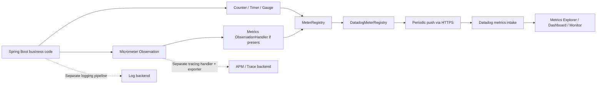
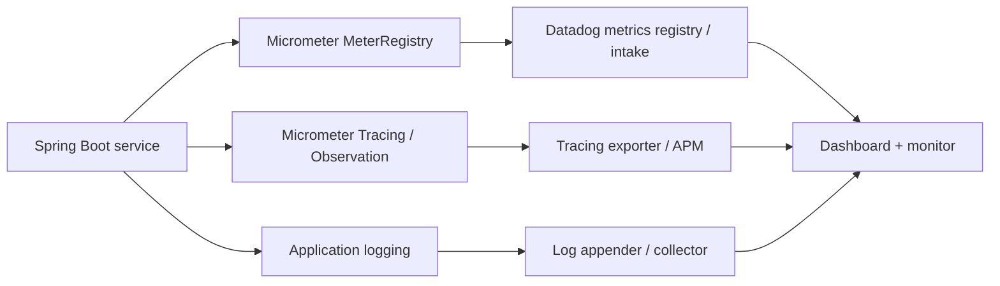

# Datadog Registry

> **Chapter:** Meter registry and exporter  
> **Module:** `SPRING_BOOT_OBSERVABILITY` — building observability in Spring Boot using Micrometer Observation, metrics, logs, and distributed tracing, focusing on exporters, context propagation, tags/cardinality, and signal correlation to investigate latency, errors, and application behavior.

## Learning Objectives

After this lesson, you will be able to:

- Explain the role of **`DatadogMeterRegistry`** in Micrometer and the difference between periodic metric **push** and Prometheus **pull**.
- Configure Spring Boot to send metrics via the Datadog registry, manage API keys with secrets, select the right Datadog site, and verify the data flow.
- Create business counters/timers and observations, choose low-cardinality names/tags, and understand what the `step` interval means.
- Distinguish Datadog **metrics intake** from Datadog **APM tracing** and log collection: adding a metrics registry does not automatically collect traces or logs.
- Troubleshoot situations where metrics appear in the app but not in Datadog, wrong endpoints, missing credentials, network failures, duplicate exporters, or mismatched tags.
- Correlate metrics, logs, and distributed traces to investigate a real production incident.

## 1. Role of the Datadog Registry

Micrometer is a measurement API layer in Java. Application code records data through `MeterRegistry` using meter types such as `Counter`, `Timer`, `Gauge`, and `DistributionSummary`. The concrete registry decides how data is organized and exported to a backend.

**`DatadogMeterRegistry`** is Micrometer's implementation for shipping metrics to **Datadog**. With direct registry integration, the application aggregates measurements over an interval and **pushes** them to the Datadog metrics API over HTTPS. It is not a Prometheus endpoint for Datadog to pull from.

For example, a checkout system needs to track:

- Committed orders, segmented by `channel=web|mobile`.
- Checkout processing time by outcome group.
- Timeout counts when calling the payment provider.
- HTTP request rate, HTTP 5xx, JVM memory/GC, and connection pool metrics when corresponding instrumentation is present.
- Behavioral shifts after deploying a release.

For data to be useful, **both sides** must work: accurate instrumentation in the application and accurate export/ingestion in the infrastructure. A metric can exist inside the process without ever being ingested by Datadog.

### 1.1. Overall Architecture



Role of each component:

| Component | Responsibility |
| --- | --- |
| `MeterRegistry` | Registers and records meters by name, tags, and meter type. |
| `DatadogMeterRegistry` | Publishes aggregated measurements using the Datadog registry mechanism. |
| `ObservationRegistry` | Manages observation lifecycles; with a metrics handler, observations can contribute metrics. |
| `DatadogConfig` | Specific configuration such as API key, URI, and step duration when setting up the registry manually. |
| Datadog metrics intake | Receives submitted metrics, validates them, and stores them in the data platform. |
| Tracing bridge/exporter | Sends spans to a tracing backend; **not** the Datadog metrics registry. |
| Log appender/collector | Transports log records; does **not** automatically originate from a metric. |

An architecture can use multiple registries via a composite registry, but you must verify which registry Spring Boot manages. If you instantiate a standalone `SimpleMeterRegistry` and write only to it, data will not automatically export through the application's Datadog registry.

## 2. Push Registry vs. Pull Registry

| Criterion | Direct Datadog Registry | Prometheus Registry with Standard Scrape |
| --- | --- | --- |
| Communication direction | Application **pushes** data to the Datadog API. | Prometheus server **pulls** data from an application endpoint. |
| Transport cadence | `step`/publish interval. | Prometheus server's `scrape_interval`. |
| Authentication from app | Typically requires a Datadog API key. | App needs no Datadog API key; scrape endpoint security is configured separately. |
| Network | Workload needs outbound HTTPS to metrics intake. | Prometheus needs network access to the workload's endpoint. |
| Troubleshooting missing data | Check credentials, region, URI, DNS/TLS, and exporter logs. | Check scrape target, endpoint, and Prometheus logs. |
| Reliability | Losing a publish leaves a data gap. | Losing a scrape leaves a data gap. |

Datadog also supports **Datadog Agent/DogStatsD**. When an application sends data to the Agent over DogStatsD, Micrometer typically uses **`micrometer-registry-statsd`** or an equivalent integration. That is a **different export path** from using `DatadogMeterRegistry` directly against the HTTPS API. Do not mix these concepts when designing a pipeline.

### 2.1. Why Does the Registry Have a `step`?

A **step registry** aggregates data over an interval before publishing. For example, a 30-second step:

```text
12:00:00 - 12:00:30   180 checkout events
12:00:30 - 12:01:00   220 checkout events
12:01:00 - 12:01:30   150 checkout events
```

This does not mean the application calls the Datadog API 180 times during the first window. It records measurements locally and the exporter ships them periodically. Whether Datadog displays the value as a **count, rate, gauge, or distribution** depends on meter type, registry conversion, and backend query/rollup rules.

**Never mechanically compare** a cumulative `COUNT` in Actuator with a single point on a Datadog chart: the two sides may differ in time window, units, aggregation method, or replica count.

A shorter step brings data closer to real time at the cost of higher publish frequency and overhead. A longer step saves outbound requests but reduces temporal granularity and increases observation lag. Choose based on SLOs, load profile, backend limits, and organizational standards.

### 2.2. Restarts and Network Failures

When a process is killed or restarted, unpublished state can be lost. When the network or Datadog API is unavailable, the exporter can log errors. Retry/buffering behavior depends on the implementation and version, so **never treat a direct push registry as a durable queue guaranteeing delivery of every measurement**.

If you need exact accounting figures, store them in a business database with commit guarantees and auditing. Use metrics to detect trends, trigger alerts, and investigate; never use them as a financial ledger.

## 3. Configuring the Datadog Registry in Spring Boot

### 3.1. Dependencies

Gradle example with Spring Boot dependency management:

```groovy
dependencies {
    implementation 'org.springframework.boot:spring-boot-starter-actuator'
    runtimeOnly 'io.micrometer:micrometer-registry-datadog'
}
```

If the application serves an HTTP API, add the appropriate web starter for MVC or WebFlux. A Spring Batch worker does not need an HTTP web starter just to instrument jobs with Micrometer.

Dependencies should use versions managed by the Spring Boot BOM. Do not arbitrarily mix incompatible versions of Micrometer Core, the Datadog registry, and Spring Boot.

### 3.2. Configuring `application.yml`

Example for the standard Spring Boot 3.x configuration branch:

```yaml
spring:
  application:
    name: checkout-service

management:
  datadog:
    metrics:
      export:
        enabled: true
        api-key: ${DATADOG_API_KEY}
        step: 30s
  metrics:
    tags:
      application: ${spring.application.name}
      environment: ${APP_ENV:dev}
```

Explanation:

1. `management.datadog.metrics.export.enabled` enables the integration when the registry dependency is present and auto-configuration applies.
2. `api-key` comes from an **environment variable**; never store literal secrets in Git.
3. `step: 30s` illustrates the aggregation and push interval; real values should follow platform policy.
4. `management.metrics.tags.*` sets **process-stable common tags** for filtering service and environment data.
5. This configuration does not automatically enable APM tracing or log intake, nor does it guarantee the HTTPS exporter can connect successfully.

**Compatibility:** the `management.datadog.metrics.export.*` group is used in Spring Boot 3.x. In Spring Boot 2.x, some configurations used the `management.metrics.export.datadog.*` prefix. Always check configuration metadata/docs for the **exact version running**; do not copy both prefixes expecting identical behavior.

### 3.3. Datadog Site and URI

Datadog operates multiple sites/regions. An API key is only valid for its associated organization/site; the exporter must also send to the matching **metrics intake endpoint**.

You can externalize the URI as an environment variable, for example:

```yaml
management:
  datadog:
    metrics:
      export:
        api-key: ${DATADOG_API_KEY}
        uri: ${DATADOG_METRICS_URI}
        step: 30s
```

Here `DATADOG_METRICS_URI` is a variable defined by your deployment. Its value must be the full URI conforming to the API and registry version, **not the web UI URL**. If using the compatible default site, you can let the registry use its default URI, but always verify the actual endpoint before going to production.

Never guess an endpoint by swapping hostnames at random. Configure according to the Datadog site your account actually uses and the API path supported by Datadog/Micrometer.

### 3.4. Managing Credentials

For direct metrics integration, a **Datadog API key** is typically required to submit data. An **Application key** generally serves other management/query APIs and is not required by default to push metrics via the Datadog registry.

Minimum practices:

- Inject the API key via a secret manager or runtime environment with least-privilege access.
- Never hardcode keys in committed YAML, error messages, or public examples.
- Never log or write keys into tags, logs, traces, or health responses.
- Have key rotation and revocation procedures in place per policy.
- Verify the workload can read the secret without printing its value to the console.
- When encountering 401/403 errors, investigate credentials, site, permissions, and endpoint rather than jumping to conclusions from a single status code.

## 4. Recording Metrics via `MeterRegistry`

Business code should depend on **`MeterRegistry`** rather than the Datadog-specific class, making testing and switching backends easy without changing business logic.

### 4.1. Counter and Timer

```java
package example.observability;

import java.util.function.Supplier;

import io.micrometer.core.instrument.Counter;
import io.micrometer.core.instrument.MeterRegistry;
import io.micrometer.core.instrument.Timer;
import org.springframework.stereotype.Service;

@Service
public class CheckoutMetrics {
    private final MeterRegistry registry;

    public CheckoutMetrics(MeterRegistry registry) {
        this.registry = registry;
    }

    public <T> T measure(String inputChannel, Supplier<T> action) {
        String channel = normalize(inputChannel);

        Timer timer = Timer.builder("checkout.processing")
                .description("Duration of synchronous checkout processing")
                .tag("channel", channel)
                .register(registry);

        return timer.record(action);
    }

    public void orderCommitted(String inputChannel) {
        Counter.builder("checkout.orders.committed")
                .description("Number of committed orders")
                .tag("channel", normalize(inputChannel))
                .register(registry)
                .increment();
    }

    private static String normalize(String input) {
        return "web".equals(input) || "mobile".equals(input)
                ? input : "other";
    }
}
```

Meaning:

- `checkout.processing` is a Timer; `Timer.record(...)` measures the **synchronous** execution time of the Supplier. If the Supplier merely returns an incomplete future, the Timer **does not wait** for async work to finish.
- `checkout.orders.committed` is a Counter; to remain accurate, the application must increment the counter **after the actual commit**, never before a transaction that might roll back.
- `channel` only accepts `web`, `mobile`, or `other`, keeping cardinality bounded.
- The registry reuses meters when registered with matching names/tags, but **dynamic tags** will still create unbounded meter IDs.

Example invocation in a business service, assuming `Order`, `request`, and `checkoutService` already exist:

```java
Order order = checkoutMetrics.measure(
        request.channel(),
        () -> checkoutService.createOrder(request)
);

// Place only at the point where the transaction actually completes:
checkoutMetrics.orderCommitted(request.channel());
```

Data can be measured before the Datadog exporter reaches its publish interval. There is no need to wait for Datadog on the request path to confirm measurements.

### 4.2. Do Not Embed Per-Request Values

Wrong:

```java
// Each order ID creates a separate metric name.
registry.counter("checkout.order." + orderId).increment();

// Stable name, yet each order creates a new tag set.
registry.counter("checkout.orders", "orderId", orderId).increment();
```

Better to use a stable name and a finite set of tag values:

```text
checkout.orders.committed{channel=web}
checkout.orders.committed{channel=mobile}
checkout.processing{channel=web}
```

Individual values like `orderId`, `userId`, `tenantId`, `traceId`, and `spanId` should be handled in logs/traces when legitimate lookup is needed—never as metric tags just because Datadog supports searching.

## 5. Micrometer Observation and the Datadog Registry

Micrometer Observation models an operation and dispatches lifecycle events to `ObservationHandler`s.

```java
package example.observability;

import java.util.function.Supplier;

import io.micrometer.observation.Observation;
import io.micrometer.observation.ObservationRegistry;

public class CheckoutObservationService {
    private final ObservationRegistry observations;

    public CheckoutObservationService(ObservationRegistry observations) {
        this.observations = observations;
    }

    public <T> T submit(Supplier<T> action) {
        return Observation.createNotStarted("checkout.submit", observations)
                .contextualName("submit checkout")
                .lowCardinalityKeyValue("channel", "web")
                .observe(action);
    }
}
```

When a **metrics ObservationHandler** is bound to the active `MeterRegistry`, observations can produce timers/measurements. `DatadogMeterRegistry` receives the metric through `MeterRegistry` and exports it per step. Without a metrics handler, creating an observation is not enough to export metrics.

When a separate **tracing handler** is present, the operation can also become a span correlated with the parent HTTP request, provided a Micrometer Tracing bridge and exporter are configured. The Datadog metrics registry **does not generate traces on its own**.

**Low-cardinality key values** like `channel=web` or `outcome=error` are generally suitable for metrics. **High-cardinality key values** like `orderId` can be useful in controlled tracing, but should not be forwarded into metric labels.

For attributes only known after processing, attach them at the right time with accurate error/success semantics. Do not hardcode `outcome=success` and reuse the same observation on exception paths. Also verify on your actual stack how handlers read key-values at different lifecycle stages.

## 6. Metric Names, Types, and Units in Datadog

A logical Micrometer name does not necessarily appear verbatim in the backend. The registry may apply a **naming convention**, unit conversion, or metric type mapping.

| Micrometer Meter | Recorded Data | What to Check in Datadog |
| --- | --- | --- |
| `Counter` | Cumulative event count in process | Count/rate type and interval meaning, especially with step |
| `Timer` | Count and total/duration stats | Time unit; representation and percentile/distribution calculation if enabled |
| `Gauge` | Current value such as pool depth | Value at observation time; can go up and down |
| `DistributionSummary` | Count, sum, and sample distribution | Unit, bounds/histogram if configured, tag cost |
| `LongTaskTimer` | Active task count and elapsed time | Distinguish from durations of completed tasks |

Never assume a Java metric named `checkout.processing` automatically becomes a Datadog series with the exact same name and millisecond units. Inspect the actual name, metric type, tags, and rollup in Metrics Explorer.

A counter in `/actuator/metrics` may show the total since process startup, whereas Datadog renders data in time buckets/rollups. **Comparisons must match in semantics and time window**, rather than comparing one raw number across two UIs.

### 6.1. Step, Aggregation, and Display Latency

A measurement appears only after:

1. The application creates the meter and records measurements.
2. The step/publish interval elapses.
3. The HTTPS push succeeds.
4. Datadog ingests/processes the data.
5. The dashboard queries the right site, time range, tags, and rollup.

Therefore, a freshly recorded measurement may not be visible immediately. If the application has been running for less than one step, verify timing and exporter health before changing business logic.

## 7. Cardinality and Metrics Cost

Every combination of metric name and tags increases observation dimensions. With 10 route templates × 4 methods × 5 status groups × 3 regions, there could be up to **600 combinations** for one measurement type under those assumptions. Adding 20,000 tenant IDs could push that to **12 million potential combinations** before counting instance labels and histograms.

Preferred tags:

| Tag | Example | Assessment |
| --- | --- | --- |
| `application` | `checkout-service` | Usually good; stable per process. |
| `environment` | `prod`, `staging` | Good if standardized. |
| `region` | `ap_southeast`, `eu_west` | Good when grouping is genuinely needed. |
| `channel` | `web`, `mobile`, `other` | Good; finite set. |
| `provider` | `provider_a`, `provider_b` | Good if the list is controlled. |
| `status` / `outcome` | `success`, `error` | Good; follows measurement contract. |
| `tenantId` / `orderId` / `userId` | Per-entity IDs | Usually unsuitable as metric tags. |
| `traceId` / `spanId` | Trace identifiers | Never use as metric tags. |
| Raw URL / query string | `/orders/1234?token=...` | No; cardinality explosion and data leak risk. |

A quick check before adding a tag: "Which dashboard/monitor does this tag serve, how many values can it have at most, and which other labels already exist on the same metric?" If you cannot answer, hold off on adding it.

**Common tags** `management.metrics.tags.*` express stable properties of the application. They are unsuitable for a `tenantId` that changes per HTTP request inside a multi-tenant process.

### 7.1. Guarding Labels with `MeterFilter`

`MeterFilter` at the metrics layer can cap or deny meters whose tags exceed a budget. However, denying a meter means measurements for that group may be dropped, leaving dashboards missing part of the traffic. Treat it as a **guardrail**, not a substitute for sound tag design.

Monitor meter ID counts, cardinality growth, ingestion limits/quotas, and backend costs after deployment.

## 8. Direct Datadog Registry vs. Datadog Agent/DogStatsD

Two common transport options:

| Criterion | Direct `DatadogMeterRegistry` | Datadog Agent / DogStatsD |
| --- | --- | --- |
| Path | App → HTTPS Datadog metrics intake | App → Agent → Datadog |
| Typical Micrometer registry | `micrometer-registry-datadog` | `micrometer-registry-statsd` or matching integration |
| API key in app | Usually required | Usually managed at the Agent instead of each app |
| Internet egress from app | Needs connectivity to intake | Can talk only to an internal Agent |
| Transport monitoring | HTTPS, URI/site, auth, publish | Client-to-Agent, Agent health, Agent-to-Datadog |
| Operations | Fewer local components | Centralized credential management and forwarding |

Choose based on networking, platform standards, security requirements, and reliability; do not assume one is universally better.

If both the direct registry and the Agent send the same metric with the same tag identity, data can be **duplicated or overcounted**. Establish clear ownership for each export path. Never run two exporters in parallel just to "improve reliability" without a deduplication plan.

## 9. Metrics Do Not Equal APM Traces and Logs

A complete observability stack typically has three distinct pipelines:



- **Metrics**: show frequency and error/latency trends across bounded tag groups.
- **Traces**: show the execution path and step durations within a request; trace ID/span ID uniquely identify an execution flow.
- **Logs**: provide exceptions, timeouts, retries, and discrete events, optionally carrying trace/correlation IDs when logging context is configured.

Adding `micrometer-registry-datadog` only handles **metrics export**. For APM tracing, you need a tracing bridge/instrumentation, context propagation across HTTP/queues/async, and an appropriate trace exporter. For logs, you need a separate logging/collector pipeline.

### 9.1. Sampling and Correlation

A tracing sampler may retain only a percentage of traces; metrics can still record every instrumented request even if a given request has no trace in APM. Therefore:

1. Use metrics to spot "high p95 and rising HTTP 5xx".
2. Search sampled traces in the same time window for the relevant route/service.
3. Search logs by `traceId`/`spanId` or correlation ID when logging MDC/structured logging is enabled.
4. Cross-check dependency metrics, deployment metadata, and saturation signs in DB/HTTP clients.

**Never put trace IDs into metric tags** to turn every request into its own time series. If the backend supports exemplars or signal linking, use them only after configuring and verifying them.

### 9.2. Context Propagation

Metrics arriving in Datadog **do not prove** trace context flows properly across services. Tracing context such as W3C `traceparent` must be injected/extracted by HTTP client/server or messaging instrumentation. For `@Async`, executors, and Reactor, verify proper context capture/restore. Logging MDC on the initial thread does not automatically appear on another worker thread.

## 10. Verifying Metrics Reach Datadog

To tell whether a bug is in instrumentation or the exporter, check layer by layer.

### Step 1 — Confirm the Meter Has Data in the App

Expose the Actuator metrics endpoint **only in a protected environment**:

```yaml
management:
  endpoints:
    web:
      exposure:
        include: health,info,metrics
```

When the app exposes the HTTP management endpoint, test:

```http
GET /actuator/metrics
GET /actuator/metrics/checkout.processing
GET /actuator/metrics/checkout.orders.committed
```

`/actuator/metrics` returns metadata and measurements from the `MeterRegistry` queried by Actuator; it does not prove Datadog received the data. If the metric is missing here, the code may not have executed, the meter was filtered, the wrong registry was used, or instrumentation is not enabled.

### Step 2 — Confirm the Datadog Registry and Exporter

Verify:

- The Datadog registry dependency is on the runtime classpath.
- Spring Boot creates and uses the right registry, not just a standalone `SimpleMeterRegistry`.
- The API key is injected properly (without printing its value).
- The URI/site matches the account.
- The workload has proper HTTPS egress, DNS, proxy, and TLS configuration.
- There are no auth, 4xx/5xx, or network errors in redacted exporter logs.
- At least a few `step` intervals have passed so data has had a chance to publish.

401/403 errors usually relate to credentials, permissions, or endpoints; 429/quota errors point to backend limits and policies; 5xx/network errors may be transient. **Never draw definitive conclusions from a status code alone** without inspecting the error details and actual site/API.

### Step 3 — Find It in Datadog

In Metrics Explorer or the equivalent search tool:

1. Select the right organization/site.
2. Search for the actual metric name after naming conventions rather than guessing from Java alone.
3. Filter by `application`/`environment` and configured tags.
4. Expand the time range to cover multiple publish cycles plus ingestion lag.
5. Verify the metric type, unit, and rollup rules.
6. Compare against a few controlled test requests.

If you cannot find the data, do not change metric names randomly. Trace from the source: meter exists → Datadog registry active → push succeeds → ingested into the right site → queried with the right name/tags/time window.

### Step 4 — Distinguish Single Instance vs. Whole Service

One pod incrementing `checkout.orders.committed` by 100 does not necessarily make the Datadog total increase by 100: multiple replicas may be reporting together. Be explicit about whether you are viewing `sum`/`avg`/`rate` or another rollup. If `application`/`environment` tags changed after a deploy, data may be landing under a new tag group.

## 11. Common Operational Mistakes

| Symptom | Possible Cause | Check / Fix |
| --- | --- | --- |
| Actuator shows meter, Datadog does not | Exporter inactive, wrong key/URI, blocked egress, or step not reached | Check Datadog registry, secret, site, and publish logs |
| Metric appears in wrong org/site | Key or intake endpoint belongs elsewhere | Verify organization/site and environment config |
| Authentication error on push | API key missing, wrong, revoked, or URI mismatch | Check secret injection, site, and key rotation |
| Network or TLS error | DNS/proxy/firewall/certificate issue | Verify egress to intake and TLS policy |
| Data arrives slowly | Long step, ingestion lag, or narrow query window | Check publish interval and display time range |
| Counts differ from Actuator | Step aggregation, rollup, restarts, or multiple instances | Compare using same unit, time window, and metric type |
| Data vanishes after deploy | Name/tag changed, exporter changed, or different auto-configuration | Compare release, meter identity, and config |
| Time series count spikes | Added order ID, tenant ID, or raw URL to tags | Normalize tags; use logs/traces for request IDs |
| Metrics duplicated or inflated | Two exporters sending the same metric set | Check Agent/direct pipelines and ownership |
| Metrics exist, no traces | Tracing bridge/exporter missing or trace sampled out | Check APM and context propagation separately |
| Metrics exist, logs lack trace ID | MDC/structured logging or async context misconfigured | Check log correlation and worker boundaries |
| Gaps during shutdown | Process stopped before publish interval | Review graceful shutdown and reliability; never treat metrics as durable transactions |

**Note:** adding a registry or changing egress configuration does not change the business semantics of a measurement. Before tuning the exporter, verify that metric names, meter types, tags, and counter increment timing are accurate.

## 12. Investigating Slow Checkout with Datadog Metrics

**Scenario:** after a deployment, checkout latency rises, completed orders drop, and some requests time out.

1. Verify Datadog is still receiving metrics after the deploy; if not, separate an **exporter outage** from an **application outage**.
2. Filter metrics by the exact `application`, `environment`, and time range. Compare request rate, HTTP 5xx, and duration.
3. Inspect `channel=web/mobile`, provider, and other bounded labels to see which group concentrates the errors.
4. Check dependency metrics: DB pool, Tomcat busy threads, Reactor Netty outbound pool, HTTP client timeouts, or queue depth where instrumented.
5. Open traces collected during the same window if APM is configured. Find which span accounts for most of the duration.
6. Search logs by `traceId`/correlation ID for exceptions, timeouts, and retries.
7. Validate hypotheses against configuration, deployment changes, and controlled experiments; avoid attributing root cause from a single chart.
8. After fixing, verify error rate/latency recovery and continuous metrics delivery.

An evidence-backed conclusion looks like: "HTTP error rate increased at the same time as outbound payment latency; sampled traces show most time spent in the payment call, and related logs record timeouts; downstream and retry policy need verification." That is **multi-signal correlation**, without confusing the metrics exporter with the tracing pipeline.

## 13. Hands-On Exercise

Prepare a Spring Boot application with Actuator, the Datadog registry, and an authorized Datadog test environment. Never use a production API key in submissions or public examples.

1. Add `micrometer-registry-datadog`, and configure the API key via an environment variable along with a step interval.
2. Verify the Datadog site/URI, egress policy, and auto-configuration for your exact Spring Boot version.
3. Create `checkout.processing` and `checkout.orders.committed` via `MeterRegistry`; record test data with `channel=web` and `mobile`.
4. Check `/actuator/metrics` to confirm the recorded names and tags. Explain why this endpoint is not proof that Datadog ingested the metrics.
5. After enough publish cycles, find the corresponding metrics in Datadog using `application`/`environment`, comparing metric types and rollups.
6. Send requests with different unique IDs on the same channel; verify that tag values do not grow beyond `web/mobile/other`.
7. In an **isolated environment**, temporarily configure an unreachable URI or invalid key and verify exporter error logging; then restore valid settings. Never disrupt production.
8. Draw two data-flow diagrams: direct Datadog registry vs. StatsD via Datadog Agent; indicate which component manages the API key and egress.
9. If APM is available, inspect a correlated span and log for a request, explaining why a trace may be sampled out even while the metric is still recorded.
10. Perform a controlled application restart, inspect the steps around restart time, and summarize the durability limits of measurements.

**Passing criteria:** you can identify where meters are created, which registry is used, the publish interval, the Datadog site, valid tag sets, and how to troubleshoot missing metrics without confusing them with APM or log failures.

## 14. Self-Check

**Q1.** Is `DatadogMeterRegistry` a push or pull registry?  
**Answer:** With direct integration, the registry **pushes** metrics to the Datadog API on each step.

**Q2.** Does `step: 30s` mean the app sends a Datadog request every time `Counter.increment()` is called?  
**Answer:** No. The registry aggregates measurements locally and publishes periodically.

**Q3.** Is adding the Datadog registry enough to export distributed traces and logs?  
**Answer:** No. You need a separate tracing bridge/exporter and logging pipeline.

**Q4.** Why does `/actuator/metrics` show a counter while Datadog does not?  
**Answer:** The publish interval may not have elapsed yet, or there may be a missing key, wrong URI/site, network error, or backend ingestion/query issue; check layer by layer.

**Q5.** Should a Datadog API key be written directly into source YAML and committed?  
**Answer:** No. Inject it via a secret manager/environment variable with rotation and redaction policies.

**Q6.** Should `traceId`, `orderId`, or `tenantId` be attached as metric tags?  
**Answer:** Generally no, due to very high cardinality and data exposure risks; looking up individual requests in logs/traces is more appropriate.

**Q7.** If Actuator shows 100 orders while a single Datadog chart point shows 20, can we conclude the exporter lost 80 orders?  
**Answer:** Not yet. You must check step, time window, rollup, units, restarts, and multi-instance aggregation.

**Q8.** Is the Datadog Agent/DogStatsD path the same as using `micrometer-registry-datadog` directly?  
**Answer:** No. It typically uses `micrometer-registry-statsd` or a separate integration, sending data through the Agent.

**Q9.** Does having no trace in APM mean checkout never ran?  
**Answer:** No. The trace could have been sampled out or the tracing exporter could have failed; metrics and logs provide additional evidence.

**Q10.** Does a direct push registry replace an exact business system of record?  
**Answer:** No. It is for observability; data can be lost during process/network failures and does not guarantee durable delivery by default.

**Key takeaway:** The Datadog registry enables Spring Boot to ship Micrometer metrics to Datadog on a **periodic push cycle**. To operate it reliably, configure the registry, API key, site/URI, step, and low-cardinality names/tags accurately, and verify both sender and receiver. For cross-service incident investigation, you still need independent tracing/logging pipelines and context propagation to correlate signals reliably.
