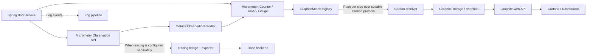
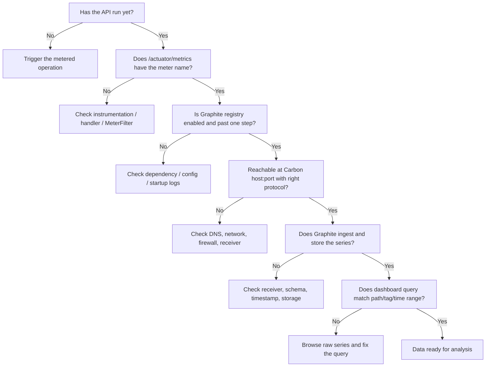

# Graphite Registry

A Spring Boot application already instruments payment processing duration with Micrometer. Calling `/actuator/metrics/checkout.payment.duration` shows data, yet the operations team uses **Graphite** to store time series and **Grafana** to monitor multiple service instances. How do meters inside the application get sent to Graphite? Why might a metric name in Graphite not look identical to its name in Java? When Graphite shows no data, should you check instrumentation, the registry, the Carbon connection, or retention settings first?

Within the **Meter registry and exporter** chapter of the **SPRING_BOOT_OBSERVABILITY** module, the **Graphite registry** is an important example of the **push metrics** model. Micrometer provides the in-app measurement API, while `GraphiteMeterRegistry` translates meters into suitable series and actively pushes them to Graphite on a schedule. Metric signals can then be correlated with logs and distributed traces to investigate errors, latency, and system load in real environments.

This lesson helps you:

1. Distinguish **Graphite**, **Carbon**, **Graphite-web**, **Grafana**, and the **Micrometer Graphite registry**.
2. Understand the data path from `MeterRegistry` and `Observation` to Graphite, as well as the difference between push and Prometheus pull.
3. Configure Spring Boot 3.x to push metrics to a Carbon receiver using the `micrometer-registry-graphite` dependency.
4. Choose meter names, tags, export intervals, and hierarchical or Graphite-tag representations that remain queryable without exploding cardinality.
5. Write Java instrumentation with Counter, Gauge/Timer, or Observation and verify data in both the app and Graphite.
6. Recognize Graphite's limitations when representing timer distributions, histograms/percentiles, aggregation, and retention.
7. Troubleshoot data loss, timestamp mismatches, wrong hostname/port, network errors, backpressure, and exporters failing to send metrics.
8. Understand why the Graphite registry only handles **metrics**; logs and distributed tracing require separate pipelines.

## 1. What Is the Graphite Registry?

**Graphite** is a system for collecting, storing, and querying *time-series* data. A traditional Graphite stack typically consists of:

- **Carbon**: components that receive metric data over a supported protocol, process it, and write it to the storage layer.
- **Whisper**: the disk-based time-series storage mechanism governed by retention and aggregation schemes in the classic Graphite architecture.
- **Graphite-web**: the UI and HTTP APIs for browsing series, rendering graphs, or querying data.
- **Grafana** (optional): a dashboarding tool that can use Graphite as a data source.

In a Java application, **`GraphiteMeterRegistry`** is a Micrometer `MeterRegistry` implementation designed to export metrics to Graphite. It reads registered meters, formats them into metric series, and pushes the data periodically.

Separate two questions:

| Component | Answers the Question |
| --- | --- |
| `Counter`, `Timer`, `Gauge`, `DistributionSummary` | What quantity is the application measuring? |
| `MeterRegistry` | How are those meters registered and managed? |
| `GraphiteMeterRegistry` | How are Micrometer measurements exported to Graphite? |
| Carbon receiver | Which endpoint receives metrics on the backend? |
| Storage/retention | How long does the backend retain raw vs. downsampled data? |
| Graphite-web/Grafana | How do we query, chart, correlate, and alert on the data? |

**The Graphite registry is not a Graphite server.** Adding the dependency in Spring Boot does not spin up a Graphite/Carbon backend, create dashboards, or guarantee metrics are received or retained long-term.

### 1.1. End-to-End Architecture



The metrics arrows show the logical data flow. Micrometer Observation **does not emit every metric directly** without an appropriate metrics handler; for example, JVM gauges can be created by meter binders without going through Observation.

### 1.2. Traditional Graphite vs. Prometheus

| Aspect | Graphite Registry | Prometheus Registry |
| --- | --- | --- |
| Base model | Micrometer periodically **pushes** measurements to Carbon | Prometheus server **scrapes/pulls** data from an endpoint |
| Destination | Carbon receiver, commonly TCP port 2003 for plaintext | HTTP endpoint such as `/actuator/prometheus` |
| Series identification | Hierarchical metric paths and/or tagged series depending on stack/config | Metric name + label set |
| Computation | Graphite query/render functions and retention/aggregation | PromQL, scrape storage, and recording rules |
| Collection | Depends on step, network, and backend ingesting pushed data | Depends on scrape interval and target availability |
| Visualization | Graphite-web or Grafana with a Graphite data source | Prometheus UI or Grafana with a Prometheus data source |

Never copy Prometheus PromQL like `rate(...)` or `histogram_quantile(...)` assuming Graphite understands it. The two backends have different export models, query languages, and bucket capabilities.

## 2. How Does a Measurement Travel from Micrometer to Graphite?

Suppose a payment completes in 240 ms:

1. Java code records a sample into a `Timer` with a stable name, such as `checkout.payment.duration`.
2. `MeterRegistry` holds the aggregated state for that meter and tag set.
3. On the next export cycle, `GraphiteMeterRegistry` reads the measurements it supports.
4. The registry converts names, tags, and measured quantities into series lines matching the Graphite configuration.
5. The registry sends the payload to the Carbon receiver over the selected protocol.
6. The backend receives, stores, and downsamples the data according to policy.
7. Dashboards query Graphite-web/Grafana to display latency, throughput, errors, and other indicators.

A line in the **Graphite plaintext protocol** normally has three parts:

```text
metric.path value unix_timestamp_in_seconds
```

An illustrative example of the **protocol format**, not a guaranteed exporter name for any specific Timer:

```text
demo.checkout.requests 12 1790000000
demo.worker.active 4 1790000000
```

This line carries one value at one timestamp. What `12` means depends on **meter type and export semantics**: a Gauge may represent an instantaneous value, whereas a Counter in a step registry may be reported per interval. Never infer from line syntax alone that every Counter is a lifetime cumulative counter.

### 2.1. Step Publishing

`GraphiteMeterRegistry` is a periodic (*step*) registry. For example, with `step=30s`, the application attempts to publish periodically rather than sending a new network packet on every `Counter.increment()` or `Timer.record()`.

```text
Time:           0s           30s           60s           90s
                |-------------|-------------|-------------|
Record samples:   X X X X       X X X          X X X X X
Publish:                     ^             ^             ^
```

Consequences:

- Right after calling an API, `/actuator/metrics` may show the meter while Graphite has no new point yet because the step has not elapsed.
- Application data and export timing can be affected by network, load, process stop/restart, or backend issues.
- Shorter intervals are not free: they increase send frequency and stored data points.
- Longer intervals reduce sends but delay updates and can smooth over brief spikes.

**Step does not replace histogram buckets**: 30 seconds here is the export interval, not the bucket width of a latency distribution.

## 3. Configuring Spring Boot to Use the Graphite Registry

These examples target **Spring Boot 3.x** on Java 17+ using Spring Boot dependency management. Property names and integrations can differ in Spring Boot 2.x or 4.x; check the documentation for your exact version before deploying.

### 3.1. Maven Dependencies

```xml
<!-- Actuator, Micrometer infrastructure, and operational endpoints -->
<dependency>
    <groupId>org.springframework.boot</groupId>
    <artifactId>spring-boot-starter-actuator</artifactId>
</dependency>

<!-- Micrometer registry exporting data to Graphite -->
<dependency>
    <groupId>io.micrometer</groupId>
    <artifactId>micrometer-registry-graphite</artifactId>
</dependency>
```

If exposing an HTTP API, the application still needs the appropriate web starter. These two dependencies do not provide a business HTTP server on their own.

Spring Boot auto-configures `GraphiteMeterRegistry` when the library and matching configuration conditions are met. When using auto-configuration, **do not arbitrarily create a second Graphite registry**, or the same meter may be exported multiple times or with conflicting settings.

### 3.2. Configuring `application.yml`

Example Carbon receiver running on an internal host listening for plaintext TCP on port 2003:

```yaml
management:
  endpoints:
    web:
      exposure:
        include: health,info,metrics

  metrics:
    tags:
      application: checkout-service
      environment: lab

  graphite:
    metrics:
      export:
        enabled: true
        host: graphite.internal.example
        port: 2003
        step: 30s
```

Key fields:

| Property | Meaning | Considerations |
| --- | --- | --- |
| `management.graphite.metrics.export.enabled` | Enables/disables the Graphite exporter when supported | Disable when an environment has no Graphite |
| `management.graphite.metrics.export.host` | Carbon receiver host | Do not confuse with the Graphite-web/dashboard hostname |
| `management.graphite.metrics.export.port` | Receiver port, e.g., 2003 TCP plaintext | Confirm the backend's actual protocol/port |
| `management.graphite.metrics.export.step` | Series export interval, e.g., 30 seconds | Align with retention/resolution and observability needs |
| `management.metrics.tags.application` | Common tag distinguishing the service | Stable, rarely changes |
| `management.metrics.tags.environment` | Common tag distinguishing the environment | Avoid accidentally mixing prod/staging on one dashboard |

`management.graphite.metrics.export.*` is the configuration group used in Spring Boot 3.x. Some older Spring Boot versions used **`management.metrics.export.graphite.*`**. Do not mix both prefixes assuming the registry will accept both.

The address `graphite.internal.example` is only a **placeholder**; use the real host provided by your environment. Port 2003 is common for **Carbon plaintext TCP**, not a universal default for every receiver type. For backends using a different protocol or topology, select the matching configuration and receiver.

**Enabling the Graphite registry does not create `/actuator/prometheus`.** The Prometheus endpoint requires a separate Prometheus registry. To inspect meters inside the app, use `/actuator/metrics`; to confirm Graphite received data, query the Graphite backend or inspect the Carbon receiver.

### 3.3. Separating Configuration by Environment

Do not hardcode production addresses in source when deployment configuration can supply them:

```yaml
management:
  graphite:
    metrics:
      export:
        enabled: ${GRAPHITE_ENABLED:false}
        host: ${GRAPHITE_HOST:localhost}
        port: ${GRAPHITE_PORT:2003}
        step: ${GRAPHITE_STEP:30s}
```

These environment variables are **examples**; in production, ensure variable names, secret management, DNS, and network policies follow standards. Defaulting `enabled=false` can be helpful in local dev environments without a running receiver. In production, set it explicitly so metrics are not silently lost during config changes.

**Syntax note:** Spring Boot property binding parses duration strings like `30s`. When placing `management.graphite.metrics.export.*` into a separate profile, verify that the config file is actually loaded; otherwise the exporter may fall back to defaults or stay inactive.

## 4. Writing Java Metrics So Graphite Receives Useful Data

### 4.1. Using the Spring Boot-Managed `MeterRegistry`

Example service recording payment latency and bounded outcomes:

```java
import io.micrometer.core.instrument.Counter;
import io.micrometer.core.instrument.MeterRegistry;
import io.micrometer.core.instrument.Timer;
import org.springframework.stereotype.Service;

@Service
public class PaymentMetricsService {

    private final MeterRegistry registry;
    private final PaymentGateway gateway;

    public PaymentMetricsService(MeterRegistry registry, PaymentGateway gateway) {
        this.registry = registry;
        this.gateway = gateway;
    }

    public boolean authorize(String provider, String paymentToken) {
        String normalizedProvider = switch (
                provider == null ? "" : provider) {
            case "primary" -> "primary";
            case "backup" -> "backup";
            default -> "other";
        };

        Timer.Sample sample = Timer.start(registry);
        String outcome = "error";

        try {
            boolean approved = gateway.authorize(paymentToken);
            outcome = approved ? "approved" : "rejected";
            return approved;
        } finally {
            Timer timer = Timer.builder("checkout.payment.duration")
                    .description("Time spent authorizing a payment")
                    .tag("provider", normalizedProvider)
                    .tag("outcome", outcome)
                    .register(registry);

            sample.stop(timer);

            Counter.builder("checkout.payment.completed")
                    .description("Finished payment authorization attempts")
                    .tag("provider", normalizedProvider)
                    .tag("outcome", outcome)
                    .register(registry)
                    .increment();
        }
    }
}

interface PaymentGateway {
    boolean authorize(String paymentToken);
}
```

This code uses standard Micrometer APIs with **no Graphite dependency in the business service layer**. The registry configured in Spring Boot determines where data is sent.

Key points:

- `checkout.payment.duration` and `checkout.payment.completed` have stable names.
- `provider` only takes `primary`, `backup`, or `other`, and `outcome` only takes `approved`, `rejected`, or `error`.
- `paymentToken` stays strictly inside the business call and is never put in names, tags, logs, or traces.
- `finally` ensures the Timer and Counter update even when the dependency throws an exception.
- `Timer` already has a count, so the `checkout.payment.completed` Counter here only makes sense if you **need a separate business metric** with an explicit counting contract. If you only need the total number of timed calls, avoid adding a redundant Counter.

In real applications, establish single ownership of metrics to prevent double counting. If a business step already uses Micrometer Observation with a metrics handler, creating an extra direct Timer around the same boundary can give dashboards two measurements for the same operation.

### 4.2. With Micrometer Observation

In the Spring Boot observability module, you can use a unified API to produce metrics and traces (when corresponding handlers are present):

```java
import io.micrometer.observation.Observation;
import io.micrometer.observation.ObservationRegistry;

public boolean reserveInventory(
        ObservationRegistry observationRegistry,
        InventoryGateway inventoryGateway,
        String itemId) {

    return Observation.createNotStarted(
                    "inventory.reserve", observationRegistry)
            .contextualName("reserve inventory")
            .lowCardinalityKeyValue("operation", "reserve")
            .observe(() -> inventoryGateway.reserve(itemId));
}

interface InventoryGateway {
    boolean reserve(String itemId);
}
```

Here `inventory.reserve` can become a meter when a metrics handler is active, and a tracing handler can create a corresponding span. **`GraphiteMeterRegistry` only exports metrics**; trace spans are never sent to Carbon automatically. Distributed tracing requires a separate tracing bridge, context propagation, sampler, exporter, and trace backend.

If an operation returns a future or reactive publisher, avoid `observe(() -> future)` thinking the observation covers the entire async work. `stop()` must align with actual completion or cancellation at the defined boundary.

### 4.3. Gauges and Instantaneous Data

For long-running work, a Gauge fits the number of currently running jobs:

```java
import io.micrometer.core.instrument.Gauge;
import io.micrometer.core.instrument.MeterRegistry;
import java.util.concurrent.atomic.AtomicInteger;

public final class InFlightJobs {
    private final AtomicInteger count = new AtomicInteger();

    public InFlightJobs(MeterRegistry registry) {
        Gauge.builder("report.jobs.inflight", count, AtomicInteger::get)
                .description("Number of report jobs currently running")
                .register(registry);
    }

    public void jobStarted() {
        count.incrementAndGet();
    }

    public void jobFinished() {
        count.decrementAndGet();
    }
}
```

Job lifecycles must guarantee `jobFinished()` in `finally` where appropriate so the Gauge does not drift upward on errors. This pattern requires the application to keep `InFlightJobs` alive; Micrometer gauges typically hold a **weak reference** to the observed object to prevent memory leaks. If the object is GC'd, the gauge value can vanish or become invalid. Alternatively, reference an `AtomicInteger` owned by a Spring singleton bean rather than creating an unreferenced object.

Do not treat a Gauge as a Counter: `inflight` moves up and down, whereas completed jobs are an event count.

## 5. Metric Names and Tags: The Tricky Part of the Graphite Registry

Micrometer uses dot-separated hierarchical meter names like `checkout.payment.duration`. Graphite historically uses dot-delimited **hierarchical paths**:

```text
service.checkout.payment.duration....
```

However, **tags are not represented identically across every Graphite deployment**. There are two main mental models:

1. **Hierarchical naming:** Meter names, tag keys, and tag values can be mapped into path segments; exact ordering depends on the naming mapper/registry.
2. **Graphite tagged series:** Compatible Graphite versions and endpoints support series formatted with tags, conceptually like `series.name;tag=value`.

Never claim one specific path string is the universal default across all Micrometer Graphite versions. `GraphiteConfig` settings, the hierarchical mapper, backend tag support, and the Micrometer version all affect final names.

### 5.1. Why Does Tag Mapping Matter?

Suppose a Timer has:

```text
name    = checkout.payment.duration
provider= primary
outcome = approved
service = checkout-service
```

To query accurately in Graphite, you must know:

- What actual path/tags does the series carry?
- Are provider values mapped into path segments or Graphite tags?
- Can special characters in a tag value alter the hierarchy structure?
- Do all instances share the same naming/tag policy?
- Does the query use wildcard paths or `seriesByTag(...)` on a tag-capable Graphite backend?

With hierarchical paths, segment position is critical. Reordering tag values or adding a prefix can stop existing queries from matching. With tagged series, keys/values preserve clearer semantics, but require a compatible backend and exporter.

### 5.2. Tag Cardinality Can Cause Series Explosion

A meter with 4 providers, 3 outcomes, and 10 instances already generates up to:

```text
4 × 3 × 10 = 120 series combinations
```

Adding `orderId` with 100,000 values raises potential combinations to 12 million. Actual series depend on observed combinations, but storage and query cost risks are massive.

| Attribute | Should It Be a Metric Dimension? | Why? |
| --- | --- | --- |
| `provider=primary|backup|other` | Yes | Small value set |
| `outcome=approved|rejected|error` | Yes | Useful for ratio analysis |
| `environment=prod|staging` | Yes | Separates environments |
| `http.route=/orders/{id}` | Yes, if taken from route template | Groups endpoints semantically |
| `orderId`, `customerId`, `traceId` | No | Nearly unique; explodes cardinality |
| Raw URL, email, token | No | Cardinality, security, and sensitive data exposure |
| Raw exception message | No | Unbounded values; may leak internal data |

A common mistake is thinking Graphite paths are immune to cardinality because they are "just paths." In reality, embedding a request ID into a path turns nearly every request into a new series. Prometheus's label-minimization rule applies equally to Graphite, even though the format differs.

### 5.3. Documenting a Metric Contract

For systems spanning multiple teams and dashboards, publish a table:

| Attribute | Example |
| --- | --- |
| Micrometer canonical meter name | `checkout.payment.duration` |
| Meter type | `Timer` |
| Unit | Time; verify unit exported to Graphite |
| Metric dimensions | `provider`, `outcome`, `application` |
| Value sets | `primary|backup|other`; `approved|rejected|error` |
| Graphite export mapping | Record actual series path/tags for the registry version in use |
| Step and retention | 30 seconds; matching retention/rollup policy |
| Owner | Checkout team |
| Consumers | Graphite-web queries, Grafana dashboards, alerts |
| Change policy | Requires a migration plan for names/tags/paths |

Avoid embedding exporter-specific suffixes directly in Java names in case you later switch to Prometheus, OTLP, or another registry. Keep canonical names readable and verify exported names.

## 6. Graphite Tags vs. Hierarchy

Compatible Graphite backends support tagged series. Graphite tag queries typically use `seriesByTag(...)`, as shown in this syntax illustration:

```text
seriesByTag('name=your.actual.series', 'application=checkout-service')
```

**`your.actual.series` is just a placeholder**, not a default Timer name. You must inspect the **actual series name and tags** ingested by Graphite, and ensure both the Graphite stack and exporter have tag support enabled. When metrics are mapped hierarchically, query using paths and wildcards rather than assuming the backend can filter by tags.

Verify these points before choosing a strategy:

1. Does your Graphite/Carbon version support tagged-series ingestion?
2. How does your active Micrometer registry map tags?
3. How are dots, spaces, semicolons, and equals signs in keys/values sanitized or handled?
4. Do existing queries rely on path segment order or tag names?
5. How much will series count grow if you add a new dimension?

**Never change tag mapping mid-flight without a migration plan.** In hierarchical Graphite, shifting a tag's position can break every dashboard querying the old path even while the backend keeps receiving metrics.

## 7. Export Interval, Units, Retention, and Aggregation

The Graphite registry has an export interval, while the Graphite backend has its own storage policy. Both must be designed together.

### 7.1. Step and Storage Resolution

Suppose the app exports every 30 seconds. A retention scheme might store:

- 30-second resolution data for a short window.
- Downsampled 5-minute or 1-hour points for longer-term history.

This is an **illustrative model**, not the default configuration of every Graphite stack. Storage tiers are defined on the Graphite/Carbon/Whisper (or compatible TSDB) side—they do not materialize merely by setting `step: 30s` in Spring Boot.

| If Configured As | Risk |
| --- | --- |
| Export step 30s, backend retention expects 60s resolution | Values may be overwritten or aggregated into unexpected slots |
| Export every 5 minutes, dashboard wants 10-second alerts | Insufficient source resolution |
| Backend downsamples per-interval counts using average | Total event counts can be misinterpreted |
| Backend downsamples instantaneous gauges using sum | Artificially inflates metrics like CPU or inflight jobs |
| Raw retention is too short | Cannot investigate spikes from an older incident |

### 7.2. Do Not Infer Semantics from Suffixes

In a step-based system, exported Counter values may represent a per-interval count or rate depending on meter/exporter semantics. Graphite may downsample series via average, sum, max, last, or other rules. Therefore:

- Verify whether each series represents an **instantaneous gauge**, **step count**, **cumulative count**, **rate**, or **total duration**.
- Only apply derivative/rate functions when the data's semantics and shape fit.
- Configure aggregation/retention per metric type rather than one global rule for every series.
- Never add `sum` and `count` of a Timer across incompatible intervals or units.
- Document exported units: durations can be converted by registry config; do not assume every Timer series in Graphite is in `seconds` just because Prometheus uses `_seconds`.

The most reliable approach is to run a test with a known call count and duration, then compare raw series in Graphite across several steps to confirm the exact semantics of your version.

## 8. Timers, Histograms, and Percentiles: Limitations to Understand

In Spring Boot, a `Timer` measures durations across many occurrences, not a gauge of "the last request's duration." The registry can export quantities such as count, total duration, mean/max, or supported distribution statistics.

However, **histogram and percentile capabilities differ across backends**. Never copy a Prometheus query like:

```promql
histogram_quantile(
  0.95,
  sum by (le) (
    rate(http_server_requests_seconds_bucket[5m])
  )
)
```

and run it directly in Graphite. `histogram_quantile` is a PromQL function, not a Graphite query function.

### 8.1. Why Can't You Average p95s Across Instances?

Suppose two pods export p95 latency:

| Pod | Requests in Window | p95 |
| --- | ---: | ---: |
| A | 100 | 100 ms |
| B | 9,900 | 800 ms |

The average of the two p95s is 450 ms, **not the true p95 of the 10,000 requests**. Even a weighted average of p95s cannot reconstruct the system-wide percentile because the distribution shape is lost.

If Graphite only stores client-computed percentiles, treat them as **per-series/per-instance percentiles**, never aggregating them into a "cluster-wide p95." System-wide percentiles require mergeable distribution data (such as histogram buckets or another backend-supported mechanism) with compatible buckets and semantics.

### 8.2. Graphite Query Functions and a Percentile Trap

Graphite offers many time-series functions, including `sumSeries`, `summarize`, `movingAverage`, and `nonNegativeDerivative`. Depending on the version, there are also functions with percentile-related names.

**Do not confuse the percentile of time points in a series** with the percentile of **all request latencies**. If a series holds "average latency every 30 seconds," the 95th percentile of those 30-second averages is not the p95 latency of individual requests in that period.

Likewise, averaging per-pod "p95" series is still not service-wide p95. On dashboards:

- For throughput, verify count/rate semantics and whether summing is valid.
- For mean duration, you may need compatible total duration and count series.
- For tail latency, you need proper distribution data or a backend supporting accurate quantile aggregation.

Define your SLI/SLO requirements before picking an exporter. If the system requires accurate cluster-wide p99, verify whether the Graphite pipeline supplies the right data and aggregation method or if another histogram pipeline is needed.

## 9. Querying Graphite and Building Dashboards

### 9.1. Querying Hierarchical Paths

If your backend uses hierarchical naming, Graphite-web lets you browse branches and write queries such as:

```text
sumSeries(your.actual.counter.paths.*)
movingAverage(your.actual.gauge.path, '5min')
```

These paths are **syntax-illustrating placeholders**, not guaranteed Micrometer metric names. Browse the series or inspect the names ingested by Carbon to write accurate queries.

Graphite functions assume specific series types and storage behaviors. For instance:

- `sumSeries` works when series share the same quantity and unit and are additive, such as running jobs across multiple instances at the same point in time.
- `movingAverage` smooths gauges or noisy series, but can hide brief spikes.
- `nonNegativeDerivative` can help with **cumulative counters**, but must not be blindly applied to **step counts** or series already expressed as rates.

### 9.2. Minimal Dashboard for Spring Boot

| Observation Group | Suggested Metrics | Question Answered |
| --- | --- | --- |
| Traffic | Request count/rate, request totals by endpoint | Is traffic rising or falling? |
| Errors | Failure count/rate and HTTP outcomes | Which step is failing requests? |
| Latency | Timer duration, mean/max, and distribution if backend supports it | Where are users experiencing latency? |
| Saturation | Executor queue, active threads, connection pool pending | Is a resource bottlenecked? |
| JVM | Heap/non-heap memory, GC pauses, CPU | Is the runtime impacting behavior? |
| Business steps | Checkout authorize, inventory reserve, report generation | Which business step takes the most time? |
| Export health | Carbon connection status / ingestion lag | Are metrics being sent and displayed reliably? |

Split series by `application`, `environment`, instance, and operation appropriately, but never put request IDs or tokens into names/tags just for easier filtering.

A good Graphite dashboard does more than draw graphs: document **the definition of each metric**, export interval, retention, and aggregation. If a team mistakes "12" for 12 tasks/second when it actually means 12 tasks over a 30-second step, capacity decisions will be wrong.

## 10. Securing Connections and Data in Graphite

Graphite plaintext TCP typically uses **port 2003**, sending unencrypted plain text with no built-in TLS. For production operations:

1. Keep the Carbon receiver inside a private network or controlled infrastructure.
2. Use firewalls, network policies, and authentication where supported; avoid exposing ingestion ports publicly.
3. If TLS is needed over untrusted networks, consider a gateway/proxy/tunnel/collector securing the link or another exporter protocol meeting requirements. Never assume plaintext TCP on 2003 is encrypted.
4. Bound metric frequency and series count so Carbon and storage are not overwhelmed.
5. Monitor connection drops, publish/ingest errors, and backend disk capacity.
6. Never put PII, passwords, tokens, or payment details into metric paths or tags, since metric metadata often has broad visibility across engineering teams.

**Securing Graphite-web/Grafana** is also important. They can reveal internal hostnames, service names, and system topology. Never rely on dashboard permissions as a substitute for controlling sensitive data at the source.

## 11. Why Are Metrics Missing from Graphite?

Failures can happen at several points:



### 11.1. Step 1: Confirm the Meter Exists in the App

```bash
curl -fsS http://localhost:8080/actuator/health
curl -fsS http://localhost:8080/actuator/metrics
curl -fsS http://localhost:8080/actuator/metrics/checkout.payment.duration
```

This example assumes Actuator runs on port 8080 and the metrics endpoint is exposed in a lab environment. If the meter is missing:

- The code may not have reached `Timer.record(...)` or `Observation.stop()`.
- `MeterRegistry` may lack a metrics observation handler if you only used the Observation API.
- The meter may be denied or renamed by a `MeterFilter`, or registered in a different registry.
- You may be looking up the **Graphite series** name instead of the canonical Micrometer name.

At this step, do not blame Carbon or the network yet.

### 11.2. Step 2: Confirm Graphite Registry Configuration

Check that the app actually has `micrometer-registry-graphite`, `enabled=true`, host, port, step, and the active config profile. Avoid creating a new `GraphiteMeterRegistry` manually inside a service and wondering why Boot-instrumented metrics are not exported.

If multiple registries exist in the same app, understand `CompositeMeterRegistry` and how Boot registers and customizes each registry. Never assume every meter exports to every registry if code grabs different `MeterRegistry` instances; verify how auto-configuration actually wired the registries.

### 11.3. Step 3: Check Connectivity to Carbon

Useful checks in an authorized environment:

```bash
# When netcat is available: check if the TCP port accepts connections.
nc -vz graphite.internal.example 2003

# When Carbon plaintext receiver is allowed to accept a test line in lab:
printf 'lab.graphite.connection_test 1 1790000000\n' \
  | nc graphite.internal.example 2003
```

The test line illustrates the protocol and uses a **simulated timestamp**, which will not show up in recent-time queries. For real tests, use the current timestamp and a lab namespace so you do not pollute production data.

**Test only in authorized environments.** If `nc` is unavailable, use appropriate network diagnostic tools. A successful TCP connect only proves the port is open; it does not prove Carbon processed, stored, or exposed the series in Graphite-web.

### 11.4. Step 4: Check Graphite-web

When the backend exposes the Graphite-web HTTP API, `/render` typically supports querying series. Example request format (substitute your real series and backend address):

```text
GET /render?target=your.actual.series&from=-15min&format=json
```

Reasons data might still be missing:

- Carbon received it, but the timestamp falls outside the query window.
- The retention schema does not match the resolution or has no stored points yet.
- The metric path/tag is mapped differently from the query.
- The publish step has not elapsed yet.
- Graphite-web is pointing at a different storage/backend instance.
- Packets arrived, but were dropped due to queue/backpressure or backend errors.

### 11.5. Symptom Matrix

| Symptom | Likely Cause | Priority Check |
| --- | --- | --- |
| No meter in Actuator | No samples yet, missing handler, filtered out | Code/lifecycle and `/actuator/metrics` |
| Actuator has meter, Graphite does not | Step not reached, registry disabled, exporter/network | Dependency, enabled flag, config, logs |
| Carbon port open, no data stored | Wrong protocol, timestamp, ingestion/storage | Receiver logs and raw series |
| Some metrics disappear | Naming mapping, tags, type, backend retention | Browse series and compare schema |
| Metrics from only a subset of instances | Network policy, inconsistent config, dead instance | Per-instance config and targets |
| Data exported, dashboard blank | Wrong query path/tag, time range, consolidation | Graphite-web render and dashboard |
| Ratios wrong after several days | Unsuitable aggregation/downsampling | Retention & aggregation schema |
| Service-wide p95 looks nonsensical | Averaging p95s or wrong distribution | Check aggregation method and metric type |
| Metrics normal, traces missing | Different tracing pipeline/sampling/propagation | Tracing handler, sampler, exporter, collector |

## 12. Graphite Registry vs. OpenTelemetry/OTLP: Do Not Mix Two Pipelines

`GraphiteMeterRegistry` exports **metrics** to Graphite. With Micrometer Observation, you can combine:

- Metrics handler → `MeterRegistry` → Graphite.
- Tracing handler → Micrometer Tracing bridge → OTLP/Zipkin exporter or matching backend.
- Application logs → logging framework → log pipeline.
- Trace context propagation → HTTP/message headers/async context when configured.

```text
A POST /checkout request
  |
  +--> Micrometer Observation
           |
           +--> Metrics Handler --> GraphiteMeterRegistry --> Carbon/Graphite
           |
           +--> Tracing Handler --> Trace bridge/exporter --> Trace backend
           |
           +--> Scope/MDC --> Log events --> Log backend
```

A common mistake is seeing the `checkout.authorize` timer in Graphite, finding no corresponding trace, and changing the Graphite configuration. The two pipelines are independent: tracing may drop spans via sampling, lose context across threads or HTTP clients, or fail at the exporter/collector while metrics keep flowing.

To correlate signals:

1. Keep operation names and bounded tags consistent across services.
2. Preserve `traceId` and `spanId` in logs when tracing/log correlation is configured.
3. Never use trace IDs as a Graphite metric dimension; nearly every trace would create a new series.
4. For HTTP clients or message brokers, verify W3C Trace Context propagation or the chosen standard.
5. When investigating tail latency, use Graphite metrics for frequency/trends, sampled traces for execution paths, and logs for exceptions/retries/fallbacks.

**Trace sampling does not mean exporting only a subset of metrics.** A tracing policy can keep 10% of traces while the Timer still records durations for every instrumented call, as long as the metrics handler and exporter are healthy.

## 13. Choosing Graphite in an Observability Architecture

Graphite can be a good fit when an organization already operates:

- Managed Carbon/Graphite-web infrastructure with defined retention and aggregation.
- Grafana dashboards built on the Graphite data source.
- Established hierarchical or tagged series conventions.
- Metric observability requirements well served by Graphite storage and query semantics.

Key considerations:

| Requirement | Question to Answer Before Deciding |
| --- | --- |
| Cluster-wide p99 | Can the pipeline store mergeable distributions, or only per-instance p99s? |
| Latency SLO math | Are the needed buckets/ratio metrics and denominator definitions available? |
| Growing cardinality | Can Carbon/storage/Grafana handle the series count? |
| Multi-tenant isolation | How are metric names, tags, and ingestion isolated? |
| Secure transport | Does plaintext Carbon comply with network security policies? |
| Cross-microservice debugging | How do metrics integrate with tracing and log pipelines? |
| Future exporter migrations | Do canonical meter names and dashboards have a migration contract? |

No single registry solves all of observability. Graphite is **one metrics export/storage option**; data quality still depends on instrumentation, tag design, lifecycles, units, step, retention, and operational discipline.

## 14. Hands-On Exercise: From Spring Boot to Graphite

Assume you have a **lab** environment with Spring Boot, an internal Carbon plaintext receiver, and a configured Graphite-web/Grafana UI.

### Tasks

1. **Set up dependencies:** add `spring-boot-starter-actuator` and `micrometer-registry-graphite`, without adding a Prometheus registry if you only want to test Graphite.
2. **Configure the exporter:** set `management.graphite.metrics.export.host`, `port`, and `step=30s` for the lab receiver; enable export explicitly.
3. **Create simple meters:** record `Counter` and `Timer` named `checkout.payment.completed` and `checkout.payment.duration`, with bounded `provider`/`outcome` tags only.
4. **Send controlled API calls:** trigger a mix of `approved`, `rejected`, and test exception requests. Verify `/actuator/metrics` shows canonical names.
5. **Inspect after one step:** watch the Graphite receiver and browse raw series; note the exact exported names/paths/tags.
6. **Read values:** execute exactly 10 calls within one lab interval and inspect the semantics of the exported count; do not assume it is a cumulative Counter or a per-second rate.
7. **Compare with a Gauge:** create `report.jobs.inflight` and vary the running job count; contrast point-in-time values with a Counter.
8. **Check cardinality:** pass varied `orderId` values in business inputs; verify no additional series are created per order ID.
9. **Adjust step deliberately:** test 10s and 60s in the lab, observing display lag and point density against retention resolution.
10. **Simulate a network failure:** temporarily disable the receiver in the lab, then re-enable it; observe how the app, logs, and backend reflect the outage.
11. **Compare with tracing:** if Micrometer Tracing and an OTLP pipeline are available, find a trace for a slow request; explain why Graphite does not contain trace spans.
12. **Write a handoff sheet:** document meter type, units, tags, exported path, step, retention, dashboard query, and owner so another team can operate it.

### Analysis Exercises

**Scenario A:** After startup, `/actuator/metrics/checkout.payment.duration` has data, yet Graphite-web shows nothing yet.

**Approach:** Check publish step timing, Graphite registry dependency/enablement/config, Carbon host/port, network, ingestion, and query time range before blaming instrumentation code.

**Scenario B:** A dashboard sums the p95 of three pods and divides by three, labeling it "cluster-wide checkout p95."

**Approach:** Statistically invalid. Percentiles do not combine linearly. You need proper distribution data or a backend/method supporting accurate quantile aggregation; never average p95s.

**Scenario C:** A team adds `userId` to the hierarchical path for easier debugging.

**Approach:** Bad idea. Series counts will scale with user count and risk data exposure. Use bounded tags for metrics and protected log/trace correlation for investigating individual cases.

**Scenario D:** Carbon port 2003 is open, yet metrics from one instance are still missing.

**Approach:** A successful TCP connect does not prove the receiver accepted or stored the series. Check timestamps, registry step, writer/exporter errors, ingestion queues, retention, Graphite-web backend, and query path/tags.

**Scenario E:** Graphite has metrics, but logs lack `traceId` when a job runs on an executor.

**Approach:** This is likely a scope/context propagation or tracing/logging configuration issue, not the Graphite exporter. Verify context propagation across executors/threads and logging MDC.

## 15. Graphite Registry Operations Checklist

| Question | Expectation Before Production Deployment |
| --- | --- |
| Is the registry configured properly? | Dependency, enabled flag, host/port/protocol/step are clear |
| Is the Carbon receiver actually working? | Ingestion succeeds and series are stored/queryable |
| Is metric naming consistent? | Canonical names and path/tag mappings are documented |
| Is cardinality controlled? | No dynamic IDs, raw URLs, tokens, or PII |
| Are units and semantics clear? | Gauges, step counts, rates, and durations are unambiguous |
| Does retention match the step? | Resolution and aggregation fit each metric type |
| Do dashboards use the right data source? | Query real series, matching environment and time range |
| Is the exporter monitored? | Detect broken connections and stale/dropped ingest |
| Is security appropriate? | Plaintext Carbon is never exposed to public networks |
| Are signals correlated? | Metrics accompany logs/traces for investigations |
| Is there a migration process? | Name/tag/retention changes do not silently break alerts |
| Has end-to-end testing been done? | Generate sample → Actuator → Carbon → Graphite-web/Grafana |

**Summary:** The Graphite registry bridges Micrometer/Spring Boot metrics to Graphite using a periodic push model. The hard part is not merely setting `host` and `port`, but preserving **measurement semantics, names and tags, step, retention, aggregation, and export troubleshooting**. Once these boundaries are clear, you can read Graphite metrics alongside logs and distributed traces to investigate performance reliably.

### References

- [Micrometer — Graphite implementation](https://docs.micrometer.io/micrometer/reference/implementations/graphite.html)
- [Micrometer — Meter Registries](https://docs.micrometer.io/micrometer/reference/concepts/registry.html)
- [Micrometer — Naming Meters](https://docs.micrometer.io/micrometer/reference/concepts/naming.html)
- [Micrometer — Timers](https://docs.micrometer.io/micrometer/reference/concepts/timers.html)
- [Spring Boot — Metrics (Actuator)](https://docs.spring.io/spring-boot/reference/actuator/metrics.html)
- [Spring Boot — Observability](https://docs.spring.io/spring-boot/reference/actuator/observability.html)
- [Graphite — Feeding In Your Data](https://graphite.readthedocs.io/en/latest/feeding-carbon.html)
- [Graphite — Functions](https://graphite.readthedocs.io/en/latest/functions.html)
- [Graphite — Storage Schemas](https://graphite.readthedocs.io/en/latest/config-carbon.html)
