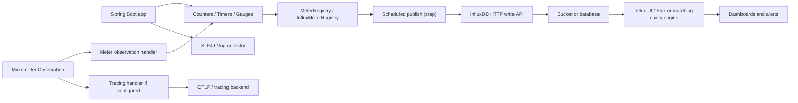
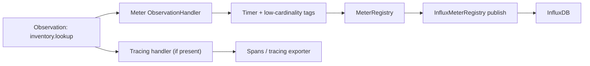
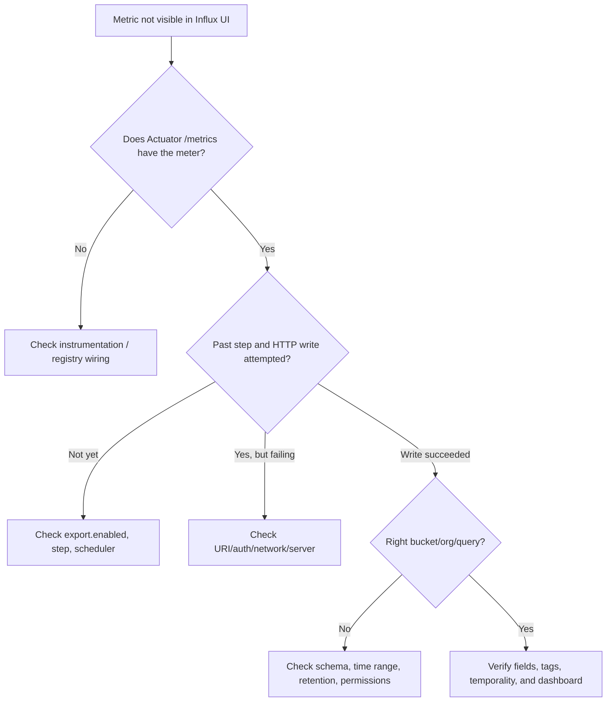

# Influx Registry in Spring Boot and Micrometer

> **Chapter:** Meter registry and exporter  
> **Module:** `SPRING_BOOT_OBSERVABILITY` — Setting up observability for Spring Boot using Micrometer Observation, metrics, logs, and distributed tracing. Learn context propagation, tags/cardinality, exporters, sampling, and signal correlation to investigate errors, latency, and application behavior in production environments.  
> **Focus:** Configuring Micrometer's `InfluxMeterRegistry` to push metrics to InfluxDB; understanding periodic push (`step`), differences between InfluxDB 1.x and 2.x, tag design, querying, and diagnosing a pipeline that works reliably both locally and in production.

## 1. Learning Outcomes

After this lesson, you will be able to:

1. Distinguish `MeterRegistry`, `InfluxMeterRegistry`, `ObservationRegistry`, the InfluxDB backend, and tracing exporters.
2. Explain why the Influx registry is a scheduled **push metrics exporter**, whereas a Prometheus registry usually serves a **pull/scrape** model.
3. Add `micrometer-registry-influx` to Spring Boot; use Boot 3.x configuration with `management.influx.metrics.export.*` and manage credentials safely.
4. Choose the right configuration for InfluxDB 1.x or 2.x; recognize that InfluxDB 3.x and compatible services require checking their specific API/registry rather than assuming 2.x config applies.
5. Register `Counter`, `Timer`, and `Gauge` using the Spring Boot-managed `MeterRegistry`; use low-churn names/tags and avoid inflating series counts.
6. Verify along the chain **application → Micrometer registry → HTTP write → bucket/database → query/dashboard**, distinguishing data that has not reached an export interval from token, network, org/bucket, or naming errors.
7. Read and aggregate values accurately according to **meter type, exporter-written data type, and time semantics**; never blindly apply PromQL `rate()` formulas to Influx fields.
8. Combine InfluxDB metrics with traces and logs to investigate errors and latency, while understanding that the Influx registry does not ship traces or logs.

## 2. Why Do You Need InfluxMeterRegistry?

Suppose a checkout system needs to store and query these metrics:

- Payment gateway invocation counts and failure rates by channel.
- Order processing times and HikariCP connection borrow durations.
- JVM heap, GC, CPU, and active thread counts.
- HTTP API throughput, error ratio, and p95 latency.

Micrometer provides a **backend-neutral instrumentation API**. The code emitting metrics does not need to know whether the backend is InfluxDB, Prometheus, or another platform. With the Influx registry, Micrometer converts meters into corresponding payloads and **actively sends HTTP requests** to InfluxDB on a periodic schedule.



A single application can have multiple telemetry branches:

| Component | Responsibility | Handled by Influx Registry? |
|---|---|---|
| `MeterRegistry` | Registers and reads meter states | Yes |
| `InfluxMeterRegistry` | Formats and pushes metrics to InfluxDB | Yes |
| `ObservationRegistry` | Manages Observation lifecycles and handlers | No, that is a separate registry |
| Tracing bridge/`Tracer` | Creates spans, propagates trace context | No |
| OTLP tracing exporter | Ships spans to a collector/trace backend | No |
| Logger and log collector | Writes/ships logs | No |
| InfluxDB | Ingests, stores, and queries time-series data | Independent backend |

**Having metrics in InfluxDB does not mean distributed tracing is enabled.** Tracing requires its own integration, sampling, propagation, and exporter. Log correlation requires a logger/MDC and an appropriate log pipeline.

## 3. Push vs. Pull: How Does Influx Differ from Prometheus?

| Perspective | Influx Registry | Common Prometheus Registry |
|---|---|---|
| How data arrives | **Push:** app sends HTTP writes to the backend periodically | **Pull:** Prometheus scrapes the app's HTTP endpoint |
| Collection schedule | Driven by registry's `step`/scheduler | Driven by Prometheus's `scrape_interval` |
| Target config | InfluxDB URI, token/credentials, org/bucket or database | Target discovery, endpoint, auth, relabeling |
| When backend disconnects | Publishes can fail; not a durable transaction store | Failed scrapes create data gaps |
| Query tool | InfluxDB query API/Flux or language per product/version | PromQL |
| Format | Line protocol/HTTP write per registry implementation | Prometheus exposition/OpenMetrics |
| Primary security | Write token/permissions on bucket, TLS, network | Access control on scrape endpoint, TLS/auth/network |

**You do not need to expose `/actuator/prometheus` for the Influx registry to push metrics.** Spring Boot Actuator `/actuator/metrics` is helpful for inspecting meters in-process, but a real Influx pipeline can operate without exposing the Prometheus endpoint.

Conversely, adding both `micrometer-registry-prometheus` and `micrometer-registry-influx` lets Spring Boot configure multiple meter registries receiving the same instrumented meters. Each backend then has its own export path, naming/temporality, and cost. Do not assume both backends will produce identical series names or rate calculations.

### 3.1. Step Does Not Equal Event Timestamp

Suppose `step=30s` and the app calls `counter.increment()` at 10:00:07, 10:00:14, and 10:00:23. The registry records each event in-process immediately when code runs, but **publishing** may only occur at a scheduled tick later.

Not seeing a data point immediately does not mean the Counter is broken. Verify:

1. Whether the app actually created/registered the meter.
2. Whether the registry is enabled and what the publish interval is.
3. Whether the HTTP write succeeded.
4. Whether the bucket/database received and can query the data.

A step registry may represent Counters/Timers per **export window**, rather than raw cumulative Counters like a Prometheus scrape sample. Always verify how data is written by your Micrometer version before building rate or total queries.

## 4. InfluxDB 1.x, 2.x, and API Generations

The name "InfluxDB" spans versions and services with distinct authentication, storage, and query models.

| Feature | InfluxDB 1.x | InfluxDB 2.x |
|---|---|---|
| Storage unit | Database (with retention policy, depending on config) | Bucket bound to an organization |
| Common auth | Username/password or server-configured auth | API token with scoped permissions |
| Typical HTTP write path | `/write?db=...` | `/api/v2/write?org=...&bucket=...` |
| Micrometer settings to check | `db`, `uri`, and credentials per deployment | `org`, `bucket`, `token`, `uri` |
| Query | InfluxQL via matching API/UI | Flux or query APIs supported by the 2.x deployment |
| Notes | Auth can be disabled locally, never do this in prod | Token must have bucket write permission and stay secret |

**Do not blindly copy 2.x configuration for InfluxDB 3.x.** Some InfluxDB 3 offerings support compatible write protocols/APIs, yet authentication, database/bucket mapping, and query engines differ. Before integrating, check the **exact Micrometer Influx registry version** and the **actual write endpoint** of your InfluxDB 3 product.

This lesson uses InfluxDB **2.x** as the primary path; the InfluxDB **1.x** section shows the variant so you do not confuse `db` properties with `bucket`.

### 4.1. What Is Influx Line Protocol?

The Influx write API accepts data points in this conceptual form:

```text
measurement,tag_key=tag_value field_key=field_value timestamp
```

Example of a **hand-crafted** point:

```text
learning_probe,source=manual value=1i
```

Here:

- `learning_probe` is the measurement.
- `source=manual` is a tag for filtering/grouping.
- `value=1i` is an integer field.
- Timestamp is omitted, so the server can assign the ingestion timestamp per API and config.

**Never assume Micrometer always emits a field named `value`, or always replaces dots in meter names with underscores.** The registry maps Counter, Gauge, Timer, and DistributionSummary to measurements/fields/tags according to its implementation. Always **inspect the actual stored data** before writing queries.

## 5. Adding the Influx Registry to Spring Boot

These examples target **Spring Boot 3.x** with a Spring Boot parent or BOM managing versions. Property keys and dependencies can change across major versions; verify against the deployed version.

### 5.1. Maven

```xml
<dependencies>
    <dependency>
        <groupId>org.springframework.boot</groupId>
        <artifactId>spring-boot-starter-actuator</artifactId>
    </dependency>

    <dependency>
        <groupId>io.micrometer</groupId>
        <artifactId>micrometer-registry-influx</artifactId>
    </dependency>

    <!-- Needed only if the app exposes an HTTP API. -->
    <dependency>
        <groupId>org.springframework.boot</groupId>
        <artifactId>spring-boot-starter-web</artifactId>
    </dependency>
</dependencies>
```

### 5.2. Gradle

```groovy
implementation 'org.springframework.boot:spring-boot-starter-actuator'
runtimeOnly 'io.micrometer:micrometer-registry-influx'
implementation 'org.springframework.boot:spring-boot-starter-web'
```

`micrometer-registry-influx` provides the InfluxDB backend registry. `spring-boot-starter-actuator` brings in instrumentation/auto-configuration and helpful inspection endpoints. The web starter is only needed when the app serves an HTTP API; a batch worker can export metrics to InfluxDB just fine too.

**Do not call `new InfluxMeterRegistry(...)` inside business services** when Boot already auto-configures the registry from dependencies and properties. Creating a private registry can split metrics across two places or bypass default instrumentation.

## 6. Configuring InfluxDB 2.x with application.yml

In Spring Boot **3.x**, the standard configuration namespace is `management.influx.metrics.export.*`:

```yaml
spring:
  application:
    name: checkout-service

management:
  influx:
    metrics:
      export:
        enabled: true
        uri: ${INFLUX_URI:http://localhost:8086}
        org: ${INFLUX_ORG:training}
        bucket: ${INFLUX_BUCKET:springboot}
        token: ${INFLUX_TOKEN}
        step: 30s

  metrics:
    tags:
      application: ${spring.application.name}
      environment: ${APP_ENVIRONMENT:local}

  endpoints:
    web:
      exposure:
        include: health,info,metrics
```

Key properties:

| Property | Role | What to Watch |
|---|---|---|
| `enabled` | Enables/disables Influx export per configuration | Metrics may still exist locally even if export is disabled |
| `uri` | InfluxDB server base URL | Do not confuse with an OTLP tracing endpoint |
| `org` | Receiving organization in InfluxDB 2.x | Must match the token/bucket and account |
| `bucket` | Bucket storing metrics | Bucket must exist and token must have write permission |
| `token` | Authentication token for writing data | Never commit tokens to Git or print them in logs |
| `step` | Interval at which the registry attempts to publish metrics | Balance visibility lag, request count, and cost |
| `management.metrics.tags.*` | Common tags added to meters | Use only low-churn values like application/environment |
| `management.endpoints.web.exposure.include` | Exposes Actuator endpoints over HTTP | For inspection only; does not trigger Influx writes directly |

**Configuration note:** Spring Boot **2.x** namespaces differ from **3.x**. If upgrading a project, check property migration; updating only the dependency while keeping Boot 2.x's `management.metrics.export.influx.*` keys can prevent configuration from taking effect.

### 6.1. Where to Put Secrets

Locally, inject `INFLUX_TOKEN` via environment variables or a secret manager. In production, use Kubernetes Secrets, runtime secret injection, or an appropriate secrets service. Illustrative shell example:

```bash
export INFLUX_URI=http://localhost:8086
export INFLUX_ORG=training
export INFLUX_BUCKET=springboot
export INFLUX_TOKEN='local-token-from-secret-store'
export APP_ENVIRONMENT=local
```

The values above are **illustrative placeholders**; never put a real token in documentation, committed files, or shared examples. On a real terminal, use an organization-approved secret injection mechanism and avoid saving tokens in shell history.

If the app runs **inside a Docker Compose network**, `localhost:8086` refers to the app container itself. When InfluxDB is a service named `influxdb` on the same network, use `http://influxdb:8086` as `INFLUX_URI`. If the app runs on the host, use a host-reachable address like `http://localhost:8086` when InfluxDB publishes its port.

### 6.2. How Should You Choose the Push Interval?

| Step | Benefit | Cost / Limitation |
|---|---|---|
| `10s` | Data arrives faster, good for short diagnostics | More write calls, higher overhead |
| `30s` | Balanced for labs and many workloads | Still introduces lag and frequent writes |
| `1m` | Lower write frequency; common for general operations | Brief Gauge spikes can be harder to spot |
| `5m` | Fewer writes | High lag, misses transient gauges, slow alerts |

These are options to weigh, not universal defaults. Base `step` on incident-detection SLAs, system load, metric volume, instance count, and registry publish behavior.

An important step is **understanding temporality**: for Counters/Timers from a step registry, periodic values may be **per-step** totals rather than totals since process startup. Before applying derivatives or rates, inspect the representation of your actual series.

## 7. Local Lab with InfluxDB 2.x

A simple way to test the exporter is running an InfluxDB 2.x instance **locally or in an isolated dev environment**. Docker Compose example:

```yaml
services:
  influxdb:
    image: influxdb:2.7
    ports:
      - "127.0.0.1:8086:8086"
    environment:
      DOCKER_INFLUXDB_INIT_MODE: setup
      DOCKER_INFLUXDB_INIT_USERNAME: ${INFLUX_ADMIN_USER}
      DOCKER_INFLUXDB_INIT_PASSWORD: ${INFLUX_ADMIN_PASSWORD}
      DOCKER_INFLUXDB_INIT_ORG: training
      DOCKER_INFLUXDB_INIT_BUCKET: springboot
      DOCKER_INFLUXDB_INIT_ADMIN_TOKEN: ${INFLUX_BOOTSTRAP_TOKEN}
    volumes:
      - influxdb2-data:/var/lib/influxdb2
      - influxdb2-config:/etc/influxdb2

volumes:
  influxdb2-data:
  influxdb2-config:
```

To start it:

```bash
docker compose up -d
```

Before starting, supply `INFLUX_ADMIN_USER`, `INFLUX_ADMIN_PASSWORD`, and `INFLUX_BOOTSTRAP_TOKEN` via environment variables or an appropriate secrets mechanism. In a local lab, you can use a dedicated test token. In production, **never use the admin bootstrap token as a standing token for every app**: issue tokens **scoped only to writing the required bucket**.

This InfluxDB 2.x container requires disk space and persists data in the configured volumes; removing the volumes deletes local data. This local setup **does not replace** production hardening, backup, TLS, or retention guidance.

**Keep variables clearly separated:**

- `INFLUX_BOOTSTRAP_TOKEN` is used when initializing local InfluxDB 2.x.
- `INFLUX_TOKEN` is the token **used by the Spring Boot app to write**. In a lab, you can provision a suitable token after setup; in production, issue a least-privilege write-only token.

### 7.1. Checking the Server Before Starting the App

InfluxDB 2.x exposes a health endpoint depending on configuration:

```bash
curl -i http://localhost:8086/health
```

A successful health response proves **the server is reachable**, not that your token has bucket write permissions. If the app still fails to export metrics, inspect authentication and the write API separately.

### 7.2. Sending a Test Point in Influx Line Protocol

To separate an **InfluxDB server/token/bucket** problem from a **Micrometer registry** problem, test the write API with a non-sensitive probe point.

In a dev environment with variables already set, for example:

```bash
curl -i -X POST \
  "http://localhost:8086/api/v2/write?org=training&bucket=springboot&precision=ns" \
  -H "Authorization: Token ${INFLUX_TOKEN}" \
  -H "Content-Type: text/plain; charset=utf-8" \
  --data-binary 'learning_probe,source=manual value=1i'
```

This syntax targets POSIX-compatible shells. **Do not copy real tokens onto command lines saved in shell history on shared machines**; use secret injection or approved CLI tools in practice. The token must have **write** permission on the bucket. A successful InfluxDB 2.x write response is normally **HTTP 204 No Content**.

The `learning_probe` test point has a known measurement and field, making query verification easy. If the direct HTTP write succeeds while Micrometer still fails to send, the problem likely lies in registry configuration, how the app connects to the server, publish scheduling, or the app's token/permissions.

### 7.3. Starting the Application

Run the Spring Boot app with the configuration from section 6, then invoke a few endpoints to generate metrics:

```bash
curl -s http://localhost:8080/actuator/health
curl -s http://localhost:8080/actuator/metrics
curl -s http://localhost:8080/actuator/metrics/jvm.memory.used
```

Wait **at least one configured publish interval** and inspect logs/exporter status, then check the InfluxDB bucket. Note: if the app exits before the registry publishes, no data points may appear; whether shutdown flushes depends on the implementation and circumstances.

## 8. Variant for InfluxDB 1.x

An InfluxDB 1.x deployment typically uses a `database` and a different authentication model:

```yaml
management:
  influx:
    metrics:
      export:
        enabled: true
        uri: ${INFLUX_V1_URI:http://localhost:8086}
        db: ${INFLUX_V1_DATABASE:metrics}
        user-name: ${INFLUX_V1_USER}
        password: ${INFLUX_V1_PASSWORD}
        auto-create-db: false
        step: 30s
```

Key points:

- `db` is the **InfluxDB 1.x database name**, not an InfluxDB 2.x bucket.
- `user-name` and `password` apply only when the 1.x deployment configures matching authentication.
- `auto-create-db: false` prevents the exporter from silently creating a database if absent; provision the database and permissions before enabling production export.
- InfluxDB 1.x has its own retention policy, auth/proxy, and write API settings to match against the running server.

If an InfluxDB 1.x deployment sits behind a different gateway/compatibility API, do not assume every property behaves identically. **Never mix `db` from 1.x config arbitrarily with `bucket`/`org`/`token` from 2.x**; choose a profile matching your actual backend.

### 8.1. Separate Profiles by Backend

For example, put 1.x settings in `application-influx1.yml` and 2.x settings in `application-influx2.yml`, then activate only the needed profile. Avoid enabling both sets of properties and relying on unclear override precedence.

Property names alone do not prove the exporter sends to the right URL: verify the outbound HTTP write path, response, and ingested data in Influx.

## 9. Sharing MeterRegistry for Business Metrics

A core goal of Micrometer is keeping business code **unaware that the backend is InfluxDB**. Services simply inject `MeterRegistry` and call the Meter API.

Counter and Timer example for payment processing:

```java
package com.example.checkout.metrics;

import io.micrometer.core.instrument.Counter;
import io.micrometer.core.instrument.MeterRegistry;
import io.micrometer.core.instrument.Timer;
import java.util.Locale;
import org.springframework.stereotype.Component;

@Component
public final class CheckoutMeters {

    private final Counter approved;
    private final Counter failed;
    private final Timer paymentDuration;

    public CheckoutMeters(MeterRegistry registry) {
        approved = Counter.builder("checkout.payment.attempts")
                .description("Completed payment gateway attempts")
                .tag("outcome", "approved")
                .register(registry);

        failed = Counter.builder("checkout.payment.attempts")
                .description("Completed payment gateway attempts")
                .tag("outcome", "error")
                .register(registry);

        paymentDuration = Timer.builder("checkout.payment.duration")
                .description("Duration of a payment operation")
                .register(registry);
    }

    public <T> T recordPayment(java.util.function.Supplier<T> action) {
        return paymentDuration.record(() -> {
            try {
                T result = action.get();
                approved.increment();
                return result;
            } catch (RuntimeException exception) {
                failed.increment();
                throw exception;
            }
        });
    }
}
```

This example **assumes** returning normally means `approved`. With a real payment gateway, `declined` is a business outcome that can return without throwing, so you should inspect the decision and add a `declined` label per domain contract rather than relying solely on exceptions.

Principles in this code:

1. The registry is injected by Spring Boot rather than created per call.
2. Counters measure **events**, Timers measure **duration**; Timers also keep their own count.
3. Tags like `outcome=approved/error` have small, stable cardinality.
4. A request with retries can generate multiple attempts; define counting boundaries clearly.
5. Timers/Counters are held in singleton fields to avoid dynamic per-request registration.
6. `InfluxMeterRegistry`'s exporter periodically publishes registered meters; business logic never makes direct HTTP calls to InfluxDB.

**Never attach** `orderId`, `userId`, `traceId`, raw URLs, exception messages, or tokens as meter tags. They multiply series counts and risk data exposure. Use correlated tracing/logs with proper data policies to trace individual transactions.

### 9.1. Using Gauge for Current State

Example observing the length of an application-managed in-memory queue:

```java
package com.example.checkout.metrics;

import io.micrometer.core.instrument.Gauge;
import io.micrometer.core.instrument.MeterRegistry;
import java.util.concurrent.atomic.AtomicInteger;
import org.springframework.stereotype.Component;

@Component
public class LocalQueueMetrics {

    private final AtomicInteger queuedJobs = new AtomicInteger();

    public LocalQueueMetrics(MeterRegistry registry) {
        Gauge.builder("checkout.queue.pending", queuedJobs, AtomicInteger::get)
                .description("Queued jobs in the current process")
                .register(registry);
    }

    public void jobEnqueued() {
        queuedJobs.incrementAndGet();
    }

    public void jobDequeued() {
        queuedJobs.decrementAndGet();
    }
}
```

**Important point:** here the application holds the `queuedJobs` reference for the bean's lifetime. Gauges typically sample at publish time; if the queue rises and drains quickly between two steps, the spike may **not appear** in Influx data. To track total enqueued/dequeued jobs, add dedicated Counters with clear semantics.

Do not use this in-memory Gauge as a source of truth for a distributed queue. If the queue is Kafka/RabbitMQ/SQS, prefer broker/consumer integration metrics reflecting real queue state.

## 10. ObservationRegistry vs. MeterRegistry with Influx

Micrometer Observation provides an API for recording **work lifecycles**, independent of the metrics backend. Example:

```java
import io.micrometer.observation.Observation;
import io.micrometer.observation.ObservationRegistry;

public String loadInventory(ObservationRegistry observationRegistry) {
    return Observation.createNotStarted(
                    "inventory.lookup", observationRegistry)
            .lowCardinalityKeyValue("dependency", "inventory")
            .observe(() -> {
                // A synchronous business operation.
                return "AVAILABLE";
            });
}
```

When Spring Boot configures a meter observation handler, an Observation can create a Timer and tags in `MeterRegistry`; the Influx registry then exports those meters like any other metric.



Do not confuse them:

- `ObservationRegistry`: manages and dispatches lifecycles/handlers.
- `MeterRegistry`: stores/registers meters.
- `InfluxMeterRegistry`: a meter registry implementation shipping metrics to InfluxDB.
- `Observation.lowCardinalityKeyValue(...)`: adds dimensions to the observation; matching handlers can include them in metrics.
- Tracing `sampling probability`: decides which spans are kept; it does **not** sample Influx metrics at that rate.

**Do not write a separate Counter just to "count how many times an operation ran"** if the observation's automatic Timer already provides that count with the same semantics, unless the Counter represents an independent business event.

## 11. Tags, Fields, and Cardinality in InfluxDB

InfluxDB distinguishes **measurement**, **tags**, **fields**, and **timestamp**. Tag values are used to group and index series. Adding a tag with a unique value on every request grows series counts and increases indexing, storage, and query costs.

Example contract for payment metrics:

| Key | Reasonable Value Set | Used For | Assessment |
|---|---|---|---|
| `application` | `checkout-service`, `inventory-service` | Filtering by service | Low cardinality |
| `environment` | `local`, `staging`, `prod` | Filtering by environment | Low cardinality |
| `channel` | `web`, `mobile`, `partner`, `other` | Grouping business outcomes | Low cardinality |
| `outcome` | `approved`, `declined`, `error` | Error/failure ratio | Low cardinality |
| `provider` | `primary`, `backup`, `other` | Dependency breakdown | Low cardinality |
| `pod`/`instance` | One value per replica | Replica debugging | Acceptable within budget; watch churn |
| `orderId` | Potentially unique per order | Do not use as meter tag | High cardinality |
| `traceId` | Nearly unique per trace | For tracing/logs | Do not use as meter tag |
| `user.email` | Personal data | Never put in tags | Privacy risk |

With 4 `channel` × 3 `outcome` × 3 `provider` × 2 `environment` × 8 instances, up to **576 tag combinations** can exist for one meter, before additional dimensions. Attaching `orderId` on every request lets series grow with order volume.

**Manage the tag contract like an API:**

1. Define key names and allowed value sets.
2. Normalize raw inputs against an enum/whitelist with an `other` or `unknown` fallback.
3. Keep session IDs, per-request URLs, and exception messages out of metric names or tags.
4. Check whether application common tags collide with metadata added by a Collector/backend.
5. Monitor cardinality and retention after schema changes.

### 11.1. An Influx Tag Is Not Tracing Baggage

A tag `channel=web` in an Influx metric helps dashboards group data, but **does not automatically propagate trace context** between service A and service B. HTTP propagation requires instrumented clients, `traceparent`/`tracestate` (or the configured protocol), a tracing bridge, and context propagation across async/reactive boundaries.

An Influx metric may reveal rising error rates on `channel=partner`. To find a specific request, use service and time window filters to pull sampled traces, then search logs by `traceId`. Never turn `traceId` into an Influx dimension just to "click from a metric to a log."

## 12. Querying Data from InfluxDB 2.x

On InfluxDB 2.x deployments supporting **Flux**, you can use Data Explorer or the query API to inspect data. Different InfluxDB products/versions support different query languages; this lesson uses Flux only where applicable to **2.x** and does not assume InfluxDB 3 uses Flux.

### 12.1. Querying a Probe Point with a Known Measurement and Field

After writing `learning_probe,source=manual value=1i`:

```flux
from(bucket: "springboot")
  |> range(start: -1h)
  |> filter(fn: (r) => r._measurement == "learning_probe")
  |> filter(fn: (r) => r.source == "manual")
  |> filter(fn: (r) => r._field == "value")
```

If this query returns nothing, check the query time range, bucket, org, token permissions, write status, and retention before hunting for bugs in the application.

### 12.2. Discovering Measurements Actually Sent by the Application

In Data Explorer you can list measurements/fields. With Flux and the schema package:

```flux
import "influxdata/influxdb/schema"

schema.measurements(
  bucket: "springboot",
  start: -2h
)
```

Once you have the exact measurement name for your meter, filter by that real name. Never take a Prometheus name like `http_server_requests_seconds_count` and assume the Influx measurement shares that exact name.

### 12.3. Sample Query for an Application Meter

Suppose you inspect the data and confirm the actual measurement is `checkout_payment_attempts` and the Counter is written to field `value`. Only then write an example like:

```flux
from(bucket: "springboot")
  |> range(start: -1h)
  |> filter(fn: (r) => r._measurement == "checkout_payment_attempts")
  |> filter(fn: (r) => r._field == "value")
  |> filter(fn: (r) => r.outcome == "error")
  |> aggregateWindow(every: 5m, fn: sum, createEmpty: false)
```

**Warning:** `checkout_payment_attempts` and `value` are **illustrative assumptions**, not a guaranteed schema for the Micrometer Influx registry. Furthermore, windowing with `sum` is only valid when the field represents **per-step event counts** that can be summed. If the backend stores a cumulative Counter, you need proper reset/temporality handling before aggregating. If the field is a Gauge, reading and aggregation differ.

For a Timer, before calculating mean latency or percentiles, inspect which fields represent **count**, **total duration**, and **max**, along with their units. Never divide fields with mismatched units or time windows.

### 12.4. Do Not Infer p95 from Mean Values

If Influx stores `count` and `total time` per step, dividing total time by count gives **mean latency**, not p95. Cluster-wide p95 requires percentile/histogram/distribution data emitted by instrumentation/exporters and a mergeable distribution method supported by the backend.

Never average per-pod p95s and call the result system-wide p95. If distribution data is unavailable, label the metric accurately as *mean* or pull traces for slow examples—never mislabel it as p95.

### 12.5. Timezones, Retention, and Late-Arriving Data

Influx uses timestamps for time-series data. Dashboards must align timezones and windows, especially when correlating with logs and traces. Publish intervals, network retries, and batch ingestion can cause points to appear slightly after the real event.

Bucket retention can expire data after a configured period. Never treat telemetry as an exact accounting/audit ledger; metrics pipelines can drop points on app/backend restarts or export failures.

## 13. Verifying the Exporter with a Chain of Evidence

A thorough Influx registry check does not stop at "the app started with no errors."

### Step 1 — Do MeterRegistry and Meters Exist in the Process?

Call:

```bash
curl -s http://localhost:8080/actuator/metrics
curl -s http://localhost:8080/actuator/metrics/process.uptime
```

If `process.uptime` or another meter is missing, check Actuator, binders, filters, and versions. Having the meter proves local instrumentation exists; **it does not yet prove data reached Influx**.

### Step 2 — Is the Influx Server Reachable?

Verify the URI, DNS, port, and health endpoint. From inside an application container, `localhost` is not the host or a separate InfluxDB container. When using HTTPS/TLS, check the CA/certificate and matching hostname.

### Step 3 — Does the Token Have Bucket Write Permission?

Run a safe probe in a dev environment as in section 7. A successful HTTP write response is separate proof from `health=UP`. A read-only token usually cannot write, even though the query UI works.

### Step 4 — Has at Least One Publish Interval Elapsed?

With `step=30s`, right after startup there may be zero points yet. Wait at least one full interval and watch for scheduler jitter, backend load, and last successful write time.

### Step 5 — Are There HTTP Write Failures in Application Logs?

Common failure groups:

| HTTP/Network Symptom | Possible Cause | Where to Check |
|---|---|---|
| `401 Unauthorized` | Wrong/expired token or invalid auth header | Token/secret injection, server auth |
| `403 Forbidden` | Token lacks permissions on bucket/org | Token grants/permissions, org/bucket |
| `404 Not Found` | Wrong endpoint, base URL, bucket, or API version | URI, InfluxDB version, write path |
| `429 Too Many Requests` | Backend rate limit/quota | Step, replica count, backend capacity |
| `5xx` | Backend/reverse proxy or infra failure | Influx server logs, load/storage, proxy |
| Connection refused/timeout | Wrong host/port, service down, network policy | DNS, routing, container networking |
| TLS handshake/certificate error | Wrong scheme, CA, or hostname | Trust store, TLS chain, cert rotation |
| App has metrics, no outbound requests | Registry disabled/unwired, or step not reached | Active config, classpath, export enabled flag |

Never enable full HTTP wire logging that could expose tokens; raise log levels selectively, briefly, and within security policy.

### Step 6 — Does Data Appear in the Right Org/Bucket/Time Range?

Use Data Explorer or the API to search for a known measurement (the probe or an actual metric) within the right time window. Account for retention expiration or clock/timestamp skew. If Influx received points while the dashboard stays empty, the cause is likely query/filter syntax, read permissions, timezone, or schema mapping—not the exporter.

### 13.1. Minimal Layered Troubleshooting Workflow



This sequence is far more effective than editing business code when the meter already exists but the export token or URL is wrong.

## 14. Production Configuration: Security and Operations

### 14.1. Tokens and Access Control

- Issue tokens scoped solely to writing the needed metrics bucket; never share a long-lived admin token across all microservices.
- Deliver tokens via a secret manager or Kubernetes Secrets with RBAC and rotation.
- Never commit tokens, secret YAML, or outputs containing Authorization headers to repositories.
- Use HTTPS/TLS over untrusted networks; restrict Influx endpoints to authorized workloads.
- Separate UI/dashboard read permissions from application write permissions.
- Plan token rotation cost and rollout so metrics export is not interrupted.

### 14.2. Stable Service Identity and Tags

A multi-service system should standardize `application`/`service`, `environment`, `region` or `cluster`, and `instance`/`pod` if needed. Labels should have bounded value sets. Never put trace IDs or session IDs into common tags.

Measurement/tag names are part of your telemetry schema. Renaming them in a release can cause dashboards to report missing data even while Influx continues ingesting points under the new name. Treat schema changes like API changes: update dashboards/alerts and verify before/after.

### 14.3. Retention and Capacity

InfluxDB stores points over time. Total volume scales roughly as:

\[
\text{Approximate points} \propto
\text{series count} \times
\frac{\text{retention duration}}{\text{step}}
\]

For example, 2,000 series published every 30 seconds yield roughly up to:

\[
2000 \times 2 \times 60 \times 24 = 5{,}760{,}000
\]

points/day when every series emits regularly. This figure is illustrative; registries may omit idle series, emit multiple fields, or batch differently, so actual volume will vary.

The bigger problems usually lie in **cardinality**, retention, query cost, and indexing; tweaking `step` without eliminating dynamic tags will not solve series explosion.

### 14.4. Reliability and Failure Isolation

- Metrics export should remain an asynchronous observability task, never a synchronous dependency of business requests.
- Never issue manual Influx HTTP writes inside a payment path "to be sure the metric is recorded."
- Monitor exporter errors, publish duration, network latency, backend health, and quotas.
- Maintain a runbook for metric outages; distinguish an application outage from a telemetry-only outage.
- Do not assume **exactly-once delivery** for telemetry; use transactional databases/event logs for exact audit needs.
- Test shutdown, reconnect, and retry behavior under representative traffic; never assume zero data loss if a process dies before a publish tick.
- Bound metric tag cardinality, exporter logging, and registry count so observability itself does not exhaust CPU/memory.

### 14.5. Multiple Replicas and Churn

A fleet of 20 pods creates 20 concurrent publish sources. Total points/sec depends on series per registry, `step`, and pod count. Scaling up increases write load on InfluxDB; rolling deploys introduce new instance labels.

Configure identity so instances remain traceable without injecting pod UIDs into **every** business tag unnecessarily. When infrastructure labels like pod/name are added at a Collector/backend, monitor series counts before and after service discovery changes.

## 15. Testing Metrics Separately from Testing the Exporter

Do not rely on an integration test coupled to a real Influx instance just to verify simple rules like "Counter increments once when payment fails." Separate two goals:

1. **Instrumentation unit tests:** verify business code emits the right Counter/Timer/tags using `SimpleMeterRegistry`.
2. **Exporter integration tests:** against an isolated InfluxDB 2.x instance, verify write permissions, write API, publish interval, and queryable data; requires a stable test environment.

### 15.1. Unit Testing Counter and Timer

```java
import io.micrometer.core.instrument.Counter;
import io.micrometer.core.instrument.Timer;
import io.micrometer.core.instrument.simple.SimpleMeterRegistry;
import org.junit.jupiter.api.Test;

import static org.junit.jupiter.api.Assertions.assertEquals;

class CheckoutMetersTest {

    @Test
    void recordsSuccessAndFailure() {
        try (SimpleMeterRegistry registry = new SimpleMeterRegistry()) {
            CheckoutMeters meters = new CheckoutMeters(registry);

            meters.recordPayment(() -> "approved");

            try {
                meters.recordPayment(() -> {
                    throw new IllegalStateException("gateway timeout");
                });
            } catch (IllegalStateException expected) {
                // Verify exception still propagates.
            }

            Counter successes = registry.get("checkout.payment.attempts")
                    .tag("outcome", "approved")
                    .counter();

            Counter failures = registry.get("checkout.payment.attempts")
                    .tag("outcome", "error")
                    .counter();

            Timer latency = registry.get("checkout.payment.duration")
                    .timer();

            assertEquals(1.0, successes.count(), 0.000001);
            assertEquals(1.0, failures.count(), 0.000001);
            assertEquals(2L, latency.count());
        }
    }
}
```

This test verifies **measurement logic**, not `InfluxMeterRegistry` export. For production payments, also test gateway declines returned without throwing and retry scenarios, since `CheckoutMeters` above only separates normal returns from exceptions.

### 15.2. Integration Testing with an InfluxDB Backend

An end-to-end test should:

1. Start InfluxDB 2.x in an isolated test environment.
2. Create an org/bucket and a write-scoped token.
3. Boot Spring Boot with the Influx 2.x profile and a controlled short `step`.
4. Call endpoints to trigger custom Counters/Timers.
5. Wait for the publish interval and confirm the HTTP write succeeds.
6. Use a read-scoped query token to verify the measurement, fields, tags, and fresh points.
7. Test invalid-token/unavailable-endpoint paths to verify error logging and export failure handling.
8. Clean up the test bucket/environment without touching production data.

Do not assert "data appears immediately after one request" when the exporter publishes on a step. Tests must respect publish schedules and potential lag, and should not assume transient network failures automatically retry without ever dropping points.

## 16. Combining Influx Metrics with Tracing and Logs to Investigate Errors

Suppose Influx dashboards show payment errors rising after a deployment alongside increasing HTTP latency. Influx metrics show **when, which service, and which request group** is impacted.

An investigation workflow:

1. From Influx queries, identify `application=checkout-service`, `environment=prod`, `outcome=error`, and the time window.
2. Check request rate, Timer latency, HikariCP `pending/acquire`, and JVM CPU/GC to spot saturation.
3. Query traces by service and time window, focusing on slow/error requests if tracing is instrumented and sampled.
4. Inside a trace, inspect outbound payment client, DB call, timeout, and retry spans to see where time is spent.
5. Use the `traceId` of an anomalous request to read correlated logs for exceptions, statuses, or fallbacks.
6. After fixing, confirm error ratio, latency, and saturation drop in metrics while verifying the Influx exporter continues publishing.

**Trace sampling does not shrink Influx Counters at the same probability.** A tracing backend keeping 10% of spans can coexist with Influx metrics counting 100% of instrumented payment attempts. Conversely, if Influx export fails, traces/logs may still exist; never treat "no Influx points" as "no requests."

### 16.1. Exemplars and Correlation Conditions

Some metrics backends support exemplars to link a metric sample to a trace. **Do not assume `InfluxMeterRegistry` writes `traceId`/`spanId` as clickable exemplars by default.** For a metrics→traces workflow, rely on service/time-window filters, platform tooling, or exemplars only if the registry, collector, backend, and UI all genuinely support them.

Never "fix" missing links by adding `traceId` as an Influx tag: that causes severe cardinality explosion.

## 17. Comparing Exporter Choices

| Scenario | Option Worth Considering | Why |
|---|---|---|
| Already running InfluxDB 2.x and want apps pushing directly | `micrometer-registry-influx` | Direct integration, org/bucket/token config |
| Already using standard Prometheus scraping in Kubernetes | Prometheus registry | Service discovery/scraping/PromQL ready |
| Want to decouple credentials/egress from each app | Collector/agent suited to architecture | Centralizes pipeline, policy, and fan-out |
| Need trace context and spans | Micrometer Tracing + exporter | Influx metrics registry does not replace a tracing exporter |
| Need correlated logs | Structured logging + log collector | Influx metric push does not replace a log pipeline |
| Want to export to multiple backends | Multiple registries or collector routes | Requires evaluating cost, naming, and duplication |

No single backend fits every goal. Decide based on existing observability tooling, operational cost, query language, retention, tenancy, security, and metric interpretability.

## 18. Quick Troubleshooting

| Symptom | Common Cause | Check Step |
|---|---|---|
| No `InfluxMeterRegistry` or no export | Missing dependency/auto-config, exporter disabled | Classpath, Boot version, `management.influx.metrics.export.enabled` |
| `/actuator/metrics` has meter, Influx is empty | Step not reached, wrong URI/token/org/bucket, HTTP write error | Wait for publish, probe HTTP write, read exporter logs |
| Local app writes fine, container app fails | `localhost` points wrong, DNS/network policy | Switch URI to proper service name/route |
| Influx health=UP, but write returns 401/403 | Token permissions or org/bucket mismatch | Check write grants and app token |
| HTTP write returns 204, UI shows nothing | Query targets wrong bucket/time window or unexpected measurement/field | Query probe, discover measurements/fields, check retention |
| Measurement appears under another name | Different naming convention or registry/schema version | Inspect real data in Influx, update queries |
| Counter chart wrong after restart | Mixed up cumulative/delta/step or wrong aggregation | Verify semantics and reset handling |
| Timer count exists, p95 is missing | No histogram/percentile data | Check available fields; do not infer from mean |
| Data arrives tens of seconds late | Periodic step publishing | Adjust step if genuinely needed and within capacity |
| Series count spikes sharply | Tag contains raw URL/user/order/request ID | Audit tag contract, whitelist values |
| API slows down alongside exporter errors | Export overhead, slow backend, resource contention | Profile app, exporter logs, network; confirm impact |
| Metrics exist, logs/traces unlinked | Tracing/MDC/propagation not enabled | Inspect tracing integration separately |
| Two backends disagree on numbers | Different temporality, step/scrape, time window, label mapping | Compare raw schemas and query formulas |

### 18.1. When Should You Show "No Data" Instead of 0?

If an Influx query is empty because export failed, you cannot conclude the payment error rate is 0%. "No data" is different from "measured 0 errors." Dashboards and alerts should include a separate **pipeline health** signal, such as exporter availability or backend write failures where instrumented.

For a Gauge, a value of 0 carries real meaning (e.g., 0 pending jobs); if the meter has not emitted a series yet, do not silently backfill 0 without noting it. For a step Counter, intervals with zero events happen; distinguish zero events, missing samples, and dropped points.

## 19. Comprehensive Hands-On Exercise

**Context:** A checkout system runs 4 Spring Boot replicas, each pushing metrics to InfluxDB 2.x with `step=30s`. The team wants to see attempts, error ratio, p95 latency, and pool health in Influx, while keeping OTLP tracing in a separate backend.

### Part A — Setup

1. Add `spring-boot-starter-actuator` and `micrometer-registry-influx`.
2. Configure `management.influx.metrics.export.uri/org/bucket/token/step` for local InfluxDB 2.x.
3. Attach bounded common tags `application` and `environment`.
4. Verify Influx health and send a `learning_probe` point via the write API with a write-enabled token.
5. Call an endpoint creating business Counters/Timers in Spring Boot, and verify meters appear in Actuator.
6. After a publish cycle, query the bucket for the actual measurements/fields written by the registry.

### Part B — Schema and Query Design

1. Define Counter `checkout.payment.attempts` with `outcome=approved/declined/error`.
2. Define Timer `checkout.payment.duration` to measure latency.
3. Add `channel=web/mobile/partner/other` only if dashboards truly need it.
4. Never add `orderId`, `userId`, or `traceId` to meter tags.
5. Determine whether Counter data in Influx for your registry/version is **per-step delta** or **cumulative**; choose the right time-rate aggregation accordingly.
6. If p95 is desired, check whether the exporter emits histograms/percentiles with a compatible schema; never derive p95 from mean.
7. If each replica emits 150 series every 30 seconds, 4 replicas produce roughly `4 × 150 × 2 = 1200` points/minute in the simplified case of one point per series per step. Explain how multiple fields, absent series, and batching change actual volume.

### Part C — Simulated Failures

Change one variable at a time **in a test environment only**:

- Swap the token to one without write permissions.
- Change `bucket` to a non-existent bucket.
- Set URI to an unreachable container address.
- Set `step=1m` and search for data just 5 seconds after a request.
- Add a dynamic per-request-ID tag on a mock meter and assess the cardinality impact.

For each scenario, create a table listing symptom, failure layer, verification method, and remediation. Never run these fault injections in production.

### Part D — Cross-Signal Incident Investigation

Dashboards show rising `outcome=error` and longer payment durations, yet Influx holds no trace IDs. Do the following:

1. Identify the service, time window, and error group from Influx.
2. Query the tracing backend by service and time window to find slow/error spans.
3. Use the trace ID from the tracing backend to retrieve corresponding logs.
4. Inspect timeouts, retries, dependencies, and connection pools.
5. Verify recovery after the fix via error rate/latency metrics while confirming the Influx exporter keeps publishing.

### Completion Criteria

You succeed when you can configure the Influx registry for the right backend, distinguish step push from Prometheus scrape, prove **meter → HTTP write → bucket → query**, protect tokens, design low-cardinality tags, and understand the query limits of Step/Timer data. You also know how to narrow down failures with metrics, then pivot to tracing and logs to analyze individual requests.

---

## 20. Pre-Production Checklist for Influx Registry

- [ ] Confirmed exact InfluxDB 1.x/2.x or alternative product and verified write API/registry compatibility.
- [ ] Used `micrometer-registry-influx` and property namespaces matching the Spring Boot version.
- [ ] Registry works through the application's `MeterRegistry`; no isolated registries created inside business services.
- [ ] Token has write-only permissions scoped to the required bucket, injected via secrets, with a rotation plan.
- [ ] URI uses the right DNS/network/TLS inside containers/Kubernetes; never assumed `localhost` reaches another service.
- [ ] Step matches detection latency and ingestion budget; cost sized by instances and series count.
- [ ] Common tags and business tags follow a clear schema without user/order/trace IDs or secrets.
- [ ] Verified meters exist in Actuator and HTTP writes to Influx succeed.
- [ ] Verified queries target the exact bucket, measurement, field, tags, timezone, and retention.
- [ ] Dashboards respect exact temporality (step/delta/cumulative) and Counter/Timer/Gauge semantics.
- [ ] Mean latency is never labeled p95; histograms/percentiles rely on proper distribution data.
- [ ] Alerts/monitoring exist for exporter health, networking, and ingestion; no-data is never treated as 0.
- [ ] Tested behavior across restarts, rollouts, network failures, backend unavailability, and scaling.
- [ ] Runbook links Influx metrics with traces and logs without putting trace IDs into metric tags.
- [ ] Separated observability telemetry from transactional/audit records requiring exact durability.

## Key Takeaways

**`InfluxMeterRegistry` is a push-based metrics bridge from Micrometer to InfluxDB.** In Spring Boot, add the registry dependency, configure the endpoint and write permissions for InfluxDB 1.x or 2.x, and inject `MeterRegistry` into business code to create Counters, Timers, and Gauges. Because the registry publishes on a `step`, data does not necessarily appear immediately after a request, and you must verify actual schema and temporality before writing queries.

Low-cardinality tags enable slicing by service, environment, operation, and outcome; dynamic tags like request IDs or user IDs inflate series counts and costs. The Influx registry **does not replace a tracing exporter or log pipeline**. During production investigations, use Influx metrics to pinpoint timing and error groups, then query traces and logs by service/time window/trace ID to explain root cause—while confirming the exporter is still delivering data completely.
