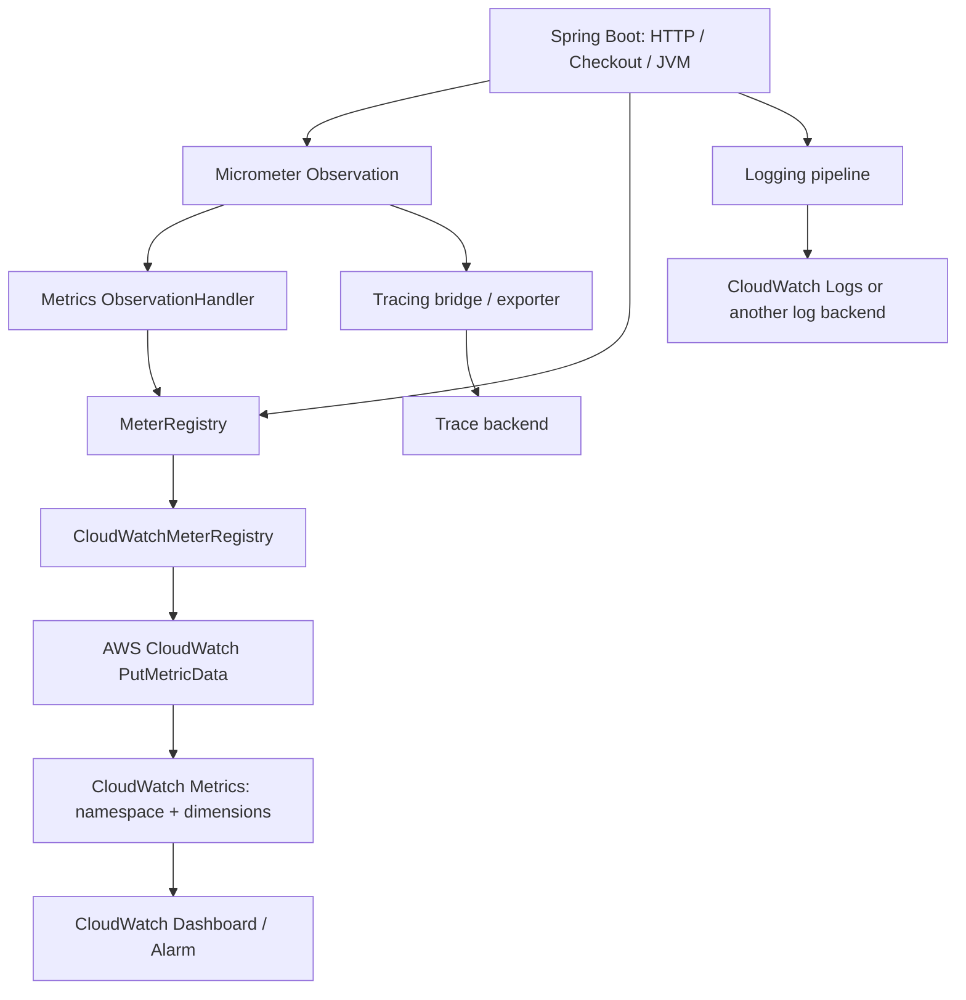
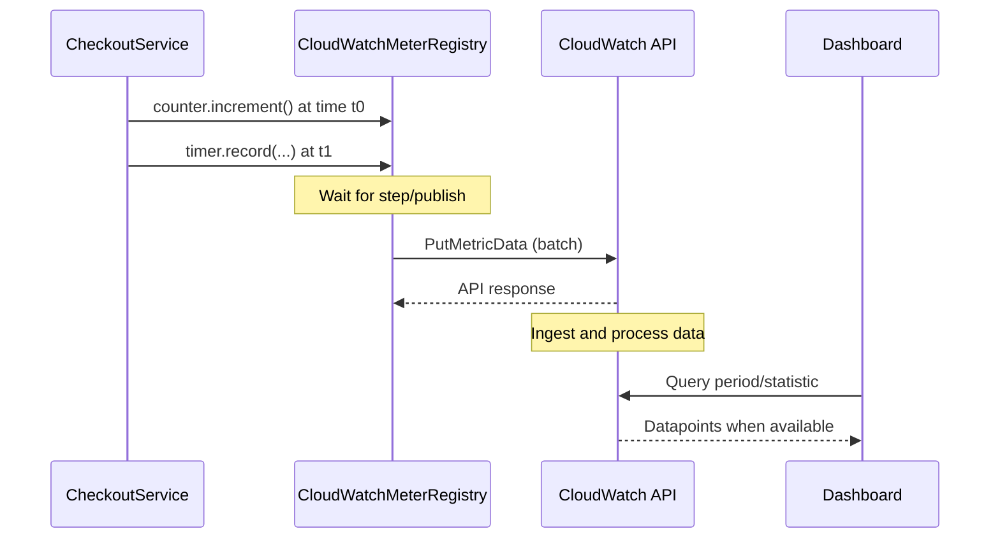
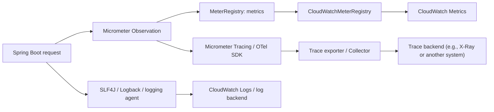

# CloudWatch Registry: Exporting Micrometer Metrics from Spring Boot to Amazon CloudWatch

A Spring Boot application can record `Counter`, `Timer`, and `Gauge` values with Micrometer, yet those values inside `MeterRegistry` exist only within the process until an external system collects them. When deploying on AWS, one option is the **CloudWatch registry**: Micrometer's registry/exporter that sends custom metrics to **Amazon CloudWatch** so you can build charts, dashboards, and alarms without operating a Prometheus server yourself.

The **CloudWatch registry** lesson belongs to the **Meter registry and exporter** chapter in the **SPRING_BOOT_OBSERVABILITY** module. The module spans Micrometer Observation, metrics, logs, and distributed tracing—especially context propagation, tags/cardinality, exporters, sampling, and correlating signals to investigate errors and latency in production environments.

This lesson aims to help you understand how the CloudWatch registry works, configure the right dependency/namespace/region/credentials, know **which metrics are exported and when**, bound dimensions to control costs, interpret data and alarms accurately, test across layers, and distinguish CloudWatch Metrics from CloudWatch Logs and distributed tracing.

## 1. What Is the CloudWatch Registry?

In Micrometer, `MeterRegistry` accepts meters registered by the application or instrumentation, such as:

- `Counter` counting failed payments.
- `Timer` measuring the duration of `checkout.payment.authorize`.
- `Gauge` reading the number of tasks waiting in a queue.
- Binders collecting JVM, CPU, HTTP server/client, connection pool, or cache state, depending on the app.

The **CloudWatch registry** is an implementation that sends Micrometer metrics into **Amazon CloudWatch Metrics**. With AWS SDK for Java v2, the artifact typically used is `micrometer-registry-cloudwatch2`. It differs from `SimpleMeterRegistry` (in-memory) and `PrometheusMeterRegistry` (exposing an endpoint for Prometheus scraping).

| Concept | Role |
| --- | --- |
| `MeterRegistry` | Where the application registers and updates measurements |
| `CloudWatchMeterRegistry` | Registry/exporter shipping Micrometer measurements to CloudWatch |
| `CloudWatchAsyncClient` | AWS SDK client calling the CloudWatch API using configured credentials and region |
| **CloudWatch namespace** | Logical grouping to locate custom metrics, e.g., `Checkout/Backend` |
| **Metric name** | Measurement name; may be mapped from the Micrometer name |
| **Dimensions** | Key/value pairs corresponding to metric tags in CloudWatch |
| **Statistic/period** | How CloudWatch stores and queries metrics over time |
| **CloudWatch alarm** | Monitors a metric or metric math expression and triggers alerts on conditions |

The CloudWatch registry **is not Amazon CloudWatch Logs or AWS X-Ray**. It only handles the **metrics** export path. Querying application logs or distributed traces requires separate logging and tracing pipelines.

## 2. Architecture: From Application to CloudWatch



This diagram gives a high-level view: in an app using `CloudWatchMeterRegistry` as its primary registry, meters can be registered **directly in this registry** without passing through two separate registries. `MeterRegistry` in the diagram is the abstraction; `CloudWatchMeterRegistry` is a concrete implementation. In multi-registry setups, a `CompositeMeterRegistry` may forward measurements to multiple destinations.

Key steps:

1. The application registers a meter or starts an observation.
2. Business code or a metrics observation handler calls `increment()`, `record(...)`, or updates gauge state.
3. The CloudWatch registry batches measurements according to a step registry's **periodic** publish cycle.
4. The AWS SDK uses the appropriate region and credentials to send a `PutMetricData` request to CloudWatch.
5. CloudWatch ingests the metric under its namespace, name, and dimensions; data becomes viewable in Metrics, dashboards, or alarms.

**`Counter.increment()` does not mean data appears instantly in CloudWatch.** Latency comes from the export interval, the API call, CloudWatch processing, and dashboard refresh cadence.

## 3. Pull vs. Push: How Does CloudWatch Differ from Prometheus?

| Property | CloudWatch Registry | Prometheus Registry |
| --- | --- | --- |
| How data leaves the app | **Push** via AWS CloudWatch API on a schedule | **Pull**: Prometheus scrapes an endpoint |
| Needs `/actuator/prometheus`? | No | Usually yes with Spring Boot Actuator |
| Destination | AWS account, region, and namespace | Prometheus server or compatible scraper |
| Primary authentication | AWS credentials / IAM permissions | Scrape endpoint connectivity/authorization |
| Grouping metadata | CloudWatch dimensions | Prometheus labels |
| Cadence | Step/export interval and backend ingestion time | Scrape interval and query evaluation |
| Typical querying | CloudWatch console, metric math, Metrics Insights, or API | PromQL on a Prometheus-compatible backend |
| Prominent cost drivers | Custom metrics/dimensions count, API frequency, alarms, retention per pricing | Storage infra, ingest, series cardinality, and queries |

An application can export to multiple backends simultaneously if truly needed, but doing so increases cost, complexity, and the chance of numbers diverging due to collection timing, aggregation, or temporality. Do not enable both just thinking "more registries is better."

## 4. Adding the Dependency in Spring Boot

Gradle example for a Spring Boot 3.x application using Spring Boot dependency management:

```groovy
dependencies {
    implementation 'org.springframework.boot:spring-boot-starter-actuator'
    runtimeOnly 'io.micrometer:micrometer-registry-cloudwatch2'

    testImplementation 'org.springframework.boot:spring-boot-starter-test'
}
```

The `cloudwatch2` module uses AWS SDK v2, unlike legacy CloudWatch integrations. Use the BOM/dependency management compatible with your Spring Boot line; **never mix arbitrary versions** of Micrometer, the AWS SDK, and Actuator.

In Spring Boot versions supporting CloudWatch metrics auto-configuration, adding the registry dependency and valid configuration creates `CloudWatchMeterRegistry` as a bean and exports metrics with it. However, **auto-configuration conditions and `CloudWatchAsyncClient` creation vary by version**. If the app defines custom beans or skips auto-configuration, configure the client/registry explicitly. Always inspect the actual `MeterRegistry` bean instead of relying solely on dependencies.

### Example `application.yml` Configuration

```yaml
management:
  cloudwatch:
    metrics:
      export:
        enabled: true
        namespace: Checkout/Backend
        step: 1m
```

Spring Boot 3.x lines typically use the `management.cloudwatch.metrics.export` prefix. Verify exact property names and support conditions for your deployed version; older versions used a different configuration structure.

Meaning:

- `enabled`: enables the CloudWatch export path when the registry and auto-configuration conditions are met.
- `namespace`: groups custom metrics by application or system. `Checkout/Backend` is purely illustrative.
- `step`: aggregation/export interval, here one minute. This does not mean CloudWatch always displays data points exactly 60 seconds after a request occurs.

Do not set an ultra-short `step` just to make dashboards feel "faster": it increases API call rate, cost, and load, and must align with CloudWatch resolution and statistic handling. Consult current registry documentation and AWS limits before tuning.

## 5. Region, Credentials, and IAM Permissions

Unlike an in-memory registry, the CloudWatch registry must **call an AWS API**. Successful delivery depends on at least three elements:

1. **AWS region**: where metrics are sent and where you must look for them in the Console/API.
2. **AWS credentials**: identity of the workload or authorized account.
3. **IAM policy**: permits `cloudwatch:PutMetricData` within the proper scope.

Illustrative minimal IAM policy for publishing custom metrics:

```json
{
  "Version": "2012-10-17",
  "Statement": [
    {
      "Effect": "Allow",
      "Action": "cloudwatch:PutMetricData",
      "Resource": "*",
      "Condition": {
        "StringEquals": {
          "cloudwatch:namespace": "Checkout/Backend"
        }
      }
    }
  ]
}
```

This is an **illustrative** policy for metric writes. CloudWatch `PutMetricData` does not support resource-level ARNs the way many AWS APIs do, which is why `Resource: "*"` is standard; the namespace condition narrows scope as supported by the service's IAM model. Real policies must be reviewed against organizational standards, workload roles, regions, permission boundaries, and audit rules.

**Never embed AWS access keys or secret keys in source code, `application.yml`, metric tags, or logs.** Prefer the AWS SDK default credentials provider chain and workload identities:

- IAM roles for EC2 when running on eligible instances.
- Task roles for Amazon ECS.
- Configured workload identity/IAM roles for EKS.
- Profiles/SSO or short-lived credentials in development when permitted by policy.

The SDK can resolve the region from environment config, profiles, or the runtime environment; if no region is resolved, client creation or requests can fail. In multi-region setups, document clearly **which region metrics land in**, because opening the CloudWatch Console in another region will show nothing.

### Building an AWS SDK Client Explicitly When Needed

If your project configures clients manually or tunes connection behavior, you can build `CloudWatchAsyncClient`:

```java
import software.amazon.awssdk.regions.Region;
import software.amazon.awssdk.services.cloudwatch.CloudWatchAsyncClient;

CloudWatchAsyncClient client = CloudWatchAsyncClient.builder()
    .region(Region.AP_SOUTHEAST_1)
    .build();
```

This snippet illustrates building the AWS SDK client, **not a complete Spring Boot configuration**. `ap-southeast-1` is only an example; real workloads must use approved regions. The AWS SDK uses the default credentials provider chain unless another provider is specified. Manage the client lifecycle properly and close it on shutdown; never instantiate a new client per request or per measurement.

When Spring Boot already manages the client and registry, avoid registering a redundant second set of beans; doing so can cause duplicate exports or ambiguity over which credentials send metrics.

## 6. Namespace, Metric Name, and Dimensions

CloudWatch identifies custom metrics by **namespace**, **metric name**, and **dimension set**; combined with parameters like unit and timestamp, the system determines how datapoints are stored and queried. In Micrometer, meter tags typically map to CloudWatch dimensions.

Example:

```text
Namespace: Checkout/Backend
Metric: checkout.orders.processed
Dimensions:
  service = checkout-service
  environment = production
  outcome = accepted
```

If `outcome` changes to `rejected`, CloudWatch treats that as a **distinct metric stream** by dimension set. If `service` or `environment` changes, that creates another combination. **Dimensions are not free arbitrary search attributes**; every new combination can increase custom metric counts and cost.

### Designing Namespaces

A namespace should be stable enough for discovery and IAM scoping, such as one namespace per system or product group. Avoid:

- Putting request IDs or arbitrary dates/times in the namespace name.
- Changing the namespace on every release without a clear purpose and migration plan.
- Sharing one namespace across apps while reusing identical metric names with conflicting meanings or units.
- Assuming a namespace automatically links metrics to CloudWatch Logs or traces.

`Checkout/Backend` is an internal convention, not an AWS or Micrometer requirement. Choose names per your organization's naming and ownership standards.

## 7. Cardinality: A Major Driver of CloudWatch Cost

In Prometheus, more labels multiply time series; in CloudWatch, more dimensions multiply custom metric combinations. Suppose `checkout.orders.processed` has:

- `outcome`: 3 values;
- `channel`: 4 values;
- `region`: 5 values;
- `service`: 2 values.

Potential combinations:

\[
3 \times 4 \times 5 \times 2 = 120
\]

Adding `orderId` with 100,000 values pushes theoretical combinations to **12 million**; actual streams depend on observed data, but cost and load risks are obvious. Beyond dimension counts, CloudWatch enforces **AWS quotas and API limits**; check current AWS documentation. Never rely on a single `PutMetricData` returning success as proof that your metric design is cost-optimal.

Recommended dimensions:

| Dimension | Example | Assessment |
| --- | --- | --- |
| `environment` | `prod`, `staging` | Small value set, useful |
| `service` | `checkout-service` | Stable, identifies source |
| `outcome` | `accepted`, `rejected`, `error` | Finite set |
| `channel` | `web`, `mobile`, `partner` | Useful with a clear contract |
| `http.route` | `/orders/{id}` | Good when using route templates |
| `orderId` | `ORD-927135` | Unsuitable: nearly unique values |
| `customerEmail` | `person@example.test` | Unsuitable: private and high cardinality |
| `traceId` | Unique ID per request | Unsuitable for metric dimensions |

Never put API tokens, Authorization headers, cookies, raw URLs containing PII, or exception messages into metric names or dimensions. Hashing `orderId` does not reduce cardinality; a unique hash is still a distinct value.

### Common Tags Can Amplify Metric Counts

Example setting common tags in Spring Boot:

```yaml
management:
  metrics:
    tags:
      service: checkout-service
      environment: staging
```

Common tags aid routing and dashboard filtering, but apply broadly across many meters. Never put per-user or per-request data into common tags. Ensure the same dimension is not declared redundantly with conflicting values in binders or custom instrumentation.

## 8. Hands-On: Recording Custom Metrics in Spring Boot

This `CheckoutMetrics` example uses a counter by outcome and a Timer measuring processing duration. Meters are registered via the Spring-injected `MeterRegistry`; if the CloudWatch registry is configured properly, data can be exported periodically.

```java
import io.micrometer.core.instrument.Counter;
import io.micrometer.core.instrument.MeterRegistry;
import io.micrometer.core.instrument.Timer;
import java.util.concurrent.TimeUnit;
import org.springframework.stereotype.Service;

@Service
public final class CheckoutMetrics {
    private final Counter accepted;
    private final Counter rejected;
    private final Counter error;
    private final Timer duration;

    public CheckoutMetrics(MeterRegistry registry) {
        accepted = counter(registry, "accepted");
        rejected = counter(registry, "rejected");
        error = counter(registry, "error");

        duration = Timer.builder("checkout.order.duration")
            .description("Duration of one checkout operation")
            .register(registry);
    }

    private static Counter counter(MeterRegistry registry, String outcome) {
        return Counter.builder("checkout.orders.processed")
            .description("Completed checkout operations")
            .tag("outcome", outcome)
            .register(registry);
    }

    public void recordAccepted() {
        accepted.increment();
    }

    public void recordRejected() {
        rejected.increment();
    }

    public void recordError() {
        error.increment();
    }

    public void recordDuration(long elapsedNanos) {
        duration.record(elapsedNanos, TimeUnit.NANOSECONDS);
    }
}
```

The business service must call the right method **once when the logical outcome is decided**, using a reliable clock to measure duration. This snippet does not manage retries, error handling, or transactions; that belongs to the business layer. If business logic retries HTTP calls multiple times, this counter should record the **final outcome** if `orders.processed` carries that meaning.

**Never call the CloudWatch API directly inside business services.** Registering and recording via `MeterRegistry` keeps business code independent of AWS. If you later migrate to Prometheus or another monitoring backend, most instrumentation stays unchanged.

If the app already starts a `checkout.order` observation and uses a metrics observation handler to record a Timer, avoid recording a second Timer with the same meaning in the service unless you genuinely need an independent measurement. Overlapping instrumentation causes double-counting and skewed dashboards.

## 9. How Do Observation and CloudWatch Metrics Relate?

Micrometer Observation has its own lifecycle: `start`, optionally `openScope`, signaling `error`/`event`, and `stop`. A metrics observation handler converts an observation's duration and low-cardinality key-values into metrics.

```java
import io.micrometer.observation.Observation;
import io.micrometer.observation.ObservationRegistry;

// Assume registry is provided by Spring and the metrics handler is configured.
Observation.createNotStarted("checkout.payment.authorize", observationRegistry)
    .lowCardinalityKeyValue("operation", "authorize")
    .observe(() -> paymentAction.run());
```

This snippet illustrates the API; `observationRegistry` and `paymentAction` must be defined in real code. For an observation to become a Timer, a metrics handler must be bound to the corresponding registry. **Creating an Observation does not guarantee CloudWatch receives a metric** if the handler, `MeterRegistry`, or exporter is unconfigured.

### Why Avoid High-Cardinality Tags in Metrics?

An Observation can carry **high-cardinality key-values** to enrich tracing depending on handlers, whereas metrics are built for aggregation over finite dimensions. A value like `orderId`, though helpful when inspecting one trace, **should never become a CloudWatch dimension**. Protect sensitive data across metrics, logs, and traces alike—not only at the CloudWatch export step.

## 10. Step Registry: Understanding Time and Counts Properly

The CloudWatch registry belongs to the **step-based exporters** group: values are aggregated over an interval and then shipped. This has operational implications:

1. Incrementing a counter in code **does not immediately appear** in CloudWatch.
2. Per-interval data may be exported as step measurements/statistics produced by the registry; do not assume it is a lifetime cumulative JVM counter.
3. With a one-minute step, a datapoint can represent activity during that interval, yet when CloudWatch ingests and renders it can lag further.
4. A failed publish can result in missing data or library-specific retry/buffer behavior; never assume every measurement is guaranteed to be re-sent cleanly.
5. When an instance terminates abruptly, measurements in the unpublished step window can be lost; consider actual shutdown/flush behavior and remember metrics are not durable transactional records.



Never compare `Counter.count()` in `SimpleMeterRegistry` directly against `Sum` in CloudWatch without clarifying **temporality** and interval. A test registry counter may accumulate since creation, while CloudWatch values from a step registry may reflect increments within one export step. Identical meter names do not mean identical snapshot semantics.

### Batching, API Limits, and Throttling

`CloudWatchMeterRegistry` groups data into batches sent to CloudWatch. Datapoint counts, dimensions, payload sizes, and API rates are governed by **current AWS quotas** and the registry's implementation. At scale, you must:

- Keep cardinality low before considering increasing batch sizes.
- Monitor AWS SDK errors, request throttling, timeouts, and publish duration.
- Check payload size limits, metric datum limits, and per-account/region rate limits.
- Tune step and batching sensibly, rather than assuming bigger batches solve all errors.
- Alert on the export pipeline itself, not only on business errors.

## 11. Viewing Metrics in the CloudWatch Console and CLI

A post-deployment verification flow:

1. Execute a controlled business action to record a metric like `checkout.orders.processed`.
2. Wait at least one export cycle plus CloudWatch processing time; do not expect instant visibility.
3. Open the CloudWatch Console in the **exact AWS account and region**.
4. Go to **Metrics**, locate the `Checkout/Backend` namespace, and find the metric under its dimensions.
5. Select an appropriate metric, period, and statistic—such as `Sum` for event counts recorded over an interval.
6. If data is absent, check export/AWS SDK logs and `PutMetricData` permissions before concluding instrumentation is broken.

AWS CLI example using illustrative region `ap-southeast-1`:

```bash
aws cloudwatch list-metrics \
  --namespace "Checkout/Backend" \
  --region ap-southeast-1
```

When there are many metrics, add `--metric-name` if you know the **actual CloudWatch metric name**. Do not assume the name is always verbatim identical to Micrometer after the exporter applies naming conversions or statistical suffixes.

`list-metrics` is primarily for discovering names and dimensions; it does not replace querying datapoints by **time range, period, and statistic**. Brand-new metrics may take a moment to show up, and idle metrics may age out of standard discovery listings. For deeper inspection, use `GetMetricData`/`GetMetricStatistics` or the console with exact names and dimensions.

### Choosing Meaningful Statistics

Typical interpretations:

| Measurement | Usually Useful Statistic | Caution |
| --- | --- | --- |
| Checkouts recorded in an interval | `Sum` of the matching count measurement | Verify whether the registry sends per-interval counts or cumulative values |
| Checkout rate per second | Interval count / seconds in interval | Never treat a cumulative value directly as RPS |
| Mean duration | Total duration divided by sample count, if exporter supplies both | Verify units: seconds vs. milliseconds |
| CPU usage or queue depth | `Average`/`Maximum` depending on source and goal | Gauges can fluctuate between exports |
| Error ratio | Error count / total requests over same period and dimensions | Denominator must share definition and have sufficient traffic |
| p95 latency | Distributions/percentiles if the pipeline supports them | Never infer p95 from `Average` or `Maximum` |

CloudWatch offers metric statistics and percentile capabilities, yet **you should not assume** every Micrometer Timer is exported as a distribution capable of accurate p95/p99 calculation. Statistic sets, histograms, and percentile limits depend on the registry adapter and CloudWatch API. Verify actual exported data and query capabilities directly before defining SLOs.

## 12. Building Meaningful Dashboards and Alarms

Dashboards are only useful when the question is clear. For checkout:

| Goal | Suggested Metric/Expression | Meaning |
| --- | --- | --- |
| Track traffic | `checkout.orders.processed` by environment/outcome | How many checkouts ran during the period |
| Track failures | `outcome=error` and error / total ratio | Is there an upward error trend? |
| Track latency | `checkout.order.duration` with appropriate statistic | Are requests getting slower? |
| Track resource load | JVM CPU/heap/threads or queue metrics | Are resources saturating? |
| Track pipeline health | Continuous exports, throttling, or SDK error metrics | Is CloudWatch blank due to the app or the exporter? |

A **CloudWatch alarm** usually consists of a metric or expression, period, threshold, evaluation periods, and missing-data treatment. For instance: alerting when the checkout error ratio breaches a threshold for consecutive periods, or when request counts unexpectedly drop to missing while traffic should be flowing.

When designing alarms:

- Never alert on a cumulative counter as a rate without converting to per-period count or rate.
- Match the denominator across the exact same route, environment, and time period.
- Distinguish **missing data** caused by legitimate zero traffic, a downed service, or a broken export pipeline.
- Separate HTTP 4xx/5xx responses from business outcomes; a `409 Conflict` might be expected behavior.
- Base thresholds on SLOs, baselines, and real traffic rather than arbitrary guesses.
- Watch alarm/dashboard costs and dimension stream counts.

CloudWatch alarm evaluation can lag behind a counter increment due to step interval, ingestion, and evaluation periods. Do not expect "instantaneous" alerts from a 1-minute periodic exporter.

## 13. CloudWatch Metrics, CloudWatch Logs, and Distributed Tracing

The shared "CloudWatch" product name often misleads beginners into thinking exporting metrics to CloudWatch automatically captures logs or traces. In reality, these are **separate pipelines**:



**Metrics** tell you the blast radius: how many slow requests, error counts, throughput, and resource usage. **Traces** tell you which spans a request traversed and where latency occurred. **Logs** record contextual events and error codes.

With a tracing bridge and context propagation, `traceId`/`spanId` can link logs to spans in a capable query tool. However:

1. **The CloudWatch registry does not create or store distributed traces.**
2. **AWS X-Ray/OTel tracing** must be configured with its own tracing stack and exporter—not just `micrometer-registry-cloudwatch2`.
3. **Sampling** can cause a request to contribute to metrics without having a stored trace.
4. **Context propagation** across HTTP clients/servers, async executors, and messaging requires instrumentation and proper inject/extract hooks.
5. Never attach `traceId` as a CloudWatch dimension: it has extreme cardinality.
6. Never write credentials, emails, request bodies, or access tokens into metric dimensions, log fields, trace attributes, or baggage.

Some platforms link metrics, logs, and traces via dashboards or exemplars, but that depends on specific components and end-to-end configuration; it is not an automatic property of every CloudWatch metric.

## 14. Testing: In-Memory Registry First, AWS Second

To verify business logic updates meters, **you do not need to call AWS** in every unit test. Use `SimpleMeterRegistry` to assert names, tags, and counts:

```java
import io.micrometer.core.instrument.Counter;
import io.micrometer.core.instrument.simple.SimpleMeterRegistry;
import org.junit.jupiter.api.Test;
import static org.junit.jupiter.api.Assertions.*;

class CheckoutMetricsTest {
    @Test
    void recordsOutcomeWithoutAws() {
        try (SimpleMeterRegistry meters = new SimpleMeterRegistry()) {
            CheckoutMetrics checkout = new CheckoutMetrics(meters);

            checkout.recordAccepted();
            checkout.recordAccepted();
            checkout.recordError();

            Counter accepted = meters.find("checkout.orders.processed")
                .tag("outcome", "accepted").counter();
            Counter error = meters.find("checkout.orders.processed")
                .tag("outcome", "error").counter();

            assertNotNull(accepted);
            assertNotNull(error);
            assertEquals(2.0, accepted.count());
            assertEquals(1.0, error.count());
        }
    }
}
```

This test proves instrumentation creates and updates the right Counters in `MeterRegistry`. It **does not prove** CloudWatch auto-configuration works, the SDK has credentials, or datapoints reach AWS.

Keep test layers separate:

| Layer | Goal | How to Verify |
| --- | --- | --- |
| Unit test | Metric names, outcomes, tags, and counts/durations | `SimpleMeterRegistry` |
| Spring integration test | Registry injected properly, namespace/step config and beans valid | Spring test context, inspect registry/config |
| Exporter contract test | Mapping to `PutMetricData`, batching, namespace/dimensions | Mock/fake AWS SDK client or appropriate stub |
| Staging integration test | IAM, region, API connectivity, and datapoints appearing in CloudWatch | Scoped AWS sandbox/account with cost monitoring |
| Operational test | Dashboards, alarms, missing-data handling, and runbooks | Validate across real time windows and periods |

For exporter tests, avoid calling `Thread.sleep(...)` and hoping a datapoint shows up in CloudWatch. Design bounded wait times, clear observation criteria, scoped test namespaces, cleanup procedures, and guards against creating excessive custom metrics. Never send real customer data to test environments.

## 15. Common Issues and How to Diagnose Them

| Symptom | Possible Cause | Remediation |
| --- | --- | --- |
| `SimpleMeterRegistry` has data, CloudWatch does not | CloudWatch registry not created/registered | Check dependencies and auto-configuration |
| `AccessDenied` on `PutMetricData` | Role lacks permissions or namespace condition mismatches | Inspect active IAM role and policy |
| Metric missing in Console | Wrong AWS account/region/namespace selected | Verify via AWS CLI and client config |
| Missing right after one `increment()` | Step interval not reached or CloudWatch ingest lag | Check step, publish logs, and wait time |
| Missing region/credentials | Default provider chain cannot resolve settings | Configure workload role and region properly |
| Metrics arrive unevenly or have gaps | Throttling, network loss, quotas, exporter errors, or restarts | Inspect SDK/exporter errors, limits, and restarts |
| Custom metrics cost grows rapidly | Dynamic ID in dimension, overly granular host/pod, or wide histograms | Audit cardinality, metric names, and tags |
| CloudWatch value differs from `counter.count()` in tests | Step temporality/statistic differs from cumulative snapshot | Compare matching period, `Sum`, and exported semantics |
| Metric exists, p95 is missing | Exporter does not emit matching histogram/percentiles | Verify metric mapping and CloudWatch capabilities |
| Logs exist, Metrics dashboard is blank | Logging pipeline is separate from metrics pipeline | Inspect `CloudWatchMeterRegistry` separately |
| Metrics exist, traces are missing | Missing tracing bridge/exporter, sampling, or broken propagation | Investigate the tracing pipeline independently |
| Alarm reports `INSUFFICIENT_DATA` | Missing datapoints, unsuitable period, or zero traffic | Review alarm missing-data treatment |

### "Near-Source to Far" Troubleshooting Flow

1. **Code:** did the request or business flow actually call `increment()` / `record(...)`?
2. **Registry:** does the active `MeterRegistry` hold the expected meter, name, and tags?
3. **Spring configuration:** is the CloudWatch registry created with the right namespace, step, and region?
4. **AWS SDK/IAM:** does `PutMetricData` succeed, or is it throttled, timing out, or getting `AccessDenied`?
5. **CloudWatch:** are you inspecting the right namespace, dimensions, account, region, and time window?
6. **Dashboard/Alarm:** are the statistic, period, metric math, and missing-data policy sensible?
7. **Business incident:** correlate metrics with logs/traces to isolate root cause; do not confuse an exporter outage with a checkout failure.

## 16. Case Study: Payment Errors Spike, Yet the AWS Dashboard Stays Quiet

**Hypothetical scenario:** `checkout-service` runs on ECS; after a deployment, payment errors jump sharply. Application logs show many `payment.authorization.failed` events, yet the CloudWatch dashboard displays `checkout.orders.processed{outcome=error}` near 0.

How to investigate:

**Step 1 — Check the metric definition.** When is `recordError()` called? If the code only counts the final failure after retries, a count lower than the total 503 HTTP attempts makes sense. If log entries include intermediate retries, the two signals are measuring **two different concepts**.

**Step 2 — Inspect the in-app registry.** If the error Counter increments inside `MeterRegistry`, instrumentation itself works. If not, inspect catch blocks, exception mapping, and whether the right registry is injected.

**Step 3 — Check the exporter.** Look for `PutMetricData` errors, the `Checkout/Backend` namespace, and the IAM task role. If a role or region recently changed, metrics may be landing elsewhere or getting rejected.

**Step 4 — Compare period and statistic.** With a 1-minute step, per-interval counts are not lifetime cumulative counters. If the dashboard queries the wrong statistic or filters on mismatched dimensions, it can render blank/wrong charts without any actual data loss.

**Step 5 — Analyze root cause using traces and logs.** Open sampled traces (if a tracing pipeline is set up) to see whether the payment downstream timed out or returned 503; use trace IDs safely in logs to inspect retries and backoff. If traces are absent, check sampling/exporter/propagation—never add `traceId` to metric dimensions as a "fix."

**Step 6 — Remediate and verify.** Fix the exporter/role or measurement logic based on evidence, then verify error counts, durations, and alarms over the same period. Keep AWS permissions scoped and avoid creating ad-hoc dimensions or logging secrets while debugging.

Conclusion: a blank dashboard can stem from **count semantics**, **the export path**, **AWS identity/region**, or **the query**; separate these before concluding `payment-service` is healthy.

## 17. Self-Check Exercises

**Exercise 1.** A service increments a `Counter` continuously, yet the CloudWatch Console does not show the metric immediately after a request. Is this definitely a bug?

*Hint:* No. The CloudWatch registry exports on a step, and AWS ingestion/console updates can lag. Check the registry, export logs, step interval, and account/region.

**Exercise 2.** Is adding `micrometer-registry-cloudwatch2` enough to get distributed traces in AWS X-Ray?

*Hint:* No. The CloudWatch metrics registry is not a tracing bridge or exporter. You need separate tracing instrumentation, sampler, exporter, and context propagation.

**Exercise 3.** A team adds `customerId` as a CloudWatch dimension to look up failures per customer. What problems can arise?

*Hint:* Cardinality and custom metric costs explode, alongside privacy risks. Use bounded tags for metrics and authorized correlation/lookup systems for business entities.

**Exercise 4.** A container has a workload role, yet `PutMetricData` returns `AccessDenied`. What should you check?

*Hint:* IAM action, the actual role used by the SDK, namespace condition, permission boundaries, and account/region; never embed long-lived access keys into the app to bypass the error.

**Exercise 5.** A Counter in `SimpleMeterRegistry` reports `1000`, while a one-minute CloudWatch `Sum` is `45`. Is something necessarily broken?

*Hint:* No. The test registry may count cumulatively, while CloudWatch step metrics summarize events per interval. Align temporality, period, and export windows.

**Exercise 6.** You want to alert on p95 checkout latency using the CloudWatch registry. Why shouldn't you simply use `Average`?

*Hint:* Average is not p95. Check what distribution/percentile data the adapter and CloudWatch actually support; you may need a dedicated histogram/SLO solution.

**Exercise 7.** Metrics export fine, yet logs do not appear in CloudWatch Logs. Is the CloudWatch registry broken?

*Hint:* Not necessarily. The logging pipeline is independent; check logging agent/driver/collector configuration and log write permissions separately.

**Exercise 8.** A CloudWatch alarm shows missing data overnight when traffic is 0. How should you handle it?

*Hint:* Distinguish legitimate zero traffic from a broken exporter, and configure an appropriate missing-data policy, period, and metric rather than treating every gap as an outage.

## 18. Key Takeaways

- **`CloudWatchMeterRegistry`** belongs to the **Micrometer Metrics → Amazon CloudWatch Metrics** path, typically via `micrometer-registry-cloudwatch2` using AWS SDK v2.
- CloudWatch is a **push/step exporter**: `increment()` in the JVM does not equal an instant datapoint in AWS. Understand step, API ingestion, statistics, and periods.
- **Namespace, metric name, dimensions, region, and AWS identity** are the essential details for exporting and querying metrics accurately.
- Use **IAM workload roles** and appropriately scoped `cloudwatch:PutMetricData` permissions; never embed AWS secrets in code, config, or logs.
- **Dimension cardinality drives cost**. Never use `orderId`, `customerId`, `traceId`, raw URLs, or PII as metric dimensions.
- **CloudWatch Metrics differs from CloudWatch Logs and tracing/X-Ray**. Micrometer Observation can feed multiple signals, yet logs, tracing bridges, sampling, exporters, and context propagation require separate setup.
- Test instrumentation with `SimpleMeterRegistry`, then verify the CloudWatch exporter/IAM/API in a controlled environment; debug along **code → registry → export → AWS → dashboard/alarm**.
