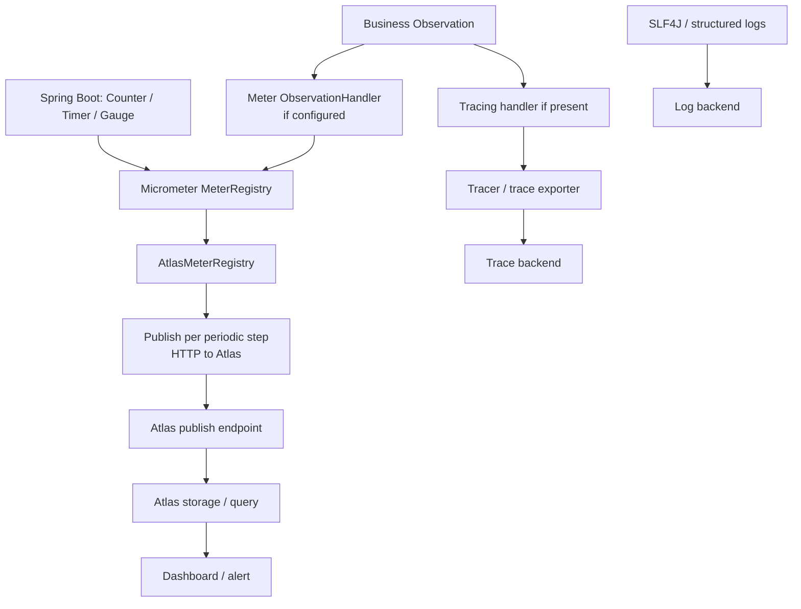
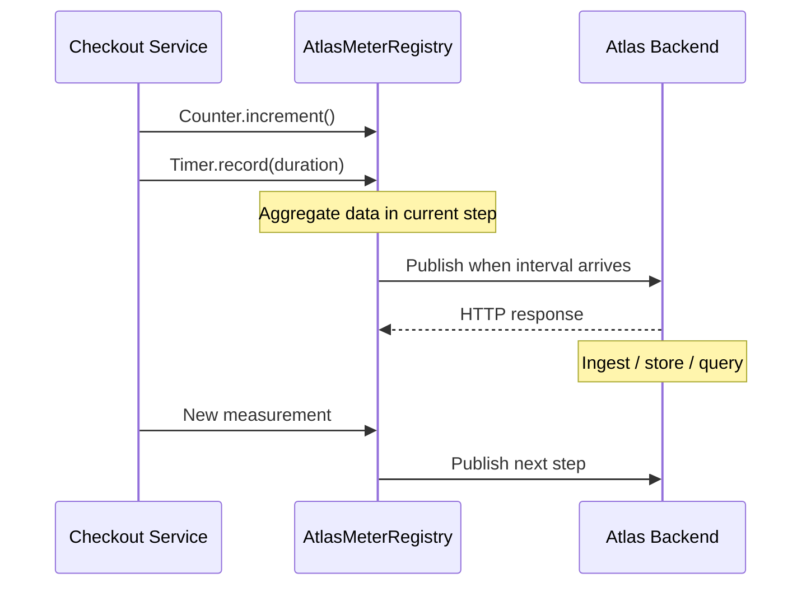

# Atlas Registry in Spring Boot and Micrometer

A Spring Boot application already records payment counts, partner call latency, and JVM stats using Micrometer. These meters reside inside application memory, but how do they become charts and alerts in a centralized monitoring system? One option is **Netflix Atlas**—a system for storing and querying dimensional time series by tag. Micrometer provides the **Atlas registry** to ship in-app measurements to Atlas via **periodic push**.

The **Atlas registry** lesson belongs to the **Meter registry and exporter** chapter of the **SPRING_BOOT_OBSERVABILITY** module. The module focuses on setting up observability for Spring Boot using Micrometer Observation, metrics, logs, and distributed tracing; understanding context propagation, tags/cardinality, exporters, sampling, and signal correlation to investigate errors, latency, and application behavior in real environments. This lesson walks through understanding, configuring, verifying, and operating **`AtlasMeterRegistry`**, while distinguishing its metrics-export role from logging and tracing.

## 1. Learning Objectives

After this lesson, you will be able to:

- Explain what Atlas is and the role of `AtlasMeterRegistry` in Micrometer.
- Describe the flow **meter → registry → periodic publish step → Atlas** and distinguish push from Prometheus pull.
- Configure Spring Boot to send metrics to a deployed Atlas endpoint.
- Create Counters and Timers using `MeterRegistry` without coupling directly to a specific backend.
- Understand the `step` parameter, update lag, post-restart behavior, and limitations when the app cannot yet reach the backend.
- Design safe tags/cardinality when exporting many meters across multiple instances.
- Distinguish the Atlas metrics exporter from Micrometer Observation, tracing bridges, trace exporters, and logs.
- Diagnose scenarios where Actuator shows a meter but Atlas shows no data.

## 2. Netflix Atlas and AtlasMeterRegistry

**Netflix Atlas** is a platform for storing, querying, and analyzing **dimensional time-series metrics**. Instead of viewing a single scalar metric value, operators can filter and aggregate by labels such as application, environment, region, or outcome.

**Micrometer** provides a unified API for applications to record Counters, Timers, Gauges, and other meters. `MeterRegistry` is where meters are registered and receive measurements. `AtlasMeterRegistry` is the implementation for Atlas: it converts meter data into the format and delivery mechanism expected by Atlas.

| Component | Responsibility | Example |
| --- | --- | --- |
| `Counter` / `Timer` / `Gauge` | Describes and records measurements in the application | Checkout count, partner latency |
| `MeterRegistry` | Manages meters and tags | Registry injected into services |
| **`AtlasMeterRegistry`** | Collects, prepares, and pushes values to Atlas | Publishes on a `step` interval |
| Atlas publish endpoint | Receives metric payloads pushed by the registry | `/api/v1/publish` on the Atlas server |
| Atlas storage/query | Stores and queries time series by tags | Dashboards, charts, and analysis |
| `ObservationRegistry` | Orchestrates Observation lifecycles across handlers | Observing checkout business steps |

**The Atlas registry does not deploy an Atlas server.** Adding the `micrometer-registry-atlas` dependency only provides the application-side metrics publisher. You still need a running Atlas deployment, a reachable publish endpoint, networking, and appropriate authentication.

### Data Flow Diagram



Metrics, traces, and logs can travel through **separate pipelines**. The Atlas registry handles the **metrics** branch—it is not an all-purpose exporter that automatically sends spans or log records.

## 3. How Does the Push Model Differ from Prometheus Pull?

In a typical Prometheus setup, the app exposes `/actuator/prometheus` and Prometheus **actively scrapes** it periodically. With the Atlas registry, the app **actively publishes** metrics to a configured Atlas URI.

| Criterion | Atlas Registry | Typical Prometheus Registry |
| --- | --- | --- |
| Data transfer direction | Application **pushes** to Atlas | Prometheus **pulls/scrapes** endpoint |
| Where target lives | Atlas URI in application config | Scrape target in Prometheus/collector |
| Cadence | `step` / registry publish schedule | Collector's `scrape_interval` |
| Characteristic endpoint | Atlas publish API, typically `/api/v1/publish` | `/actuator/prometheus` when exposed |
| In-app checks | Actuator metrics, exporter logs, URI config | Actuator metrics and scrape response |
| Causes of missing data | Outbound connectivity, auth, URI, step, Atlas ingest | Unreachable endpoint, target discovery, auth, scrape |

Do **not** assume Atlas will read `/actuator/metrics` or `/actuator/prometheus`. Those Actuator endpoints are not the primary publishing mechanism of `AtlasMeterRegistry`.

If the same application configures both Atlas and Prometheus registries, it can **export the same meter to two different systems** by design. However, avoid accidentally feeding duplicate data into the same backend and summing them as independent events.

## 4. Required Dependencies in Spring Boot

For Spring Boot 3.x using Gradle Kotlin DSL and Spring Boot BOM dependency management:

```kotlin
dependencies {
    implementation("org.springframework.boot:spring-boot-starter-actuator")
    runtimeOnly("io.micrometer:micrometer-registry-atlas")
}
```

Actuator provides the metrics/management foundation and auto-configuration. `micrometer-registry-atlas` adds the Atlas registry for Micrometer; Spring Boot detects it and configures it according to matching properties.

In Maven projects, the idea is identical:

```xml
<dependencies>
    <dependency>
        <groupId>org.springframework.boot</groupId>
        <artifactId>spring-boot-starter-actuator</artifactId>
    </dependency>
    <dependency>
        <groupId>io.micrometer</groupId>
        <artifactId>micrometer-registry-atlas</artifactId>
        <scope>runtime</scope>
    </dependency>
</dependencies>
```

When using Spring Boot dependency management, do not manually pick arbitrary Micrometer versions. If using a different Boot major version, verify compatible property names and exporter versions.

### Adding the Dependency Does Not Provide an Atlas Backend

To see metrics in Atlas, you need at minimum:

1. An Atlas deployment accepting publishes and serving queries.
2. The right publish URI, such as `https://atlas.example.internal/api/v1/publish` (**illustrative address, not a real server**).
3. Network connectivity from the app to the endpoint plus proper security/auth.
4. Atlas registry enabled, publish schedule running, and the app actively recording measurements.
5. Atlas ingestion accepting the data; dashboards/queries using matching meter names/tags.

Never treat successful application startup as proof that Atlas received metrics.

## 5. Configuring the Atlas Registry via application.yml

In Spring Boot 3.x, a typical configuration looks like:

```yaml
spring:
  application:
    name: order-service

management:
  atlas:
    metrics:
      export:
        enabled: true
        uri: ${ATLAS_PUBLISH_URI:https://atlas.example.internal/api/v1/publish}
        step: 1m
  metrics:
    tags:
      application: ${spring.application.name}
      environment: ${APP_ENV:local}
      region: ${APP_REGION:local}
  endpoints:
    web:
      exposure:
        include: health,info,metrics
```

Explanation:

- `management.atlas.metrics.export.enabled`: enables/disables the exporter under matching auto-configuration conditions.
- `management.atlas.metrics.export.uri`: the **publish** target where the app sends data. The URI above is a placeholder and **must be replaced with a real endpoint**.
- `management.atlas.metrics.export.step`: the base window interval for recording/sending step metrics; `1m` is an example, not a universal optimum.
- `management.metrics.tags.*`: common tags applied across meters on the app's registry.
- `management.endpoints.web.exposure.include`: exposes Actuator metrics for local inspection—**not** for Atlas to scrape over HTTP.

In production, supply `ATLAS_PUBLISH_URI` from deployment configuration or an appropriate secret/config system. If Atlas requires authentication, proxies, or custom TLS, configure the client and network path explicitly; never embed credentials or tokens directly in source code or labels.

### Enabling/Disabling by Environment

Example keeping the Atlas exporter **off locally** and enabled in deployments with a backend:

```yaml
management:
  atlas:
    metrics:
      export:
        enabled: ${ATLAS_EXPORT_ENABLED:false}
        uri: ${ATLAS_PUBLISH_URI:http://localhost:7101/api/v1/publish}
```

The exporter only activates when deployment config sets `ATLAS_EXPORT_ENABLED=true`. The localhost URL only illustrates a dev environment running Atlas on that machine—do not assume a local machine has an Atlas server by default.

**Version note:** the `management.atlas.metrics.export.*` property group is used in Spring Boot 3.x lines. Some Boot 2.x projects use a different property path; check configuration metadata for your **exact Boot version** before migrating settings.

## 6. Understanding `step` and When Data Appears

A **step registry** divides metric measurement and export into periodic intervals. `AtlasMeterRegistry` publishes on this basis, so data in Atlas can **lag behind** events that just occurred in the application.



### Key Facts to Keep Straight

1. **Recording in-app does not mean instant export:** `counter.increment()` and `timer.record(...)` update the meter; Atlas may only see the data after the publish tick.
2. **Step is not query refresh:** changing `step` affects the publish schedule and how data is bucketed into windows, not just dashboard refresh speed.
3. **Display lag has multiple sources:** measurement time, registry publish, network, ingestion, and dashboard refresh.
4. **Publish errors should not become business errors:** a failed HTTP call to Atlas impacts telemetry, but should never fail a checkout simply because a metric could not be exported.
5. **Restarts can lose unsent data:** in-memory measurements may not reach the backend if the process terminates abruptly before publishing or fails to flush properly.

Do not claim "every 1 minute there will be an exact instant datapoint" because Atlas ingestion, step alignment, and pipeline timing can vary. Verify real data timestamps and semantics for your active registry and backend.

### Step Differs from Scrape Interval

For example, `management.atlas.metrics.export.step=1m` configures **the Atlas publisher side**. It does not alter Prometheus's scrape schedule if you also include the Prometheus registry. With two backends, operate and verify each system's collection schedule independently.

## 7. Recording Counter and Timer Without Coupling to Atlas

Business code should depend on **`MeterRegistry`** rather than tightly coupling to `AtlasMeterRegistry`. That way, the same service runs with Atlas in production, `SimpleMeterRegistry` in unit tests, or another exporter if architecture evolves.

### Example: Checkout Service with Bounded Tags

```java
package example.observability;

import io.micrometer.core.instrument.MeterRegistry;
import io.micrometer.core.instrument.Timer;
import org.springframework.stereotype.Service;

@Service
public class CheckoutService {

    private final MeterRegistry meterRegistry;
    private final PaymentGateway paymentGateway;

    public CheckoutService(
            MeterRegistry meterRegistry,
            PaymentGateway paymentGateway) {
        this.meterRegistry = meterRegistry;
        this.paymentGateway = paymentGateway;
    }

    public PaymentResult checkout(PaymentCommand command) {
        Timer.Sample sample = Timer.start(meterRegistry);
        String outcome = "error";

        try {
            PaymentResult result = paymentGateway.authorize(command);
            outcome = result.accepted() ? "success" : "rejected";
            return result;
        } finally {
            Timer duration = Timer.builder("business.checkout.duration")
                .description("Checkout authorization duration")
                .tag("operation", "authorize")
                .tag("outcome", outcome)
                .register(meterRegistry);
            sample.stop(duration);

            meterRegistry.counter(
                "business.checkout.completed",
                "outcome", outcome
            ).increment();
        }
    }
}

record PaymentCommand(String orderId) {}
record PaymentResult(boolean accepted) {}

interface PaymentGateway {
    PaymentResult authorize(PaymentCommand command);
}
```

**Explanation:**

- `Timer.Sample` measures elapsed time from checkout start until completion or exception.
- `outcome` only accepts `success`, `rejected`, or `error`. When the gateway throws an exception, `finally` still records duration and increments the counter while Java propagates the exception.
- `orderId` is never used as a metric tag due to high cardinality.
- The two meters serve **two distinct purposes**: the Timer measures latency, and Counter `business.checkout.completed` counts outcomes. If you only need total checkout calls, `Timer.count` suffices and you can drop the redundant Counter.
- When Boot configures the Atlas registry, these meters are pushed to Atlas per step with **no Atlas API calls inside the service**.

This example does not record exceptions onto a tracing span; it only measures metrics. If you need tracing and log correlation, consider Micrometer Observation/tracing integration at the right boundary and avoid wrapping an extra manual Timer when a meter observation handler already creates one.

### Adding Common Tags in Spring Boot

When configured on the registry:

```yaml
management:
  metrics:
    tags:
      application: order-service
      environment: prod
      region: ap-southeast-1
```

A business series can be categorized by:

```text
name=business.checkout.duration
application=order-service
environment=prod
region=ap-southeast-1
operation=authorize
outcome=error
```

This is a **metadata diagram**, not a raw Atlas JSON payload. The actual wire format and query/display behavior depend on the Atlas registry implementation and Atlas server.

## 8. Atlas Registry vs. ObservationRegistry

The word "registry" appears in two related systems with distinct responsibilities:

| Component | Role | Which Question Does It Answer? |
| --- | --- | --- |
| `ObservationRegistry` | Orchestrates `Observation` lifecycles and handlers | Where did an operation start/stop, fail, or emit events? |
| `MeterRegistry` | Manages Counters, Timers, and Gauges | How many times, how long, what value? |
| `AtlasMeterRegistry` | Ships meter measurements to Atlas | How are metrics exported to Atlas? |
| Micrometer Tracing bridge | Converts Observations into spans when configured | Which steps did a request traverse? |
| Tracing exporter | Sends spans to a tracing backend | Where are traces stored? |
| Logging pipeline | Formats/collects logs | Which specific events and exceptions happened? |

### Example Using Observation Instead of a Direct Timer

```java
import io.micrometer.observation.Observation;
import io.micrometer.observation.ObservationRegistry;

public PaymentResult observeCheckout(
        PaymentCommand command,
        PaymentGateway gateway,
        ObservationRegistry observationRegistry) {

    Observation observation = Observation
        .createNotStarted("business.checkout", observationRegistry)
        .lowCardinalityKeyValue("operation", "authorize")
        .start();

    try (Observation.Scope ignored = observation.openScope()) {
        try {
            PaymentResult result = gateway.authorize(command);
            observation.lowCardinalityKeyValue(
                "outcome", result.accepted() ? "success" : "rejected");
            return result;
        } catch (RuntimeException ex) {
            observation.lowCardinalityKeyValue("outcome", "error");
            observation.error(ex);
            throw ex;
        }
    } finally {
        observation.stop();
    }
}
```

This is an **alternative way** to instrument checkout—not code to run alongside a manual Timer for the exact same measurement. When `ObservationRegistry` has a meter observation handler, the observation creates metrics stored in `MeterRegistry`, which `AtlasMeterRegistry` exports. When a tracing handler is present, a corresponding span is produced via the separate tracing pipeline.

**Remember:** Atlas does not automatically store traces or logs just because an observation ran. Correlating metrics with traces and logs requires configuring a tracing bridge, exporter, MDC/context propagation, and logging pipeline.

## 9. Tags, Cardinality, and Atlas Cost

Atlas is a multi-dimensional metrics system. The power of tags only stays sustainable when value sets are tightly controlled.

| Tag | Good Example | Dangerous Example |
| --- | --- | --- |
| `application` | `order-service` | New UUID per request |
| `environment` | `dev`, `staging`, `prod` | Free-form client-supplied string |
| `region` | `ap-southeast-1`, `eu-west-1` | Per-user IP address |
| `operation` | `authorize`, `reserve` | Operation name concatenated with ID |
| `outcome` | `success`, `rejected`, `error` | Full exception message |
| `http.route` | `/orders/{id}` | `/orders/123456` |
| `traceId` | Should not be a metric tag | New value for nearly every trace |

### Why Are Tag Combinations Dangerous?

Suppose one timer has 5 applications, 3 environments, 4 regions, 3 outcomes, and 6 HTTP routes. If all combinations occur, potential tag sets reach:

\[
5 \times 3 \times 4 \times 3 \times 6 = 1\,080
\]

Adding `orderId` with 100,000 values pushes the theoretical bound to **108 million combinations**. Actual series depend on observed combinations, instance breakdown, and Atlas storage internals, yet storage, network, and query risks are very real.

There is no universal cardinality threshold across all Atlas clusters. Set a **tag budget** based on services, instances, meter families, publish intervals, and backend limits. Labels like `instance` or `pod` may be added by infrastructure; avoid duplicating them with conflicting values.

### Safety Rules

1. Use route templates instead of concrete URLs; normalize outcomes/error categories to finite enums.
2. Never put emails, tokens, payloads, user IDs, order IDs, or exception messages into metrics.
3. When you need to locate a specific request, use `traceId` in controlled logs/traces instead of creating a time series per trace.
4. Track **newly created** meters during rollouts and churn from changing labels.
5. Enable histograms/percentiles selectively since distribution statistics increase memory and exported payload volume.

## 10. Verifying Metrics from App to Atlas

Thorough verification requires **checking multiple layers**, because seeing a meter in Actuator does not prove Atlas received it.

### Layer 1 — Does the Meter Exist in the App?

If the `metrics` endpoint is exposed:

```http
GET /actuator/metrics
GET /actuator/metrics/business.checkout.duration
GET /actuator/metrics/business.checkout.completed
```

Use the Micrometer meter name, **not** a name transformed by another backend. The JSON should show `measurements` and `availableTags` like `operation` and `outcome`. If missing, verify the code ran, the injected registry, `MeterFilter` rules, and metric enablement settings.

### Layer 2 — Is the Atlas Registry Active?

Verify:

- `micrometer-registry-atlas` is on the classpath and matches the Boot version.
- Atlas export is genuinely **enabled** in the active profile.
- Publish URI is right and the endpoint has valid DNS, routing, TLS, and auth.
- Enough `step`/publish time has elapsed for a send attempt.
- Application logs/telemetry show no publish errors, timeouts, or unexpected HTTP responses.

Never treat `/actuator/metrics` returning 200 as proof of a successful publish. That endpoint reads meters inside the app; publishing uses a separate network path.

### Layer 3 — Is Atlas Receiving and Storing Data?

On the Atlas side, check ingestion logs/metrics, publish endpoint HTTP responses, and query results by meter name and tags. When testing in an authorized environment, verify:

1. Does the query time window include the recently published steps?
2. Are you filtering by the wrong `application`, `environment`, `region`, `outcome`, or name?
3. Are timestamps or ingestion lag delaying data visibility?
4. Is Atlas dropping or renaming series due to rules, limits, or ingest settings?
5. Are multiple instances splitting the metric by source without proper aggregation?

Atlas query APIs and expressions depend on the version/deployment; never guess internal endpoint syntax without verifying against your real Atlas setup.

### Layer 4 — Is the Dashboard Interpreting Values Correctly?

Suppose a checkout Counter tracks `success` and `error`. Backend representation may reflect per-step counts or a normalized rate. To compute an error ratio, understand the **units and semantics** published by the Atlas registry/backend, then divide **total errors / total attempts** over the exact same time range and tag set.

Never sum data points just because they "look like counts" when the backend actually stores a rate. Verify aggregation math and windows against real system data.

## 11. Security, Reliability, and Operability

### Network and Authentication

The Atlas push path may cross network zones or proxies. In production:

- Use HTTPS where appropriate, configure trusted certificates, and restrict egress destinations.
- Use authentication/authorization supported by your Atlas deployment; store credentials in a secret store, never in tags or logs.
- Configure timeouts and connection pools suited to the network path.
- Consider an intermediate gateway if organizational policy blocks apps from pushing directly to the backend.

### When Atlas Is Unavailable

A push metrics path should follow the rule **do not break core business logic**. Still, exporting consumes CPU, memory, and network and can generate warnings/logs on failure. Monitor publish errors, queue/buffer status if applicable, resource usage, and actual retry/backoff behavior of the registry/transport.

Never assume `AtlasMeterRegistry` durably persists every measurement and replays them after a process crash. If zero-loss guarantees are required, build a dedicated collection architecture; telemetry is typically **best effort**.

### Time Synchronization and Publish Cadence

With step-based metrics, clock skew or timestamp drift across sources makes data hard to compare. Synchronize system clocks and verify publish schedules and query windows. Especially across regions, do not blame application code for missing points before checking ingest latency and system time.

## 12. Common Design Mistakes

| Mistake | Symptom | Fix |
| --- | --- | --- |
| Added dependency only, no Atlas server | No metrics on dashboards | Configure a real backend/publish endpoint |
| Assumed Atlas scrapes `/actuator/prometheus` | No data in Atlas | Understand the Atlas registry's **push** model |
| Recorded meters in a manual non-Boot registry | Meters run in code, never published to Atlas | Inject the Spring-configured `MeterRegistry` |
| URI points to wrong path/port | HTTP publish errors or timeouts | Verify `/api/v1/publish` endpoint and network |
| Expected instant export | Concluded data was lost right after test | Wait for the step/ingestion cycle before checking |
| Left exporter enabled locally with no server | Repeated connection error logs | Disable per profile or run a test Atlas |
| Attached `traceId`/`orderId` as tags | Cardinality explosion | Keep tags finite; put IDs in logs/traces |
| Enabled histograms on every timer | High memory and payload bloat | Enable selectively on key timers |
| Treated Atlas step like Prometheus scrape interval | Confused collection schedules | Manage the two pipelines independently |
| Summed rates as counts in Atlas dashboards | Wrong total counts | Check query semantics and units |
| Used manual Timer and Observation on same boundary | Duplicate metrics recorded | Pick one instrumentation strategy |
| Assumed Atlas registry exports spans/logs | Missing traces/logs | Configure separate tracing/log pipelines |
| Left publish credentials unprotected | Secret exposure risk | Use secret management, TLS, and RBAC |
| Equated publish failures with checkout failures | Misunderstood business impact | Separate telemetry failures from business errors |

## 13. Hands-On Exercise: Configuring and Verifying the Atlas Registry

**Problem:** an `order-service` needs to send Counter `business.checkout.completed` and Timer `business.checkout.duration` to Atlas. The app emits metrics with `application`, `environment`, `region`, `operation`, and `outcome` tags, with no dynamic IDs.

### Part A — Preparation

1. Ensure Spring Boot Actuator and a compatible `micrometer-registry-atlas` dependency.
2. Prepare an Atlas publish endpoint in test/staging; verify connectivity and authentication.
3. Configure `management.atlas.metrics.export.uri` and `step`, plus bounded common tags.
4. Expose `/actuator/metrics` for local inspection; protect the endpoint per policy.
5. Keep business code using `MeterRegistry` without hardcoding an Atlas client.

### Part B — Generating Measurements

Run three cases with `CheckoutService`:

| Case | Gateway Result | Expected Timer / Counter |
| --- | --- | --- |
| A — Success | `PaymentResult(accepted=true)` | `outcome=success`, duration and count increment |
| B — Business decline | `PaymentResult(accepted=false)` | `outcome=rejected`, not treated as a technical error |
| C — Technical timeout | Throws `RuntimeException` | `outcome=error`, duration still recorded, error propagates |

Measurements appear in Actuator right after execution; Atlas requires waiting for the publish/ingest cycle. Record test timestamps, `step` interval, and query window.

### Part C — Verification Table

| Check | Expected Result |
| --- | --- |
| `/actuator/metrics` | Newly created meter names appear |
| `/actuator/metrics/business.checkout.duration` | Measurements and bounded available tags present |
| Atlas exporter | Enabled with environment-appropriate URI/step |
| Network/auth | Publish hits no DNS/TLS/401/403/timeout failures |
| Atlas ingest | Evidence that backend received data |
| Atlas query | Meter found under exact name/tags and time range |
| Error path | Duration is not dropped when gateway throws |
| Cardinality | No `orderId`, `traceId`, email, or payload in tags |
| Correlation | Logs/traces configured separately and linkable by trace ID |

### Part D — Troubleshooting Drill

**Scenario:** Actuator shows the Counter incrementing, yet the Atlas dashboard has no data points.

1. Verify `management.atlas.metrics.export.enabled` and publish URI in the final active profile.
2. Check exporter logs **after one or more step intervals**, distinguishing connection failures from simply waiting for the publish tick.
3. Check proxies, networking, TLS, auth, HTTP responses, and Atlas ingestion logs.
4. Widen the query time window and avoid overly restrictive tag filters.
5. Compare Java meter names/tags against how Atlas stores/displays them; check if common tags were altered or filtered.
6. With multiple instances, verify aggregation formulas and units so rates are not confused with counts.
7. If an issue occurred right before a pod restart, consider possible loss of unpublished measurements.

### Self-Assessment Questions

1. How does `AtlasMeterRegistry` differ in responsibility from `ObservationRegistry`?
2. Why does having `micrometer-registry-atlas` on the classpath not prove Atlas has received metrics?
3. Does `step=1m` force `counter.increment()` to block for one minute before returning? What does it actually control?
4. When an app configures both Atlas and Prometheus registries, who initiates data collection on each branch?
5. Why should `orderId` and `traceId` not be included in Atlas metric tags?
6. If Atlas represents a metric as a rate, why might summing its data points fail to yield total events?
7. When a JVM terminates before the publish schedule, why can the backend miss metrics even though Actuator previously showed them?
8. How do you connect rising errors in Atlas metrics to logs and distributed traces for a single transaction?

## 14. Key Takeaways

The **Atlas registry** is Micrometer's `MeterRegistry` implementation for **periodically pushing metrics** to Netflix Atlas. In Spring Boot, integration typically starts with `micrometer-registry-atlas` and `management.atlas.metrics.export.*` configuration pointing to a real Atlas deployment's publish URI. Business code should depend on `MeterRegistry`, measure Counters/Timers at clear boundaries, and attach low-cardinality tags.

Seeing a metric in Actuator only proves it exists inside the application; confirming Atlas received it requires verifying the publish schedule, network, auth, ingestion, and queries. When interpreting results, understand step intervals, units, and backend aggregations without confusing them with Prometheus scraping. Atlas serves **metrics**; tracing and logs use separate pipelines. Combining signals properly alongside context propagation, sampling, and sound data policies lets you investigate errors, latency, and Spring Boot behavior in production while keeping observability costs under control.
