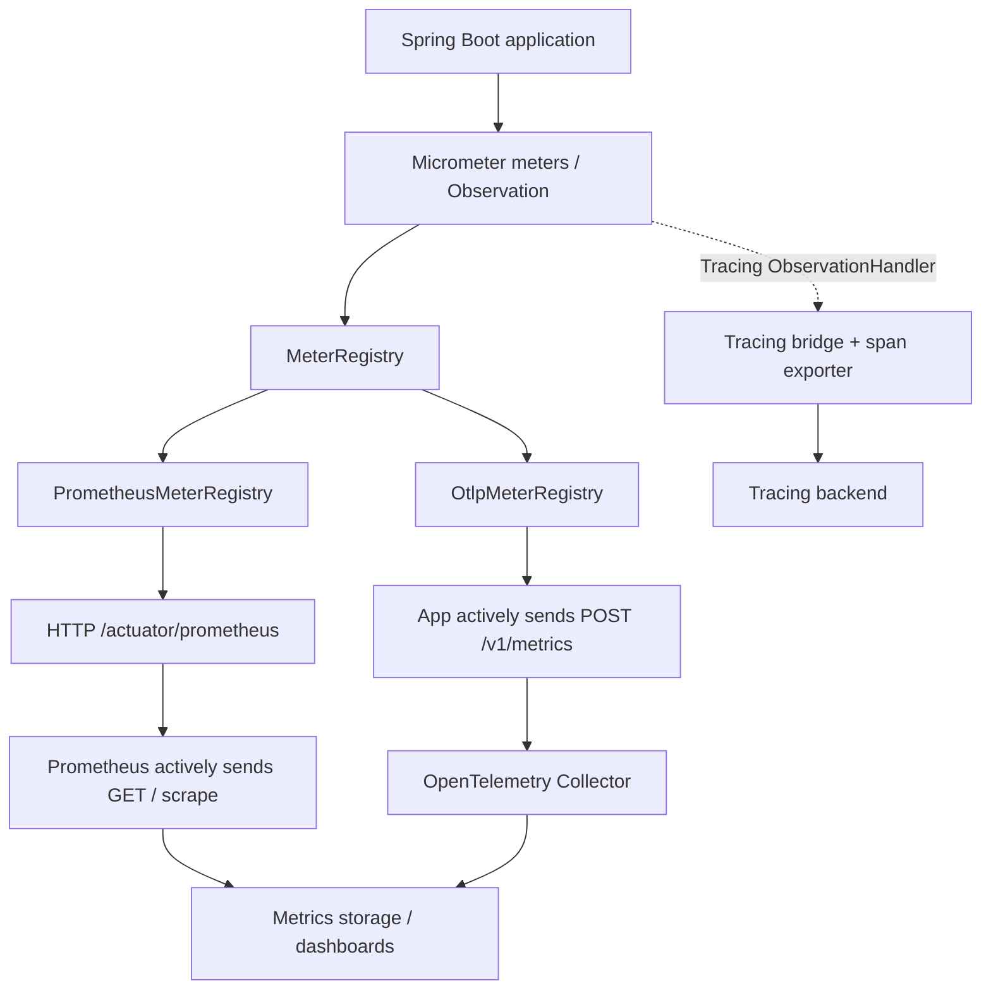
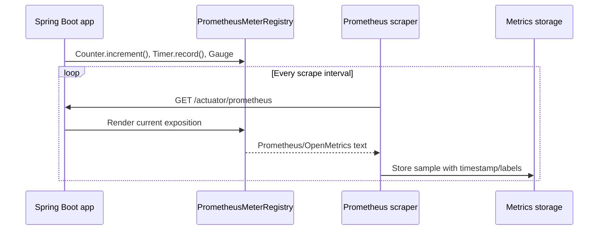
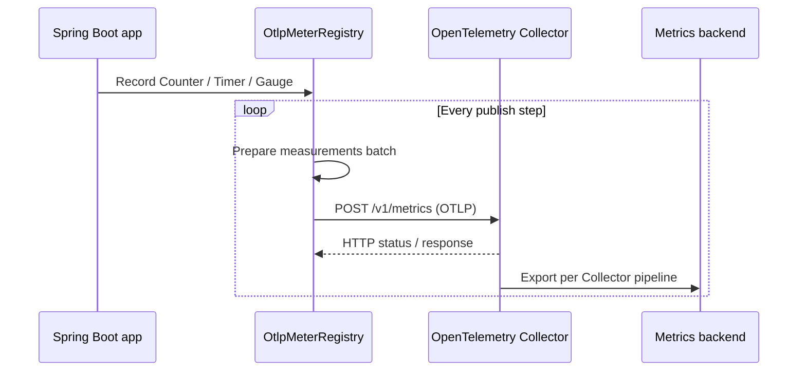
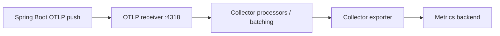
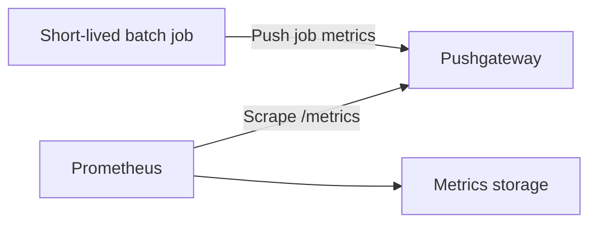
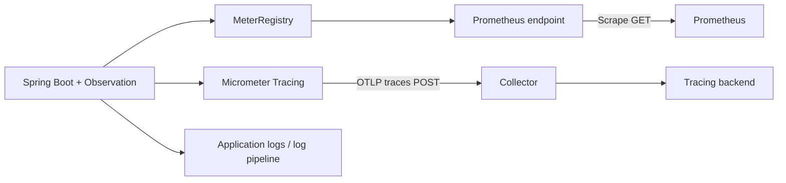

# Push and Pull Models in Spring Boot Meter Registries and Exporters

**Push** and **pull** are two transport models for moving metrics from an application to a monitoring system. They answer the same question—*how does data get from where it is measured to where it is stored?*—yet differ in who initiates the connection, how scheduling works, target discovery, network paths, and failure modes.

In the **SPRING_BOOT_OBSERVABILITY** module, Spring Boot uses **Micrometer** to create meters such as Counters, Timers, and Gauges, and can use **Micrometer Observation** to derive measurements from a business operation. Then, a **`MeterRegistry`** and exporter determine whether metrics are **pulled/scraped by Prometheus** or **pushed/published by the application** via OTLP or another protocol.

This lesson belongs to the **Meter registry and exporter** chapter, focusing on designing, configuring, operating, and verifying both models, while connecting them to tags/cardinality, sampling, context propagation, logs, and distributed tracing to support error, latency, and behavior investigations in production.

## 1. First, Separate Measurement from Transport

Suppose `order-service` receives orders and wants to track:

- Total successfully processed orders: `Counter`.
- Order processing duration: `Timer`.
- Orders waiting in a queue: `Gauge`.
- The journey of a request across `order-service`, `inventory-service`, and `payment-service`: a **distributed trace** composed of spans.

Measurements are recorded by libraries, frameworks, or business code. **Where data is exported** sits in a separate layer.



This diagram illustrates **transport paths you can choose between or combine**. Not every app installs both registries. When multiple registries exist, Spring Boot/Micrometer can coordinate them via `CompositeMeterRegistry`, depending on auto-configuration and registered beans.

**Do not confuse `ObservationRegistry` with `MeterRegistry`:**

- `ObservationRegistry` orchestrates the Observation lifecycle and handlers.
- A metrics `ObservationHandler` can record Timers/measurements into `MeterRegistry`.
- A tracing `ObservationHandler` can create spans via a tracer.
- A Prometheus or OTLP **metrics exporter** only governs how metrics are transported; it does not automatically enable distributed tracing.

## 2. Foundational Terms

| Term | Meaning | Example |
| --- | --- | --- |
| **Instrumentation** | Component producing measurements | HTTP server observations, JVM binder, business Counter |
| **Meter** | Represents a measurement and its tags | `http.server.requests` Timer |
| **MeterRegistry** | Manages meters and export paths | `PrometheusMeterRegistry`, `OtlpMeterRegistry` |
| **Exporter/publisher** | Ships measurements to a destination | Micrometer OTLP metrics export |
| **Scraper** | Actively fetches data from an HTTP endpoint | Prometheus scrape target |
| **Receiver** | Service accepting pushed metrics | OTLP receiver in Collector |
| **Backend** | Stores, queries, alerts, and graphs metrics | Prometheus-compatible metrics store |
| **Scrape interval** | Cadence at which a pull scraper collects data | 15 seconds |
| **Publish step** | Cadence at which a push registry aggregates/exports metrics | 30 seconds |
| **Cardinality** | Number of unique metric name + label combinations / time series | Many `uri`/`status`/`instance` combinations |

**Push/pull does not define meter type.** Counters, Timers, and Gauges can be exported under either model, though name normalization, units, distributions, and temporality can differ across registries and backends.

## 3. Pull Model: Prometheus Actively Scrapes

In the pull model, **the application exposes an HTTP endpoint**. Prometheus or a compatible scraper periodically sends requests to collect a snapshot of current metrics.



The request target is an endpoint inside the app; **the application does not open outbound connections to push metric batches to Prometheus** merely because `PrometheusMeterRegistry` is configured.

### 3.1. Required Components

1. Spring Boot Actuator integrating Micrometer.
2. `micrometer-registry-prometheus` on the classpath.
3. `/actuator/prometheus` exposed and reachable by the scraper.
4. Prometheus scrape targets, service discovery, or target discovery rules configured.
5. Backend receiving and storing samples, with dashboards/alerts querying exact series names.

If step 4 is missing, the app may still serve text at the endpoint while **Prometheus dashboards show zero series**.

### 3.2. Advantages of Pull

- The collector controls **scrape frequency**, timeouts, and target lists.
- Prometheus can surface target health via metrics like `up`, distinguishing successful scrapes from failed ones.
- Services do not need a push URL configured on every instance once Prometheus discovers targets.
- Labels can be normalized at scrape time and scraping managed per job/namespace.
- An HTTP metrics endpoint is easy to inspect with `curl` during local debugging.

### 3.3. Limitations of Pull

- The scraper must be **able to reach the application** across networks, DNS, service discovery, and security policies.
- Very short-lived processes may exit before the first scrape occurs.
- Dynamic instance fleets require service discovery; wrong ports/paths/targets silently drop visibility.
- When the backend temporarily cannot scrape, fluctuations between scrapes may not be captured.
- Heavy scrapes can add CPU and network load to the application.

**Pull is not inherently more reliable than push.** It simply places scheduling and connection responsibility on the scraper, with its own failure modes.

## 4. Push Model: The Application Actively Publishes Metrics

In the push model, the application has a registry/exporter that periodically **sends data to an ingestion endpoint**, such as an OpenTelemetry Collector supporting OTLP/HTTP.



Here **the application is responsible for connecting to the receiver**, while the Collector decides how to process data next: batching, transforming, authenticating, and forwarding to the configured backend.

### 4.1. Advantages of Push

- The app only needs outbound network access to the Collector/receiver, helpful when inbound connections from scrapers are hard to allow.
- Telemetry can route through a centralized Collector tier.
- The Collector can aggregate metrics from multiple sources and enforce processing, limits, batching, and fan-out rules.
- Export destinations can be managed via deployment configuration or receiver service discovery.
- Fits observability platforms built around push ingestion.

### 4.2. Limitations of Push

- Every exporter must know its **target endpoint** and configure protocol, authentication, and TLS.
- Receiver outages can cause publish failures, retry pressure, or data loss depending on buffering behavior.
- Processes terminating before a publish tick may fail to export their latest measurements.
- Endpoint, proxy, DNS, or permission misconfigurations surface directly on the application side.
- Consumes CPU/network resources periodically to encode and send batches.

**Push does not mean "guaranteed delivery without losing a single measurement."** Real reliability depends on the exporter, queues/buffers/retries, collector, backend, and shutdown hooks; verify behavior for your specific library and version.

## 5. Comparing Push and Pull by Operational Criteria

| Criterion | Pull (Prometheus Scrape) | Push (e.g., OTLP Metrics) |
| --- | --- | --- |
| Who opens the connection? | Scraper connects to the app | App/exporter connects to the receiver |
| Endpoint | App exposes `/actuator/prometheus` | Collector accepts `/v1/metrics` |
| Typical HTTP method | GET | POST for OTLP/HTTP |
| Scheduling | Scraper holds `scrape_interval` | Registry/exporter holds `step`/publish schedule |
| Target discovery | Service discovery / scrape config | Receiver endpoint configured in the app |
| Network | Needs inbound path from scraper to app | Needs outbound path from app to collector |
| Receiver/target failure | Scrape fails, often visible via `up=0` | Publish fails; monitor exporter/collector |
| Short-lived jobs | Risk being missed if exiting before scrape | Risk not publishing before exit |
| JVM/HTTP data | Yes, if instrumented | Yes, if instrumented |
| Metric names/labels | Prometheus exposition conventions | OTLP and backend mapping |
| Collector | Optional | Commonly used, though optional if backend accepts OTLP directly |
| Tracing | Configured separately | Configured separately, even if sharing the Collector |

**The two models are not mutually exclusive.** An application can expose Prometheus for legacy monitoring while pushing OTLP metrics during a migration. Just watch out for double ingestion if both paths eventually land in the same storage.

## 6. Setting Up Spring Boot for Pull: Prometheus

Example using **Spring Boot 3.x** and Maven with versions managed by the Spring Boot BOM/parent. Other Boot lines may change starters or properties; verify against your project's version.

### 6.1. Dependencies

```xml
<dependencies>
    <dependency>
        <groupId>org.springframework.boot</groupId>
        <artifactId>spring-boot-starter-actuator</artifactId>
    </dependency>
    <dependency>
        <groupId>io.micrometer</groupId>
        <artifactId>micrometer-registry-prometheus</artifactId>
    </dependency>
</dependencies>
```

Spring Boot automatically configures `PrometheusMeterRegistry` when the dependency and matching conditions are met.

### 6.2. application.yml

```yaml
spring:
  application:
    name: order-service

management:
  endpoints:
    web:
      exposure:
        include: health,info,metrics,prometheus
  prometheus:
    metrics:
      export:
        enabled: true
  metrics:
    tags:
      application: order-service
      environment: development
```

This opens `/actuator/metrics` for diagnostics and `/actuator/prometheus` for scraping on the default management path. Endpoints may require authentication or use a separate port/base path when security is configured.

Verify:

```bash
curl -i http://localhost:8080/actuator/metrics
curl -i http://localhost:8080/actuator/prometheus
```

Prometheus output is normally exposition text:

```text
# HELP jvm_threads_live_threads The current number of live threads
# TYPE jvm_threads_live_threads gauge
jvm_threads_live_threads{application="order-service"} 42
```

This is illustrative output; actual names and labels depend on the Micrometer registry, version, common tags, and unit conventions.

### 6.3. Illustrative Prometheus Scrape Config

A basic Prometheus configuration targeting one reachable instance:

```yaml
scrape_configs:
  - job_name: order-service
    metrics_path: /actuator/prometheus
    scrape_interval: 15s
    scrape_timeout: 10s
    static_configs:
      - targets:
          - order-service:8080
```

This belongs in the **Prometheus server** configuration, not Spring Boot's `application.yml`. The host `order-service` must resolve from where Prometheus runs, and `8080` must be the port serving the management endpoint.

If Actuator runs on a dedicated management port, update the target port accordingly. In Kubernetes, `ServiceMonitor`/`PodMonitor` or discovery rules select targets depending on your Prometheus Operator/stack; **never assume merely creating a Service makes Prometheus scrape it**.

### 6.4. Verifying the Pull Path

1. From the scraper's host/namespace, issue a GET request to the endpoint.
2. Check status code, `Content-Type`, and valid exposition text.
3. Inspect Prometheus Targets to confirm the target is UP and check its last scrape time.
4. Query the metric after enough scrape intervals and after traffic generates measurements.
5. Check final names and labels in the backend rather than guessing from Java code.

A successful GET from your laptop **does not guarantee** Prometheus has the same network access. Diagnose networking from the scraper's perspective.

## 7. Setting Up Spring Boot for Push: Micrometer OTLP Metrics

With **OTLP/HTTP**, the application sends metric batches to a Collector or backend with a compatible receiver.

### 7.1. Dependencies

```xml
<dependencies>
    <dependency>
        <groupId>org.springframework.boot</groupId>
        <artifactId>spring-boot-starter-actuator</artifactId>
    </dependency>
    <dependency>
        <groupId>io.micrometer</groupId>
        <artifactId>micrometer-registry-otlp</artifactId>
    </dependency>
</dependencies>
```

You do not need `micrometer-registry-prometheus` if the system only uses OTLP metrics. Adding `micrometer-registry-otlp` **does not automatically enable OTLP tracing**.

### 7.2. application.yml for Spring Boot 3.x

```yaml
spring:
  application:
    name: order-service

management:
  endpoints:
    web:
      exposure:
        include: health,info,metrics
  metrics:
    tags:
      application: order-service
      environment: development
  otlp:
    metrics:
      export:
        enabled: true
        url: http://otel-collector:4318/v1/metrics
        step: 30s
```

In this example:

- `url` is the **metrics receiver** endpoint, not an Actuator path.
- `step: 30s` is the publish interval configured for the registry.
- `otel-collector` must be a hostname or Service DNS actually reachable by the app.
- Port `4318` is typically OTLP/HTTP; port `4317` is typically OTLP/gRPC. Receiver configs may vary.
- If the Collector and app run in separate containers, `localhost` inside the app container usually does **not** reach the Collector.

The OTLP/HTTP endpoint normally accepts POST requests with a supported payload encoding, such as protobuf with media type `application/x-protobuf`. Ensure the protocol/encoding used by `OtlpMeterRegistry` matches the actual receiver.

### 7.3. Minimal Collector Setup

A properly configured Collector needs an OTLP receiver, a metrics pipeline, and an exporter forwarding data downstream.



An **illustrative lab-debugging** configuration can accept OTLP/HTTP and print metrics using the debug exporter:

```yaml
receivers:
  otlp:
    protocols:
      http:
        endpoint: 0.0.0.0:4318

exporters:
  debug:
    verbosity: basic

service:
  pipelines:
    metrics:
      receivers: [otlp]
      exporters: [debug]
```

Depending on Collector distribution and version, settings and exporter names may vary. This example is only for labs: binding `0.0.0.0` opens the receiver across container/host interfaces, so enforce network limits and auth in real environments. To get data into Prometheus-compatible storage, add an appropriate pipeline/exporter—**the debug exporter does not store metrics long-term**.

### 7.4. Verifying the Push Path

1. Verify `/actuator/metrics` shows meters changing.
2. Check the URL, protocol/encoding, and OTLP port.
3. Confirm the Collector listener receives POST connections.
4. Read exporter/Collector logs or self-observability during publish intervals.
5. Verify the metrics pipeline forwards data to the backend, not only arriving at the receiver.
6. Query the metric in the backend after several publish steps, accounting for ingest/processing lag.

**Do not test the receiver by sending GET `/v1/metrics` expecting JSON metrics.** That is a POST endpoint; it may return 404/405 depending on implementation even when the receiver is completely healthy.

## 8. Testing a Business Measurement with Both Registries

To see clearly that push and pull differ only in the export path, let's create a Counter and Timer using the Spring Boot-managed registry.

```java
import io.micrometer.core.instrument.MeterRegistry;
import io.micrometer.core.instrument.Timer;
import org.springframework.stereotype.Service;

@Service
public class CheckoutMetrics {

    private final MeterRegistry registry;

    public CheckoutMetrics(MeterRegistry registry) {
        this.registry = registry;
    }

    public void process(String channel, Runnable action) {
        String channelTag = normalizeChannel(channel);

        Timer timer = Timer.builder("checkout.process.duration")
                .description("Time spent processing checkout")
                .tag("channel", channelTag)
                .register(registry);

        timer.record(() -> {
            try {
                action.run();
                registry.counter(
                        "checkout.processed",
                        "channel", channelTag,
                        "outcome", "success"
                ).increment();
            } catch (RuntimeException error) {
                registry.counter(
                        "checkout.processed",
                        "channel", channelTag,
                        "outcome", "error"
                ).increment();
                throw error;
            }
        });
    }

    private static String normalizeChannel(String raw) {
        if ("mobile".equalsIgnoreCase(raw)) {
            return "mobile";
        }
        if ("web".equalsIgnoreCase(raw)) {
            return "web";
        }
        return "other";
    }
}
```

In this code:

- The Timer measures the duration of the callback upon completion, even if the callback throws a `RuntimeException` and `Timer.record` handles completion.
- The Counter records success counts or thrown `RuntimeException` counts within this example's scope.
- `channel` only has three groups: `mobile`, `web`, and `other`.
- No `orderId`, `requestId`, or Trace ID appears in tags.
- The exact same business code works with `PrometheusMeterRegistry`, `OtlpMeterRegistry`, or a composite registry managed by Spring Boot.

This is a synchronous example. With asynchronous code, if the callback returns before work actually finishes, this Timer only measures task submission time. Instrument the actual lifecycle of `CompletableFuture`, Reactor, or queue jobs to avoid misreading latency.

### End-to-End Observation

On the application side:

```bash
curl -s http://localhost:8080/actuator/metrics/checkout.processed
curl -s http://localhost:8080/actuator/metrics/checkout.process.duration
```

With Prometheus, look up time series by the registry-normalized name; for example, a Counter may gain a `_total` suffix and a Timer may emit count/sum or histograms if configured.

With OTLP push, wait for the publish step/collector processing and then search the backend for the metric. Displayed names and units may differ from Prometheus; **verify actual metadata rather than assuming every backend uses identical series names**.

## 9. Scrape Interval vs. Publish Step: Two Different Clocks

Both push and pull sample data over time, but different parties coordinate the schedule.

### 9.1. Pull by Scrape Interval

Example with Prometheus scraping every 15 seconds:

```text
Time (s):      0       15       30       45       60
Prometheus:    GET-----GET------GET------GET------GET
App counter:   increases continuously with events
Stored:        snapshots at successful scrapes
```

If an app's Counter rises from 100 to 150 between two scrapes, the backend sees two samples at different timestamps and can derive a rate over an appropriate window. A Counter resetting on process restart must be handled properly by the query engine.

### 9.2. Push by Publish Step

Example with `OtlpMeterRegistry` publishing every 30 seconds:

```text
Time (s):      0             30             60
Otlp registry: collect ------ publish ------- publish
Receiver:                    batch A        batch B
Backend:                   ingest/query per pipeline
```

The publish interval affects dashboard update lag and registry aggregation behavior. Never confuse `step` with Prometheus's scrape interval, nor assume "a 30s step means every event gets wrongly collapsed into one single value."

### 9.3. Why Can Two Backends Show Different Numbers?

For the same business operation, two export paths may differ in:

- Sampling timestamps.
- Units and naming conventions.
- How Counter/Timer/histograms are represented.
- Temporality and aggregation rules per registry and receiver.
- Extra labels added by Prometheus scrapes, OTLP resource attributes, or the Collector.
- Ingest, buffering, and retry timing.
- Measurements unexported before shutdown or occurring between scrapes.

Therefore, **never compare two instantaneous values from two different clocks and conclude an exporter is broken**. When cross-checking, match the exact same time window, label set, units, and aggregation method.

## 10. Semantics of Counter, Gauge, and Timer Across Push/Pull

Transport models do not alter a meter's business definition, yet they affect what data the backend receives.

| Meter | In-App Meaning | Pull Notes | Push Notes |
| --- | --- | --- | --- |
| `Counter` | Cumulative event count | Scrapes samples over time; rate queries must handle resets | OTLP/backend must interpret temporality and monotonicity properly |
| `Gauge` | Current instantaneous value | Spikes between scrapes may go unseen | Spikes between publishes may go unseen |
| `Timer` | Count, total duration, and optional distribution | Prometheus typically exposes count/sum/buckets | OTLP represents metrics per its own schema and aggregation |
| `DistributionSummary` | Distribution of a quantity | Can export count/sum/buckets if supported | Can export distribution/histogram depending on registry |
| `LongTaskTimer` | Active long-running tasks and elapsed time | Snapshot at scrape time | Snapshot at publish time |

### 10.1. Is a Counter Cumulative or Delta?

OTLP defines **aggregation temporality** such as *cumulative* and *delta*, depending on metric type and exporter/receiver. You cannot assume an OTLP payload is a carbon copy of a Prometheus scrape just because transport changed.

When the backend computes rates, confirm the temporality mapping from the Micrometer registry through the Collector to storage; avoid double-counting cumulative numbers or treating a delta as cumulative.

If unsure which schema your backend uses, drive a test Counter incrementing once per second in a lab, compare both paths, and inspect metadata/temporality at the receiver.

### 10.2. Gauges Do Not Guarantee Capturing Every Fluctuation

A queue jumping from 0 to 100 and draining back to 0 between two scrapes/publishes can yield two samples of 0. Faster sampling helps at higher cost. When you need to know how many jobs entered, exited, failed, or how long they waited, add dedicated Counters and Timers/`LongTaskTimer`s.

### 10.3. Histograms Multiply Series Cost

With a Prometheus classic histogram, every tag combination can emit many bucket series alongside count and sum. OTLP histograms structure data differently yet still carry measurement, transport, and storage costs.

With 20 endpoints, 5 HTTP statuses, 3 methods, and 10 instances, the upper bound of label combinations across those dimensions is:

\[
20 \times 5 \times 3 \times 10 = 3\,000
\]

Enabling many histogram buckets scales total series or transported/stored data points accordingly. **Neither push nor pull fixes high-cardinality mistakes**; design tags and buckets at the source.

## 11. Operational Issues: When Exporters or Scrapers Fail

### 11.1. When Prometheus Fails to Scrape

Common causes:

- Service discovery failed to find a new target.
- `/actuator/prometheus` is unexposed or listening on another port.
- Spring Security or a reverse proxy rejects requests.
- NetworkPolicy/firewall blocks connections from the scraper.
- Endpoint responds too slowly and exceeds `scrape_timeout`.
- Invalid `Content-Type` or malformed exposition body.
- Target temporarily unavailable during a rolling deployment.

When a scrape fails, the backend gets no valid sample for that cycle. Prometheus normally records `up=0` for failing targets, though you should also inspect target details and stale/missing series timestamps.

Troubleshoot **from the scraper toward the app**, not only by curling the endpoint from your laptop.

### 11.2. When OTLP Push Fails

Common causes:

- Wrong endpoint URL: missing `/v1/metrics` or mistakenly using `/v1/traces`.
- Protocol or encoding mismatch with the receiver.
- Collector port not bound, DNS unresolved, or timeouts.
- Invalid TLS, API key, or authentication headers.
- Collector receives data, but the metrics pipeline lacks an exporter to the backend.
- Receiver/backend throttled or hitting resource limits.
- Process shut down with unpublished measurements still in memory.

Inspect **app → receiver → processors → exporter → backend**. A 2xx response from the Collector does not prove the final backend stored the data if downstream pipeline steps exist.

### 11.3. Buffering and Retries Are Not Free

When a receiver is down, an exporter may retry depending on implementation and version. Some registries follow step publishing rather than acting as a durable event queue.

If in-memory queues grow while the Collector cannot flush, you risk memory pressure, dropped data, or lag. In production, verify:

1. What retry/buffer mechanisms does the registry have?
2. Are retries bounded by time or attempt count?
3. Is there backpressure or circuit-breaking?
4. Does shutdown flush pending measurements?
5. Does the Collector have configured queues, retries, or persistence?
6. During a backend outage, how much data will dashboards miss and how will you detect it?

Never substitute generic claims like "push retries" or "pull recovers" for verifying your actual system.

## 12. Security: Connection Direction Shapes the Attack Surface

### Pull

An HTTP metrics endpoint is exposed on the application. Control:

- Network path from scraper to endpoint: namespace, VPC, firewalls, NetworkPolicy.
- Management port/base path and access control.
- TLS and authentication where required by infrastructure.
- Avoid exposing every Actuator endpoint just to get `/actuator/prometheus`.
- Avoid emitting sensitive labels like user IDs, tenant secrets, or raw request payloads.

A metrics endpoint can reveal routes, pool names, service names, and runtime state. Even if it only exposes numbers, it is still a resource worth protecting.

### Push

The application maintains outbound connections to the receiver. Control:

- Exact Collector/backend endpoint; avoid shipping to the wrong environment.
- TLS/server certificates and exporter credentials.
- Secret injection via an approved secret manager; never put tokens in source code.
- Egress policies and DNS.
- Proper client authentication, quotas, and ingestion limits at the receiver.
- Collector processing, filtering, and data retention policies.

**Push is not inherently more secure than pull.** It shifts the network surface and where authentication lives.

## 13. Kubernetes, Autoscaling, and Instance Churn

Dynamic pod environments highlight differences between the two models.

### Pull in Kubernetes

Prometheus must discover every target to scrape via discovery/Operator configuration and appropriate permissions. Watch out for:

- Pods appearing and disappearing during rolling deployments.
- Short-lived pods exiting before the next scrape.
- Consistent service targets, ports, and management endpoints.
- `pod` and `instance` labels creating churned old/new series as pods rotate.
- Scraping through a load-balanced Service hits one random pod rather than **all pods**; use per-instance target discovery when collecting across every pod.

### Push in Kubernetes

Apps can push to a nearby Collector (such as a Service or node agent) which forwards to the backend:

- Apps need a stable, available Collector endpoint.
- The Collector needs enough scale and buffering for all senders.
- Labels/resource attributes identifying service, namespace, pod, or instance must be designed carefully.
- Pods killed abruptly may lose unpublished measurements.
- Collector and metrics pipeline health become part of system health, not an afterthought.

### Churn and Cardinality Affect Both Models

If a service runs 10 pods and every deployment spawns 10 new pod IDs, the backend retains old time series until retention expires. Monitor **active series**, newly created series, retention, and label stability.

Never add `request.id` or `trace.id` to metric labels to identify individual requests; they scale nearly 1:1 with request volume and cripple metrics systems.

## 14. Short-Lived Jobs and Prometheus Pushgateway

A classic question: **if a batch job runs for 5 seconds and exits while Prometheus scrapes every 15 seconds, how do we avoid missing it?**

Under pure pull, a job can exit before the scraper arrives. One option for suitable *service-level batch jobs* is **Prometheus Pushgateway**:



Key points:

- This is **not "Prometheus server accepting pushes from every web service."**
- Pushgateway is an intermediary service holding pushed metrics so Prometheus can **scrape Pushgateway**.
- Metrics can linger in Pushgateway after a job exits; manage grouping keys and cleanup to avoid stale metrics.
- Never use Pushgateway as the default for long-running Spring Boot servers that Prometheus can scrape directly.
- To record job outcomes, you can also run a long-lived metrics-emitting service or use an appropriate event/telemetry system depending on topology and semantics.

### Is Remote Write Application Push?

Prometheus can **remote_write** scraped data to another backend. That is **Prometheus (or an agent) pushing data downstream**—it does not mean the application switched from `PrometheusMeterRegistry` to a push registry.

Distinguish three steps:

1. App exposes Prometheus exposition.
2. Prometheus scrapes the app (pull).
3. Prometheus `remote_write`s to another backend (push at the Prometheus layer).

Similarly, a Collector can scrape a Prometheus endpoint and then export via OTLP to a backend. **A single end-to-end pipeline can combine pull and push at different hops.**

## 15. Push/Pull with Micrometer Observation, Traces, and Logs

Micrometer Observation lets you instrument business operations once. When both metrics and tracing handlers are registered, the same Observation can feed two independent pipelines.

```java
import io.micrometer.observation.Observation;
import io.micrometer.observation.ObservationRegistry;
import org.springframework.stereotype.Service;

@Service
public class PaymentService {

    private final ObservationRegistry observationRegistry;

    public PaymentService(ObservationRegistry observationRegistry) {
        this.observationRegistry = observationRegistry;
    }

    public void authorize(String paymentMethod, Runnable paymentAction) {
        String methodGroup = "wallet".equals(paymentMethod)
                ? "wallet" : "card";

        Observation.createNotStarted(
                    "payment.authorize",
                    observationRegistry
                )
                .lowCardinalityKeyValue("payment.method", methodGroup)
                .observe(paymentAction);
    }
}
```

Depending on configuration:

- **Metrics handler** can record a `payment.authorize` Timer in `MeterRegistry`.
- **Pull registry** can expose those measurements at `/actuator/prometheus`.
- **Push registry** can publish those measurements via OTLP metrics.
- **Tracing handler** can create a span with matching context.
- **Tracing exporter** ships sampled spans to a tracing backend, typically via a separate push path.
- **Logs** can carry Trace ID / Span ID via MDC when tracing scope and logging patterns are configured properly.

### An App Can Pull Metrics While Pushing Traces

This topology is very common and **completely consistent**:



Metrics transport and trace transport do not have to run in the same direction. There is no "10% sampling for all metrics" simply because tracing sampling is set to 10%.

### Sampling and Propagation Are Separate Mechanisms

- **Tracing sampling** decides which traces/spans are recorded or exported.
- **Trace context propagation** carries context across HTTP, async, or messaging boundaries, such as W3C `traceparent`.
- **Metrics scrape/publish cadence** determines when the backend receives metric samples.
- **Tag cardinality** governs how many series are created and backend cost.

These independent mechanisms interact indirectly without replacing one another. If traces break between `order-service` and `payment-service`, changing `scrape_interval` will not fix it; inspect instrumentation and propagation.

### Three-Signal Incident Investigation

When payment p95 rises:

1. **Metrics:** identify the affected service, operation, outcome, and time window.
2. **Traces:** locate sampled requests and the slow span, comparing client/server spans by Trace ID.
3. **Logs:** confirm timeouts, retries, connection errors, or business errors using the matching correlation ID.
4. **Runtime/infra metrics:** inspect connection pools, thread pools, CPU, memory, and Collector health.

If the backend supports **exemplars**, some measurements can link directly to a sampled trace without turning Trace ID into a regular label; verify registry and backend support rather than assuming every meter supports exemplars.

## 16. When to Choose Push, When to Choose Pull?

No single option fits every system. Base the decision on network topology, infrastructure standards, and operability.

| Context | Option Worth Considering | Reason |
| --- | --- | --- |
| Existing Prometheus and reliable service discovery | Pull via `/actuator/prometheus` | Existing monitoring stack; scraper manages targets |
| Many apps inside a scrapable network | Pull | Easy to inspect scrape targets and exporters |
| Outbound to Collector easier than inbound from scraper | Push OTLP metrics | Simplifies certain network constraints |
| Organization standardizes on OpenTelemetry Collector pipelines | Push OTLP or Collector scrape-and-export | Depends on topology, Collector tooling, and policy |
| Migrating from Prometheus to a new metrics system | Run both briefly during transition | Cross-check numbers while managing duplicate-write risk |
| Very short-lived batch jobs | Needs dedicated design; Pushgateway where appropriate | Avoids missing jobs before a scrape |
| Metrics and traces share a Collector | Push metrics and traces separately | Collector is the common receiver, though signals stay distinct |
| Strict inbound network restrictions | Usually prefer outbound push or agent | Fits security architecture |

### Questions to Answer Before Deciding

1. Which side is allowed to open network connections?
2. Does the backend support Prometheus exposition, OTLP, or both?
3. Is service discovery for instances/pods reliable?
4. What are the targets for dashboard freshness and retention?
5. Are mTLS, authentication, or tenant isolation required?
6. Do the Collector and Prometheus have their own SLOs and self-monitoring alerts?
7. If the exporter/receiver goes down, can you tolerate losing some measurements?
8. What are the budgets for labels, histograms, network, CPU, and storage?

**Your design must include failure-verification procedures**, not just a dependency and a few lines of `application.yml`.

## 17. Troubleshooting Every Point in the Pipeline

| Symptom | Likely Cause | Check First |
| --- | --- | --- |
| `/actuator/metrics` has meter, backend is empty | Scrape/push/export error | Follow the exact transport branch to inspect |
| `/actuator/prometheus` returns 404 | Missing Prometheus registry, unexposed, wrong path/port | Dependency, exposure, management port |
| Prometheus target DOWN | Network, auth, DNS, timeout, malformed exposition | Test from scraper host; inspect target error |
| Prometheus endpoint has data, dashboard blank | Not scraped yet, wrong query, different labels | Target health, PromQL, actual series names |
| OTLP receiver GET returns 405 | Receiver expects POST | Check exporter config; do not use GET to probe |
| OTLP push returns 404/415 | Wrong path/encoding/protocol | `/v1/metrics`, OTLP HTTP vs. gRPC |
| Collector accepts request, backend sees nothing | Downstream pipeline/exporter error | Collector config/logs and backend ingestion |
| Push registry logs timeouts | Collector unreachable or overloaded | DNS, TLS, auth, connections, receiver health |
| Counters disagree across two backends | Step/scrape/temporality/labels/timestamps | Compare matching time windows, units, aggregation |
| Gauge misses spikes | Snapshot cadence too coarse | Check cadence; add matching Counters/Timers |
| Series count explodes | Dynamic ID tag, raw URL route, histograms | Enforce metadata and label budgets |
| Metrics exist, spans missing | Missing/broken tracing bridge, sampling, or exporter | Independent tracing pipeline |
| Trace breaks across HTTP/async | Missing propagation | W3C headers, executor/context, client instrumentation |
| Data lost during rollouts | Scrape missed pod or exited before publish | Pod lifecycle, graceful shutdown, cadence |
| Both export paths store into same backend | Duplicate ingestion | Check routing, external labels, and dedupe policy |

### Four-Layer Diagnostic Process

**Layer 1 – Instrumentation:** are meters created and recording measurements? Check `/actuator/metrics`, Observation lifecycle, `MeterFilter`, and real traffic.

**Layer 2 – Registry/exporter:** does the Prometheus endpoint render valid exposition, or does the OTLP publisher have the right URL and `step`?

**Layer 3 – Collector/scraper:** is the pull target UP? Does the OTLP receiver receive requests? Are downstream processors or exporters dropping data?

**Layer 4 – Backend/query:** was data ingested? Are series names, label schemas, aggregation temporality, and query windows accurate?

Layering prevents wasted fixes: for example, raising tracing sampling can never fix a DOWN Prometheus target.

## 18. Hands-On Exercise: Comparing Both Models on the Same Service

### Preparation

- A Spring Boot 3.x web app with Actuator.
- A business operation recording Counters/Timers, such as `CheckoutMetrics` from section 8.
- A test Prometheus instance or environment able to scrape the app.
- A lab OpenTelemetry Collector receiving OTLP/HTTP.
- Never use production credentials or real customer data.

### Step 1 – Confirm In-App Metrics

Send several requests or invoke the business service multiple times. Check:

```bash
curl -s http://localhost:8080/actuator/metrics/checkout.processed
curl -s http://localhost:8080/actuator/metrics/checkout.process.duration
```

If meters are missing, verify the service executed, the registry was injected, and no filter blocked them.

### Step 2 – Configure Pull

Add `micrometer-registry-prometheus`, expose `/actuator/prometheus`, and configure a scrape job in Prometheus per section 6.

Confirm the target is scraped, metrics appear in the backend, and names/labels match. Record the `scrape_interval`.

### Step 3 – Configure Push in Lab

Add `micrometer-registry-otlp` or create a separate profile for push. Configure the OTLP/HTTP Collector URL and `step` per section 7. Confirm the Collector receives metrics and the backend stores data.

If running both registries simultaneously, clearly tag or separate the paths to avoid confusion or duplicate writes.

### Step 4 – Compare the Two Clocks

Have the app increment Counters steadily during a test window and record:

- The 15-second pull scrape interval.
- The 30-second push publish step.
- When samples begin appearing in the backend.
- Names, units, labels, and count representation.

Pick a shared window long enough to compare total events and rates; never treat differences between two instantaneous points as a bug.

### Step 5 – Controlled Fault Injection

In the lab:

- Temporarily make the Prometheus endpoint unreachable, observe target DOWN, then restore it.
- Temporarily misconfigure the OTLP URL to observe publish errors, then fix it.
- Verify in-app metrics stay intact even when the backend receives nothing.
- Observe recovery lag and check whether data gaps appear.

Never run disruptive fault experiments in shared or production environments.

### Step 6 – Experiment with a Gauge

Add a Gauge for queue depth. Trigger a brief spike and check whether Prometheus/OTLP samples capture it. Conclude that both models are constrained by **sampling instants**, while understanding each registry's schedule.

### Step 7 – Verify Cardinality

Use `channel=web/mobile/other` and `outcome=success/error`. Count actual series and label combinations. Never add order ID, user ID, raw URL, or Trace ID as labels.

### Step 8 – Add Traces and Logs

If your environment already configures a Micrometer Tracing bridge and exporter, instrument `payment.authorize` with Observation. Verify a Timer appears in the metrics backend and a span appears in a sampled trace, then query logs by Trace ID. Vary tracing sampling to verify it does not directly alter metrics scrape interval or publish step.

### Step 9 – Summarize Architectural Decision

Document which model fits your network topology, backend, security policy, and SLOs best. List tested failure modes along with exporter and dashboard ownership.

### Acceptance Checklist

| Verification | Expected Outcome |
| --- | --- |
| In-app meters | Counter/Timer appear and grow with traffic |
| Pull | Prometheus scrapes endpoint, target UP |
| Push | Collector receives OTLP metrics POST and forwards downstream |
| Cadence | Clear distinction between scrape interval and publish step |
| Query | Exact names/labels/units used in the corresponding backend |
| Resilience | Can isolate app, scraper, exporter, Collector, and backend failures |
| Security | Pull endpoints and push targets have proper network/auth controls |
| Cardinality | Bounded tags; no dynamic IDs or sensitive data |
| Tracing | Spans configured and exported independently of metrics transport |
| Decision | Model chosen based on topology, cost, and operability |

## 19. Conclusion

**Pull** and **push** differ in **which side initiates fetching or sending metrics**, not in the application's observability goals.

- With **Prometheus pull**, Spring Boot exposes `/actuator/prometheus`; a scraper periodically GETs the endpoint and stores samples.
- With **OTLP push**, `OtlpMeterRegistry` actively POSTs metrics to a Collector/receiver on a publish interval.
- The exact same Counter, Timer, or Gauge can serve both models; the difference lies in the exporter, schedule, semantics, and backend mapping.
- When troubleshooting, follow **instrumentation → registry → scraper/receiver → backend**.
- Low-cardinality metadata design and protecting sensitive data matter equally for **both models**.
- Logs and distributed traces use separate pipelines: metrics spot systemic issues, traces show request execution paths, and logs verify root cause.

Understanding push and pull helps architects pick a transport suited to their infrastructure, developers configure Spring Boot accurately, and operations teams quickly diagnose missing metrics, export lag, or cross-signal discrepancies in production systems.
