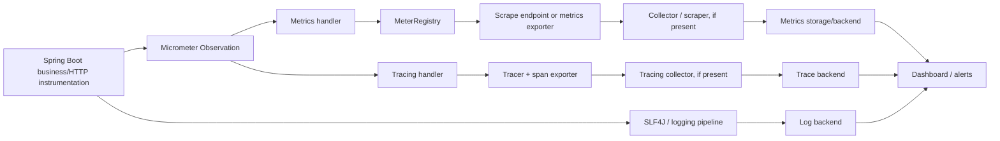
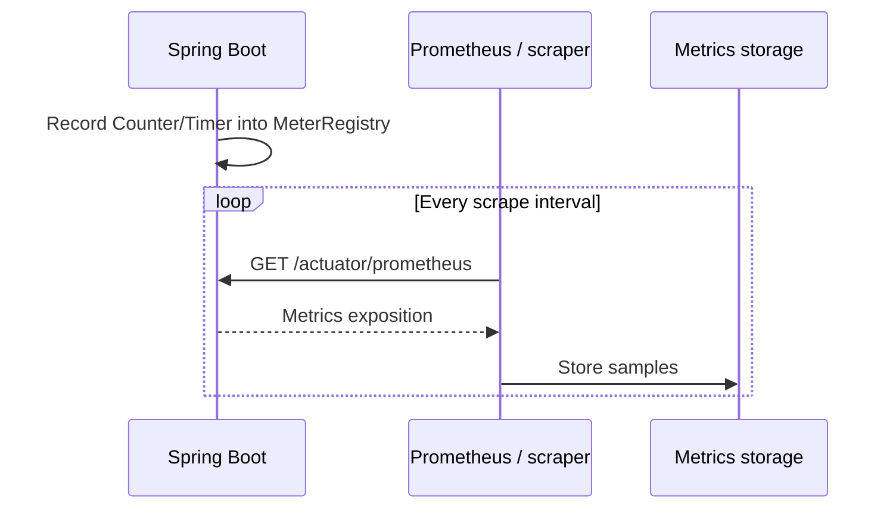
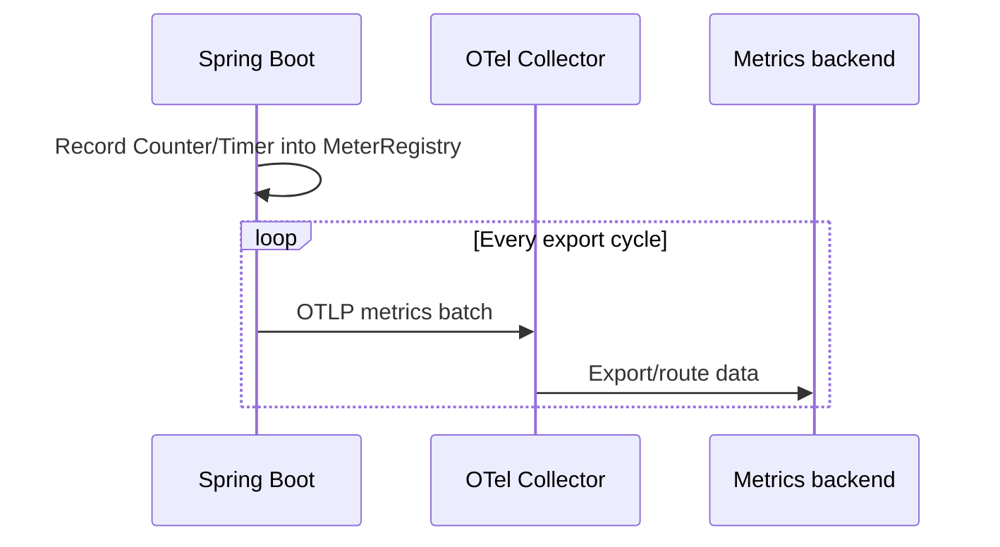
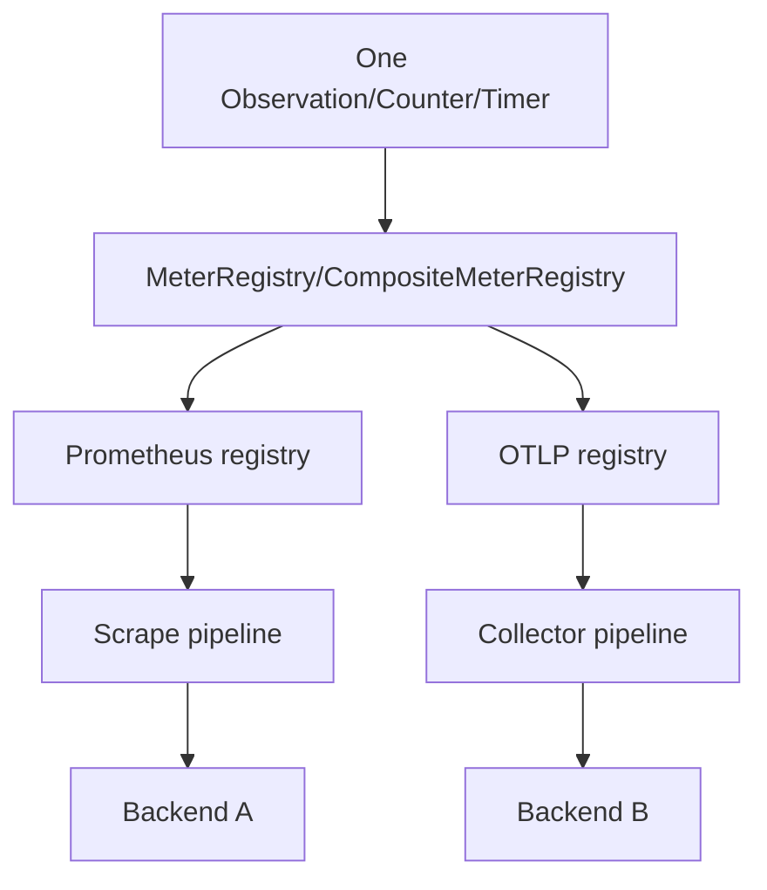
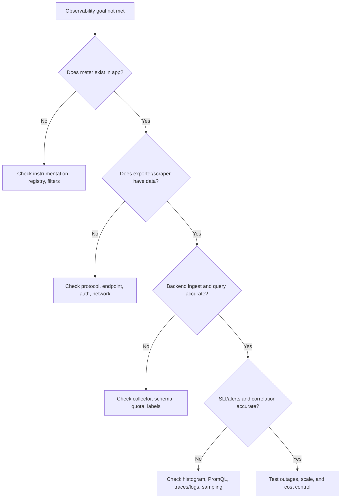

# Criteria for Choosing a Backend for Spring Boot Observability

A Spring Boot application may already have Micrometer Observation, HTTP metrics, logs, and distributed tracing configured, yet still fail to be **observable in practice**. To know which endpoint is slow, which service is generating errors, and where the root cause lies, telemetry must be collected, transported, stored, and queried in a suitable system. That is why you must evaluate the **observability backend** right from the design phase, rather than adding an exporter library and calling it done.

The lesson **"Criteria for Choosing a Backend"** belongs to the **Meter registry and exporter** chapter of the **SPRING_BOOT_OBSERVABILITY** module. Its goal is to help you select a metrics collection and storage architecture tailored to Spring Boot while accounting for logs, distributed tracing, context propagation, tags/cardinality, exporters, sampling, and signal correlation for investigating errors, latency, and application behavior.

**Core principle:** choose a backend based on the **questions you need answered**, **data contracts and SLOs**, **operability**, **security**, and **total cost**—not simply because one exporter happens to be easy to configure.

## 1. Distinguishing MeterRegistry, Exporter, Collector, and Backend

In observability documentation, the word "backend" is sometimes loosely applied to multiple layers. Separate them clearly so you can pinpoint where failures occur.

| Component | Responsibility | Example |
| --- | --- | --- |
| **ObservationRegistry** | Orchestrates Observation lifecycles, conventions/filters, and handlers | Micrometer `ObservationRegistry` |
| **MeterRegistry** | Manages Counters, Timers, Gauges, tags, and in-app measurements | `PrometheusMeterRegistry`, `OtlpMeterRegistry`, `SimpleMeterRegistry` |
| **Exporter or reader** | Exposes measurements outward via HTTP scrape or periodic push | `/actuator/prometheus` endpoint, OTLP metrics export |
| **Collector / agent** | Receives, processes, enriches, batches, routes, and forwards telemetry | OpenTelemetry Collector, vendor agent |
| **Storage backend** | Persists time series, traces, or logs per retention/indexing | Prometheus, PromQL-compatible metrics stores, trace/log stores |
| **Query and visualization** | Queries data, renders dashboards, and fires alerts | PromQL and matching dashboards/alerting |

Orientation diagram:



A **`MeterRegistry` is not necessarily a durable storage system**. For example, `SimpleMeterRegistry` is primarily for testing or local measurements; values disappear when the process exits unless another persistence path exists.

A **collector is not automatically a backend**: it can receive OTLP, process it, and forward it, yet still needs a storage target and query UI. Conversely, a backend can scrape metrics directly without an intermediate collector.

Likewise, a **metrics backend does not automatically store traces or logs** just because it ingests metrics. An observability suite may offer all three signals, yet each still has its own pipeline, schema, retention, and export prerequisites.

## 2. Start from Operational Questions

Before comparing Prometheus, OTLP, or SaaS offerings, list the actual operational scenarios your application must support:

| Question to Answer | Primary Signal | What the Backend Must Support |
| --- | --- | --- |
| How many requests/sec hit each route? | HTTP request metrics | Counters/rates grouped by route/method |
| What is checkout's HTTP 5xx ratio over the last 5 minutes? | Metrics | Time-series queries, label filtering, alerting |
| Is p95/p99 latency breaching the SLO? | Histogram metrics | Storing and aggregating buckets or valid quantile mechanics |
| Is the payment gateway slowing down requests? | Metrics + traces | Dependency latency breakdown and related spans |
| Why did a specific transaction fail? | Traces + logs + business data | Trace search, log correlation, controlled access |
| How many requests were affected by a new release? | Metrics, release metadata | Before/after deploy comparisons on stable labels |
| Which service in the call chain caused the failure? | Distributed traces | Service identity, span parent-child links, propagation |
| Do we need to audit **every** transaction? | Dedicated audit/transaction store | Completeness, strict access control, required retention |

If your main goal is **web service SLIs/SLOs**, the metrics backend needs time-series queries, histograms, and alerting. If your goal is **investigating cross-service calls**, tracing requires collectors, sampling, span search, and log correlation. A backend great at charting metrics will not satisfy financial/transaction auditing requirements.

### Define SLIs Before Picking a Product

Example of sensible HTTP SLIs:

- **Availability SLI:** share of requests deemed successful under the service's definition.
- **Latency SLI:** share of requests completing under a time threshold or latency percentile for critical routes.
- **Traffic:** request rate, broken down across major processing paths.
- **Errors:** 5xx rate or separately defined business failure outcomes.

Not every 4xx is a system error. A lookup request finding no record returning 404 may be working as designed. A legitimately declined payment may return an HTTP success status while requiring a separate business metric. **No backend can fix a poorly defined SLI.**

## 3. First Decision: Pull or Push?

At the metrics layer, the two dominant transport models are **pull/scrape** and **push/periodic export**.

### Pull: Monitoring System Actively Scrapes the App

Typical example: Spring Boot with `PrometheusMeterRegistry` and `/actuator/prometheus`. Prometheus or an authorized scraper calls the endpoint periodically.



**Strengths:** fits the Prometheus ecosystem cleanly, scraper controls collection frequency, easy target health checks (`up`), and integrates well with service discovery.

**Constraints:** the scraper must reach the app over the network and the endpoint must be secured; NAT, firewalls, serverless platforms, or short-lived jobs can be awkward to scrape. Dropped scrape connections leave sample gaps that are not backfilled on the next scrape.

### Push: Application or Agent Periodically Exports Data

Example: `OtlpMeterRegistry` sends metrics over OTLP to an OpenTelemetry Collector, which processes and forwards them to storage.



**Strengths:** the app usually only needs outbound connectivity to the collector; works well behind strict inbound firewalls and lets the collector route/transform data centrally.

**Constraints:** you must manage export intervals, request timeouts, retries, batching/queues, backpressure, and unsent data when a process terminates abruptly. A Collector does not guarantee "exactly-once" delivery automatically; depending on protocol, SDK/registry, and queue config, failed sends can still cause missing or duplicated data.

### Quick Selection Matrix

| Condition | Pull / Prometheus Scrape | Push / OTLP Metrics |
| --- | --- | --- |
| Scraper can reach services directly | Very strong fit | Not required |
| Only outbound connections permitted | Harder without proxies/agents | Usually more convenient |
| Existing PromQL/alerting ecosystem | Natural choice | Needs compatible backend/collector |
| Ephemeral/short-lived workloads | Needs special scrape design | Convenient, though must flush on shutdown |
| Standardizing telemetry through a Collector | Can scrape and forward via Collector | Native Collector integration |
| Easy target liveness checks | Scrape health works out of the box | Must monitor exporter/collector separately |
| Transport security | Secure scrape endpoint and credentials | Outbound TLS/auth and collector endpoints |
| Data risks | Missed scrapes, broken target discovery | Export failures, full queues, missed shutdown flush |

**Neither model is universally superior.** Choose based on network topology, freshness needs, operations, and backend requirements—not the brevity of YAML snippets.

## 4. Backend Categories and Suitable Scenarios

This section describes **solution categories**, without treating any specific vendor as mandatory.

### Category A — Prometheus and Prometheus-Compatible Systems

Use when operations teams want a metric model centered on **labeled time series**, **PromQL**, alerting, and the scrape ecosystem. You can run standalone Prometheus for appropriate scale or a multi-cluster/long-term Prometheus-compatible storage system.

Verify:

- How Spring Boot targets are discovered in Kubernetes or VMs.
- Queryability across multiple instances or clusters.
- Retention and long-term storage needs.
- High availability, replicas, and sample deduplication.
- Histogram buckets, recording rules, alerting, and label management.
- API/query access control and data residency.

**Scraping a target with Prometheus does not automatically give you long-term metrics storage or full HA.** Design those explicitly according to system scope.

### Category B — OTLP + OpenTelemetry Collector + Metrics Backend

Use when you want a unified OTLP export stream with a Collector to route or govern telemetry. **OTLP is a wire protocol and data format**, not a storage or query system on its own.

Flow:

```text
Spring Boot OtlpMeterRegistry
    -> OTLP/HTTP or OTLP/gRPC depending on exporter
    -> OpenTelemetry Collector
    -> Collector exporter
    -> metrics storage/backend
    -> dashboards + alerts
```

Verify ingestion endpoints, transport, authentication, temporality, aggregation, and how the backend maps resource attributes into labels.

A Collector can ingest metrics from apps alongside traces/logs from other pipelines, yet **each signal still requires its own matching receiver, processors, and exporter**. Never assume configuring OTLP metrics automatically generates traces or collects Logback logs.

### Category C — Managed Observability Services

A SaaS or managed platform can bundle metrics, traces, logs, dashboards, and alerting in one product. Its main draw is reducing operational overhead for storage, HA, scaling, and correlation UIs.

Evaluate before committing:

- Pricing dimensions: sample volume, active series, GB ingested, indexed attributes, retention, or seat counts.
- Query limits, quotas, throttling, and burst handling.
- Countries/regions where data travels or is stored, access controls, and encryption.
- Import/export options, vendor lock-in, and exit/data-retention paths.
- Ability to search traces by attributes, support exemplars, and jump to logs via trace ID.
- SLAs, incident support, audit trails, and admin governance.

**A platform offering metrics, logs, and traces tabs does not guarantee all three are instrumented or correlated inside Spring Boot.**

### Category D — Other Specialized Registries and Backends

Systems like StatsD or other metrics registries may fit existing infrastructure. Do not assume they support the same Timer, histogram, exemplar, or tag-normalization semantics as Prometheus.

For local Java demos and unit tests, `SimpleMeterRegistry` is a practical choice to inspect values without external exporters or services; however, **never choose it as a persistent production observability store**.

## 5. Mandatory Criteria to Lock Down Before Deciding

A backend only passes muster when it satisfies both technical and operational criteria.

| Criterion | Verification Question |
| --- | --- |
| **Required telemetry** | Does it support Counter, Gauge, Timer, histograms, units, labels, and resource metadata? |
| **Querying** | Can it reliably compute rate, increase, error ratio, and p95 by service/route? |
| **Data freshness** | How long from request completion until dashboards/alerts see the point? |
| **Cardinality** | What are the limits on active series, label values, histogram buckets, and overage handling? |
| **Retention** | How long are raw vs. downsampled data kept for incident response, reporting, and SLOs? |
| **Scale & HA** | Does it handle multi-instance, multi-zone, multi-cluster, and burst loads? |
| **Network** | Is pull feasible, or can apps push outbound over TLS/proxies? |
| **Security** | Are TLS, auth, mTLS, token rotation, RBAC, audit logs, and tenant isolation supported? |
| **Compliance** | Do data residency, deletion policies, masking, and PII rules align? |
| **Reliability** | When the exporter/collector/backend fails, are metrics lost or can they impact the app? |
| **Correlation** | Can operators pivot from metric → exemplar/trace → log via trace ID? |
| **Operations** | Who operates collectors, queries, alerts, backups, upgrades, and incident response? |
| **Cost** | Can you estimate total ingest, storage, query, egress, and ops cost as traffic grows? |
| **Portability** | Does it follow Micrometer/OTLP/Prometheus conventions so switching backends stays feasible? |

Confirm the **priority order** of each criterion. For instance, a financial service with strict data-residency rules may disqualify a convenient tool lacking local hosting, whereas a system with only a few internal services may not need a complex distributed stack.

## 6. Cardinality Is a Backend Selection Criterion, Not Just the Backend's Problem

In Micrometer Metrics, each metric name plus tag combination produces a distinct time series. Adding dimensions or expanding values in a dimension increases series count rapidly.

Suppose an HTTP server metric has:

| Dimension | Assumed Value Count |
| --- | ---: |
| `application` | 4 |
| `environment` | 2 |
| `method` | 4 |
| `uri` route template | 30 |
| `status` | 5 |

Theoretical combination bound:

\[
4 \times 2 \times 4 \times 30 \times 5 = 4\,800
\]

Adding `user.id` with 100,000 values pushes the theoretical number to:

\[
4\,800 \times 100\,000 = 480\,000\,000
\]

**This is not a forecast that 480 million series will materialize.** Only combinations that actually occur create series, and tags often correlate. Still, the math demonstrates how a single high-cardinality ID can blow through a metrics budget fast.

### Histograms Multiply Series Further

When a Timer emits histogram buckets, each label combination produces multiple `_bucket` series alongside `_count` and `_sum`. Enabling histograms on every endpoint while carrying a `user.id` tag or raw URL is especially hazardous.

When evaluating a backend, verify:

- Does it support histograms to compute p95/p99 across multiple instances?
- Can you configure bucket boundaries and accuracy levels appropriately?
- Are percentiles computed client-side or from backend histograms, and are they mergeable?
- Does the system alert when active series surge unexpectedly?
- On quota breach, does the backend **drop** data or throttle? What happens to alerts and SLOs?

### Never Use a High-Quota Backend to Excuse Bad Tags

Keys like `user.id`, `order.id`, `session.id`, `traceId`, or raw URLs containing IDs are almost never appropriate as metric labels. Hashing a user ID does not solve cardinality if every user still produces a unique hash.

Use low-cardinality tags such as `method`, templated `http.route`, `status` groups, normalized `payment.method`, and stable common tags. High-cardinality attributes can go onto spans when justified and governed by data controls—never automatically into metric labels.

## 7. Retention, Latency, and Real Cost

A backend choice must address both **data retention** and **freshness**.

### Retention

For example, an operations team might require:

- High-resolution data for days or weeks for incident response.
- Aggregated statistics retained longer for SLO reporting and capacity planning.
- Traces retained by sampling or on a shorter schedule than metrics.
- Logs governed by stricter sensitivity, access controls, and separate retention periods.
- Audit/transaction records **never replaced** by sampled traces when completeness is mandatory.

No single retention period fits every app; base it on internal policy, regulations, debugging needs, and budget.

### Pipeline Latency

With 15–30 second scrapes or periodic OTLP exports, metrics reach dashboards after the request completes. Collector batching and backend ingestion add further delay. If an SLO or alert demands rapid failure detection, evaluate **end-to-end freshness**, not only application latency.

### Budgeting Estimation Formulas

For a pull system on a scrape cadence:

\[
\text{Samples/day} \approx
\text{Active series}
\times
\frac{86\,400}{\text{Scrape interval (seconds)}}
\]

This estimates steady-state volume when targets scrape reliably and series remain active. It **does not directly equal GB or dollar cost**: per-sample size, metadata, compression, histograms, indexing, and backend pricing models vary.

For example, with 50,000 active series and a 30-second scrape interval:

\[
50\,000 \times \frac{86\,400}{30}
= 144\,000\,000 \text{ samples/day}
\]

Under push/OTLP, ingest accounting may differ by publish step, aggregation/temporality, and vendor billing rules. Never apply the scrape formula blindly as a universal SaaS billing unit.

## 8. Example Setup A: Prometheus Scraping Spring Boot

A Spring MVC app using Gradle Groovy can declare:

```groovy
dependencies {
    implementation 'org.springframework.boot:spring-boot-starter-web'
    implementation 'org.springframework.boot:spring-boot-starter-actuator'
    runtimeOnly 'io.micrometer:micrometer-registry-prometheus'
}
```

Illustrative Spring Boot configuration:

```yaml
spring:
  application:
    name: checkout-service

management:
  endpoints:
    web:
      exposure:
        include: health,info,metrics,prometheus
  metrics:
    tags:
      application: checkout-service
      environment: test
```

After starting the application:

```bash
curl -sS http://localhost:8080/actuator/metrics
curl -sS http://localhost:8080/actuator/prometheus
```

`/actuator/metrics` is a JSON API listing and inspecting meters, while `/actuator/prometheus` serves exposition text for scrapers. **Having the endpoint does not mean Prometheus is scraping it.**

Minimal Prometheus scrape configuration for a test network only:

```yaml
scrape_configs:
  - job_name: "checkout-service"
    scrape_interval: 15s
    metrics_path: /actuator/prometheus
    static_configs:
      - targets: ["checkout-service:8080"]
```

`checkout-service:8080` is an assumed hostname/port **reachable by Prometheus**, not automatically valid DNS in every deployment. In Kubernetes or multi-instance fleets, configure service discovery and make sure you do not accidentally scrape the same target twice.

**Security:** never expose `/actuator/prometheus` to the public internet just because a scraper needs it. Configure private networking, HTTPS/auth, service discovery, and proper access controls. The YAML snippets here illustrate concepts, not complete production security hardening.

### Layered Result Verification

1. Trigger an HTTP request or inspect JVM metrics to confirm Micrometer created meters.
2. Verify `/actuator/metrics` lists `http.server.requests` or `jvm.memory.used` per active instrumentation.
3. Verify `/actuator/prometheus` outputs Prometheus-formatted series.
4. Confirm the target in Prometheus shows healthy scrape status.
5. Query Prometheus to confirm expected series and tags appear.
6. Verify dashboards/alerts use accurate queries, units, and time windows.

Always check series names **after the exporter**. For example, Micrometer's `http.server.requests` commonly becomes `http_server_requests_seconds_count` and `http_server_requests_seconds_sum` in Prometheus, though exact naming depends on registry, version, and conventions.

## 9. Example Setup B: Spring Boot OTLP Metrics Push

When an OpenTelemetry Collector runs on the internal network and the app has outbound connectivity to it, Micrometer provides an OTLP metrics implementation.

Example dependencies:

```groovy
dependencies {
    implementation 'org.springframework.boot:spring-boot-starter-actuator'
    runtimeOnly 'io.micrometer:micrometer-registry-otlp'
}
```

Common configuration in Spring Boot 3.x (verify properties for your exact deployed version):

```yaml
spring:
  application:
    name: checkout-service

management:
  metrics:
    tags:
      application: checkout-service
      environment: test
  otlp:
    metrics:
      export:
        url: http://otel-collector:4318/v1/metrics
        step: 30s
```

Meaning:

- `micrometer-registry-otlp` supplies the OTLP metrics exporter.
- `management.otlp.metrics.export.url` sets the OTLP metrics receiver destination per Spring Boot config.
- `step` sets the publish cadence for the step-based registry.
- `otel-collector` is an illustrative hostname; production should use TLS, authentication, and the endpoint provided by your observability platform.

**Distinguish OTLP/HTTP from OTLP/gRPC.** Port 4318 with path `/v1/metrics` is standard for OTLP/HTTP; OTLP/gRPC typically uses a different port and client setup. Never point the path to `/v1/traces` expecting metrics to go through.

**Important:** configuring OTLP metrics **does not automatically set up Micrometer Tracing, a span exporter, or a logging pipeline**. Distributed tracing requires a separate bridge/tracer, sampler, propagation, and exporter, plus a Collector traces pipeline. Logs require their own logging exporter/agent/pipeline.

### What Does the Collector Need?

The Collector must have:

- A receiver accepting the protocol/transport sent by the application.
- A metrics pipeline connecting receiver → processors → exporter.
- An exporter authorized to connect and ship to metrics storage.
- Controlled resource/attribute rules that do not explode labels.
- Properly tuned queues, retries, memory limits, and internal self-telemetry.

If a Collector is deployed without a valid metrics pipeline, the app may still send requests while data never reaches the backend. Never expose an unauthenticated Collector receiver without TLS to the public internet.

### Verifying Real Export

1. Confirm the Counter/Timer exists and updates in `MeterRegistry`.
2. Confirm the app reaches the Collector; check HTTP responses, DNS, TLS, and auth.
3. Confirm the Collector receives metrics without dropping/rejecting them for quotas or schema.
4. Confirm the Collector's exporter delivers them to the backend.
5. Confirm the backend shows the right service identity, tags, temporality, and units.
6. Confirm queries and dashboards show data after an appropriate export interval.

When data is missing, isolate the failing layer instead of immediately swapping backends.

## 10. Instrument Once, Export to Multiple Metric Destinations

Some situations require sending the same metrics to two backends: an existing internal dashboard alongside a new evaluation system, or a central platform plus a specialized monitor.

Micrometer supports multiple `MeterRegistry` instances and can use `CompositeMeterRegistry` to fan out to child registries. In Spring Boot, depending on version and dependencies, auto-configuration can manage these registries together.



**Never create two Observations for the same request just to send to two backends.** Doing so can double-count metrics and emit duplicate spans.

Watch out for **duplicate export risks**:

- A meter instrumented twice at the source.
- The same child registry added to a composite while also exported via a redundant pipeline.
- Two exporters writing identical data and labels into the same backend, distorting ingest and queries.
- Two scrapers hitting one target and `remote_write`-ing to shared storage without distinguishing origin.

An application exporting to two backends does not mean both backends hold identical sample-for-sample numbers. Differences in scrape intervals, export steps, filtering, aggregation, and transient disconnects create natural divergence.

## 11. Histogram, SLO, and Query Capabilities

A web service backend must answer **latency questions**, not just count requests.

A Micrometer Timer provides Count and Total Time. For example, Prometheus typically exports:

```text
http_server_requests_seconds_count
http_server_requests_seconds_sum
http_server_requests_seconds_bucket   (if the corresponding histogram is enabled)
```

In Prometheus, illustrative throughput:

```promql
sum by (uri) (
  rate(http_server_requests_seconds_count[5m])
)
```

HTTP 5xx error rate for a service:

```promql
sum(rate(http_server_requests_seconds_count{
  application="checkout-service", status=~"5.."
}[5m]))
/
sum(rate(http_server_requests_seconds_count{
  application="checkout-service"
}[5m]))
```

If classic histogram buckets actually exist, you can compute p95 per route:

```promql
histogram_quantile(
  0.95,
  sum by (uri, le) (
    rate(http_server_requests_seconds_bucket[5m])
  )
)
```

**Conditions for using these queries:**

- The exporter/backend actually emits those exact series and label names.
- The Timer has histogram buckets enabled if using classic `histogram_quantile`.
- Sufficient traffic exists in the window; error ratios must guard against division by zero.
- Multi-instance data is aggregated along the right dimensions rather than averaging per-instance p95s.
- Durations use consistent units, typically seconds in Prometheus.

If a backend only stores Count and Sum without histograms or an equivalent distribution type, **you cannot compute accurate p95 from the average**. When p95 is a hard SLO requirement, make that a mandatory backend selection criterion and test exporter configuration early.

## 12. Sampling, Exemplars, and Metrics–Traces–Logs Correlation

Choosing an observability backend does not stop at getting a metric onto a chart. During an incident, engineers must pivot from **a bad chart** to **a specific request** to find root cause.

```text
Metric: p95 of POST /checkout spikes
   |
   +-- service/route/time window
   |
   v
Trace: server span + DB span + payment gateway span
   |
   +-- traceId / spanId
   |
   v
Logs: timeouts, retries, circuit breaker, fallback
```

Three mechanisms to distinguish:

- **Common metric tags:** `application`, `environment`, and `region` locate the metric group.
- **Trace context propagation:** W3C `traceparent` or equivalent links spans across HTTP, messaging, and async calls when properly instrumented.
- **Log correlation:** `traceId`/`spanId` appear in MDC/logs when tracing and logger patterns are configured.

**`MeterRegistry` common tags do not automatically become trace resource attributes.** For instance, `application=checkout-service` in metrics and `service.name=checkout-service` in traces may require separate configuration to keep identity aligned.

### Sampling Does Not Directly Solve Metric Cardinality

Traces are commonly sampled to control cost. An unsampled request still gets recorded into a Timer by the metrics handler. Therefore:

- Never divide collected trace count by total requests to infer error rates when sampling is non-uniform.
- Never expect to find every single request in the trace backend when head/tail sampling keeps only a subset.
- Never use trace sampling as an excuse to attach `user.id` as a metric label.
- When auditing every transaction is required, use a dedicated governed audit/transaction store.

### Exemplars: Useful, Yet Requires End-to-End Support

Some systems attach an **exemplar** carrying a trace reference to a metric sample. When dashboards render exemplars, operators can click straight into the trace.

Never select a backend purely on marketing claiming "exemplar support." Test whether:

1. The registry/exposition actually emits exemplars when tracing is active.
2. The collector/scraper preserves exemplars through processing steps.
3. The metrics backend stores and queries exemplars.
4. The trace backend still retains the referenced trace given sampling and retention.
5. The dashboard constructs a working link using the right trace ID format.

Only when the entire chain works does clicking from a metric to a trace pay off in investigations.

## 13. Security, Privacy, and Data Boundaries

Metrics look like harmless numbers, yet labels, resource attributes, and exemplars/traces can leak internal topology or user-related data.

Evaluate at minimum:

| Area | What to Verify |
| --- | --- |
| TLS | Are app → collector, scraper → app, and collector → backend links encrypted? |
| Credentials | Are tokens/API keys stored in a secret manager with rotation? |
| RBAC | Are permissions scoped separately for dashboard viewers vs. trace/log investigators? |
| Data residency | Which regions/countries store telemetry, and does it meet regulations? |
| Sensitive metadata | Are user IDs, emails, tokens, raw URLs, bodies, or IPs kept out of tags/spans/logs? |
| Retention/deletion | Are retention, deletion, and access controls defined per signal? |
| Multi-tenancy | Does the backend isolate data and quotas across teams/tenants? |
| Audit | Are administrative actions and sensitive data queries audited when required? |

Hashed or pseudonymized IDs can still be re-identified if a lookup table exists. Never assume hashing makes sensitive data harmless—nor does it reduce metric cardinality if every user still gets a unique hash.

**Rule:** keep metrics aggregated, and confine detailed personal data to approved systems with explicit purpose, access controls, and retention.

## 14. How Should the App Behave When the Exporter or Backend Fails?

Observability exists to help detect failures—it must never cause business transactions to fail just because a monitoring backend is unreachable.

Define explicit policies for:

- **Timeouts:** exporters must never block indefinitely when a Collector or backend slows down.
- **Retry/backoff:** avoid retry storms against failing destinations; bound attempts and duration.
- **Buffers/queues:** size memory limits sensibly and define drop policies when full.
- **Shutdown flush:** for push exporters, check flush/close mechanics and potential loss of the final batch on abrupt pod kills.
- **Scrape gaps:** for pull, missing targets or network partitions leave sample gaps.
- **High availability:** is the Collector or storage a single point of failure?
- **Alerting on the telemetry pipeline:** monitor export errors, queue saturation, and freshness.
- **Fail-open for business paths:** where appropriate, metric recording must never break checkout flows; mandatory audit trails must be designed separately.

Never claim a `MeterRegistry`/exporter **can never** affect request threads by default: impact depends on implementation, configuration, and how telemetry is recorded. Measure load, thread behavior, and export timing under realistic conditions.

### Designing a Disconnect Test

In staging, temporarily block the Collector or scraper, then:

1. Verify business requests continue meeting expected SLOs.
2. Inspect exporter logs and pipeline self-metrics.
3. Observe queues, retries, memory usage, and collector recovery.
4. Compare samples/series before, during, and after the outage.
5. Identify missing or duplicated data; document exact limits instead of assuming zero data loss.

This tests the operational resilience of your chosen solution—not merely whether TCP connects.

## 15. Scenario-Based Decision Matrix

| Scenario | Usually Sensible Approach | What to Verify First |
| --- | --- | --- |
| A few Spring Boot services in Kubernetes with Prometheus already running | Prometheus registry with pull/scrape | Target discovery, endpoint security, retention, label budgets |
| Networks allowing outbound only, OTel Collector already deployed | OTLP metrics push to Collector and matching storage | Receiver/export pipeline, TLS/auth, retries, temporality |
| Need metrics/traces/logs in one UI with small ops team | Managed observability platform | Cost, SLOs, real correlation, compliance, and lock-in |
| Strict requirement to keep telemetry inside internal infra | Self-hosted/private managed backend | HA operations, backups, storage, access control |
| Local unit/integration testing of Micrometer code | `SimpleMeterRegistry` | Never treat in-memory stats as production monitoring |
| Zero-downtime migration to a new backend | Time-bounded dual export or Collector routing | Duplicate data, cutover order, temporary cost |
| Need every single transaction audited completely | Dedicated complete audit store with business metadata | Never substitute sampled tracing for auditing |
| Need p95 alerts per route | Metrics backend with histogram/query support | Accurate histograms, aggregation, cardinality, alert semantics |

"Prometheus for all metrics, OTLP for all traces" is not a mandatory rule. OTLP also transports metrics, and Prometheus integrates with other pipelines and storage engines. Evaluate the **concrete architecture** rather than product names alone.

### Weighted Scoring Table

Suppose an organization evaluates Options A and B, where each criterion carries different weight:

| Criterion | Illustrative Weight | A (1–5) | B (1–5) |
| --- | ---: | ---: | ---: |
| SLI/SLO queries and histograms | 25% | 5 | 4 |
| Network and security | 20% | 3 | 5 |
| Retention and scale | 20% | 4 | 4 |
| Operability/reliability | 15% | 4 | 4 |
| Cost predictability | 10% | 4 | 3 |
| Traces/logs correlation | 10% | 3 | 5 |

Weighted score equals the sum of **weight × score**. This illustrates a decision framework, not an objective rating of Prometheus, Collector, or any specific vendor. Project teams must measure and score using their own evidence.

**Non-negotiable criteria** such as legal compliance, data residency, or mandatory security controls must act as hard disqualifiers rather than receiving a low weight that other strengths can "average out."

## 16. Rollout and Verification Roadmap for the Chosen Backend

To avoid choosing based on marketing brochures, run a complete **vertical slice** with one service and one simulated incident.

### Phase 1 — Lock the Data Contract

- Meter names and units, e.g., `http.server.requests`.
- Allowed low-cardinality tags: `method`, route template, `status`, `application`, `environment`.
- Histograms needed for p95 and SLIs.
- Service identity across traces/logs and `traceId` correlation rules.
- Retention, masking, access control, and quotas.
- Test cases: success, 5xx, timeouts, retries, and traffic bursts.

### Phase 2 — Wire Exporter and Collector

Drive controlled test requests and verify layer by layer:

```text
Spring Boot MeterRegistry
  -> [PASS] meter exists
Exporter/scrape
  -> [PASS] samples read/sent
Collector (if present)
  -> [PASS] received and routed
Backend
  -> [PASS] ingested and queryable
Dashboard/alert
  -> [PASS] queries right SLI
Trace/log
  -> [PASS] opens trace and log via correlation
```

### Phase 3 — Verify Correctness

- Each request is instrumented exactly once.
- RPS and error rates match test traffic within expected tolerances/windows.
- Exported names and tags follow the taxonomy.
- p95 uses real histograms, never averages.
- No `user.id` or `traceId` appears as a metric label.
- Collector/scraper failures do not break business paths beyond acceptable bounds.
- Traces, links, and logs work when traces are retained by sampling.
- Metrics across multiple instances aggregate accurately without double-counting.

### Phase 4 — Parallel Run and Cutover

When migrating backends:

1. Keep the name/tag contract steady; avoid changing instrumentation and backend at the exact same time.
2. Dual-export for a bounded period if budget permits.
3. Compare counts, rates, error ratios, and p95 over matching windows, noting differences in scrape intervals and sampling pipelines.
4. Update dashboards, alerts, on-call runbooks, and RBAC.
5. Validate rollback paths and schedule decommissioning of the old backend.
6. Never leave two export paths writing duplicates into the same destination store after migration.

Success means more than "seeing a metric appear"—it means seeing **the right signal, with adequate freshness, accurate semantics, and proper access controls**.

## 17. Quick Diagnosis of Backend Selection or Config Errors

| Symptom | Possible Cause | Where to Check |
| --- | --- | --- |
| `/actuator/metrics` lists meter, backend has no series | Exporter/scrape/network/ingest/query failure | Step through registry → exporter → collector → storage |
| `/actuator/prometheus` has data, Prometheus target is DOWN | Target/service discovery, auth, TLS, or network | Scrape target config and HTTP status |
| OTLP push returns 404 | Wrong OTLP/HTTP path/protocol or receiver disabled | `/v1/metrics`, protocol, Collector receiver |
| OTLP push returns 401/403 | Credentials, token, or permissions | Auth config, headers, secret rotation |
| Collector receives data, backend has none | Missing Collector exporter, queue/retry issue, backend rejection | Collector self-telemetry/logs, backend ingest |
| Count/Sum exist, p95 is missing | Histograms disabled or backend lacks distribution support | Buckets and query strategy |
| Series surge unexpectedly | Added IDs, raw URLs, pod/build labels, or wide histograms | Tag cardinality, filters, quotas |
| One specific service missing from dashboard | Service identity/tag mismatch or different registry | Meter ID, common tags, exporter mapping |
| Metrics exist, spans are missing | Missing tracing bridge, sampling, or span exporter | Separate trace pipeline; do not swap `MeterRegistry` blindly |
| Spans exist, logs lack trace ID | MDC/formatter/propagation or log pipeline issue | Scope, async instrumentation, encoder |
| Values doubled | Double instrumentation, duplicate scrape/export | Source code, target lists, `remote_write` |
| Alerts fire too slowly | Scrape/export step, batching, ingest/query lag | End-to-end freshness and alert evaluation |

Decision tree:



## 18. Practice Exercises

### Exercise A — Evaluating Pull

Build a Spring Boot app with Actuator and the Prometheus registry per section 8. Call a business endpoint producing at least two HTTP status codes. Verify `/actuator/metrics` and `/actuator/prometheus` show the matching names and series. Then configure an authorized scraper on the same test network.

Record: scrape timestamps, target status, metric names, tag values, RPS, and error rate. If only Count and Sum exist, explain why `histogram_quantile` cannot compute p95 yet.

### Exercise B — Evaluating Push

Use `OtlpMeterRegistry` per section 9 with a Collector/receiver configured in a test environment. Create a Counter with low-cardinality tags. Observe an export cycle and verify the pipeline to the backend, then temporarily disconnect the receiver.

Record exporter errors, retries, data freshness, and queue status. Never assume zero data loss without evidence.

### Exercise C — Verifying Cardinality

Use `SimpleMeterRegistry` to create `checkout.attempts` with `result=success|failure` and `payment.method=card|wallet`. Then temporarily test a few **synthetic** user IDs as a separate tag and observe meter ID counts growing. Remove the ID instrumentation before using a shared backend.

Explain why a backend capable of storing a million series still does not make `user.id` an acceptable tag from a cost and privacy standpoint.

### Exercise D — Verifying Signal Correlation

In an environment with tracing and logging enabled, trigger a request with a simulated error. Use metrics to identify route and status, open the trace if retained by sampling, search logs by `traceId`, and align timestamps. Confirm the common metric tag `application` and trace resource/service identity use compatible naming conventions.

If the trace is absent, check sampling, exporter, and propagation rather than concluding the HTTP metric failed to record.

## 19. Self-Check Questions

1. Why are `MeterRegistry` and a metrics backend not the same component?
2. When is pull a better fit than push, and vice versa?
3. To use OTLP, besides `OtlpMeterRegistry`, what components are needed in the Collector and backend?
4. Why does seeing a meter at `/actuator/metrics` not prove the backend collected the data?
5. When choosing a backend for p95 SLOs, which distribution/histogram types and aggregation capabilities must you verify?
6. Why is using `user.id` as a metric label risky even when a metrics service offers a very high quota?
7. Must metrics retention match trace and log retention?
8. Does 10% trace sampling mean the HTTP Timer also measures only 10% of requests?
9. What data is required for dashboards to pivot from a metric point to a trace and log?
10. Why is OTLP a protocol rather than the name of a storage system?
11. When the Collector is network-blocked, how should the application handle telemetry?
12. Can the exact same meter show slightly different numbers in Prometheus vs. an OTLP backend? Why?
13. When one backend ingests two overlapping export streams, what risks must you check?
14. Which criteria act as hard disqualifiers that cannot be traded off via weighted scoring?
15. Is a backend proof-of-concept complete once you see a metric name appear, or what else must you verify?

## Conclusion

**Choosing a backend for Spring Boot Observability is an architectural decision across the entire pipeline**, from Micrometer `MeterRegistry`, exporters, and collectors to storage, querying, alerting, and metrics–traces–logs correlation. Prometheus pull, OTLP push via a Collector, and managed platforms each fit different environments. Base your decision on network topology, SLI/SLO queries, histograms, cardinality, retention, compliance, cost, reliability, and operational capability.

A backend only delivers value when data **arrives at its destination, with accurate names and units, sufficient freshness, queryability, no duplication, and no leakage of unnecessary sensitive data**. During incidents, use metrics to gauge scope, distributed tracing to inspect the execution path of sampled requests, and logs to read concrete root causes—while verifying sampling, context propagation, and data governance at every layer.
