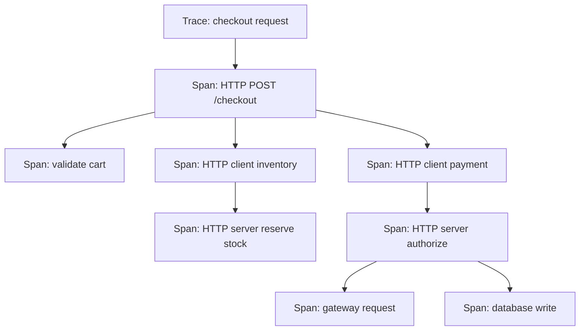
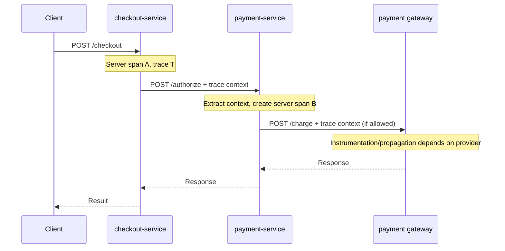
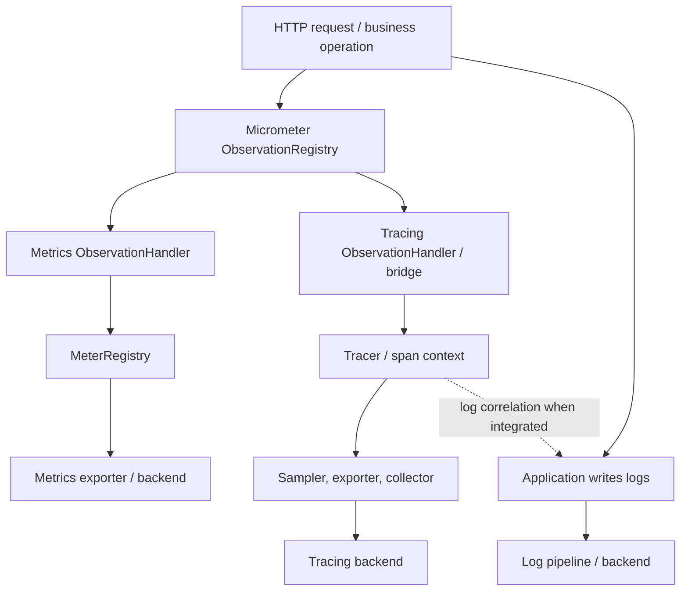

# What is a Trace in Distributed Tracing?

A customer calls `POST /checkout` on a Spring Boot application. The checkout service validates the cart, queries inventory, calls the payment service, and then writes the result to the database. The user only sees **a single slow request taking 2.4 seconds**; behind the scenes, the system performs multiple operations across several services. HTTP metrics may show increased p95 latency, and logs may record that the payment gateway timed out, but the critical question remains: **where did this specific request go, how long did each step take, and which steps are related to each other?**

A **trace** is a data model that enables observing **the journey of an operation across multiple execution steps**, often spanning multiple threads, processes, or services. A trace groups related **spans** together using identifiers and contextual relationships. With proper instrumentation and propagation, we can open a trace to inspect the measured steps, timestamps, durations, errors, and associated metadata.

This lesson belongs to the **Tracing** chapter of the **SPRING_BOOT_OBSERVABILITY** module. The module sets up observability for Spring Boot using Micrometer Observation, metrics, logs, and distributed tracing; it also explores context propagation, tags/cardinality, exporters, sampling, and correlating signals to investigate errors, latency, and application behavior in production. This lesson focuses on **the nature of a trace**, how a trace is formed, and the boundaries of what we actually observe.

## Learning Objectives

After this lesson, you will be able to:

1. Define **trace**, **span**, **trace ID**, **span ID**, and **parent span**; read a multi-service trace diagram.
2. Distinguish a trace from logs and metrics, as well as distinguish a **business-complete trace** from a **trace containing only instrumented steps**.
3. Describe span start/end, attributes, events, status, links, and relationships between spans.
4. Explain why **context propagation** across HTTP, messaging, and threads is required to preserve the linkage of a distributed trace.
5. Understand the roles of Micrometer Observation, tracing bridge, sampler, exporter, collector, and trace backend in Spring Boot.
6. Understand the meaning of head/tail sampling, limitations when traces are sampled or dropped, and how to combine traces with metrics/logs.
7. Identify risks related to cardinality, sensitive data, missing spans, or durations that are easily misinterpreted.
8. Apply an evidence-based investigation workflow using traces without confusing correlation with causation.

## 1. A Trace Describes a Journey, Not Just a Single Log Line

Suppose a checkout request passes through three services:

```text
User
   |
   v
checkout-service
   |-- validate cart
   |-- inventory-service: reserve stock
   |-- payment-service: authorize payment
   |       |-- external payment gateway
   |       +-- database: record result
   +-- respond to user
```

Each service may write its own logs, but without correlation keys and reliable timestamps, stitching log lines from a single request into one journey is difficult. Distributed tracing provides a different model:

- A **trace** represents a logical tracked journey/operation.
- Each **span** represents an instrumented step within that journey.
- Spans share a **trace ID** and can be linked via a **parent span ID** or **span links**.
- Each span records start/end timestamps, step name, and appropriate attributes.
- The trace backend aggregates received spans to visualize the timeline and relationships.



The diagram above describes the **intended business relationship**, not a guarantee that client/server spans will definitely be created. The actual result depends on instrumentation, propagation, sampling, exporter, and backend storage capabilities.

### How is a Trace Different from a Request?

An HTTP request can initiate a trace, but "one request = exactly one complete trace" should not be treated as an absolute rule:

- A request may not have a stored trace due to sampling.
- A request may trigger an asynchronous task that outlives the response; the relationship may use a continuation trace or span links depending on the design.
- One trace can contain multiple service calls and many spans, not just a single controller.
- A batch job or message consumer can be the origin of a trace without any HTTP request.
- If propagation is lost, the same business transaction may appear as **multiple disconnected traces**.

## 2. Span is the Fundamental Unit of a Trace

A **span** represents an instrumented operation: handling an HTTP request, executing a DB query, calling a downstream API, processing a message, or running a business step.

Information commonly associated with a span:

| Component | Meaning | Illustrative Example |
|---|---|---|
| **Trace ID** | Identifier of the trace to which the span belongs | `6f8c...` |
| **Span ID** | Identifier of a span within the trace | `a9b4...` |
| **Parent span ID** | Direct parent span, if any | HTTP server span ID of checkout |
| **Name** | Operation type name, should be stable | `checkout.payment.authorize` |
| **Start time** | Recorded start timestamp | 10:15:00.120 |
| **End time / duration** | End timestamp and observed duration | 85 ms |
| **Kind** | Role in the communication call | `SERVER`, `CLIENT`, `PRODUCER`, `CONSUMER`, `INTERNAL` |
| **Attributes** | Key-value pairs describing the operation | `http.request.method=POST` |
| **Events** | Notable milestones/events within the span | Retry, exception |
| **Status** | Status according to tracing stack semantic conventions | `OK`, `ERROR`, or unset |
| **Links** | Association with other span contexts | Fan-in work from multiple messages |

Not every library or backend displays fields with the same names and types. For example, HTTP attribute names depend on semantic conventions and the OpenTelemetry/Micrometer version. Check actual data rather than relying solely on illustrative diagrams.

### 2.1. Trace ID and Span ID

The Trace ID helps identify spans belonging to the same journey. The Span ID distinguishes individual steps within the trace.

In tracing systems supporting W3C Trace Context, a trace ID is 16 bytes (represented as 32 hex characters), and a span ID is 8 bytes (16 hex characters). Example standard structure:

```text
trace-id:  0af7651916cd43dd8448eb211c80319c
span-id:  b7ad6b7169203331
```

These are **diagnostic/identification IDs**, not business data. Do not infer username, order, environment, or error type from the content of a trace ID. Each span within the same trace has its own span ID; a trace ID does not prove that every service sent complete spans.

### 2.2. Root Span and Child Span

A **root span** has no parent in the parent-child relationship being represented. Spans beneath it have a parent ID, forming a hierarchical structure.

Example:

```text
Trace ID: T-01
  HTTP POST /checkout  [span A, root]
    validate cart      [span B, parent A]
    reserve inventory  [span C, parent A]
      DB query         [span D, parent C]
    authorize payment  [span E, parent A]
      gateway request  [span F, parent E]
```

When viewing a trace UI, distinguish between:

- **Parent-child relationship** shows how context was inherited/established.
- **Start/end times** show whether steps overlap or are sequential.
- **Root** is not necessarily the very first business step across the entire system if upstream is uninstrumented or trace data is missing.
- A span **displayed as root** in the backend might simply be because the parent span was not received.

### 2.3. Span Kind Does Not Indicate Importance

Common kinds:

- `SERVER`: the side receiving and handling an RPC/HTTP request.
- `CLIENT`: the side making an outbound call.
- `PRODUCER`: the side sending a message.
- `CONSUMER`: the side receiving/processing a message.
- `INTERNAL`: an in-process operation.

Span kind provides semantics about communication direction, and does not itself indicate whether an operation is fast/slow or succeeded/failed. An `INTERNAL` span for authorization business logic may be more important than an HTTP client span, depending on the investigation question.

## 3. How is a Trace Formed Over Time?

Suppose a checkout request takes 900 ms:

```text
Timeline (ms)
0           200         400         600         800   900
|------------|-----------|-----------|-----------|------|

checkout HTTP request    [================================] 900
validate cart              [==]                               60
inventory reserve             [===========]                  300
authorize payment                         [================] 430
write audit DB                                     [===]      80
```

Each bar corresponds to a span, provided that segment is instrumented. Some spans may run in parallel; multiple child spans can overlap within the parent's timeframe.

**Do not sum all child span durations to derive the root duration.** If two calls run concurrently for 300 ms and 400 ms, the sum of durations is 700 ms, yet the actual added wall-clock time might only be around 400 ms. Conversely, there are intervals within the parent not described by any child span, such as internal computation, lock waiting, or uninstrumented code.

### 3.1. Span Duration is Not Absolute Proof of Root Cause

An 800 ms client span only indicates that the **instrumented execution segment on the client side** lasted that long. Depending on the instrumentation scope, it may include DNS, connection acquisition, network transit, waiting on the server, and reading the response. It **does not prove** that the server spent 800 ms of CPU time.

A 500 ms server span indicates the measured scope on the server side; it does not specify which portion was CPU, I/O, or thread waiting. Determining the cause requires combining child spans, resource metrics, logs, and sometimes profiling.

### 3.2. Clock Skew and Event Ordering

Many spans reside on different hosts. Clock skew, timestamp rounding, or instrumentation resolution can make a timeline look like a child started before its parent or show unusual durations. A tracing backend may or may not adjust for this.

Do not immediately infer causation from a few milliseconds of difference on a timeline between two hosts. Check propagation, request-response order, and clock synchronization.

## 4. Parent-Child vs. Span Links

A parent-child structure fits well when one operation is executed within the context of another operation. However, asynchronous workflows may have multiple sources or spawn new tasks that should not be represented by a single parent.

A **span link** allows associating a span with the context of one or more other spans without declaring them as its direct parent.

Batch processing example:

```text
Message A -> producer span A ---\
                                 \
Message B -> producer span B -----> batch consumer span C
                                 /   (C links to A and B)
Message D -> producer span D ---/
```

If a consumer processes multiple messages simultaneously, picking one producer as the sole parent can be misleading. Span links preserve input relationships while maintaining accurate semantics.

When designing, distinguish:

| Relationship | When Generally Appropriate | Notes |
|---|---|---|
| **Parent-child** | Nested calls or clear parent context | A span typically has at most one direct parent |
| **Span link** | Batching, fan-in, combining multiple messages, related work that is not parent-child | Links do not automatically create a standard parent-child waterfall |
| **Same trace ID** | Spans belonging to the same trace | Not enough alone to prove every dependency was instrumented |
| **Same business ID** | Events belonging to the same business transaction | May span multiple different traces |

For queues/messaging, different libraries represent propagation and span links differently. Do not force a single relationship type for every case; choose based on lifecycle and actual semantic conventions.

## 5. Why Does Distributed Tracing Need Context Propagation?

A distributed trace is only meaningful when components can **pass and restore linkage information** across execution boundaries.

With HTTP:



Key steps:

1. **Inject:** HTTP client instrumentation takes the current span context and attaches it to outbound headers.
2. **Transport:** headers travel across the network, gateways/proxies, and intermediate services.
3. **Extract:** server instrumentation receives headers and restores the appropriate context.
4. **Create span:** the receiving side creates a span linked according to the restored context.
5. **Close scope and export:** context is properly restored on completion, and spans are forwarded to the pipeline if configured to retain them.

A common format is **W3C Trace Context** with `traceparent` and optional `tracestate`. Example:

```http
traceparent: 00-0af7651916cd43dd8448eb211c80319c-b7ad6b7169203331-01
```

The header above consists of version, trace ID, parent ID, and trace flags. Trace flags can carry the sampled flag; it is **not an authentication token or proof that the backend stored the trace**. Some systems use B3 or other propagators; the format must be compatible on both ends.

### 5.1. Propagation vs. Export

Propagation carries **context** to the next step to build span relationships. Export transfers **recorded span data** to a collector/backend. A request may pass `traceparent` correctly, yet the trace still fails to appear in the UI due to sampling, exporter, collector, or retention.

Conversely, two services that both export spans without propagating context may produce two disconnected traces.

### 5.2. Across Threads and Async Callbacks

In a Java application, opening an observation/tracing scope on an HTTP thread **does not mean** that scope automatically propagates to every thread pool. Example:

```java
// Illustrates the issue; not a proper propagation pattern:
try (Observation.Scope scope = parentObservation.openScope()) {
    executor.execute(() -> doBackgroundWork());
}
```

`doBackgroundWork()` may execute on another thread after the parent scope has already closed. Without capturing/restoring context via appropriate instrumentation or Micrometer Context Propagation, the callback may not see the current span.

With `@Async`, `CompletableFuture`, raw executors, Reactor, or messaging, you need to choose the right propagation mechanism for the active stack. In Reactor, context is typically bound to the subscription/signal; opening a scope when **constructing** a `Mono`/`Flux` does not guarantee the scope exists when the callback actually runs.

**Do not keep a scope open arbitrarily across multiple threads.** A scope should be owned and closed cleanly where the work executes. For long-running tasks with independent lifecycles, decide on span parent/link and end time based on business semantics.

### 5.3. Baggage is Not a Default Tracing Attribute

**Baggage** is additional contextual data that can be propagated across hops when supported by the system. Baggage differs from trace IDs and backend-stored span attributes:

- Not all baggage is automatically recorded as searchable span attributes.
- Baggage can cross trust boundaries and HTTP headers; limit its size and content.
- Do not put tokens, card numbers, emails, customer info, or sensitive payloads into baggage.
- Do not use baggage as an arbitrary transport channel for high-cardinality fields merely for search purposes.

## 6. Traces, Metrics, and Logs Answer Different Questions

| Signal | Strengths | Important Limitations |
|---|---|---|
| **Metrics** | Error rates, throughput, p95/p99 latency, resources, system-wide trends | Aggregation loses the context of a specific request |
| **Logs** | Events, state, error messages, application evidence | Depends on what is logged; may lack correlation or get lost |
| **Traces** | Journey of an instrumented request, span relationships and durations | Has gaps if instrumentation, sampling, or propagation is missing |

Example:

- **Metric:** `http.server.requests` reports p95 rising from 300 ms to 1.2 seconds over 15 minutes.
- **Log:** `payment gateway timeout` with `traceId` on several requests.
- **Trace:** a transaction has an HTTP client child span lasting 900 ms while DB steps are short.

Combining the three signals helps form a hypothesis: the gateway may be a major contributor to latency. However, **a single trace does not prove** 100% of slow requests share the same cause, especially if sampling only keeps a subset of cases.

### Correlating by Trace ID

When Micrometer Tracing and log correlation are integrated properly, a log entry can carry `traceId`/`spanId`. Illustrative log example:

```json
{
  "timestamp": "2026-11-22T10:15:01Z",
  "level": "WARN",
  "service": "checkout-service",
  "message": "Payment authorization timed out",
  "traceId": "0af7651916cd43dd8448eb211c80319c",
  "spanId": "b7ad6b7169203331"
}
```

This is a hypothetical log. **Opening a scope does not automatically emit a log line**, and the log format may not print IDs if unconfigured. A trace ID appearing in logs also **does not guarantee** that the corresponding trace was retained by the tracing backend.

In particular, **do not attach trace IDs as labels on metrics**: the number of values is nearly equal to the number of requests, easily causing a time-series explosion. When supported by infrastructure, exemplars can link a point on a metric chart to a trace without turning every trace ID into a label across the entire series.

## 7. How are Traces Created in Spring Boot?

In Spring Boot 3.x, observability integration typically relies on related yet distinct layers:

- **Micrometer Observation**: represents an operation and its `start`, `openScope`, `error`, `stop` lifecycle; notifies handlers of milestones.
- **Micrometer Tracing**: provides abstractions and bridges to tracing implementations such as OpenTelemetry or Brave.
- **Tracing implementation/SDK**: manages spans, context, sampling, and exporter coordination.
- **Exporter/collector**: transports spans to collection/storage such as OpenTelemetry Collector and the tracing backend.
- **Instrumentations**: HTTP server/client, messaging, database, and business code create appropriate observations/spans.



**An `ObservationRegistry` does not create traces merely by existing.** It requires a tracing handler/bridge and a corresponding implementation. Conversely, having a tracing dependency does not mean every method gets its own span; only instrumented locations create spans.

### 7.1. Illustrative Dependencies

An **illustrative Gradle configuration for a Spring Boot 3.x stack supporting Micrometer Tracing with the OpenTelemetry bridge and OTLP exporter**:

```groovy
dependencies {
    implementation 'org.springframework.boot:spring-boot-starter-actuator'
    implementation 'io.micrometer:micrometer-tracing-bridge-otel'
    runtimeOnly 'io.opentelemetry:opentelemetry-exporter-otlp'
}
```

This is one integration **option**, not a requirement to use all tracing bridges simultaneously. Spring Boot versions may differ in starters, dependency management, and auto-configuration mechanisms; verify against your specific stack in real deployments. Do not mix Brave and OpenTelemetry bridges arbitrarily as this can produce overlapping configurations.

Example sampling probability supported by some Spring Boot 3.x setups:

```yaml
spring:
  application:
    name: checkout-service

management:
  tracing:
    sampling:
      probability: 0.10
```

`0.10` merely illustrates **10% head sampling probability under the configured mechanism**; it does not mean only 10% of requests get metrics recorded. Endpoints, OTLP protocol, collector address, and authentication must be configured appropriately for your library/version. **You cannot export spans to a backend with sampling YAML alone while missing an exporter and pipeline.**

### 7.2. Instrumenting a Business Step with Observation

If the HTTP controller is already auto-instrumented, you can add an observation for a business step that is valuable for investigation:

```java
import io.micrometer.observation.Observation;
import io.micrometer.observation.ObservationRegistry;
import org.springframework.stereotype.Service;

@Service
class PaymentAuthorizationService {
    private final ObservationRegistry observationRegistry;
    private final PaymentGateway gateway;

    PaymentAuthorizationService(
            ObservationRegistry observationRegistry,
            PaymentGateway gateway) {
        this.observationRegistry = observationRegistry;
        this.gateway = gateway;
    }

    PaymentResult authorize(PaymentRequest request) {
        return Observation.createNotStarted(
                        "checkout.payment.authorize", observationRegistry)
                .contextualName("authorize payment")
                .lowCardinalityKeyValue("payment.operation", "authorize")
                .lowCardinalityKeyValue("payment.provider", "provider-a")
                .observe(() -> gateway.authorize(request));
    }
}
```

`PaymentGateway`, `PaymentRequest`, and `PaymentResult` are hypothetical domain types. When the registry has a suitable tracing handler/bridge and parent context is maintained, this observation **can** generate a business span linked to the HTTP request. If only a metrics handler is present, it can measure duration without creating a span in the tracing backend.

`observe(...)` manages the synchronous lifecycle of the callback. For asynchronous tasks, do not wrap an operation returning a `Future` or publisher and assume the observation measured until the work actually finishes; use instrumentation tailored to the lifecycle and context of the async workflow.

**Do not redundantly instrument the entire HTTP request** when server instrumentation already creates an equivalent span. Define the boundary of the business span: e.g., measure only the `authorize` step, rather than stacking a second HTTP server span over the same scope without purpose.

### 7.3. HTTP Client Tracing Requires an Instrumented Builder

HTTP clients managed/instrumented by Spring in a supported manner can create outbound spans and propagate context automatically. If code constructs clients directly using raw APIs, bypasses Spring-provided builders/customizers, or passes requests through an uninstrumented wrapper, the trace may break at that point.

When checking:

1. Is there a server span in checkout?
2. Is there a client span when calling payment-service?
3. Does the outbound request contain the proper trace context header?
4. Does payment-service extract it and create a server span in the same trace?
5. Are spans retained by the exporter/backend after sampling?

A visible client span alone is not sufficient proof that the server received the header or created a corresponding span. Verify both ends.

## 8. Sampling: Why Does a Request Exist Without a Trace?

A high-throughput system can generate huge volumes of spans. **Sampling** decides which trace data is recorded/retained at various stages of the pipeline.

### 8.1. Head-Based Sampling

Head sampling typically decides near the start of a trace, before knowing whether the final operation succeeds or fails. It reduces load early, but can drop a rare slow or failing request.

**Parent-based sampling** can inherit the sampling decision from the parent context, increasing consistency among spans in the same trace; it does not strictly guarantee every span will be stored if propagation or export fails.

### 8.2. Tail-Based Sampling

Tail sampling decides after more trace data is available, allowing prioritization of error traces, slow traces, or specific services/operations. This requires a collector/pipeline capable of buffering spans long enough to make a decision, costing additional buffer, memory, and proper configuration.

Do not equate `management.tracing.sampling.probability` with a **tail sampling** policy in the collector. They operate at different layers.

| Scenario | Possible Cause | Invalid Conclusion |
|---|---|---|
| HTTP metric increases, no trace found | Trace was sampled out, exporter/collector failed, or not instrumented | The request did not happen |
| Log has trace ID, backend has no trace | Log correlation still holds the ID, spans were not retained | The log wrote a wrong ID |
| Trace misses some spans | Missing instrumentation/propagation or spans were dropped | The business step was not called |
| Trace shows all spans, but latency metric differs | Two signals have different scopes and aggregation policies | One of them is definitely broken |

**Sampled traces are not a representative statistical dataset by default.** Do not use the ratio of error spans inside an error-prioritized trace sample to estimate the true error rate of the entire service.

## 9. Span Name, Attributes, Cardinality, and Sensitive Data

Traces need metadata for investigation, but more metadata consumes more resources and risks exposing sensitive information. Two key rules:

1. **Span names should describe a stable operation type**, without per-request data.
2. **Attributes must be selected based on operational questions and privacy.**

Example:

```text
Good:
  span.name = checkout.payment.authorize
  payment.operation = authorize
  payment.provider = provider-a
  http.route = /orders/{id}

Avoid:
  span.name = checkout.payment.authorize.order-928381
  http.url = /orders/928381?access_token=...
  payment.card_number = ...
  user.email = ...
```

In Micrometer Observation, `lowCardinalityKeyValue(...)` denotes a classification dimension with a bounded set of values, more suitable for metric tags; `highCardinalityKeyValue(...)` can be used for detailed trace information if handlers and policies allow. **High cardinality does not imply safe.** Never put tokens, secrets, financial payloads, or PII into spans, events, or baggage.

Trace IDs and span IDs are inherently very high-cardinality identifiers by design. That does not mean every order ID should also be copied onto every span. Some backends index attributes while others do not; query costs and retention vary by platform.

### Tags Do Not Automatically Join Traces

A metric having tag `payment.provider=provider-a` and a span having an attribute with the same value **only proves both refer to provider-a**, not that they originated from the same request. To connect a specific event, you need trace ID/log correlation or exemplars when supported by the stack.

Conversely, trying to attach `traceId` to all metric tags can cause time series to grow nearly linearly with request count; that is not a sustainable observability solution.

## 10. Traces Do Not Guarantee Completeness or Causation

A trace is **partial observational data of a system**, not an omniscient record. Common gaps:

- **Missing instrumentation:** libraries/protocols do not create spans, internal methods are not wrapped.
- **Lost context propagation:** thread switches, uninstrumented HTTP clients, proxies stripping headers, message consumers missing extraction.
- **Sampling and export:** spans not sampled, queue/collector drops, backend overload, or expired retention.
- **Wrong timing:** span ends before async callback or measures the wrong scope.
- **Clock skew:** unsynchronized timestamps across hosts.
- **Inconsistent status semantics:** a business rejection may be treated as a valid outcome by the application, while HTTP 4xx or exceptions are handled differently per conventions.
- **Permission-restricted data:** backend or filters only permit viewing a subset of spans/traces.
- **Temporal overlap does not prove causation:** two spans occurring concurrently do not prove one span slowed down the other.

For instance, a 900 ms `payment-client` span and a timeout log are only **correlative evidence**; you must inspect retry counts, network, connection pool, payment-service server spans, and gateway health before attributing root cause.

### Note on Error Status

A span with an exception event or `ERROR` status is not always equivalent to an HTTP 5xx request or a failed business transaction. An exception might be caught and retried successfully; a business decline might be a valid outcome returned with HTTP 200. The definition of **failure** needs to be clear in metrics/SLIs and business logic, whereas span status follows the tracing implementation's semantic conventions.

## 11. Workflow for Investigating a Slow Spring Boot Request

Suppose the dashboard shows:

- p95 `POST /checkout` jumped from 280 ms to 1.5 seconds in 10 minutes.
- HTTP 5xx increased from 0.2% to 3%.
- Logs show several `payment provider timeout` messages.

In the trace backend, an engineer opens a sample trace for a slow request:

```text
HTTP POST /checkout                   1,420 ms
  validate cart                          45 ms
  inventory-service client              190 ms
  authorize payment                     980 ms
    payment-service client              940 ms
      gateway outbound request          910 ms
  update order DB                       100 ms
```

The illustrative data suggests the gateway outbound request is a **candidate worth investigating**. To reach a reliable conclusion:

**Step 1 — Narrow scope with metrics.** Identify timeframe, route, instance, version, and actual error rate. Metrics are a better source for quantifying impact scope.

**Step 2 — Open multiple relevant traces.** Compare successful/slow/error requests, noting the sampling policy. Do not generalize across the entire system from a single trace.

**Step 3 — Inspect span structure.** Which child span dominates the critical path? Are there parallel spans or uninstrumented gaps? Is the trace broken between checkout-service and payment-service?

**Step 4 — Correlate logs via trace ID.** Look for retries, timeouts, circuit breakers, pool exhaustion, or specific exceptions. Check that logs match the trace ID and occur near the spans' timestamps.

**Step 5 — Check the dependency side.** Compare client and server spans, network metrics, connection pools, queues, and downstream error rates. A long client span alone is insufficient to conclude the provider server has a CPU bottleneck.

**Step 6 — Cross-check changes.** Do deployments, timeout configurations, retry policies, traffic patterns, or infrastructure incidents coincide with the timeframe?

**Step 7 — Verify the hypothesis.** Reproduce with an appropriate workload or monitor after remediation; re-measure p95/error rate and sample spans. A change that shortens traces while error metrics remain high does not prove the incident is resolved.

### Valid and Invalid Conclusions

| Evidence | Valid Conclusion | Conclusion Not to Rush Into |
|---|---|---|
| HTTP p95 increases | Latency of that request group increased | All requests are slow |
| One client span lasts 900 ms | The outbound call scope was slow in this trace | The server spent 900 ms on CPU |
| Timeout log has a trace ID | A timeout event correlates with this request | Every failed request timed out |
| No server span seen | There is a tracing gap to investigate | Downstream was definitely never called |
| Trace successfully stored | Some telemetry passed through the pipeline | All requests/traces were stored |

## 12. Anti-Patterns When Starting with Tracing

| Mistake | Consequence | How to Improve |
|---|---|---|
| Treating a trace as multi-line logs | Ignores span relationships, timeline, and context propagation | Understand trace ID, span ID, parent-child, and links |
| Assuming every request always has a complete trace | Wrong conclusions when sampling or propagation gaps occur | Distinguish business behavior from instrumented data |
| Creating a span wrapping the entire request when server instrumentation exists | Duplicate spans, cluttered timeline | Add spans only for necessary business steps |
| Using order ID as the span name | Too many operation names, hard to group and search | Use stable names; controlled metadata |
| Attaching trace ID as a metric label | Metric cardinality explosion | Use log correlation and exemplars where supported |
| Opening scope on parent thread and assuming it spreads across executors | Parent-child trace breaks | Use proper context capture/restore or async instrumentation |
| Stopping observation right when creating `Future`/`Mono` | Duration does not reflect actual async processing | Tie lifecycle to completion/cancellation time |
| Mistaking traceparent for an authentication header | May place misplaced trust in external input | Treat context as untrusted data; authenticate separately |
| Treating a single `ERROR` span as an entire failed transaction | Misaligned business semantics | Cross-check outcomes and SLIs separately |
| Summing all child durations to find total time | Double-counts overlapping spans | Analyze critical path and uninstrumented gaps |
| Missing traces and infinitely increasing sampling | High cost, may not fix propagation/export | Pinpoint where data is lost before changing sampling |
| Putting PII/tokens into attributes or baggage | Data exposure risk through telemetry pipeline | Apply allowlists, redaction, retention, and access control |

## 13. Checklist for Productionizing Tracing

Before relying on traces as investigation evidence, verify:

1. **Instrumentation:** Do HTTP server/client, database, messaging, and key business steps create properly scoped spans?
2. **Bridge and handlers:** Does Micrometer Observation have a tracing handler/bridge and an active tracer?
3. **Trace context:** Is W3C `traceparent` or the chosen propagator consistent across services?
4. **Async:** Do executors, `@Async`, Reactor, and queues capture/restore context at the right moment?
5. **Span naming:** Are operation names stable, free of dynamic IDs, raw URLs, or sensitive payloads?
6. **Attributes/events:** Is classification info useful, cardinality reasonable, and compliant with privacy and retention?
7. **Sampler:** Where is head/parent/tail sampling applied and what is the actual retention rate?
8. **Exporter:** Have queues, retries, collector, endpoint, TLS/authentication, and backend been verified?
9. **Sampling bias:** Do you distinguish sampled traces from statistics across all requests?
10. **Log correlation:** Do logs include `traceId`/`spanId` within the appropriate scope? Is MDC leaking into other requests?
11. **Metrics correlation:** Are HTTP latency, throughput, error rate, and SLIs available alongside traces to quantify impact?
12. **Timing:** Do clock skew, start/end handling, and asynchronous lifecycles make durations ambiguous?
13. **Relationships:** Do parent-child and links accurately reflect fan-out, fan-in, and message handling?
14. **Operations:** Are there dashboards by service/version, retention policies, access control, and a procedure to query a specific trace?
15. **Testing:** Have you tested successful requests, error requests, downstream calls, async tasks, and sampler drops?

## 14. Self-Assessment Questions

**Question 1.** A trace contains ten spans. Does that mean all ten unique business steps were tracked?

**Hint:** No. Spans only represent instrumented scopes; the business flow may have many unmeasured steps, and a single step can produce multiple spans.

**Question 2.** How do Trace ID and Span ID differ in role?

**Hint:** Trace ID groups spans belonging to one trace; Span ID uniquely identifies a single span, while parent span ID helps construct the parent-child relationship.

**Question 3.** One child span takes 300 ms and another child span takes 400 ms. Can we conclude the parent took at least 700 ms?

**Hint:** No. Two child spans can run in parallel or overlap. Inspect the timeline and critical path.

**Question 4.** Both checkout-service and payment-service have spans, but under two different trace IDs. What should be checked?

**Hint:** Check client inject, server extract, propagator format, proxy/gateway headers, async context, and unexpected new root creation.

**Question 5.** A log has a request's trace ID, but the tracing backend cannot find the trace. Does that prove the request never ran?

**Hint:** No. Sampling can drop the trace; exporter/collector/backend may also drop it or expire retention. The log can still retain the ID.

**Question 6.** Why shouldn't `traceId` be attached as a tag on every HTTP metric?

**Hint:** Nearly every request has a unique ID, causing very high cardinality and massive time-series counts. Use log/trace correlation or exemplars depending on your stack.

**Question 7.** Does `Observation.createNotStarted(...).observe(...)` always create a span visible in the backend?

**Hint:** No. It manages the observation; producing a span requires a tracing handler/bridge, proper instrumentation/context, and the trace being retained through the sampler/exporter.

**Question 8.** When a batch consumer processes multiple messages from different producers, why might span links be better than a single parent?

**Hint:** Links preserve associations to multiple sources without forcing an inaccurate parent-child relationship; choosing parent vs. link should follow the semantics of the messaging stack.

## Conclusion

**A trace is a collection of related spans describing the instrumented parts of an operation's journey** across multiple steps or services. Trace IDs group the journey, span IDs and parent-child/link relationships clarify structure, while timestamps and attributes support timing and error analysis. In Spring Boot, Micrometer Observation combines with a tracing bridge, context propagation, sampler, exporter, and backend to form distributed traces. However, traces are not inherently complete, do not replace metrics for measuring impact scale, and do not replace logs for recording every event. Reliable tracing requires stable naming, proper context propagation, managing cost and sensitive data, and cross-checking traces against metrics, logs, and operational evidence before concluding root cause.
