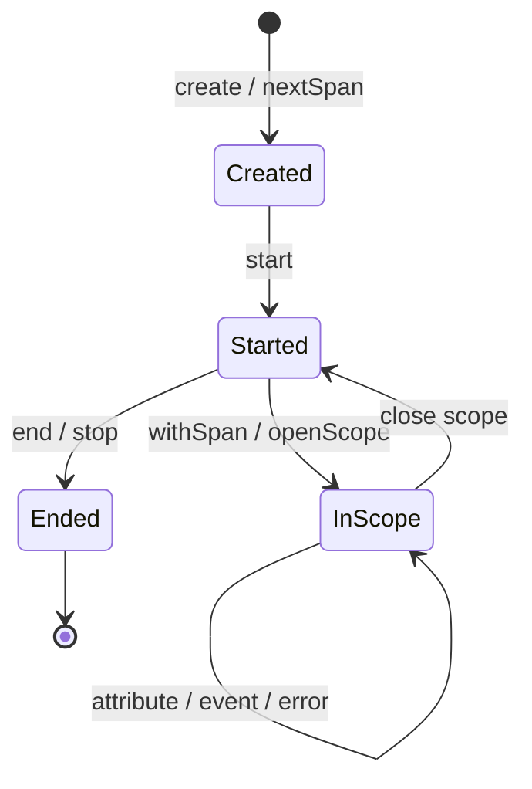
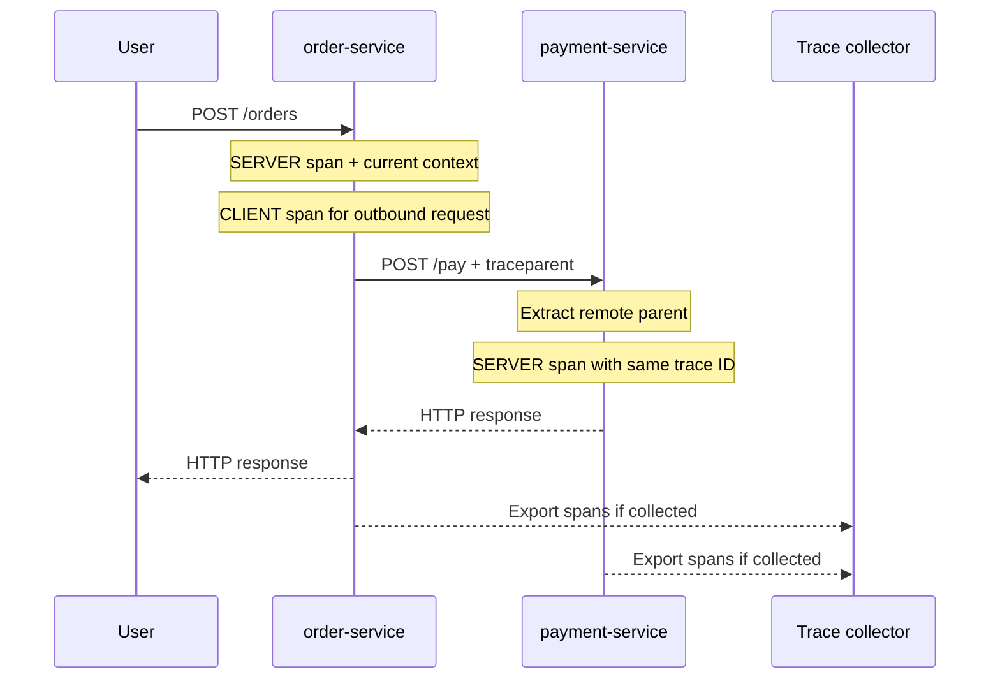
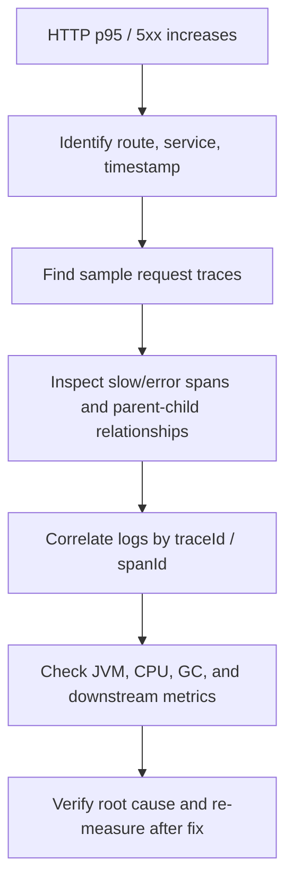

# What is a Span? The Fundamental Unit of Observation in Distributed Tracing

A customer places an order through the `POST /orders` API. The request passes through `order-service`, checks inventory, calls `payment-service`, and writes data. The dashboard reports that p95 increased from 250 ms to 1.4 seconds, yet HTTP metrics do not pinpoint which step consumed the time. **Distributed tracing** helps reconstruct the path of a request as related intervals of work. Each such interval is called a **span**.

The lesson **"What is a Span?"** belongs to the **Tracing** chapter of the `SPRING_BOOT_OBSERVABILITY` module. The module teaches how to set up observability for Spring Boot using Micrometer Observation, metrics, logs, and distributed tracing; understand context propagation, tags/cardinality, exporters, sampling, and signal correlation to investigate errors, latency, and application behavior in production. This lesson focuses on the span concept, its structure, lifecycle, relationships between spans, how to create/observe spans in Spring Boot, and what spans **can and cannot prove** when diagnosing incidents.

## 1. Span and Trace Concepts

A **span** is a record representing a unit of work with a start and end time: handling an HTTP request, confirming an order, calling a database, sending a message, making an HTTP client call, or executing a business step. A span typically has a name, identifiers, timestamps, attributes, events, and linkage information to other work.

A **trace** is a collection of spans belonging to the same distributed processing flow, connected via **trace context** and parent–child or other link relationships. A trace often begins when the system receives an external request, though it can also start from a scheduled job, message, or work without an HTTP request.

| Concept | Meaning | Example |
| --- | --- | --- |
| Trace | Entire traced processing flow | A customer placing an order across multiple services |
| Span | A unit of work with a time interval | `inventory.reserve`, `payment.authorize` |
| Trace ID | Shared identifier used to group spans in the same trace | 32-character hex string in the common W3C format |
| Span ID | Unique identifier of one span within a trace | 16-character hex string in W3C |
| Parent span | Span that creates or serves as the parent context for another span | HTTP server span as parent of the order placement logic |
| Root span | Span with no recorded parent in the trace | The first span when an operation starts a new trace |
| Span context | Identifying information and flags/values to propagate | Trace ID, span ID, trace flags, trace state |

Example of a hierarchical trace:

```text
Trace: 4bf92f3577b34da6a3ce929d0e0e4736
└── HTTP SERVER POST /orders         (span A, 980 ms)
    └── order.place                  (span B, 900 ms)
        ├── inventory.reserve        (span C, 190 ms)
        └── payment.authorize        (span D, 580 ms)
            └── HTTP CLIENT /pay     (span E, 530 ms)
                └── HTTP SERVER /pay (span F, 490 ms in another service)
```

All spans in the diagram can share the **Trace ID**, while each span has its own **Span ID**. Spans C and D are child spans of B. Spans E and F in different processes can establish a parent–child relationship if the HTTP client injects and the HTTP server extracts trace context properly.

**A trace is not guaranteed to contain every span.** Sampling, exporter errors, missing instrumentation, or lost context propagation can cause traces stored in the backend to miss certain branches. The order and durations in the example are illustrative only, not actual application output.

## 2. Structure of a Span

In the OpenTelemetry ecosystem, a span typically contains the following fields; Micrometer Tracing provides its own abstraction API while aligning with these same tracing concepts.

| Field | Role | Notes |
| --- | --- | --- |
| Name | Operation name | E.g., `order.place`; should be stable, without dynamic IDs |
| Trace ID | Trace identifier | Typically preserved when propagated across multiple services |
| Span ID | Span identifier | Each span has its own ID |
| Parent Span ID | Parent span identifier, if any | Not every span has a parent |
| Start/end timestamps | Defines execution interval | Used to calculate duration and render waterfalls |
| Kind | Interaction role of the span | `SERVER`, `CLIENT`, `INTERNAL`, `PRODUCER`, `CONSUMER` |
| Attributes/tags | Structured context | HTTP method, route template, dependency type, outcome |
| Events | Notable milestones inside the span | Retry started, cache miss, recorded exception |
| Status/error | Processing status | The tracing system and conventions determine representation |
| Links | Links to other spans outside the parent–child tree | Batches or messages with multiple sources |
| Resource | Service/process/host info attached by SDK/exporter when present | `service.name`, deployment version, environment |

An example span displayed in a tracing backend might look like:

```text
traceId      = 4bf92f3577b34da6a3ce929d0e0e4736
spanId       = 00f067aa0ba902b7
parentSpanId = b9c7c989f97918e1
name         = payment.authorize
kind         = INTERNAL
service.name = order-service
start        = 10:15:24.100
end          = 10:15:24.630
duration     = 530 ms
attributes:
  payment.channel = card
  outcome         = success
events:
  gateway.requested
  gateway.responded
```

This is **hypothetical** data; whether `kind`, `resource`, tags, or events appear depends on instrumentation and configuration. Information like `service.name` is typically a **resource attribute** tied to the process, not necessarily an attribute attached directly to each individual span.

### 2.1. How do Trace ID and Span ID Differ?

- **Trace ID** groups spans belonging to a trace. When `order-service` calls `payment-service`, the trace ID is typically preserved if propagation works.
- **Span ID** identifies a specific span. The client span and server span of the same HTTP call are **two distinct spans**, usually sharing the trace ID but having separate span IDs.
- **Parent Span ID** indicates the parent context. The first span of a new trace normally has no parent; a span created from a request with a remote parent gets the parent ID from the upstream service.

An ID is only a correlation key. It **does not contain the error cause, customer name, or latency**. Never use trace ID as a metric tag because its value differs on nearly every trace, causing very high cardinality.

## 3. Span Kind: Seeing the Role of Each Operation

In OpenTelemetry, **span kind** describes the interaction role:

| Kind | When Used | Example |
| --- | --- | --- |
| `SERVER` | Side receiving and handling a remote call | HTTP request arriving at `payment-service` |
| `CLIENT` | Side actively calling a remote service/resource | `order-service` calling `payment-service` |
| `INTERNAL` | Internal work within a single process | `inventory.reserve`, price calculation, order validation |
| `PRODUCER` | Side publishing a message via messaging | Publishing `OrderCreated` to a broker |
| `CONSUMER` | Side receiving and processing a message | Consumer processing `OrderCreated` |

This reflects **interaction semantics**, not HTTP status or priority level. A `CLIENT` span is not necessarily failed; an `INTERNAL` span can record an exception. Spans created directly from Observation may carry an internal kind unless specialized instrumentation is used.

To model an HTTP call, instrumentation typically creates a **CLIENT span** on the caller side and a **SERVER span** on the receiver side. These two spans overlap in time because the client waits for the response while the server processes. **Do not simply sum all durations to infer total request latency.**

## 4. Duration, Waterfall, and Critical Path

A span's duration is typically calculated by subtracting the start time from the end time:

\[
\text{span duration} = \text{end time} - \text{start time}.
\]

Example request:

```text
Time (ms)       0      200      400      600      800      1000
HTTP server     [----------------------------------------------] 980
order.place       [------------------------------------------]   900
inventory.reserve   [--------]                                  190
payment.authorize                 [--------------------------]  580
HTTP client /pay                    [-----------------------]     530
```

The bars here are simplified for illustration. When reading a waterfall:

1. **A parent span includes the runtime of nested work**, not just the parent's own direct processing time.
2. **Child spans can overlap** if code runs concurrently; the sum of child durations can exceed the parent's duration.
3. There may be **uninstrumented gaps** between children; do not automatically assume gaps are CPU work.
4. An HTTP call has a client span and a server span; the difference may include network, queueing, serialization, or instrumentation overhead, not all of it is "network latency".
5. For traces spanning multiple machines, timestamps can be skewed due to unsynchronized clocks; interpret very short intervals carefully.

The **critical path** is the chain of work that determines actual latency when concurrent processing exists. It is not determined simply by picking the spans with the largest total duration. When a slow span is found, inspect concurrency, queueing, GC, locks, and downstream calls next.

## 5. Span Lifecycle: Create, Start, Scope, Record, End

A span has its own lifecycle:



**Start** marks the starting timestamp; **end** completes the span. **Scope** sets the span as the current context within an execution block so nested operations can find their parent. Closing a scope **does not mean** ending the span: the scope restores the previous context, whereas `end()` finishes the measurement interval.

Rules:

- Never create a span and forget to end it: the backend may not receive a complete span.
- Never close a scope opened on one thread in a different thread.
- Never leave request A's current span on a thread pool thread when that thread is reused for request B.
- Record error info according to business and tracing semantics; do not assume every HTTP status code maps to a Java exception.
- Avoid creating spans for every variable assignment, getter, or tiny loop; observation overhead and trace noise will grow.

### 5.1. Why Does Scope Matter?

Suppose a parent span `order.place` is executing. If `inventory.reserve` starts inside the parent's scope, the tracing layer can establish a **parent → child** relationship. If code runs on another thread without restoring context, the child span may become a new trace or lack the proper relationship.

In Spring Boot, **Micrometer Observation** manages operation lifecycles uniformly; the **Micrometer Tracing bridge** translates eligible Observations into spans via the configured tracer backend. Not every Observation becomes a span if a handler is missing or if sampling/filtering drops it.

## 6. Creating Business Spans via Micrometer Observation

With Spring Boot 3.x, the preferred approach to instrument business logic is using the Spring-managed `ObservationRegistry`. This serves **both metrics and tracing** from a single lifecycle rather than writing two separate instrumentations.

Suppose placing an order requires reserving inventory:

```java
import io.micrometer.observation.Observation;
import io.micrometer.observation.ObservationRegistry;
import org.springframework.stereotype.Service;

@Service
public class InventoryService {
    private final ObservationRegistry observationRegistry;
    private final InventoryGateway gateway;

    public InventoryService(
            ObservationRegistry observationRegistry,
            InventoryGateway gateway) {
        this.observationRegistry = observationRegistry;
        this.gateway = gateway;
    }

    public Reservation reserve(OrderCommand command) {
        String channel = normalizeChannel(command.channel());

        return Observation.createNotStarted(
                "inventory.reserve", observationRegistry)
            .contextualName("reserve-inventory")
            .lowCardinalityKeyValue("sales.channel", channel)
            .observe(() -> gateway.reserve(command));
    }

    private static String normalizeChannel(String channel) {
        if ("web".equals(channel) || "mobile".equals(channel)
                || "partner".equals(channel)) {
            return channel;
        }
        return "other";
    }
}

record OrderCommand(String orderReference, String channel) {}
record Reservation(boolean reserved) {}

interface InventoryGateway {
    Reservation reserve(OrderCommand command);
}
```

This example focuses on observability; a real application must have an implementation registered as a bean for `InventoryGateway`.

When `reserve(...)` is called:

1. An Observation named `inventory.reserve` is created using the application's configured registry.
2. `observe(Supplier)` wraps **synchronous** work, managing start/scope/stop and propagating exceptions on failure.
3. The metrics handler can record an `inventory.reserve` Timer.
4. When a tracing bridge and appropriate handler are present, the Observation can be represented as a span named `reserve-inventory` with the right parent relationship if a current context is active.
5. The `sales.channel` attribute has a bounded value set, suitable for grouping metrics; avoid turning `orderReference` into a low-cardinality metric tag.

**An Annotation/Observation does not guarantee a span appears in the backend.** You still need a tracer bridge, exporter, receiving backend, and matching sampling policy. Creating a registry manually in a service via `ObservationRegistry.create()` may lack the handlers registered by Spring Boot.

### 6.1. Difference Between Observation and Span

| Micrometer Observation | Span |
| --- | --- |
| Concept for observing an operation across its lifecycle | Tracing record of an operation |
| Can produce a Timer metric, span, or other handler outputs | Dedicated to distributed tracing |
| `ObservationRegistry` + `ObservationHandler` | `Tracer`, tracing SDK, exporter/backend |
| `lowCardinalityKeyValue`, `highCardinalityKeyValue`, error/event | Attributes/tags, events, error/status depending on API |
| `openScope()` and `stop()` are two distinct responsibilities | `SpanInScope.close()` and `span.end()` are two distinct responsibilities |

Do not create both a manual Tracer span and an Observation span around the exact same step just to "add detail": this can generate two nearly identical spans. Decide clearly which instrumentation layer owns the boundary.

## 7. Creating a Span Directly Using Micrometer Tracer

When direct tracing APIs are needed, you can inject `io.micrometer.tracing.Tracer`. Example:

```java
import io.micrometer.tracing.Span;
import io.micrometer.tracing.Tracer;
import org.springframework.stereotype.Service;

@Service
public class PricingService {
    private final Tracer tracer;
    private final PricingEngine engine;

    public PricingService(Tracer tracer, PricingEngine engine) {
        this.tracer = tracer;
        this.engine = engine;
    }

    public PriceQuote calculate(PriceCommand command) {
        Span span = tracer.nextSpan().name("price.calculate");
        span.start();

        try (Tracer.SpanInScope scope = tracer.withSpan(span)) {
            span.tag("pricing.mode", "standard");
            span.event("pricing.started");
            PriceQuote quote = engine.calculate(command);
            span.event("pricing.completed");
            return quote;
        } catch (RuntimeException exception) {
            span.error(exception);
            throw exception;
        } finally {
            span.end();
        }
    }
}

record PriceCommand(String sku) {}
record PriceQuote(long amountMinor) {}
interface PricingEngine {
    PriceQuote calculate(PriceCommand command);
}
```

The example assumes a `PricingEngine` bean and a configured `Tracer`. `tracer.nextSpan()` typically creates a child span from the current context if present; when no valid parent exists, a new trace may start.

**Meaning of each operation:**

- `nextSpan().name(...)`: requests span creation and names the type of work.
- `start()`: begins measuring the execution interval.
- `withSpan(span)`: places the span into the current scope, allowing nested operations to discover the context when supported.
- `tag(...)`, `event(...)`: adds context/state within the trace scope.
- `error(exception)`: records error details via the bridge/tracer mechanism without replacing application exception handling.
- `scope.close()` via `try-with-resources`: restores the current span to its prior state.
- `span.end()` inside `finally`: ends the span even if an exception occurs.

For sensitive data, **do not log raw SKUs containing user data, tokens, emails, or payloads** into tags/events unless there is a clear requirement and proper protection policy.

### 7.1. When Should You Use Tracer Directly?

Use Micrometer Tracer when you need direct control over spans, tags/events, or integration with a specific tracing snippet. For most routine business instrumentation, Observation is more reusable because it feeds multiple signals and shared conventions simultaneously. Do not replace automatic HTTP/messaging instrumentation with manual spans when the framework already provides standard boundaries.

## 8. Parent–Child Relationships Across Services: Propagation

When a request flows from `api-gateway` to `order-service` and then `payment-service`, each process has separate memory and threads. **The current span cannot travel across the network on its own.** Trace context must be encoded into transport fields and restored on the receiving side.

Example W3C Trace Context using HTTP headers:

```http
traceparent: 00-4bf92f3577b34da6a3ce929d0e0e4736-00f067aa0ba902b7-01
```

In the common version `00` format:

| Segment | Meaning |
| --- | --- |
| `00` | traceparent format version |
| `4bf92f3577b34da6a3ce929d0e0e4736` | Trace ID (32 hex characters) |
| `00f067aa0ba902b7` | Parent ID sent in context (16 hex characters) |
| `01` | Trace flags; sampled bit is enabled in this example |

The header may be accompanied by `tracestate` to carry vendor/SDK-managed tracing metadata. The sampled flag is a **signal of the sampling decision**, not a guarantee that every span will reach the backend and be retained. Head-based/tail-based sampling mechanisms or collector filtering steps may apply.



If the sender fails to inject headers, the receiver fails to extract them, or both sides use incompatible propagation configurations, the span in the downstream service may start a new trace. **Do not fix this by manually copying traceId into metric tags**: fix instrumentation and propagation instead.

### 8.1. Is Baggage a Span Attribute?

**Baggage** is context data designed to travel across process boundaries alongside trace context when configured. A **span attribute** describes a single span and is not automatically forwarded to downstream services. An attribute like `payment.channel=card` on span A **does not automatically appear** on span B in another process.

Baggage can impact header sizes, privacy, and security; do not use it to pass tokens, personal data, or sensitive fields indiscriminately. Not all baggage fields are automatically placed into log MDC or span attributes without proper configuration.

## 9. Scope Across Threads, Async, and Reactive Pipelines

In synchronous flows, the current span is typically bound to the thread's execution context. When invoking an `Executor`, `CompletableFuture`, `@Async`, a message consumer, or a Reactor pipeline, code may resume on another thread.

Misleading example:

```java
// Does NOT guarantee measuring until the CompletableFuture work completes.
return Observation.createNotStarted("report.generate", registry)
    .observe(() -> CompletableFuture.supplyAsync(this::generateReport));
```

Here, the Observation may only measure the time to create/schedule the future; the current thread's scope does not automatically follow the task to the worker thread. To measure the full async lifecycle, start/end timing must align with **actual completion** and context must be propagated properly.

Key principles:

1. **Capture** the parent work's context at task submission time and **restore** it when the worker runs; close the restored scope on that same thread.
2. Use Micrometer Context Propagation or corresponding framework integrations to handle ThreadLocal context.
3. With Reactor/WebFlux, understand Reactor Context and supported propagation; do not assume a ThreadLocal follows an entire reactive chain.
4. With messaging, producers/consumers can pass context via headers; batch/fan-in patterns may need **span links** instead of a simple parent–child relationship.
5. Inspect the actual trace tree: child spans must belong to the right trace, have the expected parent, and measure the true work duration.

**Never leave `Tracer.SpanInScope` or `Observation.Scope` open on one thread and close it on another thread.** A scope is responsible for restoring the current context within the exact scope where it was opened.

## 10. Attributes, Events, Errors, and Semantic Conventions

Spans exist to understand an operation, not to store every program variable. Choose data that answers concrete operational questions:

| Data | Reasonable Example | Avoid |
| --- | --- | --- |
| Span name | `inventory.reserve` | `inventory.reserve-ORDER-928371` |
| Bounded-value attribute | `inventory.outcome=reserved/rejected` | Unbounded free-form user input |
| HTTP attributes | Method, route template, response status per conventions | Raw URL containing tokens or sensitive queries |
| Event | `retry.started`, `stock.lock.acquired` | Events for every line of code or every loop iteration |
| Exception | Error type, message sanitized per policy | Uncontrolled stack traces/payloads/secrets |
| Link | Linking batch message sources | Forcing multi-parent work into a single-parent tree |

Points to remember:

- **Tags/attributes** add context to a span; they do not necessarily become metric tags.
- A **span event** marks a timestamped milestone within an operation, rather than creating a new span.
- **Error status** and **exception event** are not always synonymous. Depending on SDK, conventions, and handlers, recording an exception may emit an event, set status, or both.
- **HTTP 4xx** is not always a technical error; a **business rejection** does not have to be marked as an exception. Define error policies according to observability needs.
- High-cardinality attributes in tracing also incur storage and query costs; even though tracing can hold richer detail than metrics, limits and security policies still apply.

### 10.1. Example of Events and Errors

In code using `Tracer`:

```java
Span span = tracer.nextSpan().name("inventory.reserve").start();
try (Tracer.SpanInScope scope = tracer.withSpan(span)) {
    span.tag("inventory.result", "pending");
    span.event("inventory.lookup.started");
    performReservation();
    span.tag("inventory.result", "reserved");
    span.event("inventory.lookup.completed");
} catch (RuntimeException ex) {
    span.tag("inventory.result", "error");
    span.error(ex);
    throw ex;
} finally {
    span.end();
}
```

The example assumes `tracer` and `performReservation()` are available in the same method scope. For synchronous operations with a business outcome such as "out of stock", you might set `inventory.result=rejected` without throwing an exception; this handling depends on the domain contract.

## 11. Configuring Distributed Tracing with Spring Boot

The following example targets **Spring Boot 3.x and Java 17+**, using the Micrometer Tracing bridge to OpenTelemetry; dependency versions are managed by the Spring Boot BOM/parent. Verify properties and exporter protocols against your **exact Spring Boot version** before deploying to production.

```xml
<dependencies>
    <dependency>
        <groupId>org.springframework.boot</groupId>
        <artifactId>spring-boot-starter-web</artifactId>
    </dependency>
    <dependency>
        <groupId>org.springframework.boot</groupId>
        <artifactId>spring-boot-starter-actuator</artifactId>
    </dependency>
    <dependency>
        <groupId>io.micrometer</groupId>
        <artifactId>micrometer-tracing-bridge-otel</artifactId>
    </dependency>
    <dependency>
        <groupId>io.opentelemetry</groupId>
        <artifactId>opentelemetry-exporter-otlp</artifactId>
    </dependency>
</dependencies>
```

Example `application.yml` for a development environment:

```yaml
spring:
  application:
    name: order-service

management:
  tracing:
    sampling:
      probability: 1.0   # For local testing; do not use by default in production
  otlp:
    tracing:
      endpoint: http://otel-collector:4318/v1/traces
  endpoints:
    web:
      exposure:
        include: health,metrics
```

Path `4318/v1/traces` here is an example **OTLP HTTP** receiver; ensure the collector is listening on the right endpoint, network, and protocol. Sampling `1.0` helps observe plenty of traces during testing but can be expensive in production. There is no single optimal sampling probability for every service.

**Do not confuse metrics with traces:** `/actuator/metrics` exposes meters; it is not a trace viewer and does not confirm spans reached the backend. Traces are shipped via the corresponding tracing exporter/collector. If Prometheus metrics are needed, you also need a Prometheus registry and separate scrape/export configuration.

### 11.1. Verifying an End-to-End Trace

1. Start a compatible collector and tracing backend (such as Jaeger/Tempo or another system per architecture).
2. Send a request to an instrumented endpoint.
3. Search for traces by `service.name` and a time window near the request.
4. Open a trace and inspect the HTTP SERVER span, business spans, and HTTP CLIENT span if present.
5. Verify parent–child relationships, trace IDs, and corresponding durations.
6. If multiple services are involved, verify header propagation and the server span in the downstream service under the same trace.
7. Check log correlation if the tracing bridge and logging pattern are configured with traceId/spanId.

When an application uses WebFlux, messaging, or different HTTP clients, auto-instrumentation coverage depends on the framework, how clients are built, and specific configurations. Prefer Spring-managed client builders/instances that support observation; a hand-rolled HTTP client outside that mechanism may not automatically propagate context.

## 12. How Sampling and Exporters Affect Span Visibility

A system can instrument many spans yet **not store every span** to control costs:

| Mechanism | Decision | Impact |
| --- | --- | --- |
| Head-based sampling | Decides early when a trace starts based on policy | Can drop an entire trace before knowing the request failed |
| Parent-based sampling | Honors sampling decision from parent if present | Helps maintain consistency across services |
| Tail-based sampling | Decides after inspecting spans/trace in a compatible collector | Can prioritize error/slow traces, but requires infrastructure to buffer and analyze data |
| Exporter/collector | Ships/receives/batches/retries/processes spans | Network failures or misconfiguration can drop recorded spans |
| Backend retention | How long traces are kept and what queries are allowed | Older traces may be purged even after successful export |

A sampling probability of `0.1` usually expresses a target of keeping roughly 10% of traces under a probabilistic sampling policy, **not a guarantee of exactly 10% every minute**, nor "every failed request is kept". Retained traces can be skewed when selective policies exist; understand the sampling strategy before interpreting error counts from traces.

**Do not use span counts in the backend as total request counts** when sampling is active. To track request rates, error rates, and aggregated p95/p99, use independently designed and collected metrics, such as HTTP Timers/histograms.

### 12.1. When a Trace Appears Only Partially

Possible causes include:

- A service lacks tracing instrumentation/bridge.
- Trace context headers were not injected or were stripped by a proxy.
- A worker thread or message consumer failed to restore context.
- Sampling and processors selectively dropped part of the data.
- Exporter/collector/backend failed, throttled, or was unconfigured.
- Querying the wrong service name, time range, or trace ID.

When diagnosing, distinguish between **span was never created**, **span was created but not exported**, and **span was exported but is missing in the backend**. Seeing a trace with a missing branch alone is insufficient to pinpoint which cause occurred.

## 13. Spans, Metrics, and Logs Complement Each Other

Suppose `POST /orders` is slow and occasionally returns errors:

| Signal | Unit of Observation | Question Answered |
| --- | --- | --- |
| HTTP metrics | Many requests aggregated by tags | How are 5xx rate, p95, and request rate changing? |
| Business metrics | Many invocations of a business operation | Which channel has slow `payment.authorize`? |
| Span/trace | One collected execution flow | Which span spent time in this request, and which service was called? |
| Logs | Timestamped events and messages | What timeouts, retries, exceptions, or error codes occurred? |
| JVM/CPU/GC metrics | Runtime state per instance | Are there GC pauses, CPU saturation, or thread contention? |

Investigation flow:



**Span duration is not CPU time.** An 800 ms span might spend 700 ms waiting on network, locks, or queues. If CPU-bound behavior is suspected, profile (e.g., JFR) and check CPU metrics. If an HTTP client span is long, inspect the receiving server span, retries, and network health too; do not assume the entire delta is network transit.

### 13.1. How Does Log Correlation Work?

When the tracing bridge and logging integration are configured, logs emitted inside a span's scope can be enriched with `traceId`/`spanId` via MDC or an equivalent mechanism. This helps locate logs associated with a selected trace.

Avoid confusion:

- Putting `traceId` into a **log field** for per-request lookup is appropriate.
- Putting `traceId` into a **metric label/tag** typically causes massive cardinality.
- Logs printed outside the current span scope may lack correlation info.
- If threads or processes lose context, logs and spans may fail to connect properly; fix propagation instead of copying IDs manually everywhere.

### 13.2. Is an Exemplar a Span?

Some metric systems support **exemplars**: a measurement sample can carry a trace ID so operators can jump from a metric data point to the corresponding trace. An exemplar is a **linking mechanism** between certain metric samples and traces; not every sample has an exemplar, and it does not replace spans. Availability depends on Micrometer, registry, exporter, backend, sampling, and dashboards.

## 14. Designing Useful Span Names and Attributes

Span names should represent the type of work, not describe each unique entity.

| Target | Recommended | Avoid |
| --- | --- | --- |
| HTTP server | `GET /orders/{id}` or framework convention name | `GET /orders/492813` |
| Business operation | `order.place` | `order.place.customer.8291` |
| HTTP client | Request name per HTTP instrumentation | Embedding access tokens in the name |
| SQL/database | Operation/statement normalized per policy | SQL containing sensitive data |
| Messaging | `order.created process` per convention | Names containing a different message ID each time |

Attributes should be useful for filtering traces, such as `order.channel=web/mobile` or `payment.provider=providerA/providerB` when values are bounded. Order IDs, customer IDs, or exception messages may be sensitive and high-cardinality: record them only with clear lookup needs, appropriate retention/access control, and normalize or redact as needed.

Do not treat a span as an unbounded log: adding thousands of events/attributes to a single span can cause the SDK/collector to truncate, drop data, or drive up costs. When detailed history is needed, use structured logs linked via trace ID.

## 15. Common Misconceptions When Reading Spans

| Misconception | Why It Is Wrong | Correct Understanding |
| --- | --- | --- |
| "A span is the whole trace" | A span only represents one unit of work | A trace consists of multiple linked spans |
| "Span ID equals trace ID" | Two different levels of identification | Same trace ID, distinct span IDs |
| "Having an Observation guarantees seeing a span" | Requires tracing handler/bridge/exporter and sampling | Check the full tracing pipeline |
| "Closing scope ends the span" | Scope only manages current context | Only `span.end()` or Observation `stop()` finishes it |
| "Sum of child durations equals parent duration" | Overlapping spans and uninstrumented gaps exist | Use waterfalls and critical path analysis |
| "A 500 ms span means 500 ms of CPU usage" | It could be waiting on network/I/O/locks | Check CPU metrics, threads/JFR |
| "A trace missing a span means code didn't run" | Span could be uninstrumented, sampled, or dropped in export | Verify each stage of the pipeline |
| "Every HTTP 4xx is a technical error" | HTTP 4xx can be an expected outcome | Define error policy based on semantics |
| "Attach traceId as a metric tag to link signals" | Extremely high cardinality | Use log correlation/exemplars |
| "A span name should include unique IDs" | Hard to filter/group, increases variance and data leak risk | Use stable operation names |
| "Child spans automatically cross to other threads" | Current context does not propagate across async by default | Capture/restore via proper integration |
| "10% sampling shows 10% of errors" | Head sampling can drop error traces before outcome is known | Use metrics and appropriate sampling policies |

## 16. Hands-On Exercise: Tracing a Request Across Two Spring Boot Services

Create two test services `order-service` and `payment-service`; both have Actuator, Micrometer Tracing bridge, exporter, and share a compatible tracing backend. Run this in a dev/staging environment.

1. **Explore an existing trace:** send `POST /orders` and locate the HTTP server span of `order-service`. Note the trace ID, span ID, duration, and service name.
2. **Add a business span:** instrument `inventory.reserve` using `Observation.createNotStarted(...).observe(...)`. Confirm the new span sits inside the request's trace rather than becoming a disconnected trace.
3. **Make an inter-service call:** use a Spring-configured HTTP client with corresponding instrumentation to call `payment-service`. Check that the caller's CLIENT span and receiver's SERVER span share the same trace ID.
4. **Verify propagation:** observe `traceparent` in a controlled test environment and verify parent/child linkage. Do not log full headers containing secrets.
5. **Attach events and errors:** simulate a business payment rejection and a technical exception; distinguish outcome from error, and inspect span attributes/events/status per your SDK.
6. **Test sampling:** lower probability from `1.0` in dev to a smaller rate, send multiple requests, and compare trace counts with HTTP metrics. Explain why trace counts cannot serve as total request counts.
7. **Test async:** offload a step to an executor, observe the missing parent when propagation is absent, and fix it using an appropriate context propagation mechanism. Verify scope and span duration match true completion.
8. **Correlate logs:** configure logs with traceId/spanId and locate logs for a slow span; also check CPU/GC metrics to distinguish wait time from CPU execution.
9. **Audit data:** review span names, attributes, events, trace retention, and access permissions; ensure no customer identifiers or tokens enter telemetry.

### Self-Check Questions

1. How does a span differ from a trace? Can two spans from two services share the same trace ID while having different span IDs?
2. Why doesn't a 900 ms parent span necessarily equal the sum of its child durations?
3. How do `CLIENT` and `SERVER` spans of the same HTTP request differ?
4. What is the role of `traceparent`? If that header is stripped at a proxy, how might the trace tree change?
5. Do `withSpan(...)` and `span.end()` serve the same function?
6. Why does `Observation.observe(() -> CompletableFuture.supplyAsync(...))` not guarantee measuring the entire async job?
7. How does sampling affect finding a trace for a rare error?
8. When a span lasts 1 second, what additional signals are needed before concluding the CPU is overloaded?

## 17. Checklist for Productionizing Tracing

- Use stable span names, attaching attributes/events only when serving concrete investigation questions.
- Instrument meaningful boundaries; avoid duplicate spans and overly granular instrumentation.
- Maintain trace context across HTTP/messaging/async; verify parent–child links across services.
- Ensure spans are started/ended properly and scopes are opened/closed on the right thread.
- Define error and outcome recording policies aligned with HTTP and business semantics.
- Use Micrometer Observation to reuse instrumentation across metrics and tracing where appropriate.
- Have clear tracing bridge, exporter/collector, backend, network/auth, and sampling policies.
- Do not use trace counts as request rates when sampling is active; combine with metrics to monitor total traffic.
- Do not put trace IDs or user-identifying data into metric tags; protect span attributes and logs.
- Enforce limits on retention, cardinality, event counts, exporter cost, and trace access permissions.
- Cross-check traces against HTTP/business/JVM metrics, structured logs, and profilers to verify true root causes.

## Conclusion

A **span** is the fundamental unit of distributed tracing: a named, timed record of work with identifiers and context that can carry attributes, events, status, and links to other spans. Related spans form a trace reflecting a request's path across services. In Spring Boot, Micrometer Observation together with a tracing bridge creates spans from business operations and connects them with metrics; Micrometer Tracer allows direct span control when needed. A useful trace requires proper start/end and scoping, context propagation across boundaries, and appropriate exporters and sampling. When cross-checked with metrics and logs, spans pinpoint **slow or failing segments of work** without mistaking a single span's duration for CPU time or total request volume.
