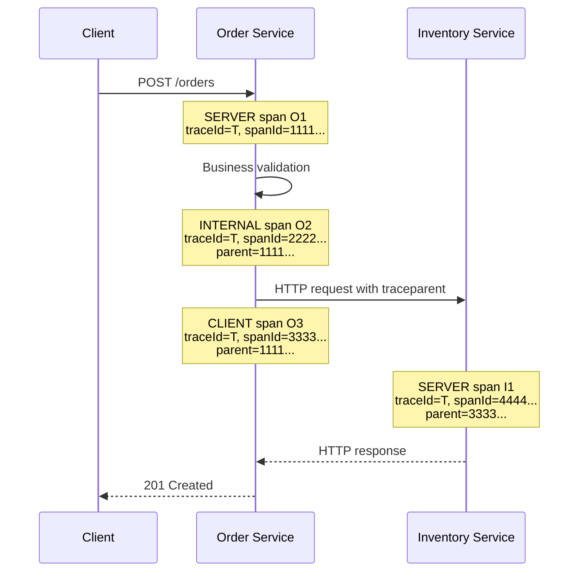
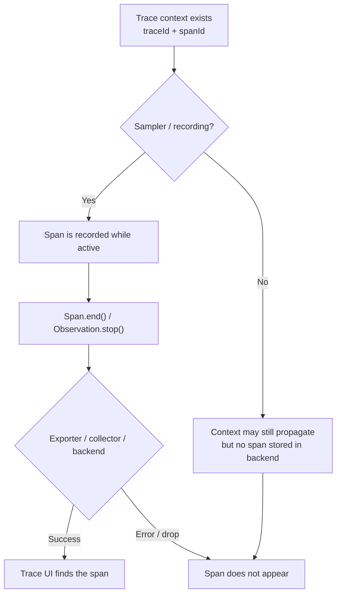

# Span ID

A `POST /orders` request passes through the Order Service, calls the Inventory Service, and then calls the Payment Service. When a request is slow, operators need to know **which step actually consumed the time**, which logs belong to that exact step, and how they connect to one another. Distributed tracing provides `span` records to describe each unit of work. **Span ID** distinguishes individual spans within a trace, even when spans share the same name or execute across different services.

The **Span ID** lesson belongs to the **Tracing** chapter of the **SPRING_BOOT_OBSERVABILITY** module. The module focuses on observing Spring Boot with Micrometer Observation, metrics, logs, and distributed tracing; learning context propagation, tag/cardinality management, exporters, sampling, and signal correlation when investigating errors, latency, and application behavior in production.

> **Key Takeaway:** `traceId` identifies the **entire trace**, whereas `spanId` identifies **a specific span within that trace**. A child span uses the same `traceId` as its parent span, has its own `spanId`, and records `parentSpanId` pointing to the parent's `spanId`. In the common W3C Trace Context format, a span ID is **8 bytes, represented as 16 lowercase hexadecimal characters**; an all-zero value is invalid.

## 1. Learning Objectives

After this lesson, you will be able to:

1. Accurately distinguish `Trace ID`, `Span ID`, `Parent Span ID`, span name, span kind, and span attributes.
2. Read a trace tree and identify parent–child relationships through the IDs.
3. Explain the W3C `traceparent` structure and the meaning of the `parent-id` field when propagated over HTTP.
4. Understand why an inter-service call can generate multiple distinct Span IDs while preserving the same Trace ID.
5. Read `traceId` and `spanId` from `Micrometer Tracer` in Spring Boot, and correlate log records with spans.
6. Recognize propagation failures across HTTP, thread pools, `@Async`, Reactor, and messaging.
7. Distinguish missing spans due to sampling/exporters from broken trace context.
8. Avoid placing Span ID into low-cardinality metric tags, and avoid using tracing IDs for authentication or replacing business identifiers.
9. Use Span IDs to investigate a slow or failing trace and understand the limits of conclusions drawn from them.

## 2. What Is a Span, and Where Does Span ID Fit?

A **span** represents a time-bounded unit of work, such as receiving an HTTP request, querying a database, calling an HTTP client, or executing a business task.

A span can contain:

| Field | Example | Role |
|---|---|---|
| `name` | `POST /orders`, `inventory.reserve` | States **what work** is being measured. |
| `traceId` | `4bf92f3577b34da6a3ce929d0e0e4736` | Groups spans belonging to the same trace. |
| `spanId` | `a1b2c3d4e5f60718` | Identifies a specific span within the trace. |
| `parentSpanId` | `00f067aa0ba902b7` | Points to the parent span, if any. |
| `startTime`, `endTime` | Start/end timestamps | Determines duration and temporal ordering. |
| `kind` | `SERVER`, `CLIENT`, `INTERNAL` | Describes the communication or processing role. |
| Attributes | `http.request.method=POST`, `db.system.name=postgresql` | Structured metadata for searching/grouping. |
| Events | `retry.scheduled`, exception event | Notable milestones while the span is running. |
| Status | `UNSET`, `ERROR`, `OK` (OTel) | Outcome according to tracing semantics. |
| Links | Span context of other work | Causal relationships that are not necessarily parent–child. |

Do not confuse **span name** with **Span ID**:

```text
span.name = "inventory.reserve"
span.id   = "a1b2c3d4e5f60718"

Another call:
span.name = "inventory.reserve"
span.id   = "5e6f708192a3b4c5"
```

Two spans can share the **same name** because they represent the same kind of work; they remain two separate executions with distinct Span IDs. Keep span names stable, and avoid embedding Order IDs or Span IDs inside the span name.

## 3. Trace ID, Span ID, and Parent Span ID

The following illustrative trace tree contains one HTTP request and three inner operations. All share the same Trace ID:

```text
Trace ID: 4bf92f3577b34da6a3ce929d0e0e4736

Order HTTP server span
  spanId       = 1111111111111111
  parentSpanId = (none: root in this example)
  |
  +-- Validate order
  |     spanId       = 2222222222222222
  |     parentSpanId = 1111111111111111
  |
  +-- Reserve inventory
  |     spanId       = 3333333333333333
  |     parentSpanId = 1111111111111111
  |
  +-- Authorize payment
        spanId       = 4444444444444444
        parentSpanId = 1111111111111111
```

The repeating digit sequences here are **only to make the tree easy to read**, not to illustrate an actual ID generation algorithm. In real systems, IDs are typically generated to minimize collision probability rather than incremented sequentially by call order.

Looking at the tree:

- `1111111111111111` is the Span ID of the root span within this trace.
- `2222222222222222`, `3333333333333333`, and `4444444444444444` are **three distinct Span IDs** for the children.
- Each child span carries `parentSpanId=1111111111111111`; they are **siblings**.
- If the Inventory span has a child DB span, the DB span points to `3333333333333333`, not directly to the Order root.
- Every span in this example still has `traceId=4bf92f3577b34da6a3ce929d0e0e4736`.

### 3.1 Identifying a Span Requires the (Trace ID, Span ID) Pair

In OpenTelemetry's representation, a **Span ID** only needs to be unique within the scope of a single trace. To identify a span in a system storing many traces, use the **(`traceId`, `spanId`) pair**. A standalone Span ID is not a globally unique key guaranteed to locate the right record across all systems.

| Value | Identification Scope | Common W3C Size |
|---|---|---|
| `traceId` | One inter-service trace | 16 bytes = 32 hex chars |
| `spanId` | One span within a trace | 8 bytes = 16 hex chars |
| `parentSpanId` | Parent span ID of the current span | Same 8-byte form when present |

Two **different** traces can theoretically share the same Span ID string without ambiguity as long as their Trace IDs differ. Instrumentation must avoid generating duplicate Span IDs **within the same trace**.

### 3.2 Does a Root Span Have a Parent Span ID?

A root span **has no parent span** in the trace it starts. Depending on the data model, `parentSpanId` may be absent, empty, or represented by a sentinel value depending on the exporter/backend; do not assume all JSON formats represent it identically.

If a service receives trace context from outside, the HTTP server span created by that service is usually **not the root of the entire trace**, even if it is the top-level span shown when filtering strictly by that service. The true parent may reside in an upstream service whose traces have not been collected.

## 4. Inter-Service Flow: One Trace ID, Many Span IDs

Suppose Order Service calls Inventory Service over HTTP. This is a classic example of `SERVER` and `CLIENT` span kinds.



The abbreviated notation `1111...`/`2222...` in the diagram notes is only shorthand. On the wire, a W3C Span ID requires 16 hex characters.

Full identifier table:

| Span | Service | `traceId` | `spanId` | `parentSpanId` |
|---|---|---|---|---|
| O1: HTTP server | Order | `4bf92f3577b34da6a3ce929d0e0e4736` | `1111111111111111` | None |
| O2: validate | Order | Same Trace ID | `2222222222222222` | `1111111111111111` |
| O3: HTTP client | Order | Same Trace ID | `3333333333333333` | `1111111111111111` |
| I1: HTTP server | Inventory | Same Trace ID | `4444444444444444` | `3333333333333333` |

**Most important point:** Inventory Service **does not copy Order's HTTP client Span ID as its own Span ID**. It uses that ID as its **parent**, then generates a new Span ID for server span I1.

If the two services independently create **two new Trace IDs** for the same call chain, the trace splits into two separate trees, making end-to-end tracing difficult. If they share the Trace ID but the parent relationship breaks, spans may appear disconnected within the same trace and lack causal linkage.

## 5. W3C Trace Context: Reading `traceparent` Correctly

W3C Trace Context standardizes how tracing context is propagated across systems. For HTTP, two key headers are typically `traceparent` and `tracestate`; `baggage` is a separate mechanism for propagating contextual key-value pairs.

Example `traceparent` version `00`:

```http
traceparent: 00-4bf92f3577b34da6a3ce929d0e0e4736-00f067aa0ba902b7-01
```

Structure:

```text
00 - 4bf92f3577b34da6a3ce929d0e0e4736 - 00f067aa0ba902b7 - 01
│                   │                               │          │
│                   │                               │          └─ trace-flags
│                   │                               └─ parent-id (8 bytes)
│                   └─ trace-id (16 bytes)
└─ version
```

| Part | Example | Hex Length | Meaning |
|---|---|---:|---|
| `version` | `00` | 2 chars | Header format version. |
| `trace-id` | `4bf92f3577b34da6a3ce929d0e0e4736` | 32 chars | Identifies the trace across hops. |
| `parent-id` | `00f067aa0ba902b7` | 16 chars | Span ID **of the sender's operation** used as parent context for the receiver. |
| `trace-flags` | `01` | 2 chars | Flags propagated across hops, including the sampled bit. |

With version `00`, the total length of the `traceparent` value above is 55 characters. All-zero Trace ID and Parent ID values are **invalid**. Hex fields in version `00` headers use lowercase `0-9a-f`; do not construct headers using hyphenated `java.util.UUID` strings and treat them as valid Trace IDs.

### 5.1 Why Is the Field Named `parent-id` Instead of `span-id`?

On the **sender side**, the header reflects the ID of the span through which context is passed. It is usually the **current Span ID of the HTTP client span**, not the ID of the server span the receiver is about to create.

```text
Order Service:
  traceId = T
  CLIENT spanId = 3333333333333333

Header sent to Inventory:
  traceparent: 00-T-3333333333333333-01

Inventory Service upon receiving:
  traceId = T                         (preserved)
  parentSpanId = 3333333333333333     (read from header)
  SERVER spanId = 4444444444444444   (new ID)
```

`T` in the block above is a **placeholder symbol**, not a literal value that can be sent on the wire. Over HTTP, the Trace ID portion must be a valid 32-character hex string.

If Inventory Service goes on to call Payment Service, it must propagate **the context of the span active at its call site**, rather than blindly replaying the original Order caller's Span ID. The instrumentation/tracer's **inject/extract trace context** mechanism is responsible for updating `parent-id` at each hop.

### 5.2 `trace-flags` and Sampling

In W3C, the lowest bit `01` denotes **sampled**. In the example `trace-flags=01`, the sampled bit is on; `00` has the sampled bit off. Check the **bit** itself rather than requiring the entire byte to equal `01` in case other flags appear.

The flag is a **hint/metadata propagated across hops**, not a guarantee that every span will ultimately be recorded and exported successfully. A downstream service may apply a different sampling policy; the collector may drop spans, the exporter may fail, or backend retention may expire.

Do not assume sampling rate is turned on just because you see a `spanId` in logs. The ID can exist in context without the span being saved by the backend.

### 5.3 W3C `tracestate` and `baggage`

- `tracestate` holds vendor-specific information enabling different tracing systems to interoperate. It **does not replace** `traceId`/`parent-id`.
- `baggage` carries application-chosen contextual key-value pairs. Do not assume baggage automatically becomes span attributes or metric tags; it can travel over the network, so avoid secrets, personal data, and oversized values.
- Span ID is not baggage. Do not write `baggage: spanId=...` to roll your own propagation when tracing instrumentation already supports W3C.

## 6. How Are Span IDs Generated and When Do They Change?

Tracing implementations (OpenTelemetry/Brave) typically generate IDs using mechanisms designed to minimize collision risk, rather than sequence numbers or business IDs.

Common scenarios:

1. **A new span is created:** it gets its own Span ID and may inherit Trace ID from a parent context.
2. **A child span is created:** Trace ID matches the parent; new Span ID; Parent Span ID references the parent.
3. **Starting a new trace:** the tracer generates a new Trace ID; the first span also gets its own Span ID.
4. **Across HTTP client → server:** the server typically generates a new Span ID and sets Parent Span ID from the received context.
5. **Across an async task:** if tracing context is propagated, the worker span can be a child or linked span by design; without propagation, the worker may start a separate trace.
6. **When sampling does not record the span:** the SDK may still propagate valid trace context; do not assume every observed ID corresponds to a queryable backend record.

**Never assign Span ID manually from `orderId` or a predictable sequence.** The tracer implementation is responsible for constructing valid span context and guaranteeing uniqueness within a trace. In standard Spring Boot applications, rely on auto-instrumentation or Micrometer Tracing APIs instead of inventing ID algorithms.

### 6.1 Span ID Is an Opaque Identifier, Not an Access Token

A Span ID should not be used as:

- An API authentication/authorization token.
- A secret key for accessing order data.
- A long-lived business identifier for a transaction.
- A metric name or low-cardinality tag.
- The sole basis for inferring user, service, ordering, or error severity.

IDs serve **correlation/trace topology**, encoding no business meaning. Having a Span ID also does not grant permission to read trace details; tracing backends must be protected with separate access control policies.

## 7. Micrometer Tracing in Spring Boot

Spring Boot Actuator integrates **Micrometer Tracing** as a unified application-facing API, while the underlying tracer implementation can be OpenTelemetry or Brave. When properly configured, HTTP instrumentation creates spans and propagates trace context across managed clients.

### 7.1 Distinguishing Key APIs

| API | Role | When to Use |
|---|---|---|
| `ObservationRegistry` | Manages observation lifecycle and handlers for metrics and traces. | Instrumenting a business step that needs both duration and tracing. |
| `MeterRegistry` | Manages metrics (Counter, Timer, Gauge...). | Measuring aggregated events and states. |
| `io.micrometer.tracing.Tracer` | Accesses the current span, creates/manages spans via the tracing facade. | When you need to read Trace ID/Span ID or manipulate spans at a lower level. |
| `io.micrometer.tracing.Span` | Represents a span managed by the tracer. | Inspecting context or adding metadata/errors via API. |
| `Span.context()` | Returns span context containing `traceId`, `spanId`, etc. | Used for correlation and diagnostics. |
| SLF4J/Logback MDC | Fields bound to the logger's execution context. | Injecting `traceId` and `spanId` into log output. |

**Do not equate `Observation` with `Span`:** an Observation can create a span via a tracing handler, but if the app has no tracing configured or the observation is no-op, you cannot expect an active span.

### 7.2 Dependencies for Spring Boot 4.x

For Spring Boot 4.x with integrated OpenTelemetry starter support, a Gradle example:

```groovy
dependencies {
    implementation 'org.springframework.boot:spring-boot-starter-actuator'
    implementation 'org.springframework.boot:spring-boot-starter-opentelemetry'
}
```

This starter setup supports Micrometer Tracing/OpenTelemetry under Spring Boot 4.x configuration. To **export** traces to an actual backend, you also need a proper OTLP endpoint/collector and access permissions. If running locally without a collector, do not treat a trace ID in logs as proof that spans were stored.

In **Spring Boot 3.x**, tracing dependencies typically use Actuator alongside `micrometer-tracing-bridge-otel`/`micrometer-tracing-bridge-brave` and a corresponding exporter (Zipkin, OTLP, etc.). **Do not blindly copy Boot 4 dependency lists into Boot 3.** Check the reference guide for your pinned version.

### 7.3 Sampling Configuration for Test Environments

```yaml
spring:
  application:
    name: order-service

management:
  tracing:
    sampling:
      probability: 1.0
```

`probability: 1.0` is only suited for **controlled testing**, increasing the chance of capturing full traces. Current Spring Boot documentation typically defaults to a lower sampling rate, such as 10%, to avoid overwhelming backends. In production, choose a rate based on traffic, cost, SLOs, and exporter capacity; 100% is not automatically optimal.

When using OpenTelemetry with OTLP on Boot 4.x, check `management.opentelemetry.tracing.export.otlp.*` and general exporter properties per your version's docs. Do not assume setting sampling alone establishes an OTLP export pipeline.

## 8. Reading the Active Span's Span ID with Micrometer

Inside code running **within an active tracing scope**, you can inject `Tracer` and call `currentSpan()` to inspect context. Here is a Spring Boot service example (Java 17+):

```java
import io.micrometer.observation.Observation;
import io.micrometer.observation.ObservationRegistry;
import io.micrometer.tracing.Span;
import io.micrometer.tracing.Tracer;
import org.slf4j.Logger;
import org.slf4j.LoggerFactory;
import org.springframework.stereotype.Service;

@Service
public class InventoryService {

    private static final Logger log =
            LoggerFactory.getLogger(InventoryService.class);

    private final ObservationRegistry observations;
    private final Tracer tracer;

    public InventoryService(ObservationRegistry observations, Tracer tracer) {
        this.observations = observations;
        this.tracer = tracer;
    }

    public String reserve() {
        Observation observation =
                Observation.createNotStarted("inventory.reserve", observations)
                        .contextualName("reserve inventory")
                        .lowCardinalityKeyValue("operation", "reserve")
                        .start();

        try (Observation.Scope ignored = observation.openScope()) {
            Span current = tracer.currentSpan();
            if (current == null) {
                log.info("Reservation running without an active tracing span");
            } else {
                String traceId = current.context().traceId();
                String spanId = current.context().spanId();

                // To illustrate both values clearly; in production,
                // prefer automatic correlation via MDC/log format.
                log.info("Reservation span traceId={} spanId={}",
                        traceId, spanId);
            }

            return "reserved";
        } catch (RuntimeException failure) {
            observation.error(failure);
            throw failure;
        } finally {
            observation.stop();
        }
    }
}
```

**Lifecycle explanation:**

1. `Observation.createNotStarted(...).start()` initializes the business measurement lifecycle.
2. `openScope()` places the observation into the current context. With a suitable tracing handler, an **active span** can exist for this block.
3. `tracer.currentSpan()` may return `null` if no span is active; always handle this rather than immediately calling `currentSpan().context()`.
4. `span.context().traceId()` identifies the trace; `span.context().spanId()` identifies the current span.
5. If an exception occurs, `observation.error(...)` notifies matching handlers before stopping.
6. `try-with-resources` closes the scope, and `finally` calls `observation.stop()`, preventing context leaks across reused threads.
7. The snippet does not generate a new Span ID using Java string manipulation; ID generation belongs to the tracer.

**Conditions for this example to run properly:** the application must have `ObservationRegistry` and `Tracer` beans wired via compatible tracing configuration; returning `"reserved"` is just a business stub. Do not assume this snippet compiles/runs identically on every Spring Boot version if dependencies differ.

### 8.1 Why Can the Observed Span ID Differ Between Two Log Lines?

When a child span opens (such as an HTTP client span) inside a business method, the current context temporarily switches to the child span and then reverts to the parent span when the scope closes.

```text
10:00:00.000  traceId=T spanId=A  "start inventory reserve"
10:00:00.005  traceId=T spanId=B  "calling database"
10:00:00.040  traceId=T spanId=A  "inventory reserved"
```

This can be **expected behavior**: same trace, different active span at the moment of logging. Expecting every log line of a request to carry the exact same Span ID misses the value of span-level correlation. To group logs across the **whole request**, filter by Trace ID; to know which **specific step** emitted a log, check Span ID as well.

### 8.2 Do Not Create a Manual Span If Observation Already Covers That Exact Boundary

A common mistake:

```java
// Pattern to reconsider: Observation already has a tracing handler
// yet code manually creates another span measuring the EXACT SAME work.
Observation observation = Observation.start("inventory.reserve", observations);
Span manual = tracer.nextSpan().name("inventory.reserve").start();
```

If both measure the same block of work, the trace may display two redundant spans, obscuring duration and parent–child structure. Pick **one owner** for a measurement boundary. Create a manual span only when describing a **genuinely distinct** step not already instrumented by Observation or the framework.

## 9. Correlation IDs in Logs: Trace ID + Span ID

With Micrometer Tracing enabled, Spring Boot can enrich log output with correlation IDs. Typically, MDC holds `traceId` and `spanId` keys, and the log pattern renders them.

Illustrative log lines:

```text
2026-11-22T10:15:32Z INFO  [order-service,4bf92f3577b34da6a3ce929d0e0e4736,a1b2c3d4e5f60718] Order accepted
2026-11-22T10:15:32Z INFO  [order-service,4bf92f3577b34da6a3ce929d0e0e4736,00f067aa0ba902b7] Calling inventory
2026-11-22T10:15:32Z INFO  [order-service,4bf92f3577b34da6a3ce929d0e0e4736,a1b2c3d4e5f60718] Inventory response received
```

This format is illustrative; the exact logging pattern depends on Spring Boot version and Logback/Log4j2 configuration. Do not assume an application already emits these fields without verifying tracing is enabled.

### 9.1 Configuring the Pattern via MDC

One explicit way to display these fields in Logback is via `logging.pattern.correlation` if supported by your version. YAML example:

```yaml
logging:
  pattern:
    correlation: "[%X{traceId:-},%X{spanId:-}] "
```

Other Boot versions may use separate logging level patterns. Before changing it, check the default format so you **do not print IDs twice** or drop service names/log levels. MDC only holds values within properly propagated scopes; it can be empty during startup logs, uninstrumented scheduled tasks, or threads outside a trace.

### 9.2 Trace ID Finds the Whole Request; Span ID Narrows Down the Step

| Query | Which Identifier to Use? | Expected Result |
|---|---|---|
| "Give me all logs for one inter-service request" | `traceId` | Groups logs across multiple spans and services in the same trace. |
| "Which DB call emitted this log?" | `traceId` + `spanId` | Pinpoints the exact span if the backend retained it. |
| "What is the parent span of the current span?" | `parentSpanId` | Locates the parent span in the same trace. |
| "How many times did this error occur in 5 minutes?" | Metric with bounded name/tags | Never use Span ID as a metric label. |
| "Is the trace definitely exported?" | Exporter/collector/backend diagnostics | IDs in logs alone are insufficient proof. |

A Span ID visible in logs might not be found in the trace backend due to sampling, exporter, collector, retention, or an incorrect search window; it might also belong to a non-recorded span per recording policy.

### 9.3 Structured Logging

With JSON logging if configured, fields might look like:

```json
{
  "timestamp": "2026-11-22T10:15:32Z",
  "level": "INFO",
  "service": "order-service",
  "event": "inventory.reservation.started",
  "traceId": "4bf92f3577b34da6a3ce929d0e0e4736",
  "spanId": "a1b2c3d4e5f60718"
}
```

This is **not a fixed default JSON format** across all Spring Boot versions; it illustrates the schema needed for correlation. Ensure your log collector preserves field types/names and does not truncate Span ID or parse it as an integer that strips leading zeros.

## 10. Propagation Over HTTP: Why Do Span IDs Differ While the Trace Stays Connected?

Spring Boot can automatically instrument inbound HTTP servers and outbound HTTP clients, especially when clients are constructed via Spring Boot-managed builders.

Spring Boot example using an injected `RestClient.Builder`:

```java
import org.springframework.stereotype.Service;
import org.springframework.web.client.RestClient;

@Service
public class InventoryClient {

    private final RestClient client;

    public InventoryClient(RestClient.Builder builder) {
        this.client = builder
                .baseUrl("http://inventory-service:8080")
                .build();
    }

    public String reserve() {
        return client.post()
                .uri("/api/reservations")
                .retrieve()
                .body(String.class);
    }
}
```

When the stack has Micrometer Tracing and active HTTP client observation, the Spring-managed builder attaches instrumentation and context propagation to requests. The URL in this example is illustrative; real applications require discovery, timeouts, auth, and proper error handling.

**Do not call `RestClient.create(...)` or `WebClient.create(...)` everywhere and assume tracing will still propagate.** Bypassing the auto-configured builder can skip necessary instrumentation; verify actual headers in a test environment and inspect traces in the backend.

### 10.1 When Receiving a Valid Header

Suppose Order Service's HTTP client span ID is `00f067aa0ba902b7`:

```http
POST /api/reservations HTTP/1.1
Host: inventory-service
traceparent: 00-4bf92f3577b34da6a3ce929d0e0e4736-00f067aa0ba902b7-01
Content-Type: application/json
```

Inventory Service decodes the trace context, preserves the Trace ID, and generates a new span. It will have a **different `spanId`**, with `parentSpanId` set to `00f067aa0ba902b7` when the framework creates a child server span from that context.

Do not expect Inventory logs to show a Span ID **identical** to the header's `parent-id`: if they matched completely, it could indicate an instrumentation bug or that you are looking at a different span context than the newly created server span. What you should verify is that **Trace ID stays unchanged and the parent-child relationship is valid**.

### 10.2 When Propagation Breaks

If Inventory starts a new trace, common causes include:

- The HTTP client was created outside an instrumented builder.
- A proxy/gateway stripped or modified the header.
- Sender used one propagation format (W3C/B3) while receiver only understands another.
- Header data was invalid or rejected by a security policy.
- Context was already lost before creating the HTTP client span due to a thread/async boundary.
- Server instrumentation or tracer configuration is disabled.

Check **both inbound and outbound instrumentation**, not just the sampling rate.

## 11. Async and Reactive: ThreadLocal Does Not Cross Every Boundary

In a synchronous single-threaded app, tracer scope and MDC are typically stored in thread-local state. When work moves to another thread, `@Async`, a custom executor, `CompletableFuture`, Reactor, or messaging, context can be lost without explicit propagation.

### 11.1 Example of Losing Correlation When Spawning Raw Threads

```java
log.info("Request accepted"); // traceId=T, spanId=A on the request thread

new Thread(() -> {
    log.info("Background work started");
    // Tracer.currentSpan() here may be null:
    // does not automatically inherit context from the request thread.
}).start();
```

This snippet merely illustrates an **anti-pattern**; never spawn raw threads per request in Spring Boot. Use a managed executor with an appropriate context propagation mechanism, or a queue/job abstraction with tracing instrumentation.

### 11.2 Propagation Does Not Mean Every Span Shares the Same Span ID

When context is properly propagated to a worker, the worker span may still get a **new Span ID** while sharing the parent's Trace ID. Seeing different Span IDs across two threads and concluding context was lost would be a misdiagnosis.

What to check instead:

- Is Trace ID preserved when a single trace is intended across boundaries?
- Does the worker span have the right `parentSpanId` or span link per design?
- Is MDC leaking context between consecutive tasks on a thread pool?
- Is the scope closed inside `finally` or `try-with-resources`?
- If a job runs independently much later, should it start a **new trace with a Span Link** instead of forcing it to be a child of an already-finished HTTP request?

With Reactor, callbacks can execute across multiple schedulers. Depending on your Spring Boot/Micrometer/Reactor version, you need context propagation integration or Reactor instrumentation. **Never assume `ThreadLocal` automatically follows every `publishOn/subscribeOn`.**

### 11.3 Producer–Consumer and Span Links

In messaging, producer spans and consumer spans may use parent–child relationships or links depending on instrumentation and semantic conventions. A batch consumer processing multiple messages can use **links** to the source span contexts rather than a single parent.

`Span Link` is **not** `parentSpanId`. A link expresses a causal relationship to another span context, potentially in a different trace; it does not impose a "single-parent" constraint in the span tree. When debugging asynchronous systems, inspect links as well if your backend displays them.

## 12. Span ID and Sampling/Exporters: Having an ID Does Not Mean the Trace Appears

Distinguish three stages:

1. **Context:** tracer/context propagation holds a valid Trace ID and Span ID.
2. **Recording/sampling:** the SDK decides whether the span should be recorded for export, per sampler/parent decision.
3. **Export/storage:** exporter, collector, and backend receive/store data per policy.



If logs contain `traceId` and `spanId` yet the trace backend returns nothing, check:

| Possibility | Clue | How to Verify |
|---|---|---|
| Trace not sampled | Sampled flag/policy and sampling ratio suggest it may be dropped. | Check sampler, `management.tracing.sampling.probability`, parent-based policy. |
| Span never ended | Span was created without calling `end()`/`stop()`. | Audit lifecycle, try/finally blocks, and async callbacks. |
| Exporter failed to send | Queue backlog, OTLP/Zipkin connection errors. | Check exporter and collector logs/metrics. |
| Backend dropped or retention expired | Collector received it, but UI shows nothing. | Check pipeline processors, collector-side sampling, retention. |
| Trace ID lost/different format | Two services have different Trace IDs. | Check W3C/B3 headers, proxies, client builders. |
| Wrong time range/service query | Span exists, but queried in the wrong range. | Widen search by Trace ID and service name. |
| Span not created at target step | Only HTTP server span exists, no business span. | Add an Observation at the target boundary. |

**Important:** `management.tracing.sampling.probability=1.0` in a test environment **does not fix** a broken exporter or broken context propagation. It only changes the sampler's recording probability.

## 13. Should Span ID Become a Metric Tag?

**No.** Span ID generally gets a new value for every span. Attaching it as a tag on a `Timer` or `Counter` creates a new time series on almost every execution, causing cardinality to explode rapidly.

Wrong:

```java
// Avoid: an almost-always-new Span ID for every operation.
registry.counter("checkout.requests", "spanId", currentSpanId)
        .increment();
```

Better:

```java
registry.counter("checkout.requests", "outcome", "approved")
        .increment();
```

The `outcome` value set is small, letting metrics aggregate cleanly by result. When investigating a specific request:

- Grab `traceId` and `spanId` from a correlated log record.
- Look up the trace in the tracing backend by Trace ID.
- Open the span matching the ID to inspect timing, attributes, and parent–child links.
- Use metrics grouped by service/route/status/time window to measure **overall** impact.

### 13.1 Cardinality Example

A `checkout.duration` metric has tags:

```text
outcome: 3 values
channel: 4 values
region: 5 values
=> max combinations: 3 × 4 × 5 = 60 logical series
```

Adding `spanId`, which changes nearly every invocation and reaches 100,000 values, pushes potential series into the millions. Storing Span ID as **trace context in logs** is completely different from putting it into **low-cardinality metric tags**.

### 13.2 High-Cardinality Trace Attributes Still Need Limits

Trace attributes can hold richer values for diagnostics, yet that does not mean logging every ID, payload, or personal detail. Span ID and Trace ID are **dedicated tracing fields** and do not need to be duplicated as custom attributes on every span. Backends may enforce limits on attribute count, length, and retention.

## 14. Distinguishing Span ID, Span Name, Trace State, and Correlation ID

| Concept | Example | What to Use It For |
|---|---|---|
| **Span ID** | `a1b2c3d4e5f60718` | Pinpointing a single span within a trace. |
| **Trace ID** | `4bf92f3577b34da6a3ce929d0e0e4736` | Grouping the entire trace across services. |
| **Parent Span ID** | `00f067aa0ba902b7` | Connecting the parent–child tree. |
| **Span name** | `inventory.reserve` | Grouping/identifying the operation type. |
| **Span kind** | `CLIENT` / `SERVER` / `INTERNAL` | Describing the role of the operation. |
| **Correlation ID in logs** | String displaying Trace ID and Span ID. | Jumping from logs to traces, or vice versa. |
| **W3C tracestate** | Vendor-specific key-values. | Interoperability between tracing systems. |
| **Baggage** | Context key-values propagated when configured. | Passing metadata across boundaries in a controlled way. |
| **Request ID** | ID from reverse proxy or HTTP request. | Tracking one request at a specific layer; may differ from Trace ID. |
| **Business transaction ID** | Order/payment ID. | Tracking business state, often outliving a single trace. |

Do not replace `orderId` with Span ID because a single business transaction can have many spans, retries, and multiple traces over time. Conversely, a Trace ID does not guarantee a transaction involved only one request or had no asynchronous work outside the initial trace.

## 15. Investigation Playbook: Two Services Have Different Span IDs

**Scenario:** Order Service calls Inventory Service. Order logs show Trace ID `T1`, Span ID `A`. Inventory logs show Trace ID `T1`, Span ID `B`. The team suspects "different Span IDs means correlation is broken".

### Step 1 — Check Trace ID

If Trace ID matches and the parent relationship is valid, **different Span IDs are normal**. This is typically a sign that two distinct operations are properly instrumented.

### Step 2 — Open the Trace by Trace ID

Observe `Order HTTP server` → `Order HTTP client` → `Inventory HTTP server`. Each span should have its own ID. Verify that Inventory's `parentSpanId` points to the Span ID of **Order HTTP client**, not necessarily Order HTTP server.

### Step 3 — Cross-Check `traceparent`

In a test environment, inspect outbound `traceparent` from Order, inbound at Inventory, and the server span's `parentSpanId`. Avoid logging full production headers since they can contain secrets/cookies. When testing headers, log only the needed tracing fields with proper access controls.

### Step 4 — Verify Use of Spring-Managed Clients

If the HTTP client was created outside an auto-configured builder, tracing may be missing. Check how `RestClient.Builder`/`WebClient.Builder` are wired and verify actual dependencies.

### Step 5 — Check Async Context

If the caller switched to an executor before calling Inventory, verify trace context propagation to the worker thread. A client span might start under a new Trace ID if context was lost.

### Step 6 — Confirm Exporter/Sampling

If only partial spans appear, verify sampler, exporter, collector, and backend. Different Span IDs **do not cause** missing spans; they are an expected property.

### Sample Conclusion

```text
Order HTTP server:     traceId=T1 spanId=A   parent=(none)
Order HTTP client:     traceId=T1 spanId=C   parent=A
Inventory HTTP server: traceId=T1 spanId=B   parent=C
```

When this structure appears, parent–child propagation aligns with standard HTTP instrumentation. If Inventory has `traceId=T2` instead of `T1`, investigate propagation format, headers, client builders, or async context.

## 16. Investigation Playbook: Slow Span, Yet Logs Show a Different Span ID

**Scenario:** A slow trace shows `payment.authorize` taking 1.8 seconds. Searching Order Service logs by Trace ID reveals multiple Span IDs, and several ERROR logs are not on the span under investigation.

1. **Inspect the overall trace:** check traceId, timing, child spans, and the critical path. Do not just pick the span with the largest duration and declare it the cause.
2. **Note the suspect Span ID:** record the (`traceId`, `spanId`) pair for `payment.authorize`.
3. **Filter logs by both IDs:** if supported by your log backend, find logs actually written inside that span's scope.
4. **Read logs from parent/child spans:** a provider error may be logged inside the HTTP client span, while the business span only logs "authorization failed".
5. **Verify propagation:** if dependency logs carry a different Trace ID, inspect context passing.
6. **Check metrics:** do p95 payment authorization latency, HTTP error rate, connection pool saturation, and retry counts correlate?
7. **Account for sampling:** a single trace may not represent all requests. Aggregated metrics reveal how widespread the issue is.
8. **Verify after fixing:** monitor latency distributions/error budgets and new traces, not just a clean Span ID in logs.

**Distinction:** Span ID tells you **which span a log was emitted in**, not **an explanation of the error cause**. The outer span might simply be waiting on a dependency; read attributes/events, child span timings, and other signals.

## 17. Common Span ID Pitfalls

| Symptom | Possible Cause | How to Check |
|---|---|---|
| Same Trace ID, different Span IDs across services | **Usually normal**: each service has its own span. | Inspect `parentSpanId` and the trace tree. |
| Different Trace IDs across services for the same request | Context failed to propagate or headers stripped. | Check client builder, gateway, and W3C/B3 format. |
| `parent-id` in header differs from receiving server's Span ID | **Normal**: it is the sender's span ID. | Compare against `parentSpanId`, not the new `spanId`. |
| Span ID equals 16 zeros (`0`) | Invalid value under W3C version 00. | Check generator/parser; never construct IDs manually. |
| Span ID truncated to 15 characters | Hex converted to integer or leading `0` stripped. | Store identifiers as strings/byte sequences. |
| Span ID appears in logs but missing from trace UI | Sampling/exporter/backend/retention. | Check tracing pipeline and time range. |
| Log `spanId` empty at startup | No active tracing scope. | Don't force startup logs to have spans; check framework lifecycle. |
| Async task gets a new Trace ID | Context propagation lost at thread boundary. | Use a context-aware executor/instrumentation. |
| Single request has too many identically named spans | Duplicate or overly granular instrumentation. | Clarify span ownership and business boundaries. |
| Trace UI shows unexpected multiple roots | Broken propagation or parent links; or dropped spans. | Check inbound headers, parent IDs, and sampling. |
| Meter registry series spike after enabling tracing | Putting `traceId`/`spanId` into metric tags. | Remove dynamic tags; use logs/traces for correlation. |
| Querying by Span ID alone returns nothing | Only Span ID provided without Trace ID, or backend hasn't stored it. | Search using both IDs and time window. |
| Span ID in logs doesn't match HTTP server span | A child span was active when the log was written. | Verify which scope was active at log time. |
| Valid Trace ID but zero Span ID | Span context manually constructed or invalid. | Let SDK/tracer manage IDs and validate propagation. |

## 18. Knowledge Check and Exercises

### Exercise 1 — Trace ID and Span ID

A trace has three spans A, B, and C. All three carry `traceId=4bf92f3577b34da6a3ce929d0e0e4736` but have three distinct `spanId` values. Is this an error or expected behavior? If both B and C have `parentSpanId` equal to A's Span ID, what is their relationship?

### Exercise 2 — Reading a W3C Header

Given:

```http
traceparent: 00-4bf92f3577b34da6a3ce929d0e0e4736-00f067aa0ba902b7-01
```

Identify version, trace-id, parent-id, and sampled flag. When the receiving service creates a new span, should its `spanId` always equal `00f067aa0ba902b7`?

### Exercise 3 — Which Values Are Invalid?

```text
A: 00f067aa0ba902b7
B: 0000000000000000
C: ABCD1234EF567890
D: 00f067aa0ba902b
```

Assuming `traceparent` header version `00`, select the invalid values and explain why.

### Exercise 4 — Filtering Logs at the Right Level

A request has Trace ID `T` and three Span IDs `S1`, `S2`, and `S3`. Which ID do you use to find all logs for the request? Which condition do you need to find logs strictly inside DB span `S3`?

### Exercise 5 — Lost Trace Context

Order Service uses `RestClient.create(...)` and Inventory Service always generates a new Trace ID even though the HTTP request succeeds. List the steps to inspect instrumentation, W3C headers, builders, scopes, and tracing configuration.

### Exercise 6 — Sampling

A log shows `traceId` and `spanId`, yet the trace backend cannot find the trace. Does this necessarily prove propagation failed? List alternative reasons.

### Exercise 7 — Cardinality

A developer adds `spanId` as a tag on `checkout.requests` to inspect individual requests. Why is this inappropriate? What approach enables per-span investigation while keeping metric cardinality low?

### Exercise 8 — Async Spans

A background task is triggered by an HTTP request and runs several minutes later via a queue. When should you use parent–child, and when might a span link with a new trace make more sense? Why shouldn't long-lived work be forced into an indefinitely "open" child span?

### Suggested Answers

1. Expected: each span has its own Span ID; B and C are two child/sibling spans under parent A.
2. `00`, 32-hex Trace ID, 16-hex parent-id, sampled bit `01`; the receiving span must normally get a new ID, with `parentSpanId` set to the sender's ID.
3. B (all zeros) is invalid; C (uppercase) is invalid when serializing `traceparent` version 00; D (only 15 chars) is invalid. A is valid as an ID.
4. Filter `traceId=T` for the entire request; filter by both `traceId=T` and `spanId=S3` for the DB span.
5. Check instrumented `RestClient.Builder`/`WebClient.Builder`, header inject/extract, gateways, propagation format, and thread boundaries.
6. No. It could be due to sampling, exporter, collector, retention, query time range, or an unended span.
7. Span ID varies per span, causing high cardinality; use bounded metric tags, MDC logs, and the tracing backend for specific IDs.
8. For tasks that are no longer direct children in lifetime or involve batching, a new trace with links may fit better; the choice depends on messaging/instrumentation semantics.

## 19. Official References

- [W3C Trace Context](https://www.w3.org/TR/trace-context/): `traceparent`, 16-byte `trace-id`, 8-byte `parent-id`, flags, and validity rules.
- [W3C Trace Context Level 2](https://www.w3.org/TR/trace-context-2/): format updates, sampled/random flags, and system interoperability.
- [OpenTelemetry — Traces](https://opentelemetry.io/docs/concepts/signals/traces/): Trace ID, Span ID, parent, events, attributes, links, kinds, and status.
- [OpenTelemetry Specification — Overview](https://opentelemetry.io/docs/specs/otel/overview/): `SpanContext`, span identification, and immutability of tracing context.
- [OpenTelemetry — Context Propagation](https://opentelemetry.io/docs/concepts/context-propagation/): propagating context across execution boundaries.
- [OpenTelemetry — Logs Data Model](https://opentelemetry.io/docs/specs/otel/logs/data-model/): `TraceId`/`SpanId` in correlated log records.
- [Micrometer Tracing — Reference](https://docs.micrometer.io/tracing/reference/): `Tracer`, `Span`, logging correlation, and tracing bridges.
- [Micrometer Observation — Components](https://docs.micrometer.io/micrometer/reference/observation/components.html): `Observation`, scope, errors, and handlers.
- [Spring Boot — Tracing](https://docs.spring.io/spring-boot/reference/actuator/tracing.html): dependencies, correlation IDs, HTTP client builders, sampling, and exporters.
- [Spring Boot — Observability](https://docs.spring.io/spring-boot/reference/actuator/observability.html): connecting Observation, context propagation, and signal configuration.

**Remember:** **Trace ID groups the entire journey; Span ID pinpoints a specific step; Parent Span ID connects causal links between steps.** When a request traverses multiple services, Span IDs **should differ** while Trace ID stays intact if context propagates properly. Read `traceparent.parent-id` as the sender operation's ID—not the new span's ID on the receiving side. Use the Trace ID + Span ID pair to locate logs and traces, use metrics to quantify across many requests, and always check sampling/exporters when a span is missing from the backend.
