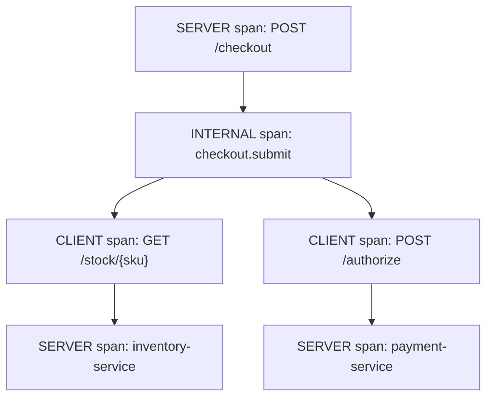
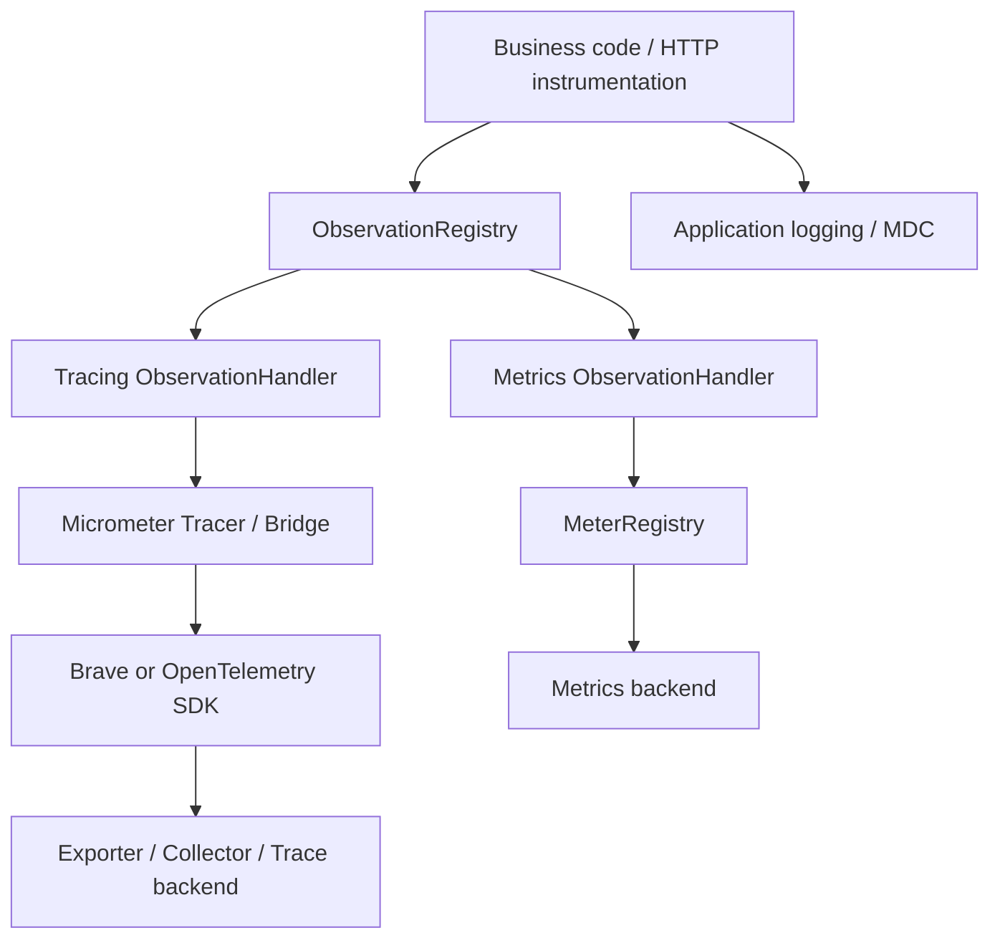
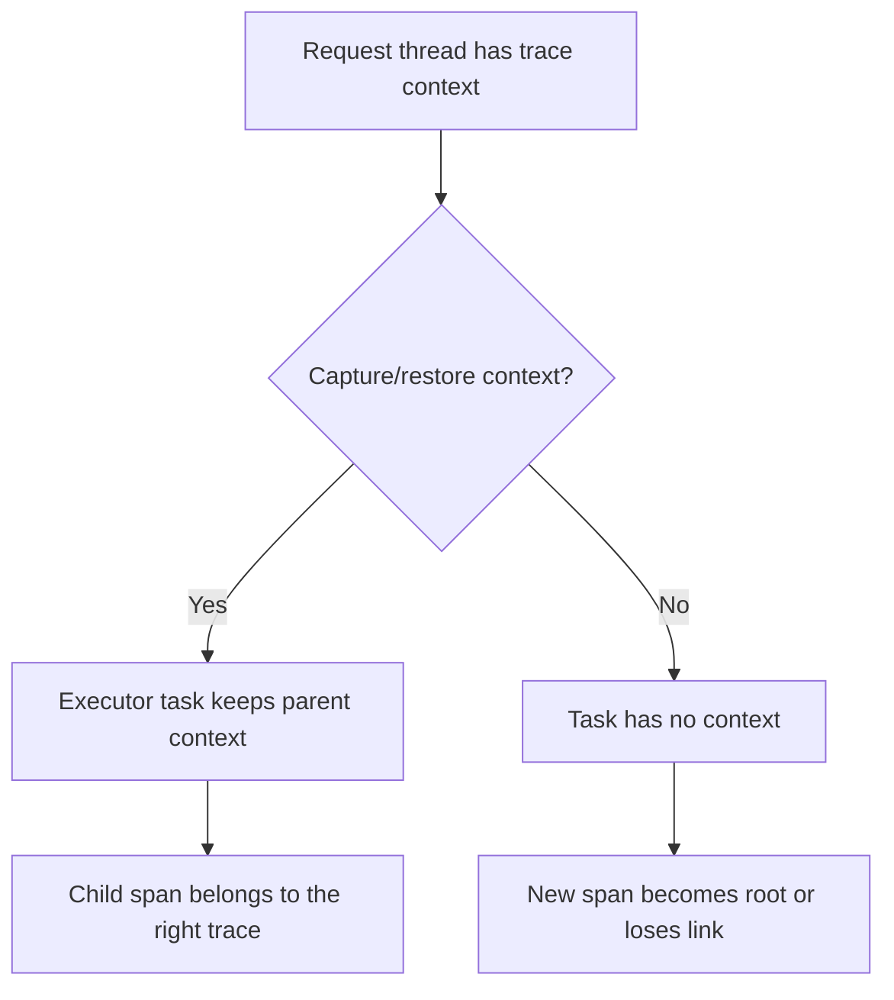
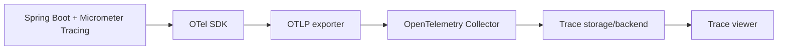

# Micrometer Tracing in Spring Boot: From Observation to Distributed Traces

When `POST /checkout` slows down, metrics tell us p95 increased and logs report timeouts, yet we need **distributed tracing** to see which services the request traversed, how long each call took, and at which step the error occurred. In the **SPRING_BOOT_OBSERVABILITY** module, **Tracing** chapter, the **Micrometer Tracing** lesson guides setting up and using Micrometer Tracing alongside Micrometer Observation, metrics, logs, and data export pipelines. This knowledge supports investigating errors, latency, and application behavior in production; it also explains context propagation, sampling, tags/cardinality, exporters, and correlation.

After this lesson, you will be able to distinguish trace/span/scope, understand the role of Tracer and tracing bridges, instrument business logic, connect spans across HTTP or executors, tune sampling, export OTLP, and diagnose why metrics have data while traces do not appear.

## 1. What Is Micrometer Tracing?

**Micrometer Tracing** provides an abstraction API to create and manage tracing without coupling business code directly to a specific vendor. In Spring Boot, tracing is typically paired with **Micrometer Observation**: when an operation starts/stops, a tracing handler can translate that operation into a span via a tracer implementation.

| Component | Responsibility |
| --- | --- |
| `Observation` and `ObservationRegistry` | Describes an operation's lifecycle and dispatches callbacks to handlers |
| `io.micrometer.tracing.Tracer` | API for creating spans, retrieving the current span, and opening span scopes |
| **Tracing bridge** | Connects the Micrometer Tracing API to OpenTelemetry or Brave |
| **SDK/implementation** | Maintains context, produces span data, applies samplers, and coordinates exporters |
| **Exporter/Collector** | Ships spans out of the JVM to a receiving system |
| **Trace backend** | Stores and visualizes traces/spans |
| **Metrics and logging** | Two separate signals that can be correlated via context |

Micrometer Tracing is **not** a trace database, and adding a bridge dependency does not guarantee every request gets a span in the backend. A span may be created inside the JVM yet dropped by sampling or fail to export.

## 2. Trace, Span, Parent, and Scope

A **trace** describes the path of an operation through components. A **span** represents a segment of work within a trace, containing details such as:

- **Trace ID:** shared identifier for the entire trace.
- **Span ID:** unique identifier of the span.
- **Parent span ID:** link to the parent span, if any.
- **Name:** stable operation name, e.g., `checkout.submit`.
- **Start/end time, duration:** execution timing.
- **Tags/attributes, events, error/status:** context and outcome.
- **Span kind:** `SERVER`, `CLIENT`, `INTERNAL`, or another role depending on instrumentation.



The diagram illustrates an intended trace: if propagation works, spans share the same trace ID and maintain parent–child relationships. Calling APIs across multiple services does not automatically connect spans; each side must understand the context passed over the request.

**Scope** binds the current span or observation to the execution context. When a scope is open, newly created spans can pick up the current span as their parent. When the scope closes, the previous context must be restored. Incorrect scope lifecycles easily split traces or mix contexts between requests.

### Do Not Confuse a Span with a Log or Metric

A span is a **time interval** and attributes of an operation. A log line is usually an **event at a point in time**. A metric like Timer aggregates **multiple executions** into count, total time, or a histogram. A trace shows where a specific request was slow; histograms show p95 across many requests.

## 3. Observation → Tracing Architecture

In a Spring Boot application using Actuator, an observation can be translated into both metrics and tracing through handlers:



**Observation and Span are not identical:** `Observation.start()` creates an active observation, but a span appears only when a tracing handler/bridge or tracing instrumentation is present. Conversely, code can create spans directly with `Tracer` without creating a new observation.

The metrics handler may record a Timer when the observation stops. The tracing handler may create a span at start and close it at stop. Therefore, attributes attached to context at different times do not necessarily affect metrics and traces identically. Check how conventions/filters and handlers process them.

## 4. Choosing OpenTelemetry Bridge or Brave Bridge?

Two common bridges in the Micrometer Tracing 1.x ecosystem:

| Option | Common Dependency | What to Verify |
| --- | --- | --- |
| **OpenTelemetry** | `io.micrometer:micrometer-tracing-bridge-otel` | OTel SDK, sampler, propagator, and OTLP exporter |
| **Brave** | `io.micrometer:micrometer-tracing-bridge-brave` | Brave implementation, reporter, and propagation |

Choose one primary stack suited to your system. Never add both bridges and assume the framework will always pick the intended implementation. For an OTLP/Collector setup, the OTel bridge is usually appropriate; for an existing Zipkin/Brave setup, Brave is an option.

**Version note:** the examples below target Spring Boot 3.x and matching Micrometer Tracing versions. Dependencies, auto-configuration, annotations, and properties can change across Spring Boot/Micrometer lines. Use your application's BOM/dependency management and consult documentation for your exact version when deploying.

## 5. Configuring OpenTelemetry for Spring Boot

Gradle example:

```groovy
dependencies {
    implementation 'org.springframework.boot:spring-boot-starter-actuator'
    implementation 'io.micrometer:micrometer-tracing-bridge-otel'
    runtimeOnly 'io.opentelemetry:opentelemetry-exporter-otlp'

    testImplementation 'org.springframework.boot:spring-boot-starter-test'
}
```

Actuator supports the Observation foundation; the bridge connects Micrometer Tracing to OpenTelemetry; the exporter sends spans to the receiving endpoint. An illustrative `application.yml` configuration:

```yaml
spring:
  application:
    name: checkout-service

management:
  tracing:
    sampling:
      probability: 1.0
  otlp:
    tracing:
      endpoint: http://localhost:4318/v1/traces
```

`probability: 1.0` is only suited for learning or testing under controlled traffic; production needs a ratio selected for operational needs and cost. The example endpoint is OTLP/HTTP on port 4318; the collector must actually listen on the same protocol and path. Inside a container, `localhost` refers to the container itself, **not** automatically a neighboring collector container.

To see traces in the backend, all steps are needed: `Tracer`/handlers created, instrumentation executed, sampler selects the trace, exporter connects to the right receiver, and backend persists it. If any step is missing, logs may still carry trace IDs while backend queries return no trace.

### Brave/Zipkin Option

A system using Brave can configure:

```groovy
dependencies {
    implementation 'org.springframework.boot:spring-boot-starter-actuator'
    implementation 'io.micrometer:micrometer-tracing-bridge-brave'
    runtimeOnly 'io.zipkin.reporter2:zipkin-reporter-brave'
}
```

Example properties for Spring Boot versions supporting Zipkin:

```yaml
management:
  tracing:
    sampling:
      probability: 0.25
  zipkin:
    tracing:
      endpoint: http://localhost:9411/api/v2/spans
```

This is a reference configuration; verify the starter/reporter matching your version and actual Zipkin endpoint. Do not configure Brave and OTel side by side without clear design around ownership, exporter, and propagation.

## 6. Instrumenting Business Logic with Micrometer Observation

For business operations where you want both metrics and tracing, `Observation` is a suitable starting point. Example service with a Spring-injected `ObservationRegistry`:

```java
import io.micrometer.observation.Observation;
import io.micrometer.observation.ObservationRegistry;
import org.springframework.stereotype.Service;

interface PaymentGateway {
    void authorize();
}

@Service
public final class PaymentService {
    private final ObservationRegistry observations;
    private final PaymentGateway gateway;

    public PaymentService(ObservationRegistry observations,
                          PaymentGateway gateway) {
        this.observations = observations;
        this.gateway = gateway;
    }

    public void authorize() {
        Observation observation = Observation.createNotStarted(
                "checkout.payment.authorize", observations)
            .lowCardinalityKeyValue("operation", "authorize")
            .start();

        try (Observation.Scope scope = observation.openScope()) {
            gateway.authorize();
            observation.lowCardinalityKeyValue("outcome", "accepted");
            observation.event(
                Observation.Event.of("payment.authorized"));
        } catch (RuntimeException ex) {
            observation.lowCardinalityKeyValue("outcome", "error");
            observation.error(ex);
            throw ex;
        } finally {
            observation.stop();
        }
    }
}
```

In this example:

1. `start()` and `stop()` mark the operation lifecycle.
2. `openScope()` sets the observation as current context so child operations can link properly.
3. `lowCardinalityKeyValue` records bounded tags for metric aggregation.
4. `event(...)` represents a milestone; turning it into a **span event** depends on the tracing handler.
5. `error(ex)` forwards the failure to handlers. How the backend represents status/exceptions depends on the SDK and exporter.
6. `finally` guarantees the observation does not remain open indefinitely if an exception occurs.

Do not attach order IDs, emails, tokens, or free-form exception messages as low-cardinality tags. To categorize failures, use stable codes such as `error.category=timeout` or `unavailable` and evaluate exception retention policies separately.

**Avoid duplicate measurement:** if the HTTP client is already instrumented by Spring, a business observation `checkout.payment.authorize` should carry its own distinct meaning. Do not write extra code creating an identical HTTP client span just to have "more spans".

## 7. Using the Tracer API Directly When Span Control Is Needed

The Micrometer Tracing API is useful for adapters or segments requiring custom span control:

```java
import io.micrometer.tracing.Span;
import io.micrometer.tracing.Tracer;
import org.springframework.stereotype.Component;

@Component
public final class PaymentSpanAdapter {
    private final Tracer tracer;

    public PaymentSpanAdapter(Tracer tracer) {
        this.tracer = tracer;
    }

    public void run(Runnable action) {
        Span span = tracer.nextSpan().name("payment.authorize").start();
        try (Tracer.SpanInScope scope = tracer.withSpan(span)) {
            span.tag("component", "payment");
            action.run();
            span.event("payment.authorize.completed");
        } catch (RuntimeException ex) {
            span.error(ex);
            throw ex;
        } finally {
            span.end();
        }
    }
}
```

`nextSpan()` builds on the current context when present; `withSpan(span)` opens a scope; `end()` completes the span. Never store a span or scope as a singleton across requests. Never end a span before async work completes if the span is meant to cover that entire execution.

### Observation API or Tracer API?

Prefer the **Observation API** for business operations useful in both metrics and tracing. Use the **Tracer API** when you truly need direct control over spans, events, or integration with a specialized library. If both instrument the exact same segment without distinct purpose, the backend may show two redundant spans.

## 8. Propagation Over HTTP: Why Do Traces Split?

Service A calls service B; besides creating a client span, A must **inject trace context** into request headers. B must **extract** the context and create a linked server span.

```mermaid
sequenceDiagram
    participant User as Client
    participant Checkout as checkout-service
    participant Inventory as inventory-service
    User->>Checkout: POST /checkout
    Note over Checkout: SERVER span; current context
    Checkout->>Inventory: GET /stock/{sku} + trace headers
    Note over Inventory: Extract parent context
    Inventory-->>Checkout: 200 OK
    Checkout-->>User: 200 OK
```

**W3C Trace Context** typically uses `traceparent` (and optionally `tracestate`). Another system may use B3. Both ends must configure compatible propagation; if A sends W3C while B only understands a different format, B may start a new trace. Never manually attach an arbitrary trace ID string as a header and treat it as valid propagation.

In Spring Boot, prefer HTTP client builders managed by the framework:

```java
import org.springframework.stereotype.Component;
import org.springframework.web.client.RestClient;

@Component
public final class InventoryClient {
    private final RestClient client;

    public InventoryClient(RestClient.Builder builder) {
        this.client = builder
            .baseUrl("https://inventory.internal.example")
            .build();
    }

    public String getStock(String sku) {
        return client.get()
            .uri("/stock/{sku}", sku)
            .retrieve()
            .body(String.class);
    }
}
```

`RestClient` is typically available in Spring Boot 3.2 and later. With Spring Boot-provided `RestTemplateBuilder` or `WebClient.Builder`, the pattern is similar: the builder receives observation/tracing customizations. Clients constructed directly via `new RestTemplate()`, `RestClient.create()`, or `WebClient.builder()` outside Boot configuration **may lack** instrumentation. Verify API names and behavior against your actual version.

Not every third-party library such as OkHttp, Feign, or Java HttpClient is automatically instrumented merely because Actuator is installed. Each needs its corresponding integration, while avoiding double-instrumentation with a Java agent/SDK.

## 9. Context Propagation Across Executors, `@Async`, and Reactor

An active span is usually held in **scope/thread context**. When an application hands work off to another thread, you cannot assume context follows automatically:



Micrometer Context Propagation supports capturing and restoring context across execution boundaries when matching accessors are registered. The following pattern shows how:

```java
import io.micrometer.context.ContextSnapshot;
import java.util.concurrent.Executor;

void submitWithContext(Executor executor, Runnable work) {
    ContextSnapshot snapshot = ContextSnapshot.captureAll();
    executor.execute(() -> {
        try (ContextSnapshot.Scope scope = snapshot.setThreadLocals()) {
            work.run();
        }
    });
}
```

This example requires `io.micrometer:context-propagation` and the necessary `ThreadLocalAccessor` registrations. Some Spring Boot versions wire context propagation/`TaskDecorator` automatically for certain executors; avoid stacking duplicate wrappers if the framework already handles it. Test **the actual executor** your application uses, not just a synchronous call on the same thread.

With Reactor, `Context` is not the same as Java `ThreadLocal`. `WebClient` and reactive instrumentation can preserve context when properly configured; a publisher only begins network exchange upon subscription. Using different schedulers, custom operators, or misconfigured bridges can cause spans to lose their parent. Never use `Thread.sleep(...)` to wait for tracing without deterministic verification conditions.

Across Kafka/RabbitMQ or a message bus, context typically flows via message headers and matching instrumentation. Some systems use span links to model non-strict parent–child relationships; do not force every messaging flow into an HTTP model.

## 10. Baggage, Span Attributes, and MDC

These three concepts must not be conflated:

| Component | Meaning | Automatically Sent Over Network? |
| --- | --- | --- |
| **Span attributes/tags** | Describes one span, supports searching | Does not automatically become baggage |
| **Baggage** | Selected context fields propagated across processes when configured | Yes, if remote fields/propagators are configured |
| **MDC logging** | Fields present in logging context, e.g., traceId/spanId | Does not automatically become HTTP headers |

**Never place** emails, access tokens, JWTs, card numbers, or transaction payloads into baggage. Because baggage can travel to downstream services or external partners, it represents a security boundary. Restrict sizes, field counts, and access; use technical trace IDs/correlation IDs per policy rather than broadcasting personal data.

Trace context like `traceparent` carries tracing identifiers and linkage; do not try to encode business data inside it. Allowed baggage fields and propagation behavior must be verified against your stack/version rather than assuming enabling tracing lets arbitrary application keys cross the network.

## 11. Sampling: Why Do Some Requests Have No Trace?

Sampling reduces the volume of traces stored. In a Spring Boot configuration supporting sampling probability:

```yaml
management:
  tracing:
    sampling:
      probability: 0.10
```

A value of `0.10` represents roughly a 10% sampling probability under the active sampler policy; it **does not guarantee** exactly one trace out of every ten requests. Decisions can also depend on parent sampling flags, SDK configuration, and collector/backend policies.

| Mechanism | Decision Time | Limitation |
| --- | --- | --- |
| **Head-based sampling** | Early, when the trace/span is created | Does not yet know whether the request will later slow down or fail |
| **Parent-based sampling** | Follows upstream decision when a parent exists | Requires understanding propagation and parent policies |
| **Tail-based sampling** | After sufficient trace data arrives at a supporting collector/system | Requires processing infrastructure, memory, and clear policies |

A request still contributes to Timer metrics even when its span is not sampled/exported. A log containing a trace ID also does not guarantee the trace resides in the backend. Never leave sampling at 100% indefinitely in high-traffic production; choose a policy grounded in SLOs, investigation needs, retention, and cost.

**Sampling is not a secrets redaction mechanism.** Even if only 1% of traces are retained, a sampled trace can still leak sensitive data if code writes tokens or payloads into attributes/events.

## 12. Exporter, OpenTelemetry Collector, and Backend

The trace export path with OTel typically involves:



OTLP typically supports **gRPC** on port 4317 or **HTTP** on port 4318; endpoints and protocols must match the running receiver. Ports are common conventions, not guarantees. For OTLP/HTTP, `/v1/traces` is standard; do not supply an HTTP URL to a gRPC-configured exporter without checking.

An **illustrative collector configuration to receive spans and print debug output in a test environment**:

```yaml
receivers:
  otlp:
    protocols:
      http:
        endpoint: 0.0.0.0:4318

processors:
  batch: {}

exporters:
  debug: {}

service:
  pipelines:
    traces:
      receivers: [otlp]
      processors: [batch]
      exporters: [debug]
```

This is not a complete production configuration: your collector version/distribution must support these components, and the `debug` exporter provides no trace storage. Production requires real receivers/exporters, TLS/identity, limits, queues, batching, dropped-span monitoring, and data protection.

### Diagnosing From Source Outward

1. Were `Tracer` and the tracing handler actually registered in the application context?
2. Did the call create a span, end it cleanly, and did the sampler retain it?
3. Is the exporter using OTLP HTTP/gRPC or Zipkin; are endpoint/network/auth accurate?
4. Did the Collector receive and forward spans, or did a processor drop/transform them?
5. Is the backend querying the right service name, environment, tenant, and time window?

Pipeline delivery can lag due to batching/queues; do not treat not seeing a span immediately as sole proof that instrumentation is broken.

## 13. Log Correlation: traceId and spanId

Micrometer Tracing can populate `traceId` and `spanId` into logging context/MDC when the active scope integrates with the logger, making it easy to find log lines tied to a trace.

```text
2026-11-22T10:30:01.120Z WARN [checkout-service] [traceId=<trace-id> spanId=<span-id>] payment.retry.scheduled reason=timeout
```

This is an **illustrative log**, not a mandatory format. With Logback, a pattern can typically reference MDC fields via `%X{traceId}` and `%X{spanId}`:

```text
%d{yyyy-MM-dd HH:mm:ss.SSS} trace=%X{traceId:-} span=%X{spanId:-} %-5level %logger - %msg%n
```

Verify your logging configuration/version and avoid applying duplicate patterns if the app already uses structured JSON logging. A trace ID in logs **does not prove** the span was exported successfully: the trace may have been dropped by sampling, exporter failure, or backend persistence.

For logs in asynchronous tasks to carry correlation, logging scope/MDC must also be restored appropriately. Never put customer IDs, emails, JWTs, raw bodies, or unchecked exception messages into MDC just for "easy lookup".

## 14. Cardinality, Security, and Span Events

Traces allow richer, more varied attribute values than metrics, yet data must still be governed:

| Attribute | Guidance |
| --- | --- |
| `http.request.method=POST` | Bounded value set, useful |
| `http.route=/orders/{id}` | Stable route template |
| `error.category=timeout` | Normalized error code |
| `service.name=checkout-service` | Source identification |
| `orderId=ORD-492715` | Use only with approved purpose and data protection; never as a metric label |
| `user.email=...`, `authorization=Bearer ...` | Do not collect by default |
| Raw URL/query or request body | Avoid recording verbatim into spans, logs, or metrics |

Micrometer Observation distinguishes `lowCardinalityKeyValue` from `highCardinalityKeyValue`. Low-cardinality keys are generally useful for metrics, while high-cardinality keys can be processed by tracing handlers depending on implementation. **High-cardinality does not authorize recording PII or secrets.**

A **span event** can record a milestone such as `payment.retry.scheduled` without embedding free-form error messages containing personal info. `Observation.event(...)` does not automatically guarantee every backend stores a matching span event; a compatible handler and export pipeline are required.

**Exception recording** via `observation.error(ex)` or `span.error(ex)` can store exception attributes/messages; audit error sources (HTTP client, database, third-party) and scrub disallowed data before emitting telemetry. Never use trace IDs as metric labels: every request gets a new ID, exploding cardinality.

## 15. Testing Tracing Across Layers

| Layer | What It Can Prove | How to Test |
| --- | --- | --- |
| **Unit Observation** | Operation name, low-cardinality tags, error/event | `TestObservationRegistry` |
| **In-memory tracing** | Span name, IDs, parent-child, attributes, and errors | In-memory tracer/exporter from Brave or OTel |
| **Spring integration** | HTTP client/server instrumentation and async context | Test web server/client, real executor, proper sampling |
| **Exporter/Collector** | Protocol, batching, endpoint, and receive capability | Collector or stub receiver in test environment |
| **End-to-end staging** | Trace stored/queried and correlated with logs | Test request with trace ID in a controlled environment |

Example **Observation** contract test:

```java
import io.micrometer.observation.Observation;
import io.micrometer.observation.tck.TestObservationRegistry;
import io.micrometer.observation.tck.TestObservationRegistryAssert;
import org.junit.jupiter.api.Test;

class CheckoutObservationTest {
    @Test
    void recordsCheckoutOperation() {
        TestObservationRegistry registry = TestObservationRegistry.create();

        Observation.createNotStarted("checkout.submit", registry)
            .lowCardinalityKeyValue("outcome", "accepted")
            .observe(() -> {
                // Simulate task, no network call.
            });

        TestObservationRegistryAssert.assertThat(registry)
            .hasObservationWithNameEqualTo("checkout.submit")
            .that()
            .hasLowCardinalityKeyValue("outcome", "accepted");
    }
}
```

Compiling requires the matching `io.micrometer:micrometer-observation-test` test dependency. **This test does not verify tracing.** To prove parent–child linkage or export, configure an in-memory span exporter/tracer for your SDK and assert the exported spans. Never hardcode a fixed trace ID.

A good propagation test must actually cross an **HTTP request boundary** or **executor**, rather than merely calling a synchronous method. In Spring Boot tests, observability auto-configuration may be disabled/reduced by default; when testing auto-instrumentation, `@AutoConfigureObservability` may be needed in versions that support it. Prevent test exporters from sending spans to a production backend.

## 16. Common Issues and Diagnostic Directions

| Symptom | Possible Cause | Check |
| --- | --- | --- |
| Observation exists but no span | Missing tracing bridge/handler or instrumentation didn't run | Tracer bean and handlers |
| Log has trace ID, backend has no trace | Sampling, exporter, collector, or backend | Check each pipeline stage |
| Spans of two services have different trace IDs | Missing/incompatible header propagation | Inject/extract W3C/B3 at each hop |
| Parent lost after `@Async` or executor | Context not captured/restored | Accessors, task decorator, and real executor |
| WebClient produces no span | Publisher not subscribed or uninstrumented builder | Reactive execution |
| Duplicate spans | Combining auto-instrumentation and manual spans for the same step | Clarify ownership |
| Few traces appear | Low sampling or upstream sampling decision | Sampling/parent configuration |
| Wrong span duration | Span ended too early/late, incorrect async lifecycle | start/scope/end |
| Metrics appear but no traces | Two independent pipelines | Bridge, sampler, exporter |
| Trace contains raw URL/token | Uncontrolled header/body capture or tags | Sanitization at source and collector |
| Collector receives spans but UI is empty | Wrong backend/tenant/index/time range | Inspect final exporter |

**Practical checklist:** verify request ran → instrumentation created span → context kept parent → sampler allowed it → exporter/collector received it → backend stored/queried the right service and timeframe. Find the **first layer missing data** before changing sampling or adding more instrumentation.

## 17. Real-World Scenario: Slow Checkout, Yet Trace Missing Payment

**Scenario:** after a deployment, checkout p95 rises from 300 ms to 2 seconds. HTTP client metrics show slow payment calls and 503s, logs show `payment.retry.scheduled`, yet the trace backend only displays the checkout HTTP server span.

**Step 1 — Verify the numbers.** Check p95 and 5xx/error rate over a representative request window, distinguishing HTTP attempts from logical orders. Retries can raise client request counts without increasing business throughput.

**Step 2 — Inspect the client.** Is checkout using a Boot-managed `RestClient.Builder` or a client built outside the framework? Without instrumentation, the payment client span may not exist at all.

**Step 3 — Check propagation.** If checkout produces a client span while payment-server starts a different trace ID, inspect W3C/B3 headers without logging secrets. Verify both injection and extraction ends.

**Step 4 — Check async.** If payment logic runs via an executor, verify context capture/restore; a scope active only on the initial thread does not ensure the worker thread inherits the parent.

**Step 5 — Check sampling and export.** Under controlled staging traffic, set an appropriate sampling rate, inspect in-memory spans or a collector debug exporter, then verify backend ingestion.

**Step 6 — Investigate root cause.** Once spans are complete, cross-check payment durations, retries/backoff, and logs sharing the trace ID. Never generalize from one trace to the whole system: corroborate with aggregated metrics.

**Step 7 — Re-measure.** After fixing instrumentation/timeouts/retries, verify p95/error rate, trace completeness, log correlation, and attempts per checkout. Complete traces enable better diagnosis—they do not by themselves prove latency is resolved.

## 18. Self-Check Exercises

**Exercise 1.** A `checkout.payment.authorize` Timer count increases, yet the trace backend is empty. Is `ObservationRegistry` broken?

*Hint:* Not necessarily. The metrics handler can work while the tracing bridge, sampling, or exporter sits on a separate pipeline.

**Exercise 2.** Service A has a client span and service B has a server span, but their trace IDs differ. What should you check?

*Hint:* HTTP headers, W3C/B3 propagators, inject/extract, and context propagation across async boundaries.

**Exercise 3.** A team puts user email into baggage to locate users faster. What is the risk?

*Hint:* Baggage can propagate across services and third parties, leaking PII; replace it with technical correlation and properly authorized data systems.

**Exercise 4.** `sampling.probability=0.1` and metrics record 10,000 requests, yet the backend only holds around 1,000 traces. Is this a contradiction?

*Hint:* Not necessarily. Tracing sampling is independent of metrics; parent decisions and pipelines can also affect trace counts.

**Exercise 5.** A log shows a trace ID, yet no trace is found. Name at least three causes.

*Hint:* Sampling, wrong exporter endpoint/protocol, collector drops, or querying the wrong tenant/time range in the backend.

**Exercise 6.** Why can adding `Tracer.nextSpan()` to an operation already instrumented with Observation be harmful?

*Hint:* It creates redundant spans, making timelines and durations harder to interpret. Pick one primary instrumentation path or split genuinely distinct segments of work.

**Exercise 7.** A synchronous test on the same thread passed. Is that enough to assert traces won't break across `@Async`?

*Hint:* No. You must test with a real executor and verify parent–child linkage after context capture/restore.

**Exercise 8.** Does a single 1.5-second payment trace prove payment p95 is 1.5 seconds?

*Hint:* No. Traces are individual sampled instances; histogram metrics reflect the distribution across many requests.

## 19. Key Takeaways

- **Micrometer Tracing** is a vendor-neutral tracing API; seeing traces in a backend requires a **bridge, tracer SDK, sampler, exporter/collector, and storage system**.
- A **Trace** consists of spans linked via trace ID/parent context. **Scope** and **propagation** determine whether child operations join the right trace.
- **Micrometer Observation** fits business operations needing both metrics and tracing; avoid instrumenting the exact same step twice without reason.
- Choose **OpenTelemetry or Brave**, use Spring-managed HTTP clients, and verify W3C/B3 context across HTTP, executors, Reactor, and messaging.
- **Sampling** reduces stored trace data without suppressing metrics or hiding secrets. A trace ID in logs does not guarantee the backend persisted the trace.
- **Baggage, span attributes, events, and logs** require data protection policies; never put tokens/PII into telemetry or trace IDs into low-cardinality metric labels.
- When investigating errors and latency, use **metrics to gauge scale → traces to see the path → logs to understand events**, then validate with aggregated numbers.
