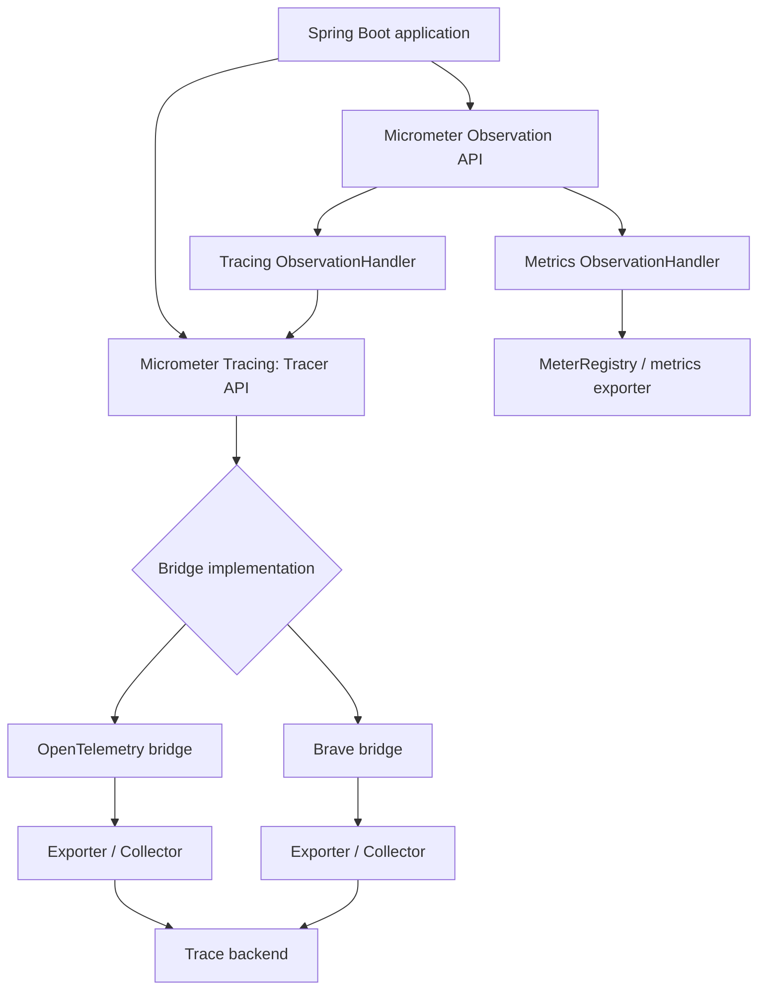
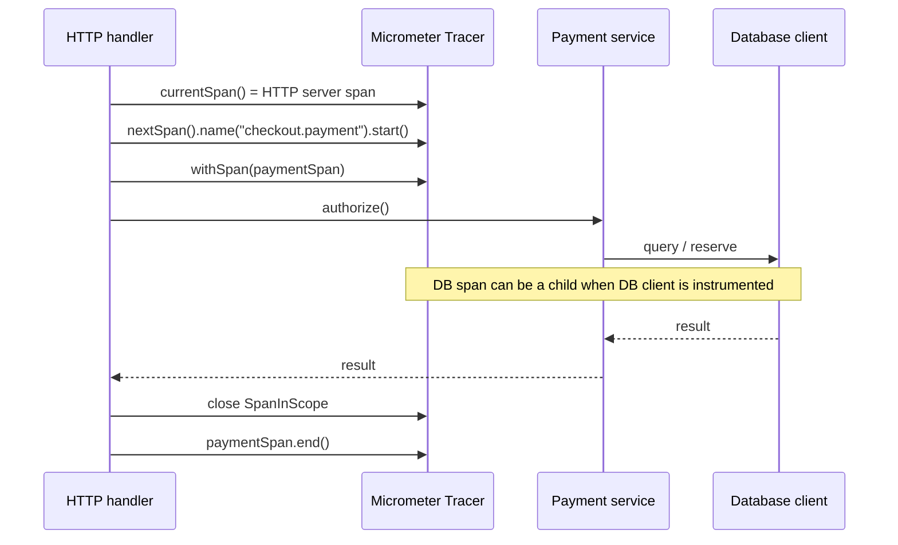
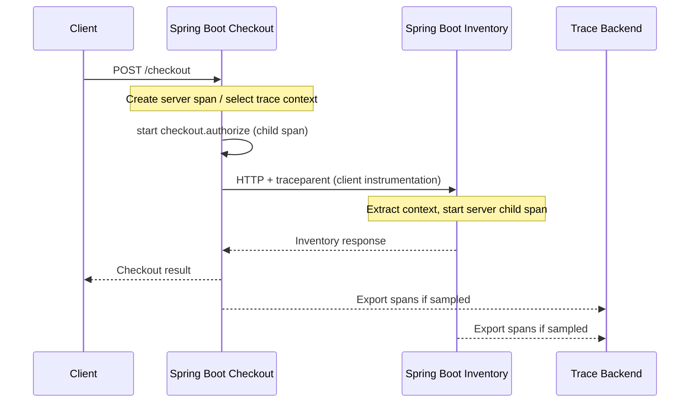

# Tracer Abstraction

A `POST /checkout` request flows through a Spring Boot API, an inventory service, a payment service, and a database. The dashboard tells you the request is slower than usual, yet that information is not enough to pinpoint which stage introduced the latency. If each service generates log IDs differently or records traces directly with a proprietary SDK, maintaining linkage across processing steps becomes difficult when switching tracer backends.

The **Tracer abstraction** solves part of this problem: instead of coupling business code directly to a specific tracing SDK, Micrometer Tracing provides interfaces such as `Tracer`, `Span`, and `Tracer.SpanInScope`. Concrete bridges/integrations (e.g., based on OpenTelemetry or Brave) implement those interfaces; exporters and backends are configured at the infrastructure layer. In Spring Boot, this abstraction collaborates with **Micrometer Observation**, metrics, logs, and distributed tracing to investigate latency, errors, and application behavior in production.

This lesson belongs to the **Tracing** chapter of the **SPRING_BOOT_OBSERVABILITY** module, focusing on designing and using the abstraction, not merely enabling an exporter.

After this lesson, you will be able to:

1. Distinguish `Tracer`, `Span`, `TraceContext`, `CurrentTraceContext`, `SpanInScope`, propagator, and exporter.
2. Create, name, add tags/events, record errors, and end a manual span with a proper lifecycle.
3. Explain parent–child relationships, current span, and when a span becomes a root.
4. Understand the difference between an active in-thread context and **distributed context propagation** over HTTP/messages.
5. Choose when to use `Observation` versus operating directly on `Tracer`.
6. Configure a suitable Micrometer Tracing bridge and exporter in Spring Boot 3.x, and recognize differences across other versions.
7. Avoid pitfalls with sampling, context loss across executors/Reactor, scope leaks, sensitive data, or creating unbounded spans/tags.
8. Verify trace IDs, span relationships, errors, and the export pipeline using a concrete investigation workflow.

## 1. Why Do We Need a Tracer Abstraction?

Distributed tracing describes **the path of a single execution** across multiple operations and processes. Each operation can be represented as a **span**, and all related spans typically share the same **trace ID**.

Example:

```text
Trace ID: 7d43...f219
|
+-- HTTP SERVER  POST /checkout                 [span A]
    |
    +-- checkout.authorize                      [span B]
        |
        +-- HTTP CLIENT  POST /payments/verify   [span C]
            |
            +-- HTTP SERVER  POST /payments/verify [span D, another service]
                |
                +-- database query              [span E, if instrumented]
```

If components use compatible propagation mechanisms, span D can be linked to span C via context sent along the request. Viewing the trace in the backend shows time spent at each step, call ordering, and recorded error details.

However, a Java application may use different tracing implementations. If business code always references classes from one backend SDK directly, switching bridges or instrumentation configurations causes tight coupling.

Micrometer Tracing provides an API layer:



**Abstraction does not mean you can skip the implementation.** `Tracer` is only an API contract; there must be an active bridge/tracer implementation, an export mechanism, and a receiving backend. Even when a span is created properly, sampling or exporter failures can still prevent traces from appearing in storage.

### 1.1. Goals the Abstraction Addresses

| Problem | How the Abstraction Helps | Limits to Keep in Mind |
| --- | --- | --- |
| Code coupled to a specific SDK | Code calls `io.micrometer.tracing.Tracer` instead of depending directly on a vendor SDK | Bridge/exporter configuration still has implementation details |
| Hard to create manual spans | APIs `nextSpan()`, `name(...)`, `start()`, `tag(...)`, `end()` | Developers must still manage the lifecycle properly |
| Losing parent–child when splitting tasks | `withSpan(...)` activates the current span in scope | Local scope alone does not propagate across threads/processes |
| Need extra investigation details | `Span.tag(...)`, `event(...)`, `error(...)` | Attributes are constrained by sampling, privacy, and backend limits |
| Want metrics and traces from one instrumentation | Use Micrometer Observation with tracing/metrics handlers | Raw `Tracer` does not automatically record Timers or Counters |
| Want to change trace storage backend | Bridges and exporters are decoupled from business code | Attribute names, propagation, and semantic conventions may differ |

## 2. Core Components of Micrometer Tracing

### 2.1. `Tracer` — Entry Point for Working with Spans

`io.micrometer.tracing.Tracer` is the high-level interface providing operations to create spans, retrieve the active span, and activate a span in scope. Commonly used methods:

- `nextSpan()`: obtains a new span, which can inherit from the active parent context if present.
- `currentSpan()`: returns the active span in the current context; may return `null`.
- `withSpan(span)`: places a span into the current scope and returns `Tracer.SpanInScope` to restore context on close.
- `spanBuilder()`: provides a builder for controlled span creation needs.

Crucially: **creating a span, making it current, and ending a span are distinct actions**. The API names look simple, yet each action carries specific meaning for trace relationships, log correlation, and lifecycle.

### 2.2. `Span` — One Measured Occurrence

A `Span` represents a traced operation: it has a name, trace/span context, start/end timestamps, and backend-supported metadata.

Common operations:

| Method | Purpose |
| --- | --- |
| `span.name("...")` | Sets the operation name, which should generally be stable |
| `span.start()` | Starts the span |
| `span.tag("key", "value")` | Adds an attribute/tag for tracing lookup |
| `span.event("...")` | Marks a notable milestone within the span |
| `span.error(exception)` | Records error info for tracing instrumentation |
| `span.end()` | Ends the span, letting the implementation finalize data |
| `span.context()` | Accesses span/trace context info when needed |

Span names should describe the operation, e.g., `inventory.reserve`, `checkout.authorize`, or `report.generate`. Never name spans like `checkout.authorize.order-983716`; dynamic IDs explode operation names in the backend and risk leaking sensitive data.

### 2.3. `Tracer.SpanInScope` — Which Span Is Current?

`SpanInScope` represents the **activation scope of a span**, typically bound to the executing thread/context. Use `try-with-resources` so the scope closes even when exceptions occur:

```java
try (Tracer.SpanInScope scope = tracer.withSpan(span)) {
    // Inside this scope, tracer.currentSpan()
    // can return the activated span.
}
```

**Closing a scope does not end the span.** It restores the previous current context. Conversely, `span.end()` ends the span's lifetime; it does not substitute for closing an active scope.

An important rule:

```text
Create new span -> start -> withSpan -> do work
                              |
                         close scope
                              |
                           end span
```

Confusing `span.end()` with `scope.close()` can leave a stale current span on the thread, mislinking subsequent logs or nested instrumentation.

### 2.4. `TraceContext` and `CurrentTraceContext`

`TraceContext` holds identifying/linking trace info: trace ID, span ID, sampling state, and other context properties depending on implementation. `CurrentTraceContext` is the abstraction managing the **active trace context** within an execution scope.

You rarely need to manually manipulate IDs to create a child span; rely on `Tracer` and active instrumentation. Accessing IDs is mainly for correlation or verification:

```java
Span current = tracer.currentSpan();

if (current != null) {
    String traceId = current.context().traceId();
    String spanId = current.context().spanId();
    // Illustrates reading only; do not put IDs into metric tags.
}
```

Trace ID/span ID help locate a specific request in logs/traces. **Never use them as low-cardinality metric labels**: nearly every request would spawn a new time series.

### 2.5. How Propagators and Baggage Differ from Tracer

- A **Propagator** encodes/decodes trace context across carriers such as HTTP headers or message headers. This is required for spans in other services to receive the same trace and parent–child linkage.
- **Baggage** can carry selected metadata across boundaries when configured. It adds overhead, traverses multiple layers, and requires strict allowlists; never treat baggage as a place for tokens, passwords, emails, or full request payloads.
- An **Exporter** determines how collected spans are shipped to the collector/backend. It does not replace injecting/extracting headers.

No single `tracer.withSpan(...)` call automatically turns arbitrary Java objects or span tags into HTTP headers. Propagation is a separate mechanism requiring compatible instrumentation and carriers.

## 3. First Example: Creating a Manual Span in Spring Boot

Some business steps are not auto-instrumented, such as calculating shipping fees with a custom algorithm. If you only need a detailed span for this operation, you can inject Micrometer `Tracer`.

Java 17+ / Spring Boot 3.x example with a configured tracing bridge:

```java
import io.micrometer.tracing.Span;
import io.micrometer.tracing.Tracer;
import org.springframework.stereotype.Service;

@Service
public class DeliveryQuoteService {
    private final Tracer tracer;
    private final DeliveryPricing pricing;

    public DeliveryQuoteService(Tracer tracer, DeliveryPricing pricing) {
        this.tracer = tracer;
        this.pricing = pricing;
    }

    public long calculate(String routeGroup) {
        String category = switch (
                routeGroup == null ? "" : routeGroup) {
            case "local" -> "local";
            case "regional" -> "regional";
            default -> "other";
        };

        Span span = tracer.nextSpan()
                .name("delivery.quote.calculate")
                .start();

        try (Tracer.SpanInScope scope = tracer.withSpan(span)) {
            span.tag("delivery.route.group", category);
            span.event("quote.calculation.started");

            long result = pricing.calculate(category);

            span.event("quote.calculation.finished");
            return result;
        } catch (RuntimeException | Error failure) {
            span.error(failure);
            throw failure;
        } finally {
            span.end();
        }
    }
}

// Minimal interface to focus on tracing.
interface DeliveryPricing {
    long calculate(String routeGroup);
}
```

Execution flow to note:

1. `nextSpan()` creates a new span. If a suitable current span is active at that moment, the implementation can create a child span; if no parent context exists, it may start a new trace.
2. `name(...)` sets a stable name before starting.
3. `start()` starts the span, **without automatically making it current on every thread**.
4. `withSpan(span)` activates the span for the synchronous processing inside `try`.
5. `tag(...)` adds a bounded-value attribute; `event(...)` marks a meaningful milestone.
6. `span.error(failure)` records tracing error info; `throw failure` preserves normal business behavior.
7. `finally` guarantees `span.end()` runs even on early `return` or exception. The scope is closed by `try-with-resources` before `finally` executes.

**Limitation of this example:** this is manual tracing and **does not** automatically create a duration Timer metric. When you want both metrics and traces from one instrumentation, Micrometer Observation is usually a better fit. Moreover, ending a span does not guarantee it is exported or stored: samplers and pipelines may decide otherwise.

## 4. Scope, Parent–Child, and Current Span

A span can be the root of a trace or a child of another span. In synchronous code, when a span is placed in the current scope, instrumentation invoked inside can adopt it as its parent.



### 4.1. Checking Current Span Properly

```java
Span current = tracer.currentSpan();

if (current == null) {
    // No active span in the current context.
} else {
    String traceId = current.context().traceId();
    // traceId can be used for controlled correlation/debugging.
}
```

Never treat `currentSpan()` as a mandatory precondition for business logic to run. Tracing may be disabled, only partially instrumented, or running on a contextless thread. **Business logic must continue working properly even without a span.**

### 4.2. A Span Must Not Be Shared as a Singleton

A `Span` and scope belong to **one occurrence**, not shared service state. Storing an active `Span` in a singleton field and letting multiple requests update it causes:

- Trace A and Trace B mixing tags/events.
- Corrupted parent–child relationships.
- Lifecycle errors when one request ends another request's span.
- Lost log correlation.
- Race conditions as multiple threads mutate one object.

Create a span per invocation. To pass context to an asynchronous task, use proper context propagation rather than storing a global mutable current span.

### 4.3. End Time vs. Scope Close Time

A span can exist for the lifetime of an operation while only being **active** during specific code blocks. For example, a future executing on another executor; the submitting thread's scope may close while the span measuring the ongoing work stays open. That is only valid when you have a clear strategy for completion, concurrency, and context propagation.

Never leave a `SpanInScope` open when returning from a request hoping some arbitrary thread will close it. Every scope needs a clear owner. In asynchronous/reactive code, using instrumentation with built-in propagation is safer than manually passing scope objects across threads.

## 5. When to Use Tracer Directly vs. Observation?

Spring Boot generally encourages **Micrometer Observation** for instrumenting business operations when you need both metrics and traces from a single definition.

| Need | Preferred Tool | Reason |
| --- | --- | --- |
| Measure duration + count + trace for a business step | `Observation` + matching handlers | Single lifecycle, multiple signals |
| Add a granular span into an existing trace | `Tracer` directly | Fine-grained span/event/tag control |
| Measure duration of work without tracing | `Timer` | No need to allocate spans |
| Standardize names/tags across occurrences | `ObservationConvention` | Normalizes telemetry across contexts |
| Access current trace ID/span ID | `Tracer.currentSpan()` or log correlation | No need to create a span just to read IDs |
| Propagate trace over HTTP/messaging | Instrumentation + propagator | `withSpan(...)` does not cross the network |
| Instrument an HTTP server that already has auto-tracing | Prefer framework instrumentation first | Avoids overlapping spans/timers on the same boundary |

### 5.1. Same Business Logic with Observation

```java
import io.micrometer.observation.Observation;
import io.micrometer.observation.ObservationRegistry;
import org.springframework.stereotype.Service;

@Service
public class InventoryReservationService {
    private final ObservationRegistry registry;
    private final InventoryGateway gateway;

    public InventoryReservationService(ObservationRegistry registry,
                                       InventoryGateway gateway) {
        this.registry = registry;
        this.gateway = gateway;
    }

    public boolean reserve(String sku) {
        return Observation.createNotStarted("inventory.reserve", registry)
                .contextualName("reserve inventory")
                .lowCardinalityKeyValue("operation", "reserve")
                .observe(() -> gateway.reserve(sku));
    }
}

interface InventoryGateway {
    boolean reserve(String sku);
}
```

`observe(...)` wraps **synchronous** work, managing start/scope/stop and handling exceptions per the API. When the registry has a metrics observation handler, it updates a Timer; when a tracing handler is present, it creates a span via the `Tracer` implementation.

**Avoid mixing lifecycles:** if code creates both a manual span via `Tracer` and an Observation for the exact same boundary where a tracing handler also creates a span, the trace may contain two nearly identical spans. Verify whether two operations are genuinely distinct or redundantly instrumented.

### 5.2. Tracer Tags vs. Observation Key-Values

Directly on a span:

```java
span.tag("operation", "reserve");
```

On an observation:

```java
observation.lowCardinalityKeyValue("operation", "reserve");
observation.highCardinalityKeyValue("diagnostic.class", "inventory");
```

These APIs are not completely equivalent:

- `Span.tag(...)` enriches a span (per implementation support); it does not automatically become a metric label.
- `Observation.lowCardinalityKeyValue(...)` can serve as a metric dimension and also be consumed by tracing handlers.
- `Observation.highCardinalityKeyValue(...)` typically targets detailed tracing attributes, not metric dimensions.
- Key-values do not automatically travel to other services merely because they exist on a span.

Whether low or high cardinality, **never put tokens, passwords, payment details, emails, or raw request bodies into telemetry**. High cardinality refers to value diversity, not permission to export sensitive data.

## 6. Configuring Spring Boot 3.x with Micrometer Tracing

### 6.1. Distinct Roles of Dependencies

Example Maven setup using Spring Boot 3.x dependency management to ship traces via OpenTelemetry Protocol (OTLP):

```xml
<!-- Actuator and Observation infrastructure -->
<dependency>
    <groupId>org.springframework.boot</groupId>
    <artifactId>spring-boot-starter-actuator</artifactId>
</dependency>

<!-- Bridge implementing Micrometer Tracing API with OpenTelemetry -->
<dependency>
    <groupId>io.micrometer</groupId>
    <artifactId>micrometer-tracing-bridge-otel</artifactId>
</dependency>

<!-- Export spans to OTLP collector/backend -->
<dependency>
    <groupId>io.opentelemetry</groupId>
    <artifactId>opentelemetry-exporter-otlp</artifactId>
</dependency>
```

In a Spring Boot-supported setup, the tracing bridge creates/registers beans such as `Tracer`; the exporter ships spans externally. `spring-boot-starter-actuator` **by itself** does not mean you have a tracing backend or working trace export.

If selecting a Brave-based bridge, include the matching dependency and exporter for that bridge, such as a Zipkin-compatible pipeline per deployment setup. Avoid pulling multiple competing bridges implementing `Tracer` into the same application unless you have explicitly designed their coordination.

### 6.2. Sampling and OTLP Exporter Configuration

```yaml
management:
  tracing:
    sampling:
      probability: 0.1

  otlp:
    tracing:
      endpoint: http://localhost:4318/v1/traces
```

Explanation:

- `management.tracing.sampling.probability: 0.1` illustrates roughly **10%** of tracing decisions being sampled under the active sampler; it does not mean every 10th request is strictly guaranteed a trace.
- `management.otlp.tracing.endpoint` in Spring Boot 3.x configures the OTLP HTTP trace receiver endpoint per the corresponding integration.
- `localhost:4318` only works when the app and collector/backend share access to that address. Inside containers/Kubernetes, `localhost` resolves within **the current container/pod's network namespace**, not automatically to a collector in another container.
- The collector must successfully ingest and store spans; a syntactically valid HTTP endpoint does not guarantee the entire pipeline works.

**Version note:** Spring Boot 4.x changes starters and OTLP/tracing configuration compared to some 3.x releases. When deploying, cross-check docs for your **exact version** and actual dependencies rather than copying properties verbatim.

### 6.3. Sampling Is Not Lifecycle

Even if a tracer does not export a span due to sampling, code must still close scopes and call `span.end()`. Never write:

```java
if (tracer.currentSpan() != null) {
    // Only run business logic when a span exists.
    processPayment();
}
```

Business logic must never depend on a sampled span existing. Tracing may create non-recorded spans or skip export; the application must still execute and clean up normally.

A missing trace can also stem from the collector, network, exporter queue, authentication, retention, or querying the wrong time range. Do not blame every missing trace on "span not created".

## 7. Distributed Context Propagation: How Do Spans Connect Over HTTP?

Inside one service, `Tracer.withSpan(...)` marks the active span in scope. **To preserve the same trace across two services**, the client must inject context into a carrier (typically HTTP headers), and the receiving server must extract that context and start a child span when instrumentation is configured.

Under W3C Trace Context, a `traceparent` header looks like:

```http
traceparent: 00-4bf92f3577b34da6a3ce929d0e0e4736-00f067aa0ba902b7-01
```

Meaning of each segment:

- Leading `00`: format version.
- `4bf92f3577b34da6a3ce929d0e0e4736`: 32 hex chars representing the trace ID.
- `00f067aa0ba902b7`: 16 hex chars representing the propagated parent ID.
- `01`: trace flags in this example, with the sampling bit enabled.

This illustrates a valid `traceparent`. Every real request has its own IDs; **never hardcode these sample values in production**.

### 7.1. Spring Boot HTTP Client

A preferred option is an HTTP client builder provided and configured by Spring Boot, such as `RestClient.Builder` in compatible stacks:

```java
import org.springframework.stereotype.Component;
import org.springframework.web.client.RestClient;

@Component
public class InventoryApiClient {
    private final RestClient client;

    public InventoryApiClient(RestClient.Builder builder) {
        this.client = builder
                .baseUrl("http://inventory-service")
                .build();
    }

    public String getStatus() {
        return client.get()
                .uri("/internal/inventory/status")
                .retrieve()
                .body(String.class);
    }
}
```

When HTTP client instrumentation, tracing handlers, and propagation are enabled, the client creates a client span and injects trace context into headers; service B extracts it to attach its server span to the same trace. Never hand-craft headers by copying `tracer.currentSpan().context().traceId()` into a custom `traceparent` string: you also need the parent span ID, flags, valid formatting, and multi-format propagation support when required.

**Not every `new RestClient.Builder()` has Boot instrumentation.** Injecting the Boot-managed builder preserves customizers/tracing integration, though you should still verify dependencies and runtime configuration.

### 7.2. An Example Context Flow



If the backend shows two different trace IDs for the same request crossing A and B, inspect:

1. Does client A have tracing instrumentation?
2. Do headers actually carry `traceparent` or the chosen propagation format?
3. Did a gateway/proxy strip or rewrite headers?
4. Does server B extract the matching format?
5. Did async/scheduler handoffs lose parent context before calling B?
6. Did any component intentionally start a new root span instead of a child?

Sampling decides which spans get stored; it is **not** a complete explanation for broken propagation.

### 7.3. Baggage Does Not Replace an API Contract

Baggage can travel across processes when permitted by configuration, yet it is no place to stuff an entire `CheckoutRequest`. Baggage fields risk being logged, forwarded to unintended services, or bloating headers.

If B needs `customerTier` for business decisions, define it in the API/message contract and protect it with proper authentication. If you only want traces linked, trace context is usually enough; **never broadcast customer IDs unnecessarily**.

## 8. Handling Exceptions, Tags, and Events on a Span

A manual span is only helpful when it describes **meaningful work** and records important states accurately. Example:

```java
Span span = tracer.nextSpan()
        .name("payment.authorize")
        .start();

try (Tracer.SpanInScope scope = tracer.withSpan(span)) {
    span.tag("payment.provider", "primary");
    span.event("payment.request.sent");

    boolean approved = gateway.authorize();

    span.tag("payment.outcome",
            approved ? "approved" : "rejected");
    return approved;
} catch (RuntimeException | Error failure) {
    span.error(failure);
    span.tag("payment.outcome", "error");
    throw failure;
} finally {
    span.end();
}
```

This illustrates code **inside a boolean-returning method** with `tracer` and `gateway` in scope. Key guidelines:

- `approved=false` may be a valid business rejection, **not necessarily an exception**. Tagging `outcome=rejected` reflects this cleanly.
- Record errors with `span.error(failure)` so tracing handlers/backends see the exception. Still rethrow or handle it per your business contract.
- `span.end()` must live in cleanup so early `return` or exceptions never skip it.
- Attributes/events must be intentional. Never record raw request bodies, access tokens, or payment card data for "quick debugging".
- Never reuse one generic span name like `work` for everything; names should describe distinct operations while remaining bounded.

### 8.1. Events and Logging Serve Two Purposes

`span.event("cache.miss")` records a timestamped marker inside a span when supported by the implementation/exporter; it is **not** a logger call and does not guarantee emitting a log line. Meanwhile:

```java
log.info("Inventory reservation started");
```

emits a log event, optionally carrying trace/span IDs via MDC when tracing scope and logging correlation are configured. Logs do not automatically become span events. Depending on investigation needs:

- Span events mark key milestones along a request's journey.
- Structured logs describe detailed outcomes/exceptions/decisions subject to retention and access policies.
- Metrics aggregate frequencies and distributions; never use span counts as traffic denominators when sampling is active.

### 8.2. Avoid High-Cardinality Attributes and Sensitive Data

Attributes like `payment.provider=primary|backup` or `payment.outcome=approved|rejected|error` aid diagnostics. In contrast, `orderId`/`userId` vary per request; even if technically supported as span attributes, they incur indexing costs and privacy risks.

Deciding to include granular detail in traces should weigh **purpose, data policies, sampling, access controls, and retention**. Never assume "not a metric label means anything goes".

## 9. Async Executors: Current Span Does Not Automatically Cross Threads

A request runs on an HTTP thread and then submits work to a thread pool:

```text
HTTP thread:
  currentSpan = HTTP/server span
      |
      +-- submit Runnable to executor
             |
Executor thread:
  currentSpan = ?   (may be null if propagation is missing)
```

Thread-local/current trace context is normally not inherited across thread pools the way you might expect. If a task calls `tracer.nextSpan()` after losing current context, it can start a **new root trace**, leaving two disconnected fragments.

### 9.1. Using Spring's TaskDecorator When Appropriate

In Spring Framework 6.1+ and corresponding Spring Boot versions, you can use `ContextPropagatingTaskDecorator` with proper Micrometer Context Propagation integration:

```java
import org.springframework.context.annotation.Bean;
import org.springframework.context.annotation.Configuration;
import org.springframework.core.task.support.ContextPropagatingTaskDecorator;
import org.springframework.scheduling.concurrent.ThreadPoolTaskExecutor;

@Configuration
public class TracingExecutorConfig {

    @Bean("jobsExecutor")
    public ThreadPoolTaskExecutor jobsExecutor() {
        ThreadPoolTaskExecutor executor = new ThreadPoolTaskExecutor();
        executor.setCorePoolSize(4);
        executor.setMaxPoolSize(8);
        executor.setQueueCapacity(100);
        executor.setThreadNamePrefix("jobs-");
        executor.setTaskDecorator(
                new ContextPropagatingTaskDecorator());
        return executor;
    }
}
```

This integration comes with conditions:

- `TaskDecorator` captures context at submit time and restores it on the worker thread when context propagation is fully configured.
- Capture/restore carries overhead; not mandatory for ultra-trivial tasks.
- A tracing bridge and matching context accessors must still be present.
- It does not automatically guarantee propagation across chained future continuations running on different executors or arbitrary async libraries.

With `@Async("jobsExecutor")`, verify the Spring proxy actually dispatches calls through this executor. Self-invocation within the same bean bypasses `@Async`, producing unexpected observations.

### 9.2. Never End a Span Too Early When Returning a Future

Incorrect example:

```java
Span span = tracer.nextSpan().name("report.generate").start();
try {
    return reportClient.generateAsync(); // Future is still running.
} finally {
    span.end(); // Only measures time to create/schedule the future.
}
```

To measure **time from submission until the future finishes**, a single owner must handle terminal completion/cancellation and call `end()` exactly once. Any callback updating the span must account for thread safety and context propagation. In reactive code, align lifecycle with subscription and cancellation, not `Mono` construction.

That is why in complex async flows, built-in instrumentation/context propagation is far more reliable than manually passing a span object across callbacks.

## 10. Reactive Pipelines and Reactor Context

Spring WebFlux/Reactor does not guarantee operators stay on a single thread. `Reactor Context` is scoped to a subscription and differs from thread-local span scopes.

If you create a span right when **declaring** a `Mono`:

```java
public Mono<String> lookup() {
    Span span = tracer.nextSpan().name("catalog.lookup").start();
    try {
        return webClient.get()
                .uri("/catalog")
                .retrieve()
                .bodyToMono(String.class);
    } finally {
        span.end();
    }
}
```

The span ends right after building the publisher, **failing to measure the actual reactive request execution**. Proper observation requires instrumentation tied to subscription, terminal signals, and cancellation, along with context propagation across schedulers/operators. Spring Boot + Reactor + Micrometer Context Propagation provide integrations for this, whereas a manual `withSpan(...)` will not automatically span operators.

Guidelines:

1. For reactive HTTP servers/clients, prefer Boot-configured Spring WebFlux/`WebClient.Builder` instrumentation.
2. For custom reactive business steps, use the Observation API and Reactor-lifecycle-aware integrations.
3. Each subscription or logical operation needs a clear owner; a cold publisher can be subscribed multiple times.
4. Never reuse a mutable span/context across independent subscriptions.
5. Handle `onComplete`, `onError`, and `cancel` according to lifetime semantics.
6. Verify parent–child traces and logs in practice after switching schedulers.

**Ending a span at the right time** and **propagating context accurately** are two separate requirements: getting one right does not guarantee the other.

## 11. How Do Sampling, Exporters, and Backends Affect the Abstraction?

Micrometer Tracing only provides the API and bridge to the implementation; it cannot force a backend to store every span.

### 11.1. Four Layers to Distinguish

| Layer | Question |
| --- | --- |
| Instrumentation | Did code create, activate, and end the span properly? |
| Sampling | Did the tracing policy decide to record/collect that span? |
| Exporter/collector | Were spans transmitted and received successfully? |
| Storage/query | Did the backend store, index, and query the right trace/time range? |

For instance, at 10% sampling: a request may execute completely, custom Observation may record a Timer, and logs may be emitted, yet the backend holds no trace. That **does not prove a span was missing or the Tracer API is broken**.

If a trace is recorded but misses a segment:

- Instrumentation may not create a span for that segment.
- Context propagation may have broken at a thread/HTTP boundary.
- Sampler/drop policies may differ.
- The exporter may have dropped partial data.
- The backend query may be filtering the wrong service/time range.

Never work around an exporter failure by adding trace IDs to metric tags; that only explodes cardinality without fixing the trace pipeline.

### 11.2. Span Names, Trace IDs, and Attributes Are Not Metric Dimensions

Metrics typically observe **all instrumented traffic** across bounded dimensions. Trace backends store **selected, exported traces** with richer execution paths. Using trace IDs to locate specific logs/traces makes sense, whereas turning trace IDs into Timer labels does not.

When investigating slow p99, use:

1. Histogram/timer metrics to detect tail latency degradation.
2. Representative sample traces to locate which segment consumes time.
3. Logs sharing trace/span context to inspect exceptions, retries, or fallbacks.
4. Other resource metrics like connection pools, executor queues, and GC to verify hypotheses.

## 12. Testing the Tracer Abstraction

A good test checks not only "did the method return the right result", but also that instrumentation **does not alter business semantics** and **does not leak context**.

### 12.1. Test Matrix

| Scenario | What Must Be Proven |
| --- | --- |
| No parent span | Manual span is created and ended; can serve as root |
| With HTTP/server parent | Child span preserves parent–child linkage when propagation/scope works |
| Success | `end()` is called and tags/events carry expected values |
| Exception | `error(...)` is recorded; business exception still propagates/handles normally |
| Early return | Span still ends in `finally` |
| Concurrent requests | No shared span/global mutable context |
| Cross-service HTTP client | Trace context injected/extracted in the expected format |
| Executor task | Context captured/restored cleanly, log correlation works when enabled |
| Reactor cancellation | Cleanup on subscription completion/cancellation, not at publisher assembly |
| Low sampling | Business logic operates normally even when spans are not stored |
| Disconnected exporter | Telemetry failures are not mistaken for business errors; pipeline drops detected |

### 12.2. Choosing the Right Test Type

**Unit test:** verify business methods still return expected values and throw exceptions properly with tracing on or off; span lifecycles clean up cleanly. Use test doubles or supported tracer implementations if testing callbacks.

**Integration test:** run the tracing bridge and a test exporter/collector. Use an in-memory span exporter or test collector if supported; assert span names, parent IDs, events/errors, and reasonable durations.

**End-to-end test:** send requests across at least two services; verify trace ID connects across HTTP headers and spans reflect accurate parent–child linkage. Verify log correlation, sampling, and working export.

**Do not judge tests solely by backend trace counts** when sampling is under 100%; in test environments, configure deterministic sampling and isolate pipelines for verification.

### 12.3. Measuring Exactly What Needs Measuring

If a custom span measures `gateway.authorize(...)`, ensure it starts before and ends after **all the work being measured**. Wrapping only the construction of a `CompletableFuture` produces misleadingly tiny durations while callers wait far longer. When retries exist, decide whether an outer span covers all retries/backoff or child spans cover each attempt—never conflate the two.

## 13. Common Anti-Patterns

| Anti-Pattern | Consequence | Fix |
| --- | --- | --- |
| Calling `tracer.nextSpan()` without `start()` or `end()` | Incomplete span lifecycle, cannot export/measure duration | Manage start/scope/end explicitly |
| Calling `end()` only on the happy path | Exceptions/early returns leave spans unended | `try-with-resources` for scope, `finally` for end |
| Using `withSpan(...)` without closing scope | Current span leaks on thread; wrong parent/log correlation | Close scope on every execution path |
| Creating one singleton `Span` for the whole service | Concurrent requests corrupt traces, race conditions | Create a span per invocation |
| Putting `userId` or tokens in span name/attributes | Cardinality/cost spikes and data leakage | Stable names, attribute allowlists, data protection |
| Propagating traces by copying only trace ID manually | Loses parent ID, flags/format, breaks propagator | Use HTTP/message instrumentation and propagators |
| Adding manual spans duplicating auto HTTP spans | Cluttered, noisy traces hard to read | Add spans only for meaningful business steps |
| Assuming `Tracer` automatically records Timers | Missing metrics or redundant measurements | Use Observation + metrics handler when both are needed |
| Ending span immediately upon returning `Future`/`Mono` | Artificially short duration missing async work | Bind lifecycle to completion/cancellation |
| Assuming thread A's scope flows across an executor | Split traces, worker logs lack correlation | Use proper context propagation/`TaskDecorator` |
| Enabling exporter without bridge or collector | Config exists but traces never arrive | Verify dependencies and every pipeline layer |
| Assuming every sampled trace always appears | Confuses sampling with broken instrumentation | Check sampler, exporter, and backend time range |

## 14. Hands-On Exercise: Manual Spans and Cross-Service Traces

### Context

You have two Spring Boot services:

- **Checkout** receives `POST /checkout` and calls **Inventory**.
- **Inventory** reserves stock and returns a result.

In your lab, you have Actuator, a tracing bridge + exporter, and a backend to view traces.

### Steps

1. **Prepare dependencies:** add Actuator, a Micrometer tracing bridge (e.g., OpenTelemetry), and an exporter matching your Spring Boot version.
2. **Configure sampler:** in an isolated lab environment, set sampling high enough to inspect tests easily; never blindly apply 100% sampling to production.
3. **Create a manual span:** inside a calculation step in Checkout, inject `io.micrometer.tracing.Tracer` and create a `checkout.pricing.calculate` span.
4. **Ensure cleanup:** use `try (Tracer.SpanInScope ...)` and `finally { span.end(); }`. Test both early return and exception branches.
5. **Add controlled info:** add `span.tag("checkout.channel", "web")` and `span.event("pricing.calculated")`. Do not send order IDs or tokens.
6. **Use an instrumented HTTP client:** build `RestClient` from Boot-injected `RestClient.Builder`. Call Inventory and verify headers/context propagate over HTTP.
7. **Inspect trace in backend:** confirm Checkout spans, HTTP client span, and Inventory server span share the trace ID with proper parent–child relationships.
8. **Test broken propagation:** in the lab, create an uninstrumented HTTP client or intentionally drop context and compare the split trace. Then fix and verify.
9. **Test async:** dispatch a step to `jobsExecutor`, inspect context propagation/`TaskDecorator`, and check whether worker logs carry the matching trace ID.
10. **Cross-check metrics:** measure a custom business step with Observation and check Timer metrics (if a metrics handler is present). Explain why raw `Tracer` manual spans do not automatically produce a Timer.
11. **Cross-check sampling:** lower sampling and observe that some traces are not stored while the app keeps working and metrics continue incrementing.
12. **Simulate exporter failure:** stop the collector in the lab, inspect exporter metrics/logs/errors, and distinguish telemetry loss from business errors.

### Self-Check Questions

**Question 1.** Can a service create spans yet show zero traces in the backend?

Yes. Sampling, exporter, collector, storage, and query time ranges can all prevent traces from appearing even after code executes. Inspect each layer sequentially.

**Question 2.** Does `span.end()` close the current span scope?

No. Scope is managed via `Tracer.SpanInScope.close()`; `span.end()` ends the span's lifetime. The two operations have distinct responsibilities.

**Question 3.** Can `Tracer.currentSpan()` return `null`?

Yes. Not every thread or code path has an active span. Tracing must never be a prerequisite for business logic to run.

**Question 4.** To pass trace context from Checkout to Inventory, do you need to copy all span tags into HTTP headers?

No. Use tracing instrumentation/propagators to inject/extract trace context fields such as `traceparent`. A span's tags do not automatically propagate to other services.

**Question 5.** When should you choose Micrometer Observation over direct Tracer?

When you want to describe a business operation and share a single lifecycle for metrics/traces via handlers. Use `Tracer` directly when you need fine-grained span/event/tag control and accept manual lifecycle management.

**Question 6.** Why shouldn't trace ID be attached to Timer tags?

Trace ID is nearly unique per trace, causing extreme metric cardinality and breaking aggregation. It belongs in log/trace correlation, not metric dimensions.

**Question 7.** What is wrong with a span named `checkout.authorize.ORD-12345`?

Including dynamic transaction IDs explodes unique operation names/groups and risks leaking info. Use a static name like `checkout.authorize`, adding controlled attributes only when genuinely needed.

## 15. Production Checklist for Using the Tracer Abstraction

| Question | Readiness Criterion |
| --- | --- |
| Using the right abstraction? | `io.micrometer.tracing.Tracer` or Observation chosen appropriately for the goal |
| Bridge implementation present? | Tracing bridge compatible with Spring Boot |
| Exporter/backend receiving spans? | Verified end-to-end, not just declared in dependencies |
| Clear span lifecycle? | Start, scope close, and end on all execution paths |
| Accurate parent–child? | Current span and HTTP/message propagation verified |
| Async/reactive handled? | Context propagation and lifecycle tied to completion/cancellation |
| Stable names and attributes? | Free of dynamic IDs, tokens, emails, or full payloads |
| Sampling understood? | Do not confuse "missing trace" with "no span created" |
| Metrics tracked independently? | Do not assume Tracer records Timers; verify Observation handlers |
| Logs correlated? | Trace/span IDs in the right scope, MDC/log pipeline configured |
| Investigation procedure ready? | Verify instrumentation → sampling → exporter → storage/query |
| Failure cases tested? | Exceptions, early returns, timeouts, cancellations, and downstream errors covered |

**Summary:** `Tracer` is the abstraction managing spans and current trace context in Spring Boot without coupling business code to a specific tracing SDK. `Span` describes an operation, `SpanInScope` governs the active context, and propagators carry context across service boundaries. Bridges, samplers, and exporters determine where trace data ends up. By choosing appropriately between **Tracer** and **Observation**, designing safe lifecycles, and combining metrics, logs, and traces, you build a far more reliable observability foundation for investigating performance and incidents.

### References

- [Micrometer — Tracing reference](https://docs.micrometer.io/tracing/reference/)
- [Micrometer — Tracing API](https://docs.micrometer.io/tracing/reference/api.html)
- [Micrometer — Context Propagation](https://docs.micrometer.io/context-propagation/reference/)
- [Spring Boot — Tracing](https://docs.spring.io/spring-boot/reference/actuator/tracing.html)
- [Spring Boot — Observability](https://docs.spring.io/spring-boot/reference/actuator/observability.html)
- [Spring Framework — Task Execution and Scheduling](https://docs.spring.io/spring-framework/reference/integration/scheduling.html)
- [OpenTelemetry — Context Propagation](https://opentelemetry.io/docs/concepts/context-propagation/)
- [W3C — Trace Context](https://www.w3.org/TR/trace-context/)
