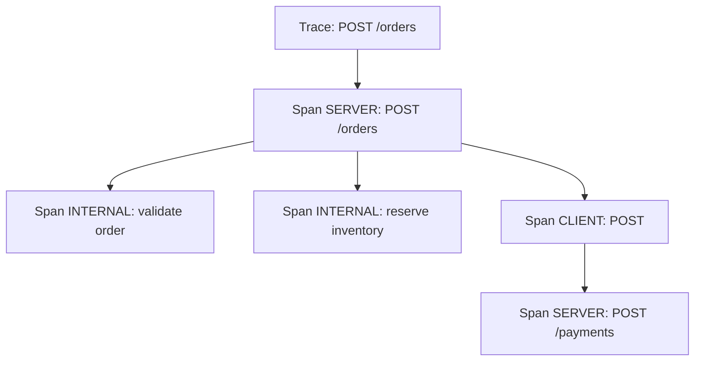
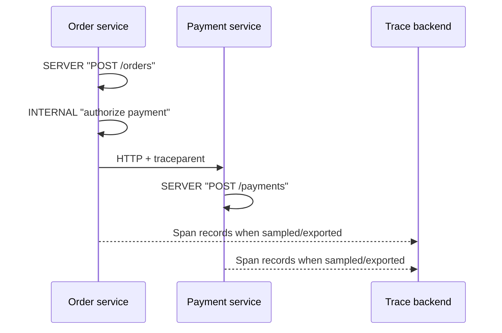

# Span Name in Micrometer Tracing and Spring Boot

## 1. Purpose and Scope

When investigating a slow request in a distributed system, the trace backend may display dozens of spans across multiple services. The span name is the first piece of information helping operators distinguish **HTTP handling**, **inventory checking**, **pricing calculation**, **database queries**, or **event publishing**. If names are too generic, traces are hard to read; if names embed `orderId`, `userId`, or raw URLs, tracing data fragments and risks leaking sensitive information.

This lesson belongs to the **Tracing** chapter of the **SPRING_BOOT_OBSERVABILITY** module. Its focus is **Span name**: the name representing the measured operation, naming rules, its relationship with Micrometer Observation, controlled name customization, and verification in Spring Boot. This knowledge sits in the module context of setting up metrics, logs, distributed tracing, context propagation, tags/cardinality, exporters, and sampling to investigate errors and latency in production.

After this lesson, you will be able to:

1. Distinguish `span name`, `traceId`, `spanId`, `span kind`, attributes, and resource attributes.
2. Choose **stable, low-cardinality, action-meaningful** names without appending per-request identifiers.
3. Explain how `Observation.name` differs from `Observation.contextualName` and why tracing handlers prefer the contextual name.
4. Name custom spans via `Observation`, `Tracer`, `@Observed`, or `ObservationConvention`.
5. Understand HTTP span naming conventions based on method and **route template**.
6. Verify actual span names in the backend, correlate traces properly with metrics and logs, and avoid confusing naming with sampling or propagation.
7. Recognize common mistakes when renaming too late, double-instrumenting, using dynamic values, or missing exported traces.

**Illustrative version:** Spring Boot 3.5.x, Java 17+, Micrometer Observation/Tracing. For Spring Boot 4.x or different OpenTelemetry semantic convention versions, verify the exact starters, configuration namespaces, and conventions of your target release.

## 2. What Is a Span Name?

A **trace** describes a request's journey across components. A **span** represents an operation with start time, end time, parent–child relationships, and metadata. The **span name** is a concise label describing the *type of operation being performed*, not a unique identifier of a single execution.

Example when a request creates an order:



The diagram only illustrates a trace when servers/clients are instrumented and trace context is propagated. Actual HTTP client names may include a URL **template** when instrumentation has one available, or simply use the HTTP method when no low-cardinality target exists. Span structure and names in the backend also depend on the framework, tracer, and semantic convention version.

### 2.1. Distinguishing Related Fields

| Field | Purpose | Example | Should It Contain Dynamic IDs? |
| --- | --- | --- | --- |
| **Span name** | Grouping/reading operation types | `reserve inventory`, `GET /orders/{id}` | **No** |
| `traceId` | Identifies the entire trace journey | Hex string / trace ID | Already a technical identifier; do not put in name |
| `spanId` | Identifies a single span within a trace | Span ID string | Do not put in name |
| `parentSpanId` | Connects parent–child links | Parent span ID | Do not put in name |
| Span kind | Role of the operation in communication | `SERVER`, `CLIENT`, `INTERNAL`, `PRODUCER`, `CONSUMER` | No |
| Span attributes | Structured details about the operation | `http.request.method=GET`, `payment.provider=acquirer-a` | Subject to policy, sampling, and privacy |
| Resource attributes | Entity emitting telemetry | `service.name=checkout-service` | Usually stable values |
| Span events | Timestamped milestones within a span | `retry scheduled` | Avoid putting secrets in names/events |
| Span status/error | Error status when the operation fails | `ERROR`, exception type | Separate from name |

**You cannot infer a trace ID from a span name.** Many spans across different requests can share the name `reserve inventory`, yet each execution has its own `spanId`. Renaming a span does not make it a new span, nor does it change `traceId`/`spanId`.

### 2.2. Span Name Differs from Service Name

`service.name` belongs to **resource attributes** and identifies the application/service emitting the span, such as `checkout-service`. `span name` describes the operation inside that service. One service can emit hundreds of distinct span types; never name every span `checkout-service`.

In a trace backend, fields are typically queried together: *service*, *operation/span name*, *duration*, *status*, and *trace ID*. A dashboard aggregating latency by span name is only meaningful when names are **stable**.

## 3. Rules for Choosing Good Span Names

A useful name must simultaneously **express the action** and **bound the value set**:

- Use one name per **operation type**, not per-execution names.
- Prefer action + domain target/object phrasing: `reserve inventory`, `authorize payment`, `calculate tax`.
- For HTTP, follow semantic conventions and route templates: `GET /orders/{id}`, not raw URL `GET /orders/81472`.
- Keep names short, searchable, and consistent across the system; avoid stuffing parameters, payloads, or exception messages.
- Move supplementary details into span attributes/events per data policies instead of concatenating them into the name.
- Do not change names by outcome: `authorize payment success` and `authorize payment failed` should normally be the **same operation type**; distinguish outcomes via status/error/controlled attributes.
- Do not manufacture spans just to show extra lines; create spans only for steps with genuine observability value, avoiding traces cluttered with tiny spans.

### 3.1. Good Names vs. Names to Avoid

| Context | Recommended | Avoid | Problem with the Bad Name |
| --- | --- | --- | --- |
| Reading an order over HTTP | `GET /orders/{id}` | `GET /orders/81472` | A distinct name for every ID |
| Checking inventory | `reserve inventory` | `reserve inventory sku=88235` | Dynamic SKU fragments data |
| Payment | `authorize payment` | `authorize payment for alice@example.com` | Personal data leakage |
| DB query | `SELECT orders` or name per active DB instrumentation | `SELECT * FROM orders WHERE id=81472` | Dynamic SQL and sensitive parameters |
| Sending a message | `publish order-events` (when destination is bounded) | `publish order-81472` | Dynamic destination, hard-to-use index |
| Error handling | `process checkout` | `failed: timeout after 1032ms for id=...` | Name polluted by error/runtime values |
| Price calculation | `calculate price` | `run method` or `process` | Too generic to pinpoint bottlenecks |

Names in the recommended column are **design examples**. For HTTP, database, and messaging auto-instrumented by the framework, names/kinds should follow your active instrumentation's conventions; do not override them arbitrarily just to match the table verbatim.

### 3.2. Span Name Cardinality

Suppose an API has 4 HTTP methods and 30 valid route templates. Ideally, it produces at most around `4 × 30 = 120` name groups under the method + route rule. If you append 100,000 order IDs into the name, the count of **distinct span names** scales with order count.

This degrades searching/grouping by operation name, raises indexing costs, and breaks name-based summary tables. Do not mechanically apply `span name count = metric series count`: metric time series are distinguished by **meter name and tags**, whereas tracing stores **span records** with names and attributes. Both suffer storage pressure from dynamic metadata, though their mechanisms and budgets differ.

**Conclusion:** Good span names **group operations**; specific IDs belong in trace IDs, approved span attributes, logs/audits, or databases depending on the investigation goal.

## 4. Span Names Under OpenTelemetry Semantic Conventions

OpenTelemetry specifies naming conventions for span types so diverse services, tracers, and backends interpret them consistently. Not every span needs manual naming; prefer framework auto-instrumentation for HTTP and supported transports.

### 4.1. HTTP Server Spans

When a **low-cardinality route template** is available, HTTP span names typically follow:

```text
{HTTP_METHOD} {ROUTE_TEMPLATE}
```

Examples:

```text
GET /orders/{id}
POST /orders
PUT /orders/{id}
```

Requests:

```text
GET /orders/102
GET /orders/103
GET /orders/104
```

all group under a single span name `GET /orders/{id}`, rather than creating three different names.

If **no route template is available** at instrumentation time, OpenTelemetry specifies using the method—e.g., `GET`—instead of guessing from the raw URI path. When the framework resolves the route later, instrumentation may update the span name before finishing. Specific fallback names and update mechanics vary by version; verify actual data in your trace backend.

`http.route` is the attribute holding the route template (when available), distinct from `url.path` which holds the actual path. Never substitute `url.path` or raw query strings for `http.route`.

### 4.2. HTTP Client Spans

On the client side, the app may not know the target server's route template. An HTTP client span might therefore be named `GET` or `POST`. When instrumentation has a **valid URL template**, the name may include that template. Never blindly concatenate full URLs containing tokens, queries, or dynamic IDs into the name.

In Spring Boot, use framework-configured `RestClient.Builder`/`WebClient.Builder` so interceptors/observation conventions can receive context and propagate trace headers. When creating HTTP clients manually, do not assume tracing is instrumented.

### 4.3. Database and Messaging

For databases, semantic conventions/instrumentation may use the operation (`SELECT`, `INSERT`, `db.client.operation`, etc.) and a low-cardinality target such as collection/table where appropriate. Avoid full SQL with dynamic parameters in span names.

For messaging, names should express actions like `publish`, `receive`, or `process` and a bounded destination. User-generated free-form queue/topic names should be normalized to avoid high cardinality.

Semantic conventions evolve across versions; when an instrumentation library already exists for your database/message broker, prefer its defaults and inspect actual output before customizing.

## 5. Micrometer Observation: `name` vs. `contextualName`

This is the most common source of confusion in Spring Boot.

An `Observation` has two related name properties:

| Micrometer Property | Primary Purpose | Example |
| --- | --- | --- |
| **Observation name** (`name`) | Stable technical identifier of the observation, typically used as **meter name** | `inventory.reserve` |
| **Contextual name** (`contextualName`) | Human-readable contextual name; tracing handlers typically use this as **span name** | `reserve inventory` |
| Low-cardinality key-values | Bounded labels used for metrics and optionally spans | `channel=web` |
| High-cardinality key-values | More detailed metadata for spans when permitted | `workflow.id=opaque-value` |
| `Observation.Context` | Internal state of an observation shared with handlers | Step state, error |

Example:

```java
import io.micrometer.observation.Observation;
import io.micrometer.observation.ObservationRegistry;

Observation observation = Observation
        .createNotStarted("inventory.reserve", observationRegistry)
        .contextualName("reserve inventory")
        .lowCardinalityKeyValue("channel", "web");

observation.observe(() -> inventoryService.reserve());
```

Assuming the registry has matching metrics/tracing handlers:

- The metrics handler can create a **Timer** named `inventory.reserve` with tag `channel=web`.
- The tracing handler can create a span named **`reserve inventory`**, still linked to the parent trace/span when scoping/propagation work properly.
- Logs can carry `traceId`/`spanId` within scope if MDC is configured, yet they do **not automatically carry the span name** as an MDC field.

In Micrometer Tracing, `TracingObservationHandler`'s naming logic uses `Observation.Context.getContextualName()` when non-null; otherwise, the handler typically falls back to `getName()`. Thus if you only write:

```java
Observation.createNotStarted("inventory.reserve", observationRegistry)
        .observe(() -> inventoryService.reserve());
```

the span name will likely be `inventory.reserve`. This is valid, though whenever you want a distinct readable span name, use `contextualName`.

**Never set `Observation.name` to `inventory.reserve.81472` to make spans easier to find:** that name can also become the **metric name**, exploding metric families. An execution instance ID is not the name of an operation type.

### 5.1. When to Assign Names

Set `name` and `contextualName` **before calling `observe` or `start`** when the operation already has a stable name. HTTP instrumentation may rename a span when the route template is only known after routing; that is intentional instrumentation behavior, not a reason to mutate every span name based on end-of-request data.

A span may permit renaming before `end()`, yet late renaming does not retroactively alter **head sampling** decisions made at span creation/start. Different handlers, filters, and exporters read metadata at different points; avoid relying on updates near `stop/end`.

## 6. Configuring Spring Boot 3.5 to Observe Span Names

Example Spring Boot MVC application using Micrometer Observation and the **Micrometer Tracing bridge to OpenTelemetry**.

### 6.1. Maven Dependencies

With Spring Boot parent/BOM managing versions:

```xml
<dependencies>
    <dependency>
        <groupId>org.springframework.boot</groupId>
        <artifactId>spring-boot-starter-web</artifactId>
    </dependency>
    <dependency>
        <groupId>org.springframework.boot</groupId>
        <artifactId>spring-boot-starter-actuator</artifactId>
    </dependency>
    <dependency>
        <groupId>io.micrometer</groupId>
        <artifactId>micrometer-tracing-bridge-otel</artifactId>
    </dependency>
    <dependency>
        <groupId>io.opentelemetry</groupId>
        <artifactId>opentelemetry-exporter-otlp</artifactId>
    </dependency>
</dependencies>
```

Tracing requires a compatible bridge, tracer/provider, and exporter; with Boot's dependency management, auto-configuration wires them together when conditions are met. If using the **Brave** bridge instead of OpenTelemetry, swap in the corresponding dependencies and exporter; never mix both bridges just to generate the same span types.

**Note:** the tracing SDK/provider and `OtlpMeterRegistry` are two separate data paths. Adding `micrometer-registry-otlp` solely to export metrics does not provide a tracer or spans.

### 6.2. Application Properties

```yaml
spring:
  application:
    name: inventory-service

management:
  endpoints:
    web:
      exposure:
        include: health,info,metrics
  tracing:
    sampling:
      probability: 1.0  # For local testing only
  otlp:
    tracing:
      endpoint: http://localhost:4318/v1/traces
```

Configuration illustrates **Spring Boot 3.5.x**: the trace exporter ships to an OTLP/HTTP receiver on port 4318 at path `/v1/traces`. An actual Collector/trace backend must be running and accepting ingestion. Inside Docker/Kubernetes, `localhost` refers to the app's own network namespace; replace it with DNS or a reachable Collector address.

Sampling `1.0` helps inspect more spans in exercises; **never** default to 100% in production due to cost and volume. Adjusting `management.tracing.sampling.probability` does not change span names or make Timer metrics count only sampled traces.

Exposing `/actuator/metrics` to inspect meters is optional; this endpoint is **not** where you read all span names. Inspect actual span names in your Collector or compatible trace backend (such as Jaeger/Tempo/Zipkin).

## 7. Complete Spring Boot Example: Stable Span Names for Business Logic

The service below measures a single `inventory.reserve` step. It uses a request-independent span name and normalizes `channel` to bounded values.

```java
package com.example.inventory;

import io.micrometer.observation.Observation;
import io.micrometer.observation.ObservationRegistry;
import org.springframework.stereotype.Service;

@Service
public class InventoryService {
    private final ObservationRegistry registry;

    public InventoryService(ObservationRegistry registry) {
        this.registry = registry;
    }

    public String reserve(String rawChannel, boolean fail) {
        String channel = "web".equals(rawChannel) ? "web" : "other";

        return Observation
                .createNotStarted("inventory.reserve", registry)
                .contextualName("reserve inventory")
                .lowCardinalityKeyValue("channel", channel)
                .observe(() -> {
                    if (fail) {
                        throw new IllegalStateException(
                                "Simulated out-of-stock error");
                    }
                    return "reserved";
                });
    }
}
```

A simple controller to invoke the business method:

```java
package com.example.inventory;

import org.springframework.web.bind.annotation.GetMapping;
import org.springframework.web.bind.annotation.RequestParam;
import org.springframework.web.bind.annotation.RestController;

@RestController
public class InventoryDemoController {
    private final InventoryService inventory;

    public InventoryDemoController(InventoryService inventory) {
        this.inventory = inventory;
    }

    @GetMapping("/demo/reserve")
    public String reserve(
            @RequestParam(defaultValue = "web") String channel,
            @RequestParam(defaultValue = "false") boolean fail) {
        return inventory.reserve(channel, fail);
    }
}
```

Send two requests:

```text
GET /demo/reserve?channel=web
GET /demo/reserve?channel=mobile&fail=true
```

Expectations when tracing is properly configured:

- The Spring MVC-instrumented HTTP server span is named per framework convention (exact name varies by version/routing).
- The nested custom span is typically named **`reserve inventory`**.
- The error span receives error/status/exception metadata when `observe` catches the escaping exception.
- The two requests get different trace IDs, yet both contain a custom span with the **same name**.
- The metric is named `inventory.reserve` with tag `channel=web|other`, not two metrics named `reserve inventory`.

Span names do not encode success/failure outcomes. In the demo, when `fail=true`, the name **remains unchanged**, while error status differs. This design lets you query all `inventory.reserve` invocations and analyze error rates/latency over time.

## 8. Using `Tracer` to Name Spans Directly

Not every scenario goes through `Observation`. With Micrometer Tracing, you can explicitly create a span:

```java
import io.micrometer.tracing.Span;
import io.micrometer.tracing.Tracer;

public class InventoryTraceOperation {
    private final Tracer tracer;

    public InventoryTraceOperation(Tracer tracer) {
        this.tracer = tracer;
    }

    public void checkInventory(Runnable checkAction) {
        Span span = tracer.nextSpan().name("check inventory").start();

        try (Tracer.SpanInScope scope = tracer.withSpan(span)) {
            checkAction.run();
        } catch (RuntimeException | Error ex) {
            span.error(ex);
            throw ex;
        } finally {
            span.end();
        }
    }
}
```

Things to note:

1. `tracer.nextSpan()` typically creates a child span if there is a **current span**; otherwise, it may start a new trace.
2. `.name("check inventory")` sets the name **directly** on the span.
3. `.start()` starts timing; `tracer.withSpan(span)` puts the span in scope so nested code/logging can access context.
4. `SpanInScope.close()` restores the previous active context; **it does not substitute for `span.end()`**.
5. When `checkAction` throws, `span.error(ex)` records the failure and rethrows the exception.
6. The snippet only creates a **tracing span**; it does not automatically create a same-named Timer in `MeterRegistry`.

When you need both metrics and traces from a business instrumentation point, **prefer `Observation`**. Never wrap the exact same block in both an `Observation` and a `Tracer.nextSpan()` just to have different names; that produces duplicate spans and clutters the trace.

### 8.1. Span Names Can Be Changed via API, But Should Not Be Abused

Micrometer `Span.name(...)` allows changing the span name before ending. However:

```java
span.name("check inventory");
// ... business logic runs ...
span.name("check inventory"); // Still keeps the name stable.
```

Never call `span.name("check inventory order=" + orderId)` to update the name with execution results. To classify outcomes, use status/exceptions and a **bounded attribute** such as `inventory.outcome=reserved|out-of-stock`, while checking privacy rules.

Renaming after `end()` has no guarantee of updating already-dispatched spans. When an initial name is unknown due to routing, let the framework/convention update it to a low-cardinality route template.

## 9. Centralized Naming with `ObservationConvention`

When multiple components instrument the same family of operations, avoid scattering separate `name` and `contextualName` strings across call sites. `ObservationConvention` standardizes names and key-values for a given `Observation.Context` subtype.

Example Context for checkout:

```java
import io.micrometer.observation.Observation;

public final class CheckoutContext extends Observation.Context {
    private final String channel;

    public CheckoutContext(String channel) {
        this.channel = channel;
    }

    public String channel() {
        return channel;
    }
}
```

The convention sets both distinct names as **stable constants**:

```java
import io.micrometer.common.KeyValues;
import io.micrometer.observation.Observation;
import io.micrometer.observation.ObservationConvention;

public final class CheckoutConvention
        implements ObservationConvention<CheckoutContext> {

    @Override
    public boolean supportsContext(Observation.Context context) {
        return context instanceof CheckoutContext;
    }

    @Override
    public String getName() {
        return "checkout.process";
    }

    @Override
    public String getContextualName(CheckoutContext context) {
        return "process checkout";
    }

    @Override
    public KeyValues getLowCardinalityKeyValues(CheckoutContext context) {
        return KeyValues.of("channel", context.channel());
    }
}
```

At the instrumentation call site:

```java
CheckoutContext context = new CheckoutContext("web");

Observation.createNotStarted(
                new CheckoutConvention(),
                () -> context,
                observationRegistry)
        .observe(() -> processCheckout());
```

`processCheckout()` is your business logic; `observationRegistry` is the Spring Boot-injected bean. This keeps **meter name** `checkout.process`, **span name** `process checkout`, and `channel=web` consistent across call sites.

Notice the overload **taking a convention and context supplier**. If you only call `Observation.createNotStarted("checkout.process", registry)`, merely declaring the `CheckoutConvention` class will not magically apply it. For built-in framework integrations like HTTP servers/clients, prefer framework conventions and supported extension points; avoid registering competing conventions unnecessarily.

## 10. Span Names from the `@Observed` Annotation

Spring Boot 3.5 can enable support for Micrometer annotations, e.g.:

```java
import io.micrometer.observation.annotation.Observed;
import org.springframework.stereotype.Service;

@Service
public class PricingService {

    @Observed(
        name = "pricing.calculate",
        contextualName = "calculate price"
    )
    public long calculate(long basePrice, long tax) {
        return basePrice + tax;
    }
}
```

For proxies/aspects to intercept the annotation, a Boot 3.5 app needs **`spring-boot-starter-aop`** and configuration:

```yaml
management:
  observations:
    annotations:
      enabled: true
```

When the method is called **through the Spring AOP proxy**, `@Observed` creates an observation with technical name `pricing.calculate` and contextual name `calculate price`. With a tracing handler, the contextual name typically becomes the span name.

Notes:
- Calling a method internally within the same bean (self-invocation) can **bypass** the Spring AOP proxy.
- Placing `@Observed` on an MVC controller or a method already auto-instrumented by the framework can create **duplicate observations/spans**. To measure a distinct business step, place the annotation on an appropriate service method.
- Never attempt `@Observed(name = "pricing.calculate." + orderId)`; annotations require compile-time constants anyway, and the same principle applies to all dynamic naming mechanisms.
- Micrometer Tracing's `@NewSpan` is a separate tracing-only mechanism. Do not stack both `@Observed` and `@NewSpan` on the same operation without a clear reason.

With Spring Boot 4.x, AOP/AspectJ starters may be organized differently; check documentation and dependencies for your active version.

## 11. Span Names, Tags/Attributes, and Cardinality

**Span names should be low-cardinality.** However, that does **not** mean every span attribute must be as restricted as a metric tag. Trace backends can store detailed per-execution attributes when permitted, though security, sampling, retention, and indexing costs still apply.

| Data | Span Name? | Low-Cardinality Metric Tag? | Span Attribute? |
| --- | --- | --- | --- |
| `operation=reserve` | Can guide choosing a stable name | Yes | Yes |
| `channel=web\|mobile\|other` | Usually no need to concatenate into name | Yes | Yes |
| `outcome=ok\|failed` | No need for two distinct names | Yes when appropriate | Yes |
| `http.route=/orders/{id}` | Yes, when building HTTP span names | Yes, if supported by framework | Yes |
| `orderId=81472` | **No** | **No** | Only with justification, approval, and controls |
| `email=alice@example.com` | **No** | **No** | Normally avoid in tracing |
| `traceId=...` | **No** | **No** | Already in span context; no need to duplicate |
| `exception.message=...` | **No** | **No** | Evaluate risk of leaking secrets |

With Micrometer Observation:

```java
Observation.createNotStarted("payment.authorize", observationRegistry)
        .contextualName("authorize payment")
        .lowCardinalityKeyValue("provider", "acquirer-a")
        .highCardinalityKeyValue("workflow.id", safeOpaqueId)
        .observe(() -> authorizePayment());
```

`safeOpaqueId` here is a technical ID **cleared by data policy**, not a blanket recommendation to emit every workflow ID. Low-cardinality tags can become metric tags; high-cardinality key-values are typically forwarded by tracing handlers to spans and **not exported as metric tags by standard metrics handlers**.

Putting a request ID into `Observation.name` disrupts both metrics and trace naming. Putting an ID only into `contextualName` avoids changing the meter name yet still causes **span name explosion**. The right practice is keeping dynamic values out of both names.

### 11.1. Span Names Are Not Business Lookup Keys

Trace ID is the mechanism for locating an execution in a trace backend. If the requirement is finding all transactions for a specific customer, do not turn the span name into `checkout.customer.<id>`. Use an event/audit store or controlled indexing on approved data, linking from logs/traces when needed.

## 12. Span Name, Tracing Propagation, and Sampling

### 12.1. What Does Propagation Carry?

When service A calls service B, distributed tracing must pass **trace context** (such as the W3C `traceparent` header) so service B creates a span in the same trace with the right parent–child link.



Header propagation **does not transfer span names** between two services and does not automatically copy all attributes from a parent span. Service B names its spans based on **B's own** instrumentation and work. Two spans may have identical or different names while linked by trace context, not by name.

When using `@Async`, `CompletableFuture`, or Reactor, the current span/observation can be lost without proper context propagation. A `reserve inventory` span appearing as a root span in the backend is not necessarily a naming bug; it may be a scoping/propagation bug.

### 12.2. Sampling Decides Which Spans Are Retained

Test configuration example:

```yaml
management:
  tracing:
    sampling:
      probability: 0.1
```

This illustrates a **10%** sampling probability per the tracing policy. Even when code sets the proper span name, a span may still be absent from the backend due to sampling, exporters, collectors, or retention. Do not alter span names to "force" a sampler to keep a trace without a clear sampling policy design.

Some samplers decide at span start time; **renaming at the end** does not guarantee changing an already-made decision. For operation-based sampling requirements, verify your sampler type and what data is available at decision time rather than relying on late name updates.

### 12.3. Span Names and Log Correlation

When tracing scope is configured, logs can carry `traceId` and `spanId` in MDC:

```text
INFO  [traceId=4af8..., spanId=25c1...] Reserve inventory started
ERROR [traceId=4af8..., spanId=25c1...] Inventory provider timeout
```

This is only a formatting example, not guaranteed output for every logging pattern. **Changing a span name does not change the trace ID.** The logging pipeline also does not automatically embed span names on every log line; if needed, design log fields deliberately without inflating cardinality or logging sensitive data.

## 13. Verifying Span Names in a Real System

### 13.1. Verification Steps with the Demo App

1. Start Spring Boot with Actuator, tracing bridge, and configured exporter.
2. Send several `GET /demo/reserve` requests with both `fail=false` and `fail=true`.
3. Inspect `GET /actuator/metrics/inventory.reserve` if a metrics registry/handler is present. This verifies the **metric name**, not the span name.
4. Open the trace backend or OpenTelemetry Collector debug exporter to locate service `inventory-service` and span name `reserve inventory`.
5. Verify each span has its own trace ID/span ID, sensible parent, duration, and accurate error status.
6. Change `channel` values or set `fail=true`, confirming the **span name stays unchanged**.
7. Verify HTTP server spans use the route template when routing info is available, without raw IDs or query strings.
8. To correlate logs, search the span's `traceId` in MDC-configured logs and cross-check exceptions/timelines.

### 13.2. What to Check in the Backend

| Backend Field | Expectation | If Incorrect |
| --- | --- | --- |
| `service.name` | Consistent service name | Check resource attributes/exporter |
| `span.name` | `reserve inventory` | Check `contextualName`, convention, instrumentation |
| `traceId` | Same trace across parent and child spans | Check propagation/scope |
| `parentSpanId` | Matches expected hierarchy | Check span creation site, context transfer |
| `span.kind` | Appropriate INTERNAL/SERVER/CLIENT | Never try fixing kind merely by renaming |
| `status/error` | Reflects execution outcome | Check how exceptions are recorded |
| `duration` | Covers the intended code block | Check start/stop boundaries and async lifecycle |
| `attributes` | Free of secrets, useful tags | Audit conventions and input normalization |

### 13.3. Distinguishing Metric Results from Trace Results

A dashboard reports `inventory.reserve` p95 latency increasing, while the trace UI shows `reserve inventory`. These can be the **exact same operation** instrumented with Micrometer Observation, wearing different names at the two layers.

If an operator searches `inventory.reserve` in the trace backend and finds nothing, they may be searching the **metric name** instead of the **span name**. Similarly, searching `reserve inventory` in `/actuator/metrics` yields nothing because the Timer uses the observation name.

Maintain a "metric name ↔ span name" mapping table for critical business operations so dashboards and runbooks stay aligned.

## 14. Common Mistakes When Designing Span Names

| Symptom | Common Cause | Resolution |
| --- | --- | --- |
| Thousands of nearly identical span names | Appending orderId, URI, email, or timestamp to names | Use stable operation/route templates |
| Only seeing `inventory.reserve` instead of `reserve inventory` | Missing contextual name or convention not applied | Check `contextualName`, Context type, and handlers |
| HTTP span displays path with ID | Custom instrumentation uses raw URI instead of route template | Use framework route metadata and semantic conventions |
| Every span named `process` | Name too generic | Use meaningful action + target/operation |
| Span name changes on failure | Embedding error message or outcome in name | Keep name constant; use status/attributes |
| Metrics appear, no spans found | Missing tracer/exporter, sampling, backend, or tracing handler | Inspect tracing pipeline end-to-end |
| Spans exist without parents | Context not propagated across HTTP/executor/reactive | Check W3C headers and context propagation |
| Two redundant spans | `@Observed`/custom Tracer re-instrumenting auto-instrumented code | Pick a single instrumentation source |
| Renamed near stop, yet queries inconsistent | Handler/exporter/sampler reads name at a different phase | Set stable names early; verify lifecycle |
| Logs lack span name | MDC usually holds trace ID/span ID, not span name | View span name in trace backend; add log fields only if needed |
| Using `@Observed` produces no span | Missing AOP/annotations enabled, self-invocation, or missing tracing handler | Check dependencies, proxy, config, and exporter |
| Tracing consumes unexpected resources | Too many spans/names/attributes, high sampling | Drop noisy spans, stabilize names, tune sampling/retention |

## 15. Design and Review Checklist

- [ ] Span names describe the **operation type**, not an individual run.
- [ ] HTTP server names are standardized on method + route template; no raw paths.
- [ ] **Observation.name** (typically for metrics) and **Observation.contextualName** (typically for spans) are clearly distinguished.
- [ ] Span names are low-cardinality and free of IDs, emails, tokens, stack traces, or exception messages.
- [ ] When custom names use a convention, verify the exact Context type and where the convention is applied.
- [ ] Neither `@Observed` nor `Tracer.nextSpan` duplicates existing instrumentation.
- [ ] Scopes and `stop()/end()` accurately cover execution time, including errors/timeouts/async.
- [ ] Traces verified in the actual backend, not inferred solely from the metrics endpoint.
- [ ] Trace sampling and export/Collector verified independently of naming strategy.
- [ ] Log correlation uses `traceId`/`spanId` when needed; span name is not used as the sole join key.
- [ ] Standard naming table exists for critical operations like `inventory.reserve`, `payment.authorize`, `checkout.process`.
- [ ] Span attributes/metric tags are governed for cardinality and privacy.

## 16. Self-Practice Questions

1. Why should two requests both hitting `GET /orders/{id}` share the same **span name** while having different `traceId` or `spanId` values?
2. How do span name, span kind, and `service.name` answer three different questions?
3. In Micrometer, how do `Observation.name` and `Observation.contextualName` differ?
4. When `Observation.createNotStarted("payment.authorize", registry).contextualName("authorize payment")` runs, what Timer name and span name do you expect respectively?
5. Why is appending `orderId` to `contextualName` still harmful even though it does not directly change the meter name?
6. An HTTP server does not know the route template. Per semantic conventions, should it fall back to the raw URL path or just the method?
7. A custom span has a great name yet does not appear in the tracing backend. Which components besides the name must you check?
8. When using `@Observed` on Spring Boot 3.5, why might self-invocation fail to create a new observation?
9. Why is `contextualName` alone insufficient to connect spans across two services?
10. Does renaming a span after the sampler makes its decision guarantee the trace gets re-sampled? Explain.
11. When logs contain a trace ID without a span name, is that a log correlation bug?
12. If you have an HTTP server span, a custom `checkout.process` span, and an outbound HTTP client span, where is the right place to express the business operation name?

## References

- [Micrometer — Observation Components](https://docs.micrometer.io/micrometer/reference/observation/components.html)
- [Micrometer — Observation Instrumentation](https://docs.micrometer.io/micrometer/reference/observation/instrumenting.html)
- [Micrometer — Observation API](https://javadoc.io/doc/io.micrometer/micrometer-observation/latest/io/micrometer/observation/Observation.html)
- [Micrometer — ObservationConvention](https://javadoc.io/static/io.micrometer/micrometer-observation/1.15.0/io/micrometer/observation/ObservationConvention.html)
- [Micrometer Tracing — Direct Tracer API](https://docs.micrometer.io/tracing/reference/api.html)
- [Spring Boot — 3.5 Observability](https://docs.spring.io/spring-boot/3.5/reference/actuator/observability.html)
- [Spring Boot — 3.5 Tracing](https://docs.spring.io/spring-boot/3.5/reference/actuator/tracing.html)
- [OpenTelemetry — HTTP Span Semantic Conventions](https://opentelemetry.io/docs/specs/semconv/http/http-spans/)
- [OpenTelemetry — Tracing API, Span Names](https://opentelemetry.io/docs/specs/otel/trace/api/)
