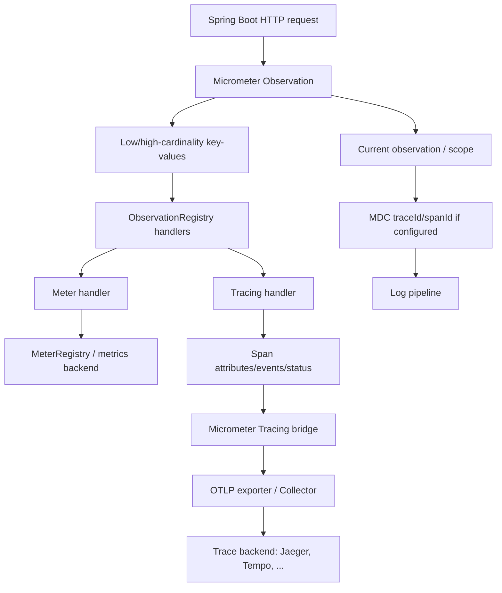
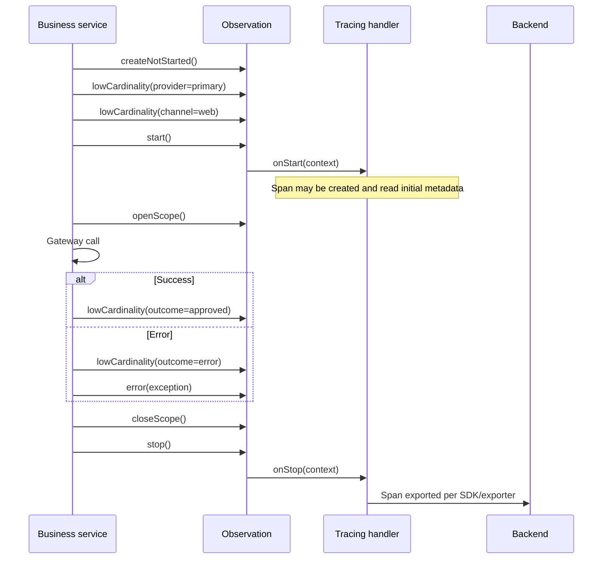
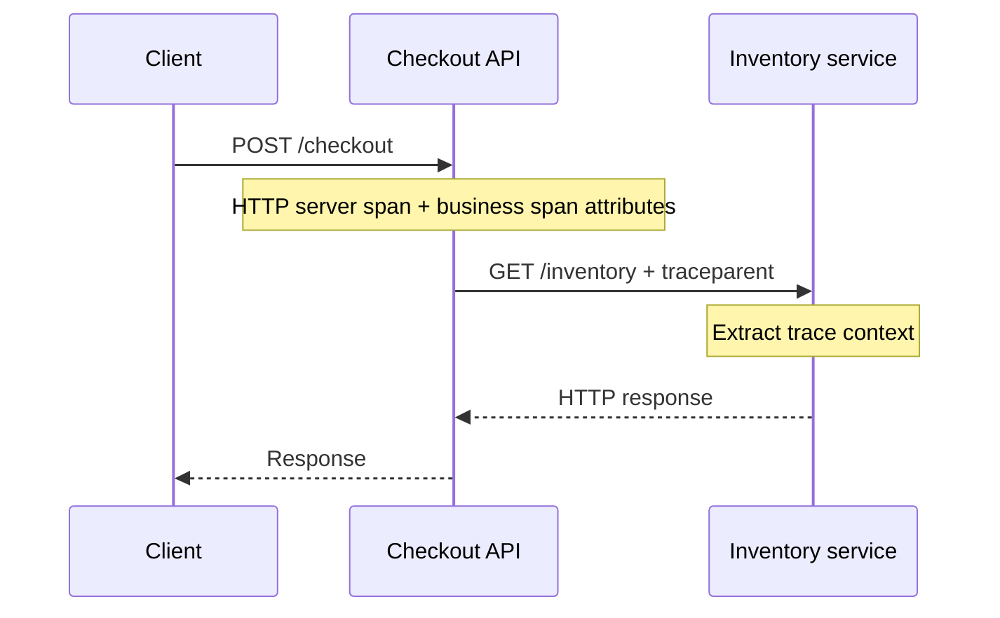

# Span Attributes in Distributed Tracing with Spring Boot

> **Chapter:** Tracing  
> **Module:** `SPRING_BOOT_OBSERVABILITY` — Setting up observability for Spring Boot using Micrometer Observation, metrics, logs, and distributed tracing; understanding context propagation, tags/cardinality, exporters, sampling, and correlating signals to investigate errors, latency, and application behavior in production.  
> **Focus:** Span attributes are metadata describing **a specific unit of work** inside a distributed trace. This lesson focuses on how to define, attach, convey semantics, and verify attributes across Micrometer Observation, Micrometer Tracing, Spring Boot, and OpenTelemetry/OTLP, while avoiding confusing attributes with metric labels, baggage, or log fields.

## 1. Learning Objectives

After this lesson, you will be able to:

1. Explain how trace, span, span name, span attributes, events, status, resource attributes, and trace context differ.
2. Select operationally meaningful attributes to identify **operation, dependency, outcome, and execution branch**, instead of dumping entire request payloads into traces.
3. Use `Observation.lowCardinalityKeyValue(...)` and `Observation.highCardinalityKeyValue(...)` to describe an operation and understand how tracing handlers map them to span attributes.
4. Use `Tracer`/`Span.tag(...)` directly when manually instrumenting a unit of work; manage scope, exceptions, and `end()` timing accurately.
5. Design naming and attribute keys following consistent semantic conventions/contracts, recognizing the difference between high cardinality in tracing and metric cardinality.
6. Understand that attributes **do not automatically propagate** over HTTP, do not govern sampling if added late, and are not synonymous with baggage or MDC.
7. Verify attributes at the code layer, OTLP exporter, Collector, and tracing backend; diagnose cases where a span exists but attributes are missing.
8. Combine metrics–traces–logs to pinpoint causes of errors and latency without putting trace IDs or sensitive data into metric labels.

## 2. What Is a Span and What Do Attributes Add?

A **trace** describes the journey of an operation across one or more services. A trace typically consists of multiple **spans** representing processing steps, such as receiving an HTTP request, checking an order, calling a payment gateway, and writing to a database.

A span typically contains:

| Component | Example | Purpose |
|---|---|---|
| **Trace ID** | Trace identifier | Connects spans belonging to the same trace |
| **Span ID / parent span** | Span ID and parent–child relationship | Builds the call path tree structure |
| **Span name** | `checkout.payment.authorize` | Identifies the type of work; should be stable |
| **Start/end timestamps** | 10:30:00.000 to 10:30:00.145 | Determines duration and timeline placement |
| **Span attributes** | `payment.provider=primary`, `payment.outcome=approved` | Describes properties, classification, and context of a span |
| **Events** | `retry.started`, `fallback.used` | Marks timestamped occurrences inside the span |
| **Status/error** | Error, exception | Represents processing failure in tracing semantics |
| **Links** | Reference to another span context | Describes relationships outside parent–child, per instrumentation |

Example:

```text
Trace 4bf92f3577b34da6a3ce929d0e0e4736
└─ HTTP POST /checkout                    [180 ms]
   ├─ checkout.validate                   [12 ms]
   ├─ checkout.payment.authorize          [130 ms]
   │  attributes:
   │    payment.provider = primary
   │    payment.channel  = mobile
   │    payment.outcome  = approved
   └─ checkout.order.persist              [24 ms]
```

The IDs and durations here are illustrative data only.

Span attributes answer questions that span name/duration alone cannot: **which gateway is slow? which channel did the request arrive from? did this step succeed or fall back?** When the backend supports searching/indexing attributes, you can filter a targeted group of spans instead of browsing thousands of traces at random.

### 2.1. Attributes Are Not Everything Related to a Request

A span is an observational record, **not a full copy of an HTTP request, database transaction, or user session**. Never add raw request/response bodies, authorization headers, tokens, passwords, card numbers, emails, street addresses, or SQL statements containing sensitive parameters into attributes.

A good attribute has three traits:

- **Explainable:** key and value have concrete meaning agreed upon by the team.
- **Purposeful:** used to filter, compare, isolate errors, or evaluate latency.
- **Cost- and policy-compliant:** avoids excessive cardinality/indexing and avoids leaking data.

## 3. Where Do Attributes Sit in the Observability Flow?



In Spring Boot with tracing enabled, **two instrumentation styles** are common:

1. **Observation API:** creates an `Observation` and attaches low-/high-cardinality key-values. Registry handlers decide how that information maps to meters and spans.
2. **Tracing API:** works directly with `Tracer` and `Span` to set names, tags/attributes, events, and errors on a span.

Both are valid; avoid using both simultaneously to measure **the exact same block of work**, as this can accidentally create two semantically duplicate nested spans.

**Note:** `Span.tag(key, value)` in Micrometer Tracing typically maps to a **span attribute** in the tracing implementation. The word "tag" in the Micrometer Tracing API does not mean it automatically becomes a **metric label**.

## 4. Distinguishing Span Attributes from Similar Concepts

| Concept | Where Does It Live? | Purpose | Propagates Automatically to Other Services? |
|---|---|---|---|
| **Span attributes** | A specific span | Filtering/inspecting operation, dependency, outcome | **No** |
| **Resource attributes** | Resource describing the telemetry-emitting service/process/entity | Identifies `service.name`, version, environment | Not automatically span-to-span; configured per service resource |
| **Metric labels/tags** | Meter/time series | Aggregation, grouping, dashboards, alerts | No |
| **Baggage** | Trace/propagation context carried across service boundaries | Carries a small amount of approved context downstream | **Possible**, when baggage propagation is configured |
| **Trace context** | Parent/child IDs, flags, state | Links spans into the same trace | **Yes**, when headers are injected/extracted properly |
| **MDC/log fields** | Log lines and logging scope | Correlation, log diagnostics | Does not cross the network automatically |
| **Span event** | Timestamped event payload inside a span | Records milestones such as retries | No |

### 4.1. Attributes Differ from Baggage

If a span in service A has:

```text
payment.channel = mobile
```

service B **does not automatically receive** this attribute over HTTP. HTTP tracing instrumentation typically sends `traceparent` and optionally `tracestate` or configured baggage headers. Those headers carry trace context and baggage **explicitly chosen for propagation**, not all attributes of span A.

If both A and B need to know a classification value, consider:

- Passing domain data through a well-defined **request contract**, letting each service attach appropriate attributes.
- For small non-sensitive context that must travel with the trace, using baggage with clear policies and supported propagation.
- Avoiding baggage for secrets or large payloads; baggage can traverse multiple network hops and headers.

**Never add a `traceId` attribute to every span just to link traces.** Trace ID is already a core part of span context; backends index and query by it natively.

### 4.2. Resource Attributes Differ from Span Attributes

`service.name=checkout-service` is an **attribute of the resource** emitting telemetry, not a varying trait of each payment attempt. You typically configure service identity once via the application/tracing SDK rather than manually attaching `service.name` to every span.

Example tiered metadata:

```text
Resource:
  service.name           = checkout-service
  service.version        = 2.7.0
  deployment.environment = staging

Span: checkout.payment.authorize
  payment.provider       = primary
  payment.channel        = web
  payment.outcome        = error
```

Mapping attributes such as `service.version` or deployment environment may be handled by an OpenTelemetry resource detector, Spring Boot config, or the Collector; establish a single source of truth to prevent conflicting values.

## 5. Attribute Naming and Semantic Conventions

A system with hundreds of spans becomes hard to query if the same concept uses multiple keys:

```text
provider=primary
paymentProvider=PRIMARY
payment.gateway=primary
payment.provider=main
```

These four variants describe the same concept yet prevent reusable filters/queries. Build an **attribute contract**.

### 5.1. Prefer Semantic Conventions When Standard Definitions Exist

OpenTelemetry defines **semantic conventions** for HTTP, databases, RPC, messaging, exceptions, and many workloads. Exact names and stability statuses can change across instrumentation/semantic-convention library versions.

Common examples in newer convention versions:

| Attribute/Group | Example | Notes |
|---|---|---|
| `http.request.method` | `POST` | HTTP method has a small value set |
| `http.route` | `/orders/{id}` | **Route template**, not raw URL containing IDs |
| `http.response.status_code` | `500` | Numeric HTTP code; set by instrumentation |
| `server.address` | `api.internal.example` | Consider security and host format |
| `db.system.name` or version-specific key | `postgresql` | Let database instrumentation handle consistently |
| `error.type` or convention exception info | An error category | Policy and exact names depend on version |

With framework integrations, **do not manually re-attach all HTTP attributes** if auto-instrumentation already emits them. Overwriting with raw URLs or dynamic names breaks semantics and inflates cardinality.

### 5.2. Naming Custom Attributes by Domain Namespace

When no standard semantic convention exists for checkout domain concepts, you can define an internal key set:

| Key | Example | Meaning |
|---|---|---|
| `app.payment.provider` | `primary`, `backup` | Logical payment gateway |
| `app.payment.channel` | `web`, `mobile`, `partner`, `other` | Normalized request source |
| `app.payment.outcome` | `approved`, `declined`, `error` | Business outcome of the operation |
| `app.payment.retry.phase` | `initial`, `retry` | Retry phase |
| `app.payment.fallback` | `true`, `false` | Whether the fallback branch was used |
| `app.inventory.region` | `north`, `south`, `other` | Normalized business region |

The `app.` prefix in this table is merely an **illustrative internal convention**, not a mandatory OpenTelemetry semantic convention. Choose names deliberately to avoid colliding with existing keys. If your organization maintains internal conventions, align with what your instrumentation and backends support.

### 5.3. Span Names Must Also Be Stable

**Recommended:**

```text
checkout.payment.authorize
checkout.inventory.reserve
checkout.order.persist
```

**Avoid:**

```text
checkout.payment.authorize.ORDER-928473
checkout.inventory.reserve.sku-725194
GET /orders/928473
```

Span name is one of the primary fields UIs use for grouping, searching, and summarizing. Dynamic values belong in places governed by security policies, never in the operation name. For HTTP, use route templates instead of raw URLs when supported by instrumentation.

## 6. Attaching Attributes with Micrometer Observation

This is the preferred choice when you already use `ObservationRegistry` for application instrumentation and want to unify metrics and tracing around one operation boundary.

### 6.1. Adding Low-Cardinality Key-Values

```java
import io.micrometer.observation.Observation;
import io.micrometer.observation.ObservationRegistry;

Observation observation = Observation
        .createNotStarted("checkout.payment.authorize", observationRegistry)
        .contextualName("authorize payment")
        .lowCardinalityKeyValue("app.payment.provider", "primary")
        .lowCardinalityKeyValue("app.payment.channel", "web");

observation.observe(() -> {
    // Perform the synchronous work to observe.
    authorizePayment();
});
```

`authorizePayment()` here represents an application-provided domain method.

**Low-cardinality** means each key's value set is bounded and small, for example:

- `provider`: `primary`, `backup`, `other`;
- `channel`: `web`, `mobile`, `partner`, `other`;
- `outcome`: `approved`, `declined`, `error`.

These key-values can be used by meter handlers as **metric tags** and by tracing handlers as span attributes. Exactly which keys appear in the backend depends on handlers, conventions, context update timing, and exporters.

### 6.2. High-Cardinality Key-Values

Observation also provides:

```java
observation.highCardinalityKeyValue(
        "app.diagnostic.attempt_id", approvedDiagnosticId);
```

`approvedDiagnosticId` is an identifier **vetted and approved** for tracing storage. This is an illustrative example, not a blanket recommendation to attach every attempt ID.

Differences:

- **High-cardinality** means the value set can be large, better suited for diagnosing an individual trace than serving as a metric label.
- Tracing handlers can convert high-cardinality key-values into span attributes, whereas meter handlers **should not** create metric dimensions from them.
- "High cardinality allowed" **does not mean sensitive data allowed**. Customer IDs, emails, account numbers, tokens, and payment details still require strict policies.
- High-cardinality data still increases trace storage/indexing costs even though it does not explode metric time series.

If you do not need to look up a specific attempt in the trace backend, do not add that ID "just to be thorough".

### 6.3. Which API to Use When?

| Need | Choice | Explanation |
|---|---|---|
| Classify requests by channel across both metrics and traces | `lowCardinalityKeyValue` | Bounded value set |
| Attach an approved high-cardinality technical correlation ID | `highCardinalityKeyValue` | Does not become a metric dimension |
| Add data to a span controlled directly | `Span.tag` | Direct tracing instrumentation |
| Mark retry timing inside a span | `Span.event` or implementation event API | Events carry timestamps, unlike attributes |
| Mark an exception | `observation.error` or `span.error` | Signals failure to tracing handlers; not just error text |
| Pass context to HTTP downstream | Tracing instrumentation/propagator | Never use attributes to replace propagation |
| Store service identity | Tracing SDK resource/config | No need to attach manually on every span |

## 7. Spring Boot Example: Payment Authorization with Span Attributes

This example uses **Spring Boot 3.x, Java 17+** with Actuator and Micrometer Observation. When a tracing bridge/exporter is enabled, the observation can export spans. The code focuses on **defining safe attributes** and classifying business outcomes.

### 7.1. Preparing Dependencies

In Maven using the Spring Boot parent/BOM:

```xml
<dependencies>
    <dependency>
        <groupId>org.springframework.boot</groupId>
        <artifactId>spring-boot-starter-web</artifactId>
    </dependency>

    <dependency>
        <groupId>org.springframework.boot</groupId>
        <artifactId>spring-boot-starter-actuator</artifactId>
    </dependency>

    <!-- Example tracing setup using OpenTelemetry bridge -->
    <dependency>
        <groupId>io.micrometer</groupId>
        <artifactId>micrometer-tracing-bridge-otel</artifactId>
    </dependency>
    <dependency>
        <groupId>io.opentelemetry</groupId>
        <artifactId>opentelemetry-exporter-otlp</artifactId>
    </dependency>
</dependencies>
```

If the project already uses another tracing bridge, do not add multiple bridges simultaneously without a clear tracer selection design. For Spring Boot 4 or minor versions with dependency/property changes, verify documentation for your exact version.

### 7.2. Local Configuration to Observe Spans

```yaml
spring:
  application:
    name: checkout-service

management:
  tracing:
    sampling:
      probability: 1.0
  otlp:
    tracing:
      endpoint: ${OTLP_TRACES_ENDPOINT:http://localhost:4318/v1/traces}
  endpoints:
    web:
      exposure:
        include: health,metrics
```

This configuration **illustrates Spring Boot 3.x** using the OTLP/HTTP tracing exporter. The endpoint must point to a Collector/backend with an HTTP receiver listening on that port and path. Not all OTLP exporters use HTTP/4318: some environments use gRPC/4317 or custom protocol settings.

`probability: 1.0` is only suited for **local/dev or low-traffic testing** to find traces easily. In production, sample according to budget and system policy; never store all traces by default.

### 7.3. Defining a Business Tags Contract

```java
package com.example.checkout;

import java.util.Locale;

final class PaymentAttributePolicy {

    private PaymentAttributePolicy() {}

    static String channel(String raw) {
        if (raw == null) {
            return "other";
        }

        return switch (raw.trim().toUpperCase(Locale.ROOT)) {
            case "WEB" -> "web";
            case "MOBILE" -> "mobile";
            case "PARTNER" -> "partner";
            default -> "other";
        };
    }

    static String provider(String raw) {
        if ("primary".equalsIgnoreCase(raw)) {
            return "primary";
        }
        if ("backup".equalsIgnoreCase(raw)) {
            return "backup";
        }
        return "other";
    }
}
```

Normalized value sets ensure low-cardinality attributes carry consistent semantics across metrics and traces. Merely truncating raw input or capping length at 50 characters **does not guarantee** low cardinality.

### 7.4. Service Attaching Attributes and Outcome in the Right Lifecycle

```java
package com.example.checkout;

import io.micrometer.observation.Observation;
import io.micrometer.observation.ObservationRegistry;
import org.springframework.stereotype.Service;

@Service
public class PaymentService {

    private final ObservationRegistry observationRegistry;
    private final PaymentGateway gateway;

    public PaymentService(
            ObservationRegistry observationRegistry,
            PaymentGateway gateway) {
        this.observationRegistry = observationRegistry;
        this.gateway = gateway;
    }

    public AuthorizationResult authorize(
            String rawChannel,
            String rawProvider,
            String paymentToken) {

        String channel = PaymentAttributePolicy.channel(rawChannel);
        String provider = PaymentAttributePolicy.provider(rawProvider);

        Observation observation = Observation
                .createNotStarted("checkout.payment.authorize",
                        observationRegistry)
                .contextualName("authorize payment")
                .lowCardinalityKeyValue("app.payment.channel", channel)
                .lowCardinalityKeyValue("app.payment.provider", provider);

        return observation.observe(() -> {
            try {
                AuthorizationResult result =
                        gateway.authorize(paymentToken);

                observation.lowCardinalityKeyValue(
                        "app.payment.outcome",
                        result.approved() ? "approved" : "declined");

                return result;
            } catch (RuntimeException exception) {
                observation.lowCardinalityKeyValue(
                        "app.payment.outcome", "error");
                throw exception;
            }
        });
    }
}

interface PaymentGateway {
    AuthorizationResult authorize(String paymentToken);
}

record AuthorizationResult(boolean approved) {}
```

**Why design it this way?**

1. `ObservationRegistry` is injected by Spring Boot instead of creating a standalone registry; the same instance is shared by framework and business instrumentation.
2. Each `authorize(...)` call creates a fresh `Observation` with a stable name.
3. `channel` and `provider` are set **before the observation starts**, useful if the tracing handler reads metadata at start time.
4. `outcome` is only known after the gateway call and is attached **before the observation stops**.
5. Synchronous `observe(...)` manages start, scope, recording exceptions escaping the callback, and stop. Rethrowing preserves error business logic instead of faking success.
6. `paymentToken` must **never be attached as a span attribute, metric tag, or log field**. It is strictly a gateway parameter.
7. Meter and tracing handlers may read metadata at different points; thus a late-attached `outcome` tag **is not guaranteed** to appear on every span/exporter. Verify against your actual pipeline.

For example, returning `declined` without throwing is a **business outcome**. Do not treat every decline as a tracing error; error/status depends on your semantic contract and service behavior.

### 7.5. Sample Controller to Trigger Requests

```java
package com.example.checkout;

import org.springframework.web.bind.annotation.PostMapping;
import org.springframework.web.bind.annotation.RequestMapping;
import org.springframework.web.bind.annotation.RequestParam;
import org.springframework.web.bind.annotation.RestController;

@RestController
@RequestMapping("/demo/payments")
public class PaymentController {

    private final PaymentService paymentService;

    public PaymentController(PaymentService paymentService) {
        this.paymentService = paymentService;
    }

    @PostMapping("/authorize")
    public AuthorizationResult authorize(
            @RequestParam String channel,
            @RequestParam String provider,
            @RequestParam String paymentToken) {

        return paymentService.authorize(
                channel, provider, paymentToken);
    }
}
```

**Demo controller only:** passing `paymentToken` in query/form parameters risks exposing it in access logs, URLs, or tracing instrumentation depending on HTTP clients/servers, and is unsuitable for real payment data. In production, use proper API contracts and encryption/redaction; never put tokens in URLs or request logs. For safe local testing, use only a dummy string like `demo-token`.

To avoid exposing tokens in the lab URL, send a form body:

```bash
curl -X POST http://localhost:8080/demo/payments/authorize \
  -H 'Content-Type: application/x-www-form-urlencoded' \
  --data-urlencode 'channel=WEB' \
  --data-urlencode 'provider=primary' \
  --data-urlencode 'paymentToken=demo-token'
```

This remains a test with dummy values. For real integrations, implement proper authentication, validation, secret handling, and API design.

## 8. Attaching Attributes Directly with Micrometer Tracing

Sometimes you want to create a manual span instead of an observation. Micrometer Tracing provides the `io.micrometer.tracing.Tracer` and `Span` facades.

### 8.1. Example with Tracer and Span.tag

```java
package com.example.checkout;

import io.micrometer.tracing.Span;
import io.micrometer.tracing.Tracer;
import org.springframework.stereotype.Component;

@Component
public class InventoryTraceOperation {

    private final Tracer tracer;
    private final InventoryGateway inventoryGateway;

    public InventoryTraceOperation(
            Tracer tracer,
            InventoryGateway inventoryGateway) {
        this.tracer = tracer;
        this.inventoryGateway = inventoryGateway;
    }

    public boolean checkStock(String sku) {
        Span span = tracer.nextSpan()
                .name("inventory.check-stock")
                .start();

        span.tag("app.inventory.operation", "check-stock");

        try (Tracer.SpanInScope scope = tracer.withSpan(span)) {
            boolean available = inventoryGateway.isAvailable(sku);

            span.tag("app.inventory.available",
                    Boolean.toString(available));
            span.event("inventory.response.received");

            return available;
        } catch (RuntimeException exception) {
            span.tag("app.inventory.outcome", "error");
            span.error(exception);
            throw exception;
        } finally {
            span.end();
        }
    }
}

interface InventoryGateway {
    boolean isAvailable(String sku);
}
```

**Explanation:**

- `tracer.nextSpan()` creates a new span; when a current tracing context exists, the bridge typically links the parent appropriately. Never assume a parent exists if code runs outside an instrumented scope.
- `name(...)` picks a stable span name.
- `start()` begins the span; `withSpan(span)` opens the scope for the current span.
- `span.tag(key, value)` adds metadata as a tag/span attribute per bridge behavior.
- `span.event(...)` marks a named milestone inside the span.
- `span.error(exception)` reports error info to the tracing implementation; exact exception/status representation depends on bridge/SDK/exporter.
- `span.end()` completes the span even when exceptions occur.

**Never attach `sku` as a metric tag.** Even for querying a specific SKU in traces, weigh privacy, investigative need, retention, and index costs. A safer option is attaching a bounded inventory group such as `app.inventory.region=north`.

### 8.2. Span.tag Is Not a MeterRegistry Tag

```java
span.tag("app.inventory.operation", "check-stock");
```

uses the tracing API and describes a span. Whereas:

```java
meterRegistry.counter(
        "inventory.checks",
        "operation", "check-stock"
).increment();
```

uses the metrics API, creating **time series** by labels. Tracing attributes tolerate higher cardinality than metric labels, yet remain subject to storage, privacy, and attribute-indexing limits.

Do not attach the same info twice using both `Observation.lowCardinalityKeyValue` and `Span.tag` on different spans and assume both appear on **the exact same span**. When using multiple instrumentation layers, inspect the actual span hierarchy.

### 8.3. When Should You Prefer Observation Over a Direct Span?

| Scenario | Preference |
|---|---|
| Business operation needing both duration/timer and trace | `Observation` using the configured registry |
| Framework already auto-instruments HTTP/JDBC/client calls | Keep existing instrumentation; avoid duplicate spans |
| Need a manual span for a critical step with fine-grained event/attribute control | `Tracer`/`Span` may fit |
| Only need a business Counter | `MeterRegistry` Counter; no need to create spans |
| Need parent context propagation | Tracing integration, scopes, and instrumented clients |
| Need to run a synchronous callback with self-closing lifecycle | `Observation.observe(...)` |

Using both Observation and direct `Tracer` around the exact same code block can emit two nearly identical nested spans, lengthening traces and wasting resources. Choose meaningful instrumentation boundaries.

## 9. Attaching Attributes Early vs. Late in the Lifecycle

A common pitfall is that **attributes are not always read from context at the exact same moment**.



The diagram illustrates the logical sequence for synchronous execution. Callbacks and how tracing handlers map key-values onto spans can differ by Micrometer version, bridge, and handler type. **Never assume an attribute attached just before stop is guaranteed to appear on a span built at start.**

### 9.1. Safe Timing Rules

- Values known upfront (`operation`, `channel`, `provider`) should be normalized and attached **before `start()`**.
- Actual outcomes (`outcome`) can be attached before `stop()` if the API and handler support late updates; verify traces in the backend.
- With direct spans, call `Span.tag(...)` **while the span is active/unended**; never expect edits to work after `end()`.
- Do not rely on `ObservationFilter` (which typically enriches context at completion) to name spans, determine parents, or supply attributes to start-time sampling logic.
- If an attribute must participate in start-time logic, supply it in context or at span creation; a late filter cannot reverse decisions already made.

### 9.2. Why Can a Late-Attached Attribute Disappear?

A tracing handler might read low-cardinality metadata in `onStart`, whereas the metrics handler reads final tags in `onStop`. As a result, **metrics show `outcome=error` while the span lacks `outcome`**, even though both came from the same Observation.

To diagnose, check:

1. When was the key present in `Observation.Context`?
2. Does the tracing handler read key-values in `onStart`, `onError`, or `onStop`?
3. Did the bridge/SDK/exporter receive that attribute?
4. Did the sampler drop the span before export?
5. Did the Collector/backend filter or rename the attribute?

If `outcome` is critical for tracing, consider updating the direct/current span appropriately when the outcome becomes known, or using your version's tracing instrumentation extension points rather than relying on unverified callback assumptions.

## 10. Attributes, Error Status, and Span Events

These three concepts are distinct:

### 10.1. Attributes Describe State or Classification

```java
span.tag("app.payment.outcome", "error");
span.tag("app.payment.provider", "primary");
```

Attributes support filtering/searching; **they do not automatically set span status to error** just because `outcome=error` is present.

### 10.2. Errors Must Be Recorded via the Error API

```java
try {
    paymentGatewayCall();
} catch (RuntimeException exception) {
    span.error(exception);
    throw exception;
}
```

`span.error(exception)` lets the tracing implementation attach error/exception details via its native mechanism. OpenTelemetry defines semantic conventions for exception events, status, and error types; exact representation depends on version/bridge. Never dump raw exception messages containing sensitive data into arbitrary tags.

**Do not use exceptions merely to express a normal business decline.** "Card declined" can be an expected outcome; define error semantics clearly at the operation boundary.

### 10.3. Events Carry Timestamps

```java
span.event("payment.retry.started");
span.event("payment.fallback.used");
```

Events indicate **what happened at a specific moment**. An attribute like `app.payment.fallback=true` only indicates state or outcome without showing precisely when fallback occurred.

Do not emit an event for every log line or tiny loop iteration with no investigative value: span events also increase volume and cost.

### 10.4. Links Are Not Attributes

When a consumer processes a message created in another trace, there may be a causal relationship that should not be modeled as parent–child. OpenTelemetry provides **span links** to reference another span context. A custom attribute like `related.trace_id=...` does not replace a standard span link and can introduce data access risks. Use the tracing SDK/instrumentation links API when needed, per bridge support.

## 11. Cardinality: Tracing Tolerates More Than Metrics, Not Infinity

In **metrics**, low-cardinality labels are essential to control time-series counts. In **tracing**, attribute values can be more varied because each span is already an individual record; nevertheless, storing lots of keys/values still consumes storage, network, indexing, and query resources.

| Attribute | Metric Label | Span Attribute | Notes |
|---|---|---|---|
| `app.payment.channel=web` | Usually appropriate | Appropriate | Small value set, meaningful classification |
| `app.payment.provider=primary` | Appropriate | Appropriate | Allowlisted provider set |
| `app.payment.outcome=error` | Appropriate if semantics clear | Appropriate | May be attached late |
| `retry.phase=initial` | Appropriate | Appropriate | Avoid redundant dimensions |
| `order.id=...` | No | Only when approved | May be customer data or sensitive identifier |
| `traceId` | No | No need to repeat | Trace ID is already in span context |
| `http.route=/orders/{id}` | Usually appropriate | Appropriate | Never use dynamic raw paths |
| `user.email` | No | Usually avoid | Personal data, security risk |
| `authorization.token` | No | **Never** | Authentication secret |

### 11.1. Calculating Cost Across Both Layers

For example, a timer with 4 `channel` × 3 `outcome` × 2 `provider` × 8 replicas yields up to 192 label combinations before counting other dimensions. Adding `userId` with 100,000 values explodes series counts.

In traces, there is no identical series multiplication, yet suppose each request creates 20 spans with 10 attributes each: at 1,000 requests/sec, the system produces huge telemetry volume **before sampling**, not counting events, exceptions, and resource fields. Exported/stored volume depends on sampling and SDK/exporter/backend limits.

### 11.2. Enforcing Data Policies

An observability team should define:

- Allowed key list per operation.
- Value types: enum/category, boolean, integer, domain ID, or resource metadata.
- Which values must be normalized or redacted before instrumentation.
- Whether high-cardinality references are needed, who can query them, and retention duration.
- Attribute limits (count, length, size) across SDK/Collector/backend.
- Rules for user data, payment details, customer IDs, credentials, and regulated data.

Never assume a backend is "safe" merely because it runs on an internal network; a tracing backend often serves broader teams than a domain database.

## 12. Attribute Data Types and API Differences

In OpenTelemetry, span attributes support **string, boolean, integer, floating point**, and certain array types per SDK/API. The Micrometer Tracing facade exposes methods like `Span.tag(String, String)` that primarily represent values as strings.

Example:

```java
span.tag("app.payment.retry", Boolean.toString(true));
span.tag("app.payment.retry_count", Integer.toString(2));
```

Depending on the bridge, the backend may store these values as **strings** rather than automatically converting them to booleans/integers. If a query requires numeric comparison on an attribute, verify the actual stored type in the backend or use approved native SDK/instrumentation supporting typed attributes.

Prefer standard semantic conventions for HTTP/databases instead of overwriting standard typed attributes with arbitrary strings. Type consistency is part of your **telemetry schema**.

## 13. Sampling and Attribute Visibility Limits

### 13.1. Head Sampling Decides Early

In **head sampling**, the decision to record/export a span is typically made when the span is created/started, using information already available (trace parent, sampler config, and supported inputs). If you attach `app.payment.outcome=error` **after** the gateway returns, a head sampler cannot rewind and save an already-dropped trace simply because an error occurred later.

Consequences:

- An error trace may be absent from the backend even though Observation/metrics recorded the error.
- `management.tracing.sampling.probability=0.10` does not mean only 10% of Counter metrics are recorded.
- Do not try to steer sampling by attaching a late key-value expecting the SDK to reconsider.
- To prioritize retaining errors/latency, evaluate **tail sampling in the Collector/backend** per your architecture and budget; tail sampling requires buffering full temporary trace data and carries its own costs/limits.

### 13.2. Attribute Limits and Dropped Data

Even a sampled span can miss some attributes if:

- The SDK caps attribute counts per span or value lengths.
- Instrumentation skips adding keys due to null/invalid values.
- Collector processors drop or rename attributes.
- The backend limits indexed fields, retention, or schemas.
- The exporter fails and spans are never delivered/received.

An attribute missing in the backend is insufficient proof that code never called `lowCardinalityKeyValue`/`span.tag`.

### 13.3. Span Links and Events Also Have Limits

Many tracing SDKs cap span events, span links, or attributes to protect resources. Never treat spans as an unbounded audit log. For data requiring complete, guaranteed traceability, maintain a dedicated event/transaction log system.

## 14. Propagation, Async, and Scope

### 14.1. Attributes Do Not Fix Broken Traces

Suppose the checkout API calls the inventory service:



For service B to continue the same trace, client A and server B need matching tracing instrumentation/propagators. The `traceparent` header carries trace/parent metadata; it **does not automatically carry** `app.payment.channel=web` unless passed explicitly via APIs or policy-governed baggage.

Creating a manual span outside the active scope or sending a request with an uninstrumented HTTP client can cause B to start a new trace. Attaching identical span attributes to A and B does not link them as parent–child.

### 14.2. Scope Must Follow the Execution Flow

A created and started span is not automatically the **current span**. When propagation to downstream clients or log MDC is needed, open a scope:

```java
Span span = tracer.nextSpan().name("checkout.validate").start();

try (Tracer.SpanInScope scope = tracer.withSpan(span)) {
    validate();
} catch (RuntimeException error) {
    span.error(error);
    throw error;
} finally {
    span.end();
}
```

`validate()` is an illustrative domain method.

`SpanInScope` sets/restores the current span within that block. For `@Async`, custom `Executor`, `CompletableFuture`, messaging, or Reactor, you need the framework's **context propagation** mechanisms. Never pass a scope object arbitrarily across threads assuming context stays safe.

### 14.3. Async Can End a Span Too Early

**Avoid:**

```java
return Observation.createNotStarted(
        "inventory.async", observationRegistry)
    .observe(() -> CompletableFuture.supplyAsync(this::loadInventory));
```

The callback returns the `CompletableFuture` immediately; the observation stops **before** the async task finishes. To measure true async duration, tie start/stop to completion signals and propagate context to the worker thread, or use framework-supported instrumentation. Do not assume attributes and span duration remain valid merely because the method returned a future.

## 15. Verifying Span Attributes Locally

### 15.1. Checking Layer by Layer

1. **Code:** did the method attach the right key with normalized values; were Observation or Span started/stopped/ended cleanly?
2. **Context/handler:** was the key present in `Observation.Context` when the handler read it?
3. **Tracing:** is a tracing bridge active and was a span created? Is there a parent scope?
4. **Sampling:** is local sampling high enough to observe data?
5. **Exporter:** are OTLP endpoint, protocol, TLS, authentication, and queue configured properly?
6. **Collector:** did the receiver/traces pipeline ingest data without dropping/renaming attributes?
7. **Backend/UI:** are you filtering the right service, operation, time range, trace ID, and exact attribute key?

Tracing backends such as Jaeger or Tempo let you inspect span details and attributes/tags via UI or API. Attribute search/indexing capabilities **vary by backend/version**: a span having an attribute does not guarantee the UI indexes every arbitrary key for direct search.

### 15.2. Testing Sequence

Assuming a Collector with an OTLP/HTTP receiver runs on `localhost:4318` connected to a tracing backend:

```bash
curl -s http://localhost:8080/actuator/health

curl -X POST http://localhost:8080/demo/payments/authorize \
  -H 'Content-Type: application/x-www-form-urlencoded' \
  --data-urlencode 'channel=MOBILE' \
  --data-urlencode 'provider=primary' \
  --data-urlencode 'paymentToken=demo-token'
```

Search traces for service `checkout-service` in the recent time window. A span `checkout.payment.authorize` or its contextual name may show:

```text
Span: authorize payment
Attributes:
  app.payment.channel  = mobile
  app.payment.provider = primary
  app.payment.outcome  = approved
```

This is **illustrative output**, not a guarantee all attributes appear. `outcome` can depend on tracing handler timing. If no traces appear at all, check tracing configuration/sampling/exporter before tweaking key-values.

### 15.3. Inspecting an Error Request by Trace ID

When an error trace exists in the backend, check:

- Parent HTTP operation name and child custom business span.
- Start/end timestamps, duration, and parent relationship.
- Attached attributes—do provider and channel match?
- Exception events/status—do they reflect the error?
- Related outbound HTTP/gRPC/database spans.
- Does the Trace ID appear in logs for that same request?

If the trace breaks at an outbound call, inspect propagation headers/client instrumentation; **never add a manual `related.traceId` attribute to "stitch" two traces together**.

## 16. Unit Testing Metadata with a Standalone ObservationRegistry

A unit test can confirm that **instrumentation code puts key-values into `Observation.Context`** without needing a tracing backend or OTLP collector. This does not yet verify that tracing handlers/exporters turned those attributes into actual spans.

```java
import io.micrometer.common.KeyValue;
import io.micrometer.common.KeyValues;
import io.micrometer.observation.Observation;
import io.micrometer.observation.ObservationHandler;
import io.micrometer.observation.ObservationRegistry;
import java.util.concurrent.atomic.AtomicReference;
import org.junit.jupiter.api.Test;

import static org.junit.jupiter.api.Assertions.assertNotNull;
import static org.junit.jupiter.api.Assertions.assertTrue;

class SpanAttributesContextTest {

    @Test
    void hasExpectedObservationKeyValues() {
        ObservationRegistry registry = ObservationRegistry.create();
        AtomicReference<Observation.Context> captured =
                new AtomicReference<>();

        registry.observationConfig().observationHandler(
                new ObservationHandler<Observation.Context>() {
                    @Override
                    public boolean supportsContext(
                            Observation.Context context) {
                        return "checkout.payment.authorize"
                                .equals(context.getName());
                    }

                    @Override
                    public void onStop(Observation.Context context) {
                        captured.set(context);
                    }
                });

        Observation.createNotStarted(
                    "checkout.payment.authorize", registry)
                .lowCardinalityKeyValue("app.payment.channel", "web")
                .highCardinalityKeyValue(
                        "app.diagnostic.attempt_id", "safe-demo-001")
                .observe(() -> "ok");

        Observation.Context context = captured.get();
        assertNotNull(context);

        assertTrue(hasKeyValue(context.getLowCardinalityKeyValues(),
                "app.payment.channel", "web"));
        assertTrue(hasKeyValue(context.getHighCardinalityKeyValues(),
                "app.diagnostic.attempt_id", "safe-demo-001"));
    }

    private static boolean hasKeyValue(
            KeyValues values, String key, String expectedValue) {
        for (KeyValue item : values) {
            if (item.getKey().equals(key)
                    && item.getValue().equals(expectedValue)) {
                return true;
            }
        }
        return false;
    }
}
```

Because this test uses a standalone registry, no tracing bridge/OTLP exporter is active by default. It protects the key/value contract and stop-time state, rather than proving backend span delivery. In Spring Boot integration tests, enable observability configuration for your Boot version and verify against a test tracer/exporter.

### 16.1. Testing Normalization and Sensitive Data

Also write unit tests for `PaymentAttributePolicy.channel(...)`:

| Input | Expected Output |
|---|---|
| `"WEB"` | `web` |
| `" mobile "` | `mobile` |
| `"partner"` | `partner` |
| `null` | `other` |
| `"unknown-user-input"` | `other` |

Add tests ensuring tokens, passwords, request bodies, and sensitive IDs **never enter the context**. An end-to-end test can inspect actual OTLP payloads/collected spans when the test environment provides a safe receiver.

## 17. Using Attributes to Connect Metrics → Traces → Logs

A production investigation workflow:

1. Metrics dashboards show `checkout.payment.authorize` error rate rising for `provider=primary` and p95 latency climbing after a deployment.
2. Filter traces by service/time range and `app.payment.provider=primary` if the backend supports searching by this attribute.
3. Within a slow trace, pinpoint which child span dominates duration: gateway HTTP, database, pool acquisition, or internal processing.
4. Copy `traceId` from the failing span and find log lines sharing that trace ID to read exceptions, retries, or fallbacks.
5. Correlate with CPU/GC, Hikari pool pending/timeouts, dependency metrics, and deployment timestamps.
6. After fixing, verify error ratios/p95 dropped and tracing/log correlation still works.

### 17.1. Why Do Metrics Have an Attribute While Traces Do Not?

There are at least three reasons:

- The meter handler consumes low-cardinality key-values at stop, whereas the tracing handler read only at start; the attribute was added late.
- The head sampler chose not to record that trace.
- The Collector/backend dropped or did not index the attribute.

Therefore, **never assume tracing is broken solely because a metrics dashboard has a tag that trace search cannot find**. Inspect application instrumentation, tracer lifecycle, and the exporter pipeline together.

### 17.2. Do Logs Automatically Carry Span Attributes?

No. Spring Boot's log pattern with Micrometer Tracing can include `traceId` and `spanId` from MDC in scope, yet `app.payment.channel` does not automatically appear in every log line. If the logging system needs that field, use dedicated structured logging/enrichment with security policies; avoid duplicating the same data repeatedly or using logs to transport trace context.

### 17.3. Sampling Does Not Reduce Metric Counters Proportionally

A trace backend retains only a subset of traces, while metric timers/counters still measure **all** instrumented operations. Accordingly:

- Use metrics to quantify system-wide impact.
- Use traces to examine call paths and concrete instances.
- Use logs to inspect detailed decisions/errors via correlation.
- Never estimate exact request counts simply by multiplying sampled traces by the inverse sampling rate when sampling is uneven or data drops occur.

## 18. Troubleshooting Span Attributes

| Symptom | Common Possibilities | How to Check |
|---|---|---|
| No spans in tracing backend | Missing tracing bridge/exporter, sampling, wrong OTLP endpoint, Collector not receiving | Classpath, Boot config, sampler, receiver, exporter logs |
| Span exists, custom key missing | Wrong key, attached to a different observation, handler didn't map, added after end/stop | Check Context and handler timing, direct `Span.tag` |
| Tag in metrics, missing on span | Handlers read metadata at different phases | Put upfront tags in context before start; verify handler/backend |
| Attribute truncated or missing | SDK attribute limits, Collector processors, backend restrictions | Check limits/processor config and test OTLP payload |
| Span name only contains order ID | Operation name built from dynamic input | Switch to stable names; keep dynamic data out of names |
| No parent/child relationship | Missing scope/context propagation, uninstrumented client | Check current span, `traceparent`, async executors |
| Logs lack traceId/spanId | Missing tracing context/MDC/layout | Check logging config and scope |
| Backend key search fails, yet opening trace shows the key | Backend does not index arbitrary attributes or query syntax error | Check tracing backend search/index config |
| Tags contain tokens/emails | Instrumentation logs raw input or exception details | Stop recording, redact, audit retention/access control |
| Sudden trace storage growth | Too many spans/attributes/events, high sampling | Audit instrumentation, sampling, limits, and retention |
| Trace failed yet status is OK | Setting `outcome=error` without recording error, or wrong error semantics | Check `observation.error`/`span.error` and bridge mapping |
| Fewer queried traces than request rate | Head/tail sampling, exporter/backend loss | Check sampling and pipeline health; don't conclude traffic dropped |

### 18.1. Layer-by-Layer Runbook

**Layer 1 — Business boundary:** did keys/values originate at the right operation? Are they normalized? Any sensitive data?

**Layer 2 — Lifecycle:** were `Observation` or `Span` started/stopped cleanly? Was a scope open when current context was needed? Were attributes attached before or after handlers read them?

**Layer 3 — Bridge and sampler:** is the app using the right Micrometer Tracing bridge? Are spans sampled? Are multiple instrumentations creating duplicate spans?

**Layer 4 — Exporter/Collector:** are OTLP protocol, URL, TLS, auth, batch/export errors, processors, and attribute limits configured correctly?

**Layer 5 — Backend/query:** do service name, time range, span name, attribute key casing, search/indexing, and retention align?

Only modify code or configuration after pinpointing the failing layer. Randomly renaming a tag key rarely fixes propagation or sampling issues.

## 19. Security and Cost Control in Production

### 19.1. Data Minimization Principles

- **Never** put authorization headers, cookies, access/refresh tokens, passwords, secrets, account numbers, card numbers, raw payloads, or SQL containing PII into attributes.
- Minimize key counts and cap value lengths; prefer enums/categories over raw input.
- Whenever storing a business ID for diagnostics, enforce approval policies, retention limits, access controls, and confirm genuine necessity.
- Never ship traces/logs to unrestricted environments; secure UIs, query APIs, and OTLP ingestion.
- Treat trace attributes as operational data with privacy implications, not "a dumping ground for debugging everything".

### 19.2. Cost and Operability

- Add new spans only at **meaningful boundaries** that aid investigation.
- Never create a span for every tiny loop or getter in hot paths.
- Monitor trace volume, span count, average attributes, events, and exporter queues.
- Choose appropriate sampling and monitor dropped/export-failed spans if SDK/backend metrics exist.
- Note that tail sampling can raise Collector costs because it buffers data before deciding.
- Load-test high traffic, exception bursts, and retries to confirm observability overhead does not noticeably degrade the application.
- Treat attribute key contracts and schemas like APIs: when renaming keys, update dashboards, saved searches, and runbooks.

## 20. Comprehensive Hands-On Exercise

**Scenario:** Checkout API calls the payment gateway and inventory service. The team wants to filter traces when gateway `primary` fails without letting metric cardinality grow with order IDs.

### Part A — Attribute Design

1. Choose a stable span name `checkout.payment.authorize`.
2. Define low-cardinality keys `app.payment.provider` and `app.payment.channel` with enums/allowlists.
3. Choose `app.payment.outcome` values `approved`, `declined`, `error`; clarify which outcomes count as technical errors.
4. Select a high-cardinality diagnostic attribute only when permitted and purposeful; exclude card numbers, tokens, and customer emails.
5. Classify what belongs in resource attributes, span attributes, and trace context.

### Part B — Instrumentation

1. Create a custom `Observation` using `ObservationRegistry`.
2. Attach provider/channel **before start**, and update outcome before stop.
3. Try the alternative using direct `Tracer`/`Span.tag` on a separate independent step without duplicate instrumentation.
4. On exceptions, call `observation.error` or `span.error` appropriately.
5. For any async calls, verify scope/context propagation and span end timing.

### Part C — Pipeline Verification

1. In dev, set high tracing sampling for easy observation and configure an appropriate OTLP exporter.
2. Send sample requests with dummy data; locate traces by service/time range.
3. Verify attributes have the expected keys and values; check span status/events on errors.
4. Trigger an outbound HTTP call to the inventory service and verify `traceparent` and parent–child relationships.
5. Use the trace ID to locate logs for the same request.
6. Compare request counts and error rate metrics with traces; explain differences caused by sampling and pipelines.

### Part D — Scenario Analysis

A metrics dashboard shows `outcome=error` climbing, yet the tracing backend cannot find that key. Formulate hypotheses across three categories:

- **Timing:** outcome attached late while the tracing handler read at start.
- **Pipeline:** SDK limits, Collector drop/rename, backend indexing/search.
- **Sampling:** those specific error spans were dropped by the head sampler.

Propose how to verify each category without adding a `traceId` tag to metrics.

### Completion Criteria

You succeed when you clearly distinguish span attributes from baggage, resource attributes, and metric labels; create a custom span with stable naming, non-sensitive attributes, and accurate lifecycle timing; explain why an attribute may disappear; and locate the trace/logs of a failing request starting from metrics context.

## 21. Code Review Checklist for Span Attributes

- [ ] Span names have stable meanings and contain no request-specific IDs.
- [ ] Attribute keys follow semantic conventions or the organization's contract.
- [ ] Low-cardinality values are normalized and allowlisted; no raw user input in metric labels.
- [ ] High-cardinality attributes exist only when genuinely needed and allowed by data policy.
- [ ] No tokens, credentials, PII, or sensitive payloads in attributes/events/logs.
- [ ] Start-time attributes are prepared before `start()`; late-attached outcomes are verified with handlers/backend.
- [ ] Exceptions and span status use the proper error API; business declines have clear semantics.
- [ ] Scopes/async contexts are managed cleanly; spans end only when operations actually finish.
- [ ] Tracing bridge, sampler, OTLP exporter, and backend have been verified individually.
- [ ] Traces maintain parent–child relationships without using an attribute to fake propagation.
- [ ] Logs include trace ID/span ID for correlation when needed and are formatted/collected properly.
- [ ] Attribute/event counts, sampling, and retention are bounded for traffic levels.
- [ ] No redundant manual traces overlapping auto-instrumentation unnecessarily.
- [ ] Context attribute tests and integration/exporter verification exist where appropriate.
- [ ] Trace queries, dashboards, and runbooks are updated whenever keys/names change.

---

## Key Takeaways

**Span attributes describe a specific step in a distributed trace; they are not trace context, baggage, metric labels, or log fields.** In Spring Boot, attach metadata via `Observation.lowCardinalityKeyValue`/`highCardinalityKeyValue` for Micrometer handlers, or directly via `Tracer` and `Span.tag` when managing spans manually. Choose stable names, normalize values, control attachment timing, and record errors through error-specific APIs.

Span attributes can be affected by when tracing handlers read context, head sampling, SDK limits, exporters, Collectors, and backend indexing/querying. For effective production investigation, use **metrics to identify failing groups and impact scale, tracing to locate slow/failing segments, and trace-correlated logs to inspect details**—while keeping per-request IDs and sensitive data out of metric tags and unnecessary span attributes.
