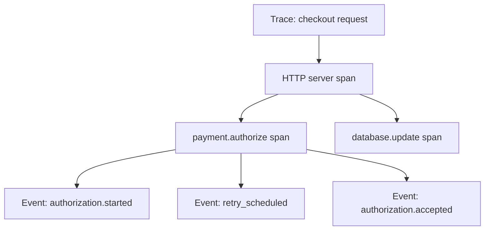
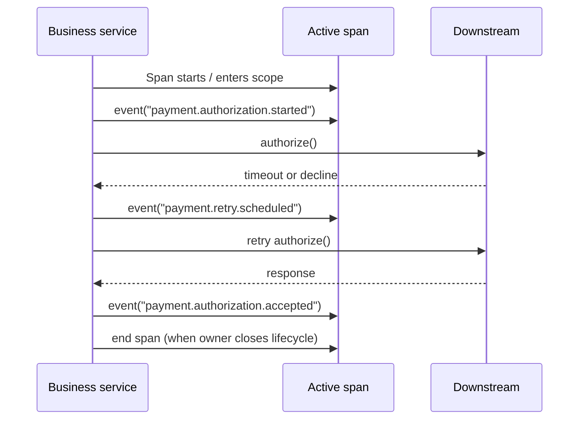
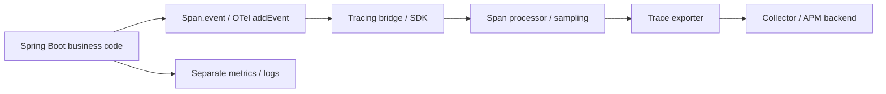

# Span Event

> **Chapter:** Tracing  
> **Module:** `SPRING_BOOT_OBSERVABILITY` — setting up observability for Spring Boot with Micrometer Observation, metrics, logs, and distributed tracing. This lesson focuses on **span events**: timestamped milestones inside a span that help correlate a request's progression with metrics, logs, context propagation, sampling, and exporters during incident investigation.

## Learning Objectives

After this lesson, you will be able to:

- Explain what a **span event** is, which span it belongs to, and how it differs from a **span**, **span attribute**, **log event**, and **metric**.
- Select meaningful business milestones to attach as events instead of creating a new span for every tiny step.
- Record events onto the **active span** using Micrometer Tracing in Spring Boot; add event attributes when using the appropriate OpenTelemetry API.
- Distinguish milestone events from **error status/exception recording** and latency measurements.
- Understand how sampling, exporters, async context propagation, and cardinality/security policies affect event visibility in the backend.
- Inspect a real trace and use events to pinpoint timeouts, retries, or state transitions within a transaction.

## 1. Problem: A Long Span Alone Does Not Explain What Happened

An HTTP request reaches the checkout service, calls the payment service, waits for a response, and finishes. The tracing backend shows:

```text
POST /checkout                            2.8 s
└── payment.authorize                     2.6 s
```

This only reports the **duration** of each span. An operator may still need to know: when did the retry begin, when did the risk check finish, and at what moment did the request enter pending confirmation?

One solution is recording **event milestones** inside the span:

```text
payment.authorize (span 2.6 s)
  +0 ms       payment.authorization.started
  +120 ms     payment.authorization.provider_selected
  +1,850 ms   payment.authorization.retry_scheduled
  +2,560 ms   payment.authorization.accepted
```

This content is illustrative, not a real captured trace. Events build a **contextual timeline inside a span** without creating child spans merely to mark single moments.

A **span event** is a record carrying a **name, timestamp**, and (depending on API) **attributes** inside a specific span. In OpenTelemetry, events are typically represented as part of the span's data and exported along with the span when collected by the tracing pipeline.

An event **has no duration of its own** and **is not a child span**. If you need to measure exactly how long a sub-operation lasts, consider creating a child span or observation with explicit start/end lifecycle boundaries.

## 2. Relationship Between Trace, Span, and Event

A **trace** describes the path of an operation across components. Each **span** describes an operation with start/end timestamps, trace ID, span ID, and parent–child relationships (if any). A single span can contain multiple events.



| Concept | Core Meaning | Has Its Own Duration? | When to Use? |
| --- | --- | --- | --- |
| **Trace** | Entire linked execution path across spans | Encompasses one or more span intervals | Investigating cross-service processing chains. |
| **Span** | An operation with start/end, attributes, status, and links | **Yes** | Measuring HTTP, DB, RPC, or business steps. |
| **Span event** | A milestone occurring inside a span, with name and timestamp | **No** | Marking retries, checkpoints, state transitions, business decisions. |
| **Span attribute** | Key/value pair describing a property of the span | No | Describing `payment.provider`, `http.request.method`, and permitted metadata. |
| **Application log** | Event record emitted by a logging framework | No | Storing exceptions and operational details, queried by trace/correlation ID. |
| **Metric** | Measurement aggregatable into time series | Depends on meter type | Tracking rates, error rates, latency, and trends. |

**Key distinction:** an event is a **point-in-time milestone**, whereas an attribute is a **property**. A span can have attribute `payment.provider=provider_a` and events `payment.authorization.started`, `payment.authorization.accepted`. Updating an attribute later does not turn it into a timestamped progression log.

### 2.1. Do Events Replace Logging?

No. A span event is typically queried **inside a trace** and governed by trace retention policies. Log events are collected by the logging/collector pipeline independently, often regardless of trace sampling.

Therefore:

- Use **span events** to inspect timeline milestones inside **a retained span**.
- Use **structured logs** when you need events searchable by timestamp, business entity, or correlation ID, especially if traces may be sampled out.
- Use **metrics** to count and track trends of all retries, timeouts, or errors across many requests.

A `retry_scheduled` event does not automatically increment a retry counter. If retry counts are an important SLI, instrument an explicit counter/observation.

## 3. When Should You Create a Span Event?

An event is valuable when it answers **"what happened at that moment inside the operation?"**

| Scenario | Suggested Event | Reason |
| --- | --- | --- |
| Transitioning from validation to gateway call | `payment.validation.completed` | Marks completion of a decision phase. |
| Scheduling a retry after a transient failure | `payment.retry.scheduled` | Marks retry timing without creating a span just as a marker. |
| Exhausting retry attempts | `payment.retry.exhausted` | Distinguishes failure after retries from immediate failure. |
| Queue consumer acknowledging message receipt | `message.received` | Helpful when investigating message lifecycles. |
| Job advancing to a new checkpoint | `batch.checkpoint.persisted` | Reads long-running job timelines at controlled frequency. |
| Confirming business state transition | `order.state.confirmed` | Records an operationally meaningful decision. |

Cases where you **should not** over-emit events:

- Every getter/setter invocation in code.
- Every iteration of a loop processing millions of items.
- Copying every `debug` log line into traces.
- Raw payloads, tokens, or per-customer identifiers outside data policy.
- Events standing in for a child span whose duration the team actually needs to measure.

If tens of thousands of events are written onto a single span, trace payloads bloat and backends may cap event counts or drop data. When tracking large-scale behavior, aggregate **metrics with bounded tags** and retain only significant milestones.

### 3.1. Naming Conventions

Event names should be:

1. **Stable** across runs and releases, without dynamic IDs.
2. Based on **domain/action/state**, e.g., `payment.retry.scheduled` or `inventory.reserve.rejected`.
3. Concise yet clear when inspecting a timeline.
4. Free of sensitive data, URLs with real IDs, or varying exception messages.
5. Consistent everywhere the event is emitted; if services share a schema, standardize names and attributes.

Examples to **avoid**:

```text
retry-order-982384
customer-nguyen@example.com-authorization-failed
payment-error-Connection timed out after 3001ms
```

Dynamic names hurt queryability and risk leaking data. Use static names and controlled attributes when extra context is truly needed.

## 4. Lifecycle and Timing of Recording Events

An event must be added while the span is still open for recording. Common pattern:



Points to remember:

- **Which span receives the event?** The active span selected at the API call site, not "the trace" generically.
- **Timestamp:** most APIs capture the timestamp when you add the event. Some APIs let you pass a timestamp, requiring synchronized clocks and proper semantics.
- **Ordering:** across threads/services, timelines are still affected by context propagation, scheduling, and clock skew; do not treat every visual ordering as absolute proof of causation.
- **Completion:** adding an event after the span has ended may be ignored. In async code, manage the span's lifetime carefully.
- **Sampling:** if the trace/span is not recorded or exported, its events will not appear in the backend.

**Marking a failure event is not the same as setting span error status.** An event named `payment.authorization.failed` does not automatically set error status on the span, record exception attributes, or turn an HTTP response into a 500. When an exception occurs, use the proper error-recording API and let the application handle business state normally.

## 5. Recording Events with Micrometer Tracing in Spring Boot

A common integration uses Micrometer Tracing's `Tracer` to fetch the active span. With a compatible tracing bridge/handlers, you can add events using `Span.event(String)`.

### 5.1. Service Example Adding Payment Events

The example below does not create a new span; it attaches events to the **current span** within an HTTP request or business observation scope. `PaymentGateway` is a domain interface implemented by the project.

```java
package example.tracing;

import io.micrometer.tracing.Span;
import io.micrometer.tracing.Tracer;
import org.springframework.stereotype.Service;

@Service
public class PaymentAuthorizationService {
    private final Tracer tracer;
    private final PaymentGateway gateway;

    public PaymentAuthorizationService(
            Tracer tracer,
            PaymentGateway gateway) {
        this.tracer = tracer;
        this.gateway = gateway;
    }

    public String authorize(String providerName, String paymentToken) {
        String provider = normalizeProvider(providerName);
        Span span = tracer.currentSpan();

        if (span != null) {
            span.tag("payment.provider", provider);
            span.event("payment.authorization.started");
        }

        try {
            String authorizationId =
                    gateway.authorize(provider, paymentToken);

            if (span != null) {
                span.event("payment.authorization.accepted");
            }
            return authorizationId;

        } catch (RuntimeException failure) {
            if (span != null) {
                span.event("payment.authorization.failed");
                span.error(failure);
            }
            throw failure;
        }
    }

    private static String normalizeProvider(String value) {
        return "provider_a".equals(value) ||
               "provider_b".equals(value)
                ? value : "other";
    }

    public interface PaymentGateway {
        String authorize(String provider, String token);
    }
}
```

**Reading the code:**

1. Spring injects `Tracer` provided by Micrometer Tracing integration. If the app only has Micrometer Metrics without a tracing bridge/config, the `Tracer` bean may not exist.
2. `tracer.currentSpan()` retrieves the span in the active tracing scope; it can be `null` if running outside a scope or if context was lost.
3. `span.tag("payment.provider", provider)` is a **span attribute/tag**, not an automatically created metric label. `provider` is normalized to prevent arbitrary values.
4. `span.event("payment.authorization.started")` marks the start of business processing **inside the active span**. It does not replace starting a span with `start()` and closing it with `end()`.
5. `span.event("payment.authorization.accepted")` and `failed` mark the two outcome branches.
6. `span.error(failure)` reports the exception to the span via the Micrometer Tracing API. Never emit only an event named `failed` expecting the backend to infer an exception.
7. The exception is rethrown. Telemetry does not alter the application's error-handling contract.

Never write `paymentToken`, authorization IDs, card details, or customer identifiers into event names or attributes. Tracing tags must also obey data policies and backend limits.

### 5.2. Attaching Events to the HTTP Span vs. a Business Span?

For a service executing inside an instrumented HTTP request, `currentSpan()` may be the **HTTP server span**. In that case, payment events appear on the HTTP span rather than a dedicated `payment.authorize` span.

If you want a separate business span to measure the payment operation's duration and attach events directly to it, create a **business observation** with an active tracing handler:

```java
import io.micrometer.observation.Observation;
import io.micrometer.observation.ObservationRegistry;

public String authorizeObserved(
        ObservationRegistry observations,
        PaymentAuthorizationService paymentService,
        String provider,
        String paymentToken) {

    String normalizedProvider =
            "provider_a".equals(provider) || "provider_b".equals(provider)
                    ? provider : "other";

    return Observation.createNotStarted("payment.authorize", observations)
            .contextualName("authorize payment")
            .lowCardinalityKeyValue("payment.provider", normalizedProvider)
            .observe(() -> paymentService.authorize(
                    normalizedProvider, paymentToken));
}
```

In a Spring Boot app configured with Micrometer Observation and Tracing, `observe(...)` wraps synchronous work with the observation lifecycle, scope, and error handling. When a metrics handler is configured, the observation contributes to a duration metric. When a tracing handler is active, the inner service sees the **active business span** and attaches events to it.

Avoid **duplicate measurement** if equivalent instrumentation already wraps the same boundary. If you do not need a separate duration, adding events to the existing span may suffice. If you need to time a start/end operation, a child span/observation is the better fit.

## 6. Event Attributes with the OpenTelemetry API

In Micrometer Tracing, `Span.event(String)` is a simple abstraction method for naming an event. **Span tags** like `span.tag(...)` describe the span itself, not per-event attributes.

If your application uses the **Micrometer Tracing OpenTelemetry bridge** with the OpenTelemetry API available, you can call `io.opentelemetry.api.trace.Span.addEvent(...)` to attach attributes **to the event itself**.

Example running in a context with an active recording OTel span:

```java
import io.opentelemetry.api.common.AttributeKey;
import io.opentelemetry.api.common.Attributes;
import io.opentelemetry.api.trace.Span;

public void inventoryRejected() {
    Span current = Span.current();

    if (current.getSpanContext().isValid() &&
            current.isRecording()) {
        current.addEvent(
                "inventory.reservation.rejected",
                Attributes.of(
                        AttributeKey.stringKey("inventory.reason"),
                        "insufficient_stock",
                        AttributeKey.longKey("inventory.requested_items"),
                        3L
                )
        );
    }
}
```

**Distinguishing the API layers:**

- `io.micrometer.tracing.Span` in Section 5 is the Micrometer Tracing abstraction.
- `io.opentelemetry.api.trace.Span` in this example is the **OpenTelemetry API**, which supports event attributes.
- Expect `Span.current()` to see the matching context only when the app actually runs on the OTel bridge/SDK and context is activated and propagated properly. If your stack uses the Brave bridge or another mechanism, do not assume the OTel API can manipulate that span.
- Verify actual dependency/bridge versions when applying this. Never mix independent tracing SDKs expecting them to automatically share context.

In the example, `inventory.reason=insufficient_stock` and `inventory.requested_items=3` are metadata belonging to the **event**. The event carries a timestamp and these attributes explaining why the stock reservation was rejected. Never put full product lists, customer IDs, or payloads into attributes without clear need and policy approval.

### 6.1. How Do Span Attributes and Event Attributes Differ?

Meaning example:

```text
Span: inventory.reserve
  Attributes:
    inventory.operation = reserve
    inventory.storage   = primary-db

  Events:
    [10:31:04.120] inventory.lookup.completed
      inventory.item_count = 3

    [10:31:04.164] inventory.reservation.rejected
      inventory.reason = insufficient_stock
      inventory.requested_items = 3
```

**Span attributes** describe the span as an operation. **Event attributes** describe the state at that specific event milestone. Multiple events of the same type can hold different attribute values at different timestamps.

How event attributes are displayed and queried depends on your tracing backend, exporter, and indexing policies. Not every backend indexes event attributes the way metrics index labels.

## 7. Use an Event or Create a Child Span?

When designing instrumentation, ask: **"Do I need a timestamped milestone, or do I need to measure a duration?"**

| Need | Tool to Consider | Why |
| --- | --- | --- |
| Mark "provider selected" | Span event | Single point in time within the current operation. |
| Measure HTTP call latency to payment provider | Child span / HTTP client instrumentation | Has duration, status, and parent–child relationship. |
| Measure a batch task taking minutes | Observation/span with lifecycle | Needs explicit start/end and can emit a duration metric. |
| Count retries system-wide | Counter with bounded tags | Supports rate analysis and alerting over time. |
| Find a request's exception when traces are sampled out | Structured log with trace/correlation ID when permitted | Log pipeline can operate independently of trace sampling. |
| Mark the second retry of an operation | Span event with selective attributes | Shows sequence whenever the trace is retained. |

An event is not a **timer**. The gap between two event timestamps in a trace can offer a clue, yet it cannot replace a span for accurate duration measurement when concurrency, async scheduling, clock skew, or missing events exist.

**Do not turn every log line into an event.** Pick meaningful milestones, bound their frequency, and clarify ownership so traces remain readable.

## 8. Sampling, Exporters, and Event Discoverability

### 8.1. Unsampled Traces

Tracing systems typically use **sampling** to control cost. With head-based sampling, decisions are often made at the start of a trace. If a trace is neither recorded nor exported, its events **will not appear** in the backend.

Spring Boot example with compatible tracing config:

```yaml
spring:
  application:
    name: checkout-service

management:
  tracing:
    sampling:
      probability: 0.1
```

`0.1` here illustrates a 10% sampling probability in a compatible setup; it is not a universal recommendation for all production systems. **Sampling traces is not equivalent to sampling metrics.** An operation can still contribute to timers/counters even when its events do not appear in the tracing backend.

For rare but critical events such as "payment failed", **do not rely on span events as the sole source for counting errors**. Use logs/metrics or appropriate domain records. Advanced sampling strategies can be considered when supported by your stack, accounting for access controls, latency, cost, and potential data loss.

### 8.2. Trace Export Pipeline



When an event is missing, several causes are possible:

1. `currentSpan()` was `null` or the OTel current span was not recording.
2. The event was called **after the span ended** or on a different span.
3. Missing tracing bridge/SDK/exporter, or the app did not create an active span.
4. The trace was dropped by sampling.
5. Exporter/collector failed, disconnected, or the backend capped event/attribute counts.
6. The backend received the trace, yet the UI is viewing the **wrong span**, or events were filtered by retention/indexing.

Identify which layer is missing data before modifying instrumentation.

### 8.3. Events and Log Correlation

When Spring Boot is configured with Micrometer Tracing and logging integration, logs can include `traceId`/`spanId` in MDC or structured fields. You can align log timestamps with span events to understand sequencing.

However, calling `span.event(...)` **does not automatically emit a log line**. To have contextual logs, the application must actually invoke the logger and the logging pipeline must be configured. If a trace is sampled out, logs may still be retained under separate rules and help reconstruct clues.

## 9. Context Propagation: Which Span Receives the Event?

A span event is always recorded on a **specific span**. In distributed systems, what `currentSpan()` returns depends on the active tracing context at the moment of the call.

### 9.1. Cross-Service HTTP

Example flow:

```text
checkout-service
  POST /checkout                traceId=T, spanId=A
    payment-client.request      traceId=T, spanId=B
        |
        | HTTP propagation (traceparent)
        v
payment-service
  POST /authorize               traceId=T, spanId=C
    event: payment.authorization.started
    event: payment.authorization.accepted
```

To continue a trace over HTTP, client/server instrumentation must inject/extract context, e.g., via W3C `traceparent`. `span.event()` itself **does not propagate trace context** over the network.

An event emitted in `payment-service` attaches to the active span in that service, not back onto `checkout-service`'s span. When the backend renders the trace, users see both spans when propagation and export succeed.

### 9.2. Async, Executors, and Reactor

Misleading example:

```java
Span current = tracer.currentSpan();

executor.execute(() -> {
    // Never assume the new thread always carries the parent tracing scope.
    Span workerSpan = tracer.currentSpan();
    if (workerSpan != null) {
        workerSpan.event("payment.async.started");
    }
});
```

If the executor lacks context propagation, `workerSpan` may be `null` or belong to a different context. Never work around this by holding a `Span` reference from an outer thread and calling `event(...)` **after the span may already have ended**: the event can be lost or violate lifecycle rules.

Proper design approach:

- Identify which operation owns the event and which span is responsible.
- Use context propagation supported by Micrometer/OTel, executor wrappers, Spring task instrumentation, or version-appropriate Reactor context integration.
- Create a child span/observation inside the task if it is a distinct operation; open/close scope and stop right when the actual work finishes.
- Verify trace ID, span ID, and parent–child relationships in the backend across thread or queue boundaries.
- For long-delayed message queues, use trace context propagation, span links, or workflow IDs per architecture; never assume one scope stays alive across processes.

### 9.3. Do Not Trust Tracing Headers as Authentication

Trace headers can originate from external clients. They serve execution correlation, **not identity verification, tenant isolation, authorization, or request trust**. Never use tracing baggage/header values directly as authorization proof or put secrets into span events.

## 10. Cardinality, Cost, and Security of Span Events

**Metric tag cardinality** and **trace attribute richness** follow different rules, yet both carry cost and risk.

| Content to Record | Should It Go Into an Event? | Explanation |
| --- | --- | --- |
| Name `payment.retry.scheduled` | Yes, when investigating retries | Stable and meaningful. |
| `payment.retry.reason=timeout` | Yes, via event attributes with standardized values | Easy to classify without leaking private info. |
| Small retry sequence number, e.g., `attempt=2` | Selectively | Useful for timelines; avoid spamming thousands of events. |
| `provider=provider_a` | Yes, when appropriate | Controlled value set. |
| Full request/response body | Not by default | Large payload, likely contains sensitive data. |
| Access tokens, passwords, payment cards | No | Critical secrets; must never enter telemetry. |
| Emails / personal identifiers | Usually no | Privacy risk; requires strict policy if ever needed. |
| Raw exception message | Weigh carefully | May contain IDs, URLs, tokens, or client input. |

Some backends limit **events per span**, total span size, or attribute lengths. When exceeded, the backend/SDK may drop or truncate events. Therefore:

- Prefer **rare, high-value milestones** over per-iteration events.
- Use stable names and small, normalized attributes.
- Record errors with control; never embed stack traces or sensitive data inside event names.
- Monitor trace payload sizes, ingestion/quotas, retention, and sampling.
- Offload "count every error" needs to metric counters or domain stores instead of expecting 100% trace retention.

**Never assume event attributes with dynamic IDs are completely harmless:** even though they do not explode metric time series when kept out of metrics, they still bloat trace payloads and may be indexed as attributes. Evaluate access controls and cost.

## 11. Investigating a Real Incident with Span Events

**Scenario:** after a deployment, users report slow checkouts or timeouts during payment authorization. HTTP metrics show increased p95 latency and higher error rates.

Investigation sequence:

1. **Confirm impact via metrics:** inspect rate, error rate, and duration by route, environment, and bounded provider tags. Never treat sampled traces as the sole source for error rates.
2. **Find a collected slow trace:** open a trace matching the timeframe, service, and route. If no trace is available, check sampling/exporters and fall back to logs.
3. **Inspect the span hierarchy:** locate `payment.authorize` and its duration. Verify it sits under the right parent HTTP span.
4. **Read events along the timeline:** check whether `payment.authorization.started`, `payment.retry.scheduled`, `payment.authorization.failed`, or `accepted` appear. Explain their presence or absence alongside instrumentation and sampling.
5. **Cross-check dependency spans:** HTTP calls to the provider may have their own durations. If a retry event exists without matching child HTTP spans, inspect client instrumentation.
6. **Look up logs by trace ID:** inspect exceptions, HTTP statuses, retry delays, and message IDs across those steps.
7. **Isolate root cause:** is latency from connection pool acquisition/queuing, DNS, provider response, retry backoff, or internal logic? Events provide supporting markers, not complete proof on their own.
8. **Verify after fixing:** rate/error/latency metrics improve, events and spans appear accurately in sample traces, and logs leak no sensitive data.

Example:

```text
Trace checkout #T42
  HTTP POST /checkout               3.5 s
    payment.authorize               3.2 s
      0.00 s  payment.authorization.started
      1.40 s  payment.retry.scheduled
      3.15 s  payment.authorization.accepted

    HTTP client provider_a attempt1 1.35 s  timeout
    HTTP client provider_a attempt2 1.60 s  200
```

Durations and timestamps here are **hypothetical data**. They suggest time was consumed across provider calls and retries, yet root cause must be corroborated with metrics/logs, network stats, and downstream health. If you need **inter-retry wait time** as a formal SLI, add explicit measurement rather than inferring everything from event timestamps.

## 12. Common Pitfalls

| Symptom | Possible Cause | How to Check |
| --- | --- | --- |
| `currentSpan()` returns `null` | No active tracing scope, bridge disabled, or lost context | Check tracing dependencies, active scope, and propagation. |
| No events despite span appearing | Event called after span ended, on another span, or capped | Check lifecycle, span ID, SDK/event limits, and code path. |
| No trace found in backend | Sampling, exporter, or collector not working | Check sampler, tracing bridge, exporter, and backend. |
| `failed` event exists, yet span shows no error | Event name alone does not set span status/exception | Record errors via proper API such as `span.error(exception)`. |
| Event lands on HTTP span instead of business span | `currentSpan()` is still the HTTP span; no child observation/span created | Choose proper scope and business boundaries. |
| Event missing inside `@Async` or executor | Context not captured/restored | Integrate context propagation; verify parent/span IDs. |
| Log has trace ID, yet no event | Logging and tracing pipelines differ; event not recorded or sampled out | Check event recording, exporter, and separate log/tracing configs. |
| Too many events, trace truncated | Emitting event per item, hitting event/span limits | Reduce frequency, aggregate metrics, keep high-value milestones only. |
| Event attributes missing in UI | Bridge/exporter/backend unsupported or unindexed | Verify active API, OTel bridge, and backend limits. |
| Attributes contain sensitive data | Logging raw payloads/exception messages | Redact/drop, enforce data policies, and audit access. |
| Retry metrics stay flat despite retry events | Events do not auto-increment counters | Add a counter with bounded tags at the retry boundary. |
| Span event appears late/out of expected order | Async timing, clock skew, or UI sorting | Cross-check timestamps, context, and business sequence. |

## 13. Verification Exercise

Run this in a Spring Boot test environment with a Micrometer Tracing bridge/exporter and a compatible trace backend.

1. Create an API calling `PaymentAuthorizationService.authorize(...)` from an HTTP request. Enable tracing and set sampling high enough to observe traces in the test environment.
2. Record a successful call. Open the trace and verify `payment.authorization.started` and `payment.authorization.accepted` appear on the **right span**.
3. Record a controlled exception case. Inspect the `payment.authorization.failed` event, error recording, and application-level error behavior.
4. Wrap the call in a business observation `payment.authorize`; compare span hierarchy and event placement before and after adding the child span.
5. With the OTel bridge, add an `inventory.reservation.rejected` event with attributes and check whether the tracing backend displays timestamp, name, and attributes.
6. Run the operation via an executor lacking context propagation in the **test environment**; observe `currentSpan()`/span ID. Then enable proper propagation and re-verify.
7. Lower sampling intentionally; explain why some runs still emit metrics/logs while lacking traces or events in the backend.
8. Simulate multiple retries. Audit the event count on the span to confirm no unbounded per-item/attempt logging or sensitive data occurs.
9. Compare error/latency metrics against sampled traces and logs sharing the trace ID; state clearly which signals are aggregated and which reflect only a single request.

**Completion criteria:** the learner can pinpoint the **span ID holding the event**, the **event's name/timestamp/attributes**, why events differ from child spans and metrics, how events are exported, and why events go missing under sampling or lost context.

## 14. Self-Check Questions

**Question 1.** Does a span event have its own duration like a child span?  
**Hint:** No. An event marks a timestamped point inside a span; a child span has start/end and duration.

**Question 2.** Is calling `span.event("payment.authorization.failed")` enough to mark the span status as error?  
**Hint:** No. Record exceptions/status via the appropriate tracing API; an event name is merely a milestone label.

**Question 3.** Does adding a span event automatically emit a log in Logback?  
**Hint:** No. Logs require a logger and their own pipeline; trace events live inside span/tracing data.

**Question 4.** If a trace is dropped by sampling, can its events still be viewed in the backend?  
**Hint:** Usually no. Use metrics/logs for signals requiring higher coverage.

**Question 5.** Why shouldn't you emit an event for every record in a million-row batch?  
**Hint:** Event counts and span sizes grow huge, easily hitting limits or driving up costs; use aggregated metrics and selective checkpoints.

**Question 6.** Are `span.tag(...)` and OpenTelemetry `span.addEvent(name, attributes)` the same thing?  
**Hint:** No. Span tags/attributes describe the operation; event attributes belong to a specific milestone.

**Question 7.** Why can `tracer.currentSpan()` return `null` when code runs inside an executor?  
**Hint:** Tracing scope/context does not automatically transfer across threads; an explicit propagation mechanism must be configured.

**Question 8.** Should `traceId` be attached as a low-cardinality metric tag to count every retry?  
**Hint:** No. Trace ID has high cardinality; use a retry counter metric with bounded tags, then link to traces/logs via context or exemplars where supported.

**Question 9.** When an event appears on the HTTP span instead of the `payment.authorize` span, what needs to change?  
**Hint:** Identify which span is current when recording the event; if a child business span is desired, create an observation/span with proper scoping and lifecycle.

**Question 10.** What does a trace having a retry event without a matching HTTP client child span prove?  
**Hint:** It does not prove the HTTP call never happened; HTTP client instrumentation or context propagation may be missing. Corroborate with logs and metrics.

**Remember:** **A span event is a named, timestamped milestone inside a span**, not a duration, metric, or log. In Spring Boot, add events using Micrometer Tracing `Span.event(String)` or OpenTelemetry `addEvent(...)` for event attributes when supported by your stack. Choose meaningful events, record them on the right active span, govern sampling/exporters/context propagation and data security, and use metrics and logs alongside traces to investigate errors/latency without relying solely on individual sampled traces.
