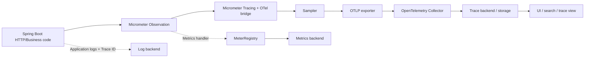
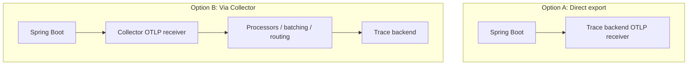
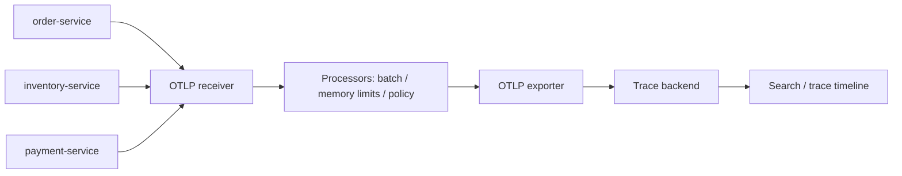
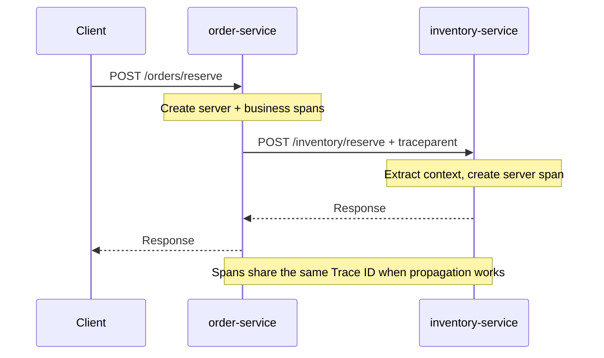
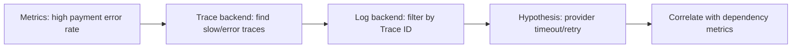

# Trace Backend in Spring Boot Observability

A **trace backend** is a system that ingests, stores, indexes or enables searching, and visualizes **distributed traces**. When a request traverses multiple services, the backend stitches spans sharing the same `traceId` into a timeline, displaying parent–child relationships, step durations, errors, and metadata for operator investigation.

In the **SPRING_BOOT_OBSERVABILITY** module, Spring Boot can combine **Micrometer Observation**, Micrometer Tracing, logs, and metrics. However, the application creating a span **does not mean the trace has appeared in the observability UI**. Data must still pass through the sampler, exporter, network, potentially an OpenTelemetry Collector, and finally be ingested, stored, and indexed for queries by the trace backend.

This lesson belongs to the **Tracing** chapter and focuses on selecting, configuring, verifying, and operating a trace backend, connecting it with **context propagation, sampling, tags/cardinality, exporters, metrics, and log correlation**. The ultimate goal is using traces to clarify root causes of errors or latency in a running Spring Boot application.

## 1. What Problem Does a Trace Backend Solve?

Suppose an order placement request passes through these services:

```text
Client
  |
  +-- order-service: POST /orders
        |
        +-- inventory-service: reserve stock
        |
        +-- payment-service: authorize payment
              |
              +-- external payment provider
```

Users report that placing an order takes 4 seconds, yet `order-service` logs only say "request completed". Looking at request duration alone does not show where those 4 seconds were spent.

A distributed trace might show:

| Span | Hypothetical Duration | Relationship |
| --- | ---: | --- |
| `POST /orders` | 4,000 ms | Root/server span |
| `inventory.reserve` | 180 ms | Child of request |
| `payment.authorize` | 3,600 ms | Child of request |
| `POST payment-provider` | 3,450 ms | Child of payment span |

The illustrative numbers indicate most of the time sat in the payment step. A trace backend makes these relationships visible and searchable instead of manually stitching separate log lines.

Typical questions a trace backend helps answer:

- Which services did a request traverse?
- Which step has a large duration and lies on the primary slowdown path?
- In which service did an error originate, and did the request retry?
- Are any child spans missing or linked to the wrong parent?
- Can we move from a metric showing rising p95 to a slow trace, and from that trace to logs sharing the same Trace ID?
- After a new deployment, which operations show signs of increased latency?

**Limitations:** traces are typically a sampled subset of recorded requests, not necessarily all traffic. A trace timeline provides evidence for spans that were instrumented and exported successfully; it does not automatically capture time spent in uninstrumented code.

## 2. Data Inside a Trace

A **trace** is a collection of spans linked by a distributed context. A **span** describes a unit of work with start/end timestamps and metadata fields.

| Component | Role | Example |
| --- | --- | --- |
| `traceId` | Links spans belonging to the same trace | 32 hex chars in W3C Trace Context |
| `spanId` | Identifies a span within the trace | 16 hex chars in W3C Trace Context |
| `parentSpanId` | Expresses direct relationship between spans | HTTP client span as child of business span |
| Span name | Meaningful operation name | `payment.authorize` |
| Start/end time | Start and end timestamps | Computes duration |
| Span kind | Role type such as CLIENT/SERVER/INTERNAL | HTTP client and HTTP server |
| Attributes | Properties of the operation | `http.route`, `http.request.method` |
| Events | Milestones occurring inside the span | Exception event or business event |
| Status | Span status, possibly error | Error status when marked by instrumentation |
| Links | Associations with other spans outside parent–child | Message processing or batch jobs |
| Resource attributes | Identifies the telemetry source | `service.name`, environment, version |

Semantic convention names and specific attributes can vary across instrumentation versions. Inspect actual backend output rather than assuming all HTTP libraries emit identical attribute names.

### 2.1. Trace ID and Span ID Are Not Interchangeable

A trace comprises multiple spans sharing the **same Trace ID**, while each span has its **own Span ID**. Parent–child relationships are recorded via Parent Span ID, not by two spans having similar names.

Example W3C Trace Context header:

```http
traceparent: 00-4bf92f3577b34da6a3ce929d0e0e4736-00f067aa0ba902b7-01
```

The four main segments are version, Trace ID, parent span ID, and trace flags. The `traceparent` header propagates context across HTTP boundaries; it **does not contain the full trace payload** and does not guarantee the backend received the trace.

### 2.2. Span Durations Cannot Always Be Summed Directly

If two spans run concurrently, the sum of their durations can exceed the parent's duration. Conversely, a parent may have gaps without any child span because that segment of code is uninstrumented.

To analyze slowdowns, examine the **timeline, relationships, and the work path driving completion time**. Do not simply sum all child durations expecting them to equal total request time.

### 2.3. Clock Skew and Missing Data

When spans arrive from multiple hosts, clock drift can make timelines look anomalous. Backends/instrumentation may partially compensate, though proper clock synchronization and timestamp checks remain necessary.

If a service is uninstrumented, a span is dropped by sampling, or an exporter fails, traces can **miss spans**. A trace backend cannot reconstruct spans that were never created or received.

## 3. Architecture: Instrumentation, Exporter, Collector, and Backend

A trace pipeline typically spans several layers:



**Each layer has a dedicated responsibility:**

1. **Instrumentation** recognizes operations such as HTTP server requests, client calls, or business steps like `inventory.reserve`.
2. **Observation and tracing handlers** create or update spans and the active context.
3. **Sampler** decides trace recording levels per configured policy.
4. **Exporter** ships recorded spans to the configured endpoint.
5. **Collector (optional)** receives, processes, batches, filters, tail-samples, or routes telemetry.
6. **Trace backend** stores and makes traces/spans searchable, renders timelines, and enforces retention and access controls per deployment.
7. **UI/Query API** lets operators or tools query traces by Trace ID, service, operation, timeframe, and supported attributes.

**An exporter is not a backend.** An exporter merely ships data. **A Collector is not necessarily a storage backend**: if a pipeline only configures a debug exporter, spans may print to Collector logs without being stored long-term for querying.

### 3.1. Direct Export vs. Via Collector?

Two common topologies:



**Direct export** is simple for small environments or labs when the backend exposes an OTLP receiver. A **Collector** helps when many services need centralized configuration, batching, data sanitization, routing, and ingestion policy management.

A Collector can also become a bottleneck or single point of failure if not scaled and monitored properly. Choosing a Collector must include capacity planning, security, and operational readiness.

## 4. Popular Trace Backend Options

Different products and stacks vary in storage architecture, search mechanics, UI experience, and operational cost. Examples:

| Backend | General Characteristics | What to Verify When Choosing |
| --- | --- | --- |
| **Jaeger** | Distributed tracing system with search and trace analysis UI | Version, OTLP receiver, storage backend, search/retention capabilities |
| **Grafana Tempo** | Trace backend commonly paired with object storage and Grafana for search/viewing | TraceQL querying, ingestion, storage, index/search, and metrics-generator if used |
| **Zipkin** | Traditional tracing system with its own span/query model | Protocol receiver, matching exporter, storage, and UI |
| **Managed tracing service** | Vendor-operated backend | Protocol, auth, data residency, quotas, cost, retention, and access control |
| **OpenTelemetry-compatible platform** | Platform accepting OTLP and providing trace querying | OTLP compatibility, indexing, sampling, search, and data organization |

There is no universal "best default" for every case. For Spring Boot, **OTLP is a transport protocol**, not the name of a storage product. An OTLP-capable backend can receive directly or through a Collector; however, verify the exact protocol, port, and receiver of your active version.

### 4.1. Jaeger

Jaeger provides trace search and visualization, typically supporting views by service, operation, duration, trace timeline, and span attributes. OTLP ingestion, storage components, and deployment configuration **depend on the Jaeger version**; consult documentation for the exact release you run.

In a lab, Jaeger can run in a compact setup to verify the pipeline. Production requires defining persistence, retention, resource limits, and scaling; a single test container does not equal a high-availability tracing system.

### 4.2. Grafana Tempo

Tempo is often paired with Grafana to query distributed traces, leveraging object storage and TraceQL. Certain attribute discovery and trace-derived metrics features depend on architecture, version, and deployment setup.

Do not assume every attribute attached to a span can be searched at identical cost. Before adding rich attributes, understand how the backend indexes/queries, retention policies, and costs.

### 4.3. Zipkin

Zipkin has its own formats/protocols and storage/query mechanisms; using Micrometer Tracing with a compatible exporter lets apps ship spans to Zipkin. Never confuse a **Zipkin HTTP endpoint** with an **OTLP/HTTP endpoint**: both use HTTP yet differ in schemas and URLs.

### 4.4. Selection Criteria

Evaluate by:

- **Protocol:** OTLP/HTTP, OTLP/gRPC, Zipkin, or proprietary protocol.
- **Search capabilities:** Trace ID, service, operation, duration, error, attributes, timeframe.
- **Retention:** how long traces are kept, deletion mechanics, and compliance requirements.
- **Cost:** ingestion, storage, indexing, querying, network, and replicas.
- **Sampling:** head sampling, tail sampling, policies prioritizing error/slow traces.
- **Security:** TLS, authentication, authorization, multi-tenancy, and sensitive data handling.
- **Operations:** HA, backups, upgrades, monitoring, and diagnosability when the backend fails.
- **Signal correlation:** trace-to-logs, metrics-to-traces/exemplars, dashboard integration.

## 5. Configuring Micrometer Tracing in Spring Boot

The examples below target **Spring Boot 3.x**, specifically common configurations when an app uses Micrometer Tracing and the OpenTelemetry bridge. For other versions, dependency names or properties may differ; use a compatible BOM/dependency management and consult docs for your exact version.

### 5.1. Maven Dependencies

```xml
<dependencies>
    <dependency>
        <groupId>org.springframework.boot</groupId>
        <artifactId>spring-boot-starter-actuator</artifactId>
    </dependency>

    <!-- Micrometer Tracing using OpenTelemetry bridge -->
    <dependency>
        <groupId>io.micrometer</groupId>
        <artifactId>micrometer-tracing-bridge-otel</artifactId>
    </dependency>

    <!-- Ship spans via OTLP -->
    <dependency>
        <groupId>io.opentelemetry</groupId>
        <artifactId>opentelemetry-exporter-otlp</artifactId>
    </dependency>
</dependencies>
```

Meaning:

- Actuator participates in auto-configuration for observability/tracing when conditions match.
- The Micrometer Tracing bridge connects Observation and the OpenTelemetry tracing implementation.
- The OTLP exporter provides the span shipping path per configuration.
- **`micrometer-registry-otlp` is the dependency for OTLP metrics**, distinct from the OTLP traces exporter in this example.

Adding only `micrometer-registry-otlp` will not produce spans in a trace backend. Likewise, adding a tracing bridge alone is insufficient if no exporter/backend is configured to receive spans.

### 5.2. application.yml for Lab Environments

```yaml
spring:
  application:
    name: order-service

management:
  tracing:
    sampling:
      probability: 1.0
  otlp:
    tracing:
      endpoint: http://localhost:4318/v1/traces
```

**Explanation:**

- `spring.application.name` is commonly used as the application identifier in Spring Boot integrations, though verify the actual **`service.name` displayed by the backend**.
- `management.tracing.sampling.probability: 1.0` suits labs for easy trace lookup; production needs sampling policies matched to traffic and cost.
- `management.otlp.tracing.endpoint` points to the OTLP/HTTP traces receiver in Spring Boot 3.x versions supporting that property.
- `localhost:4318` only works when the backend/Collector runs in a network environment reachable via `localhost` from the Spring Boot process.

When running in a different container from the Collector, use the right DNS/hostname, e.g.:

```yaml
management:
  otlp:
    tracing:
      endpoint: http://otel-collector:4318/v1/traces
```

Port `4318` is typically for **OTLP/HTTP**; `4317` is typically for **OTLP/gRPC**. Never change only the port number without verifying which transport/protocol the exporter and receiver actually speak.

### 5.3. Production Sampling

Example 10% sampling:

```yaml
management:
  tracing:
    sampling:
      probability: 0.10
```

This is a sampling probability under the configured head sampler, **not a guarantee of exactly 10% in every minute or on every endpoint**. It lowers recording/export cost, yet can drop traces of failing requests if those requests were not sampled.

Weigh sampling against traffic volume, SLOs, diagnostic value, backend limits, and Collector error/latency sampling policies. Periodic sampling at the start of a request cannot foresee whether the request will later fail or stall.

## 6. OpenTelemetry Collector: The Intermediary Component

A Collector pipeline typically consists of three configuration groups:

1. **Receivers:** ingest spans from applications, e.g., OTLP/HTTP or OTLP/gRPC.
2. **Processors:** batch, filter, transform attributes, sample, or enforce resource limits per enabled features.
3. **Exporters:** forward spans to a backend or another Collector.



### 6.1. Lab Collector: Receive Spans and Print Debug Output

Minimal illustrative configuration:

```yaml
receivers:
  otlp:
    protocols:
      grpc:
        endpoint: 0.0.0.0:4317
      http:
        endpoint: 0.0.0.0:4318

processors:
  batch: {}

exporters:
  debug:
    verbosity: basic

service:
  pipelines:
    traces:
      receivers: [otlp]
      processors: [batch]
      exporters: [debug]
```

Meaning: the Collector receives OTLP spans, batches them, and writes summaries to debug output. This configuration is **strictly for verifying ingestion**; it does not provide long-term trace storage/querying.

Notes:

- Component names and `debug` exporter support depend on your Collector version/distribution; use a compatible version.
- Binding `0.0.0.0` opens listeners on all interfaces in the runtime environment; restrict network access and configure security appropriately.
- Never enable verbose debug logging for production traffic as it inflates cost and can expose attributes.
- Ensure the pipeline is `traces`, not only `metrics`.

### 6.2. Replacing the Debug Exporter with an OTLP-Capable Backend

If the trace backend exposes an OTLP/gRPC receiver at `trace-backend:4317`, configure the Collector's exporter along these lines:

```yaml
exporters:
  otlp/traces_backend:
    endpoint: trace-backend:4317
    tls:
      insecure: true  # Lab example only; production requires TLS

service:
  pipelines:
    traces:
      receivers: [otlp]
      processors: [batch]
      exporters: [otlp/traces_backend]
```

This is a **replacement snippet for `exporters` and `service` in the previous example**, reusing the previously defined receiver/processor—**not a standalone complete config file**. Use it only when the backend genuinely exposes an **OTLP/gRPC receiver** and this hostname resolves.

In production:

- Enable TLS/mTLS or secured connections as required by the backend.
- Configure appropriate authentication headers/secrets.
- Size queues, retries, resource limits, and monitor the Collector itself.
- Ensure receiver, processor, and exporter match the exact **signal type**.
- Verify the backend actually persists data; the Collector succeeding in sending does not guarantee the search index is immediately populated.

### 6.3. Differences Between OTLP/HTTP and OTLP/gRPC

| Aspect | OTLP/HTTP | OTLP/gRPC |
| --- | --- | --- |
| Common protocol | HTTP POST | gRPC over HTTP/2 |
| Common port | 4318 | 4317 |
| Typical traces path | `/v1/traces` | gRPC service/method; does not share the HTTP POST URL path |
| Example content type | `application/x-protobuf` or JSON per encoding | `application/grpc` |
| Common issues | Wrong path/Content-Type/HTTP method | Wrong transport, HTTP/2, or TLS/proxy |
| Compatibility | Both exporter and receiver must use OTLP/HTTP | Both exporter and receiver must use OTLP/gRPC |

Sending an HTTP GET to `/v1/traces` is usually **not how you view traces**. That is typically a receiver endpoint expecting HTTP POST. To view data, use the **trace backend's UI or query API**.

## 7. Instrumenting a Business Operation in Spring Boot

HTTP server/client instrumentation usually creates spans automatically when compatible dependencies and auto-configuration are enabled. However, to highlight a domain step like `order.reserve`, use `ObservationRegistry`.

Illustrative example for Spring Boot 3.2+ using Spring Boot-managed `RestClient.Builder`:

```java
import io.micrometer.observation.Observation;
import io.micrometer.observation.ObservationRegistry;
import org.springframework.http.ResponseEntity;
import org.springframework.web.bind.annotation.PostMapping;
import org.springframework.web.bind.annotation.RequestMapping;
import org.springframework.web.bind.annotation.RestController;
import org.springframework.web.client.RestClient;

@RestController
@RequestMapping("/orders")
public class OrderController {

    private final ObservationRegistry observationRegistry;
    private final RestClient inventoryClient;

    public OrderController(
            ObservationRegistry observationRegistry,
            RestClient.Builder restClientBuilder) {

        this.observationRegistry = observationRegistry;
        this.inventoryClient = restClientBuilder
                .baseUrl("http://inventory-service:8081")
                .build();
    }

    @PostMapping("/reserve")
    public ResponseEntity<Void> reserve() {
        Observation.createNotStarted(
                    "order.reserve",
                    observationRegistry
                )
                .lowCardinalityKeyValue("operation", "reserve")
                .observe(() -> {
                    inventoryClient.post()
                            .uri("/inventory/reserve")
                            .retrieve()
                            .toBodilessEntity();
                });

        return ResponseEntity.accepted().build();
    }
}
```

**Limits of this example:** this is a controller snippet illustrating observation and trace propagation, not a full transactional flow with rollbacks, retries, or error mapping. `inventory-service:8081` must be a valid hostname/port from the application's environment.

Expected behavior when tracing and exporter work:

1. HTTP server instrumentation creates a span for `POST /orders/reserve`.
2. The `order.reserve` Observation creates a business span when a matching tracing handler is active.
3. The instrumented HTTP client creates an outbound call span and propagates tracing context via HTTP headers.
4. If `inventory-service` is also instrumented and extracts the context, its server span joins the same trace.
5. The backend stitches spans by Trace ID and renders the timeline.

Using the **Spring Boot-configured `RestClient.Builder`** ensures observation/tracing customizers are applied. Constructing HTTP clients manually outside framework configuration can lose tracing instrumentation.

### 7.1. Notes on Recording Metadata

`lowCardinalityKeyValue("operation", "reserve")` has a small value set; if Observation is processed by a metrics handler, low-cardinality values can appear as metric labels.

Never attach order IDs or user IDs to low-cardinality keys:

```java
// Avoid: every ID generates a separate metric time series.
observation.lowCardinalityKeyValue("order.id", uniqueOrderId);
```

When detailed metadata is needed in traces, consider only approved, non-sensitive, cost-controlled attributes:

```java
// Only when approvedReference contains no PII/secrets
// and backend policy permits storage.
observation.highCardinalityKeyValue(
        "operation.reference",
        approvedReference
);
```

High-cardinality span attributes are not an unrestricted dumping ground. Backends may index or store those attributes, incurring costs and security risks. Emails, tokens, card numbers, passwords, and raw request/response bodies do not belong in traces.

### 7.2. Exceptions and Error Status

If `Observation.observe(...)` wraps a callback that throws an exception, Observation can record the failure via matching handlers/instrumentation. Whether a span gets status `ERROR` or an exception event depends on how exceptions are recorded, the tracing bridge, and instrumentation.

Do not assume every HTTP 4xx/5xx becomes span `ERROR` under one universal rule; **semantic conventions and status-handling policies can differ**. Test the backend with controlled error requests.

## 8. Context Propagation Determines Trace Continuity

A backend can only stitch spans accurately if services consistently pass and extract trace context.

### 8.1. HTTP Propagation

Typically, W3C Trace Context uses:

- **`traceparent`:** Trace ID, parent context Span ID, trace flags.
- **`tracestate`:** additional vendor/system metadata if used.

When `order-service` calls `inventory-service`:



If the backend shows two separate traces for one call, check:

- Did the client inject `traceparent`?
- Did the server extract tracing context?
- Did a proxy/API gateway strip or overwrite headers?
- Was a new root span started by mistake instead of a child span?
- Did thread switches or async APIs lose context?

Never fix propagation issues by **manually attaching a Trace ID as a metric label**. That creates no parent–child relationship and causes high cardinality.

### 8.2. Async, Schedulers, and Message Brokers

For `@Async`, `CompletableFuture`, custom thread pools, Reactor, or message-driven workloads, context propagation needs a mechanism suited to the execution model.

Message brokers typically use **message headers** and their own context extraction rules. Some processing lacks direct parent–child links and uses **span links** to express relationships, such as combining multiple messages into a batch.

When a trace is missing a child span at an async step, check context propagation and framework instrumentation rather than assuming the backend deleted the span.

### 8.3. Baggage Differs from Trace Context

Baggage can carry key-values across service boundaries when configured, yet **secrets or personal data must never enter baggage**. Some systems do not propagate all baggage automatically, and baggage does not replace trace/span identifiers.

## 9. Sampling: Why Doesn't the Backend Have Every Request?

Tracing can generate massive data volumes. If a system handles 10,000 requests/second averaging 8 spans/request, storing all spans incurs substantial cost.

Suppose merely for illustration:

\[
10\,000 \text{ req/s} \times 8 \text{ spans/req}
= 80\,000 \text{ spans/s}
\]

If head sampling selects 10% of requests relatively independently, recorded/exported trace volume scales down roughly proportionally, though actual results also depend on parent-based sampling, instrumentation, traffic, and other policies.

### 9.1. Head Sampling

**Head sampling** decides early, usually when starting a trace or receiving parent context. Its advantage is reducing cost at the source. Its downside is that before knowing whether a request will fail or stall, the sampler may drop the very request needed for investigation.

Lab configuration:

```yaml
management:
  tracing:
    sampling:
      probability: 1.0
```

Production:

```yaml
management:
  tracing:
    sampling:
      probability: 0.10
```

Do not run 100% sampling on heavy traffic without assessing storage/ingestion; nor lower sampling blindly without considering rare error investigation needs.

### 9.2. Tail Sampling in the Collector

**Tail sampling** defers decisions until part or all of a trace's spans are collected, allowing prioritization of traces that:

- Have error status.
- Exceed a duration threshold.
- Match critical operations or attributes.
- Belong to a representative baseline sample.

However, tail sampling has strict requirements:

1. The Collector must see enough spans of a trace within a wait window.
2. Spans sharing a Trace ID must route to the same Collector instance deciding for that trace when running multiple Collectors.
3. Memory/queue capacity is needed for traces awaiting decisions.
4. Late-arriving spans may be handled differently if they exceed the decision window.
5. **It cannot recover spans already dropped before export by an application's head sampler.**

An architecture with Collector tail sampling typically balances app-side samplers to avoid premature drops, uses Trace-ID-aware load balancing, and caps memory. Do not assume adding one processor guarantees "100% of error traces" under all conditions.

### 9.3. Sampling Does Not Apply Directly to Metrics

Micrometer metrics handlers can record Timers for all requests while only a fraction of traces are exported. Therefore, HTTP Timer COUNT **can be much larger than the number of traces shown in the backend**, which is completely normal.

To measure error rates, request rates, or p95/p99 across all traffic, use appropriate metrics and histograms—**never count sampled traces as total requests**.

## 10. Searching and Reading Traces in the Backend

UIs differ across Jaeger, Tempo/Grafana, Zipkin, or managed backends, yet a common investigation workflow applies broadly.

### Step 1 — Identify Service and Timeframe

From metrics dashboards, identify:

- `service.name` or application experiencing rising error rates.
- Relevant route/operation.
- Timeframe of the anomaly, accounting for timezones and ingestion lag.
- Deployment/environment/region/instance if filterable in the backend.

Example: "During the 10 minutes after deployment, `POST /orders` p95 spiked."

### Step 2 — Find Matching Traces

Search by:

- Trace ID from logs or approved response correlation.
- Service and operation name.
- Duration above a threshold.
- Status/error attributes when supported by the backend.
- Indexed/queryable span attributes.

Not every backend supports all search modes at the same cost and latency; check actual indexing/search capabilities.

### Step 3 — Read the Waterfall/Timeline

```text
Trace: POST /orders                          4,000 ms
├─ order.validate                       100 ms
├─ inventory.reserve                    180 ms
└─ payment.authorize                  3,600 ms
   └─ payment-provider HTTP call      3,450 ms
```

Inspect:

- Which span lasts longest?
- Do spans run in parallel?
- Are there uninstrumented gaps between spans?
- Did retries create multiple spans or span events?
- Which span errored, and did it propagate up to the parent?
- Is a service boundary missing spans due to propagation, sampling, or exporter issues?

Never conclude root cause solely from the longest span name. Inspect exact timeouts, queues, retries, CPU/I/O, and logs to verify.

### Step 4 — Correlate Logs and Metrics

Trace ID/Span ID can appear in logs when logging correlation is configured, enabling log lookups for the same transaction. Metrics reveal how widespread the issue is; a single trace shows one concrete sample.

Illustrative log example:

```text
2026-11-22T10:02:11 INFO  [order-service,4bf92f3577b34da6a3ce929d0e0e4736,00f067aa0ba902b7] Reserving inventory
2026-11-22T10:02:14 ERROR [order-service,4bf92f3577b34da6a3ce929d0e0e4736,9bb7a001bbccdd44] Payment request timed out
```

This is an example format, not a mandatory logging template. Whether Trace ID/Span ID appear in MDC depends on the tracing bridge, active scope, and logging configuration.

## 11. Connecting the Trace Backend with Metrics and Logs

Observability comprises three complementary signals with distinct purposes:

| Signal | Goal | Question |
| --- | --- | --- |
| **Metrics** | Aggregated numbers over time | How many requests are failing/slow? |
| **Traces** | Execution journey and span relationships | At which step did this request slow down? |
| **Logs** | Detailed events and errors | What exact exception/retry/timeout occurred? |



### 11.1. Metrics-to-Traces

A dashboard can display p95/p99 and error rates. When traces can be queried by service/operation/time, operators pick a matching trace to inspect its timeline.

Some registries/backends support **exemplars**, linking a metric measurement to a sampled trace/span. However, support depends on metric type, exporter, tracing context, and backend; not every Timer/Gauge carries exemplars.

**Never attach `traceId` to metric labels** to force correlation. Trace ID is nearly unique per request, inflating metric cardinality sharply.

### 11.2. Trace-to-Logs

Applications can populate trace/span identifiers into logging context (MDC) while a tracing scope is active. The log pipeline must preserve these fields and the log backend must index/query them.

If switching to another thread loses context, worker logs may lack a Trace ID even though the HTTP server span exists. Fix context propagation rather than tweaking log patterns alone.

### 11.3. A Trace Backend Does Not Replace Metrics Storage

Never treat a trace backend as the sole source for throughput, SLOs, or error rates across all requests when sampling is active. Solutions exist to derive metrics from spans, yet sampling policies and input scope affect representativeness.

For overall traffic, use Micrometer metrics/Prometheus or a dedicated metrics backend, keeping tags low-cardinality and configuring histograms properly.

## 12. Metadata, Cardinality, and Sensitive Data

A span can carry richer attributes than metric labels, yet that does not mean all data is safe or free.

### 12.1. Stable Names and Attributes

Use operation names representing the **type of work**:

- Good: `order.reserve`, `payment.authorize`, `GET /orders/{id}`.
- Bad: `order.reserve.92813`, `GET /orders/92813`.

Bounded attributes like `http.request.method`, `http.route`, `payment.method`, or `outcome` support filtering and grouping. Dynamic values like order IDs, customer IDs, and URLs with IDs can make indexing/querying expensive while exposing personal data.

### 12.2. High Cardinality in Traces Differs from Metrics

In Micrometer Observation:

- **Low-cardinality key-values** fit metric tags and can also be exported as span attributes.
- **High-cardinality key-values** can serve tracing per handler behavior, without becoming metric labels by default.

Still, the trace backend must **store and potentially index** attributes. An attribute with millions of unique values can strain storage/querying even without causing a metric "time-series explosion".

Add high-cardinality attributes only for clear operational questions, under approved privacy policies, after evaluating cost and retention.

### 12.3. Data That Should Not Enter Traces

Exclude:

- Passwords, access tokens, refresh tokens, API keys.
- Card numbers, sensitive payment data, OTP codes.
- Email addresses, phone numbers, personal user identifiers unless properly approved under compliance rules.
- Entire raw HTTP request/response bodies.
- SQL queries containing literal personal data or headers like `Authorization`.
- Baggage carrying secrets or personal data across external systems.

Protections should begin **right at instrumentation**, reinforced in the Collector/backend per policy, and verified against actual stored output. Transport encryption does not make sensitive data safe to store.

## 13. Trace Backend Security and Access Control

A trace backend can reveal system topology, service names, endpoints, error states, and dependency details. Treat it as a controlled operational asset.

Common requirements:

1. **Transport security:** TLS/mTLS matching the topology across apps, Collectors, and backends.
2. **Authentication:** service credentials, headers, or backend-supported auth mechanisms.
3. **Authorization:** restrict who can view traces per environment, team, or tenant.
4. **Multi-tenancy:** isolate data per tenant if supported by the backend; never substitute an arbitrary attribute for real authorization.
5. **Data minimization:** keep PII/secrets out of span attributes, events, and exception messages.
6. **Retention:** align retention windows with investigation needs and compliance policies.
7. **Network:** do not expose OTLP receivers or UIs publicly unnecessarily.
8. **Audit/incident response:** track access and define remediation procedures if unwanted data enters telemetry.

Lab examples using `tls.insecure: true` must be replaced with secured connections in production. Never hardcode secrets in committed `application.yml` files; use proper secret management.

## 14. Operations: Ingestion, Storage, Indexing, and Retention

As request volume grows, the trace backend must process more spans, especially when each request spawns many child spans.

A simple estimation:

\[
\text{Spans/day} =
\text{requests/s} \times \text{spans/request}
\times \text{sampling ratio} \times 86\,400
\]

Assuming an average of 1,000 requests/s, 6 spans/request, and 10% sampling:

\[
1\,000 \times 6 \times 0.10 \times 86\,400
= 51\,840\,000 \text{ spans/day}
\]

This is an **estimate**; reality depends on parent-based sampling, error rates, fan-out, async tasks, instrumentation, tail sampling, retries, and unexported spans.

### 14.1. Cost Goes Beyond Storage

Tracing costs include:

- CPU/network overhead of instrumentation and exporters.
- Batching, queues, and memory in the Collector.
- Cross-region/cross-AZ network bandwidth.
- Ingestion, compression, storage, and replicas.
- Attribute indexing/searching/querying.
- Retention and deletion sweeps.
- UI/querier resources when multiple engineers investigate concurrently.

Traces with huge attribute counts also inflate payload and indexing costs. Set sensible bounds on event counts and attribute counts/lengths per instrumentation/backend limits.

### 14.2. Head/Tail Sampling and Retention Are Different Knobs

- Sampling decides **which traces are recorded/exported/retained** at a pipeline stage.
- Retention decides **how long stored data is kept**.
- Shortening retention does not recover traces dropped by a sampler.
- Lowering sampling does not fix slow queries caused by poor indexing/schemas.

Tune according to goals: near-real-time incident triage, multi-day regression analysis, or long-term compliance.

### 14.3. The Tracing System Must Monitor Itself

Monitor:

- Spans sent by exporters and export failure counts.
- Queue sizes, enqueue failures, or dropped spans if exposed by components.
- Collector latency/timeouts and retries.
- Receiver accepted/refused spans.
- Backend ingestion rate and storage/query health.
- Queryable trace counts compared to expected requests **adjusted for sampling**.
- Network connectivity, TLS/auth errors, quotas, and Pod/instance health.

Never rely solely on a UI showing "no traces" to conclude the application is not creating spans.

## 15. Trace Backend Troubleshooting Matrix

| Symptom | Common Hypotheses | How to Check |
| --- | --- | --- |
| Zero traces in backend | Missing tracing bridge/exporter, wrong receiver, low sampling | Dependencies, app config, Collector, and lab sampling |
| `/actuator/metrics` has HTTP Timer yet tracing UI is empty | Metrics and tracing are separate pipelines | Check Micrometer Tracing and OTLP traces exporter |
| OTLP/HTTP returns 404 | Wrong receiver URL/route | Use exact `/v1/traces` for OTLP/HTTP; check DNS |
| OTLP/HTTP returns 405 | Sending GET to a POST-only receiver | Use an exporter; do not treat receiver as query UI |
| OTLP returns 415 | Incompatible encoding/Content-Type or protocol | Verify protobuf/JSON OTLP vs. gRPC |
| Collector sees spans yet backend is empty | Downstream pipeline/exporter failure | Collector config, retry/queue, backend ingestion |
| Very few traces appear | Head/tail sampling or low actual traffic | Sampling probability, workload, ingestion stats |
| Only root span visible, child spans missing | Missing instrumentation or context propagation | HTTP client builder, async/message context |
| One request splits into two traces | `traceparent` not propagated/extracted | Inspect headers, parent span IDs |
| Service shows as `unknown_service` or wrong name | Resource `service.name` unset/incorrect | App name, resource mapping, and backend attributes |
| Span errored without exception | Exception not recorded or mapper behaves differently | Observation error recording, framework instrumentation |
| HTTP error yet span status not ERROR | Different semantic rules or error not marked | Check span attributes and instrumentation version |
| Cannot find trace via service search | Slow indexing/search or wrong query window | Time range, ingestion lag, query capabilities |
| Timeline has misaligned span timestamps | Clock skew or bad span timestamps | NTP, timestamps, runtime clocks |
| Very long span yet logs are empty | Missing logging correlation/scope or log pipeline error | MDC, Trace ID, log ingestion |
| `UNAUTHENTICATED`/TLS errors | Token, certificate, or endpoint policy | Credentials, TLS config, backend permissions |
| Backend overloaded | High span/attribute volume/quotas, broad sampling | Load metrics, sampling, batching, retention |
| Duplicate traces stored | Two exporters/pipelines shipping to the same backend | Check routing and deduplication |
| Metrics-to-traces broken | Exemplars unsupported or missing correlated Trace ID | Registry/backend support, sampled spans |

### 15.1. Layer-by-Layer Debugging

**Layer 1 – Application:** Is instrumentation/Observation active? Are sampler/exporter configured? Is service name right?

**Layer 2 – HTTP/gRPC transport:** Can the app reach the receiver? Are endpoint, protocol, TLS/auth accurate?

**Layer 3 – Collector:** Is it receiving spans, batching/filtering/tail-sampling/dropping, and is the downstream exporter succeeding?

**Layer 4 – Backend:** Is it ingesting, storing, and indexing/querying properly? Is the UI set to the right tenant, service, and time window?

**Layer 5 – Trace completeness:** Are parent/child links sensible? Did async/context propagation or sampling drop spans?

Layering prevents misplaced fixes: e.g., **raising tracing sampling will not fix a TLS error to the Collector**, and fixing the OTLP endpoint will not instrument a manually instantiated `RestClient`.

## 16. Real-World Analysis Case: Checkout Slowed by a Dependency

### Context

After a deployment, dashboards show `POST /checkout` p95 jumping from 250 ms to 2.8 s. Error rate also ticks up slightly.

Investigation sequence:

1. **Metrics:** confirm p95/error rate spike in `order-service`; check request rate to rule out or confirm traffic spikes.
2. **Trace search:** filter service `order-service`, operation `POST /checkout`, duration > 2 s in the relevant timeframe.
3. **Trace timeline:** observe span `payment.authorize` taking 2.4 s with two HTTP client spans from a retry.
4. **Log correlation:** use the Trace ID to find timeout/retry messages with matching timestamps and request context.
5. **Dependency metrics:** check payment provider response time, connection pool, queue, and error rate.
6. **Compare deployments:** check for new timeout/retry policies, pool sizing, or HTTP client configuration.
7. **Verify after fix:** p95/error rate metrics drop, and retries/durations in sampled traces drop as well.

### Do Not Abuse Traces to Count Total Errors

If only 10% of requests are sampled, finding 20 error traces does not mean the system had only 20 errors. Use HTTP Timers/Counters and backend metrics for total counts.

If a trace shows a long payment span, the external provider is not automatically the culprit. It might be **connection pool wait time**, retry/backoff, or DNS/TLS; cross-check internal spans, logs, and client metrics before concluding.

## 17. Hands-On Exercise: Connecting Spring Boot to a Trace Backend

This lab verifies the **complete data path** and looking up a trace by Trace ID.

### Prerequisites

- A Spring Boot 3.x web app.
- `spring-boot-starter-actuator`, `micrometer-tracing-bridge-otel`, `opentelemetry-exporter-otlp` as in Section 5.
- An OpenTelemetry Collector or trace backend with an OTLP receiver.
- A backend/UI capable of querying traces, such as Jaeger or Tempo/Grafana, configured for your version.
- Domain or demo endpoints capable of making an inter-service HTTP call.
- Use a lab environment only; never put PII/secrets into span attributes.

### Step 1 – Verify the Instrumented App

Enable 100% tracing sampling in the lab. Send requests to an HTTP endpoint and check logs or configuration output to confirm the tracing bridge and exporter are active.

### Step 2 – Verify the Receiver

If using a Collector, enable the OTLP/HTTP receiver and debug exporter from Section 6 first. Send a request and verify the Collector receives spans. If not, check app config, DNS, port, protocol, and sampling.

### Step 3 – Connect the Storage Backend

Configure the Collector to export to a trace backend supporting the matching protocol. Verify backend ingestion and open the UI/query view. Do not stop at "the Collector logged a span" since that does not prove the backend stored the trace.

### Step 4 – Search Traces by Service/Operation

Send a request triggering `order.reserve`. In the UI, select the service and appropriate time window, then locate a trace containing that operation. Note the Trace ID and inspect span names.

### Step 5 – Verify Propagation

Call `inventory-service` from `order-service` using an instrumented HTTP client. Verify spans in both services share the **same Trace ID** with a sensible parent–child relationship.

If not, inspect `traceparent` in an authorized test setup and check how the client was constructed. Never log or expose headers containing other sensitive values.

### Step 6 – Trigger Controlled Errors

In the lab, cause an operation to throw a predictable exception. Inspect span status/events, distinguishing a request error from a trace exporter failure. Verify log correlation.

### Step 7 – Test Sampling

Lower sampling to 10% and generate enough requests to observe behavior. Confirm backend trace counts drop while HTTP metrics continue measuring full request rates on their separate pipeline.

### Step 8 – Correlate Metrics and Logs

With a metrics backend, locate a group of slow/failing requests and pick a trace from the same timeframe. If logs include Trace ID, filter logs by that trace's ID. Record which question each signal answered.

### Step 9 – Simulate Collector/Backend Outage in Lab

Temporarily stop the receiver or point to a wrong endpoint to observe export failures/timeouts. Restore it and verify export resumes. Do not assume all spans from the outage window get replayed: that depends on exporter/Collector queueing, retries, and persistence.

### Step 10 – Review Security and Cost

Verify TLS/auth, service/tenant boundaries, retention, attributes, sampling policies, and trace ingestion. Never leave debug/insecure settings or unbounded 100% sampling active in production.

### Acceptance Checklist

| Verification | Sign of Completion |
| --- | --- |
| Spring Boot instrumentation | Server/business spans created when requests run |
| Export | App connects cleanly to the OTLP receiver |
| Collector | Traces pipeline ingests and forwards spans |
| Backend storage | Traces searchable in UI/query API |
| Service identity | `service.name` accurate and stable |
| Propagation | Cross-service spans share the same Trace ID |
| Error handling | Traces/logs reflect failures per instrumentation |
| Sampling | Clear understanding of why some requests have no trace |
| Metrics correlation | Sample traces cross-checked against aggregated latency/error rate |
| Security | No secrets/PII in span attributes |
| Capacity | Sampling, retention, and pipeline alerting planned |

## 18. Principles to Remember

1. **A trace backend does not create traces on behalf of the app.** Instrumentation, context, sampling, exporters, and receivers are all required.
2. **A Collector is not necessarily a storage backend.** A debug exporter only proves data reached the Collector, not that a searchable UI exists.
3. **Trace ID/Span ID/parent links are the foundation** for backends to stitch spans and render trees and waterfalls.
4. **Propagation determines trace continuity.** Use instrumented HTTP clients and handle context properly across async/messaging.
5. **Sampling governs which traces are observable**, not that metrics get sampled at the same rate.
6. **Metadata must stay stable and safe.** Keep dynamic IDs out of metric labels, and limit sensitive data and excessive attributes in spans.
7. **OTLP/HTTP, OTLP/gRPC, and proprietary protocols** must match between exporter and receiver; an ingest endpoint is not a query UI.
8. **Secure the trace backend** with TLS/auth, authorization, retention, and monitoring of the pipeline itself.
9. **Never deduce root cause from a single trace alone.** Correlate metrics, logs, span timelines, and dependency health.
10. **Debug layer by layer when traces go missing:** instrumentation → exporter → Collector → backend → query; distinguish dropped spans from querying the wrong timeframe/service.

A properly configured and operated trace backend turns Spring Boot spans into **structured evidence of a request's path**. Combined with Micrometer metrics and logs, distributed tracing helps engineers investigate latency, errors, and behavioral changes across services—while controlling cost, sampling, access permissions, and observational data integrity.
