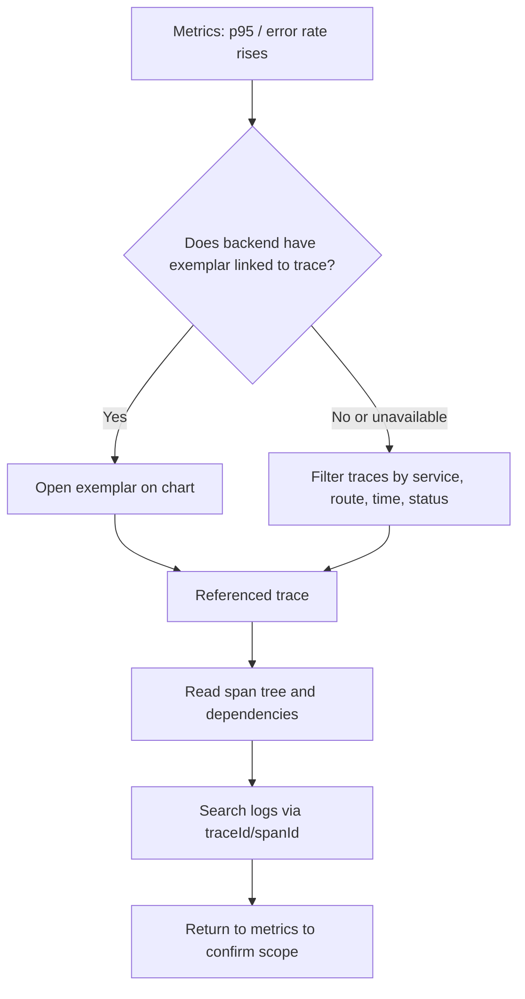
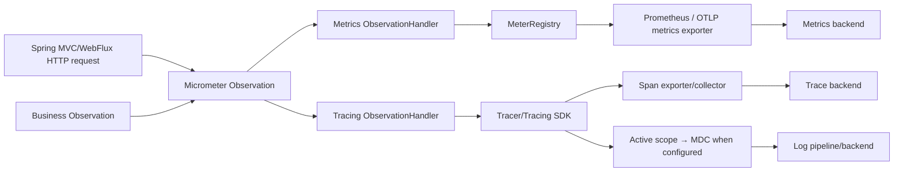
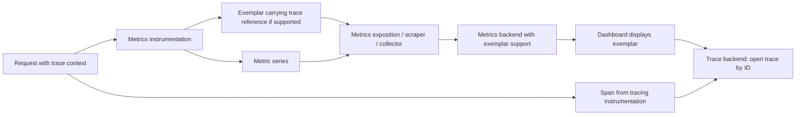
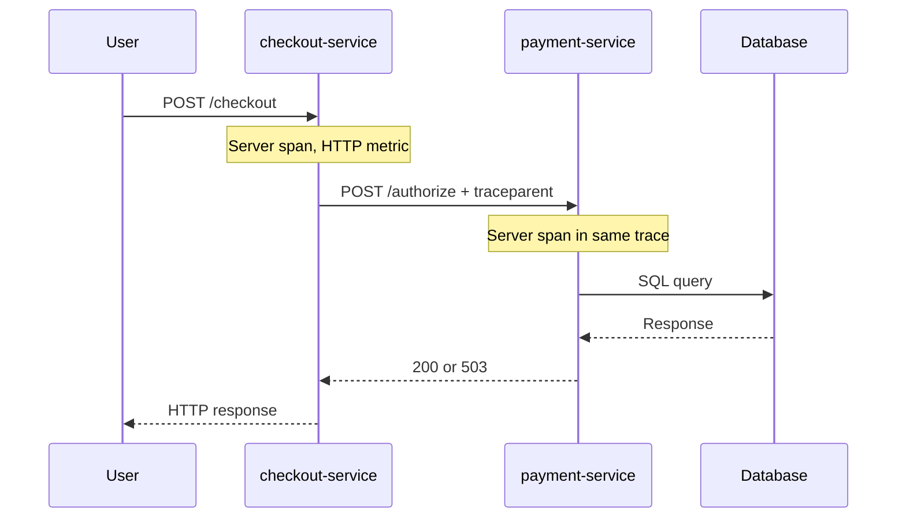

# Trace and Metrics Correlation in Spring Boot

When a dashboard alerts that **checkout API p95 latency spiked**, operators naturally want to open a distributed trace right away to see whether time was lost in the controller, database, or payment gateway. Yet metrics are **aggregated data** across many requests, whereas a trace describes **one specific execution**. The two signals do not inherently have a one-to-one mapping. Moving from a chart to a slow request requires deliberate **correlation**: matching service, route, timeframe, and tags, or using **exemplars** when the system supports direct trace links.

The **"Trace and Metrics Correlation"** lesson belongs to the **Tracing** chapter of the **SPRING_BOOT_OBSERVABILITY** module. It covers coordinating Micrometer Observation, HTTP metrics, distributed tracing, and logs in Spring Boot; choosing low/high-cardinality metadata, applying trace context and propagation, understanding sampling/exporters, and following an investigation workflow for errors and latency in production.

**Core idea:** metrics detect *symptoms and scale*; traces explain *the path of a specific request*. Correlation is the practice of finding representative traces for the symptom metrics flagged—**not** copying `traceId` into every metric label.

## 1. Why Do Metrics and Traces Complement Each Other?

Consider a `POST /checkout` API serving 10,000 requests in 5 minutes, where 200 requests return HTTP 5xx and some requests stall at the payment gateway.

Metrics answer:

- What are the total requests, requests per second, and HTTP 5xx rate?
- On which endpoint did p95/p99 latency increase?
- Is the incident isolated to one service/region or spanning multiple instances?
- Did the error rate rise before or after a deployment?

Traces answer, for **a recorded request**:

- Where did the server span start and how long did it last?
- Where are the HTTP client calls to `payment-service` or database queries along the timeline?
- Were there retries, timeouts, exceptions, or overlapping child spans?
- Do participating services share the same trace ID and parent/child relationships?

Logs add:

- Safely handled exception messages, internal error codes, or fallback decisions.
- Application context at a specific moment.
- Related events searchable by `traceId` or approved business references.

| Signal | Data Unit | Focus |
| --- | --- | --- |
| Metrics | Time series by meter name and tags | Trends, rates, alerts, SLOs |
| Traces | One trace composed of multiple spans | Causal relationships and timing along the execution path |
| Logs | One event or log line | Operational details, exceptions, application decisions |
| Audit/transaction records | Domain records with separate completeness requirements | Searching and auditing transactions under access controls |

A single slow trace **does not prove** the majority of requests are slow. A rising p95 chart **does not pinpoint** which request caused it. Use each signal for the question it answers.

## 2. Trace, Span, Metric, and Identifiers

Related concepts:

| Concept | Description | Example |
| --- | --- | --- |
| `traceId` | Identifies a distributed trace; all spans in the same trace share it | `4bf92f3577b34da6a3ce929d0e0e4736` |
| `spanId` | Identifies a specific span | `00f067aa0ba902b7` |
| Parent span | Span containing or invoking another piece of work | HTTP server span invoking a payment client span |
| Span name | Operation name in tracing | `POST /checkout`, `payment.authorize` |
| Span attributes | Span metadata; can be detailed, requires privacy controls | `http.response.status_code=503` |
| Meter name | Measurement name | `http.server.requests` |
| Metric labels/tags | Grouping dimensions with bounded value sets | `method=POST`, `uri=/checkout`, `status=503` |
| Exemplar | A sample metric observation carrying a trace reference | Trace ID attached to a measurement point/bucket |
| Service identity | Source identifier across metrics/traces/logs | `checkout-service` |

**Do not confuse `spanId` with `traceId`.** Each span has its own ID; all linked spans in one trace share the trace ID when propagation works. A single request can span many spans, or span client and server sides across multiple services.

**Do not equate metric labels with span attributes.** A `user.id` value can explode metric cardinality dramatically, even when a trace backend permits richer attributes under appropriate policies.

## 3. Two Levels of Correlation: Indirect and Direct

There are two common ways to navigate from metrics to traces:

1. **Indirect contextual correlation:** identify service, route, time window, environment, status, and outcome from metrics; use those criteria to query representative traces in the trace backend.
2. **Direct correlation via exemplars:** a specific metric observation carries a trace/span reference, letting chart UIs jump directly to the trace if the entire pipeline preserves the link.



Indirect correlation **does not require exemplars**, making it an essential skill even when backends support clicking from charts to traces. Exemplars accelerate selecting a trace, yet do not replace cross-checking aggregated numbers.

### Indirect Correlation: An Example

An alert fires:

```text
Service: checkout-service
Environment: prod
Route: POST /checkout
Time window: 10:00–10:05 UTC
HTTP 5xx rate: rising
p95 duration: rose from 0.2 s to 2.1 s
```

The operator switches to the trace backend, querying traces for `checkout-service`, the checkout route, timeframe 10:00–10:05, and slow/failing server spans. If the backend cannot filter by a specific attribute, filter by service + time, then inspect relevant traces.

Then use the `traceId` from a located trace to look up logs. This is **scoped evidence-based correlation**, not a one-to-one mapping from every metric point to a trace.

### Direct Correlation: Exemplars

Suppose a dashboard plots a high-latency point carrying an exemplar reference:

```text
Metric series:
  http_server_requests_seconds_bucket
  application=checkout-service
  uri=/checkout

Exemplar (illustrative):
  observed_duration=2.06 s
  trace_id=4bf92f3577b34da6a3ce929d0e0e4736
```

When the metric datasource retains exemplars and the trace backend still retains the trace with that ID, the dashboard can offer an "Open trace" link.

**Never assume** merely enabling Micrometer Tracing produces exemplars. Exemplar generation, exposition format, scraper/collector, backend, and UI must all support them. Label/field names carrying the trace ID may also vary across systems.

## 4. Observation Flow in Spring Boot

Micrometer Observation can serve as a single instrumentation point generating both metrics and tracing:



Note on the diagram: **one Observation can be handled by multiple handlers**, which does not mean the metrics handler creates traces or the tracing handler manages Timers. If the registry lacks the corresponding handler, one signal type will not be produced even though business code runs.

For instance, HTTP server instrumentation records Timer `http.server.requests` with `method`, `uri`, `status`, and other tags per convention. The tracing handler creates the HTTP server span. If the request invokes an instrumented HTTP client, the outbound span joins the same trace and propagates to the next service.

Metric tags are not automatically copied verbatim onto every span or vice versa. Exact behavior depends on Spring Boot/Spring Framework, Micrometer `ObservationConvention`, `ObservationHandler`, and running exporters.

## 5. Example Using Observation for a Business Step

Suppose `checkout-service` runs a processing step after an HTTP request enters the controller. We want both aggregated metrics for that step and a detailed span when tracing is enabled.

Illustrative service:

```java
import io.micrometer.observation.Observation;
import io.micrometer.observation.ObservationRegistry;
import org.springframework.stereotype.Service;

import java.util.function.Supplier;

@Service
public class CheckoutService {
    private final ObservationRegistry observationRegistry;

    public CheckoutService(ObservationRegistry observationRegistry) {
        this.observationRegistry = observationRegistry;
    }

    public <T> T process(String channel, Supplier<T> action) {
        String safeChannel = "web".equals(channel) ? "web" : "other";

        return Observation.createNotStarted(
                        "checkout.process", observationRegistry)
                .lowCardinalityKeyValue("checkout.channel", safeChannel)
                .observe(action::get);
    }
}
```

Controller invoking the service:

```java
import org.springframework.web.bind.annotation.GetMapping;
import org.springframework.web.bind.annotation.RestController;

@RestController
public class CheckoutController {
    private final CheckoutService checkoutService;

    public CheckoutController(CheckoutService checkoutService) {
        this.checkoutService = checkoutService;
    }

    @GetMapping("/checkout")
    public String checkout() {
        return checkoutService.process(
                "web",
                () -> "approved"
        );
    }
}
```

When calling `GET /checkout`:

- Spring HTTP instrumentation (if configured) creates the server Observation for the request.
- `CheckoutService.process` creates a business Observation named `checkout.process`.
- With an active **metrics handler**, a Timer for `checkout.process` is recorded.
- With an active **tracing handler** and server context, the business span appears inside the HTTP request's trace.
- `checkout.channel=web` is a low-cardinality key with a bounded value set, fitting metric tags.
- Code does not add user ID, request ID, or trace ID as labels—essential for controlling cardinality.

This example illustrates the API, not a claim that every Spring Boot version enables all handlers/tracers/exporters by default. Verify with real runtime data from your application.

### Avoiding Duplicate Instrumentation

Wrapping an already auto-instrumented method in a manual Observation with the same purpose creates **duplicate metrics/spans** and misleads when summing counts. Distinguish clearly:

- HTTP server Observation measures the full request.
- `checkout.process` measures a domain step.
- Metrics at the two layers have different meanings; never sum their Counts as if they were two independent request types.
- To measure retries, emit a dedicated domain metric meaning "one retry attempt" rather than double-counting requests.

## 6. Minimal Setup for Metrics and Tracing

This example shows a common setup in a **Spring Boot 3.x** application. Property names, starters, and auto-configuration may differ across Spring Boot versions; verify against your project's version when deploying.

With Gradle Groovy:

```groovy
dependencies {
    implementation 'org.springframework.boot:spring-boot-starter-web'
    implementation 'org.springframework.boot:spring-boot-starter-actuator'

    runtimeOnly 'io.micrometer:micrometer-registry-prometheus'

    implementation 'io.micrometer:micrometer-tracing-bridge-otel'
    runtimeOnly 'io.opentelemetry:opentelemetry-exporter-otlp'
}
```

`application.yml` configuration for a test environment:

```yaml
spring:
  application:
    name: checkout-service

management:
  endpoints:
    web:
      exposure:
        include: health,metrics,prometheus
  metrics:
    tags:
      application: checkout-service
      environment: test
    distribution:
      percentiles-histogram:
        http.server.requests: true
  tracing:
    sampling:
      probability: 1.0
  otlp:
    tracing:
      endpoint: http://localhost:4318/v1/traces
```

Explanation:

- `micrometer-registry-prometheus` and `/actuator/prometheus` provide the scrape-based **metrics** path when the endpoint is exposed and reachable by the scraper.
- The Micrometer Tracing OpenTelemetry bridge plus OTLP exporter provide the **traces** path to a compatible receiver such as OpenTelemetry Collector.
- `management.tracing.sampling.probability: 1.0` is used in **testing** to observe tracing easily; production requires its own sampling policy tailored to load, cost, representativeness, and investigation needs.
- `management.metrics.distribution.percentiles-histogram.http.server.requests` enables histogram buckets for the HTTP Timer where supported, allowing backends to compute p95/p99 from buckets.
- Common metric tag `application=checkout-service` does **not automatically** set OpenTelemetry resource attribute `service.name`. Verify the service name in the trace backend; corresponding configuration depends on version and SDK.
- `localhost:4318` only works if **the application reaches the Collector on the same host**. Inside containers/Kubernetes, `localhost` usually points to the container/pod itself rather than an external Collector.

**Traces do not reach the backend merely because an exporter dependency was added.** Collector/receiver, protocol, auth/TLS, network routing, and the pipeline to trace storage must all function. Similarly, exposing `/actuator/prometheus` does not mean Prometheus is scraping it.

### If Using a Different Metrics Pipeline

Spring Boot can also push metrics via OTLP through a matching registry. Whether metrics travel via Prometheus scrape or OTLP push **does not govern** whether trace context propagates. Tracing and metrics are separate signals/pipelines, even when unified within the same observability toolset.

## 7. Service Identity Must Be Consistent

A common friction point when pivoting from metric charts to traces: metric dashboards use `application=checkout-service`, while the trace backend displays `unknown_service` or a different name.

| Signal | Metadata Available | What to Verify |
| --- | --- | --- |
| Metric | `application=checkout-service`, `environment=test` | Common tags in MeterRegistry and post-exporter labels |
| Trace | `service.name=checkout-service` | Resource/service naming in tracer/SDK |
| Log | `service=checkout-service`, `traceId=...` | Logger JSON/pattern, MDC, and log pipeline |
| Exemplar | Trace/span ID or other link labels | Exposition, scraper, backend, and datasource/UI |

Key names across signals **do not have to be identical**, yet their meaning and values must align under a consistent convention. In multi-environment systems, prevent `prod` metrics from mixing with `staging` traces due to ambiguous naming rules.

A minimal convention to lock down:

1. Consistent service name across metrics, traces, and logs.
2. Centrally managed deployment environment names.
3. Routes normalized as templates rather than raw paths containing IDs.
4. Consistent status/outcome semantics when querying.
5. Accurate timezones and clock sync across collectors/backends.
6. Approved access controls and retention per signal.

Even with matching service names, metric and trace data **do not automatically join per request** without exemplars or appropriate correlation keys.

## 8. Low-Cardinality Tags and High-Cardinality Span Attributes

Metric systems require bounded time-series counts. A series is typically distinguished by **metric name plus tag combination**; every new tag value can spawn a new series.

Example HTTP Timer with dimensions:

| Dimension | Assumed Values |
| --- | ---: |
| `method` | 4 |
| `uri` (route template) | 20 |
| `status` | 6 |
| `application` | 3 |

Possible combinations by simple multiplication:

\[
4 \times 20 \times 6 \times 3 = 1\,440
\]

Adding `traceId` with 100,000 values turns the hypothetical combinations into:

\[
1\,440 \times 100\,000 = 144\,000\,000
\]

This is a **theoretical combinatorial upper bound**, not an assertion that every series is simultaneously active. Yet this growth potential alone explains why **`traceId` must never become a metric label**.

### Where Should Metadata Live?

| Metadata | Metric Label? | Span Attribute? | Log Field? |
| --- | --- | --- | --- |
| Route template like `/checkout` | Usually appropriate | Usually appropriate | Can be appropriate |
| HTTP method/status | Usually appropriate | Usually appropriate | Can be appropriate |
| `application`, `environment` | Stable common tags | Matching resource attributes | Matching log metadata |
| `traceId` | **No** | Trace ID is a core trace identifier, not a metric tag | Appropriate for correlation when tracing is active |
| `spanId` | **No** | Span identifier | Appropriate when log correlation supports it |
| `user.id`, `order.id` | **No** | Consider only with data policy and clear need | Only when permitted and protected |
| Raw URL/query string | Avoid | Filter dynamic/sensitive data | Filter dynamic/sensitive data |
| API keys, access tokens, passwords | **No** | **No** | **No** |

Micrometer Observation distinguishes:

```java
Observation observation = Observation.createNotStarted(
        "checkout.process", observationRegistry);

observation.lowCardinalityKeyValue("checkout.channel", "web");

// Only if telemetry policy permits:
observation.highCardinalityKeyValue(
        "checkout.operation_ref", approvedSafeReference);
```

`approvedSafeReference` here is an illustrative value governed by the application. A high-cardinality key can become a span attribute if the tracing handler uses it. It **does not automatically** become a log field, W3C baggage, an HTTP header, or a metric label.

Never assume a hash or opaque ID is anonymous by default. A value can still link back to a user if a lookup table exists, and storing it in a trace backend may broaden who can reach that data.

## 9. Correlation by Route, Time, and PromQL Queries

A workflow often starts at the HTTP server Timer. In a common Prometheus exporter, the `http.server.requests` meter may produce series:

```text
http_server_requests_seconds_count
http_server_requests_seconds_sum
http_server_requests_seconds_bucket  (if histogram is enabled)
```

Actual names depend on version, registry, and naming conventions. Inspect `/actuator/prometheus` or your backend before writing queries.

### 9.1 Detecting Failed Requests by Route

```promql
sum by (uri) (
  rate(http_server_requests_seconds_count{
    application="checkout-service",
    status=~"5.."
  }[5m])
)
```

This measures the **5xx rate per route**, not the error percentage. For the ratio:

```promql
sum by (uri) (
  rate(http_server_requests_seconds_count{
    application="checkout-service",
    status=~"5.."
  }[5m])
)
/
sum by (uri) (
  rate(http_server_requests_seconds_count{
    application="checkout-service"
  }[5m])
)
```

When the denominator is zero or data is missing, the ratio cannot be read as a normal rate; dashboards and alerts must handle that case. HTTP 5xx also does not cover all business errors (such as valid payment declines).

### 9.2 Mean vs. p95

Mean HTTP duration:

```promql
sum(rate(http_server_requests_seconds_sum{
  application="checkout-service"
}[5m]))
/
sum(rate(http_server_requests_seconds_count{
  application="checkout-service"
}[5m]))
```

This is the **mean**, not p95. If histogram buckets are actually exported:

```promql
histogram_quantile(
  0.95,
  sum by (uri, le) (
    rate(http_server_requests_seconds_bucket{
      application="checkout-service"
    }[5m])
  )
)
```

Histograms must be enabled and bucket series must exist. For service-wide p95, aggregate buckets by `le` and desired labels **before** computing the quantile; never average per-instance p95 values.

### 9.3 From Chart to Trace

Suppose `uri=/checkout` shows rising p95 around 10:05. In the trace backend, query traces with:

- Service = `checkout-service`.
- HTTP route or span name representing checkout.
- Incident timeframe (mind UTC/timezones).
- High duration, error status, or relevant attributes if filterable by the backend.

**The goal is selecting representative traces**, not hunting for a single trace that equals the entire p95. A percentile represents a distribution; many requests sit in the tail latency, and not all traces are retained by sampling.

## 10. Exemplars: Direct Path From a Metric Point to a Trace

An **exemplar** is a specific observed example attached to metric data, typically carrying a trace/span reference. In supporting systems, exemplars attach to histogram samples or other supported measurements.

A correlation pipeline can look like:



Depending on version and registry, not every request produces an exemplar. An exemplar represents **one selected observation**, not the full distribution. The trace backend may also have expired the trace, or the sampler may have dropped the referenced trace.

### Prerequisites

| Layer | Condition to Check |
| --- | --- |
| Application | Tracing context is actually active at measurement time; instrumentation/registry supports exemplars |
| Metrics exporter | Capable of emitting exemplars in a supported format/protocol |
| Scraper/Collector | Reads and preserves exemplars without dropping link metadata |
| Metrics backend | Stores and queries exemplars |
| Trace exporter/backend | Referenced trace is stored and searchable by ID |
| Dashboard | Configured to link exemplars to the trace datasource |

Seeing "exemplars supported" in one component's documentation does not guarantee the remaining components are wired together properly.

### Prometheus Exposition and Formats

In the Prometheus ecosystem, exemplars can travel via exemplar-capable formats (such as OpenMetrics), though actual support and negotiation depend on registry, client libraries, scraper version, and backend. **Do not assume plain Prometheus text output always contains exemplars.**

When testing, confirm exemplars are actually emitted, then verify them in the metrics backend and trace-link navigation. Seeing metrics without exemplars is **not automatically** an HTTP instrumentation bug; one layer in the pipeline may lack support.

### What Exemplars Do Not Solve

- Not an audit store guaranteeing every transaction is recorded.
- Does not replace searching by service/route/time.
- Does not prove statistical representativeness of a trace.
- Does not eliminate trace sampling; a linked trace may be dropped or expired.
- Does not permit bypassing data protection policies when attaching metadata to traces/logs.

## 11. Trace Sampling and Discrepancies When Comparing with Metrics

A system can retain all metric measurements while storing only a fraction of traces. The two streams follow different policies.

Suppose over 5 minutes:

- The HTTP Timer metric records 10,000 completed requests.
- The trace sampler retains roughly 10% of traces under a specific policy.
- The trace backend may hold only a portion of emitted traces, or fewer if exporter/collector errors occur.

**Never take 1,000 traces and infer the system handled only 1,000 requests.** Likewise, the error ratio inside sampled traces may not equal the true error rate, especially when prioritizing error paths or using tail sampling.

| Scenario | Metrics | Trace Backend | Interpretation |
| --- | --- | --- | --- |
| Metrics handler runs, trace sampled out | Timer/Counter recorded | No matching trace | Request ran and was measured |
| Trace retained, metrics exporter failed | Backend metrics may be missing | Trace exists | Two independent pipeline failures |
| Probabilistic head sampling | Count metrics still record all requests | Only a subset of traces | Opening a trace via exemplar won't always succeed |
| Tail sampling | Collector decides after inspecting spans | May favor error/slow traces | Sample is not uniformly random across all requests |
| Collector/backend trace retention expired | Metrics remain due to longer retention | Trace expired | Exemplar link may fail to open |
| Broken context propagation | Service metrics still record | Spans fragment into separate traces | Fix propagation, not metric labels |

You can set high sampling probability in testing to verify end-to-end linkage, yet **never default to 100% in production**. Trace sampling and metric cardinality must be managed separately.

## 12. Context Propagation Determines Trace Continuity

For spans across multiple services to form one trace, trace context must be **injected** into outbound requests and **extracted** at the receiving service. Under W3C Trace Context, an illustrative header:

```http
traceparent: 00-4bf92f3577b34da6a3ce929d0e0e4736-00f067aa0ba902b7-01
```

The header carries trace ID, parent span ID, and standard trace flags; it does not carry histogram metrics, RPS, or user IDs. When propagation works, `payment-service`'s server span continues the trace from `checkout-service`.

A simple diagram:



Here, each service has its own HTTP server metrics and some client metrics. Those metrics can reveal latency/errors yet **cannot prove** two requests belong to the same trace. Trace continuity relies on context propagation.

### Async, Executors, and Message Brokers

Context can be lost when:

- Handing off from the request thread to an executor or `CompletableFuture` without proper propagation.
- Instantiating an HTTP client manually bypassing instrumentation.
- Sending messages without injecting/extracting trace context.
- Opening a scope improperly and closing it too early.
- Using logging MDC incompatible with reactive/async contexts.

A system may still emit normal HTTP metrics in both services while traces **split into multiple trace IDs**. Adding trace ID as a metric tag will not fix propagation. Inspect instrumentation, thread context, and how clients or message producers/consumers are built.

## 13. Logs Are the Third Link in Investigation

Traces show spans and durations, whereas logs often hold failure details that spans should not store in full, such as retry policies or exception categories.

Correlated log example:

```text
2026-11-22T10:05:21.124Z ERROR
service=checkout-service
traceId=4bf92f3577b34da6a3ce929d0e0e4736
spanId=00f067aa0ba902b7
event=payment.gateway.timeout
message="Gateway did not respond within configured timeout"
```

When Micrometer Tracing is active, the tracer populates `traceId` and `spanId` into MDC within the active scope. To see these fields in the log backend, you also need:

- Pattern/JSON encoder outputting MDC fields.
- A log pipeline preserving correlation fields.
- Consistent timestamps, service identity, and environment tags.
- An active thread/async context when the log is written.
- Appropriate masking policies and access controls.

If logs carry a trace ID that the trace backend lacks, check sampler/exporter/retention; logs do not guarantee traces were stored. If traces exist yet logs lack IDs, check scope, MDC, and the logging pipeline; the issue is not necessarily in `MeterRegistry`.

**Never put trace ID into metric labels to look up logs.** That is per-request metadata causing extreme cardinality. Use exemplars if supported, or find traces by time/service and look up logs by trace ID.

## 14. Case Study: p95 Spikes Yet Traces Fail to Open

A deployment of `checkout-service` runs at 10:00 UTC. Afterward, the p95 chart for `POST /checkout` climbs from 250 ms to 2.2 seconds, while 5xx also increases.

### Phase A — Confirm the Metric

Check:

- Correct time range and sufficiently fresh data.
- `application=checkout-service`, `environment=prod`, and `uri=/checkout`.
- Histogram `_bucket` exists and p95 query is accurate.
- Traffic volume is enough for p95 to be meaningful; do not generalize from a few samples.
- New tags did not cause the dashboard to miss series post-deploy.

### Phase B — Try Exemplars

The dashboard may not display exemplars, or clicking an exemplar fails to open a trace. Separate the possibilities:

1. No trace context existed at measurement time.
2. Metrics exporter did not emit exemplars, or scrape format lacked support.
3. Scraper/collector/backend did not retain exemplars.
4. Exemplar exists, yet the trace was dropped by sampling or retention expired.
5. UI/datasource is not configured to query the right trace backend.
6. Trace ID is stored in a different format or tenant than the query expects.

If exemplars do not work, **do not halt the investigation**. Fall back to querying traces by service, route, duration, and time window.

### Phase C — Inspect Retained Traces

A slow trace is found:

```text
POST /checkout                    2,200 ms
  ├─ validateRequest                18 ms
  ├─ payment.authorize            2,110 ms
  │    └─ HTTP POST /authorize    2,080 ms
  └─ persistReceipt                 27 ms
```

This is an illustrative structure. Child span durations can overlap, so never sum all span durations to infer exact trace duration.

The trace points to `payment.authorize` and the HTTP client call dominating total time. Continue by checking `payment-service` metrics and traces, then read matching logs for timeouts, retries, or connection saturation.

### Phase D — Verify Root Cause Across All Traffic

Do not conclude the whole system is slow from one trace. Use metrics in `payment-service` to inspect timeout counts, HTTP client duration, thread/connection pools, and 5xx over time. If many requests show the same pattern post-deploy, the hypothesis grows stronger.

Key takeaway: **metrics locate the problem, traces supply the hypothesis, logs add context, and metrics confirm the scope**.

## 15. Common Correlation Issues and Fixes

| Symptom | Possible Cause | How to Check |
| --- | --- | --- |
| HTTP Timer exists, no traces found | Missing tracing bridge/handler, sampling, exporter, or backend | Check ObservationRegistry, tracer, sampler, and OTLP pipeline |
| Traces exist, no metrics found | Missing metrics handler/MeterRegistry, filter, or exporter | Check Actuator metrics, registry, and metrics backend |
| Metrics exist, dashboard cannot open exemplars | Missing exemplar support or UI/datasource mapping | Check from source through scraper to backend and UI |
| Exemplar has trace ID, opening shows no trace | Trace dropped by sampling, retention expired, wrong tenant/backend | Search trace ID directly; check sampler/exporter |
| Metric service name differs from trace service name | Inconsistent common tags and resource attributes | Compare `application` vs. `service.name` |
| Trace in service A doesn't connect to service B | Trace context not propagated across HTTP/message/async | Check headers, client instrumentation, scope |
| Logs lack `traceId` despite active span | Wrong MDC/formatter/pipeline or scope | Check logging encoder, context, and collector |
| Metric RPS far exceeds trace count | Sampling or trace pipeline dropping spans | Compare sampling policy and export health |
| Trace error rate differs from HTTP 5xx rate | Sampling bias, differing error definitions | Check HTTP statuses, business errors, and selection bias |
| Dashboard p95 looks wrong | Missing histogram or invalid aggregation | Check `_bucket`, `le`, and PromQL |
| Active metric series spike sharply | Raw URLs, `user.id`, or `traceId` used as labels | Audit low-cardinality tags/conventions |
| Spans appear twice | Overlapping auto and manual instrumentation | Audit which instrumentations create the same span |

Four distinct failures often get lumped together as "cannot correlate":

1. **Missing metrics data:** issue in instrumentation/MeterRegistry/exporter.
2. **Missing trace data:** issue in tracer/sampling/span exporter.
3. **Both exist, yet disconnected traces:** issue in propagation/parent context.
4. **Both exist, yet UI won't link them:** issue in exemplars/metadata/datasource.

To fix quickly, pinpoint the right layer before changing configs.

## 16. End-to-End Verification Procedure in Test Environments

A reliable verification exercises the **entire pipeline** and generates an identifiable request.

### Step 1 — Prepare the Environment

- Spring Boot Actuator and Micrometer Metrics are active.
- HTTP server instrumentation/metrics handler is present.
- Tracing bridge, tracer, OTLP span exporter, and Collector/trace backend are operational.
- Metrics backend or Prometheus scraper ingests data.
- Log pipeline supports searching by `traceId`.
- If testing exemplars, all participating components support them.
- Sampling in test is set high enough for easy verification; avoid real user data.

### Step 2 — Generate Traffic and Simulated Errors

Call the checkout endpoint several times, including at least one controlled slow or failing request. Do not blast heavy load into shared environments just to generate p95.

```bash
curl -i http://localhost:8080/checkout
curl -sS http://localhost:8080/actuator/metrics
curl -sS http://localhost:8080/actuator/metrics/http.server.requests
```

If using a Prometheus registry:

```bash
curl -sS http://localhost:8080/actuator/prometheus
```

Expected observations: a meter named `http.server.requests`, appropriate tags, and series in the exporter. Exact names in the backend may differ from Micrometer names after normalization.

### Step 3 — Verify Metrics

Compute request rate, 5xx rate, and p95 (only when histogram buckets exist). Verify `uri` tags use route templates without individual IDs. Compare `application`/`environment` across runtime and backend.

### Step 4 — Verify Traces

In the trace backend, locate a recent trace for `GET /checkout`. Inspect the server span and custom `checkout.process` span when the handler is configured. If traces do not arrive, isolate whether sampler, exporter, Collector, or instrumentation is at fault.

### Step 5 — Verify Propagation

If the app also calls service B, verify the trace ID continues across HTTP headers/propagators and spans belong to the **same trace**. For async work, verify context across thread boundaries.

### Step 6 — Verify Log Correlation

Take `traceId` from the trace and look up logs for that request. If missing, check MDC, pattern/encoder, sampling/retention, and the log pipeline.

### Step 7 — Test Exemplars Separately

If the environment supports exemplars:

1. Locate a metric point/bucket carrying an exemplar.
2. Identify the actual trace ID link field.
3. Open the trace via the UI or search it directly in the trace backend.
4. Record the link success rate, sampling/retention edge cases, and feature limits.

Do not mark all of observability as failed just because exemplars are unavailable; indirect correlation still works.

### Step 8 — Evidence-Based Sign-Off

Test documentation should record:

| Check | PASS When |
| --- | --- |
| Runtime meter | Matching metric updates after request completes |
| Backend metric | Series queryable with accurate labels and units |
| Tracing | Spans present for sampled requests |
| Cross-service context | Spans across services share the same trace ID |
| Log correlation | Logs searchable by trace ID when configured |
| Exemplar (optional) | Linked trace ID opens from the metric |
| Data hygiene | No `user.id` or `traceId` in metric labels |
| Incident workflow | Alert leads to hypothesis and multi-signal verification |

## 17. Misleading Statements to Watch Out For

| Statement | Why It Is Not Entirely True |
| --- | --- |
| "If metrics exist, traces must exist" | Metrics handlers and tracing handlers/exporters are separate components |
| "`http.server.requests` and `POST /checkout` are the same event" | A metric is an aggregation; a span is a single execution |
| "Just add `traceId` as a tag for correlation" | Causes extreme cardinality; unsuitable for aggregated metrics |
| "Every data point has an exemplar" | Exemplars are selectively sampled and depend on pipeline support |
| "10% trace sampling drops metric counts to 10%" | Metrics normally record independently of trace sampling |
| "One error trace tells the service's overall error rate" | Sampled traces are not statistically representative by default |
| "Common metric tags automatically become tracing resource attributes" | Metadata consistency across pipelines must be configured explicitly |
| "Span durations sum to HTTP request duration" | Spans can nest or execute concurrently |
| "A trace ID in logs proves the trace backend stored the trace" | Samplers/exporters/retention can still drop the trace |
| "Missing exemplars means tracing is broken" | Exemplar and tracing pipelines are distinct |
| "HTTP server instrumentation alone suffices across services" | Client/message/async context propagation must also work |
| "High-cardinality span attributes are always safe" | Privacy, retention, and costs still must be governed |

## 18. Self-Check Questions

1. Do metrics and traces have a one-to-one relationship? Why or why not?
2. How does indirect correlation by service/route/time differ from direct correlation via exemplars?
3. Why shouldn't `traceId` be placed in a metric label?
4. Through what mechanism can the same Observation produce both a Timer and a span?
5. If the HTTP Count metric increases yet the trace backend has no matching trace, what should you inspect?
6. A trace has multiple spans—which identifier do they share, and which identifier differs?
7. Why must `application` in metrics align with `service.name` in tracing?
8. Without histogram buckets, can you derive accurate p95 from Count/Sum alone?
9. What prerequisites must hold from application to dashboard for exemplars to work?
10. How does 10% trace sampling affect opening traces from metrics?
11. If a request loses MDC across an executor, are metrics guaranteed to be lost too?
12. Why can't error traces divided by total traces replace an HTTP 5xx SLI when sampling is biased?
13. If both service A and service B have HTTP metrics yet disconnected traces, which layer should you inspect?
14. How do you distinguish an exporter data loss from a UI exemplar-linking failure?
15. Once you find a slow trace, how do you verify whether that cause affects many requests?

## Conclusion

**Trace and metrics correlation** bridges aggregated statistics and concrete execution paths. In Spring Boot, Micrometer Observation can provide a unified instrumentation source for both metrics and tracing, yet the signals travel through separate handlers, registries, exporters, and backends. Correlation can be performed **indirectly** via service, route, timeframe, and tags, or **directly** via exemplars when supported end-to-end.

For reliable investigations, keep metric labels low-cardinality, configure consistent service identities, ensure trace context propagation, account for sampling, and verify log correlation. Start with metrics to gauge scale and timing, use traces to spot slow/failing dependencies, read logs for details, and return to metrics to validate your hypothesis across overall traffic.
