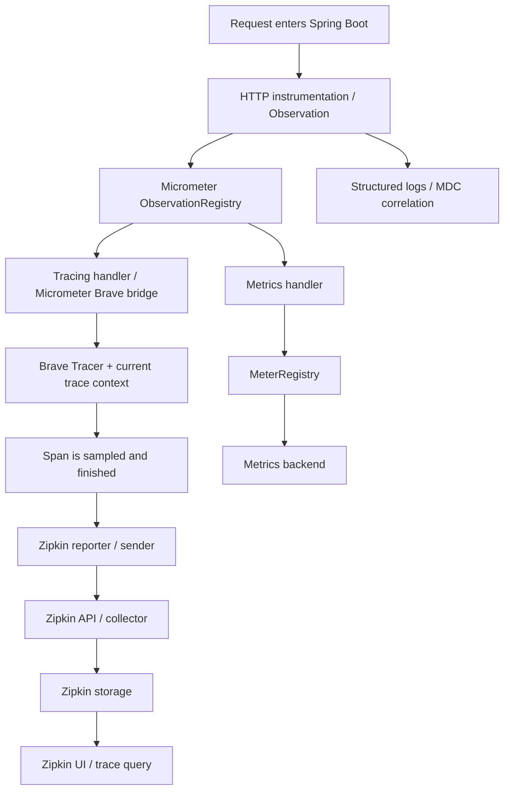
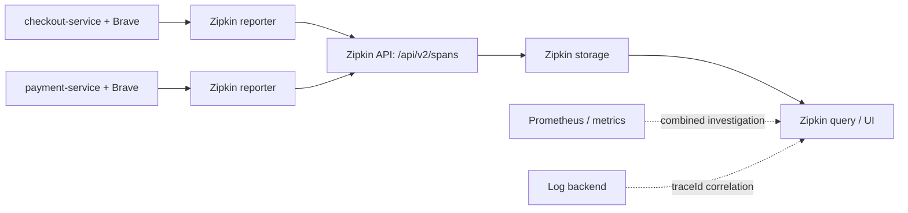

# OpenZipkin Brave with Zipkin in Spring Boot

A Spring Boot application receives `POST /checkout`, calls a payment service, and waits for a response from an external payment gateway. Metrics show that p95 latency has increased, and logs contain timeout messages, yet they do not tell you **exactly which services a specific request passed through and where time was spent**. Distributed tracing fills part of that gap by assembling **spans** into a continuous **trace**.

In the OpenZipkin ecosystem, **Brave** is the library that creates and manages spans and context inside a Java application; **Zipkin** is the system that collects, stores, and queries traces. When using Spring Boot with Micrometer Tracing, the **Brave bridge** connects Micrometer's abstraction to the Brave implementation, and the **Zipkin reporter** sends recorded spans to the Zipkin backend. These components have distinct responsibilities: simply adding Brave does not automatically put traces into the Zipkin UI.

This lesson belongs to the **Tracer implementation** chapter of the **SPRING_BOOT_OBSERVABILITY** module. The module teaches how to set up observability for Spring Boot using Micrometer Observation, metrics, logs, and distributed tracing, as well as context propagation, tags/cardinality, exporters, sampling, and how to correlate signals to investigate errors, latency, and application behavior in real environments. The focus here is implementing and operating **OpenZipkin Brave with Zipkin**, from Spring Boot source code to the actual path of a span.

## Learning Objectives

After this lesson, you will be able to:

1. Distinguish between **Brave**, **Micrometer Tracing**, the **Brave bridge**, the **Zipkin reporter**, the **Zipkin server**, and the tracing backend.
2. Describe trace ID, span ID, parent-child relationships, span kinds, and the difference between **propagation** and **export**.
3. Configure a Spring Boot application using the Brave bridge and Zipkin reporter following the Spring Boot 3.x model.
4. Create business observations/spans with stable names and understand how they become spans in Zipkin when the system is wired end-to-end.
5. Keep traces continuous across HTTP clients/servers and identify issues with B3/W3C propagation, thread-local context, or asynchronous execution.
6. Explain sampling, reporter batching, Zipkin backend limits, cardinality, and protecting sensitive data.
7. Inspect a trace across two services, read timings, and diagnose why Zipkin does not show spans or why a trace breaks.
8. Know when to use Brave–Zipkin and when to consider OTLP/OpenTelemetry or a collector aligned with your organization's architecture.

## 1. Components in the OpenZipkin Ecosystem

The name "OpenZipkin Brave with Zipkin" is sometimes mistaken for a single library. In reality, a Java tracing flow typically involves multiple components:

| Component | Role | What It Does Not Replace |
|---|---|---|
| **Brave** | Tracer implementation in Java: creates/manages spans, scopes, and propagation context | Not a search UI or trace database |
| **Micrometer Tracing** | Abstraction API for tracer/span, independent of a specific implementation | Does not provide a trace storage backend |
| **`micrometer-tracing-bridge-brave`** | Bridge from the Micrometer Tracing API to Brave | Does not replace the Zipkin reporter or backend |
| **Zipkin reporter** | Encodes and sends spans to the configured destination, typically in batches | Does not solely decide which spans to create or all sampling rules |
| **Zipkin server** | Receives spans, stores/queries traces, and provides UI/API | Does not auto-instrument Spring Boot |
| **Micrometer Observation** | Coordinates an operation's lifecycle; handlers can turn an observation into metrics/spans | Does not guarantee every observation is exported as a span |
| **Metrics/log pipelines** | Store aggregated measurements and events | Cannot be fully replaced by a trace timeline |

Brave is a tracing implementation, whereas Zipkin is a collection/storage backend. An organization can use Brave to create spans and send them through a collector or another system supporting a compatible format; conversely, Zipkin can ingest spans from multiple tracer implementations when the protocol is supported.

### Separating Responsibilities with a Diagram



**Key takeaway:** not every created span is stored. A sampler may not record the span for export; the reporter/exporter can fail; or the collector/backend may not retain or allow querying the delivered data.

## 2. What Does a Trace Look Like in Brave?

Suppose a checkout request shares a trace ID and produces spans corresponding to its key steps:

```text
Trace ID: 0af7651916cd43dd8448eb211c80319c

checkout-service
  HTTP POST /checkout                [span A, server]
    validate cart                     [span B, internal]
    POST payment-service /authorize   [span C, client]

payment-service
  HTTP POST /authorize                [span D, server; child of C]
    call external payment gateway    [span E, client]
```

Depending on instrumentation, an outbound operation has a client span in the calling service and a server span in the receiving service. The spans share a trace ID, yet each span has its **own span ID**. The parent span ID connects the steps into a tree.

A span typically carries:

- A relatively stable business or operation name.
- Start timestamp, end timestamp, and duration.
- Trace ID, span ID, and parent ID if present.
- Role such as `CLIENT`, `SERVER`, `INTERNAL`, or other kinds.
- Attributes/tags such as `http.request.method`, route template, status, or partner type.
- Events/errors/status according to semantic conventions and implementation.
- Span links when a workflow requires relationships beyond parent-child.

**A "complete" trace in the UI is only complete for the spans that were instrumented and retained**. An uninstrumented DB call leaves a gap on the timeline; a request dropped by sampling will not appear even though the application executed normally.

### 2.1. Span ID Differs from Trace ID

In the Zipkin/W3C-compatible model:

```text
traceId = 0af7651916cd43dd8448eb211c80319c
spanId  = b7ad6b7169203331
```

The trace ID identifies the entire journey; the span ID identifies a single step. Do not use a trace ID as a metric label because nearly every request produces a different value, causing high cardinality. Do not use a span ID as a business transaction ID or authentication secret.

Brave can work with trace IDs of different lengths depending on configuration and format. When connecting multiple services, align on the **propagator**, how trace IDs are generated/accepted, and gateway compatibility before assuming trace context will automatically stitch together correctly.

### 2.2. Only Properly Closed Spans Have Reliable Durations

A span measures an execution segment. If it starts before an HTTP call or task submission and closes right when the task is placed into a queue, the duration only measures enqueue time. It does not represent processing inside the consumer.

Conversely, if you forget to close a span or scope, the context can linger incorrectly and the span will not reach the reporter when expected. Even when a span finishes properly, that does not mean data has already been sent to Zipkin: the reporter may process it asynchronously later.

## 3. How Spring Boot Connects Observation, Brave, and Zipkin

In Spring Boot 3.x, **Micrometer Observation** is typically the API layer used to instrument operations. **Micrometer Tracing** is the common tracing API; the Brave bridge translates that API into Brave operations. Spring Boot provides auto-configuration when the classpath and configuration match.

Typical flow:

1. Spring Boot receives an HTTP request and instrumentation creates an observation for the request.
2. The observation starts and opens a scope; the tracing handler/bridge interacts with Brave to create or set the current span.
3. If the application creates a business observation nested inside the current scope, a child span can appear.
4. When an instrumented HTTP client is used, trace context is injected into outbound headers.
5. The downstream service extracts the context and creates a server span linked to the parent if propagation is compatible.
6. When spans finish, the configured reporter sends them to Zipkin.
7. Zipkin receives and stores the arriving spans; the UI queries by service, time range, duration, or trace ID.

**Do not instantiate a new `ObservationRegistry` manually and assume it inherits all tracing handlers.** Using the registry managed by Spring Boot is usually the safe choice for business code; if you isolate a separate registry, you must explicitly wire its handlers and context.

### Things That Do Not Appear Automatically Just Because Dependencies Exist

- No proper exporter/reporter → traces may never reach Zipkin.
- No HTTP client instrumentation → trace headers may not be injected.
- No propagation across executors/messages → child spans can become new roots.
- No log correlation → logs will not automatically contain trace ID / span ID.
- No metrics histograms enabled → Zipkin may still have spans, while p95 charts from metrics may be missing.
- Backend lacks connectivity/retention → requests work, yet the UI is empty.

These are independent configuration layers that must each be verified.

## 4. Configuring Spring Boot + Brave Bridge + Zipkin Reporter Dependencies

Gradle example for a **Spring Boot 3.x stack using Micrometer Tracing with Brave**:

```groovy
dependencies {
    implementation 'org.springframework.boot:spring-boot-starter-actuator'
    implementation 'io.micrometer:micrometer-tracing-bridge-brave'
    runtimeOnly 'io.zipkin.reporter2:zipkin-reporter-brave'
}
```

In this setup:

- `spring-boot-starter-actuator` brings in Boot's observability/metrics and management capabilities.
- `micrometer-tracing-bridge-brave` provides the bridge so Micrometer Tracing uses Brave.
- `zipkin-reporter-brave` supports reporting spans in the format expected by the Brave–Zipkin ecosystem.

Exact auto-configuration and dependencies also depend on **Spring Boot, Micrometer, Brave, and Zipkin reporter versions**. Boot manages versions via its BOM when using the corresponding dependency management setup. Avoid pinning arbitrary versions when the stack already provides a unified BOM.

**Do not mix both bridges at the same time** (`micrometer-tracing-bridge-brave` and `micrometer-tracing-bridge-otel`) just to "have more export options": that can make tracer configuration ambiguous or create duplicate pipelines. Pick the application's primary implementation and wire the matching exporter/collector.

### 4.1. Configuring the Zipkin Endpoint

Example for a local/lab environment when a Zipkin server listens on port 9411:

```yaml
spring:
  application:
    name: checkout-service

management:
  tracing:
    sampling:
      probability: 1.0
  zipkin:
    tracing:
      endpoint: http://localhost:9411/api/v2/spans
```

Explanation:

- `spring.application.name` is one source the stack uses to determine the service name in telemetry. Verify the actual name displayed in Zipkin.
- `management.tracing.sampling.probability: 1.0` suits a **low-traffic lab**, making traces easy to observe. Do not use it as a default in high-traffic production.
- `management.zipkin.tracing.endpoint` points to the Zipkin ingestion API matching the pipeline. This is **not** the UI URL.
- `localhost` inside the application process means **the application's own network namespace**. When the app runs in a container/pod and Zipkin lives elsewhere, `localhost:9411` may be wrong.

In production, the endpoint, HTTPS scheme, authentication, network routes, proxies, and exporter must match the real architecture. Verify the exact property names and auto-configuration mechanics for your Boot version; this example is no substitute for verifying configuration after startup.

### 4.2. Local Zipkin for Learning

A common way to practice locally is running Zipkin in a container:

```bash
docker run --rm --name zipkin-lab -p 9411:9411 openzipkin/zipkin
```

In an appropriate local setup, the Zipkin UI is typically accessible via `http://localhost:9411/zipkin/` or the home page on port 9411, while the ingestion API uses `/api/v2/spans`.

This is a **lab** example, not instructions for exposing Zipkin directly to the Internet. Image tag/version, storage backend, and UI path may vary in deployment. In production, pin versions, control ingress, and configure persistence; the default storage in a practice container may not retain data across restarts.

### 4.3. Two Applications on Two Hosts/Containers

Example:

```text
checkout-service    :8080
payment-service     :8081
zipkin              :9411

checkout-service  -->  payment-service
       |                       |
       +------ reporter -------+
                  |
               Zipkin API
```

Each service must configure **the Zipkin address that it can actually reach**, not a blindly copied `localhost` string. Service names must differ so the UI can distinguish span sources; sampling and propagation must be compatible between them.

## 5. Creating an HTTP Trace Across Two Spring Boot Services

To obtain a cross-service trace, both the client side and the server side must be instrumented. With Spring Boot 3.x / Spring Framework 6, a `RestClient.Builder` **provided and customized by Spring Boot** can integrate observations when the right dependencies and configuration are present.

### 5.1. Client Created from a Spring-Managed Builder

Example in `checkout-service`:

```java
import org.springframework.context.annotation.Bean;
import org.springframework.context.annotation.Configuration;
import org.springframework.web.client.RestClient;

@Configuration(proxyBeanMethods = false)
class PaymentHttpClientConfiguration {

    @Bean
    RestClient paymentRestClient(RestClient.Builder builder) {
        return builder
                .baseUrl("http://localhost:8081")
                .build();
    }
}
```

In production, the hostname and scheme should come from service discovery or configuration rather than hard-coding `localhost`. The point of this example is emphasizing the **Spring-managed builder**. If you call `RestClient.create()` or build an HTTP client manually outside Boot's customizers and instrumentation, trace headers **may not be injected** even if a server span already exists.

### 5.2. Business Observation Wrapping the Call

```java
import io.micrometer.observation.Observation;
import io.micrometer.observation.ObservationRegistry;
import org.springframework.stereotype.Service;
import org.springframework.web.client.RestClient;

@Service
class CheckoutPaymentService {

    private final RestClient paymentRestClient;
    private final ObservationRegistry observationRegistry;

    CheckoutPaymentService(
            RestClient paymentRestClient,
            ObservationRegistry observationRegistry) {
        this.paymentRestClient = paymentRestClient;
        this.observationRegistry = observationRegistry;
    }

    String authorize() {
        return Observation.createNotStarted(
                        "checkout.payment.authorize", observationRegistry)
                .contextualName("authorize payment")
                .lowCardinalityKeyValue("operation", "authorize")
                .lowCardinalityKeyValue("dependency", "payment-service")
                .observe(() ->
                        paymentRestClient
                                .post()
                                .uri("/authorize")
                                .retrieve()
                                .body(String.class)
                );
    }
}
```

Because the callback executes **synchronously**, `observe(...)` manages the lifecycle for the duration of the call. HTTP client instrumentation can create an additional client span nested inside the business span; `payment-service` receives the trace context and creates a server span in the same trace if instrumented.

An illustrative controller calling the service above:

```java
import org.springframework.web.bind.annotation.PostMapping;
import org.springframework.web.bind.annotation.RestController;

@RestController
class CheckoutController {
    private final CheckoutPaymentService service;

    CheckoutController(CheckoutPaymentService service) {
        this.service = service;
    }

    @PostMapping("/checkout")
    String checkout() {
        return service.authorize();
    }
}
```

### 5.3. Downstream Server

Example in `payment-service`, running separately on port 8081:

```java
import org.springframework.web.bind.annotation.PostMapping;
import org.springframework.web.bind.annotation.RestController;

@RestController
class PaymentController {
    @PostMapping("/authorize")
    String authorize() {
        return "approved";
    }
}
```

This is a demo **without authentication, business rule checks, or a real payment gateway**. It only illustrates the HTTP flow and trace propagation. When tracing is configured properly, Zipkin can receive spans roughly like:

```text
checkout-service
  POST /checkout                 (SERVER)
    checkout.payment.authorize   (INTERNAL)
      POST /authorize            (CLIENT)

payment-service
  POST /authorize                (SERVER)
```

The exact set of spans, names, kinds, and parent-child layout depend on the framework, instrumentation, and bridge versions. Do not treat this list as a rigid contract on span counts.

### 5.4. Verification

A lab walkthrough:

1. Start Zipkin with an accessible ingestion API.
2. Start `payment-service` with its own service name and reporter configuration.
3. Start `checkout-service` using the instrumented HTTP client builder.
4. Send a test request to `POST /checkout`.
5. Open the Zipkin UI, select the service and appropriate time range, and find the trace for the request.
6. Confirm that spans from both checkout and payment share the **same trace ID** while having distinct span IDs.
7. Check durations, parent-child links, errors, and a few logs with `traceId`/`spanId` if correlation is configured.
8. If no trace appears, inspect sampling, reporter, API endpoint, network, and propagation before changing business code.

Not seeing all four spans shown in the illustration does not necessarily mean there is no trace; inspect which layers are actually instrumented.

## 6. Brave Propagation: B3 and W3C Trace Context

**Propagation** is passing trace context along to the next task or service. It is distinct from **reporting**, which sends completed span data to Zipkin.

Brave has deep roots in the Zipkin ecosystem, where **B3 propagation** is widely used. Many modern systems also use **W3C Trace Context**. What matters is not deciding "which format is universally superior," but ensuring **every hop agrees on inject/extract capabilities**.

### 6.1. B3

B3 has a multi-header form, for example:

```http
X-B3-TraceId: 0af7651916cd43dd8448eb211c80319c
X-B3-SpanId: b7ad6b7169203331
X-B3-Sampled: 1
```

There is also a **single header** form, `b3`. Depending on the choice, client and server must agree on B3 single vs. multi-header. A proxy or security gateway may strip headers not on an allowlist, causing the downstream service to start a brand-new root trace.

### 6.2. W3C Trace Context

Example:

```http
traceparent: 00-0af7651916cd43dd8448eb211c80319c-b7ad6b7169203331-01
```

Some systems also use `tracestate`. `traceparent` carries trace ID, parent ID, and flags; it is not an authentication token. Headers arriving from external clients must be treated as **untrusted input** with appropriate trust-boundary policies applied.

### 6.3. Configuring the Propagator by Version

Different Spring Boot/Micrometer versions provide extension points and properties to select the propagation type. In some Spring Boot 3.x releases, B3 can be selected via configuration like:

```yaml
management:
  tracing:
    propagation:
      type: b3
```

**Verify the exact property and supported enum values in your specific version**, especially when you need B3 multi-header, W3C, or multiple formats combined. Do not copy configuration from an OpenTelemetry stack into Brave without testing.

The essential test is to send a real HTTP request, inspect the **outbound headers** where inspection is permitted, and confirm the downstream server **extracts the same trace ID**. Enabling a property on one service is insufficient if the other service does not understand that format.

### 6.4. What Does a Broken Trace Usually Look Like?

```text
Checkout tracer:
  traceId = A, client span = C

Payment tracer:
  traceId = B, server span = D  <-- new trace ID
```

Common causes: client does not inject, gateway does not forward, server does not extract, mismatched propagator configuration, or the active context was lost before sending the request. **The Zipkin reporter may still work fine in both services**, yet the UI shows two disconnected traces.

## 7. Context in Threads, Reactor, and Logging MDC

Brave has the concept of a current trace context tied to an execution scope. In synchronous servlet programming, the framework can open a scope during request handling and restore it when the request finishes.

In modern applications, however, work frequently crosses:

- `@Async` and `TaskExecutor`.
- `CompletableFuture` or raw `ExecutorService`.
- Spring WebFlux / Reactor `Mono` and `Flux`.
- Kafka/RabbitMQ or other message queues.
- Schedulers and background jobs.

**Never assume thread-local context automatically crosses every boundary.** If a task executes on another thread without capture/restore, a new span may lack its expected parent, and `traceId`/`spanId` in logs may be blank.

### 7.1. Observation Scope in Synchronous Code

```java
Observation observation =
        Observation.createNotStarted(
                "checkout.payment.verify", observationRegistry).start();

try (Observation.Scope scope = observation.openScope()) {
    verifyPayment();
} catch (RuntimeException error) {
    observation.error(error);
    throw error;
} finally {
    observation.stop();
}
```

In this example, `verifyPayment()` is a hypothetical business method. The scope makes the observation current within the block, and closing the scope restores the previous context. Do not pass the same `Scope` across threads without an explicit propagation mechanism.

### 7.2. Async Work Does Not Finish When Returning a Future

An error-prone example:

```java
return Observation.createNotStarted(
        "batch.payment.process", registry)
    .observe(() -> executor.submit(() -> processPayment()));
```

The outer `observe(...)` only wraps the time spent **submitting the task**; it does not measure how long `processPayment()` actually runs. A span created on the calling thread can also finish before the task completes.

Use instrumentation, task decorators, or context propagation appropriate for the executor, or manage the observation lifecycle inside the actual execution callback. With Reactor, pay attention to subscription and signal lifecycles; opening a scope when constructing a publisher does not mean the scope remains active when the publisher is subscribed to.

### 7.3. MDC and Log Correlation

In a properly configured Brave–Micrometer stack, current trace/span information can be populated into **MDC** so logging patterns print `traceId` and `spanId`. Example log output:

```text
2026-11-22T10:15:01 INFO [checkout-service,traceId=0af7651916cd43dd8448eb211c80319c,spanId=b7ad6b7169203331] Sending payment authorization
```

This is a formatting example; Spring Boot/Logback may use a different pattern. What matters:

1. There is an active trace context at **the moment the log is written**.
2. The logging stack is configured with matching correlation.
3. Scopes are closed on time so an old request's trace ID does not leak into a new request's logs.
4. Do not treat a `traceId` in logs as proof that Zipkin stored the span; sampling and reporting behave independently.

When log correlation disappears in `@Async` or a queue consumer, fix context propagation first instead of manually stuffing a trace ID into every log message.

## 8. When to Create Spans Directly with Micrometer Tracer?

For most business operations in Spring Boot, **Micrometer Observation** is the right instrumentation point because the same lifecycle can serve both metrics and tracing. However, when you need direct span control (for example, a tracing-only event), you can use `io.micrometer.tracing.Tracer`.

Example:

```java
import io.micrometer.tracing.Span;
import io.micrometer.tracing.Tracer;
import org.springframework.stereotype.Service;

@Service
class ManualTracingService {
    private final Tracer tracer;

    ManualTracingService(Tracer tracer) {
        this.tracer = tracer;
    }

    void verifyPartner() {
        Span span = tracer.nextSpan()
                .name("partner.verify")
                .start();

        try (Tracer.SpanInScope scope = tracer.withSpan(span)) {
            callPartner();
        } catch (RuntimeException ex) {
            span.error(ex);
            throw ex;
        } finally {
            span.end();
        }
    }

    private void callPartner() {
        // Actual work is performed here.
    }
}
```

`SpanInScope` makes the span current within the synchronous block and restores the prior span when closed. `span.end()` finishes the span. Scope and span lifecycle **are two different things**; closing a scope does not replace `end()`.

Limitations of this pattern:

- Only measures **synchronous** callbacks directly.
- Does not automatically produce business metrics; if you need counts or latencies, add an appropriate meter or observation.
- When called inside an existing HTTP server span, it adds another span; do this only when the operation boundary provides investigative value.
- Ensure the Brave bridge and reporter/exporter are configured; otherwise, creating a span directly does not guarantee it appears in Zipkin.
- Avoid **double-instrumenting** the same operation with both Observation and Tracer across uncontrolled code paths.

### Errors and Status Must Be Consistent

Recording `span.error(ex)` or `observation.error(ex)` gives the tracing handler evidence when an exception occurs. However, business outcomes can differ from exceptions: a valid payment decline is not necessarily a system failure; a timeout that succeeds on retry may have an error span on the first attempt while the overall transaction succeeds.

Do not use counts of spans with error status as a direct substitute for an error-rate SLI. Use metrics with a clear request/transaction denominator and use traces/logs to diagnose root causes.

## 9. Sampling in Brave and Data Reported to Zipkin

Enabling 100% tracing probability in a lab makes observation easy, but it can incur very high costs in production. Distinguish:

- **Creating trace context:** used for request identification and correlation.
- **Recording/sampling:** decides which spans are actually recorded and eligible for export.
- **Reporting:** sends finished span data from the application to the Zipkin endpoint.
- **Ingestion/storage:** Zipkin receives, stores, and makes spans searchable.

### 9.1. Head-Based Sampling

Brave is typically configured with a sampling mechanism evaluated early in the trace. `management.tracing.sampling.probability` is an example Spring Boot property that can affect the trace selection rate, depending on how tracer auto-configuration is set up.

Example:

```yaml
management:
  tracing:
    sampling:
      probability: 0.10
```

With sufficient request volume and a compatible sampling policy, a 10% rate reduces trace volume, but:

- Rare errors might not be captured.
- Do not assume exactly 10 out of every 100 specific requests will have traces.
- The retained set of traces is not automatically representative of all traffic if additional filtering, drops, or biased sampling exist.
- HTTP metrics can still measure every instrumented request regardless of tracer sampling.

### 9.2. Parent-Based Sampling and Inbound Context

A service receiving a request may inherit or be influenced by the sampling decision propagated from upstream. Exact behavior depends on the Brave sampler and propagation flags.

An `X-B3-Sampled: 1` header or the sampled flag in `traceparent` is context metadata; **it does not prove the span was actually exported, ingested, or stored**. Do not treat the sampled flag as proof that the production backend already holds every trace.

### 9.3. Tail Sampling Requires a Suitable Pipeline

If you want to prioritize keeping slow or failing traces **after knowing the outcome**, you typically need a collector/pipeline solution capable of tail sampling, buffering, and seeing all spans before deciding. **A standalone Zipkin server does not turn `management.tracing.sampling.probability` into a tail sampler.**

If the Brave application already head-sampled spans away, a downstream collector cannot recover data that was never sent. Design sampling end-to-end, especially when collecting across multiple services.

### 9.4. Reporter Batching and Delayed Visibility

Reporters typically send spans asynchronously in batches to avoid making a network request per span. Consequences:

- A finished span does not necessarily appear instantaneously in the Zipkin UI.
- If the application shuts down abruptly or a queue fills up, some unsent spans may be lost.
- Monitor reporter errors, queues, retries, and network pressure according to the library in use.
- In short tests, distinguish **missing spans** from **spans waiting in the reporter/collector pipeline**.

Do not rely on UI arrival time to measure business duration. Span duration is determined by instrumentation inside the application, not when the backend receives the record.

## 10. Zipkin Server, Storage, and Production Operations

The Zipkin server acts as the span ingestion endpoint and query system. It must be operated like any observability data component:

- **Networking:** applications/reporters must reach the ingestion API; the UI and query API should be restricted to authorized users and systems.
- **Storage:** local lab storage setups may not guarantee persistence; production requires choosing a storage backend sized for volume and retention.
- **Limits:** request sizes, spans per trace, ingestion rate, queues, and backend resources must be monitored.
- **Availability:** Zipkin ingestion failures must not crash checkout logic, though they can cause trace loss; applications need safe reporter retry/buffering strategies.
- **Security:** TLS, authentication, secret management, and network segmentation aligned with trust boundaries.
- **Data governance:** traces can expose service names, routes, errors, and attributes; enforce privacy reviews, retention limits, query permissions, and redaction rules.

Do not treat Zipkin as a financial or customer data warehouse. Business IDs can be helpful for correlation, provided they comply with data policy. **Never put tokens, card numbers, credentials, or sensitive request bodies into span tags, events, or baggage.**

### 10.1. Lab and Production Connection Flow



The diagram only shows tracing directly to Zipkin. Some production stacks place a collector or proxy in between, or use a different exporter/tracing implementation; in those cases, routes, authentication, and sampling may differ.

### 10.2. Do Not Confuse the Zipkin API with the UI

- The ingestion endpoint typically looks like `http://zipkin-host:9411/api/v2/spans`.
- The UI may be served at the root path or `/zipkin/` depending on the image, version, or reverse proxy.
- The tracer/Zipkin reporter needs the **ingestion URL**, not the trace search page URL.

A common mistake is configuring the reporter to HTTP POST to the UI path: the TCP connection succeeds, but the backend returns 404/405 and no spans are stored.

## 11. Cardinality, Sampling, and Linking Traces with Metrics/Logs

Tracing and metrics have different data models. In metrics, each combination of labels can create a time series; in traces, every span is a record and trace IDs / span IDs are inherently unique. That **does not license metadata abuse**.

| Data | Where Should It Go? | Notes |
|---|---|---|
| `service.name`, environment | Stable resource/service metadata | Keep consistent across signals if the stack supports it |
| Templated HTTP route `/orders/{id}` | Span attributes and appropriate metric tags | Do not use raw URLs containing order IDs |
| `payment.provider=provider-a` | Span attribute and low-cardinality metric tag | Bounded set of values |
| Trace ID | Span/trace context, log correlation, exemplar if supported | Do not use as a regular metric label |
| Custom request correlation ID | Optionally in a span/log if permitted | High cardinality; control retention, permissions, and indexing |
| Authorization header, token, card number | Do not collect | Confidential/sensitive data |

Micrometer Observation distinguishes `lowCardinalityKeyValue(...)` and `highCardinalityKeyValue(...)`. Tracing handlers can use both depending on implementation; metrics handlers should normally only use low-cardinality keys. Even so, the "high-cardinality" label **is not a security filter** and does not guarantee the data always stays in the tracing backend.

### Three Signals in One Incident

1. **Metrics:** `POST /checkout` p95 increases and the 5xx rate exceeds target.
2. **Logs:** `payment gateway timeout` appears with `traceId`/`spanId`.
3. **Traces in Zipkin:** several failing requests show a long `payment client` span compared to other steps.

Traces show the execution path of **retained samples**, metrics reveal overall scale, and logs supply error details. To conclude a systemic failure, compare sampled normal vs. failing requests and check the dependency; **do not use the ratio of ERROR spans in sampled traces as the overall request error rate**.

## 12. Diagnosis: Brave Is Present, Yet Zipkin Shows No Traces

An effective workflow is checking layer by layer from the application outward to the backend, instead of changing five configuration settings at once.

| Symptom | Possible Cause | First Place to Check |
|---|---|---|
| No spans at all in Zipkin | Wrong reporter dependency, endpoint, or sampling | Tracer bridge, reporter bean, Zipkin API URL |
| Zipkin shows checkout but not payment | Payment lacks instrumentation or fails to export | Payment tracing dependencies/config, reporter errors |
| Two services appear as two separate traces | B3/W3C propagation mismatch, uninstrumented HTTP client | Outbound/inbound headers, `RestClient.Builder`, gateway/proxy |
| Trace has server span but lacks business operation | Code does not create observation/span, or wrong registry | Injected `ObservationRegistry` and tracing handler |
| Logs have traceId but UI shows no trace | Sampling or export/storage failure | Sampling probability, reporter, collector, retention |
| Zipkin UI cannot find service | Different service name, wrong time window, spans delayed | `spring.application.name`, search window, ingestion |
| Spans missing during pod restart | Reporter batching not flushed or queue dropped | Shutdown lifecycle, reporter metrics/logs, resource limits |
| Very short span despite slow work | Span closed right after async enqueue | Move lifecycle to actual callback/consumer |
| Redundant or duplicate spans | Two instrumentation layers measuring same scope | Span tree, filters/annotations/manual instrumentation |
| UI displays sensitive data | Uncontrolled attributes or baggage | Code, semantic conventions, redaction, routing |

### Step 1 — Distinguish "Not Creating Spans" from "Not Exporting Spans"

If logs/telemetry show an active trace ID in scope while Zipkin has no data, check the reporter, sampling, and backend. If business spans never appear in any trace while HTTP spans do, check observation instrumentation and handlers.

### Step 2 — Check the Ingestion URL from Each Service

`localhost` is an easy trap. Inside Docker, `localhost:9411` in the checkout container points to the checkout container, not the Zipkin container. In Kubernetes, use the cluster Service name and port, along with ingress policies or sidecars/proxies as needed.

Test endpoints through authorized paths; never disable TLS or authentication in production just to test.

### Step 3 — Check Sampling Before Increasing Test Volume

At probability 0.10, a test request might simply not be sampled. In a low-traffic lab, you can use 1.0 to verify the pipeline, then return to an operational policy that fits your budget. If spans are still missing with sampling enabled properly, the fault likely lies in the reporter or bridge.

### Step 4 — Check HTTP Propagation and Context

An uninstrumented client or lost async context can start a new root trace downstream. Enable the matching propagator on both sides and verify the same trace ID across headers, logs, and the tracing UI.

### Step 5 — Check the Pipeline and Storage

Did the reporter send HTTP requests successfully? Did the ingestion API accept them? Does storage still hold the data? Is the UI querying the right service name, time range, and filters?

**Stopping criterion:** only declare "tracing works" after a test trace crosses at least two connected services and you have verified expected span names and timings.

## 13. Practical Scenario: One Request, Two Trace IDs

Suppose a system uses `checkout-service` and `payment-service`. After replacing an older HTTP client with manually instantiated `RestClient` code:

- Metrics for `POST /checkout` still record a 1.8-second duration.
- Logs in checkout show trace ID `A`.
- Logs in payment show trace ID `B`.
- Zipkin UI shows two separate traces, one for checkout and one for payment.
- Both services still send spans to Zipkin successfully.

### Step-by-Step Analysis

**Step 1 — Verify it is not an exporter failure.** Since Zipkin already shows spans from both services, the basic reporting pipeline is working. Do not try to "fix" this by raising sampling or swapping Zipkin storage right away.

**Step 2 — Check the HTTP client.** Does the code use the builder customized by Spring Boot for observation integration? If a client is instantiated directly and bypasses instrumentation, outbound context may not be injected.

**Step 3 — Inspect headers in a controlled way.** If the client does not send the expected B3/W3C headers or a gateway strips them, payment cannot know the parent trace. Inspect headers only in authorized environments; do not log full production headers since they may contain secrets.

**Step 4 — Check the propagator.** If checkout sends B3 while payment only extracts W3C, a single request can create a new root. Align configuration on both ends or use a supported bridge/propagator, then re-test on the actual path.

**Step 5 — Check async boundaries.** If calling payment is offloaded to an executor, context must be captured and restored. You cannot simply open a scope on the HTTP thread and expect it to follow across every thread.

**Step 6 — Retest.** Send a new request and confirm the HTTP client/server spans share the same trace ID, have sensible parent-child links, and show correlation in both services' logs.

**Conclusion:** the bug is in **context propagation/instrumentation**, not Zipkin's ability to store spans. Distinguishing **trace creation**, **propagation**, and **export** lets you fix the true root cause without wasting tracing budget.

## 14. Anti-Patterns to Avoid

| Anti-Pattern | Why It Is Wrong | Recommended Approach |
|---|---|---|
| Assuming Brave is the Zipkin UI | Confuses the tracer with the backend | Distinguish bridge, tracer, reporter, and Zipkin server |
| Adding only the Brave dependency and expecting spans in UI | Missing reporter/endpoint or auto-configuration | Verify the full pipeline |
| Using `localhost:9411` inside every container | Points to the wrong network namespace | Use real hostnames / service discovery |
| Pointing the reporter POST to the UI path instead of `/api/v2/spans` | API rejects requests; spans are never ingested | Configure the proper ingestion endpoint |
| Mixing Brave and OpenTelemetry bridges without design | Can create duplicate or ambiguous tracers | Pick one primary implementation |
| Using a manually built client bypassing Spring instrumentation | Trace headers are not injected | Use instrumented builders/extension points |
| Assuming B3/W3C are automatically compatible across hops | Trace IDs break between services | Choose and test a consistent propagator |
| Leaving a scope open across another thread | Leaks or corrupts current context | Capture/restore via proper propagation |
| Closing a span immediately after async task submission | Duration does not reflect actual work | Tie lifecycle to the executing task |
| Defaulting to 100% sampling in high-traffic production | Drives up cost and exporter/backend load | Set sampling policy by traffic and goals |
| Thinking higher sampling fixes all missing traces | Root cause may be network/queue/propagation | Diagnose layer by layer first |
| Putting `userId`/`traceId` into metric labels | High cardinality | Use trace/log correlation and exemplars if available |
| Putting tokens/PII into span tags or baggage | Data leakage risk | Allowlists, redaction, access control, and retention |
| Treating a long CLIENT span as slow server CPU | Client time includes network/queuing | Compare with server span, logs, and dependency metrics |

## 15. Production Checklist for Brave–Zipkin

Before considering tracing ready, verify:

1. **Implementation:** the application uses Micrometer Tracing with the **Brave bridge**, without unintended mixing with other bridges/tracers.
2. **Reporter:** the Zipkin reporter/exporter is present, properly configured by Spring Boot, and exposes telemetry for send failures.
3. **Endpoint:** each service can reach the right Zipkin ingestion URL, not the UI path or `localhost` inside a container.
4. **Service names:** the backend distinguishes each service and environment; no dynamic per-request service names.
5. **Instrumentation:** server spans, client spans, and key business spans exist without duplicate instrumentation.
6. **Propagation:** B3/W3C is consistent across HTTP, proxies, gateways, messaging, and async contexts.
7. **Scopes:** spans start/end at the right times, scopes close to restore context, and MDC never leaks.
8. **Sampling:** budgeted for traffic, with clear understanding of head/tail/parent sampling effects and verified actual trace rates.
9. **Exporter/backend:** TLS/auth, timeouts/retries, bounded queues, drop monitoring, storage persistence, and retention are configured.
10. **Privacy/cardinality:** span names are stable; no tokens/PII appear in tags, events, or baggage, and per-request IDs are not used as metric labels.
11. **Logs:** log correlation includes `traceId`/`spanId` when needed without cross-request or cross-thread leakage.
12. **Metrics:** HTTP latency, error rate, and throughput remain independent of sampling so incidents can be quantified even when a trace is not kept.
13. **Cross-service:** a test trace spanning at least two services shares one trace ID with accurate parent-child/link relationships.
14. **Resilience:** if Zipkin or reporting fails, business checkout logic continues per policy while operators are alerted to telemetry loss.
15. **Upgrades:** Spring Boot/Micrometer/Brave/Zipkin upgrades test dependencies, propagators, span/tag names, and reporter endpoints.

## 16. Self-Assessment Questions

**Question 1.** How do Brave and Zipkin differ in responsibility?

**Hint:** Brave creates and manages spans and trace context inside the Java application; Zipkin receives, stores, and makes traces searchable. A compatible reporter/transport is needed between them.

**Question 2.** An application has an `ObservationRegistry`, yet Zipkin shows no spans. Can you conclude the Brave bridge is broken?

**Hint:** Not yet. Check the tracing handler, bridge, instrumentation, sampling, reporter, ingestion endpoint, storage, and query time window. `ObservationRegistry` alone does not guarantee export.

**Question 3.** Checkout and payment both send spans to Zipkin, but with different trace IDs. Which layer should you check first?

**Hint:** HTTP instrumentation, B3/W3C inject/extract propagation, and async context. Two working reporter pipelines do not mean context was stitched together.

**Question 4.** Is `traceparent` or the B3 sampled flag proof that Zipkin stored the trace?

**Hint:** No. They carry context and sampling decisions over the network; spans might never have been recorded, could have been dropped, or failed export/ingestion.

**Question 5.** Why shouldn't you leave `management.tracing.sampling.probability: 1.0` in high-traffic production without evaluation?

**Hint:** Trace volume, queues, network traffic, and storage can grow rapidly. Design sampling around system capacity and investigative needs.

**Question 6.** A method returns a `CompletableFuture` immediately while the work takes another 5 seconds. Does wrapping the method synchronously with `observe(...)` measure all 5 seconds?

**Hint:** Not by default. `observe(...)` may finish as soon as the Future is returned; tie the observation/span lifecycle to the actual asynchronous execution.

**Question 7.** Why can logs have a trace ID while the tracing UI cannot find the corresponding trace?

**Hint:** Log correlation and span export are separate paths. Check sampling, reporter, collector, retention, and query permissions.

**Question 8.** Brave uses B3, while a downstream service only extracts W3C. What are the sensible options?

**Hint:** Align the propagator or enable a supported compatible mechanism on both sides, then verify actual headers and trace ID linkage; you cannot solve this solely by changing the Zipkin UI.

## Conclusion

**OpenZipkin Brave with Zipkin is a tracing pipeline composed of an in-app tracer, bridge/instrumentation, context propagation, reporter, and storage backend.** Brave creates spans with trace context; Zipkin collects and displays the instrumented journey. In Spring Boot, Micrometer Observation connects naturally with the Brave bridge when properly configured, provided HTTP client/server instrumentation, B3/W3C propagation, async scopes, sampling, and the reporter all work together. A useful trace does more than merely "show up in the UI"—it has stable names, properly linked spans, safe metadata, and the ability to correlate with metrics and logs during incident investigation. Verify each layer with real requests and keep pipeline cost, privacy, and reliability sustainable over the long term.
