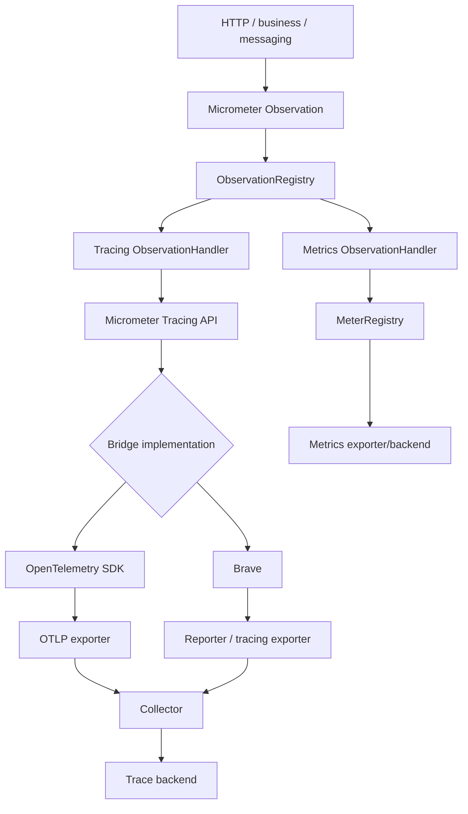
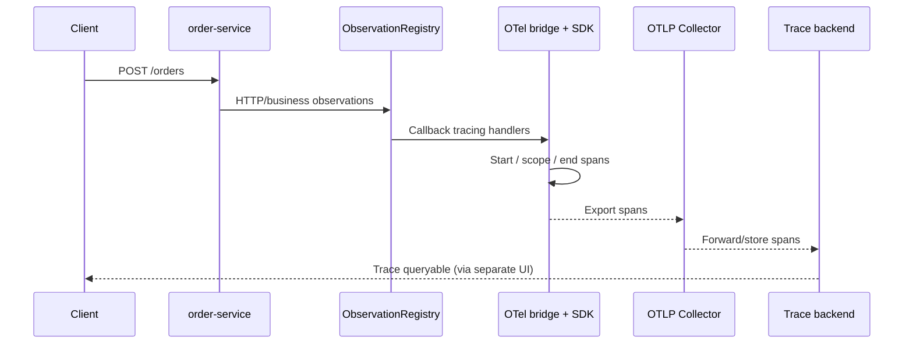
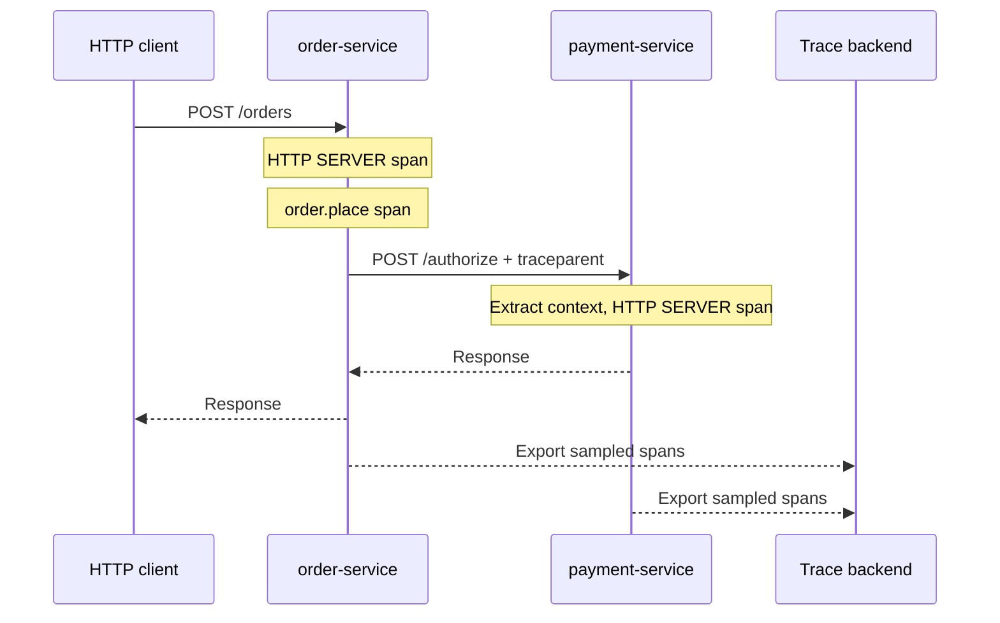
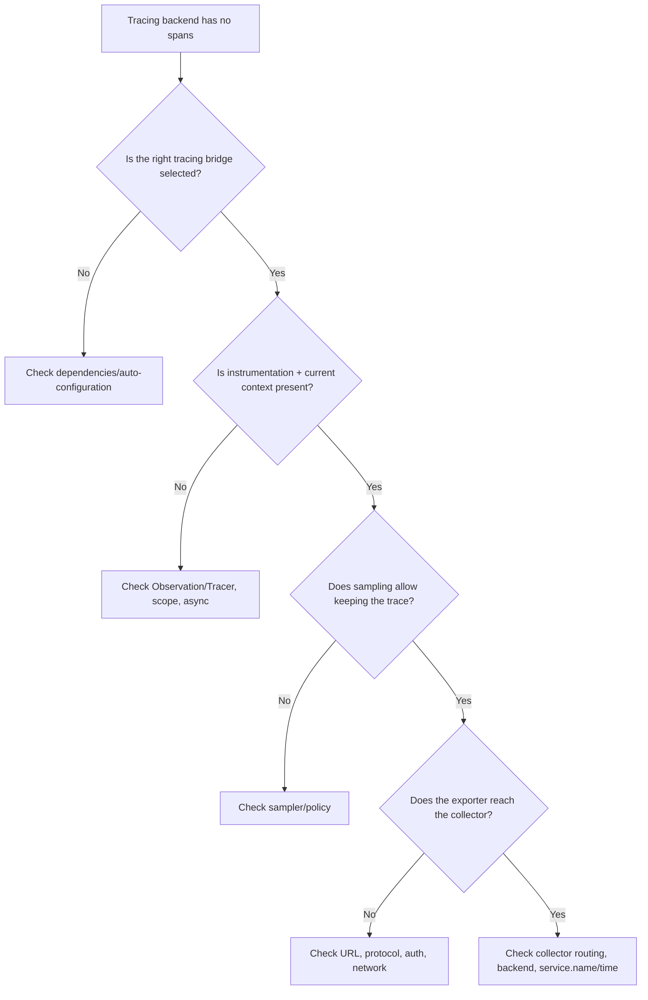

# Micrometer Tracing Bridge in Spring Boot: Connecting Observation to OpenTelemetry or Brave

A Spring Boot system has full `http.server.requests` metrics and application logs, yet when opening the tracing system, the operations team sees no spans at all. In another service, the tracing backend receives HTTP spans, but the business operation `payment.authorize` never appears in the trace. The cause may be that the application creates an `Observation` while **lacking the right tracing bridge/handler**, missing an exporter, misconfiguring propagation, or having traces sampled out.

**Micrometer Tracing Bridge** is the integration layer between Micrometer's unified tracing API and a concrete tracer implementation—most commonly **OpenTelemetry** or **Brave**. The bridge lets an application write instrumentation against `Observation` and `io.micrometer.tracing.Tracer` without coupling most business code directly to a specific tracer system's API.

This lesson, **"Micrometer tracing bridge,"** belongs to the **Tracer implementation** chapter of the `SPRING_BOOT_OBSERVABILITY` module. The scope covers Micrometer Observation, metrics, logs, distributed tracing, context propagation, tags/cardinality, exporters, sampling, and how to correlate signals to investigate errors, latency, and application behavior in production.

## 1. Layers in the Tracing Pipeline

Before adding dependencies, distinguish five roles:

| Component | Responsibility | Examples |
| --- | --- | --- |
| **Instrumentation** | Defines operation boundaries and records telemetry details | HTTP server/client instrumentation, `Observation.createNotStarted(...)`, `@Observed` when AOP is configured |
| **Micrometer Observation** | Lifecycle model for observations and interface for multiple handler types | `ObservationRegistry`, `Observation.Scope`, `ObservationHandler` |
| **Micrometer Tracing API** | Facade for working with spans and tracers | `Tracer`, `Span`, `Tracer.SpanInScope` |
| **Tracing bridge / implementation** | Implements the Micrometer facade on top of a concrete tracing engine | `micrometer-tracing-bridge-otel`, `micrometer-tracing-bridge-brave` |
| **Exporter/collector/backend** | Transports, processes, stores, and queries spans | OTLP exporter → OpenTelemetry Collector → Jaeger/Tempo; Zipkin reporter → Zipkin |

Conceptual diagram:



This is a diagram of responsibilities, not a guarantee that every registry automatically wires all branches. `ObservationRegistry` only dispatches to handlers that are registered with it; the bridge must match the tracing configuration and export component. **A bridge is not an exporter**, and **an exporter does not automatically instrument business code**.

For example, adding only `micrometer-registry-prometheus` exports metrics but does not create a tracer. Conversely, adding a tracing bridge does not automatically create histograms or a Prometheus registry.

## 2. How Does Micrometer Observation Differ from Micrometer Tracing?

`Observation` abstracts a unit of work, such as `order.place`, and dispatches lifecycle callbacks to handlers. A metrics handler can record a `Timer`, while a tracing handler can create a span on the configured tracer.

```java
Observation.createNotStarted("order.place", observationRegistry)
    .lowCardinalityKeyValue("order.channel", "web")
    .observe(() -> orderGateway.place());
```

This snippet **has no direct dependency on OpenTelemetry or Brave**. If the registry has a metrics handler, it can emit a timer; if the registry also has a tracing handler/bridge, it can emit a span. Without tracing integration, the `Observation` itself still runs normally without producing spans in the backend.

Meanwhile, `Tracer` lets you manipulate spans directly:

```java
Span span = tracer.nextSpan().name("order.place").start();
try (Tracer.SpanInScope scope = tracer.withSpan(span)) {
    orderGateway.place();
} catch (RuntimeException ex) {
    span.error(ex);
    throw ex;
} finally {
    span.end();
}
```

These two approaches serve different levels of control. For typical business operations that need unified metrics and traces, `Observation` is usually more convenient. When you need specialized control over a span, you can use `Tracer` directly. Avoid wrapping the exact same piece of work with both mechanisms unintentionally, as that can create duplicate spans.

### Concept Mapping Table

| Observation | Tracing |
| --- | --- |
| `Observation.start()` | Tracing handler can start a span |
| `Observation.openScope()` | Tracer sets the span as the current context |
| `Observation.lowCardinalityKeyValue(...)` | Bounded-value tags for metrics and trace context when supported by the handler |
| `Observation.highCardinalityKeyValue(...)` | Detailed attributes typically intended for tracing; not used as metric tags by default |
| `Observation.error(exception)` | Handler can record the exception/error on the span |
| `Observation.stop()` | Tracing handler can finish the span |
| `Observation.Scope.close()` | Restores the previous current observation/context; does not mean stop |
| `ObservationRegistry` | Coordinates handlers; not a trace database |

Some handlers read tags/events at different lifecycle points. If an important attribute must be present as soon as the span starts, set it before `start()` or use an appropriate convention/handler; do not assume every tag added after start is automatically updated in every backend.

## 3. Why Do Both OpenTelemetry and Brave Bridges Exist?

Micrometer Tracing provides a **common facade** in Java code; a bridge implements that facade on top of a concrete tracing engine:

- **OpenTelemetry bridge**: `io.micrometer:micrometer-tracing-bridge-otel` relies on the OpenTelemetry SDK and OpenTelemetry's exporter/propagator ecosystem.
- **Brave bridge**: `io.micrometer:micrometer-tracing-bridge-brave` relies on Brave, a well-established tracing library in the Zipkin ecosystem.

These are two implementation choices for the same role, not two sequential steps to install together. In most applications, **choose one primary bridge**. Installing both without understanding auto-configuration can cause bean conflicts, duplicate instrumentation, or unexpected behavior.

| Criterion | OpenTelemetry bridge | Brave bridge |
| --- | --- | --- |
| API business code should see | Micrometer `Tracer`/`Observation` | Micrometer `Tracer`/`Observation` |
| Engine beneath the facade | OpenTelemetry SDK | Brave |
| Common trace export | OTLP/Collector via compatible exporter | Zipkin reporter or compatible reporter solution |
| Context propagation | W3C Trace Context and configured propagators | W3C/B3 as supported and configured |
| Switching from one bridge to the other | Keep most code using the Micrometer facade | Keep most code using the Micrometer facade |

Sharing the Micrometer API does not mean every feature, baggage policy, exporter, propagator, or semantic convention behaves identically between the two backends. Always test actual behavior and payloads when switching bridges.

## 4. Configuring Spring Boot with the OpenTelemetry Bridge

The following examples use **Spring Boot 3.x, Java 17+, and Maven** as a baseline, with dependency versions managed by the Spring Boot parent/BOM. Property names or dependencies may change across Boot/Micrometer versions; verify against your project's actual version during deployment.

### 4.1. Dependencies

```xml
<dependencies>
    <dependency>
        <groupId>org.springframework.boot</groupId>
        <artifactId>spring-boot-starter-web</artifactId>
    </dependency>
    <dependency>
        <groupId>org.springframework.boot</groupId>
        <artifactId>spring-boot-starter-actuator</artifactId>
    </dependency>
    <dependency>
        <groupId>io.micrometer</groupId>
        <artifactId>micrometer-tracing-bridge-otel</artifactId>
    </dependency>
    <dependency>
        <groupId>io.opentelemetry</groupId>
        <artifactId>opentelemetry-exporter-otlp</artifactId>
    </dependency>
</dependencies>
```

Purpose:

1. `spring-boot-starter-actuator` provides observability auto-configuration and management/monitoring endpoints.
2. `micrometer-tracing-bridge-otel` provides the Micrometer Tracing implementation on top of OpenTelemetry.
3. `opentelemetry-exporter-otlp` provides the component for exporting trace data over OTLP.
4. `spring-boot-starter-web` provides a Servlet web environment to generate inbound HTTP observations.

If you do not need Servlet web yet, replace the web starter with the corresponding starter. You do not need a Prometheus registry just to export traces. To get metrics in Prometheus, add `micrometer-registry-prometheus` and a separate scrape pipeline.

### 4.2. Configuring Tracer Sampling and OTLP HTTP

```yaml
spring:
  application:
    name: order-service

management:
  tracing:
    sampling:
      probability: 1.0  # For testing; evaluate cost before going to production
  otlp:
    tracing:
      endpoint: http://otel-collector:4318/v1/traces
  endpoints:
    web:
      exposure:
        include: health,metrics
```

In this example configuration:

- `spring.application.name` sets the application name and is commonly used as the service identifier in telemetry through Boot's built-in integration.
- `management.tracing.sampling.probability` is the tracing sampling probability in Spring Boot 3.x configuration, not a rate for dropping metric records.
- `management.otlp.tracing.endpoint` points to the Collector's OTLP **HTTP** receiver in this style of configuration. gRPC endpoints usually use a different port/protocol; never change the port while ignoring the protocol.
- `/actuator/metrics` is a meter diagnostic endpoint; it is **not** a listing of exported spans.

The host `otel-collector` must be reachable from where the application runs. When running locally without a container network, change it to an appropriate address, such as `localhost` with an actual listening receiver.

Setting `probability: 1.0` in a test environment makes traces easy to see; in production, evaluate traffic, cost, security, and sampling policy. An exporter that cannot connect to the Collector leaves the backend without spans even when instrumentation works.

### 4.3. Checking the Pipeline in Order



Do not treat a successful `/actuator/metrics` call as proof of the `T -> Collector -> Backend` path. Inspect the Collector receiver, exporter, network, credentials, and backend query results directly.

## 5. Configuring the Brave Bridge When a Zipkin/Brave Stack Is Needed

If your architecture uses Brave, the baseline dependencies differ from the OpenTelemetry branch:

```xml
<dependencies>
    <dependency>
        <groupId>org.springframework.boot</groupId>
        <artifactId>spring-boot-starter-actuator</artifactId>
    </dependency>
    <dependency>
        <groupId>io.micrometer</groupId>
        <artifactId>micrometer-tracing-bridge-brave</artifactId>
    </dependency>
    <!-- Example when reporting spans to Zipkin -->
    <dependency>
        <groupId>io.zipkin.reporter2</groupId>
        <artifactId>zipkin-reporter-brave</artifactId>
    </dependency>
</dependencies>
```

Configuration for sending to Zipkin in Spring Boot 3.x typically uses properties like:

```yaml
spring:
  application:
    name: order-service

management:
  tracing:
    sampling:
      probability: 0.2
  zipkin:
    tracing:
      endpoint: http://zipkin:9411/api/v2/spans
```

This example illustrates **an alternative implementation branch**, not a requirement to install Brave alongside OpenTelemetry. Verify reporter and property compatibility with your actual Spring Boot version. Using Brave does not automatically force every service to use B3: propagation must be configured consistently and depends on bridge/framework support.

### 5.1. How to Choose an Implementation

Choose based on transport protocol, existing collectors, propagation standards, semantic attribute needs, and operational governance. If your platform primarily uses OpenTelemetry Collector/OTLP, the OpenTelemetry branch is usually a natural fit. If your system already has a stable Brave/Zipkin integration, the Brave branch can minimize migration effort.

Business layers that rely only on `ObservationRegistry` and `io.micrometer.tracing.Tracer` reduce coupling to a specific implementation. Still, when changing implementations, you must re-test trace sampling, span names, propagation, baggage, MDC, and exporters.

## 6. Spring Boot Example: Creating a Span from a Business Observation

Suppose HTTP `POST /orders` calls `OrderPlacementService`, which then calls a `PaymentGateway` adapter. We add a custom Observation for the order placement step:

```java
import io.micrometer.observation.Observation;
import io.micrometer.observation.ObservationRegistry;
import org.springframework.stereotype.Service;

@Service
public class OrderPlacementService {

    private final ObservationRegistry observationRegistry;
    private final PaymentGateway paymentGateway;

    public OrderPlacementService(
            ObservationRegistry observationRegistry,
            PaymentGateway paymentGateway) {
        this.observationRegistry = observationRegistry;
        this.paymentGateway = paymentGateway;
    }

    public PaymentDecision place(OrderCommand command) {
        String channel = normalizeChannel(command.channel());

        return Observation.createNotStarted(
                "order.place", observationRegistry)
            .contextualName("place-order")
            .lowCardinalityKeyValue("order.channel", channel)
            .observe(() -> paymentGateway.authorize(command));
    }

    private String normalizeChannel(String raw) {
        if ("web".equals(raw) || "mobile".equals(raw)
                || "partner".equals(raw)) {
            return raw;
        }
        return "other";
    }
}

record OrderCommand(String reference, String channel) {}
record PaymentDecision(boolean approved) {}

interface PaymentGateway {
    PaymentDecision authorize(OrderCommand command);
}
```

`PaymentGateway` here is a sample contract; to run this in practice, provide an implementation bean and invoke the service from a controller or suitable entry point.

When the application has an active Micrometer tracing bridge, the tracing handler can create a span corresponding to this Observation. When a metrics handler is present, it can also produce a Timer for `order.place`. A single business operation **does not need two separate measurement wrappers** just to obtain both metrics and spans.

The example intentionally constrains `order.channel` to `web/mobile/partner/other`. Do not attach `command.reference()` as a **low-cardinality tag**, because an order reference may be nearly unique per request. If you genuinely need the reference ID in tracing, consider `highCardinalityKeyValue(...)` subject to data policy, sensitivity review, and retention rules.

### 6.1. What to Expect with a Tracing Bridge

A properly instrumented trace might contain:

```text
Trace 4bf92f3577b34da6a3ce929d0e0e4736
└── HTTP SERVER POST /orders
    └── order.place / place-order
        └── HTTP CLIENT POST /authorize  (if the client is instrumented)
            └── HTTP SERVER POST /authorize (in payment-service)
```

The structure above is an **illustrative expectation**, not a guarantee for every bridge. Span names may come from the contextual name or a convention, and HTTP spans depend on proper client/server instrumentation. Missing propagation can cause the receiving service to start a new trace even when the caller already has a span.

### 6.2. Lifecycle Does Not Automatically Propagate Across Async

The code below **does not measure the entire asynchronous work**:

```java
return Observation.createNotStarted("order.place", observationRegistry)
    .observe(() -> CompletableFuture.supplyAsync(this::runOrderWork));
```

In this example, the Observation scope only wraps creating and scheduling the future. The task may run on a worker thread after the caller's scope has already closed. To measure the full async work, tie the observation/span lifecycle to actual completion while capturing and restoring context through Micrometer Context Propagation or compatible framework integrations.

## 7. Using the Micrometer Tracer Facade Directly

When you need specialized span operations, inject `io.micrometer.tracing.Tracer` instead of depending on a concrete tracer SDK in business code.

```java
import io.micrometer.tracing.Span;
import io.micrometer.tracing.Tracer;
import org.springframework.stereotype.Service;

@Service
public class PricingService {
    private final Tracer tracer;
    private final PricingEngine engine;

    public PricingService(Tracer tracer, PricingEngine engine) {
        this.tracer = tracer;
        this.engine = engine;
    }

    public PriceQuote quote(PriceRequest request) {
        Span span = tracer.nextSpan().name("pricing.quote").start();

        try (Tracer.SpanInScope scope = tracer.withSpan(span)) {
            span.tag("pricing.mode", "standard");
            span.event("pricing.started");
            PriceQuote quote = engine.calculate(request);
            span.event("pricing.completed");
            return quote;
        } catch (RuntimeException ex) {
            span.error(ex);
            throw ex;
        } finally {
            span.end();
        }
    }
}

record PriceRequest(String sku) {}
record PriceQuote(long amountMinor) {}
interface PricingEngine {
    PriceQuote calculate(PriceRequest request);
}
```

This is a self-contained example: the application needs a `PricingEngine` bean. Once Spring Boot/the bridge provides a compatible `Tracer` bean, the service code can use the exact same API with both OTel and Brave.

API responsibilities explained:

| API | Effect |
| --- | --- |
| `tracer.nextSpan()` | Creates a new span, typically inheriting the current parent if present |
| `name(...).start()` | Sets the name and starts timing |
| `tracer.withSpan(span)` | Sets the span as the current context for the executing scope |
| `span.tag(key,value)` | Records metadata according to the implementation |
| `span.event(name)` | Records a timestamped event milestone |
| `span.error(ex)` | Reports exception/error information |
| `scope.close()` | Restores the previous current span; does not replace `end()` |
| `span.end()` | Completes the span whether the code succeeds or throws an exception |

Keep span names stable like `pricing.quote`; do not create `pricing.quote.<sku>` per customer or product. Never put sensitive information such as tokens or payment payloads into tags and events.

### Why Not Create Both a Manual Span and an Observation Span for the Same Code?

Suppose a service uses `Observation.observe(...)` and also opens a manual span inside it with the same name. The backend can show two nested spans with nearly identical durations. This increases overhead and makes waterfalls harder to read. Only create a separate child span when it measures **a distinct unit of work** with diagnostic value.

## 8. Context Propagation: The Bridge Does Not Replace Wire Instrumentation

The current tracer on a thread **does not automatically cross process or network boundaries**. For `order-service` to call `payment-service` within the same trace, the sender must inject trace context into a carrier (typically HTTP headers) and the receiver must extract it.

Example HTTP request using W3C Trace Context:

```http
POST /authorize HTTP/1.1
traceparent: 00-4bf92f3577b34da6a3ce929d0e0e4736-00f067aa0ba902b7-01
```

A standard `traceparent` includes version, Trace ID, parent ID, and flags. When both services support the standard/propagator, the receiver can create a server span with the same trace ID and appropriate parent.



Conditions to verify:

1. **Proper client auto-instrumentation:** `RestClient`, `RestTemplate`, `WebClient`, messaging libraries, etc., have version-specific instrumentation mechanisms. Building a client manually outside Spring-managed builders can miss tracing integration.
2. **Compatible propagation format:** W3C `traceparent`/`tracestate`, B3, or another format must be configured consistently across services to read/write properly.
3. **Valid current context:** an active current span/observation must exist when starting the outbound call.
4. **Trace sampling:** passing a sampled flag does not guarantee the exporter successfully delivered the span to the backend.
5. **Proxies/gateways:** must not accidentally strip or alter trace context headers if you expect traces to connect.
6. **Trust boundary control:** do not blindly trust all baggage or headers from untrusted clients; apply security policies to propagated data.

### 8.1. Baggage and MDC Are Not the Same as Span Attributes

**Baggage** is contextual key-value data that can be configured to propagate between services. **Span attributes** describe a single span and are not automatically copied to downstream services' spans. **MDC** is a mechanism for storing log correlation fields within a thread/execution scope.

For instance, logs can include `traceId`/`spanId` when Spring Boot logging and the bridge support correlation. Baggage may require explicitly declaring which remote keys are propagated and which keys are exposed in MDC. Never place customer details, emails, secrets, or tokens in baggage, as baggage can follow requests across multiple systems.

### 8.2. Across New Threads or Reactive Chains

With `@Async`, `Executor`, `CompletableFuture`, scheduled tasks, or Reactor/WebFlux, a ThreadLocal scope on the calling thread does not automatically follow into every worker. You need **Micrometer Context Propagation**, Reactor Context, or the corresponding framework instrumentation to capture and restore context properly.

Never pass an open `Observation.Scope` or `Tracer.SpanInScope` directly to another thread to close there. Each scope must be managed within its proper execution boundary so traces from request A do not bleed into request B when thread pool threads are reused.

## 9. Sampling and Exporters: Why Are Traces Missing Even When the Bridge Works?

The tracing bridge provides the foundation for creating spans; how many spans appear in the backend also depends on the sampler, exporter, collector, network, and retention.

| Component | Role | Symptom When Broken |
| --- | --- | --- |
| Tracing bridge | Provides tracer and integrates handlers | No spans or no `Tracer` bean |
| Observation handlers | Turns Observation lifecycle into spans | Custom Observation produces metrics but no spans |
| Sampler | Decides which traces/spans are recorded or kept | Some requests have no traces |
| Exporter | Sends spans out of the process | Local tracing works, backend is empty |
| Collector | Receives, processes, batches, routes spans | Spans lost in pipeline or misconfigured |
| Backend | Stores and allows searching | Wrong `service.name`/time window, or retention expired |
| Context propagation | Maintains relationships between services | Trace splits into two or more disconnected traces |

### 9.1. Sampling Does Not Equal a Percentage of Metrics

`management.tracing.sampling.probability: 0.1` typically describes a roughly 10% tracing sampling probability at the configuration level; it does not mean only 10% of requests contribute to HTTP metrics. The metrics handler can continue aggregating measurements for every eligible Observation even when the trace is not retained.

Do not use **the count of stored traces** to compute true request rates or error rates when a sampler drops traces. Use Timers/Counters, histograms, and stable metric labels; traces are for analyzing individual requests or a sample set.

Head-based sampling (*head-based*) can discard a trace before knowing whether the request will error. To retain rare error traces, an architecture can consider tail-based sampling in the Collector if cost and system capacity allow; simply lowering head sampling probability will not keep every error trace.

### 9.2. Distinguishing Three Failure Classes

- **No spans created:** missing instrumentation, wrong registry handler, filtered context, or missing `Tracer` bean.
- **Spans created but not exported:** unconfigured exporter, dropped by sampler, or network/auth/retry/batching failure.
- **Exported but not found:** Collector misrouting, backend rejection, wrong `service.name`, wrong time range, or expired retention.

Diagnostic checks must follow the path source → bridge → exporter → Collector → backend, rather than staring at a single Grafana/Jaeger screen.

## 10. Tracing Bridge and Metrics: Low/High Cardinality

Micrometer Observation distinguishes:

- `lowCardinalityKeyValue(...)`: values from a bounded set suitable for metric aggregation, such as `payment.channel=card/bank/other`.
- `highCardinalityKeyValue(...)`: finer-grained data typically consumed only by the tracing handler; should **not** become per-request time series labels.

Example:

```java
Observation.createNotStarted("payment.authorize", observationRegistry)
    .lowCardinalityKeyValue("payment.channel", "card")
    .highCardinalityKeyValue("payment.reference", reference)
    .observe(() -> gateway.authorize());
```

This example assumes `reference`, `gateway`, and `observationRegistry` are in scope. Only add `payment.reference` when data policy allows, preferring opaque identifiers over personal data; tracing also has storage/cardinality limits and access controls.

**Do not confuse span attributes with metric labels.** A span can carry a request identifier that the tracing backend uses for lookup; if that same identifier becomes a Prometheus label, every request can create a new time series. Metric names, tags, and conventions may vary across bridges/handlers and versions.

### What Should a Telemetry Contract Include?

| Element | Example | Risk to Control |
| --- | --- | --- |
| Span/Observation name | `payment.authorize` | Do not concatenate transaction IDs into the name |
| Low-cardinality tag | `payment.channel=card` | Normalize inputs into a bounded enum |
| Outcome | `approved/rejected/error` | Agree on semantics; do not treat every decline as an exception |
| High-cardinality attribute | Opaque reference ID when needed | Security, access control, retention |
| Event | `gateway.retry.started` | Avoid overly noisy events inside a span |
| Exception | Exception type and controlled metadata | Do not log secrets or sensitive payloads |

## 11. Synchronizing Logs with traceId/spanId

When the tracing bridge and logging correlation are configured correctly, logs emitted inside a span's scope can include `traceId` and `spanId`. This lets you jump from a slow trace to related logs, or from an error log to the matching trace.

Illustrative logging pattern for Spring Boot/Logback:

```yaml
logging:
  pattern:
    level: "%5p [traceId=%X{traceId:-},spanId=%X{spanId:-}]"
```

This pattern relies on common MDC keys and may differ by version, bridge, or logging backend. If `traceId`/`spanId` do not appear in logs, verify tracing and MDC correlation within scope before editing patterns; adding placeholders to a log pattern does not create trace context by itself.

The logging system stores data separately from the tracing exporter: an OTLP tracing exporter ships spans, **not application logs automatically**. Searching logs requires stdout/structured logging and a corresponding log pipeline; shipping logs over OTLP requires configuring a separate logs pipeline if supported by your platform.

Example investigation workflow:

1. HTTP p95 rises on the metrics dashboard.
2. Identify the route, service, and time window.
3. Find a trace for a slow sample request and open the `payment.authorize` span.
4. Copy the `traceId` from the tracing backend and search logs for the same ID.
5. Inspect timeouts, retries, or downstream errors in the logs.
6. Cross-check CPU/GC/connection-pool metrics to confirm the root cause instead of guessing from a single span duration.

Note: span duration is **wall-clock time**, not CPU time. An 800 ms span may include 700 ms waiting on network I/O or a lock; when CPU-bound behavior is suspected, use CPU metrics and appropriate profiling.

## 12. Testing the Application: An End-to-End Example

A test trace can start with requests such as:

```bash
curl -i http://localhost:8080/api/orders/123
curl -s http://localhost:8080/actuator/metrics
curl -s http://localhost:8080/actuator/metrics/http.server.requests
```

These commands assume the application exposes `GET /api/orders/{id}`, Actuator is configured to expose `metrics`, and authentication is not required in the test environment. They **do not confirm** that the tracing exporter succeeded; you must query the Collector/tracing backend independently.

To verify the bridge:

1. Send a request through a service with HTTP server instrumentation.
2. Look up the trace by `service.name` and the actual time window.
3. Verify the root/server span and a business span from `Observation`.
4. Confirm span IDs differ while the trace ID matches when parent–child links are intact.
5. Make a call to another service via an instrumented HTTP client; compare the trace ID and parent of the receiving server span.
6. Check log correlation within scope for `traceId/spanId`.
7. Use 1.0 sampling in the test environment if needed to rule out sampling drops; restore the production policy before deploying.
8. Inspect the collector/exporter/auth/network if spans are missing despite instrumentation being present.

Do not run stress tests or record sensitive payloads into spans just to prove the bridge works.

## 13. Common Errors and How to Fix Them

| Symptom | Possible Cause | Where to Check |
| --- | --- | --- |
| Cannot inject `Tracer` | Bridge/auto-configuration missing or condition unmet | Check dependencies, pick one bridge, check Spring Boot config |
| `/actuator/metrics` works, no traces seen | Metrics pipeline runs, tracing unconfigured | Check bridge, sampler, tracing handler, exporter |
| HTTP spans exist, business spans missing | Business code uninstrumented or Observation uses wrong registry | Check `ObservationRegistry`, handlers, and code scope |
| Spans created, backend is empty | Wrong OTLP endpoint, collector stopped, auth/network error | Check exporter logs, receiver, and backend |
| Spans split into disconnected traces | Header propagation lost or async context not restored | Check `traceparent`, client/server instrumentation |
| Trace missing downstream portion | Manually created uninstrumented client, sampling/filtering | Use framework-managed builders; check propagation |
| Logs missing `traceId` | Wrong MDC bridge/logging pattern or logged outside scope | Check current span and logging integration |
| Two nearly identical business spans | Overlapping manual `Tracer` and `Observation` | Remove duplicate instrumentation; keep meaningful boundaries |
| Unusually high metric tag cardinality | `orderId`/`traceId` attached as low-cardinality tags | Normalize tags; move identifiers to controlled traces/logs |
| Switching OTel ↔ Brave drops traces | Reporter/protocol/propagation config changed | Verify bridge, exporter, and header compatibility per service |
| Sampled traces miss errors | Head sampling dropped failing request before completion | Track errors with metrics; review sampling policy |
| Parent span ends before async work finishes | Wrapped future creation instead of completion | Measure real lifecycle and propagate context properly |

### Ordered Diagnostic Checklist



## 14. Lab Exercise: Swapping the Bridge While Keeping Business Code

Set up two test Spring Boot services, `order-service` and `payment-service`:

1. **Choose a bridge:** initially, use `micrometer-tracing-bridge-otel` and an OTLP exporter to a test Collector/backend. Do not install Brave at the same time.
2. **Instrument business logic:** build `OrderPlacementService` using `ObservationRegistry`; add `order.channel` with a bounded set of values.
3. **Add a manual span:** instrument a *different* unit of work with Micrometer `Tracer` and verify it does not duplicate the business Observation.
4. **Test lifecycle:** intentionally throw an exception in a test; ensure the scope closes and the span ends; compare attributes/errors across implementations.
5. **Test propagation:** call `payment-service` using a Spring HTTP client with observation integration, and verify W3C `traceparent`, trace ID, and parent-child linkage.
6. **Test sampling:** start with probability 1.0 in dev; then lower it and compare trace counts against HTTP metric counts to explain the difference.
7. **Test correlation:** configure logs with `traceId`/`spanId`; locate an error's logs via trace ID. Never use trace ID as a metric label.
8. **Test async:** offload a step to an executor; observe the trace when context propagation is missing, then fix it with compatible integration.
9. **Test swapping the bridge in an isolated environment:** remove the OTel config and replace it with Brave plus a compatible reporter; keep the business layer using `Observation`/`Tracer` unchanged, and re-verify span export and propagation. Never swap bridges simultaneously in production without compatibility testing.
10. **Operational review:** secure endpoints/collectors, review sampling, retention, tags/cardinality, sensitive data, and trace export costs.

### Self-Check Questions

1. What does the Micrometer Tracing Bridge do that `ObservationRegistry` or a Prometheus registry cannot do on its own?
2. Why are `micrometer-tracing-bridge-otel` and `opentelemetry-exporter-otlp` two components with distinct responsibilities?
3. If HTTP metrics exist but no spans appear, which layers should you inspect?
4. When replacing the OpenTelemetry bridge with Brave, what parts of the business layer can remain unchanged, and what parts must be re-tested?
5. Why does `scope.close()` not replace `span.end()`?
6. Why can an HTTP client instantiated outside instrumentation break a trace even when the receiving service has a configured tracer?
7. Can you infer the exact request rate from span counts after 10% head sampling? Why or why not?
8. Why does a 1.2-second span not mean the process spent 1.2 CPU-seconds?
9. Why is putting `traceId` or `orderId` into a metric tag a cardinality mistake?
10. To see logs with the same trace ID, what logging and context conditions are required besides the tracing bridge?

## 15. Production Deployment Checklist

- Pick **one primary tracing bridge** (OTel or Brave) and verify compatible dependencies and auto-configuration.
- Use the Spring-managed `ObservationRegistry`; avoid creating custom registries without handlers.
- Separate responsibilities across instrumentation, bridge, exporter/collector, and backend; verify each hop.
- Instrument meaningful boundaries; avoid duplicate spans and dynamic IDs inside span names.
- Manage `start/end` and `open/close scope` properly, ensuring exceptions never leak current context.
- Enable proper propagation across HTTP clients, messaging, and async/reactive execution.
- Standardize on W3C/B3 or supported formats when services use different tracer implementations.
- Distinguish low/high-cardinality attributes; never put per-request identifiers into Prometheus labels.
- Configure sampling policy, exporter timeouts/retries, collector routing, and trace retention to match traffic.
- Align `service.name`, environment tags, and timestamps to correlate metrics, logs, and traces.
- Secure collectors/endpoints; never write sensitive data into tags, events, baggage, or logs.
- Verify real trace trees, parent-child links, propagation, error spans, and log lookup by `traceId`.
- Use HTTP/business/JVM metrics for aggregated data; use sampled traces to investigate individual requests.
- When changing bridges or upgrading Spring Boot/Micrometer, run regression tests for propagation, span attributes, log correlation, and exporters before release.

## Conclusion

**Micrometer Tracing Bridge** connects Micrometer's tracing facade to a concrete tracer implementation such as OpenTelemetry or Brave. In Spring Boot, the bridge together with the appropriate `ObservationHandler` can turn a business `Observation` into a span, while `Tracer` allows direct span creation and management when needed. However, a bridge does not replace the exporter, Collector, backend, sampler, or context propagation: the entire pipeline must be configured and tested. When combined properly with metrics, structured logs, sampling, and cardinality policies, the tracing bridge keeps business instrumentation stable while producing cross-service evidence to investigate errors and latency in production.
