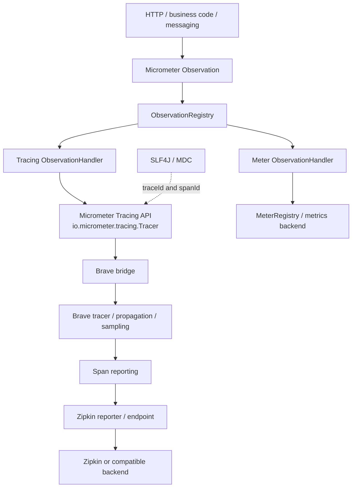
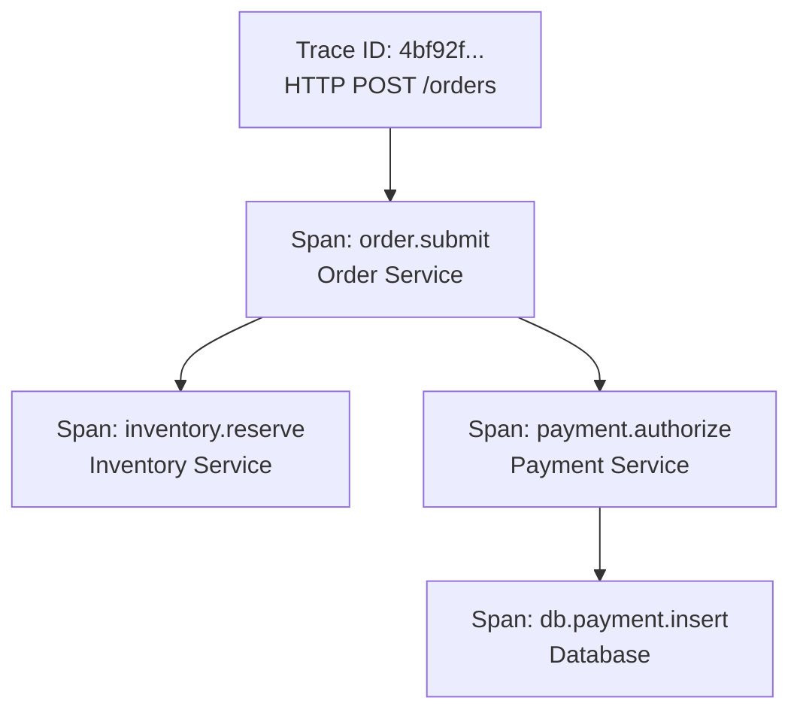
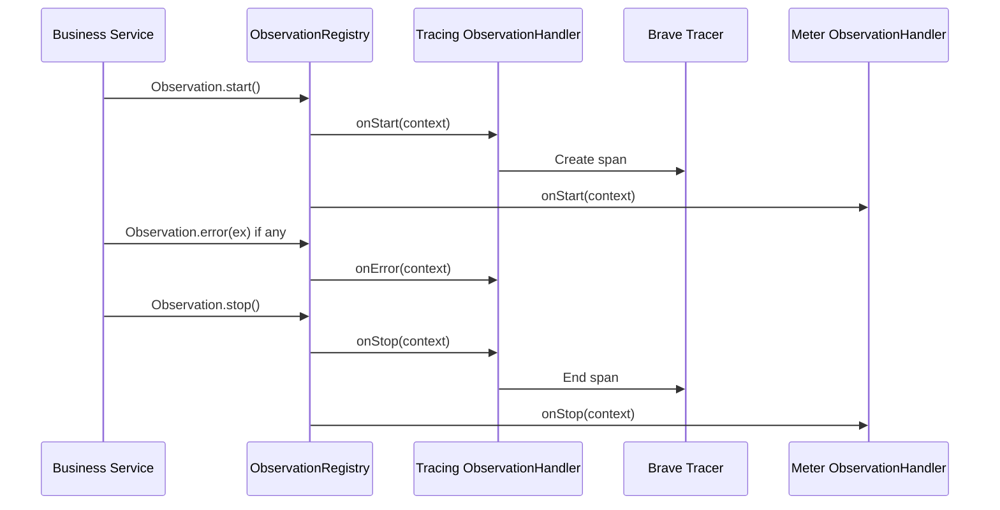
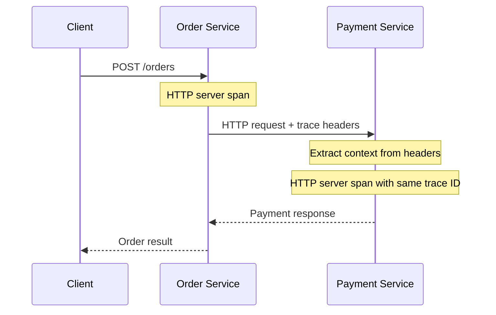
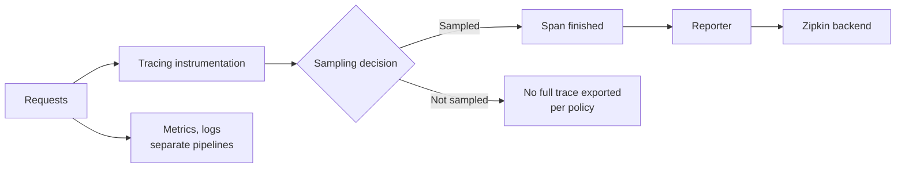
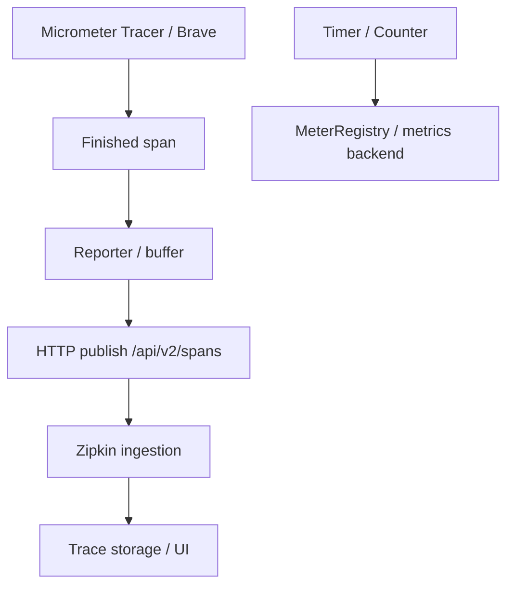

# Brave Tracer in Spring Boot and Micrometer Tracing

An order request flows through an HTTP controller, business service, inventory call, and payment call before returning a result. When users experience latency or errors, looking at individual service logs in isolation may not tell you whether they belong to **the same request**. Distributed tracing solves this problem by tying units of work into a **trace** composed of **spans** representing steps and parent–child relationships. In the Spring Boot ecosystem, **Brave** is one implementation that can provide tracing capabilities beneath the **Micrometer Tracing** interface.

This lesson, **Brave tracer**, belongs to the **Tracer implementation** chapter of the **SPRING_BOOT_OBSERVABILITY** module. The module focuses on setting up observability for Spring Boot using Micrometer Observation, metrics, logs, and distributed tracing; learning context propagation, tags/cardinality, exporters, sampling, and how to correlate signals to investigate errors, latency, and application behavior in real environments. This lesson dives into the **Brave + Micrometer Tracing** architecture, Spring Boot configuration, span lifecycle, propagation, reporting, and what to verify in operations.

## 1. Learning Objectives

After this lesson, you will be able to:

- Explain the differences between `trace`, `span`, `traceId`, `spanId`, `parentSpanId`, and a tracer implementation.
- Describe the roles of **Brave**, the **Micrometer Tracing bridge**, and a backend such as **Zipkin**.
- Configure dependencies, tracing sampling, and Zipkin reporting for Spring Boot 3.x at a foundational level.
- Use `io.micrometer.tracing.Tracer` to create spans, open scopes, attach tags/events, record exceptions, and end spans.
- Prefer Micrometer Observation when combining metrics with tracing, avoiding duplicate spans or timers.
- Recognize trace context propagation issues across HTTP, executors, Reactor, and message brokers; distinguish local scopes from network propagation.
- Understand trace sampling, asynchronous reporting, sensitive data, and cardinality when designing telemetry.
- Diagnose why logs contain a trace ID yet no trace appears in the backend, or why spans are missing parent–child links.

## 2. What Is Brave and Where Does It Sit?

**Brave** is the distributed tracing library of the Zipkin ecosystem. It provides mechanisms for managing trace/span context, sampling, propagation, and reporting helpers. In modern Spring Boot applications, developers rarely need to call `brave.Tracer` directly: **Micrometer Tracing** exposes a unified `io.micrometer.tracing.Tracer` facade, and **`micrometer-tracing-bridge-brave`** connects that facade to Brave.



Three commonly confused layers:

| Layer | Responsibility | Example |
| --- | --- | --- |
| **Micrometer Observation** | Describes work with `start`/`stop`, outcomes, errors, events | `business.order.submit` observation |
| **Micrometer Tracing API** | Provides a relatively implementation-independent API for trace/span operations | `Tracer`, `Span`, `Baggage` |
| **Brave tracer implementation** | Executes span context, propagation, sampling, and coordinates reporting | Brave wired via the bridge |
| **Reporter/exporter** | Sends finished span data to the backend | Zipkin reporter |
| **Tracing backend** | Receives, stores, and enables trace search | Zipkin |

**Brave is not synonymous with the Zipkin server.** Brave can create spans even without a trace storage server; the reporter and backend are separate components. Similarly, merely adding the Brave bridge does not provide a metrics registry or ensure application logs appear in a centralized platform.

### How Do Brave and OpenTelemetry Differ?

Micrometer Tracing can use either the Brave or OpenTelemetry bridge depending on your stack. Both serve the tracing API, but **you should not enable both bridges arbitrarily** in one application without a clear design for beans, tracers, propagation, and exporters.

| Decision | Brave | OpenTelemetry |
| --- | --- | --- |
| Implementation beneath Micrometer | Brave via `micrometer-tracing-bridge-brave` | OpenTelemetry via `micrometer-tracing-bridge-otel` |
| Concepts | Trace/span, sampling, propagation | Trace/span, sampling, propagation |
| Common reporting | Zipkin reporter | OTLP exporter or matching exporter |
| Recommended business API | Micrometer `Tracer` or `Observation` | Micrometer `Tracer` or `Observation` |
| Note when switching | Re-verify propagation and exporter | Re-verify propagation and exporter |

Choose an implementation based on your existing observability architecture, interoperability with other services, and target backend. Swapping bridges does not automatically solve sampling, baggage, or context propagation issues.

## 3. Traces, Spans, and Parent–Child Relationships

A **trace** represents the path of a request or distributed workflow. Each **span** describes a specific step, with start/end timestamps, a name, attributes, and linking context.



| Property | Meaning | Important Rule |
| --- | --- | --- |
| `traceId` | Identifier of the trace | Spans in the same trace share the trace ID when propagation works |
| `spanId` | Identifier of a single span | Each span has its own ID |
| `parentSpanId` | ID of the parent span if any | Establishes call hierarchy across units of work |
| Span name | Kind of work being performed | Use a **stable** name, such as `payment.authorize` |
| Span tags/attributes | Metadata about the step | Avoid secrets/PII and unnecessary dynamic data |
| Span events | Notable milestones inside the step | For example `retry.started`, `fallback.used` |
| Error | Exception/error details | Must be recorded explicitly when managing spans manually |

A trace can have many spans sharing one trace ID. **Do not** confuse `traceId` with `spanId`: searching another service's logs using a controller's span ID will fail because each service creates new spans.

Parent–child span relationships do not rely solely on matching trace IDs. What matters is that **span context is propagated** across boundaries and the tracer knows which span is the parent when creating the next span.

## 4. Configuring Spring Boot with Brave

With **Spring Boot 3.x** managing dependency versions via the Spring Boot BOM, a baseline configuration in Gradle Kotlin DSL looks like:

```kotlin
dependencies {
    implementation("org.springframework.boot:spring-boot-starter-actuator")
    implementation("io.micrometer:micrometer-tracing-bridge-brave")
    runtimeOnly("io.zipkin.reporter2:zipkin-reporter-brave")
}
```

If the application has HTTP controllers, include your project's web starter; if using WebClient or messaging, include the corresponding dependencies/instrumentation. `spring-boot-starter-actuator` lets Spring Boot configure observability infrastructure; `micrometer-tracing-bridge-brave` wires the Micrometer Tracing API to Brave. The Zipkin reporter exports spans to Zipkin when reporting is configured and auto-configuration conditions are met.

**Version compatibility:** These examples target Spring Boot 3.x. Other Boot branches may change auto-configuration, packages, or properties. Do not copy hardcoded dependency versions that conflict with the Spring Boot BOM.

### 4.1. Configuring Sampling and the Zipkin Endpoint

Example `application.yml` for a development environment:

```yaml
spring:
  application:
    name: order-service

management:
  tracing:
    sampling:
      probability: 1.0
  zipkin:
    tracing:
      endpoint: ${ZIPKIN_ENDPOINT:http://localhost:9411/api/v2/spans}
```

Explanation:

- `spring.application.name` identifies the service in telemetry when integration is configured.
- `management.tracing.sampling.probability` adjusts the tracing sampling rate. `1.0` helps capture nearly all eligible traces during **testing**, not a default recommendation for production.
- `management.zipkin.tracing.endpoint` specifies the address receiving spans sent by the reporter. `http://localhost:9411/api/v2/spans` is an illustrative address for Zipkin running locally.
- Having the dependency **does not** guarantee the Zipkin server is running or the endpoint is reachable; verify networking, the reporter, HTTP status, and the actual UI/backend.

In production, determine the sampling rate based on telemetry budget and investigative goals. You might pick a probability like `0.1` (10%) when appropriate, though this is not a universal threshold for all systems and does not guarantee exactly 10% of requests over every short interval.

### 4.2. What Does Spring Boot Auto-Instrument?

With the right tracing/observation auto-configuration, Spring Boot and Spring Framework can automatically observe HTTP server requests and clients built in framework-supported ways. For example, a `RestClient.Builder` or `WebClient.Builder` **injected from Spring** can receive observation configuration, whereas calling `new` on a client outside Boot's mechanism may skip instrumentation.

Some HTTP, database, messaging, or reactive flows require dedicated dependencies or integrations. **Do not** assume every external call produces a span merely because the Brave bridge is on the classpath. After configuring, run a real flow and inspect the trace to see whether the expected spans appear.

### 4.3. Do Not Blindly Reuse Legacy Sleuth Configuration

In older Spring Boot 2.x projects, **Spring Cloud Sleuth** provided tracing and Brave integration. In Spring Boot 3.x, the standard model shifted to **Micrometer Tracing**. When migrating, do not copy old `spring.sleuth.*` properties, Sleuth starters, or legacy configuration guides without checking compatibility.

## 5. Creating Spans with Micrometer Tracer on Brave

When you need to observe a business step not automatically instrumented by the framework, use `io.micrometer.tracing.Tracer`. This keeps the service decoupled from Brave-specific classes.

### 5.1. Java Example: Creating and Ending a Span

Suppose `InventoryGateway` is an interface calling an inventory service:

```java
import io.micrometer.tracing.Span;
import io.micrometer.tracing.Tracer;
import org.springframework.stereotype.Service;

@Service
public class InventoryReservationService {

    private final Tracer tracer;
    private final InventoryGateway gateway;

    public InventoryReservationService(
            Tracer tracer,
            InventoryGateway gateway) {
        this.tracer = tracer;
        this.gateway = gateway;
    }

    public Reservation reserve(String orderId, int quantity) {
        Span span = tracer.nextSpan()
            .name("inventory.reserve")
            .tag("operation", "reserve")
            .start();

        try (Tracer.SpanInScope scope = tracer.withSpan(span)) {
            try {
                Reservation result = gateway.reserve(orderId, quantity);
                span.tag("outcome", "success");
                return result;
            } catch (RuntimeException ex) {
                span.tag("outcome", "error");
                span.error(ex);
                throw ex;
            }
        } finally {
            span.end();
        }
    }
}

record Reservation(String reservationId) {}

interface InventoryGateway {
    Reservation reserve(String orderId, int quantity);
}
```

**How to read this example:**

1. `tracer.nextSpan()` creates a new span under the current context when a valid parent exists; `name("inventory.reserve")` assigns a stable name.
2. `start()` starts the span's timer.
3. `tracer.withSpan(span)` opens a scope, making the span current so child operations can inherit parent context via the tracer/instrumentation.
4. If the gateway returns a result, the span receives `outcome=success`. If an exception is thrown, the code attaches `outcome=error`, calls `span.error(ex)`, and rethrows.
5. `try-with-resources` closes the scope; `finally` calls `span.end()` to finish the span along both success and exception paths.

If `gateway.reserve` uses an instrumented HTTP client, it can create a **child span** inside `inventory.reserve`. Without client instrumentation, the manual span only records the **total call time** without showing network or callee details.

**Do not put `orderId`, `reservationId`, tokens, message bodies, or exception messages into span tags without evaluating privacy and genuine need.** While span tags are not normally metric labels, metadata is still exported to the backend, increasing storage or risking data exposure.

### 5.2. Events and Business Outcomes

Not every unsuccessful business outcome is a technical exception. For example:

```java
if (!result.accepted()) {
    span.tag("outcome", "rejected");
    span.event("inventory.rejected");
    return result;
}

span.tag("outcome", "success");
return result;
```

This snippet **illustrates an alternative result-handling branch** in a service whose result type exposes an `accepted()` method. An out-of-stock case anticipated by the contract can be recorded as `outcome=rejected`, rather than an infrastructure error requiring `span.error(ex)`.

### 5.3. When Should You Avoid Creating Manual Spans?

If an HTTP client already creates a span for a partner call, adding another span with **the same scope and purpose** makes traces noisy and increases cost. A custom span makes sense when it represents **a distinct business concept** (such as "order validation"), whereas the HTTP client span represents the concrete network call.

## 6. Using Micrometer Observation Instead of Managing Spans Directly

When an application wants the same unit of work to emit both a **Timer metric** and a **tracing span**, consider **Micrometer Observation**. Each `Observation` notifies `ObservationRegistry` of its lifecycle, and configured metrics and tracing handlers process it accordingly.

```java
import io.micrometer.observation.Observation;
import io.micrometer.observation.ObservationRegistry;

public Reservation reserveObserved(
        String orderId,
        int quantity,
        InventoryGateway gateway,
        ObservationRegistry registry) {

    Observation observation = Observation
        .createNotStarted("inventory.reserve", registry)
        .lowCardinalityKeyValue("operation", "reserve")
        .start();

    try (Observation.Scope scope = observation.openScope()) {
        try {
            Reservation result = gateway.reserve(orderId, quantity);
            observation.lowCardinalityKeyValue("outcome", "success");
            return result;
        } catch (RuntimeException ex) {
            observation.lowCardinalityKeyValue("outcome", "error");
            observation.error(ex);
            throw ex;
        }
    } finally {
        observation.stop();
    }
}
```

This is an **alternative instrumentation approach** to the direct `Tracer` example in Section 5. Do not wrap **the exact same boundary** with both blocks unless you intend to produce extra spans and timers.

### How Does Observation Reach Brave?



The diagram depicts **the case where the registry has matching handlers**; it does not promise that all handlers always exist, every observation always creates a span, or every trace is exported. `Observation.error(ex)` notifies handlers of the error; it does not throw an exception or emit an application log line by itself.

### Low-Cardinality and High-Cardinality Key-Values

| Data | Example | Where Should It Go? |
| --- | --- | --- |
| `operation` | `reserve` | Low-cardinality observation key-value |
| `outcome` | `success`, `rejected`, `error` | Low-cardinality observation key-value |
| `error.category` | `timeout`, `dependency` | Low-cardinality if value set is bounded |
| `traceId` / `spanId` | Trace/span-specific IDs | Trace/log correlation, never as a metric label |
| `orderId` | High-variety transaction ID | Controlled log or trace attribute if permitted |
| Full exception message | Dynamic string, may contain PII | Policy-bounded diagnostics, never as a metric tag |

The meter observation handler typically uses **low-cardinality** metadata as Timer tags. The tracing handler can consume Observation key-values according to its own rules. Never add high-cardinality fields indiscriminately: traces also have storage limits and security risks.

## 7. Propagation: Keeping the Same Trace Across Services

A distributed trace is only meaningful when **trace context** is passed from the calling service to the receiving service. Context carries essential fields such as trace ID, span/parent ID, and sampling flags. When Service B extracts the context and creates a child span, spans link properly to the call in Service A.



### B3 and W3C Trace Context

The Brave/Zipkin ecosystem commonly uses **B3 propagation**, in single- or multi-header variants. In many modern environments, **W3C Trace Context** uses `traceparent` and optionally `tracestate`. The propagation format used depends on tracer/instrumentation configuration and library versions; never assume two services on different stacks are automatically compatible.

| Concept | Example | Notes |
| --- | --- | --- |
| B3 single header | `b3` | Carries trace/span/sampling info in B3 format |
| B3 multi headers | `X-B3-TraceId`, `X-B3-SpanId`, `X-B3-Sampled` | Commonly used in the Zipkin/Brave ecosystem |
| W3C | `traceparent` | Cross-service standard supported by many tracers |
| Baggage | Approved metadata carried alongside context | Requires explicit configuration and data protection |

If Service A sends B3 while Service B only reads W3C, the trace splits into two separate traces with different root spans. Inspect **propagation settings on both client and server sides**, rather than seeing a trace ID in logs and assuming context crossed services.

### The HTTP Client Must Be Instrumented

Do not manually add a `traceparent` header and expect full tracing: the tracer must know how to **inject** the current span context on send and **extract** context on receive. Spring Boot/Spring Framework auto-configures HTTP clients created through Spring-managed builders; verify with a real trace.

When proxies, API gateways, or a service mesh sit in between, verify that intermediaries preserve the required tracing headers. Never forward sensitive user information in baggage or tracing headers.

## 8. Propagation Across Executors, Reactor, and Message Brokers

An active span scope is normally bound to the **current execution context**, often a `ThreadLocal`. When execution switches threads or crosses to another process, context **does not propagate automatically** just because you have a `Tracer` bean.

| Boundary | Risk | Approach |
| --- | --- | --- |
| Synchronous method on same thread | Usually preserves current span | Open/close `SpanInScope` around the block |
| `@Async` / `Executor` | New thread lacks parent context | Use context propagation or an appropriate task decorator |
| Reactor `Mono` / `Flux` | Execution happens on subscription, switches schedulers | Use Reactor Context / compatible instrumentation |
| Kafka/RabbitMQ/message queue | Context crosses network/process | Inject/extract trace context via message headers |
| Scheduled job without caller request | No inbound parent | Start a valid root observation/span at the job boundary |

### TaskDecorator Example for Spring Framework 6.1+

With Spring Framework 6.1 or newer and compatible Micrometer Context Propagation configuration, `ContextPropagatingTaskDecorator` can capture and restore context when submitting tasks:

```java
import org.springframework.context.annotation.Bean;
import org.springframework.context.annotation.Configuration;
import org.springframework.core.task.support.ContextPropagatingTaskDecorator;
import org.springframework.scheduling.concurrent.ThreadPoolTaskExecutor;

@Configuration(proxyBeanMethods = false)
public class AsyncTracingConfiguration {

    @Bean
    ThreadPoolTaskExecutor tracedExecutor() {
        ThreadPoolTaskExecutor executor = new ThreadPoolTaskExecutor();
        executor.setCorePoolSize(4);
        executor.setMaxPoolSize(8);
        executor.setQueueCapacity(100);
        executor.setThreadNamePrefix("trace-worker-");
        executor.setTaskDecorator(
            new ContextPropagatingTaskDecorator());
        executor.initialize();
        return executor;
    }
}
```

This example applies to **the specific executor** defined above. It does not automatically guarantee that every `@Async` method, custom executor, or Reactor scheduler uses this bean. Verify that tasks actually run on the decorated executor and that the relevant `ThreadLocalAccessor`/context providers are registered. Context propagation has overhead, so apply it only at boundaries that need it.

**Never** keep a `Tracer.SpanInScope` open on Thread A and pass the scope object directly to Thread B. Scopes must be managed on the executing context; across message brokers, context must travel in headers rather than keeping an in-memory scope object.

### Notes on Reactor and CompletableFuture

A method returning `Mono` or `CompletableFuture` can return **before the underlying work completes**. Calling `span.end()` immediately upon returning the publisher/future only measures scheduling time. Tie observation lifecycles to completion/error/cancellation, and avoid sharing one mutable span across multiple subscriptions. Prefer native reactive/async runtime instrumentation when available.

## 9. Sampling: Why Don't All Traces Appear?

**Sampling** determines which traces are recorded and/or exported to the backend under tracer policy. With `management.tracing.sampling.probability=0.1`, the tracer selects only a subset of traces to report; the observed fraction on a small sample set may differ from 10%.



Key principles:

1. **A missing trace in Zipkin does not prove the request never happened.** It may not have been sampled, may still be buffered, or the reporter/Zipkin may have errored.
2. **Tracing sampling differs from metrics:** a Micrometer Counter/Timer can count far more requests than the number of exported traces; do not use stored trace counts as total traffic without accounting for sampling.
3. **Trace context can still propagate** even when a trace is not recorded. A log line containing a trace ID does not guarantee a corresponding trace exists in the backend.
4. **Sampling must be consistent across services:** downstream decisions can be influenced by upstream sampling flags depending on implementation and policy.
5. **Production rates require cost consideration:** always sampling 100% can overload high-traffic systems; sampling too low may miss rare incidents.

Do not treat `probability=1.0` as an absolute promise that **every span** will appear in the UI. Reporter, endpoint, network, queues, backend ingestion, and retention policies must all function as well.

## 10. Sending Spans to Zipkin

With a properly configured Brave + Zipkin reporter setup, finished spans can be sent to Zipkin by the reporter. For instance, the publish endpoint is typically `/api/v2/spans`. This is **different** from Atlas or Prometheus metrics endpoints.



### Self-Check Checklist

- Are compatible bridge and reporter dependencies present?
- Did Spring Boot create a `Tracer` bean and the configured exporter/reporting integration?
- Does `management.zipkin.tracing.endpoint` have the right scheme, host, port, and path?
- Is a Zipkin server actually listening and returning valid responses?
- Is sampling high enough for the test to emit traces, and is span recording active?
- Is the reporter hitting network, TLS, proxy, HTTP 4xx/5xx, or timeout errors?
- Did data arrive at the backend while the UI is filtering by the wrong **service name** or time range?

For a single request, you may need to wait briefly for the reporter and backend to process it. Never add `Thread.sleep` inside business logic just to wait for traces; that adds unnecessary latency.

### Tracing Is Best-Effort

Do not assume all spans are persisted durably inside the process and re-sent after a sudden JVM crash. Reporters may have bounded queues/buffers and specific retry rules; inspect queue limits/backpressure and design infrastructure if telemetry has special requirements. A trace export failure must never be confused with a payment or business failure.

## 11. Brave and Log Correlation

When the current tracer context is integrated with logging MDC, logs can include `traceId` and `spanId`. In Spring Boot, log patterns can reference these MDC fields depending on your logging stack and version:

```yaml
logging:
  pattern:
    correlation: "[%X{traceId:-},%X{spanId:-}] "
```

When processing a request within a tracing scope, logs may look like:

```text
2026-11-22T08:30:12Z INFO [4bf92f3577b34da6a3ce929d0e0e4736,00f067aa0ba902b7] order submitted
2026-11-22T08:30:13Z WARN [4bf92f3577b34da6a3ce929d0e0e4736,b9c7c989f97918e1] inventory retry
```

This is an **illustrative log**. Actual trace/span ID values and formatting depend on the formatter, MDC, sampling, scope, and exporter. Not every log emitted from a background thread automatically carries a trace ID.

### Why Do Logs from Two Services Have the Same traceId but Different spanIds?

Because each service or step has its own span, it creates a new `spanId` while still sharing the same `traceId` when propagation works. This is normal and useful for distinguishing which step emitted each log line.

### Do Not Log the Same Exception at Every Layer

For example, an HTTP client throws a timeout, the service catches and logs the stack trace, the controller logs the stack trace again, and a global exception handler writes another copy. The result is multiple ERROR logs describing **the same incident**. Define clear logging boundaries and add diagnostic details only where useful context exists; traces link the steps without repeating stack traces everywhere.

## 12. Cardinality, Security, and Sensitive Data

Tracing can hold richer metadata than metrics, yet span data still needs governance. Every exported trace travels to a backend with its own access controls, retention, and storage costs.

| Data | Metrics Tag? | Span Attribute? | Recommendation |
| --- | --- | --- | --- |
| `operation=authorize` | Yes | Yes | Bounded set of values |
| `outcome=success|error` | Yes | Yes | Consistent semantics |
| `http.route=/orders/{id}` | Yes | Yes | Use route template |
| `traceId` | **No** | Part of trace context | Use for correlation, never as a metric label |
| `orderId` | No | Only if truly needed and permitted | Control PII, enforce length limits |
| `userId` / email | No | Cautiously, usually avoid | Personal data; restrict access |
| Token/cookie/password | **No** | **No** | Secrets must never enter telemetry |
| Exception message | No | Per policy only | Can leak queries, payloads, endpoints |

### A Good Span Name Uses a Bounded Set of Values

Use `inventory.reserve` or `payment.authorize` rather than `inventory.reserve.order-12345`. Dynamic IDs in span names break UI grouping and multiply distinct operation names to manage. If a transaction identifier is genuinely needed, place it in an approved attribute while keeping the operation name stable.

### Baggage and Propagation Are Not a Dump for Arbitrary Metadata

Baggage can propagate metadata across services, which also means data can cross trust boundaries, bloat headers, and increase exposure risk. Only propagate approved, necessary fields; never put user profiles, tokens, or payloads into baggage for search convenience.

## 13. Troubleshooting: Missing Traces or Broken Traces

| Symptom | Cause to Check | Verification Step |
| --- | --- | --- |
| No `Tracer` bean | Missing bridge/Actuator, unmet auto-configuration | Check dependencies and Spring context |
| Metrics appear, no traces | Missing tracing bridge or reporter/exporter | Verify both pipelines separately |
| Trace ID in logs, nothing in Zipkin | Sampling, reporter, endpoint, backend ingest | Raise sampling in test; inspect reporter/Zipkin |
| Server span exists, client span missing | Uninstrumented client or built outside Spring | Check builder and actual client integration |
| Two services have different trace IDs | Header propagation mismatch or stripped | Check B3/W3C on client, server, and gateway |
| Child span becomes a root span | Scope/context lost across async boundary | Check executors, Reactor, message headers |
| Trace ID on request thread, lost in worker | Context not propagated | Add task decorator / proper propagation |
| Span never ends | Forgot `span.end()` or wrong async lifecycle | Use `finally` and tie to completion |
| Span reports success despite exception | Forgot `span.error(ex)` in manual handling | Record error before calling `end()` |
| Two spans measure the exact same method | Manual span duplicates auto-instrumentation | Define boundaries; keep one instrumentation |
| Too many traces and high cost | High sampling, noisy spans | Tune sampling; instrument only meaningful steps |
| Traces expose user IDs or sensitive payloads | Uncontrolled tags/baggage | Strip, mask, restrict access and retention |

### Layer-by-Layer Verification Workflow

1. **Application:** confirm a `Tracer` bean exists, at least one span/observation is created, scopes close, and spans end on every path.
2. **Sampling:** set an appropriate rate for the test environment and send multiple requests; do not judge from one request if the rate is low.
3. **Propagation:** inspect HTTP/message trace headers across boundaries and compare trace IDs across caller and callee logs.
4. **Reporter:** look for connection, serialization, auth, TLS, or timeout errors; confirm the Zipkin endpoint is active.
5. **Backend:** search by the right service name, time range, and trace ID. A span may appear slightly delayed due to buffering/ingestion.
6. **Cross-check signals:** if 5xx metrics spike while traces are absent, consult logs and exporter status before concluding instrumentation is broken.

## 14. Practice: Tracing a Transaction Across Two Services

**Scenario:** `order-service` calls `inventory-service` and intermittently times out. You want to confirm spans belong to the same trace, errors are recorded, and related logs can be found by trace ID.

### Preparation

1. Use Spring Boot 3.x with Actuator, the Brave bridge, and the Zipkin reporter on both services (or a propagation-compatible tracer stack).
2. Run a valid Zipkin endpoint in your test environment with sampling set high enough for easy inspection.
3. Use a Spring-instrumented HTTP client or configure tracing propagation using a supported mechanism.
4. If adding a custom observation to the reserve step, inject `ObservationRegistry` instead of creating a new registry manually.
5. Enable logging correlation without logging tokens or sensitive payloads.

### Verification Cases

| Case | Scenario | Expected Result |
| --- | --- | --- |
| A — Success | Order calls inventory and gets result | Request span and appropriate child spans exist; trace ID is consistent |
| B — Timeout | Inventory fails to respond | Span at the error boundary records `error` per instrumentation; logs carry context |
| C — Retry succeeds | Attempt 1 fails, attempt 2 succeeds | Attempt span/counter indicates failure; overall result can still succeed |
| D — Low sampling | Only a subset of traces stored | Metrics still record all measurements in their own pipeline |
| E — Worker thread | Step executes on an executor | Parent context is preserved when propagation is configured |
| F — Propagation mismatch | One side uses an incompatible format | Trace splits into fragments or starts a new root span |
| G — Zipkin unavailable | Backend temporarily stopped | No new traces stored, yet business logic must not fail due to reporting |

### Verification Steps

**Step 1:** Send an HTTP request containing non-sensitive test data to `order-service`. Find the request log and grab the `traceId` if printed via MDC.

**Step 2:** Open Zipkin, filter by service and time range; locate `order-service`'s HTTP server span and the inventory call span. If sampling kept the trace, verify matching `traceId` and parent–child links.

**Step 3:** Have inventory throw a timeout; confirm the span at the failing boundary records error info. If using a manual custom span, confirm `span.error(ex)` is called and `span.end()` still runs.

**Step 4:** Make the retry succeed on the next attempt; distinguish the user's final outcome from individual attempt errors. Do not equate the count of error spans with failed user requests.

**Step 5:** Move a processing step onto an executor with context propagation; compare traces before and after to observe how parent context behaves when lost vs. preserved.

**Step 6:** Temporarily stop Zipkin (only in a controlled test environment), send more requests, and inspect logs/telemetry for reporting errors; confirm business HTTP responses still follow application logic. Restart Zipkin and verify the reporter recovers.

### Self-Assessment Questions

1. How are `brave.Tracer` and `io.micrometer.tracing.Tracer` related in Spring Boot with the Brave bridge?
2. Why does adding `micrometer-tracing-bridge-brave` not immediately give you a tracing backend?
3. How do trace ID and span ID differ, and why do services in the same request have different span IDs?
4. When should you use `Observation` rather than manually creating a `Span` for a business operation?
5. If Service A sends B3 while Service B only accepts W3C, what can happen?
6. Why might `traceId` appear in logs while the trace is missing in Zipkin?
7. If a `CompletableFuture` is returned before work finishes, when should `span.end()` be called?
8. Why does low sampling reduce trace cost without necessarily reducing metric cardinality?
9. When should `span.error(ex)` be attached, and why is a "business rejection" not always a technical error?
10. Why shouldn't tokens, dynamic order IDs, or full exception messages go into span names or baggage?

## 15. Takeaways

**Brave tracer** is a tracing implementation that can sit behind the **Micrometer Tracing API** in Spring Boot. With `micrometer-tracing-bridge-brave`, an application can work with `Tracer` or `Observation` without coupling business code directly to Brave. To view distributed traces in Zipkin, you still need a working reporter, endpoint, network path, sampling policy, and backend ingestion.

A span must be **started**, placed in an **appropriate scope**, annotated with errors/events when needed, and **ended** at the right time. When work crosses HTTP, executors, or brokers, trace context must be carried via compatible instrumentation/propagation; synchronous scopes never cross threads or networks on their own. Metrics show error rates and latency frequencies, logs supply event details and trace IDs, and sampled traces reveal request execution paths. Understanding each pipeline and governing cardinality and sensitive data lets you investigate real Spring Boot systems without misreading signals or inflating observability costs.
