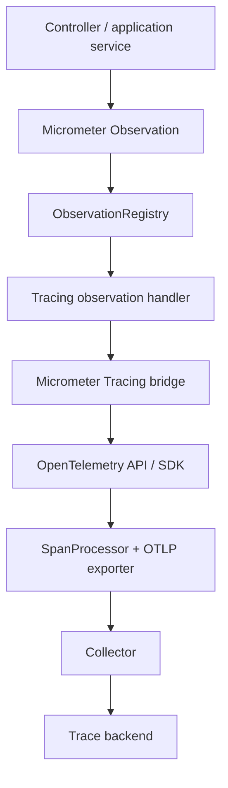

# Avoiding Direct Vendor APIs in Tracer Implementations

When an application needs distributed tracing, a team may choose a specific backend or agent to collect and export spans. If business code calls that vendor's proprietary API directly, infrastructure choices bleed into controllers, services, domain logic, and tests. Whenever you switch backends, upgrade SDKs, or run across different environments, business code must change too.

This lesson, **Avoiding direct vendor APIs**, belongs to the **Tracer implementation** chapter of the **SPRING_BOOT_OBSERVABILITY** module. The module teaches how to set up observability for Spring Boot using Micrometer Observation, metrics, logs, and distributed tracing; covering context propagation, tags/cardinality, exporters, sampling, and signal correlation to investigate errors, latency, and application behavior in real environments.

The goal is to keep instrumentation at a stable abstraction layer, isolate SDK/bridge/exporter configuration at the composition root, distinguish standard APIs from vendor extensions, and test tracing behavior without depending on a real backend.

## 1. How Do Direct Vendor APIs Create Coupling?

Suppose a business service creates spans using classes specific to one tracing vendor. The service must know class names, how to start spans, how to attach attributes, how to set status, and how to end spans. None of those details belong to checkout business rules.

Common signs of coupling:

- Controllers or services import backend-specific SDK packages.
- Business methods instantiate exporters, tracer providers, or SDK instances themselves.
- Domain exceptions are translated directly into vendor-specific statuses.
- Tests must boot a backend or agent just to verify a business operation.
- The same business concept is instrumented differently across modules.
- Swapping the tracing bridge forces edits across many business packages.

Not every dependency on an observability library is bad. The problem arises when **business logic depends on telemetry implementation details** and has to change alongside them.

## 2. Distinguishing Standard APIs, Abstractions, and Vendor Implementations

| Layer | Examples | Responsibility |
| --- | --- | --- |
| Business/domain | Checkout, payment, inventory | Executes business rules |
| Application instrumentation | Micrometer Observation | Marks operations and business metadata |
| Tracing API | Micrometer Tracing or OpenTelemetry API | Creates/reads span context through an abstraction |
| Bridge/adapter | Micrometer Tracing bridge for OTel or Brave | Connects the abstraction to a tracer implementation |
| SDK/agent | OpenTelemetry SDK, vendor agent | Sampling, processors, context propagation, and lifecycle |
| Exporter/backend | OTLP exporter, trace platform exporter | Transmits and stores telemetry |

The OpenTelemetry API is an open API independent of any specific backend; the OpenTelemetry SDK is an implementation. Micrometer Observation provides an observation abstraction; Micrometer Tracing provides a tracing abstraction that can connect to different bridges.

An exporter may be vendor-specific while still living in the configuration layer. Business code does not need to import an exporter package to record an operation.

## 3. Vendor-Decoupled Architecture

A Spring Boot architecture can keep instrumentation at the Observation level and let the framework/bridge manage the tracing implementation:



A business operation only needs to declare that an operation is taking place. Spring Boot wiring and the tracing bridge turn the observation into a span. When swapping bridges or exporters, the business method does not need to know about the new backend.

Not every application must use every single layer above. What matters is a clean boundary: instrumentation APIs in code, implementation and exporters at composition/configuration.

## 4. Prefer Micrometer Observation for Application Operations

In Spring Boot, Micrometer Observation is usually the right choice for instrumenting application-layer operations because a single observation can feed both metrics and tracing through registered handlers.

Example:

```java
import io.micrometer.observation.Observation;
import io.micrometer.observation.ObservationRegistry;
import org.springframework.stereotype.Service;

@Service
class CheckoutService {
    private final ObservationRegistry observationRegistry;
    private final PaymentGateway paymentGateway;

    CheckoutService(
            ObservationRegistry observationRegistry,
            PaymentGateway paymentGateway) {
        this.observationRegistry = observationRegistry;
        this.paymentGateway = paymentGateway;
    }

    Receipt checkout(CheckoutCommand command) {
        return Observation.createNotStarted(
                "checkout.process",
                observationRegistry)
            .lowCardinalityKeyValue("checkout.channel", command.channel())
            .observe(() -> paymentGateway.authorize(command));
    }
}
```

This example illustrates instrumenting an application operation with Observation. In a real application, `command`/`channel` must be validated and `channel` must come from a bounded set of values. Never attach emails, customer IDs, order IDs, or sensitive data as low-cardinality tags.

Observation lets handlers emit the appropriate signals. If no tracing handler is configured, the operation can still be measured by a metrics handler; therefore, do not assume every observation always produces a span.

## 5. When Direct Span Manipulation Is Needed, Use an API Abstraction

Some cases require attaching events, recording exceptions, or explicitly creating a child span. You can use the Micrometer Tracing abstraction:

```java
import io.micrometer.tracing.Span;
import io.micrometer.tracing.Tracer;
import org.springframework.stereotype.Component;

@Component
class InventoryTraceSupport {
    private final Tracer tracer;

    InventoryTraceSupport(Tracer tracer) {
        this.tracer = tracer;
    }

    void recordReservationAttempt(String warehouse) {
        Span span = tracer.nextSpan()
            .name("inventory.reserve")
            .tag("warehouse", warehouse)
            .start();
        try (Tracer.SpanInScope scope = tracer.withSpan(span)) {
            reserve(warehouse);
        } catch (RuntimeException ex) {
            span.error(ex);
            throw ex;
        } finally {
            span.end();
        }
    }

    private void reserve(String warehouse) {
        // Business operation
    }
}
```

This example uses the Micrometer Tracing abstraction without importing classes from a specific backend. Exact APIs may vary by Micrometer version; check Spring Boot's dependency management before use.

Create manual spans only when there is clear instrumentation value. If an Observation already wraps an operation, adding an equivalent span creates redundant noise in the trace tree. Never include dynamic IDs in span names; use stable operation names and tags with bounded cardinality.

## 6. The OpenTelemetry API Is Also a Vendor-Neutral Option

When an application has standardized on OpenTelemetry, you can use the OpenTelemetry API directly without coupling to an exporter or backend:

```java
import io.opentelemetry.api.trace.Span;
import io.opentelemetry.api.trace.Tracer;
import io.opentelemetry.context.Scope;

class ShippingClient {
    private final Tracer tracer;

    ShippingClient(Tracer tracer) {
        this.tracer = tracer;
    }

    void dispatch(String carrierCode) {
        Span span = tracer.spanBuilder("shipping.dispatch").startSpan();
        try (Scope scope = span.makeCurrent()) {
            span.setAttribute("shipping.carrier", carrierCode);
            sendToCarrier(carrierCode);
        } catch (RuntimeException ex) {
            span.recordException(ex);
            span.setStatus(
                io.opentelemetry.api.trace.StatusCode.ERROR);
            throw ex;
        } finally {
            span.end();
        }
    }

    private void sendToCarrier(String carrierCode) {
        // External call
    }
}
```

The OpenTelemetry API is an open standard, not tied to a single vendor backend. Still, code depends on a concrete tracing API (OTel here) rather than Micrometer Observation. Pick one consistent abstraction per architecture; avoid mixing multiple APIs inside the same business operation without a clear adapter.

## 7. Place Vendor-Specific Configuration at the Composition Root

Details like endpoints, credentials, exporters, sampling, resources, and processors belong in application or platform deployment configuration:

```yaml
management:
  tracing:
    sampling:
      probability: 0.1
  otlp:
    tracing:
      endpoint: http://otel-collector:4318/v1/traces
```

This is an example Spring Boot configuration using properties supported in matching versions; verify properties and transports against your actual dependencies. Collector endpoints can change between dev, staging, and production without touching business services.

If managing the SDK yourself, create providers/exporters as singleton beans and let Spring manage shutdown. Never instantiate exporters inside controllers or per request. If Spring Boot already owns the provider, never create a competing second SDK.

## 8. Bridges and Adapters: Transition Boundaries

Bridges translate application-layer APIs into a tracing implementation. For instance, Micrometer Tracing connects to OpenTelemetry or Brave via the corresponding bridge. An adapter can also translate an internal abstraction into a standard API.

Principles:

- Only one tracing implementation owner per pipeline.
- Inject the tracer from the container; never initialize a global SDK inside business code.
- Never let vendor-specific types leak across domain interfaces.
- Keep status, exception, and attribute mapping at the adapter/instrumentation boundary.
- Write tests verifying context and parent-child relationships across the bridge.

Bridges do not automatically erase every semantic difference. Verify span names, attribute keys, sampling, propagation formats, and baggage when switching implementations.

## 9. Do Not Hand-Roll Vendor-Specific Context Propagation

Distributed traces require context to be injected into outbound requests and extracted on inbound requests. Use HTTP client/server instrumentation or standard framework-managed propagators.

In Spring Boot, prefer instrumentation compatible with your MVC/WebFlux stack and HTTP client. When using executors or asynchronous tasks, verify context propagation across thread boundaries using supported integrations.

Never store trace IDs manually in a static `ThreadLocal` or pass IDs as business method parameters. Doing so risks dropping parent spans, leaking context across requests, or creating invalid traces. Likewise, never use trace context as an authentication or authorization mechanism.

## 10. Attributes, Naming, and Semantic Conventions

Vendor neutrality is more than avoiding package imports. If every service invents different span names and attributes, the backend will still be hard to analyze after swapping exporters.

Best practices:

- Use stable operation names such as `checkout.process`, `inventory.reserve`.
- Prefer appropriate HTTP/database/messaging semantic conventions.
- Use consistent attribute keys across services.
- Keep metric dimensions low-cardinality.
- Never record PII, tokens, raw payloads, or unnecessary dynamic identifiers.
- Document which custom attributes form an internal contract.

Instead of embedding an order ID in the span name, keep the operation name stable; if an identifier is needed for lookup, consider log correlation or a policy-governed trace attribute—never put IDs into metric labels.

## 11. Avoid Over-Abstraction

There is no need to wrap every tracing method in a custom internal interface merely to hide an already stable standard API. A homegrown wrapper can strip away capabilities, create extra API surface to maintain, and force developers to learn two abstractions.

Create a custom adapter only when a real need exists:

- Multiple tracing implementations must be supported concurrently.
- The application has an established internal API and wants to shield the domain from frameworks.
- Metadata transformations or shared policies must be enforced centrally.
- A long-term migration across many modules requires compatibility.

If a single implementation is managed by Spring Boot, Micrometer Observation/Tracing or the OpenTelemetry API is usually sufficient. Abstractions should solve real requirements, not merely rename SDK methods.

## 12. Testing Without a Vendor Backend

Business tests should verify business behavior independently of any backend. Instrumentation tests can use `ObservationRegistry`/`MeterRegistry` test utilities or an in-memory span exporter:

| Test | What to Prove |
| --- | --- |
| Business unit test | Business outcome is correct when telemetry handlers have no backend |
| Observation test | Operation creates an observation with expected name and metadata |
| Tracing API test | Span is created, ended, and has accurate status/error |
| Context test | Child span preserves trace ID and parent relationship |
| Bridge integration test | Micrometer spans export properly through the OTel bridge |
| Configuration test | Only one provider/exporter owner is created |
| Migration contract test | Key attributes and names preserve semantics across a new backend |

Example using a handlerless `ObservationRegistry` to test business flow:

```java
import io.micrometer.observation.ObservationRegistry;
import org.junit.jupiter.api.Test;
import static org.junit.jupiter.api.Assertions.assertEquals;

class CheckoutServiceTest {
    @Test
    void completesWithoutVendorBackend() {
        PaymentGateway gateway = command -> new Receipt("accepted");
        CheckoutService service = new CheckoutService(
            ObservationRegistry.NOOP, gateway);

        Receipt receipt = service.checkout(
            new CheckoutCommand("web"));

        assertEquals("accepted", receipt.status());
    }
}
```

This is an illustrative test; `command`/`receipt`/`gateway` types depend on your application. The test proves the business flow runs without a vendor backend; it does not prove the exporter or bridge works. The bridge requires dedicated integration tests with an in-memory or test exporter.

## 13. Switching Tracing Backends Without Changing Business Logic

A migration can follow these steps:

1. **Inventory:** locate vendor-specific imports, dependencies, and configuration in source code.
2. **Classify:** separate business logic from instrumentation and configuration.
3. **Choose an abstraction:** Observation/Micrometer Tracing or OpenTelemetry API per architecture.
4. **Isolate adapters:** move vendor-specific calls into the configuration/adapter layer.
5. **Standardize semantics:** align span names, resource attributes, status, exceptions, and propagation.
6. **Run controlled side-by-side tests:** if comparing backends, use a separate test pipeline; avoid duplicate instrumentation and double exporting.
7. **Compare data:** check trace completeness, latency, sampling, cardinality, log correlation, and exporter failures.
8. **Remove the old implementation:** only after contract tests and operations confirm the new pipeline meets requirements.

Never migrate via blind search-and-replace on package imports without understanding semantics. Some vendor APIs have proprietary concepts with no one-to-one equivalent in OpenTelemetry; decide explicitly how to map or retire them.

## 14. Common Mistakes

| Symptom | Possible Cause | How to Handle |
| --- | --- | --- |
| Service imports vendor SDK | Instrumentation placed inside business code | Move to Observation/standard API or adapter |
| Two traces for the same request | Two providers/agents instrumenting together | Establish single ownership; check the bridge |
| Trace ID splits across HTTP | Inconsistent propagators/instrumentation | Use W3C propagation and test inject/extract |
| Switching backends breaks many tests | Tests coupled to real exporter/UI | Separate business tests from exporter integration tests |
| Vendor-specific attributes lost | Incomplete mapping to standard API | Define an attribute contract and migration tests |
| Span names differ across services | No naming convention | Standardize operation names |
| Context lost across executors | No propagation across async boundaries | Use supported context propagation integration |
| Exporter created per request | Wrong SDK lifecycle initialization | Use singleton provider/exporter at application scope |
| Sampling differs from config | Custom provider or agent overriding it | Check effective sampler and ownership |
| Adapter becomes a custom framework | Over-abstraction | Keep only interfaces backed by real requirements |

## 15. Practical Scenario: Migrating from a Proprietary Agent to OpenTelemetry

**Hypothetical context:** a Spring Boot service currently uses an agent from a tracing platform. Controllers and services call the agent's proprietary API to create custom spans. The company wants to standardize telemetry through an OpenTelemetry Collector without editing checkout business logic.

Workflow:

1. Find all proprietary agent imports/APIs in source and separate instrumentation from business behavior.
2. Replace custom spans at application boundaries with Micrometer Observation or the chosen standard OpenTelemetry API.
3. Move endpoint, sampling, resource, and exporter settings into SDK/agent/platform configuration.
4. Verify HTTP server/client instrumentation does not emit duplicate spans from both the agent and framework.
5. Verify W3C trace context flows through the gateway, checkout, and payment.
6. Compare span names, attributes, errors, latency, and sampling between old and new pipelines with test traffic.
7. Retire the old agent only after log correlation, dashboards, and alert queries have moved to the new schema.

Business methods still invoke the payment gateway and process receipts just as before. The changes remain isolated at the instrumentation boundary and deployment configuration, letting tracing backends evolve independently of business logic.

## 16. Self-Check Exercises

**Exercise 1.** Why does importing a vendor SDK directly inside a domain service create coupling?

*Hint:* Business code depends on implementation classes, lifecycles, and semantics, forcing business edits whenever the SDK or backend changes.

**Exercise 2.** Are Micrometer Observation and the OpenTelemetry API the same thing?

*Hint:* No. Observation is Micrometer's instrumentation abstraction; the OTel API is an open standard tracing/telemetry API. They integrate via a bridge.

**Exercise 3.** Should you create a wrapper interface around every method of `OTel Tracer`?

*Hint:* Only when driven by a real need such as supporting multiple implementations or enforcing internal policies. Avoid abstractions that merely rename APIs.

**Exercise 4.** Why shouldn't the exporter endpoint live inside a business service?

*Hint:* Endpoints are deployment configuration; changing environments or backends should not require modifying business code.

**Exercise 5.** What problems can occur when two providers operate simultaneously?

*Hint:* Two trace pipelines, inconsistent context/resources/sampling, duplicate spans, and fragmented correlation.

**Exercise 6.** How can you test business flows without a trace backend?

*Hint:* Use `ObservationRegistry.NOOP` or a test registry for business tests; test exporters and bridges separately using an in-memory exporter.

**Exercise 7.** Does swapping exporters guarantee all semantic attributes stay identical?

*Hint:* No. Contract tests are needed for names, attributes, status, propagation, and vendor-specific field mappings.

**Exercise 8.** Why shouldn't you store trace IDs manually in a `ThreadLocal`?

*Hint:* It risks losing parent context, leaking data across requests, and breaking under async/thread reuse; use standard context propagation instead.

## 17. Takeaways

- Avoid direct vendor APIs in business/domain code so backends and SDKs can change without rewriting business logic.
- Use **Micrometer Observation/Tracing** or the **OpenTelemetry API** at instrumentation boundaries; choose one consistent abstraction.
- Keep SDKs, bridges, samplers, resources, exporters, endpoints, and lifecycle management in configuration/composition roots.
- A tracing pipeline needs clear ownership; avoid two providers/agents instrumenting the same operation and emitting duplicate spans.
- Keep context propagation, span names, and semantic attributes consistent; never let identifiers or PII become metric tags.
- Avoid over-wrapping. An adapter only adds value when solving concrete portability, policy, or migration requirements.
- Separate business unit tests from bridge/exporter integration tests; use an in-memory/test exporter to verify telemetry without a real backend.
