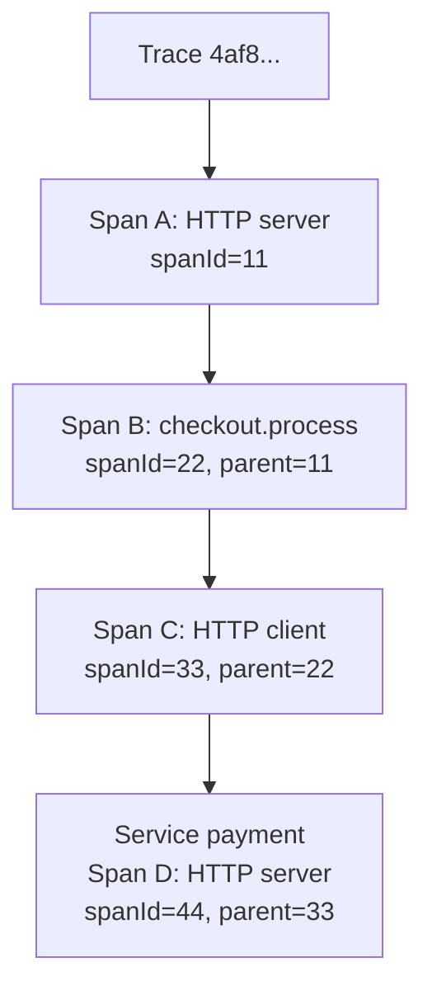
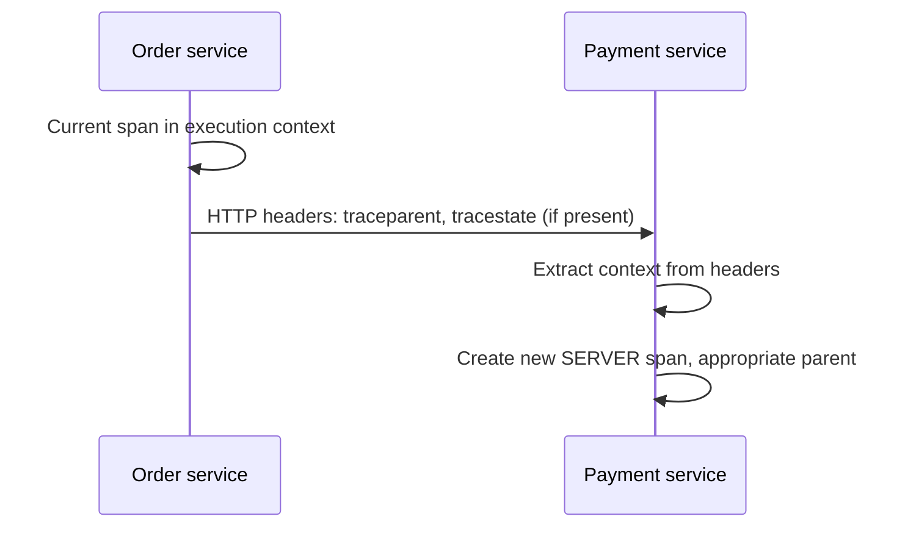

# Tracing context: propagating context in distributed tracing

## 1. Learning objectives

A request in Spring Boot can start at the HTTP server, pass through a business service, switch to an executor, emit a message, and then make an HTTP call to another service. Distributed tracing only accurately reflects parent-child relationships when **the current trace context is propagated across each execution boundary**. If context is lost, a span in a subsequent thread or service can become a new root trace, preventing operators from seeing the entire journey.

In the **Context propagation** chapter of the **SPRING_BOOT_OBSERVABILITY** module, this lesson focuses on **Tracing context**. The scope covers current span/observation, thread-local, Reactor Context, Micrometer Context Propagation, executors and `@Async`, HTTP propagation via W3C Trace Context, message headers, baggage, sampling, and end-to-end verification. These are the foundations needed to correlate metrics, logs, and distributed tracing when troubleshooting errors or latency.

After this lesson, you will be able to:

1. Explain what trace context contains and the relationship between `traceId`, `spanId`, parent, and current span.
2. Distinguish **in-process context propagation** from **network trace context propagation**.
3. Understand why `ThreadLocal` does not automatically follow thread pools and reactive pipelines.
4. Use Micrometer Context Propagation, `ContextPropagatingTaskDecorator`, and Reactor Context in the right situations.
5. Explain how tracing instrumentation injects/extracts W3C `traceparent` in HTTP or message headers.
6. Evaluate baggage, sampling, and sensitive data.
7. Verify parent-child traces and log correlation, and detect lost or misused context.

**Example baseline:** Spring Boot 3.5.x, Java 17+, Micrometer Tracing with the OpenTelemetry bridge, Spring MVC, and Reactor/WebFlux where mentioned. Always verify APIs and configuration against the actual Spring Boot/Spring Framework/Micrometer version you are running.

## 2. What is tracing context?

**Trace context** is the information that identifies and links spans belonging to the same trace. At a minimum, a span typically has:

- `traceId`: identifier of the overall trace.
- `spanId`: identifier of the current span.
- `parentSpanId`: identifier of the parent span, if any.
- Trace flags state, such as the sampled bit.
- `tracestate`: additional ecosystem/vendor data when using W3C Trace Context.

When HTTP request A creates a server span, invokes operation B, and sends a request to service C, the related spans must share the same `traceId` and have the appropriate parent relationship.



The IDs above are illustrative data only. A trace can contain multiple spans with the same `traceId`, but each span has its own `spanId`. Trace context is **not** a business payload, does not contain the full request/response, and is not a copy of `Observation.Context`.

### 2.1. Current span and scope

In Micrometer Tracing, `Tracer.currentSpan()` retrieves the span attached to the current execution context. When opening `SpanInScope`, the span becomes the current span for that code scope; when the scope closes, the previous current span is restored.

With Micrometer Observation, `Observation.Scope` attaches the current observation to the running execution context. A tracing handler can use that scope to manage the span. The two concepts work together but are not identical:

| Concept | Purpose | Common API |
| --- | --- | --- |
| Trace context | Carries IDs/flags to link a trace | W3C `traceparent`, `tracestate` |
| Span | Describes a timed operation | `io.micrometer.tracing.Span` |
| Current span | Active span in the execution context | `Tracer.currentSpan()` |
| Span scope | Sets/restores the current span | `Tracer.withSpan(span)` |
| Observation | Describes an operation that can produce metrics and a span | `Observation` |
| Observation scope | Current observation within a scope | `Observation.openScope()` |

A log line having a `traceId` does not prove that every thread/callback in the request has the correct current span. You must verify at every boundary where code transfers execution.

## 3. Two types of context propagation to distinguish

### 3.1. Within the same process: thread and execution context

Java `ThreadLocal` binds data to a specific thread. A tracing bridge can use this mechanism to store the current span during synchronous execution:

```text
Thread A:
  current span = checkout.process
  call service()
  return
  restore previous span
```

When work moves from thread A to thread B via `Executor`, `CompletableFuture`, `@Async`, or callbacks, Thread B does not automatically have the same ThreadLocal. Thread pools also reuse threads, so improper copying without cleanup can cause subsequent requests to see the context of previous requests.

In reactive applications, execution can switch across multiple threads within the same pipeline. Relying purely on ThreadLocal is therefore unreliable; Reactor uses **Reactor Context** as a context region attached to the subscription.

Micrometer Context Propagation provides a bridge mechanism between context mechanisms such as ThreadLocal and Reactor Context through:
- `ThreadLocalAccessor`: reads/writes/clears a ThreadLocal value.
- `ContextRegistry`: where accessors are registered.
- `ContextSnapshot`: captures existing context values and restores them within an execution scope.
- `ContextSnapshotFactory`: creates snapshots according to the configured accessors/registry.

### 3.2. Between services: inject and extract via carrier

When a request leaves process A over HTTP or a message broker, ThreadLocal cannot travel over the network. Instrumentation must **inject** the trace context into a carrier (HTTP headers/message headers); process B must **extract** that data and create the appropriate child or linked span.



This is a different mechanism from context snapshots in a thread pool. `ContextPropagatingTaskDecorator` does not replace a W3C propagator, and W3C `traceparent` does not automatically preserve ThreadLocal across an internal executor.

## 4. W3C Trace Context: `traceparent` and `tracestate`

W3C Trace Context defines standard headers to carry trace-linking information over HTTP. The `traceparent` header has the general format:

```text
version-trace-id-parent-id-trace-flags
```

A syntactically valid illustrative example:

```text
traceparent: 00-4bf92f3577b34da6a3ce929d0e0e4736-00f067aa0ba902b7-01
```

The fields represent:
- `version=00`: format version.
- `trace-id`: 32 hex characters (16 bytes), must not be all zeros.
- `parent-id`: 16 hex characters (8 bytes), must not be all zeros; it is typically the sender's span ID in the parent relationship.
- `trace-flags=01`: sampled flag is enabled in this example; other bits may be defined in future versions.

The `tracestate` header is optional and contains vendor-specific entries following W3C rules. It does not replace `traceparent`.

### 4.1. Inject/extract flow

1. Service A has a current span.
2. HTTP client instrumentation retrieves the current trace context.
3. The propagator encodes the context into `traceparent` and `tracestate` (if applicable) in the request headers.
4. Service B receives the headers.
5. Server instrumentation extracts the trace context and creates a server span with the proper parent attached.
6. When B calls C, it injects the context of B's current span into the outbound request.

Because each service creates its own span, the parent ID value in the outbound header is typically **the sender's span ID**; the receiver's server span gets a new span ID. Do not manually copy the inbound header verbatim to every outbound request if tracing client instrumentation already handles it; doing so incorrectly can create improper parent relationships or cause duplicate propagation.

### 4.2. Do not manually overwrite trace headers

In Spring Boot, properly configured client/server instrumentation normally handles propagation. You should not hardcode:

```java
// Do not do this in application code:
request.header("traceparent", "00-fixed-trace-id-fixed-span-id-01");
```

Fake headers or reused values will wrongly merge multiple requests into the same trace or produce invalid data. Only customize a propagator when there is a clearly defined protocol/interoperability requirement.

### 4.3. Baggage differs from span attributes

**Baggage** is a set of key-value pairs propagated across service boundaries when allowed by the propagator and configuration. It can carry routing information or shared metadata; it is not automatically a span attribute and should not be used in place of a database or business payload.

For example, you might consider a bounded key like `tenant.tier=standard` if internal policy permits. Avoid putting emails, access tokens, card numbers, personal information, or unnecessary data into baggage. Baggage can be forwarded across multiple hops, increasing header sizes and disseminating information more widely than intended.

## 5. Micrometer Context Propagation in Spring

Micrometer Context Propagation helps save and restore context values across execution boundaries. With Spring, part of this integration is used in task decorators, Reactor, and components supporting observation/tracing.

### 5.1. Context snapshot and ThreadLocal

Conceptual model:

```text
Thread A (current observation/span)
   |
   | capture context snapshot
   v
ContextSnapshot
   |
   | wrap task / restore
   v
Thread B (context values temporarily restored)
   |
   | task completes
   v
restore previous ThreadLocal values / clear
```

The goal is to **restore within a bounded scope** and then clean up, not to copy ThreadLocal permanently onto a worker thread.

A plain Java example with Context Propagation can be organized around `ContextSnapshotFactory`, but in Spring Boot applications you should prefer official/supported integrations for executors and the reactive stack instead of writing manual snapshots. Accessor registration depends on the type of context to propagate; not every ThreadLocal in an application is automatically snapshotted.

### 5.2. Why not propagate every ThreadLocal?

You should not unconditionally snapshot all state:
- A ThreadLocal might hold a large request object, security principal, or sensitive data.
- Thread pools reuse threads, so old values must be restored/cleared after the task.
- Not every context is meaningful on another thread.
- Snapshotting too many values increases overhead and creates hard-to-control dependencies.

Only register/propagate necessary contexts with clear ownership and semantics. For tracing, use Micrometer Tracing's accessors/integrations; do not create your own `traceId` ThreadLocal and expect it to be equivalent to a real current span.

## 6. Spring Boot 3.5: propagating context across executors and `@Async`

Suppose a controller receives a request and then delegates a processing step to an executor. Without propagation, the worker thread may not see the parent request's current observation/span.

### 6.1. Configuring `ContextPropagatingTaskDecorator`

Spring Framework provides `ContextPropagatingTaskDecorator` to capture and restore context during task execution. Example configuration of a Spring executor:

```java
import org.springframework.context.annotation.Bean;
import org.springframework.context.annotation.Configuration;
import org.springframework.core.task.TaskDecorator;
import org.springframework.core.task.support.ContextPropagatingTaskDecorator;
import org.springframework.scheduling.concurrent.ThreadPoolTaskExecutor;

@Configuration
public class AsyncConfiguration {

    @Bean
    TaskDecorator contextPropagatingTaskDecorator() {
        return new ContextPropagatingTaskDecorator();
    }

    @Bean(name = "applicationTaskExecutor")
    ThreadPoolTaskExecutor applicationTaskExecutor(
            TaskDecorator contextPropagatingTaskDecorator) {
        ThreadPoolTaskExecutor executor = new ThreadPoolTaskExecutor();
        executor.setCorePoolSize(4);
        executor.setMaxPoolSize(16);
        executor.setQueueCapacity(200);
        executor.setThreadNamePrefix("app-worker-");
        executor.setTaskDecorator(contextPropagatingTaskDecorator);
        executor.initialize();
        return executor;
    }
}
```

Key points:
- The decorator captures context at task submission time according to the registered accessors.
- When the worker executes, the context is restored for the duration of the task.
- When the task completes, the previous context is restored/cleaned up so the thread can be safely reused.
- Ensure the actual executor is the one injected/used by `@Async` or the task submission site; merely creating a decorator bean does not automatically attach it to every executor in the JVM.

### 6.2. Using `@Async`

```java
import io.micrometer.observation.Observation;
import io.micrometer.observation.ObservationRegistry;
import org.springframework.scheduling.annotation.Async;
import org.springframework.stereotype.Service;

@Service
public class BackgroundOrderService {
    private final ObservationRegistry observations;

    public BackgroundOrderService(ObservationRegistry observations) {
        this.observations = observations;
    }

    @Async("applicationTaskExecutor")
    public void processAsync(String orderReference) {
        Observation.createNotStarted("order.process.async", observations)
                .contextualName("process order")
                .lowCardinalityKeyValue("stage", "background")
                .observe(() -> process(orderReference));
    }

    private void process(String orderReference) {
        // Business processing; do not put orderReference into metric tags.
    }
}
```

If the method is invoked through a Spring proxy from another bean, `@Async` offloads execution to the executor. When the executor applies `ContextPropagatingTaskDecorator`, the current context can be transferred to the worker. The span name here remains `process order`; the order ID is identifying data, not a span name or metric tag.

**Distinguish two aspects of tracing:**
- Context propagation allows spans created in the worker to sit under the active parent trace.
- `Observation.createNotStarted(...).observe(...)` creates a new span/observation for the worker operation when an appropriate handler is present.

If the worker runs after the request has already finished, the parent trace can still be preserved via the snapshot, but you need to evaluate async job semantics, lifetime, and sampling policy. For decoupled scheduled or queued work, a new trace or links between traces may be more appropriate than forcing an overly long parent-child relationship beyond its business meaning.

### 6.3. Limitations of TaskDecorator

- It does not automatically propagate across every async API of every library.
- It does not fix context across process/network boundaries.
- If a task passes through multiple executors or callbacks, check each boundary.
- When a task is cancelled before running, capture/cleanup must follow the executor's implementation and lifecycle.
- Do not open a span scope on thread A and close it on thread B; a scope is bound to a thread's execution context and must be managed properly where it is used.

## 7. Reactor Context in WebFlux

Reactor uses a `Context` bound to the **subscription**, not a ThreadLocal copy of a thread. When a pipeline switches threads between schedulers, Reactor Context continues to follow the subscription; ThreadLocal can be restored in execution segments if Context Propagation is integrated.

### 7.1. Enabling automatic mode in Spring Boot

In Spring Boot 3.5, you can choose automatic mode for Reactor context propagation:

```yaml
spring:
  reactor:
    context-propagation: auto
```

Check the property metadata and documentation for the Boot version in use, as defaults/supported modes may vary across versions. `auto` supports bridging Reactor Context with ThreadLocal via the Micrometer Context Propagation mechanism; it does not automatically turn every business object in Reactor Context into span attributes.

When you need to log `traceId`, the preferred way is to read it from the current span in tracing-instrumented code, or use the built-in Observation/Tracing integration. Do not store trace IDs in an application-wide static variable.

### 7.2. WebFlux pipeline example

```java
import io.micrometer.observation.Observation;
import io.micrometer.observation.ObservationRegistry;
import org.springframework.stereotype.Service;
import reactor.core.publisher.Mono;

@Service
public class ReactiveInventoryService {
    private final ObservationRegistry observations;

    public ReactiveInventoryService(ObservationRegistry observations) {
        this.observations = observations;
    }

    public Mono<String> reserve(String channel) {
        return Mono.defer(() ->
                Observation.createNotStarted("inventory.reserve", observations)
                        .contextualName("reserve inventory")
                        .lowCardinalityKeyValue("channel",
                                "web".equals(channel) ? "web" : "other")
                        .observe(() -> Mono.just("reserved")));
    }
}
```

The snippet above **intentionally illustrates a boundary requiring caution**: `observe(Supplier)` runs synchronously up until the lambda returns the `Mono`, whereas the Mono may execute later upon subscription. Therefore, the observation can stop right when the publisher is created, before `Mono.just` or actual reactive work is subscribed to/completed. This is not an end-to-end measurement pattern for reactive work.

With WebFlux, prefer Spring Boot's built-in Reactor/HTTP instrumentation and use reactive-aware APIs to wrap the lifecycle **within subscription**, not around assembly. If you need a custom observation for a reactive operation, choose a version-appropriate Micrometer/Spring API capable of tracking subscribe/complete/error/cancel; verify duration with an actual subscription test.

### 7.3. Assembly time vs. subscription time

| Phase | Meaning |
| --- | --- |
| Assembly | Code constructs the publisher (`Mono`, `Flux`) |
| Subscription | Subscriber starts triggering the publisher |
| Execution | Operators process signals, potentially across multiple threads |
| Termination | Complete, error, or cancel |

A synchronous observation around assembly only measures pipeline construction time, not reactive I/O time. Context propagation must follow subscription and signal lifecycle to keep traces accurate.

## 8. HTTP client/server in Spring Boot

With Spring MVC, inbound HTTP requests are usually auto-instrumented by Spring Boot. If propagation is configured, the tracing server handler extracts the trace context from inbound headers and creates a server span.

For outbound HTTP, create the client from a Boot-managed builder:

```java
import org.springframework.stereotype.Service;
import org.springframework.web.client.RestClient;

@Service
public class PaymentClient {
    private final RestClient restClient;

    public PaymentClient(RestClient.Builder builder) {
        this.restClient = builder
                .baseUrl("http://payment-service")
                .build();
    }

    public String charge() {
        return restClient.post()
                .uri("/payments/charge")
                .retrieve()
                .body(String.class);
    }
}
```

The `RestClient.Builder` injected by Spring Boot can carry observation/tracing customizers and the configured propagator. Do not use `RestClient.create()` and assume trace headers will be injected; a manually created client may bypass instrumentation.

For WebClient, apply the same principle: inject Spring Boot's `WebClient.Builder`. If you create a client manually, explicitly check the observation registry, filters/interceptors, and tracing propagation before drawing conclusions.

### 8.1. Checking trace headers at service boundaries

In a development environment, you can verify via client/server tests or HTTP instrumentation diagnostic logs:
- Inbound receives a valid `traceparent`.
- The new server span has the same trace ID and corresponding parent span ID.
- Outbound requests inject the context of **the current span**, rather than hardcoding an old header.
- The receiving service continues the trace and creates a new server span.

Do not log all HTTP headers of production requests: headers can contain authorization tokens, cookies, and personal information. If you only need to confirm propagation, log a boolean state or trace IDs according to a restricted debug policy.

## 9. Messaging and background jobs

When sending messages via Kafka/RabbitMQ or a similar broker, HTTP headers do not automatically travel with the message. Messaging instrumentation or producer code needs to inject trace context into **message headers**; the consumer must extract it and create a consumer/process span.

```text
Order service
  Producer span
  message headers:
    traceparent = ...
        |
        v
Broker / queue
        |
        v
Payment service
  Consumer span (trace context extracted)
  process message
```

For messages that sit in a queue for a long time or are processed in batches, parent-child may not be the best model for every system. OpenTelemetry supports **span links** to link a span to one or more span contexts, which is useful when a consumer processes multiple messages or work continues across a long time boundary.

Do not copy `traceparent` directly into the message body unless required by a contract. Use header carriers and standard propagators. Check whether the current messaging library is already auto-instrumented to avoid having both automatic instrumentation and manual duplicate inject/extract.

## 10. Baggage, span attributes, and data safety

Three concepts are often mixed up:

| Data | Used for | Crosses services? |
| --- | --- | --- |
| Trace context | Links spans in the same trace | Yes, via propagator |
| Baggage | Small metadata allowed to propagate across services | Yes, if propagation is configured |
| Span attributes | Span-specific description for querying/diagnostics | Typically on the span; not automatically sent downstream |
| Observation Context map | Internal data for handlers | Not automatically sent over the network |
| Metric tags | Aggregates and groups metrics | Does not automatically become baggage |

Baggage and span attributes are not secret storage. When a value is placed in baggage:
- It can travel across multiple hops.
- It can increase HTTP/message header sizes.
- It can be recorded by proxies, collectors, or receiving services.
- It can leak into logs/diagnostics if instrumentation does not filter it.

Only propagate allowlisted keys, limit length and values, and avoid tokens, passwords, cookies, emails, card numbers, or unnecessary personal identifiers. When the goal is categorizing metrics, use low-cardinality tags; do not use baggage in place of labels.

## 11. Sampling and context propagation

Sampling decides which traces/spans are recorded and exported. Propagation decides which trace information is carried to the next location. The two mechanisms are related but not identical:

| Scenario | Result |
| --- | --- |
| Context propagates properly, sampler keeps trace | Spans across services can appear together in the trace |
| Context propagates properly, sampler drops trace | Services still process the request; spans may not be stored/exported |
| Context is lost, sampler keeps new span | A new trace/root span may appear downstream |
| Metrics collected fully, traces sampled at 10% | Metrics can still count all instrumented requests, while traces have only a subset |
| Renaming a span | Does not fix trace ID, parent context, or an already-made sampling decision |

When a trace is sampled out by head sampling, downstream services can receive the corresponding sampled flag and obey the parent-based sampler decision. You cannot "fix" a broken trace by increasing sampling if parent context was lost; check propagation first.

For local learning, Spring Boot 3.5 can configure a high sampling probability:

```yaml
management:
  tracing:
    sampling:
      probability: 1.0
```

Do not leave 100% trace sampling on by default in high-traffic systems. Sampling must balance observability goals, cost, retention, and rare-error capture requirements; metrics and alerts must work independently so they do not rely on sampled traces.

## 12. Verifying context propagation end-to-end

A good test must cross **real boundaries**: HTTP server → async executor → HTTP client → target service. Do not just check `Tracer.currentSpan()` in a synchronous method and conclude the entire system propagates context.

### 12.1. Verification checklist

1. Send an incoming request and note the `traceId` on the server span.
2. Call a synchronous service method; verify the child span has the same `traceId` and proper parent.
3. Submit a task to an executor with `ContextPropagatingTaskDecorator`; inside the worker, verify the current span/observation is restored.
4. Send an outbound request using Boot's `RestClient.Builder`/`WebClient.Builder`; verify headers and the client span.
5. On the downstream service, verify the server span has the same trace ID and a parent matching the client span.
6. Write a log line in each segment; if MDC integration works, logs for the same request have the correct trace ID.
7. Repeat with exceptions, timeouts, cancellations, and submitted-but-rejected tasks to verify cleanup/lifecycle.
8. Repeat with low sampling to distinguish traces lost due to the sampler from missing context propagation.

### 12.2. What to observe

| Checkpoint | Expectation |
| --- | --- |
| Thread A current span before submit | Has the request's span |
| Thread B inside decorated task | Current span/observation is restored during the task |
| Thread B after task | Previous ThreadLocal state is restored/cleared |
| Outbound HTTP | Trace header is auto-injected by instrumentation |
| Inbound service B | Extracts trace context and creates related server span |
| Logs across segments | Matching trace ID, not picking up a previous request's ID |
| Async failure | Span/observation ends, error is recorded |
| Reactive subscription | Context follows the subscription, independent of a fixed thread |

### 12.3. Useful verification checks

In the trace backend, filter by service and time, then check:
- same `traceId`,
- intended parent-child relationships or span links,
- stable operation/span names,
- duration covering the right processing segment,
- error status and exception events,
- resource `service.name` accurately identifying each service.

When using logs, search by `traceId` rather than just span name. When using metrics, compare request count/error rate/latency by the same service/route and time; metrics are aggregated data and cannot replace a span tree.

## 13. Common errors and diagnosis

| Symptom | Possible cause | How to check |
| --- | --- | --- |
| Span in executor becomes a new root trace | ThreadLocal is not propagated across executor | Configure task decorator/context snapshot and verify the exact executor used |
| Subsequent request gets previous request's trace ID | ThreadLocal not cleaned up/restored in thread pool | Use standard scope/decorator, do not hold context manually |
| Worker log missing trace ID | MDC/current span not propagated or logged outside scope | Check accessors, TaskDecorator, and log timing |
| WebFlux span breaks after scheduler switch | Code relies purely on ThreadLocal | Use Reactor Context and Context Propagation integration |
| `observe(() -> Mono...)` measures very short duration | Measuring assembly instead of subscription | Place reactive-aware instrumentation around subscription lifecycle |
| Downstream server creates new trace | Client does not inject header or server does not extract | Use auto-configured builders, check W3C headers/propagator |
| Header present but wrong parent | Hardcoded/copied header from old context or double instrumentation | Check current span at inject time and remove duplicate custom inject/extract |
| Queue consumer does not link to producer | Message headers missing trace context or consumer does not extract | Enable instrumentation/propagator for the broker |
| Baggage leaked in logs/headers | Propagating too many keys or no filtering | Allowlist, limit size, and review logs/egress |
| Span missing despite right context | Dropped by sampling, exporter/collector error, or backend retention | Check sampling, exporter logs, Collector, and storage |
| Metrics complete but traces missing | Metrics are not subject to tracing sampling; trace sampled out or propagation broken | Use metrics to narrow down, inspect trace pipeline separately |
| Trace has right parent but logs lack trace ID | Logging pattern/MDC correlation not configured | Check tracing-to-MDC integration and log format |
| Span too long after async submit | Observation only stops when task finishes or lifecycle held too long | Clearly define when work ends and handle cancellation/timeout |

## 14. Production deployment rules

- Prefer built-in instrumentation/propagation supported by Spring Boot, Spring Framework, and client/broker integrations.
- For custom executors, apply `ContextPropagatingTaskDecorator` or an equivalent propagation mechanism on the actual executor used.
- For Reactor, use Reactor Context; do not assume ThreadLocal always stays on the same thread.
- For HTTP, use W3C trace context via instrumented clients/servers; do not arbitrarily hardcode or forward headers manually.
- For message brokers, use header carriers and compatible propagators/instrumentation.
- Only propagate allowlisted baggage keys; do not use it to carry secrets or payloads.
- Use short-lived scopes, close them on the same thread, and clean up when tasks complete.
- Use stable span names and low-cardinality metric tags; handle request IDs in traces/logs/audit per policy.
- Balance sampling/exporter/Collector/retention independently for metrics, traces, and logs.
- Test errors, cancellations, retries, timeouts, and concurrency, not only the happy path.
- Measure in practice with a trace backend and correlated logs rather than concluding from a single printed `traceId`.

## 15. Self-study questions

1. What minimum information does trace context contain to link a downstream span to its parent?
2. Why can `ThreadLocal` work in a synchronous controller yet fail to work automatically in `CompletableFuture.supplyAsync`?
3. How do `Observation.Scope`, `SpanInScope`, and W3C `traceparent` differ?
4. What does `ContextPropagatingTaskDecorator` do when a task moves to a worker thread?
5. Why does `ContextPropagatingTaskDecorator` not replace HTTP header injection/extraction?
6. How does Reactor Context differ from ThreadLocal when a pipeline switches schedulers?
7. Why might wrapping a `Mono` with `Observation.observe(Supplier)` only measure assembly time?
8. What fields make up W3C `traceparent`? What does the sampled flag mean?
9. How does baggage differ from span attributes and metric tags? What would you allowlist?
10. If metrics are complete but downstream traces turn into root spans, in what order should you investigate?
11. When a consumer processes multiple messages at once, why are span links sometimes more appropriate than parent-child?
12. Does sampling 10% of traces reduce HTTP request metrics to 10%? Explain.

## References

- [Micrometer Context Propagation — Reference](https://docs.micrometer.io/context-propagation/reference/)
- [Micrometer Tracing — Propagation](https://docs.micrometer.io/tracing/reference/propagation.html)
- [Micrometer Tracing — API](https://docs.micrometer.io/tracing/reference/api.html)
- [Spring Framework — Context Propagation](https://docs.spring.io/spring-framework/reference/integration/observability.html)
- [Spring Framework — ContextPropagatingTaskDecorator API](https://docs.spring.io/spring-framework/docs/current/javadoc-api/org/springframework/core/task/support/ContextPropagatingTaskDecorator.html)
- [Spring Boot 3.5 — Observability](https://docs.spring.io/spring-boot/3.5/reference/actuator/observability.html)
- [Spring Boot 3.5 — Tracing](https://docs.spring.io/spring-boot/3.5/reference/actuator/tracing.html)
- [OpenTelemetry — W3C Trace Context Propagator](https://opentelemetry.io/docs/specs/otel/context/api-propagators/)
- [W3C — Trace Context](https://www.w3.org/TR/trace-context/)
