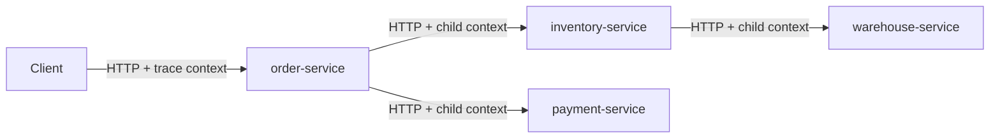
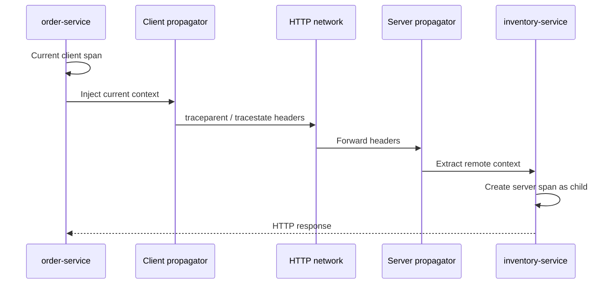
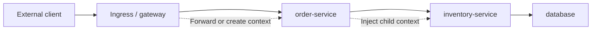

# Context over HTTP in Spring Boot

A request enters `order-service`, then calls `inventory-service` and `payment-service`. Each service creates its own span, yet when opening the trace in the backend, the spans need to belong to the same trace and show the right parent-child relationships. To achieve this, the application must propagate **trace context** via HTTP headers. That is context propagation: the sending service injects context into the request, and the receiving service extracts context from headers and continues the current trace.

In Spring Boot, Micrometer Tracing and the tracing bridge typically integrate propagation with HTTP instrumentation. When the client/server is instrumented and uses a compatible configuration, trace context can be automatically injected/extracted. However, manually creating an HTTP client, custom interceptors, gateways, or proxies can drop headers; when that happens, the trace splits into multiple root traces or loses links.

This lesson **Context over HTTP** belongs to the **Context propagation** chapter of the **SPRING_BOOT_OBSERVABILITY** module. The module focuses on setting up observability for Spring Boot using Micrometer Observation, metrics, logs, and distributed tracing; covering context propagation, tags/cardinality, exporters, sampling, and signal correlation to investigate errors, latency, and application behavior in production.

## 1. Learning objectives

After this lesson, you will be able to:

- Explain context propagation and why context needs to be passed over HTTP.
- Distinguish trace context, baggage, Observation scope, and logging MDC.
- Read the main fields of W3C Trace Context: `traceparent` and `tracestate`.
- Describe how clients inject and servers extract context.
- Configure and use HTTP clients instrumented by Spring Boot/Micrometer.
- Identify causes of broken traces across proxies, gateways, or custom interceptors.
- Understand trust boundaries, validation, and limits for baggage/headers.
- Test trace continuity across multiple HTTP services.

## 2. What is context propagation?

Context is a set of metadata attached to the current execution. In distributed tracing, the most important context contains the trace ID, current span ID, and sampling flags. When one service calls another, the context is serialized into HTTP headers so the receiving service can continue the trace.



If propagation works, spans share the same trace ID and have logical parent-child relationships. If the receiving service does not extract the context, it may start a new independent trace even though the business request succeeds.

### Trace context is not the entire application context

Do not serialize all Java thread-locals, Spring SecurityContext, request attributes, or object graphs into HTTP headers. A propagator only transmits defined and permitted metadata, such as trace context or configured baggage. Process-internal data must use its own appropriate propagation mechanism.

## 3. Three concepts to distinguish

| Concept | Content | Scope |
| --- | --- | --- |
| Trace context | Trace ID, span ID, flags, and state per propagator standard | Connects spans across service boundaries |
| Baggage | Key-value metadata selected to travel alongside context | Shares necessary metadata between services |
| Logging MDC | Map of fields attached to a log event, often including traceId/spanId | Correlates logs within the current execution |
| Observation scope | Context scope within a process so handlers and instrumentation recognize the active observation | Thread/execution scope |

Trace context is typically transmitted via HTTP headers. MDC does not automatically become headers, and baggage does not automatically become log fields. Putting baggage into MDC or span attributes must be explicitly configured and evaluated for privacy/cardinality.

## 4. W3C Trace Context

W3C Trace Context is a widely used standard for propagating trace context over HTTP. Two key headers:

- `traceparent`: contains version, trace ID, parent ID (caller's span ID), and trace flags.
- `tracestate`: carries vendor-specific tracing state in a standard format.

An illustrative `traceparent`:

```http
traceparent: 00-4bf92f3577b34da6a3ce929d0e0e4736-00f067aa0ba902b7-01
```

Components:

| Component | Example | Meaning |
| --- | --- | --- |
| Version | `00` | Format version |
| Trace ID | `4bf92f3577b34da6a3ce929d0e0e4736` | Trace identifier across services |
| Parent ID | `00f067aa0ba902b7` | Span ID of the upstream operation |
| Flags | `01` | Sampled flag in this example |

The values above only illustrate the format, not a real trace ID. Trace ID and span ID must have valid format/length; do not construct headers manually with arbitrary strings.

### Parent ID changes at each service

When `order-service` receives a request, its server span has its own span ID. When calling `inventory-service`, `order-service`'s client span has a new span ID and the propagator injects the active span context. `inventory-service` extracts that context and creates a child server span. The trace ID remains the same across the trace, while the span ID/parent ID change per operation.

### Sampling flag

Trace flags in `traceparent` can carry the sampling decision. Sampling policy and parent-based behavior determine whether downstream spans are recorded based on the received context. Do not manually edit flags to force sampling; use your stack's sampler/tracing configuration.

## 5. Inject and extract flow over HTTP

**Inject** happens on the sender side: the propagator reads the active context and writes headers onto the HTTP request. **Extract** happens on the receiver side: the propagator reads headers, validates the structure, and constructs a parent context so instrumentation can create the server span.



If headers are stripped, the receiving service cannot link the trace to upstream via W3C context. If headers are altered or invalid, the propagator may ignore them and start a new trace.

## 6. How does Spring Boot handle propagation automatically?

In Spring Boot 3.x, Micrometer Tracing can integrate with HTTP server and HTTP client instrumentation. For Spring Boot-managed clients, observation/tracing customizers can install interceptors to inject context. On the server side, web instrumentation extracts context before or while creating the server observation/span.

Common prerequisites:

1. Appropriate Actuator/Micrometer observability integration is present.
2. A tracing bridge is chosen, such as Brave or OpenTelemetry.
3. Client/server instrumentation compatible with the web stack is present.
4. A Spring Boot-managed client builder is used, or observation support is properly attached manually.
5. Intermediaries preserve the required propagation headers.

You do not need to write custom code to attach trace IDs to every request if standard instrumentation already does it. Manually crafting `traceparent` easily produces wrong parent IDs, sampling flags, or formats.

## 7. Propagation with RestClient

With Spring Boot 3.2+ and Spring Framework 6.1+, `RestClient` can receive observation integration via the builder auto-configured by Boot.

```java
import org.springframework.stereotype.Service;
import org.springframework.web.client.RestClient;

@Service
public class InventoryClient {
    private final RestClient restClient;

    public InventoryClient(RestClient.Builder builder) {
        this.restClient = builder
            .baseUrl("http://inventory-service")
            .build();
    }

    public InventoryItem find(String sku) {
        return restClient.get()
            .uri("/items/{sku}", sku)
            .retrieve()
            .body(InventoryItem.class);
    }
}

record InventoryItem(String sku, int available) {}
```

When tracing integration is configured, client observation can create a client span and the propagator injects context. Use URI templates to keep metric tags stable and do not put SKUs/customer IDs into metric dimensions if they have high cardinality.

If you call `RestClient.builder()` directly outside Spring Boot, ensure `ObservationRegistry`/customizers are properly attached. An uninstrumented client builder can send HTTP requests successfully without injecting trace context.

## 8. Propagation with WebClient

`WebClient` is the reactive HTTP client. In Spring Boot, using the Boot-managed builder preserves customizers and observation integration.

```java
import org.springframework.stereotype.Component;
import org.springframework.web.reactive.function.client.WebClient;

@Component
public class PricingClient {
    private final WebClient webClient;

    public PricingClient(WebClient.Builder builder) {
        this.webClient = builder
            .baseUrl("http://pricing-service")
            .build();
    }

    public Mono<Price> getPrice(String sku) {
        return webClient.get()
            .uri("/prices/{sku}", sku)
            .retrieve()
            .bodyToMono(Price.class);
    }
}

record Price(String sku, long amount) {}
```

The example uses a reactive return type; the corresponding WebFlux/Reactor dependency is required. In reactive pipelines, context may be bound to Reactor Context instead of only ThreadLocal. Do not assume code runs on the same thread; propagation must be supported by the integration in use.

Do not manually read MDC and copy `traceId` into headers arbitrarily inside a WebClient filter. That is not equivalent to standard W3C propagation. Use the framework's tracing propagator/interceptor. MDC is logging context; it is neither the sole nor the canonical source for trace context.

## 9. Gateways, proxies, and service meshes

An HTTP request may pass through an ingress, API gateway, reverse proxy, service mesh sidecar, or load balancer before reaching a service. Each hop can affect headers:

- Preserve `traceparent`/`tracestate` when forwarding per policy.
- Do not rewrite `traceparent` to an invalid value.
- If the gateway creates its own span, it must continue the parent context properly.
- If multiple tracing standards exist (W3C, B3), configure compatible propagators and avoid conflicts.
- Strip or control headers at trust boundaries when required.



If a gateway strips `traceparent`, traces at internal services can start over. If a gateway trusts arbitrary trace headers from the internet without applying policy, callers can send arbitrary metadata to influence correlation or baggage handling. Trace context is not an identity or authorization credential.

## 10. Baggage over HTTP

Baggage is key-value metadata propagated alongside trace context when permitted by the propagator and configuration. For example, a system might propagate `tenant.tier=gold` or `region=ap-southeast` if those values are genuinely needed for downstream processing.

Do not put sensitive data in baggage: access tokens, session IDs, cookies, emails, phone numbers, addresses, payment data, passwords, secrets, free-text, or large payloads.

Baggage can travel across multiple services and increase header size. Only allow-list necessary keys, restrict sizes/values, and validate inbound data. Never use baggage as a replacement for authentication or authorization.

### Baggage and cardinality

If baggage is copied into span attributes or metric tags, dynamic values can increase cardinality. For instance, `tenant.id` with hundreds of thousands of values is unsuitable as a metric tag. You can use a bounded tenant tier group instead of tenant ID when the goal is solely grouping.

## 11. Context propagation across async boundaries

Context on the current thread does not automatically appear in every executor or callback. With `@Async`, `CompletableFuture`, custom executors, or scheduled work, context can be lost without an appropriate propagation mechanism.

Example:

```java
CompletableFuture.runAsync(() -> {
    // Do not assume the caller's trace context is automatically here.
    performBackgroundWork();
});
```

To propagate context, Spring/Micrometer provide version-appropriate mechanisms, such as `ContextPropagatingTaskDecorator` for executors or Micrometer Context Propagation APIs. Specific configuration depends on the Spring Boot/Spring Framework/Micrometer version.

Do not blindly copy all ThreadLocals or security context into every task. Only propagate necessary context; ensure scopes are restored/cleared after a task finishes so context from a previous request does not leak into the next request.

### Reactor Context

In WebFlux/Reactor, context is tied to the subscription/pipeline. Use the stack's instrumentation and context propagation support rather than relying on thread-locals. When bridging between reactive and imperative code, check bridge/context restoration so trace IDs in logs and spans are not lost or misassigned.

## 12. Security and trust boundaries

Trace context and baggage are metadata that callers can supply. Do not treat them as proof that a user is authenticated or authorized to access a resource.

| Risk | Control |
| --- | --- |
| Caller sends spoofed trace headers | Validate format; use standard propagators; clear policy at ingress |
| Baggage contains PII/secrets | Allow-list keys, redact, and limit size |
| Bloated headers | Cap total header size and number of baggage entries |
| Trace context crosses trust boundary | Gateway decides to forward, restart, or strip per policy |
| Full headers logged | Do not log raw baggage/headers; log only correlation IDs per policy |
| Context leaks between tasks | Proper scope restoration/clearing and executor context propagation |

If a system needs to start a new trace at a trust boundary, design the gateway/server to create a new context and link it via mechanisms supported by the tracing backend. Do not arbitrarily overwrite parent IDs in individual services.

## 13. Troubleshooting: broken trace over HTTP

| Symptom | Possible cause | How to check |
| --- | --- | --- |
| Each service has a different trace ID | Client does not inject or server does not extract context | Inspect headers and instrumentation on both sides |
| Only server span, missing client span | Client builder lacks observation support | Use Boot-managed builder and check tracing handler |
| Client span exists but server span becomes root | Proxy strips/rewrites headers or server propagator differs | Inspect `traceparent` after each hop |
| Trace ID preserved but wrong parent relation | Active span context not scoped properly or custom header logic | Check span lifecycle and propagator |
| Logs lack traceId while backend has spans | Missing MDC integration or async context propagation | Check logging correlation and executor/Reactor context |
| Baggage does not reach downstream | Baggage key not allow-listed/remote propagation disabled | Check baggage config on both ends |
| Baggage arrives truncated | Header size limit or proxy policy | Check header size and gateway logs |
| Context lost in `@Async` | Executor does not propagate context | Use task decorator/context propagation support |
| WebClient loses context on reactive switch | Reactor Context/bridge misconfigured | Check reactive instrumentation and context restoration |
| No trace despite headers present | Sampling rejected or exporter error | Distinguish propagation, recording, and export |

### Investigation checklist

1. Send a request through an instrumented client and server.
2. Inspect `traceparent` on the client side before sending.
3. Inspect headers at the ingress/gateway and on the receiving server.
4. Compare trace ID, parent span ID, and sampling flags.
5. Check the tracing bridge and propagator on both services.
6. View client/server spans in the backend under the same trace ID.
7. If using async/reactive, verify context across executor/Reactor boundaries.
8. Check baggage allow-list, header size, and security policy.

Do not log bearer tokens or full baggage when debugging. Only collect redacted tracing headers in permitted environments.

## 14. Practice: linking a trace across three HTTP services

**Scenario:** `order-service` receives a request, calls `inventory-service`, and then calls `payment-service`. All three applications use Spring Boot and Micrometer Tracing with the same W3C Trace Context standard.

### Part A — Preparation

1. Enable Actuator and choose a consistent tracing bridge across all three services.
2. Use Spring Boot-managed `RestClient`/`WebClient` builders.
3. Configure exporters to the same tracing backend/Collector.
4. Confirm ingress/gateway forwards trace context according to policy.
5. Record the test request and send timestamp.

### Part B — Verification

| Case | Action | Result to verify |
| --- | --- | --- |
| A — End-to-end | Send request through order → inventory → payment | Spans share the same trace ID |
| B — Parent relation | Open trace graph | Client/server spans have logical parent-child relations |
| C — Header | Observe `traceparent` in boundary test | Parent ID changes per active span, trace ID stays the same |
| D — Gateway | Disable forwarding in test environment | Observe broken trace, then restore |
| E — Baggage | Forward a non-sensitive allow-listed key | Downstream receives the right value |
| F — Async | Run background task with context propagation | Span/log correlation preserves the right context |
| G — Security | Send oversized baggage/header | Gateway/service enforces policy without leaking data |

### Part C — Self-assessment questions

1. When are trace context injection and extraction performed?
2. Why does the trace ID stay the same while the span ID changes across each service?
3. What roles do `traceparent` and `tracestate` play?
4. Why does MDC not replace a W3C propagator?
5. Why does using a Boot-managed `RestClient`/`WebClient` builder preserve observation integration?
6. If a gateway strips `traceparent`, how does the trace graph change?
7. How does baggage differ from resource attributes and metric tags?
8. Why should baggage not be used as an authorization credential?
9. How can context be lost in `CompletableFuture` or an executor?
10. How do you distinguish successful propagation from successful trace sampling/export?

## 15. Takeaways

**Context over HTTP** allows services to connect spans within the same distributed trace. The client propagator injects trace context into headers; the server propagator extracts context and creates a child span. W3C Trace Context typically uses `traceparent` and `tracestate`; the trace ID identifies the whole trace, while the span ID/parent ID change with each operation.

In Spring Boot, prefer Micrometer Tracing and auto-configured HTTP clients so propagation happens consistently. Preserve headers through gateways according to trust policy, use allow-listed baggage, and never treat trace metadata as identity. Context over HTTP differs from MDC, metrics, or exporters; a trace can be propagated even if it is not sampled or exported. For async/reactive work, configure context propagation matching the execution model and restore scopes upon completion. Checking every boundary from client to proxy to server helps pinpoint broken traces, protect metadata, and correlate metrics, logs, and distributed tracing.
