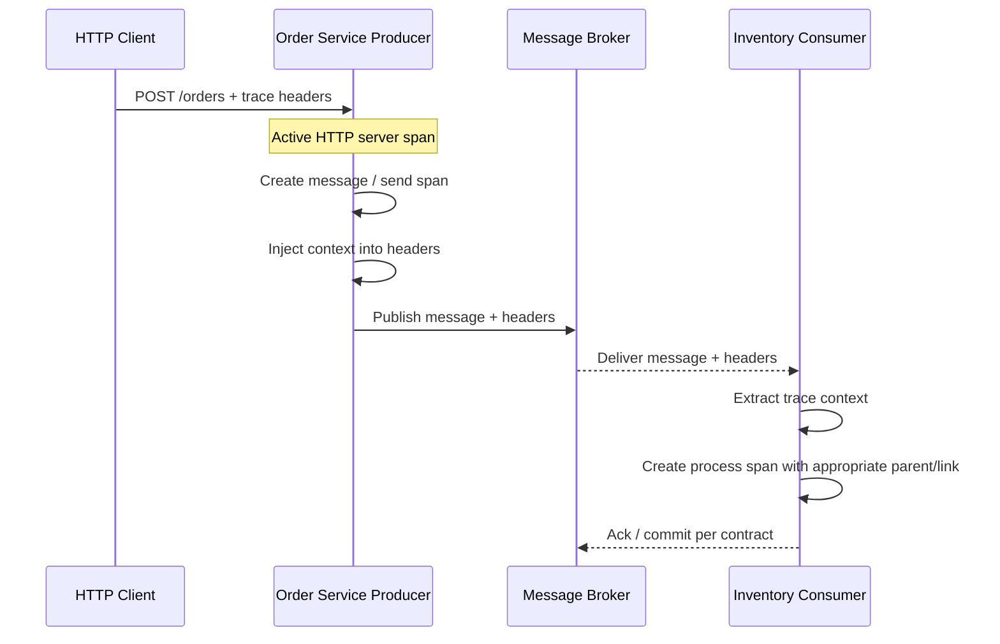
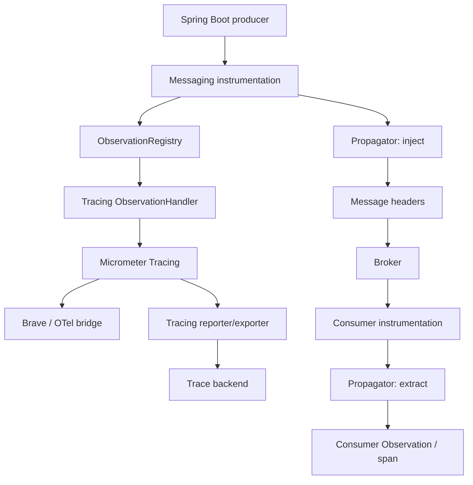
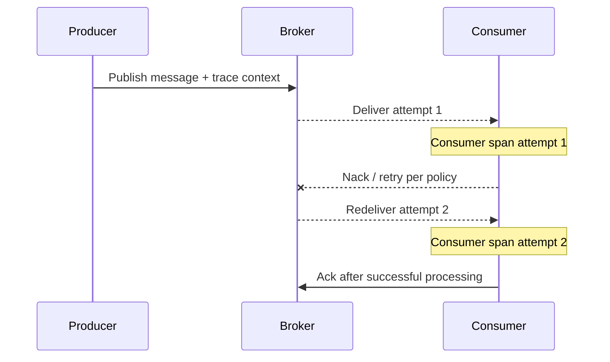

# Context over messaging in Spring Boot

A service receives an HTTP request, publishes a message to Kafka or RabbitMQ, and returns a fast response. Another consumer processes the message a few seconds later, possibly on a different thread or machine. If the trace context only sits in the producer's `ThreadLocal`, the consumer will not know which request the message originated from. The trace splits apart, making it difficult for operators to follow the end-to-end business journey.

**Context propagation over messaging** is how contextual information is carried across message boundaries via metadata/headers so that producers and consumers can link traces and spans accurately. In Spring Boot, this involves Micrometer Observation, Micrometer Tracing, Spring Kafka/Spring AMQP instrumentation, propagation formats like W3C Trace Context or B3, and asynchronous handling.

This lesson **Context over messaging** belongs to the **Context propagation** chapter of the **SPRING_BOOT_OBSERVABILITY** module. The module focuses on setting up observability for Spring Boot using Micrometer Observation, metrics, logs, and distributed tracing; covering context propagation, tags/cardinality, exporters, sampling, and signal correlation to investigate errors, latency, and application behavior in production.

## 1. Learning objectives

After this lesson, you will be able to:

- Explain why `ThreadLocal` or MDC does not automatically travel with messages through Kafka, RabbitMQ, or queues.
- Distinguish thread-local context from trace context serialized into message headers.
- Describe how a producer **injects** trace context and a consumer **extracts** context before creating a processing span.
- Understand the relationship between the message send span, receive/process span, and parent trace.
- Identify trace linking strategies suited for long queues, retries, redeliveries, and batch consumption.
- Understand how Spring Boot/Spring messaging instrumentation supports observation and propagation.
- Protect headers, baggage, and metadata from sensitive data or high cardinality.
- Troubleshoot broken traces, lost context, wrong parents, logs missing trace IDs, or traces not appearing in the backend.

## 2. Why does messaging need dedicated propagation?

With synchronous HTTP, a client can send request headers while the server is handling the request. The tracer injects trace context into HTTP headers and the server extracts it upon receipt. Messaging has a different lifecycle:

- The producer creates the message at one point in time.
- The broker may hold the message in a queue for some time.
- The consumer receives the message on a different process, thread, or machine.
- A message can be retried, redelivered, or processed by multiple consumers.
- The producer and consumer do not necessarily exist simultaneously.

The context open on the producer's thread **cannot be passed as a live object to the consumer**. The message must carry the necessary context as serializable data, typically via headers.

### Three types of context to distinguish

| Type | Example | Lifecycle | Crosses broker automatically? |
| --- | --- | --- | --- |
| Thread-local tracing scope | Active span on the producer thread | Within the thread/scope | No |
| Logging MDC | `traceId`, `spanId` in logs | Follows MDC and scope mechanisms | No |
| Trace propagation headers | `traceparent`, `tracestate`, B3 headers | Serialized with the message | Only when instrumentation is configured properly |

MDC helps log records include correlation fields; it does not replace trace propagation. Likewise, `Observation.Scope` or `SpanInScope` in the producer cannot remain open across a queue or network.

## 3. Trace context in message headers

Trace context typically carries the information needed to identify a trace and span relationships:

| Field | Meaning | Note |
| --- | --- | --- |
| Trace ID | Identifier for the entire trace | Related spans usually share the trace ID |
| Span ID | Identifier for a single span | Each span has its own ID |
| Parent relationship | Links child span to the preceding span | Can be a direct parent or a link |
| Trace flags | Sampling decision per format | Does not replace sampling configuration |
| Trace state | Vendor/implementation extension info | Do not edit manually without understanding semantics |
| Baggage | Metadata intentionally propagated across services | Restrict names, values, and allowed data |

### W3C Trace Context

W3C Trace Context defines common headers:

- `traceparent`: carries version, trace ID, parent ID, and trace flags.
- `tracestate`: carries additional vendor/implementation state information.

Illustrative example:

```text
traceparent: 00-4bf92f3577b34da6a3ce929d0e0e4736-00f067aa0ba902b7-01
```

This is an illustrative value following the W3C structure; do not copy it into a real application. Consumers must not build `traceparent` by concatenating arbitrary IDs. Let the propagator/instrumentation encode and decode context, validate formats, and handle malformed values according to the specification.

### B3 propagation

In the Brave/Zipkin ecosystem, B3 is a common format. Depending on configuration, you may encounter a single `b3` header or multiple headers:

```text
X-B3-TraceId
X-B3-SpanId
X-B3-ParentSpanId
X-B3-Sampled
```

W3C and B3 are **different formats**. If the producer serializes B3 while the consumer only reads W3C, the consumer may miss the parent context and create a new root trace. Systems supporting multiple formats can be configured to read/write one or more formats; check producer, middleware, and consumer.

### Headers are not payload

Trace headers are technical metadata and should not be merged into the business payload just for the consumer to read. Keeping them in message headers avoids changing business schemas and helps middleware manage metadata. However, headers are still stored/transmitted through the broker, so never put secrets, tokens, or personal data into trace headers/baggage.

## 4. Inject and extract flow

The producer **injects** the active span's context into message headers before sending. The consumer **extracts** headers into a parent context and creates a processing span within that context.



1. **Inject:** take the active span's context, encode it into headers via the propagator (e.g., W3C or B3), and attach them to the message before sending.
2. **Extract:** read received headers, validate/decode them into a context, and then create a new span based on the extracted context.

Do not extract after already starting an independent root span and expect the tracer to retroactively change its parent. The consumer must obtain the context **before** creating the processing span.

### Parent-child or span link?

| Scenario | Potentially suitable model | Reason |
| --- | --- | --- |
| One request emits one message, one consumer handles immediately | Consumer span is child of send span/parent per instrumentation | Direct causal relationship |
| Message sits in a queue for a long time | Processing span links to producer context, depending on API | Avoids keeping parent span open while waiting |
| Batch aggregates many messages from multiple traces | Consumer span links multiple trace contexts | A single parent cannot represent all sources |
| Fan-out to multiple consumers | Each consumer has its own span referencing the source context | Represents parallel processing branches |
| Retry/redelivery | Each attempt has its own span referencing the delivery/attempt | Distinguishes attempt failures from final result |

Span links are useful when a span has multiple related causes/contexts or when parent-child makes the trace tree hard to interpret. Choose semantics based on actual messaging behavior; do not force every flow into an artificial parent-child tree.

## 5. Micrometer Tracing and Spring Boot

Micrometer Observation is the common integration point for instrumented components. When a tracing bridge like Brave or OpenTelemetry is present, the Observation tracing handler can create spans. Compatible messaging libraries can also create observations for producers/consumers and support propagating context via headers.



Responsibilities:

- `ObservationRegistry` manages the observation lifecycle; it is not a broker header store.
- The tracing bridge implements the tracing API beneath Micrometer; it does not modify business payloads.
- The propagator injects/extracts context; messaging instrumentation decides when to invoke it.
- The broker forwards message headers according to its capabilities/configuration; it does not necessarily understand trace semantics.
- The tracing exporter/reporter sends spans to the backend; this pipeline is separate from the metrics exporter.

### Versions and auto-instrumentation

Auto-instrumentation capabilities vary across versions of Spring Boot, Spring Kafka, Spring AMQP, Micrometer Tracing, and client libraries. Do not assume **merely adding a tracing bridge is enough** for every producer/consumer to propagate headers automatically.

In a real project, verify:

1. Whether the producer/consumer is created by the Spring container or instantiated manually outside Spring.
2. Whether the messaging library has observation/tracing instrumentation and whether it is enabled.
3. Whether the template/listener container has observation configured per the running version.
4. Which propagator format is selected and whether both ends can read/write that format.
5. Whether headers are transformed, allowlisted, stripped, or overwritten by converters, interceptors, gateways, or broker policies.

If auto-instrumentation already creates producer/consumer spans and propagates trace headers, do not manually inject again in a duplicate or overwriting manner.

## 6. Spring Kafka

For Spring Boot 3.x using Spring Kafka, illustrative dependencies:

```kotlin
dependencies {
    implementation("org.springframework.boot:spring-boot-starter-actuator")
    implementation("org.springframework.kafka:spring-kafka")
    implementation("io.micrometer:micrometer-tracing-bridge-brave")
    runtimeOnly("io.zipkin.reporter2:zipkin-reporter-brave")
}
```

The Spring Boot BOM should manage compatible versions. This is an illustrative Brave/Zipkin stack; applications can use the OpenTelemetry bridge or another backend.

### Observing producer and listener

Spring Kafka provides observation configuration points for the producer template and listener container. Check exact API names against your version; a conceptual example:

```java
// Illustrative for Spring Kafka versions providing these APIs.
kafkaTemplate.setObservationEnabled(true);
factory.getContainerProperties().setObservationEnabled(true);
```

This is not a complete configuration for every version. Check whether the methods exist in your version and apply them to the actual bean/template/factory that Spring uses. If auto-configuration already exists, do not create a second template just to enable observation while continuing to send through the old template.

### Tags and message metadata

| Metadata | Appropriate place | Notes |
| --- | --- | --- |
| `application`, `environment`, `region` | Common metrics tags or resource attributes | Stable deployment metadata |
| Topic/queue name | Tag/attribute per convention with bounded set | Avoid dynamically generated per-entity topics |
| `operation=send|receive|process` | Low-cardinality observation key-value | Bounded set |
| `outcome=success|error|rejected` | Low-cardinality if consistently defined | Distinguish technical error from business outcome |
| `messageId` | Controlled log or trace attribute | Do not use as metric label |
| `traceId` | Trace context / log correlation | Do not put into metrics |
| Payload | Business message | Do not copy into observation tags |

## 7. RabbitMQ and Spring AMQP

With RabbitMQ, the principle remains that the producer injects context into AMQP message headers and the consumer extracts context on receipt. Spring Boot/Spring AMQP can combine observation and Micrometer Tracing depending on version and configuration.

Illustrative baseline dependencies:

```kotlin
dependencies {
    implementation("org.springframework.boot:spring-boot-starter-actuator")
    implementation("org.springframework.boot:spring-boot-starter-amqp")
    implementation("io.micrometer:micrometer-tracing-bridge-brave")
    runtimeOnly("io.zipkin.reporter2:zipkin-reporter-brave")
}
```

This is a Spring Boot 3.x stack configuration managed via the BOM. Broker connection, credentials, virtual host, exchange, queue, and bindings must be configured separately. Dependencies do not create a RabbitMQ server or messaging topology.

### Message headers in Spring AMQP

In Spring AMQP, message metadata resides in the headers of message properties. Converters, message post-processors, or instrumentation can add/read headers. If handling trace headers directly:

- Use the tracing stack's propagator rather than building `traceparent` or B3 from strings manually.
- Ensure headers are preserved when converters transform payloads between objects and messages.
- Do not overwrite current propagation headers with an old trace ID taken from the payload.
- Check header size limits, charsets, and data types supported by the broker/client.

A consumer may receive older messages from before tracing was enabled. If trace headers are absent or invalid, the application needs a clear policy: start a new root trace or continue processing without a parent; never fail business processing solely due to missing trace metadata.

## 8. Conceptual example with Micrometer Propagator

The propagator API injects/extracts using an arbitrary carrier. The carrier here is an illustrative Map; adapters for Kafka/Rabbit must map Setter/Getter to the client's specific header type.

### 8.1. Inject on producer

```java
import io.micrometer.tracing.Span;
import io.micrometer.tracing.Tracer;
import io.micrometer.tracing.propagation.Propagator;
import java.util.Map;

public class TraceHeaderWriter {
    private final Tracer tracer;
    private final Propagator propagator;

    public TraceHeaderWriter(Tracer tracer, Propagator propagator) {
        this.tracer = tracer;
        this.propagator = propagator;
    }

    public void injectCurrentContext(Map<String, String> headers) {
        Span current = tracer.currentSpan();
        if (current == null) {
            return;
        }
        propagator.inject(
            current.context(),
            headers,
            (carrier, key, value) -> carrier.put(key, value)
        );
    }
}
```

`Map<String, String>` is a simple carrier to explain the API. For Kafka, the setter needs to write strings into `RecordHeaders`; for AMQP, the setter needs to write into the appropriate message properties/headers. In production, check existing headers, data types, and avoid injecting context multiple times.

`tracer.currentSpan()` can return `null` when code runs outside a tracing scope. This is not necessarily an error; a scheduled job or standalone message can intentionally start a new root trace by design.

### 8.2. Extract on consumer

```java
import io.micrometer.tracing.Span;
import io.micrometer.tracing.propagation.Propagator;
import java.util.Map;

public class TraceHeaderReader {
    private final Propagator propagator;

    public TraceHeaderReader(Propagator propagator) {
        this.propagator = propagator;
    }

    public Span startConsumerSpan(Map<String, String> headers) {
        Span.Builder extracted = propagator.extract(
            headers,
            (carrier, key) -> carrier.get(key)
        );
        return extracted.name("messaging.process").start();
    }
}
```

This illustrates using a Map as a carrier. A real implementation needs to use the client's headers API, follow span kind/name/tag conventions, and end the span in `finally`. For long-delay queues or multi-message batches, decide between parent or link according to tracing semantics; do not default to a parent-child tree for every case.

After creating the span, the consumer must also open a scope while processing:

```java
Span span = traceHeaderReader.startConsumerSpan(headers);
try (Tracer.SpanInScope ignored = tracer.withSpan(span)) {
    try {
        orderHandler.handle(message);
        span.tag("outcome", "success");
    } catch (RuntimeException ex) {
        span.tag("outcome", "error");
        span.error(ex);
        throw ex;
    }
} finally {
    span.end();
}
```

This assumes `tracer` shares the same implementation/configuration as the reader. Do not open the scope before extracting context. If the messaging library already creates a consumer observation/span automatically, **do not create an additional manual consumer span** wrapping the same callback.

## 9. Queue latency, retry, and redelivery

Messaging decouples send time from processing time. Distinguish:

- **Publish/send latency:** time spent by the application preparing and sending the message.
- **Queue delay:** time the message waits in the broker before a consumer receives it.
- **Processing latency:** time the consumer spends executing the handler.
- **End-to-end business latency:** from when the business action starts until the final result; may include queue delay, retries, and other steps.

The message send span ends when the producer finishes publishing/receiving confirmation per client semantics; it should not stay open for hours waiting for the consumer. The consumer span is created when receiving the message, carrying context or linking to the source trace by design. If end-to-end time is needed, use controlled business timestamps or message-age metrics; do not keep a span alive across the entire queue wait time.

### Retry and redelivery



Each attempt should have its own trace record to distinguish failed attempts from the successful one. The original context can be preserved to link attempts; metadata such as message ID, operation, or retry count can aid diagnostics per conventions. Do not use unbounded dynamic retry counts or exception text as metric tags.

| Scenario | Recommended observation | What to avoid |
| --- | --- | --- |
| Consumer fails, broker redelivers | Separate span for each receive/process, linked to source context | Overwriting old trace ID with arbitrary ID |
| Internal retry within callback | Separate attempt span or appropriate event | A single long span obscuring retries |
| Dead-letter queue | Record dead-letter transfer outcome and standardized reason | Recording payload or credentials in span |
| Batch consume multiple messages | Batch span with links to multiple contexts if supported | Picking one message at random as parent |
| Manual reprocess | New trace with link to source if it is a new business execution | Pretending it was the original execution |

### Duplicate delivery and idempotency

Brokers can redeliver messages when an ack is lost or a consumer fails after finishing part of the work. Trace propagation **does not guarantee exactly-once processing**. Idempotency keys, deduplication, and transactions/outbox belong to business/messaging design; a trace ID does not replace an idempotency key.

## 10. Context across asynchronous execution models

### Thread pools and `@Async`

If a consumer receives a message and hands processing off to an executor, context on the receiving thread is not automatically copied to the worker. Use appropriate Micrometer/Spring context propagation, such as a task decorator or instrumented executor, and verify:

1. The task runs on the configured executor.
2. Context is captured at submission and restored when the worker runs.
3. Scope/MDC is restored to its initial state after the task.
4. Two concurrent messages do not see each other's trace ID.

### Reactor

With `Mono`/`Flux`, context should follow the reactive execution context instead of relying solely on `ThreadLocal`. Instrumentation must be compatible with Reactor Context, schedulers, and Spring Boot's propagation configuration. Do not hold `SpanInScope` across long-lived publishers or multiple subscribers.

### Scheduled consumers and independent jobs

A scheduled poller may have no parent trace from an inbound request. You can create a root span/observation per poll or batch. If the poller processes messages carrying trace headers, create spans/links matching each message's context; do not attach every message under the scheduler span as parent if doing so distorts causality.

## 11. Baggage and securing message metadata

**Baggage** is metadata that can travel across services alongside trace context if allowed by the propagator and configuration. It is useful for controlled correlation information, not as an arbitrary store for business messages.

| Data | Should propagate? | Reason |
| --- | --- | --- |
| Trace context needed for parent/link | Yes | Core to linking traces |
| Bounded correlation category | Possibly, if approved | Supports cross-service analysis |
| Tenant identifier | Only when policy requires | Potentially sensitive/high cardinality |
| User email/phone | No | Personal data |
| Authorization token/cookie | No | Secrets must not be emitted in telemetry |
| Full message payload | Not via baggage | Payload belongs to message schema and can be huge |
| Order ID | Only in logs/trace attributes when permitted | Do not use as metric label |

### Broker trust boundaries

Message headers can arrive from external producers or untrusted sources. Consumers must extract context in standard format and handle malformed headers safely; never use trace context to make authorization/identity decisions; never trust baggage as authenticated data; limit header sizes and propagated fields; strip or replace unauthorized headers when crossing trust boundaries.

A Trace ID only correlates telemetry. It is **not a credential, proof of identity, or message signature**.

## 12. Sampling and correlating signals

Sampling decisions can be carried in context depending on tracer/policy. However:

- The sampled flag does not guarantee every reporter/exporter succeeds in sending.
- Consumers can run after producers; the backend may receive spans out of order.
- Retries or consumers can still record metrics even if a trace is not exported.
- Metrics and logs have separate pipelines; do not treat stored trace count as processed message count without accounting for sampling.

```mermaid
flowchart TD
    A["Message published"] --> B["Producer metrics<br/>send count / latency"]
    A --> C["Trace context in headers"]
    C --> D["Consumer extract context"]
    D --> E["Consumer span if sampled and exported"]
    B --> F["Metrics backend"]
    E --> G["Trace backend"]
    H["Consumer logs + traceId if present"] --> I["Log backend"]
    G -. "trace correlation" .-> I
    F -. "message/error/latency groups" .-> I
```



When metrics show consumer error rates rising while traces are sparse, check sampling, exporter/reporting, broker headers, and log correlation before concluding instrumentation is broken.

## 13. Troubleshooting

| Symptom | Possible cause | How to check |
| --- | --- | --- |
| Producer and consumer have different trace IDs | Context not injected/extracted or incompatible formats | Check headers, B3/W3C |
| Consumer creates a new root span | Extracted too late or message lacks headers | Extract before creating consumer span |
| Producer span exists but consumer span missing | Consumer instrumentation disabled or export error | Check listener, tracing handler, reporter |
| Same trace ID but missing parent | Parent/link relation altered or missing context | Check span IDs and semantics |
| Trace ID lost after executor | Thread-local context not propagated | Check task decorator/context propagation |
| MDC shows old trace ID | Scope not closed/restored properly | Check cleanup and concurrency |
| Headers lost after broker | Converter, interceptor, allowlist, or broker policy strips headers | Compare before publish and after receive |
| Headers present but fail to decode | Producer/consumer use different formats or invalid values | Check propagator format and header types |
| Baggage does not reach consumer | Propagation not enabled or key not allowlisted | Check baggage config on both ends |
| Batch has only one parent | Multiple input contexts but model picks one parent | Consider span links |
| Retry creates unwanted new trace | Headers regenerated on redelivery | Preserve source context, create separate attempt span |
| Metrics increase but no traces visible | Sampling, reporter/backend, or ingestion error | Inspect tracing pipeline |

### Ordered checklist

1. **Producer:** which scope was the message created in? Is there an active span? What context was injected?
2. **Message:** do serialized headers contain valid `traceparent` or B3 fields?
3. **Broker:** are headers preserved through converters, routing, persistence, and redelivery?
4. **Consumer:** does extract run before the consumer span? Is the right propagator used?
5. **Async execution:** is context captured/restored when crossing executor/reactive boundaries?
6. **Reporter:** are spans delivered to the backend? Are there sampling, network, or auth issues?
7. **Logs:** are trace ID/span ID put into MDC in the right scope? Is old context leaking?
8. **Security:** do propagation headers/baggage cross trust boundaries or carry sensitive data?

## 14. Practice: linking a trace across a message

**Scenario:** `order-service` receives an HTTP request to create an order and emits an `orders.created` message. `inventory-service` receives the message, checks and reserves stock. When the consumer fails, the broker can redeliver.

### Part A — Preparation

1. Use Spring Boot 3.x, Actuator, and a consistent Micrometer Tracing bridge (Brave or OpenTelemetry).
2. Choose a propagation format supported by both producer and consumer, such as W3C or B3.
3. Enable observation/instrumentation on the message template and listener container per your messaging library version.
4. Configure a reporter/exporter and test backend; choose a high enough sampling rate.
5. Configure log correlation without putting payloads, tokens, or personal data into MDC/baggage.

### Part B — Verification cases

| Case | Behavior | Expected result |
| --- | --- | --- |
| A — Success | Producer sends, consumer processes and acks | Producer/consumer spans linked via context |
| B — Consumer exception | Handler throws exception | Consumer span records error per instrumentation |
| C — Redelivery | Message redelivered after nack/timeout | New attempt references the source trace context |
| D — No inbound trace | Scheduled job emits standalone message | Root trace/job span per design |
| E — Async executor | Consumer offloads processing to worker | Worker logs/spans retain right trace context |
| F — Header format mismatch | Producer writes B3, consumer extracts W3C only | Trace splits; aligning format links it |
| G — Header stripped | Converter drops trace headers | Consumer loses parent; fixing allowlist preserves context |
| H — Sensitive baggage | Try putting token into baggage in test | Policy blocks that field from propagating/exporting |

### Part C — Observing signals

1. Send an HTTP request and record `traceId` in `order-service` logs if MDC is configured.
2. Inspect message headers in the test environment to confirm propagation fields were injected.
3. When the consumer receives the message, verify the trace ID is extracted and the processing span has its own span ID.
4. Intentionally trigger a consumer error; distinguish the attempt's error span from the final outcome after retry.
5. Compare producer send duration and consumer processing duration; do not treat them as total queue delay without measuring message age/backlog.
6. View message send/receive/error metrics, logs, and traces in the same time window.
7. Run multiple messages concurrently and verify no trace IDs or MDC leak across worker threads.

### Self-assessment questions

1. Why can't the producer's `ThreadLocal` propagate context through Kafka or RabbitMQ?
2. How does `traceparent` differ from `tracestate`?
3. When should a consumer span be a child and when is a span link more appropriate?
4. Why shouldn't a producer span stay open until the consumer finishes processing the message?
5. What happens if the producer injects B3 while the consumer only extracts W3C?
6. Why might a redelivered message need a new attempt span while still referencing the original trace context?
7. Why is `traceId` useful for log correlation yet unsuitable as a metric tag?
8. How do you ensure headers do not carry tokens or PII across trust boundaries?
9. If consumer metrics increase but no traces appear, which pipeline/steps should you inspect?
10. Why does trace propagation not replace idempotency and deduplication?

## 15. Takeaways

**Context over messaging** must be transmitted using metadata traveling with the message, typically W3C or B3 trace headers. The producer injects the current span's context before publishing; the consumer extracts it before creating a processing span. Scopes and MDC only exist in local execution contexts, so they do not automatically cross queues, processes, or other threads.

In Spring Boot, Micrometer Observation and Tracing combined with Spring Kafka/Spring AMQP instrumentation can automatically create spans and support propagation when dependencies, configuration, and versions are compatible. Verify headers on both ends, handle retries/redeliveries and async boundaries intentionally, choose semantically accurate parent/link relationships, and restrict baggage/sensitive data. Metrics reveal message and latency trends, logs support trace-ID correlation, and distributed tracing tracks a message's path across services. Designing these layers properly enables investigating messaging errors and latency while keeping cardinality, security, and observability costs under control.
