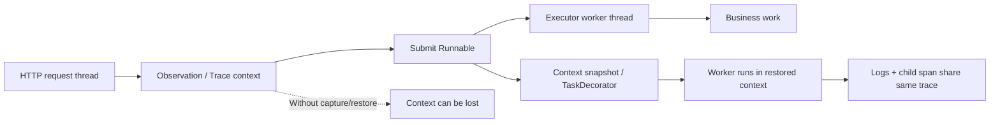
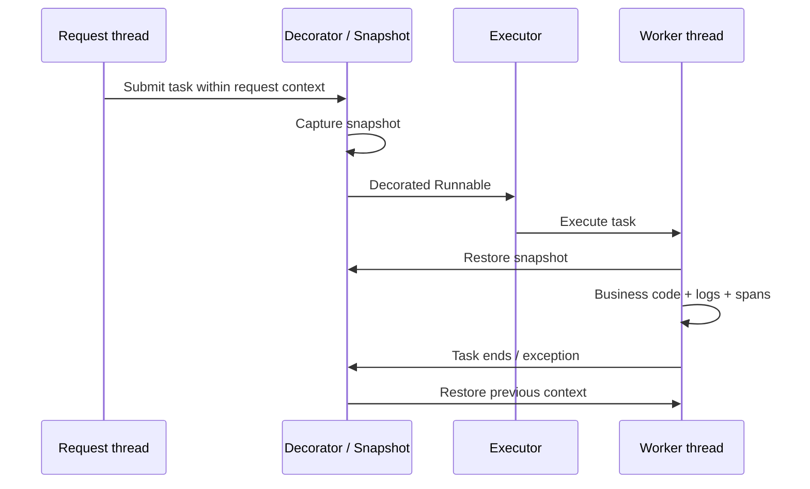
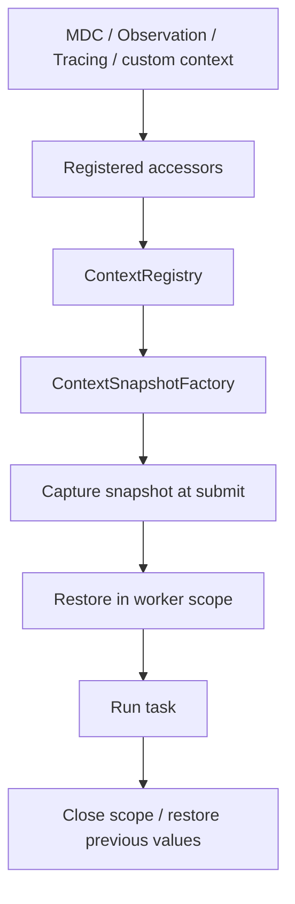

# Context over executors in Spring Boot

In a Spring Boot application, a request typically starts on an HTTP handling thread and then invokes services, repositories, or other clients. When work is handed off to an **executor** to run asynchronously, it may continue on a different worker thread. Data bound to the current thread such as **ThreadLocal**, logging MDC, or tracing context may not automatically cross that boundary.

**Context over executors** is the act of transferring necessary context from the submitting thread to the executing thread, maintaining it for the exact runtime duration, and restoring the worker's state upon completion. This is the foundation for preserving Trace ID/Span ID, log correlation, and observability data across asynchronous work.

This lesson belongs to the **Context propagation** chapter of the **SPRING_BOOT_OBSERVABILITY** module. Its goal is to understand why context is lost when switching threads, how to use **TaskDecorator** and **ContextPropagatingTaskDecorator**, the role of Micrometer Context Propagation, how to apply them with **@Async / CompletableFuture** and schedulers, and how to test so that metrics, logs, and distributed traces accurately reflect a single operation.

## 1. The problem: switching threads can cause context to vanish

Suppose a **POST /orders** request enters **order-service**. The framework creates tracing context and logging integration sets Trace ID/Span ID in MDC. The service then submits a task to an executor:

```java
public void createOrder(Order order) {
    orderExecutor.execute(() -> processOrder(order));
}
```

The HTTP thread and the worker thread are typically two separate threads. A value held in **ThreadLocal** on the first thread does not automatically appear on the second thread.

Observable consequences:

- Logs before submission have a Trace ID, while logs inside the worker do not.
- The worker creates a new span with no parent relationship to the original request.
- The trace backend shows two independent traces instead of one trace with a child span.
- Baggage or correlation metadata disappears after switching to the executor.
- Self-managed contexts (tenant, security context, locale) are not transferred without an appropriate mechanism.

**Not all context data is permitted or needed to propagate.** Only propagate necessary context with clear accessors and policies; avoid copying secrets or large data into every task.

### Visualizing the flow before and after propagation



The key lies in **capturing** context at submission time, **restoring** it when the worker starts running, and **restoring the previous state** after the task completes.

## 2. ThreadLocal, MDC, and tracing context

### 2.1. ThreadLocal binds data to a thread

**ThreadLocal<T>** provides a separate value per thread. Frameworks and libraries can use it to store the active context:

```java
private static final ThreadLocal<String> REQUEST_ID =
        new ThreadLocal<>();

void handleRequest() {
    REQUEST_ID.set("req-123");
    try {
        process();
    } finally {
        REQUEST_ID.remove();
    }
}
```

If `process` calls `executor.execute(...)`, the worker thread does not automatically see `req-123` because it has its own ThreadLocal map.

ThreadLocal is useful for single-threaded synchronous code, but it is not a mechanism for propagating context across thread boundaries.

### 2.2. MDC is context for logging

SLF4J MDC is typically implemented on top of thread-bound context. Tracing integration can populate fields like **traceId** and **spanId** in MDC for log patterns to use.

Example:

```java
MDC.put("request.id", requestId);
try {
    log.info("Starting order");
} finally {
    MDC.remove("request.id");
}
```

MDC on the submitting thread is not automatically copied to the worker. If the worker uses a long-lived thread pool, setting values without clearing them can even cause values from a previous task to appear in the next task's logs.

### 2.3. Tracing context tracks span relationships

Micrometer Tracing and the tracing bridge manage the active span context. When an Observation/span is opened in scope, instrumented calls inside it can create child spans.

When switching to an executor, if context is not properly propagated:

- The worker may have no active span.
- A new span may be created as a different root trace.
- Logs in the worker may lack a Trace ID.
- Child HTTP client spans may fail to link to the original request.

**The goal of context propagation** is to preserve logical context across execution boundaries, not merely copy a Trace ID string. Restoring the right scope also allows instrumentation to build parent-child relationships and close spans with the right lifecycle.

## 3. Context over executors requires three phases

A reliable propagation mechanism handles three phases:

| Phase | Timing | Responsibility |
| --- | --- | --- |
| Capture | Submitting thread | Captures registered contexts at submission time |
| Restore | Worker starts task | Places snapshot into the worker's active context |
| Cleanup/restore | Task finishes or throws error | Restores prior context, preventing leaks to the next task |

Flow:



If you only copy data without cleanup, the thread pool may reuse the same worker and mix contexts across requests. If you capture too late on the worker, the original context may already be gone. Capture must happen at the time the task is submitted.

## 4. What is Spring TaskDecorator?

Spring provides the **TaskDecorator** interface to wrap a **Runnable** before an executor runs it. A decorator can capture context on the submitting thread, then restore context around the task running on the worker.

Conceptual interface:

```java
@FunctionalInterface
public interface TaskDecorator {
    Runnable decorate(Runnable runnable);
}
```

A decorator does not create a thread pool and does not replace an executor. It changes how tasks are wrapped before execution.

### 4.1. Writing a custom MDC decorator (use only when scope is very narrow)

The example below illustrates copying the MDC map:

```java
import java.util.Map;
import org.slf4j.MDC;
import org.springframework.core.task.TaskDecorator;

public class MdcTaskDecorator implements TaskDecorator {

    @Override
    public Runnable decorate(Runnable runnable) {
        Map<String, String> callerContext = MDC.getCopyOfContextMap();

        return () -> {
            Map<String, String> previousContext = MDC.getCopyOfContextMap();
            try {
                if (callerContext == null) {
                    MDC.clear();
                } else {
                    MDC.setContextMap(callerContext);
                }
                runnable.run();
            } finally {
                if (previousContext == null) {
                    MDC.clear();
                } else {
                    MDC.setContextMap(previousContext);
                }
            }
        };
    }
}
```

This approach only handles MDC. It **does not automatically propagate Micrometer Observation, tracing scope, baggage, security context, or other ThreadLocals**. Only use it if the application genuinely needs MDC alone and you have tested context restoration on the worker.

Do not build custom decorators by copying all internal JVM/framework ThreadLocals. Those implementation details are not stable public contracts.

## 5. ContextPropagatingTaskDecorator and Micrometer Context Propagation

For Spring Boot applications integrating Micrometer Observation/Tracing, a more appropriate approach is usually Spring Framework's **ContextPropagatingTaskDecorator** combined with Micrometer Context Propagation.

ContextPropagatingTaskDecorator was introduced in Spring Framework 6.1. It uses the **ContextSnapshot** mechanism to capture and restore contexts that have registered accessors, rather than copying only MDC.

### 5.1. Dependency

In Spring Boot 3.x, Actuator and tracing dependencies typically bring Micrometer observability into the application. If the project does not have the context propagation module in its dependency graph, you may need to add the corresponding artifact, with its version managed by Spring Boot dependency management:

```xml
<dependency>
    <groupId>io.micrometer</groupId>
    <artifactId>context-propagation</artifactId>
</dependency>
```

Check the project's dependency tree before adding it manually to avoid pulling in a Micrometer version incompatible with the Spring Boot BOM.

### 5.2. Configuring ThreadPoolTaskExecutor

Spring Boot 3.2+ / Spring Framework 6.1+ example:

```java
import org.springframework.context.annotation.Bean;
import org.springframework.context.annotation.Configuration;
import org.springframework.core.task.support.ContextPropagatingTaskDecorator;
import org.springframework.scheduling.concurrent.ThreadPoolTaskExecutor;

import java.util.concurrent.Executor;

@Configuration
public class AsyncConfiguration {

    @Bean(name = "applicationTaskExecutor")
    public Executor applicationTaskExecutor() {
        ThreadPoolTaskExecutor executor = new ThreadPoolTaskExecutor();
        executor.setCorePoolSize(8);
        executor.setMaxPoolSize(16);
        executor.setQueueCapacity(200);
        executor.setThreadNamePrefix("app-worker-");
        executor.setTaskDecorator(new ContextPropagatingTaskDecorator());
        executor.initialize();
        return executor;
    }
}
```

Pool parameters are illustrative only. Tune them based on CPU, workload, processing time, and downstream limits. Do not grow the pool indefinitely to compensate for blocking tasks or slow dependencies.

ContextPropagatingTaskDecorator captures a snapshot when decorating/submitting per Spring/Micrometer's mechanism, places contexts with accessors into the worker during execution, and restores state afterward. For propagation to work, a context must have an accessor registered by its corresponding library. Having the decorator without an accessor for a context type **does not make that context type appear**.

### 5.3. Configuring for @Async

You can pair the executor with @EnableAsync:

```java
import org.springframework.context.annotation.Configuration;
import org.springframework.scheduling.annotation.EnableAsync;

@Configuration
@EnableAsync
public class AsyncMethodConfiguration {
}
```

Service:

```java
import org.springframework.scheduling.annotation.Async;
import org.springframework.stereotype.Service;

@Service
public class OrderAsyncService {

    @Async("applicationTaskExecutor")
    public void processOrder(String orderReference) {
        // Worker thread executes business logic.
        // Context supported by the decorator can be present here.
        process(orderReference);
    }

    private void process(String orderReference) {
        // Business work
    }
}
```

Specifying the executor name avoids accidentally using a default executor without the decorator. @Async also needs to be invoked through a Spring proxy; self-invocation within the same bean typically bypasses the proxy and may not run asynchronously as expected.

Do not assume every @Async in the application automatically uses the executor you just created. Verify bean name, qualifier, async executor configuration, and how the framework resolves the executor.

## 6. How do ContextRegistry and ContextSnapshot work?

Micrometer Context Propagation provides these core concepts:

- **ContextRegistry:** registry of ThreadLocalAccessor and ContextAccessor instances that an application can use to transfer data between context mechanisms.
- **ThreadLocalAccessor:** describes how to read, write, and clear a specific type of ThreadLocal.
- **ContextSnapshot:** snapshot of registered context values at capture time.
- **ContextSnapshotFactory:** creates snapshots according to the corresponding configuration and registry.
- **Scope:** temporary scope in which context is applied; closing the scope restores the previous values.

Conceptual flow:



### 6.1. Not every ThreadLocal is captured automatically

An accessor must be registered so Context Propagation knows how to read/write the value. Spring/Micrometer libraries can register accessors for contexts they integrate with. Custom application contexts require an appropriate accessor if you want them propagated.

Do not use a custom ThreadLocal and assume ContextPropagatingTaskDecorator knows about it. First verify whether an accessor is registered in ContextRegistry.

### 6.2. Why restore previous values?

Worker threads in a pool are reused. Task A may run with Trace ID A, then the worker is used for Task B. When Task A ends, the scope must restore the previous state. Otherwise, Task B could mistakenly log Trace ID A.

Cleanup is therefore not a secondary detail; it is a mandatory part of isolation between tasks.

### 6.3. When is the snapshot captured?

Context must be captured on the thread holding the request/Observation when the task is submitted. If the application only captures after the task has already passed through an intermediate queue and the source context has closed, the snapshot may be empty or wrong.

For tasks scheduled to run in the future, determine clearly which context is meaningful: context at scheduling time or context at execution time. Most independent background tasks should not accidentally inherit the trace of a request that already finished.

## 7. Combining with Micrometer Observation and Tracing

When an application uses Observation, a tracing handler can open a span in the active scope. When a task is handed off with proper context to an executor, work inside has the opportunity to become a child span of the request/operation that submitted the task.

Example:

```java
import io.micrometer.observation.Observation;
import io.micrometer.observation.ObservationRegistry;
import org.springframework.stereotype.Service;

import java.util.concurrent.Executor;

@Service
public class OrderWorkflow {

    private final ObservationRegistry observationRegistry;
    private final Executor applicationTaskExecutor;

    public OrderWorkflow(
            ObservationRegistry observationRegistry,
            Executor applicationTaskExecutor) {
        this.observationRegistry = observationRegistry;
        this.applicationTaskExecutor = applicationTaskExecutor;
    }

    public void submit(String channel) {
        Observation.createNotStarted(
                    "order.submit",
                    observationRegistry
                )
                .lowCardinalityKeyValue("channel", normalize(channel))
                .observe(() -> applicationTaskExecutor.execute(
                        () -> reserveInventory()
                ));
    }

    private String normalize(String channel) {
        return "mobile".equalsIgnoreCase(channel) ? "mobile" : "web";
    }

    private void reserveInventory() {
        // Call instrumented service/repository/client.
    }
}
```

This example illustrates context being captured while execute(...) is called inside an Observation scope. However, observe(...) here finishes when the task is submitted, not when the asynchronous task completes. Thus the order.submit span only reflects **submission time**, not worker execution time.

If you want a business span covering the task duration, create an Observation/span inside the worker itself and preserve the relationship with the parent context passed via snapshot, or use an appropriate async API. Never keep a scope open on the request thread to close it on a different worker thread.

### 7.1. Measuring execution duration inside the worker

A straightforward pattern is decorating the task to carry the parent context, and opening an Observation inside the worker for the execution work:

```java
public void submit(String channel) {
    Observation parent = Observation.createNotStarted(
            "order.submit",
            observationRegistry);

    parent.lowCardinalityKeyValue("channel", normalize(channel));
    parent.observe(() -> applicationTaskExecutor.execute(() ->
            Observation.createNotStarted(
                        "order.process",
                        observationRegistry)
                    .lowCardinalityKeyValue("channel", normalize(channel))
                    .observe(this::reserveInventory)
    ));
}
```

This pattern allows the order.process Observation to start/stop on the worker thread. Parent context can be carried by the executor decorator, depending on the tracing implementation and context snapshot. Verify in the backend that the spans share the same Trace ID and appropriate parent relationship; if the API/handler in use does not create parent-child as expected, do not assign Trace IDs manually.

In large systems, clearly design the boundary between "submit task" and "process task":

- order.submit measures the work-submission action.
- order.process measures the actual running task.
- Queue wait can be a separate measurement if needed.
- Parent-child or span links must accurately reflect business relationships and timing.

### 7.2. Do not arbitrarily share the same Observation object across threads

An Observation has a lifecycle and a scope. Do not share one instance to start on the request thread, stop on a worker thread, and concurrently mutate key-values from multiple threads unless the API/lifecycle supports that usage. Instead, propagate context via the official mechanism and create Observations in the proper execution scope.

## 8. @Async, CompletableFuture, and callbacks

### 8.1. @Async

With @Async, context propagation depends on the executor actually used by Spring. Configuring an executor with ContextPropagatingTaskDecorator is a common choice. Verify:

- Does @Async("applicationTaskExecutor") select the right executor?
- Is the bean called through a Spring proxy?
- Was the TaskDecorator attached before the executor was initialized?
- Are the corresponding context accessors registered?
- Are logs/traces properly restored inside the worker?

### 8.2. CompletableFuture

CompletableFuture.supplyAsync(...) without passing an executor may use the common ForkJoinPool rather than the configured Spring executor. When context propagation is needed, pass the executor explicitly:

```java
CompletableFuture<OrderResult> future =
        CompletableFuture.supplyAsync(
                () -> processOrder(order),
                applicationTaskExecutor
        );
```

When using thenApplyAsync, thenComposeAsync, or whenCompleteAsync, specify the executor when you need to control the thread and context. Continuations without a dedicated executor may run on the thread that completed the previous stage or per CompletableFuture's mechanics; do not assume every callback runs on the worker chosen in the first stage.

Chained example:

```java
CompletableFuture.supplyAsync(
        () -> loadOrder(orderId),
        applicationTaskExecutor
).thenApplyAsync(
        this::calculate,
        applicationTaskExecutor
).thenApplyAsync(
        this::reserve,
        applicationTaskExecutor
);
```

The TaskDecorator is applied to each task the executor receives. For long async chains, verify context in **every callback**, not only in the first stage.

### 8.3. Callbacks from external libraries

A library may invoke callbacks on threads it manages itself. If the callback needs context, the application's executor does not automatically govern those threads. Depending on the library, you need to:

- Provide a decorated executor/callback executor.
- Wrap the callback with snapshot capture/restore.
- Use the library's dedicated context propagation API.
- Avoid using manual ThreadLocal as a bridge across callbacks.

You cannot solve every thread boundary simply by configuring one ThreadPoolTaskExecutor.

## 9. Schedulers and periodic tasks

@Scheduled typically runs on a scheduler thread, separate from request threads. Many periodic tasks are independent background jobs and **should not inherit the trace of a request that previously triggered an event**.

Example scheduler configuration:

```java
import org.springframework.context.annotation.Bean;
import org.springframework.context.annotation.Configuration;
import org.springframework.core.task.support.ContextPropagatingTaskDecorator;
import org.springframework.scheduling.concurrent.ThreadPoolTaskScheduler;

@Configuration
public class SchedulerConfiguration {

    @Bean
    ThreadPoolTaskScheduler taskScheduler() {
        ThreadPoolTaskScheduler scheduler = new ThreadPoolTaskScheduler();
        scheduler.setPoolSize(4);
        scheduler.setThreadNamePrefix("scheduled-");
        scheduler.setTaskDecorator(new ContextPropagatingTaskDecorator());
        return scheduler;
    }
}
```

Whether a decorator applies to a task scheduler also depends on the Spring Framework version and the task scheduling API used. If using a different scheduler or callbacks created at another boundary, test the actual integration. For background work with no parent request, create a new root Observation/span for that run.

### 9.1. Scheduled job as an independent trace

```java
import io.micrometer.observation.Observation;
import io.micrometer.observation.ObservationRegistry;
import org.springframework.scheduling.annotation.Scheduled;
import org.springframework.stereotype.Component;

@Component
public class ReconciliationJob {

    private final ObservationRegistry registry;

    public ReconciliationJob(ObservationRegistry registry) {
        this.registry = registry;
    }

    @Scheduled(fixedDelayString = "PT1M")
    public void reconcile() {
        Observation.createNotStarted("reconciliation.run", registry)
                .lowCardinalityKeyValue("job", "reconciliation")
                .observe(this::runReconciliation);
    }

    private void runReconciliation() {
        // Independent periodic work.
    }
}
```

Each run can create a new root trace if the tracing handler/sampler/exporter is configured. Use stable operation names and low-cardinality tags; do not attach timestamps or job execution IDs as metric labels.

## 10. Protecting context isolation and preventing data leaks

### 10.1. Prevent context from a previous task leaking to the next task

Suppose a worker runs two tasks:

```text
Worker-1:
  Task A: traceId=A
  Task B: no trace context
```

If Task A fails to restore the old context in `finally`, Task B can mistakenly log trace A. The symptom often surfaces only under load or when threads are reused.

Use a decorator with standard scope/cleanup, and avoid manual `MDC.put(...)` without restoration. With a custom decorator, you must save the previous state and restore it in `finally`, rather than blindly calling `MDC.clear()` if the worker had valid context before entering the task.

### 10.2. Do not propagate everything

Context may contain:

- Trace/span identifiers.
- Correlation ID.
- Tenant context.
- Security principal/authorization data.
- Locale or request-scoped information.
- Baggage.

Before propagating, ask:

1. Does the worker truly need this context?
2. Is the value sensitive or does it contain credentials?
3. Will it still be valid when the task starts later?
4. Does the task outlive the original request?
5. Should some metadata be copied as immutable input instead of keeping the whole request context?

For background tasks running long after the request returns a response, retaining the original request scope/security context may no longer be valid business-wise or security-wise. Pass the required data via an explicit contract instead.

### 10.3. Context snapshot is not a deep copy of every object

A snapshot records values through accessors. If a value is a mutable object, the snapshot does not automatically guarantee a deep copy of that object. Do not share and mutate a mutable context across multiple threads without synchronization. For metadata that must stay immutable, prefer immutable values or explicitly designed copies.

## 11. Metrics, logs, and traces across executors

Context propagation preserves links across signals, while each signal still has its own pipeline.

| Signal | Impact when context is propagated | What to verify |
| --- | --- | --- |
| Logs | MDC can contain Trace ID/Span ID in the worker | Log pattern and MDC accessor |
| Tracing | Span in worker can connect to parent context | Trace ID, Span ID, parent relation |
| Metrics | Observation in worker can record Timers/counters | Metrics handler, MeterRegistry, tags |
| Baggage/custom context | Can transfer via registered accessor | Allowlist, scope, privacy |

Investigation flow for a slow task:

1. Metrics show order.process p95 increasing.
2. Trace shows the processing span inside the worker taking a long time.
3. Logs with the same Trace ID point to database timeouts or retries.
4. Executor metrics indicate whether active workers/queue depth increased.
5. Inspect thread dumps if lock contention or thread starvation is suspected.

**Do not put Trace ID into metric tags.** Trace ID has very high cardinality. Correlate using span context/MDC, or exemplars when supported by the registry/backend.

### 11.1. Context propagation does not eliminate sampling

If the parent trace is dropped by head sampling at the start of the request, propagating context to the worker does not recreate a trace stored by the backend. If the parent was sampled, child spans can be recorded according to the parent-based sampler policy. Tail sampling at the Collector also only processes spans that reach the Collector.

The Metrics Observation handler can still record a Timer even when no trace is exported for that request. Therefore, metric counts and visible trace counts do not have to be equal.

## 12. Testing context over executors

This is the most important step before deployment. Do not only verify that the task runs successfully; verify that context is accurate and does not leak to the next task.

### 12.1. Verifying MDC in a worker

Conceptual test example for a custom MDC decorator:

```java
import static org.junit.jupiter.api.Assertions.assertEquals;

import java.util.concurrent.ExecutorService;
import java.util.concurrent.Executors;
import java.util.concurrent.Future;

import org.junit.jupiter.api.Test;
import org.slf4j.MDC;

class MdcPropagationTest {

    @Test
    void propagatesMdcAndRestoresWorkerContext() throws Exception {
        ExecutorService raw = Executors.newSingleThreadExecutor();
        try {
            raw.submit(() -> MDC.put("worker.marker", "previous")).get();

            MdcTaskDecorator decorator = new MdcTaskDecorator();
            MDC.put("traceId", "trace-A");

            Future<String> result = raw.submit(
                    decorator.decorate(() -> MDC.get("traceId"))
            );

            assertEquals("trace-A", result.get());

            // Submitter's context remains on the current thread.
            assertEquals("trace-A", MDC.get("traceId"));
            MDC.remove("traceId");

            String workerAfter = raw.submit(
                    () -> MDC.get("worker.marker")
            ).get();
            assertEquals("previous", workerAfter);
        } finally {
            MDC.clear();
            raw.shutdownNow();
        }
    }
}
```

The test above illustrates a simple MDC decorator; testing ContextPropagatingTaskDecorator requires setting up accessors and checking the corresponding context types. When shutting down the executor, wait for tasks to finish or use an appropriate lifecycle in tests.

### 12.2. Required test cases

| Test case | Expectation |
| --- | --- |
| Submit inside trace A | Worker sees the same Trace ID when accessors/integration are configured |
| Submit with no context | Worker does not receive leftover context from a prior task |
| Task throws exception | Scope is restored in all cases |
| Worker thread reused | Next task does not receive prior task's MDC/Trace ID |
| Multiple concurrent tasks | Task contexts do not cross-contaminate |
| CompletableFuture callbacks | Each async stage has context per configured executor/API |
| Periodic scheduler | Independent task creates a new root context, not inheriting request context |
| Custom context | Has accessor and proper cleanup |
| Baggage | Propagates only approved keys |
| No tracing sampling | Metrics may remain, traces may not export |

### 12.3. Verification on the trace backend

Trigger a request that calls an `@Async` service:

- HTTP server span acts as parent.
- Business span in the worker appears with the same Trace ID.
- Client call span inside the worker has the right relationship if the client is instrumented.
- Worker logs have matching Trace ID/Span ID.
- Once the task completes, no log from the next request carries the old Trace ID.

Exact span names and details depend on instrumentation; what must be verified is **the same Trace ID with the designed parent/link relationships**.

## 13. Common mistakes

| Symptom | Possible cause | How to resolve |
| --- | --- | --- |
| Worker logs lose Trace ID | MDC not propagated or accessor missing | Configure decorator/accessor and verify worker |
| Worker creates new trace instead of child span | Tracing context not captured/restored | Check snapshot, scope, and submission timing |
| @Async does not use decorator | Using a different executor or self-invocation | Choose executor explicitly, call through Spring proxy |
| CompletableFuture loses context | Using common pool or another callback executor | Pass decorated executor to async stages |
| Previous task's Trace ID appears in next task | Context not cleaned up/restored | Use proper scope and test worker reuse |
| Custom context not propagated | Accessor not registered | Register ThreadLocalAccessor/context accessor |
| @Scheduled inherits old request context | Scheduler or callback holds unwanted context | Create separate root observation, ensure cleanup |
| Task span too short | Span closed at submit while task runs later | Create Observation inside worker or use proper async API |
| Parent span closes before child | Wrong lifecycle/parent context, async task | Design relationships and lifecycle; never close scope on another thread |
| MDC present but trace backend missing spans | MDC is only logging context | Inspect tracing handler/exporter/sampler separately |
| Metrics present but traces missing | Sampling or tracing exporter | Separate metrics and tracing pipelines |
| Tenant/security data reused | Sensitive context propagated or mutable snapshot | Allowlist, immutable context, and check cleanup |
| No difference after enabling decorator | Task bypasses that executor or context lacks accessor | Identify actual thread/executor, check registry |
| Performance drops after enabling propagation | Capturing/restoring many contexts or tiny tasks | Propagate only needed ones, measure overhead, consider batching |

## 14. Performance and executor design

Context propagation incurs capture/restore overhead, especially when tasks are very small and submitted at high frequency. Measure with realistic workloads instead of assuming overhead is negligible.

Principles:

- Only register and propagate necessary contexts.
- Do not place large request payloads into ThreadLocal/context.
- Use executors with explicit pool size, queue capacity, and rejection policy.
- Do not create a new thread pool per request.
- Monitor active workers, queue depth, task duration, and rejection counts.
- Avoid creating unnecessary async hops that add no value.
- Limit baggage/attributes and keep secrets out.
- Test normal task completion, exceptions, timeouts, and cancellations.

### 14.1. Rejection policy and context

When an executor rejects a task due to a full queue, the decorator has captured context, yet the task may never run. Do not assume a task was processed merely because execute(...) was called. Record rejections and handle them according to business semantics.

If using CallerRunsPolicy, the task may execute directly on the calling thread when the pool is saturated. In that case, the active context may already be present, yet the decorator still needs to restore state carefully. Test both normal worker paths and caller-runs/rejected execution.

### 14.2. Do not confuse queue wait with task execution time

If a task waits 2 seconds in the queue and then runs for 100 ms, a Timer wrapping only `Runnable.run()` will measure about 100 ms. To know user-facing delay, measure queue wait as well or measure the end-to-end parent operation. Context propagation keeps traces continuous, but it does not automatically instrument queue wait time.

## 15. Practice lab: keeping Trace ID across an executor

The goal is to build a Spring Boot service with seamless HTTP requests, executor workers, logs, and distributed traces.

### Preparation

Use Spring Boot 3.x with appropriate integrations:

- spring-boot-starter-actuator
- Micrometer Tracing bridge, e.g., micrometer-tracing-bridge-otel
- Appropriate OpenTelemetry OTLP exporter
- Micrometer context-propagation if not already in the dependency graph
- Trace backend/Collector in the lab environment

### Step 1 — Configure executor

Create a `ThreadPoolTaskExecutor` bean with `ContextPropagatingTaskDecorator`. Set a clear thread prefix like `order-worker-` to make thread inspection easy in logs.

### Step 2 — Create endpoint and async service

Create an HTTP endpoint calling a service via `@Async("applicationTaskExecutor")`. Inside the worker, log a message and call an instrumented client. Ensure the method is called through a Spring proxy.

### Step 3 — Enable tracing sampling in the lab

Use high sampling in the test environment to easily locate traces. Configure the OTLP endpoint to an accessible Collector/backend. Do not use 100% sampling indefinitely for high-volume production traffic.

### Step 4 — Compare with and without decorator

Run the same request twice on the test executor:

- Without decorator: observe how log/trace context can be lost.
- With decorator and accessors: observe worker logs and spans keeping the right context.

Do not conclude solely from seeing a `traceId` field in logs; verify Trace ID and parent-child relationships in the trace backend.

### Step 5 — Test cleanup

Use a single-thread executor to guarantee worker reuse:

1. Task A runs in Trace ID A.
2. Task B runs without trace context.
3. Confirm Task B's logs do not carry Trace ID A.
4. Repeat with Task A throwing an exception to verify cleanup in `finally`.

### Step 6 — Measure lifecycle properly

Create an Observation in the worker for `order.process`, measuring duration from when the worker starts to when it finishes. If queue time needs measuring, create a separate metric for wait time. Do not keep the request thread's scope open to close it from the worker.

### Step 7 — Test CompletableFuture

Run `supplyAsync` and every `thenApplyAsync` through the decorated executor. Log thread name and Trace ID at each stage to verify no stage accidentally falls back to the common pool or an executor lacking context support.

### Step 8 — Test an independent scheduler

Create a scheduled job with its own root Observation. Confirm it does not inherit the Trace ID of a finished request and that each run's logs have proper correlation.

### Step 9 — Verify metrics/logs/traces

- Metrics measure task count, processing time, queue wait, and errors.
- Worker logs have matching Trace ID/Span ID.
- Trace backend displays operation relationships and client spans.
- Sampling can drop traces, but should not drop Counter/Timer metrics.

### Step 10 — Security check

Do not propagate access tokens, authorization headers, user info, or raw payloads in baggage/attributes. Only propagate approved context and control backend access permissions.

### Acceptance checklist

| What to prove | Expected result |
| --- | --- |
| Thread boundary | Worker thread distinct from request thread is identified |
| Capture | Snapshot is taken at submission time |
| Restore | Appropriate context appears inside worker |
| Cleanup | Both normal completion and exceptions restore prior state |
| MDC | Accurate log correlation inside worker |
| Tracing | Spans share Trace ID and have right relationships |
| @Async | Right executor and Spring proxy |
| CompletableFuture | All critical async stages use the right executor |
| Scheduler | Background job has an independent root context |
| Metrics | Timers/Counters reflect accurate duration and outcome |
| Cardinality | No Trace ID/request ID in metric tags |
| Security | No secrets or unauthorized data propagated |

## 16. Key principles to remember

1. **ThreadLocal does not cross executors automatically.** Each worker thread has its own context; preserving context requires intentional capture and restore.
2. **Use TaskDecorator to govern task boundaries.** In the modern Micrometer/Spring ecosystem, ContextPropagatingTaskDecorator is the built-in choice to consider.
3. **Accessors determine which context types propagate.** Having a decorator without an accessor for a custom context still leaves that value uncaptured.
4. **Cleanup/restore is mandatory.** Thread pools reuse workers; subsequent tasks must never receive a previous task's MDC or Trace ID.
5. **Choose the right executor for @Async and CompletableFuture.** Do not assume the common pool or every callback uses your configured executor.
6. **Span lifecycle must match task execution duration.** Do not close a request's Observation right after submit and expect it to measure the entire background task.
7. **Scheduled jobs usually need their own root trace.** Do not accidentally carry an old request's context into independent work.
8. **Propagate minimally and safely.** Baggage, security context, and custom metadata require allowlists, scopes, and explicit policies.
9. **Test both error paths and thread reuse.** Seeing a Trace ID in one successful task is not enough to prove isolation works.
10. **Correlate metrics, logs, and traces properly.** Metrics show aggregate trends; logs aid correlation; traces map the request journey. Context propagation preserves links between them across thread boundaries.

Context over executors is an essential part of observability when Spring Boot applications use asynchronous processing. When capture, restore, and cleanup are configured properly, Trace IDs, span relationships, and log correlation can continue across worker threads, while metrics accurately reflect task duration and outcomes. That enables investigating latency, errors, and application behavior across processing steps without mixing contexts between independent requests.
