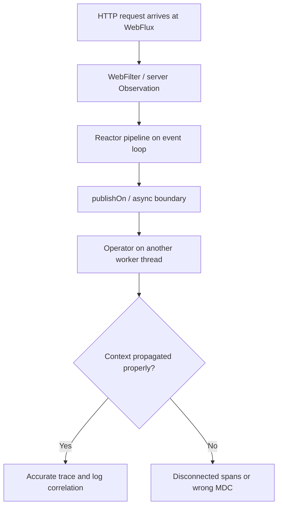
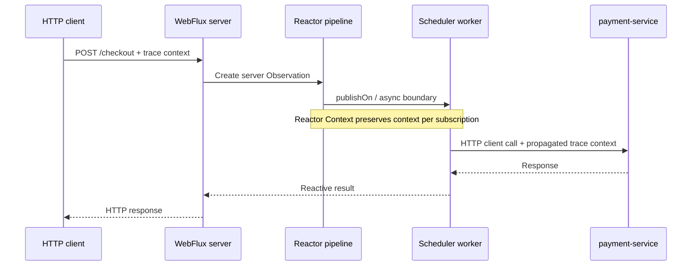
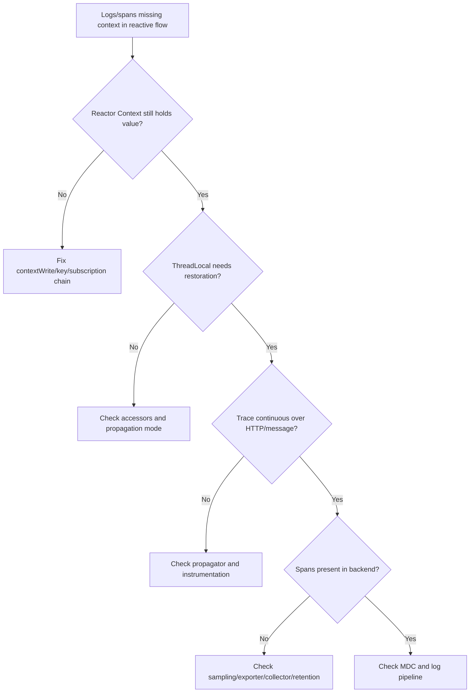

# Context over reactive pipelines in Spring Boot

In Spring WebFlux, a request can pass through multiple Reactor operators, switch from an event-loop thread to another scheduler, and continue processing asynchronously. If trace context, Observation, or correlation info sits solely in `ThreadLocal`, operators running on another thread may no longer be able to read that data. As a result, child spans fail to link to the original trace or logs lack `traceId`. To handle this, you need to understand **Reactor Context** and **Micrometer Context Propagation**.

This lesson **"Context over reactive pipelines"** belongs to the **Context propagation** chapter of the **SPRING_BOOT_OBSERVABILITY** module. The module teaches how to set up observability for Spring Boot with Micrometer Observation, metrics, logs, and distributed tracing; this lesson explains how context flows through reactive pipelines, the interaction between Reactor Context and ThreadLocal, and how to preserve trace/log correlation during asynchronous processing.

**Principle:** in Reactor code, use Reactor's Context as subscriber-scoped context; use Micrometer Context Propagation when crossing boundaries with ThreadLocal-based APIs or libraries. Do not assume ThreadLocal automatically follows a reactive chain just because the code belongs to the same HTTP request.

## 1. Why do reactive pipelines need a dedicated context mechanism?

In imperative programming, libraries can store current state in ThreadLocal, such as the current span or MDC fields for log correlation. A reactive pipeline does not guarantee that every operator runs on the same thread. `publishOn(Schedulers.parallel())` can move downstream processing to a different worker thread; `flatMap` coordinates multiple asynchronous publishers. A ThreadLocal set on thread A does not automatically appear on thread B.



A common problem when switching schedulers:

```java
static final ThreadLocal<String> REQUEST_ID = new ThreadLocal<>();

Mono<String> pipeline =
        Mono.just("order-42")
            .doOnNext(value -> log(REQUEST_ID.get()))
            .publishOn(Schedulers.parallel())
            .map(value -> "request=" + REQUEST_ID.get());
```

Even if the thread calling `subscribe()` set `REQUEST_ID`, operators after the scheduler switch can read `null` or an unrelated value. Reused scheduler threads can also leak data from previous tasks. Do not manually set/clear ThreadLocal in every operator; you need a scoped restoration mechanism that resets old values when the callback completes.

## 2. Subscription-scoped Reactor Context

Reactor provides `Context` and `ContextView` to store metadata tied to a **subscription**. Context has an immutable API: writing a key creates a new context with `put`, rather than sharing a mutable per-thread map.

| API | Role |
| --- | --- |
| `contextWrite(...)` | Writes/updates context for upstream operators |
| `deferContextual(...)` | Reads context at subscription time |
| `ContextView` | Interface for reading context |
| `contextCapture()` | Captures ThreadLocals with registered accessors at subscribe time and puts them into Reactor Context |
| `publishOn(...)` / `subscribeOn(...)` | Controls schedulers, not a context-writing API |

Example:

```java
Mono<String> greeting =
        Mono.deferContextual(ctx ->
                Mono.just("tenant=" + ctx.get("tenant")))
            .contextWrite(ctx -> ctx.put("tenant", "tenant-a"));
```

`contextWrite` is usually placed near the end of the chain because subscriptions propagate upward from the subscriber toward the source. It supplies context to operators upstream of it; hence `deferContextual` above reads `tenant-a`. Think in the direction of subscription, not the downstream direction of `onNext` data.

Context is partitioned per subscriber. Two concurrent requests can execute the same pipeline while holding distinct tenant/request references. Use clearly namespaced keys, avoid shared mutable objects, and do not store unnecessary secrets.

## 3. Differences between Reactor Context and ThreadLocal

| Criterion | Reactor Context | ThreadLocal |
| --- | --- | --- |
| Bound to | Subscription/reactive execution | Current thread |
| On thread switch | Continues following subscription | Does not move automatically |
| Access | ContextView/Reactor API | get() |
| Nature | Immutable API | Mutable per-thread |
| Best suited for | Reactive operators | Imperative/callback libraries |
| Risk | Reading wrong `contextWrite` direction | Lost context or data leak if not reset |

Micrometer Context Propagation bridges Reactor Context, ThreadLocal, and other contexts that have corresponding accessors. It does not replace Reactor Context and does not turn static variables into request-scoped ones.

## 4. Components of Micrometer Context Propagation

The `io.micrometer:context-propagation` library provides:

| Component | Responsibility |
| --- | --- |
| `ThreadLocalAccessor` | Reads, sets, and resets a ThreadLocal value by key |
| `ContextAccessor` | Converts a map/context-style context type |
| `ContextRegistry` | Manages registered accessors |
| `ContextSnapshot` | Holds a snapshot and supports restoring values within an execution scope |
| `ReactorContextAccessor` | Bridge enabling the library to understand Reactor Context/ContextView |

Since Reactor 3.5, Reactor Core supports the Micrometer Context Propagation SPI. `ReactorContextAccessor` is loaded via service loading; applications do not need to instantiate this internal accessor manually. Compatible `reactor-core` and `io.micrometer:context-propagation` dependencies are required.

An accessor describes the key, how to get the value, how to restore it, and how to reset the ThreadLocal. Prefer built-in accessors from Micrometer/Spring/Tracing; do not create duplicate accessors. Only register data that truly needs to cross boundaries and has clear reset rules.

## 5. Default mode and automatic mode

| Mode | Characteristics |
| --- | --- |
| Default/limited mode | Selected operators support restoring ThreadLocal from Reactor Context, such as `handle` and `tap`, when matching accessors are present |
| Automatic mode | Restores ThreadLocal state from Reactor Context across operator/thread boundaries via Reactor's mechanism |

Enable automatic mode via hook:

```java
import reactor.core.publisher.Hooks;

Hooks.enableAutomaticContextPropagation();
```

Enable it at application startup, before creating subscriptions that need propagation. This mode applies to **new subscriptions**; enabling it after a pipeline has already been subscribed to is not a reliable fix for in-flight subscriptions. Automatic mode still requires a valid context source and accessors; it does not conjure context out of thin air and does not replace trace propagation over HTTP/messaging.

In supported Spring Boot versions, you can configure:

```yaml
spring:
  reactor:
    context-propagation: auto
```

Verify the property against your project's Spring Boot version. Prefer Boot-managed configuration and avoid enabling hooks in multiple places.

## 6. Writing and reading context across service layers

Service definition:

```java
import reactor.core.publisher.Mono;

public final class OrderService {
    static final String REQUEST_REF = "requestRef";

    public Mono<String> loadOrder(String orderId) {
        return Mono.deferContextual(ctx -> {
            String ref = ctx.getOrDefault(REQUEST_REF, "unknown");
            return Mono.just("order=" + orderId + ", ref=" + ref);
        });
    }
}
```

Pipeline-creating layer writing context:

```java
@GetMapping("/orders/{id}")
public Mono<String> getOrder(@PathVariable String id) {
    return orderService.loadOrder(id)
            .contextWrite(ctx ->
                    ctx.put(OrderService.REQUEST_REF, "req-7f31"));
}
```

The reference in the example is hardcoded for illustration. Real applications must create/receive values at the appropriate boundary and never place personal info/secrets into Context without an explicit policy.

Services can compose publishers without passing context as parameters to every method:

```java
public Mono<String> loadOrderAndPayment(String orderId) {
    return orderService.loadOrder(orderId)
            .flatMap(order ->
                    paymentService.findPayment(orderId)
                            .map(payment -> order + ", " + payment));
}
```

As long as operators belong to the same subscription, each layer can read context via `deferContextual`. Do not call `subscribe()` inside a service to start an independent subscription; that detaches lifecycle, error handling, cancellation, and context from the caller.

## 7. Switching schedulers and contextCapture()

Reactor Context is attached to the subscriber, so it remains readable after `publishOn` or `subscribeOn`. The issue is APIs that read ThreadLocal inside callbacks, since ThreadLocal does not follow schedulers automatically.

```java
Mono<String> pipeline =
        Mono.deferContextual(ctx -> Mono.just(ctx.get("requestRef")))
            .publishOn(Schedulers.parallel())
            .flatMap(value ->
                    Mono.deferContextual(ctx ->
                            Mono.just(value + ":" + ctx.get("tenant"))))
            .contextWrite(ctx -> ctx
                    .put("requestRef", "req-91")
                    .put("tenant", "tenant-a"));
```

`subscribeOn(scheduler)` affects where subscription and upstream work start. `publishOn(scheduler)` switches downstream signal processing from that operator onward to the chosen scheduler. Neither is a context-writing API.

When a reactive chain starts from imperative code holding ThreadLocals, `contextCapture()` can capture ThreadLocals with registered accessors at subscription time:

```java
Mono<String> result =
        Mono.deferContextual(ctx ->
                Mono.just("tenant=" + ctx.get("tenant")))
            .contextCapture();
```

Keep in mind:

- Captures at **subscribe time**, not when constructing the publisher.
- If the ThreadLocal was already cleared before subscribing, the snapshot will miss the expected value.
- The accessor must be registered in ContextRegistry.
- Data naturally created inside a reactive chain should be written with `contextWrite`, not replaced by `contextCapture`.
- Do not use `block()` to force a pipeline into imperative code just to read a ThreadLocal.

## 8. Observation and tracing context in WebFlux

Micrometer Observation represents an operation; a tracing handler can turn an Observation into a span. Preserving observation/trace context across a pipeline ensures child spans link to the right trace and log correlation matches the active scope.



Distinguish the layers:

1. **Internal Reactor Context:** subscriber-scoped data.
2. **Observation/Tracing context:** information maintained by the framework/bridge and transferred via accessors.
3. **ThreadLocal/MDC:** per-thread view for imperative libraries and loggers.
4. **Distributed trace context:** headers such as W3C `traceparent` over HTTP or message carriers.

Reactor Context is not sent automatically to other services. A properly instrumented HTTP client uses the tracing propagator to inject trace context into outbound requests; the receiving service extracts it to continue the trace. Manually putting a `traceId` key into Reactor Context does not create spans or replace W3C propagation.

## 9. Spring Boot and `@Async` boundaries

Spring Boot observability uses Micrometer Context Propagation to move Observation context across threads and reactive pipelines. In reactive operators, ThreadLocal is not restored in every operator by default. The `spring.reactor.context-propagation` property can be set to `auto` on supported versions.

```yaml
spring:
  application:
    name: reactive-order-service
  reactor:
    context-propagation: auto

management:
  tracing:
    sampling:
      probability: 0.1
```

`probability: 0.1` is just a sampling example, not a universal recommendation. Choose sampling according to load, budget, and diagnostic needs. End-to-end tests may need a higher rate to verify traces.

Task executors are a different boundary from Reactor. For `@Async` or an auto-configured `AsyncTaskExecutor`, Spring Boot has a dedicated property:

```yaml
spring:
  task:
    execution:
      propagate-context: true
```

If configuring an executor manually, you can use `ContextPropagatingTaskDecorator`:

```java
@Bean
ContextPropagatingTaskDecorator contextPropagatingTaskDecorator() {
    return new ContextPropagatingTaskDecorator();
}
```

The decorator must be wired into the executor that actually uses it; merely declaring the bean does not guarantee every custom executor is wrapped. The property for Reactor and the property for task execution serve different boundaries.

## 10. Common mistakes

| Symptom | Possible cause | How to resolve |
| --- | --- | --- |
| `ThreadLocal.get()` returns null after `publishOn` | Different thread, not restored | Use Reactor Context and Context Propagation |
| Logs contain MDC from another request | ThreadLocal not reset/restored properly | Use accessors/scopes; verify cleanup |
| Child span becomes a new root trace | Tracing context lost at async/client boundary | Check bridge, propagation, instrumentation |
| `deferContextual` cannot find key | `contextWrite` placed in wrong spot or missing key | Check subscription direction |
| `contextCapture` misses value | Missing accessor or subscribed after ThreadLocal cleared | Register accessor, confirm subscribe timing |
| WebFlux has metrics but no traces | Missing tracing handler/exporter or sampling | Check tracing pipeline separately |
| `@Async` loses context despite Reactor auto enabled | Executor is a separate boundary | Enable task execution propagation or decorator |
| Context leaks across subscribers | Shared mutable object or broken cleanup | Use subscriber-scoped context; avoid mutable shared values |
| Calling `subscribe()` inside service | Detaches subscription from caller | Return `Mono`/`Flux` for caller composition |

Avoid:

```java
public void sendNotification(String orderId) {
    notificationClient.send(orderId).subscribe();
}
```

Prefer composition:

```java
public Mono<Void> sendNotification(String orderId) {
    return notificationClient.send(orderId);
}
```

The caller composes the publisher into the reactive chain; the final subscriber owns the execution lifecycle.

## 11. Testing context across thread boundaries

```java
import org.junit.jupiter.api.Test;
import reactor.core.publisher.Mono;
import reactor.core.scheduler.Schedulers;
import reactor.test.StepVerifier;

class ReactorContextTest {
    @Test
    void contextIsAvailableAfterSchedulerSwitch() {
        Mono<String> result =
                Mono.deferContextual(ctx -> Mono.just(ctx.get("requestRef")))
                    .publishOn(Schedulers.parallel())
                    .flatMap(value ->
                            Mono.deferContextual(ctx ->
                                    Mono.just(value + ":" + ctx.get("tenant"))))
                    .contextWrite(ctx -> ctx
                            .put("requestRef", "req-test")
                            .put("tenant", "tenant-test"));

        StepVerifier.create(result)
                .expectNext("req-test:tenant-test")
                .verifyComplete();
    }
}
```

This test proves Reactor Context can be read after switching schedulers. It **does not prove ThreadLocal restores automatically**; that requires a separate test with a `ThreadLocalAccessor` and the corresponding propagation mode.

When testing automatic mode, verify compatible dependencies, registered accessors, hook/property enabled before subscription, callbacks reading the restored ThreadLocal, and values reset after callbacks. Test success, exception, and cancellation paths; tests running solely on a single thread can mask bugs.

## 12. Diagnostic workflow when trace/log context is lost

1. **Identify the boundary:** operators before/after `publishOn`, `subscribeOn`, `flatMap`, or executor; is this a Reactor scheduler or `@Async`?
2. **Check Reactor Context:** use `deferContextual` on both sides. If Context is intact while ThreadLocal is missing, the issue lies in restoration/accessors.
3. **Check accessors/mode:** are dependencies present? Is `ThreadLocalAccessor` registered? Is Reactor in limited or automatic mode? Was the Boot property loaded?
4. **Check tracing:** which registry is used? Are tracing handler/bridge present? Is the HTTP client instrumented?
5. **Check outbound propagation:** is W3C `traceparent` injected/extracted across each service? Do not log full headers if they contain tokens/credentials.
6. **Check logs:** is MDC restored? Does the encoder emit `traceId`/`spanId`? Is ThreadLocal cleared?
7. **Check sampling/exporter:** if the app produces spans yet the backend lacks them, check sampler, OTLP exporter, Collector, and retention.



## 13. WebFlux practice lab

Run in local/test:

1. Add `spring-boot-starter-webflux` and `spring-boot-starter-actuator` via Spring Boot dependency management.
2. Create an endpoint returning `Mono`, write `requestRef` via `contextWrite`, and read it via `deferContextual`.
3. Insert `publishOn(Schedulers.parallel())` and read Context again; confirm subscriber-scoped values remain intact.
4. Create a mock ThreadLocal, register an accessor, and enable automatic propagation. Read the ThreadLocal on another scheduler; verify cleanup even on exceptions.
5. Add a business Observation; verify the Timer if the metrics handler is active and the span if the tracing handler is active.
6. Add a `Mono.error(...)` branch and cancellation; verify context does not leak to the next request.
7. Call another service using an instrumented HTTP client; confirm trace context is injected outbound and the receiving service continues the same trace.

## 14. Self-check questions

1. Why is ThreadLocal not a reliable context source across all Reactor operators?
2. Is Reactor Context bound to a thread or a subscription?
3. Which part of a chain does `contextWrite` affect as subscription propagates?
4. When should you use `deferContextual` instead of `ThreadLocal.get()`?
5. What roles do `ThreadLocalAccessor` and `ContextSnapshot` play?
6. How does default/limited mode differ from automatic mode?
7. Why should `Hooks.enableAutomaticContextPropagation()` be enabled before subscription?
8. When does `contextCapture` capture ThreadLocals?
9. Does `spring.reactor.context-propagation=auto` replace W3C `traceparent`?
10. Why does `@Async` require separate executor propagation configuration?
11. If Reactor Context still holds the key yet MDC lacks `traceId`, which layer should you inspect?
12. Why shouldn't a service call `subscribe()` inside business logic?
13. When can metrics still rise while spans appear disconnected?
14. How do you test cleanup when a pipeline errors or cancels?
15. Why shouldn't all metadata be placed into metric tags or baggage?

## References

- [Spring Boot Observability — Context Propagation](https://docs.spring.io/spring-boot/reference/actuator/observability.html): Reactor propagation and `@Async` propagation configuration.
- [Reactor Reference — Context-Propagation Support](https://projectreactor.io/docs/core/release/reference/advanced-contextPropagation.html): Reactor Context, limited/automatic modes, `contextCapture`, and hooks.
- [Micrometer Context Propagation — Purpose](https://docs.micrometer.io/context-propagation/reference/purpose.html): `ThreadLocalAccessor`, `ContextRegistry`, `ContextSnapshot`, and context transfer scenarios.
- [Micrometer Tracing — Context Propagation](https://docs.micrometer.io/tracing/reference/configuring.html): accessors for spans/baggage and Reactor Context.

## Conclusion

**Context over reactive pipelines must be managed per subscription; you cannot rely on the assumption that a request always stays on the same thread.** Reactor Context stores metadata per subscriber; Micrometer Context Propagation bridges Reactor Context and ThreadLocal when accessors exist; Spring Boot can enable automatic propagation for Reactor and separately configure task executors.

When you need trace/log correlation in WebFlux, check every boundary: Reactor operators, schedulers, imperative callbacks, HTTP clients, or message boundaries. Use Observation and tracing instrumentation to maintain span relationships, MDC for logs when configured, and metrics to track aggregate trends. Proper propagation keeps signals contextualized across reactive flows without turning trace IDs into metric labels or manually managing ThreadLocal in every operator.
