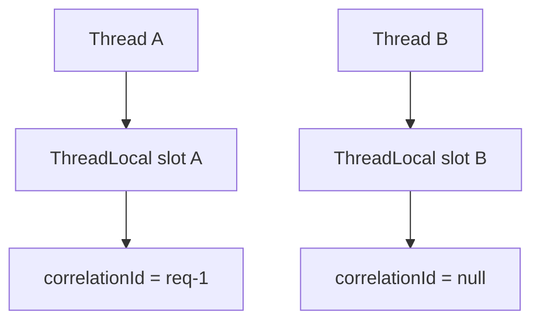
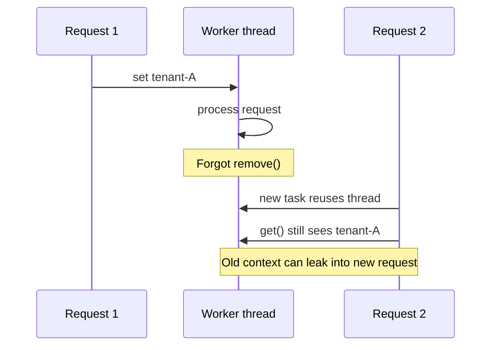
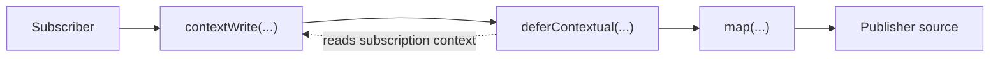
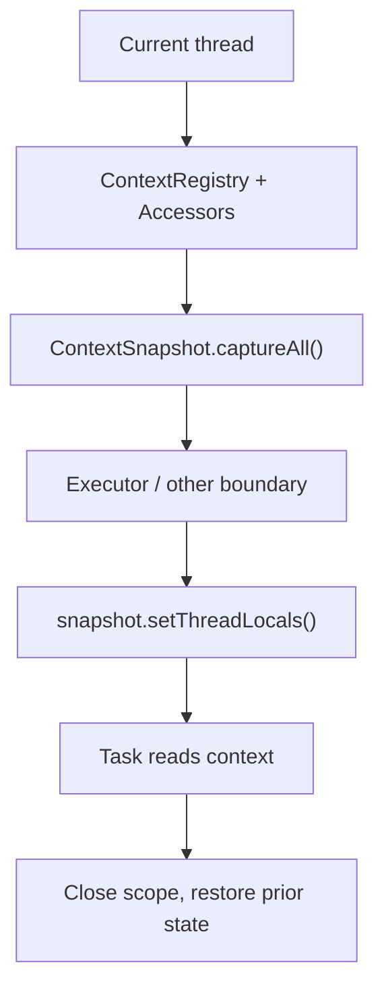

# ThreadLocal and Reactor Context in Spring Boot

A `POST /checkout` request can pass through multiple services, executors, and reactive operators before completing. At the start of the request, tracing creates a `traceId`; logging may put `traceId`/`spanId` into MDC; the application may attach tenant or diagnostic metadata. While code runs on the same thread, libraries can usually read the active context. However, when work moves to another thread or Reactor switches schedulers, data can disappear, get mixed across requests, or appear incorrectly in logs.

This lesson **ThreadLocal and Reactor Context** belongs to the **Context propagation** chapter of the **SPRING_BOOT_OBSERVABILITY** module. The module focuses on Micrometer Observation, metrics, logs, and distributed tracing, where context propagation, tags/cardinality, exporters, and sampling help correlate signals to investigate errors, latency, and application behavior in production.

After this lesson, you will be able to explain the difference between `ThreadLocal` and Reactor `Context`, understand why ThreadLocal runs into issues with thread pools/reactive code, use Micrometer Context Propagation to capture/restore context at appropriate boundaries, and test that tracing/logging context is neither lost nor leaked across requests.

## 1. What is context and why does it need propagation?

**Context** is data accompanying an operation while it executes. For example, within a request:

| Context data | Purpose |
| --- | --- |
| `traceId`, `spanId` | Links logs and spans to the request under investigation |
| Current Span/Observation | Creates child spans with the right parent and records scope |
| `correlationId` | Looks up related events according to application policy |
| Locale or authenticated tenant | Preserves processing context when switching to child tasks |
| Security context | Maintains principal/authorities per the framework's security mechanism |

Context propagation is the process of **transferring only permitted data** from where the task is created to where it executes, and then restoring the previous state after the task finishes.

Not all data needs propagation. Only transmit fields with a clear purpose, needed within the trust scope, and with a defined lifecycle. Do not use context propagation to spread passwords, access tokens, payment info, or personal data across services.

## 2. How does ThreadLocal work?

`ThreadLocal<T>` provides a separate value for **each thread**. When thread A calls `set(value)`, calling `get()` on thread A retrieves that value; thread B has its own storage slot and does not automatically see A's value.

```java
public final class RequestContext {
    private static final ThreadLocal<String> CORRELATION_ID =
        new ThreadLocal<>();

    private RequestContext() {}

    public static void set(String value) {
        CORRELATION_ID.set(value);
    }

    public static String get() {
        return CORRELATION_ID.get();
    }

    public static void clear() {
        CORRELATION_ID.remove();
    }
}
```

The code above illustrates the API, not a full-featured production context holder. Notice that ThreadLocal does not know which request owns the value; it only knows the current thread.



If code runs synchronously on A, `ThreadLocal.get()` can read the set context. When a task runs on B, it does not automatically inherit A's slot. You need a capture/restore mechanism or a different context model.

### Always clean up ThreadLocal in finally

Thread pools typically reuse worker threads across many requests. If a previous request sets a value without clearing it, the next request may read stale data:

```java
try {
    RequestContext.set(correlationId);
    handleRequest();
} finally {
    RequestContext.clear();
}
```

It must be cleared even when code throws an exception. `remove()` deletes the current thread's value; merely calling `set(null)` usually fails to clearly express releasing the slot's value.

**Do not store context in an ordinary mutable static field** and assume thread safety. ThreadLocal isolates values per thread, but does not automatically solve propagation, lifetime, or sensitive data handling.

## 3. Why is ThreadLocal dangerous with thread pools?

With a thread pool, a small number of worker threads handle many tasks. Threads do not terminate after each request, so ThreadLocal values can also survive across request boundaries if not cleaned up.



Common risks:

- **Context leakage:** tenant, correlation ID, or principal from a previous request appears in a later request.
- **Lost context:** task switches to another thread without capturing context.
- **Wrong restoration:** a child task sets a new context without restoring the parent context.
- **Memory retention:** large objects remain retained via thread-local slots for a long time.
- **Wrong trace parent:** a new span created on a thread without a current span becomes a root or links wrongly.

A proper `try/finally` reduces leakage risk on the current thread, but does not propagate context across executors. Both **propagation** and **cleanup** must be solved explicitly.

## 4. What is Reactor Context?

Reactor `Context` is a data store **bound to the subscriber/subscription**, used in reactive pipelines. It is not directly tied to a thread. Therefore, a pipeline can switch threads/schedulers and still access the subscription's context if operators and libraries use Reactor Context properly.

```java
import reactor.core.publisher.Mono;

Mono<String> result =
    Mono.deferContextual(context -> {
        String correlationId = context.get("correlationId");
        return Mono.just("processing " + correlationId);
    })
    .contextWrite(context ->
        context.put("correlationId", "checkout-req-42"));
```

`deferContextual` reads context at subscription time, whereas `contextWrite` creates context visible to upstream operators. In Reactor, context is immutable in its API usage: `put` returns a new context instead of mutating a shared map arbitrarily.

### Direction of context visibility in a pipeline

Reactor Context has a key rule: `contextWrite` affects operators **upstream of it** (closer to the source when reading left-to-right in pipeline representation), because context propagates upward from subscriber along the operator chain.



Because this order differs from how many people picture data flowing from publisher to subscriber, write a small test whenever adding `contextWrite` or moving operators. Do not guess that context will be visible at every position in the pipeline.

## 5. Comparing ThreadLocal and Reactor Context

| Property | `ThreadLocal` | Reactor `Context` |
| --- | --- | --- |
| Bound to | Thread | Subscription/subscriber context |
| Suited for | Synchronous code, current-thread-based APIs | Reactive pipelines |
| On thread switch | Does not propagate automatically | Follows subscription context if operators use it properly |
| On thread reuse | Risk of data leak if `remove()` is missed | Does not bind state directly to worker threads |
| How to read | `ThreadLocal.get()` | `deferContextual`, `Mono/Flux` context APIs |
| How to update | Writes to current thread's slot | Returns new context via `contextWrite` |
| Logging/tracing integration | Many libraries use thread-local scope/MDC | Requires appropriate bridge/context propagation |

Do not conclude that one mechanism is "better in every case." Spring MVC, servlet filters, and synchronous libraries can reasonably use ThreadLocal within the request thread scope. WebFlux/Reactor must rely on subscription context. Applications combining both need a bridge with an explicit lifecycle.

## 6. Micrometer Context Propagation as the bridge

Micrometer Context Propagation provides abstractions to **capture context from one place and restore it in another**. Common components:

- `ThreadLocalAccessor`: describes how to read, write, and clear a type of ThreadLocal.
- `ContextRegistry`: registers accessors so the library knows which contexts can be captured/restored.
- `ContextSnapshot`: snapshot of active context values.
- `ContextSnapshot.Scope`: scope that restores values for the current thread and reverts them when closed.
- Reactor integration: supports reading/writing between Reactor Context and registered thread-local accessors.



Context Propagation does not automatically know about every static variable or application field. You must register accessors for the contexts to propagate, use the proper integration, and limit the snapshot's scope.

## 7. Registering ThreadLocalAccessor and capture/restore

The following example illustrates an accessor for `RequestContext` from section 2:

```java
import io.micrometer.context.ThreadLocalAccessor;
import io.micrometer.context.ContextRegistry;

public final class CorrelationIdAccessor
        implements ThreadLocalAccessor<String> {

    public static final String KEY = "correlationId";

    @Override
    public Object key() {
        return KEY;
    }

    @Override
    public String getValue() {
        return RequestContext.get();
    }

    @Override
    public void setValue(String value) {
        RequestContext.set(value);
    }

    @Override
    public void setValue() {
        RequestContext.clear();
    }
}

// Register once during initialization:
ContextRegistry.getInstance()
    .registerThreadLocalAccessor(new CorrelationIdAccessor());
```

The `ThreadLocalAccessor` API may have signature/method differences across versions of Micrometer Context Propagation; this example demonstrates the getter/setter/clear idea. Use the exact API of your managed dependency and avoid registering the same accessor repeatedly on every request.

Once the accessor is registered:

```java
import io.micrometer.context.ContextSnapshot;
import java.util.concurrent.Executor;

void submitWithContext(Executor executor, Runnable task) {
    ContextSnapshot snapshot = ContextSnapshot.captureAll();
    executor.execute(() -> {
        try (ContextSnapshot.Scope scope = snapshot.setThreadLocals()) {
            task.run();
        }
    });
}
```

Execution path:

1. The request thread holds the correlation ID in `RequestContext`.
2. `captureAll()` collects values that have registered accessors.
3. The Runnable is submitted to the executor.
4. On the worker thread, `setThreadLocals()` installs the snapshot values onto the current thread.
5. The task runs and reads the correlation ID.
6. When the scope closes, previous values are restored so the worker thread is not polluted by the just-finished task's context.

**The scope must be closed**, because executors reuse threads. Do not create one snapshot at startup and reuse it across all requests; snapshots must be captured at the exact boundary when a task is submitted.

## 8. Using Reactor Context and Context Propagation together

In reactive applications, treat Reactor Context as the source of subscription-scoped context. Micrometer Context Propagation can connect Reactor Context with ThreadLocal when accessors are registered and integration is enabled.

A manual example using `contextCapture()`:

```java
import io.micrometer.context.ContextRegistry;
import reactor.core.publisher.Mono;

Mono<String> work =
    Mono.deferContextual(ctx ->
        Mono.just("correlationId=" + ctx.get("correlationId")))
    .contextCapture();
```

`contextCapture()` captures thread-local values that have registered accessors at subscription time and places them into Reactor Context for pipeline use. Because semantics and subscription placement matter, verify with actual code, especially when multiple `subscribeOn`, `publishOn`, nested subscriptions, or custom sources are involved.

A clearer example when the value already lives in Reactor Context:

```java
Mono<String> work =
    Mono.deferContextual(ctx ->
        Mono.just("tenant=" + ctx.get("tenant")))
    .contextWrite(ctx -> ctx.put("tenant", "tenant-blue"));
```

In this case, no ThreadLocal is needed to read `tenant`. Data can follow the subscription across schedulers without manually copying into every thread, provided operators stay within the same reactive chain.

### Automatic context propagation

Reactor provides automatic context propagation mode when the application enables the corresponding hook, for example:

```java
import reactor.core.publisher.Hooks;

// Call once at startup, after configuring ContextRegistry/accessors.
Hooks.enableAutomaticContextPropagation();
```

This hook enables Reactor to integrate context propagation with registered ThreadLocalAccessors across appropriate subscription boundaries. **This is a JVM/Reactor-wide change**, which can add overhead and alter ThreadLocal visibility for legacy code. Only enable it when you understand the impact, verify the Reactor/Micrometer version, and prefer configuring via Spring Boot integration if your version provides a supported configuration option.

Automatic propagation does not automatically propagate arbitrary ThreadLocal variables, does not replace registering accessors, and does not turn Reactor Context into a global ThreadLocal. Test actual subscribe/cancel/error paths.

## 9. publishOn, subscribeOn, and context

In Reactor, `publishOn` can move subsequent operator processing to another scheduler; `subscribeOn` affects where subscription and upstream execution start. The execution thread can change multiple times within a single pipeline:

```java
import reactor.core.publisher.Mono;
import reactor.core.scheduler.Schedulers;

Mono<String> result =
    Mono.deferContextual(ctx ->
        Mono.just("trace=" + ctx.getOrDefault("traceId", "missing")))
    .publishOn(Schedulers.parallel())
    .map(value -> value + " processed")
    .contextWrite(ctx -> ctx.put("traceId", "trace-123"));
```

Context belongs to the subscription, not a specific thread. Hence switching schedulers does not mean Reactor Context is lost. However, if a callback directly invokes a ThreadLocal API, it needs a bridge/integration so the ThreadLocal is restored at that callback point.

Example of reading properly in a reactive pipeline:

```java
Mono.deferContextual(ctx -> {
    String traceId = ctx.get("traceId");
    return Mono.just(traceId);
});
```

Whereas the following callback is not guaranteed to see the value without an appropriate bridge:

```java
Mono.fromRunnable(() -> {
    String traceId = RequestContext.get();
    use(traceId);
});
```

Do not assume `ThreadLocal.get()` always returns the right trace ID inside a reactive callback. If code depends on ThreadLocal, you must have a tested propagation bridge or refactor the API to read context reactively.

## 10. Spring Boot, WebFlux, and WebClient

Spring Boot can configure Observation/Tracing and support context propagation for the respective stacks. Behavior depends on version, dependencies, and how clients are created.

With WebFlux:

- Prefer Spring-managed `WebClient.Builder` to receive appropriate customizers/observation integrations.
- Avoid creating standalone `WebClient.builder()` instances outside configuration if default tracing/metrics propagation is needed.
- Read Reactor Context via `deferContextual` in reactive flows.
- Verify `traceId`/`spanId` on client and server spans after an actual request passes through a test server.
- Never call blocking APIs on the event loop to "keep context"; blocking can reduce throughput or cause deadlocks.

With `@Async` or `TaskExecutor`:

- Verify which executor is actually used and which context decorator/integration is configured.
- If ThreadLocal propagation is needed, use Micrometer Context Propagation or the appropriate Spring integration.
- Avoid registering accessors/decorators repeatedly on every submission.
- Close scopes/restore context even when tasks throw exceptions or get cancelled.

An application may simultaneously use servlet thread-local context and Reactor Context. Do not treat one mechanism as a global source of truth across all boundaries; clearly define where each piece of data lives, when it is captured, and where it is restored.

## 11. Tracing, Observation, and MDC

In Spring Boot observability, tracing typically uses scopes to identify the active span. Logging integration can place `traceId` and `spanId` into MDC so related log lines can be searched under the same trace.

A common Logback pattern example:

```text
%d{yyyy-MM-dd HH:mm:ss.SSS} trace=%X{traceId:-} span=%X{spanId:-} %-5level %logger - %msg%n
```

The pattern is only useful if tracing integration has placed MDC values in scope. When a task runs on another thread without context propagation, logs can:

- Lack `traceId`/`spanId`.
- Contain an old trace ID because ThreadLocal/MDC was not cleared.
- Contain another request's ID if custom code shares state improperly.

Micrometer Context Propagation can help capture/restore ThreadLocals that have accessors, but you must verify the actual MDC integration of your logging/tracing stack. Do not copy all MDC fields unconditionally; only the necessary and permitted ones.

**Correlating signals:** metrics indicate impact level (RPS, error rate, p95); traces show which spans a request went through; logs filtered by trace ID provide event details. Sampling may cause a request to have metrics and logs without a stored trace. Therefore, never put trace ID into metric tags to force dashboard linking.

## 12. Context propagation and security

Context propagation can also carry security data if accessors are registered carelessly. Security context is particularly sensitive because it can carry principals/authorities and affect execution permissions.

Principles:

1. Only propagate context that the task genuinely needs and that has clear ownership.
2. Use supported Spring Security mechanisms for security context; avoid arbitrarily copying principals/tokens into ThreadLocal.
3. Never propagate access tokens, refresh tokens, passwords, or cookies in baggage, MDC, or Observation tags.
4. Across service boundaries, send only approved HTTP/message headers; do not broadcast all internal context.
5. Bound the size and lifetime of context data.
6. Clear/restore state after the task; never let a subsequent request inherit permissions or tenant from a prior request.

Technical trace context (e.g., W3C `traceparent`) is not a credential and does not replace security context. Conversely, baggage should not be used to carry authentication data.

## 13. Testing ThreadLocal and Reactor Context

A good test must prove both that **context propagates properly** and that **context does not leak to the next task**.

### Testing Reactor Context

```java
import org.junit.jupiter.api.Test;
import reactor.core.publisher.Mono;
import reactor.test.StepVerifier;

class ReactorContextTest {
    @Test
    void readsValueFromSubscriptionContext() {
        Mono<String> source = Mono.deferContextual(ctx ->
            Mono.just(ctx.get("correlationId")))
            .contextWrite(ctx -> ctx.put("correlationId", "req-42"));

        StepVerifier.create(source)
            .expectNext("req-42")
            .verifyComplete();
    }
}
```

This test confirms that a publisher reads a value from Reactor Context. It does not prove ThreadLocal/MDC or tracing exporters are connected.

### Testing cleanup on a reused thread

Manual verification example with a single-thread executor:

```java
import java.util.concurrent.ExecutorService;
import java.util.concurrent.Executors;
import java.util.concurrent.Future;
import org.junit.jupiter.api.Test;
import static org.junit.jupiter.api.Assertions.*;

class ThreadLocalCleanupTest {
    @Test
    void clearsValueBeforeWorkerIsReused() throws Exception {
        ExecutorService executor = Executors.newSingleThreadExecutor();
        try {
            Future<String> first = executor.submit(() -> {
                try {
                    RequestContext.set("request-A");
                    return RequestContext.get();
                } finally {
                    RequestContext.clear();
                }
            });

            Future<String> second = executor.submit(RequestContext::get);

            assertEquals("request-A", first.get());
            assertNull(second.get());
        } finally {
            executor.shutdownNow();
        }
    }
}
```

If you remove `clear()` in the first task, the test can observe the stale value in the second task because the single-thread executor reuses the same worker. This test illustrates cleanup, not the Micrometer snapshot bridge.

### Testing propagation over an executor

When using Micrometer Context Propagation, tests should:

- Register the accessor once.
- Set the value on the test thread.
- Capture `ContextSnapshot`.
- Submit a task to an executor on another thread.
- Inside the task, assert the value is restored.
- Close `Scope` and submit another task to assert the value was restored/cleared.

For tracing, add an in-memory tracer/exporter and assert the child span has the same trace ID and appropriate parent span ID. For logging, capture log events and verify MDC fields are right in the task and absent in the following task.

## 14. Common mistakes

| Symptom | Possible cause | How to resolve |
| --- | --- | --- |
| `ThreadLocal.get()` returns `null` in async task | Task runs on another thread | Capture/restore context or use framework-native context |
| Next request sees old tenant/trace ID | Forgot `remove()` or didn't close scope | Use `try/finally`, test thread reuse |
| Reactor `Context` lacks key | `contextWrite` in wrong spot or mismatched key | Check operator order, subscription, and key |
| `ThreadLocal` has value in MVC but lost in WebFlux | Reactive pipeline switches threads or lacks bridge | Use Reactor Context, enable supported integration |
| Child span becomes root | Current span not propagated | Check scope and propagation across executor/client |
| Logs lack trace ID | MDC integration/scope inactive | Check tracing logging integration and async context |
| Logs show old request ID | MDC/ThreadLocal leaked | Restore/clear on all branches |
| `ContextSnapshot` empty | Accessor not registered or captured at wrong time | Check `ContextRegistry` and source thread |
| Automatic propagation increases overhead | Global hook restores many ThreadLocals | Limit accessors, benchmark performance, enable only when needed |
| Baggage contains sensitive data | Using propagation as a business data store | Remove fields, transmit only minimal context |
| Security context wrong in task | Manual copying incompatible with security model | Use supported Spring Security integration |

## 15. Real-world scenario: traceId lost after switching to executor

**Hypothetical scenario:** checkout-service receives a request, controller logs have `traceId`, yet a task submitted to an executor logs an empty `traceId`. The trace backend shows the HTTP server span without the background business span.

**Step 1 — Identify the boundary:** the controller runs on a servlet thread; the task runs on an executor worker thread. Servlet thread's ThreadLocal does not appear automatically on the worker.

**Step 2 — Check scope:** verify the active span was properly opened in the request and is still valid at capture time. If the task continues after the request ends, use an explicit span/lifecycle model rather than arbitrarily keeping the request scope open.

**Step 3 — Check propagation:** configure task decorator/integration or Micrometer Context Propagation with appropriate accessors. Capture at submit time, restore in the task, and close scope after processing.

**Step 4 — Check cleanup:** use a thread-reusing executor to verify the next task does not read stale trace/tenant values.

**Step 5 — Verify end-to-end tracing:** use a test tracer/exporter to check the background span has the right parent; log capture confirms trace ID; do not inspect just one log line.

**Step 6 — Analyze request boundaries:** if background work must continue after the response, determine clearly whether the span should be a child of the request, a linked span (link), or an independent trace. Do not keep the request scope alive just to preserve context for long-running work.

The expected outcome is that the task receives the exact technical context it needs, inherits no data from other requests, and has an observability lifecycle matching the nature of the work.

## 16. Self-check exercises

**Exercise 1.** Why does `ThreadLocal` work in a controller yet return `null` inside an executor task?

*Hint:* The two code blocks run on two different threads; ThreadLocal values do not propagate automatically.

**Exercise 2.** A worker thread serves request A and then request B. A sets a tenant in ThreadLocal without clearing it. What is the risk?

*Hint:* Threads are reused, so B may read A's tenant. Cleanup in `finally` and testing thread reuse are required.

**Exercise 3.** Is Reactor `Context` bound to a thread or a subscription?

*Hint:* Subscription. It can survive scheduler switches within the same reactive chain if operators use context properly.

**Exercise 4.** `contextWrite` does not let `deferContextual` read the key. What do you check first?

*Hint:* Position of `contextWrite` in the operator chain, propagation direction from subscriber upstream, key name, and whether the publisher has been subscribed to.

**Exercise 5.** Why must `ContextSnapshot.Scope` be closed in try-with-resources?

*Hint:* To restore the previous ThreadLocal state on the worker thread and prevent context from leaking to the next task.

**Exercise 6.** Does enabling `Hooks.enableAutomaticContextPropagation()` automatically propagate every ThreadLocal in the application?

*Hint:* No. Registered accessors and appropriate integration are needed, and scope/overhead must be evaluated; the hook does not know arbitrary variables.

**Exercise 7.** Should an access token be put into Reactor Context for all operators to use?

*Hint:* Not arbitrarily. Use proper security integration, limit scope, and never put tokens into baggage/logs/traces.

**Exercise 8.** Does a passing Reactor Context unit test prove that MDC trace ID propagates across WebClient and executors?

*Hint:* No. Integration tests across the actual WebClient/executor and verification of real spans/logging scopes are required.

## 17. Takeaways

- **ThreadLocal binds values to a thread**, whereas **Reactor Context binds values to a subscription**. They serve different execution models.
- Thread pools reuse workers; always restore/clear ThreadLocal in scopes/`finally` to prevent old context from leaking into new requests.
- Reactor Context has its own semantics: `contextWrite` affects upstream operators; use `deferContextual` to read and test when changing operator order.
- **Micrometer Context Propagation** uses accessors, a registry, and snapshots to capture/restore context across executors or bridge between Reactor Context and ThreadLocal.
- Automatic propagation is a broad-scoped hook; register accessors, check versions/overhead, and do not assume it propagates all data.
- In Spring Boot observability, tracing scope, MDC, WebClient, `@Async`, and security context require proper integration; a missing trace ID in a task is usually a sign of an unhandled propagation boundary.
- Only propagate **minimal, safe, and necessary context**. Test both that context reaches the right task and that it is restored/cleared before the worker is reused.
