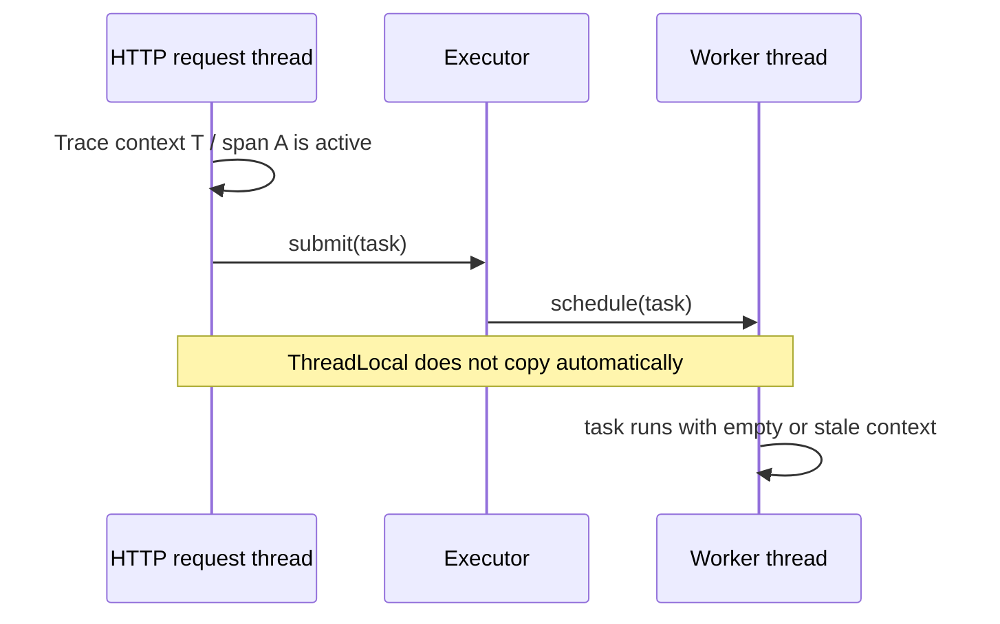
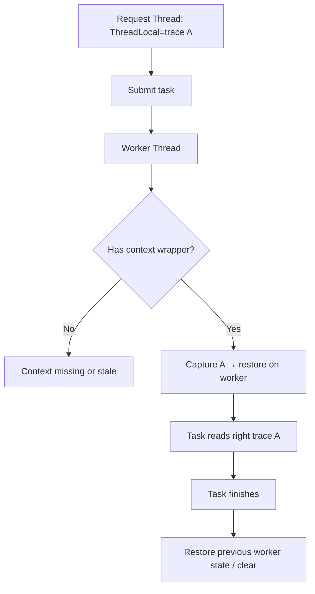

# Context propagation in async tasks

An HTTP request arrives at Order Service, the service validates the data, and then offloads sending an invoice to a thread pool for background processing. On the request thread, logs have a Trace ID and Span ID; however, when the worker thread starts running, logs lack those values. The trace backend only shows the initial HTTP span, while invoice sending disappears from the trace. This is a classic case where **context is not propagated across an asynchronous boundary**.

This lesson **Context propagation in async tasks** belongs to the **Context propagation** chapter of the **SPRING_BOOT_OBSERVABILITY** module. The module teaches how to set up observability for Spring Boot using Micrometer Observation, metrics, logs, and distributed tracing; mastering context propagation, tags/cardinality, exporters, sampling, and signal correlation to investigate errors, latency, and application behavior in production.

> **Core takeaway:** An async task usually runs on a different thread from the one that received the request. Context stored in **ThreadLocal**, such as tracing scope or MDC, **does not automatically move to the new thread**. You must capture context where the task is submitted, restore context when the task executes, and restore the prior state after the task finishes. For tracing, the worker can create a new child span; it does not need and should not share the Span ID of the request thread's span.

## 1. Learning objectives

After this lesson, you will be able to:

1. Explain why context stored in ThreadLocal does not automatically cross Executor, CompletableFuture, or @Async.
2. Distinguish context capture, propagation, restoration, and cleanup.
3. Configure a Spring task executor with TaskDecorator or ContextPropagatingTaskDecorator.
4. Use ContextSnapshot and ThreadLocalAccessor to propagate custom context.
5. Understand the roles of ObservationRegistry, Micrometer Tracing, and MDC in correlation.
6. Propagate context properly when using CompletableFuture, Reactor, and asynchronous tasks.
7. Prevent leakage of Trace IDs or user data between tasks on a thread pool.
8. Distinguish child spans from new spans linked via Span Links based on work semantics.
9. Write deterministic propagation tests and investigate incidents when traces break.

## 2. What problem does context propagation solve?

In synchronous execution, a request can pass through many methods on the same thread. Tracing scopes or MDC typically rely on ThreadLocal to answer "what is the current context?". When the program submits a task to an executor, the worker thread may be pulled from a pool and may have previously executed another task.



If context is not propagated:

- Worker logs lack `traceId`/`spanId`.
- Tracing may start a new trace unrelated to the original request.
- Some logs may carry stale context if the thread pool leaks ThreadLocals.
- Child Observations do not get the right parent, splitting the trace tree.
- Security or tenant context can be lost, causing incorrect behavior if code depends on those contexts.

**Context propagation** is the mechanism of transferring appropriate context values across execution boundaries so worker code can read the context belonging to the running task.

### 2.1 Common types of context

| Context | Information | Where usually stored | Effect when async |
|---|---|---|---|
| Tracing context | Trace ID, active Span ID, baggage/parent | Tracer scope, often with ThreadLocal accessor | Preserves parent-child relations and trace continuity. |
| Logging context | MDC fields like traceId, spanId, request category | SLF4J MDC / Logback MDC | Worker logs can be searched by trace. |
| Security context | Principal, authorities | Spring SecurityContextHolder | Preserves caller when business logic is authorized to run under that identity. |
| Tenant context | Tenant ID or partition | Custom ThreadLocal/framework context | Separates tenant data accurately. |
| Locale/request metadata | Locale, correlation metadata | Request context or custom accessor | Retains necessary metadata for the worker. |
| Reactor Context | Subscription-bound context | Reactor Context | Propagates context along reactive pipelines, independent of specific threads. |

Not all data should be propagated. Only propagate values that are genuinely needed; avoid copying whole request objects, credentials, or sensitive data into background tasks out of convenience.

## 3. Why doesn't ThreadLocal cross thread pools automatically?

ThreadLocal binds values to the **current thread**. When the request thread writes:

```java
TraceContextHolder.set("trace-123");
```

the value sits in the request thread's slot. When an executor runs the task on another worker, calling:

```java
TraceContextHolder.get();
```

reads the worker thread's slot, not the request thread's slot.

Thread pools make the problem subtler: workers are reused. If a previous task writes to ThreadLocal without clearing it, the next task may mistakenly read stale data. Cleanup is therefore not an optional detail; it is a correctness requirement for propagation.



### 3.1 Capture must occur at submission time

A context snapshot needs to be taken while code is still in the request context:

```text
Request thread:
  active trace = T
  capture snapshot T
  executor.submit(wrap(snapshot, task))

Worker thread:
  restore snapshot T
  run task
  close scope / restore previous context
```

If you only read ThreadLocal when the task begins on the worker, it can already be too late: the worker lacks the submitting request's context. A wrapper or executor integration is needed to capture on the submit side, rather than having the worker look for context once it starts.

## 4. Context propagation vs. creating a new span

The two operations are related but distinct:

- **Propagate context:** transfer active context across a thread boundary so work can continue within the same trace.
- **Create a span:** start a unit of work with its own Span ID, using a parent context obtained from the propagated context.

Example:

```text
HTTP server span:
  traceId = T
  spanId  = A

Submit async task with context:
  traceId = T
  current span context = A

Worker creates span:
  traceId = T
  spanId  = B
  parentSpanId = A
```

The new span on the worker has ID B; its parent is span A. If you propagate context without instrumenting the worker's work, the trace can carry context onward without a detailed span for that work segment. If you create a span without a valid parent context, the tracer can start an independent trace.

**Do not reuse Span ID A as the worker's Span ID.** Every new span needs its own ID.

### 4.1 When should a task not be kept as a child span?

A task pushed to a queue and executed hours later may no longer align with the lifetime of the submitting HTTP request. Forcing the request span to stay open for hours can make traces overly long and resource-heavy; the parent span may have already ended before the task runs.

Depending on the business model and messaging semantics, you can create a **new trace** for the consumer/job and attach a **Span Link** to the producer/request span. A link expresses causality without forcing the child span to fit inside the parent's lifetime. Choose based on whether it means "part of the same operation" or "independent work triggered by a prior operation."

## 5. Key API classes in Micrometer and Spring

| API/component | Role | When to use |
|---|---|---|
| ObservationRegistry | Manages observation lifecycle and handlers | Instrument business logic to produce metrics/traces. |
| io.micrometer.tracing.Tracer | Accesses current span, creates spans via tracing facade | Need explicit tracing operations. |
| ContextRegistry | Registers ThreadLocalAccessor/context accessors | So snapshots know how to read/write context. |
| ThreadLocalAccessor | Defines getting, setting, and resetting a context value | Custom context or library integration. |
| ContextSnapshot | Snapshot of registered contexts; can open a temporary restore scope | Capture at submit, restore during execution. |
| TaskDecorator | Wraps a Runnable before an executor runs it | Propagate context into a Spring TaskExecutor. |
| ContextPropagatingTaskDecorator | Spring's TaskDecorator using Micrometer Context Propagation | Transfer registered contexts to tasks. |
| Reactor Context | Context attached to a reactive subscription | Propagation in Mono/Flux pipelines. |

Micrometer Context Propagation is the bridge layer between ThreadLocal-based context models and models like Reactor Context. It does not replace the tracer, logger, or security framework; it provides a capture/restore mechanism for registered accessors.

## 6. Configuring Spring @Async with ContextPropagatingTaskDecorator

In Spring Framework 6.1+, `ContextPropagatingTaskDecorator` is available in the `org.springframework.core.task.support` package. It uses Micrometer Context Propagation to capture/restore contexts that have appropriate accessors.

### 6.1 Dependencies

With Spring Boot including Actuator and Micrometer Observation/Tracing, dependency management may already provide the needed components. If using Context Propagation explicitly, the artifact is `io.micrometer:context-propagation`. Gradle example when declared directly (version should follow your project's dependency management/BOM):

```groovy
dependencies {
    implementation 'org.springframework.boot:spring-boot-starter-actuator'
    implementation 'io.micrometer:context-propagation'
}
```

If traces actually need to be exported, you must also declare a tracing bridge/starter and exporter matching your Spring Boot version. Context Propagation alone does not create a trace backend.

### 6.2 Declaring executor and decorator

```java
import org.springframework.context.annotation.Bean;
import org.springframework.context.annotation.Configuration;
import org.springframework.core.task.TaskExecutor;
import org.springframework.core.task.support.ContextPropagatingTaskDecorator;
import org.springframework.scheduling.annotation.EnableAsync;
import org.springframework.scheduling.concurrent.ThreadPoolTaskExecutor;

@Configuration(proxyBeanMethods = false)
@EnableAsync
public class AsyncConfiguration {

    @Bean(name = "applicationTaskExecutor")
    public TaskExecutor applicationTaskExecutor() {
        ThreadPoolTaskExecutor executor = new ThreadPoolTaskExecutor();
        executor.setCorePoolSize(4);
        executor.setMaxPoolSize(8);
        executor.setQueueCapacity(100);
        executor.setThreadNamePrefix("app-async-");
        executor.setTaskDecorator(new ContextPropagatingTaskDecorator());
        executor.initialize();
        return executor;
    }
}
```

**What does this configuration mean?**

- `@EnableAsync` enables executing `@Async` methods via an executor.
- `ThreadPoolTaskExecutor` manages worker threads, avoiding creating a new thread for each task.
- `ContextPropagatingTaskDecorator` wraps tasks to propagate contexts registered with Micrometer.
- The thread prefix helps identify workers in logs/thread dumps.
- Queue capacity and pool sizes are operational parameters that must fit your workload; the numbers in the example are not universal production settings.

`ContextPropagatingTaskDecorator` is present in Spring Framework 6.1+. With Spring Boot 3.x using Framework 6.1 or newer, this API is available; if the project is pinned to an older Framework version, upgrade for compatibility or write a decorator with `ContextSnapshot`.

### 6.3 Using @Async

```java
import org.slf4j.Logger;
import org.slf4j.LoggerFactory;
import org.springframework.scheduling.annotation.Async;
import org.springframework.stereotype.Service;

@Service
public class InvoiceService {
    private static final Logger log =
            LoggerFactory.getLogger(InvoiceService.class);

    @Async("applicationTaskExecutor")
    public void sendInvoice(String orderReference) {
        log.info("Sending invoice for order");
        // Call the invoicing system here.
    }
}
```

When the method is called through a Spring proxy from another bean, the task is submitted to the executor named `applicationTaskExecutor`. If the decorator and context accessors are configured, registered MDC/tracing contexts can appear in the worker. **Self-invocation** (one method in the same object calling an `@Async` method on itself) usually bypasses the proxy and does not run asynchronously as expected.

Do not pass the entire HTTP request or mutable request-scoped objects into a background task. Usually pass only the required identifier or an immutable command, and have the worker fetch data via services/persistence with appropriate permissions.

### 6.4 @Async does not guarantee task success

`@Async` only defines how dispatch happens. Consider:

- The executor queue is full and rejects the task.
- An error occurs inside the async method.
- A `void` return type means the caller gets no direct result; use `Future`/`CompletableFuture` when tracking is needed.
- The request thread finishes before the worker runs; the tracing span may need to finish independently or use a link depending on semantics.
- Context propagation works, yet the task still fails due to dependencies, timeouts, or changed data.

Propagation preserves metadata accurately; it does not handle retries, durability, or delivery guarantees.

## 7. Writing a custom TaskDecorator with ContextSnapshot

`ContextPropagatingTaskDecorator` is the concise choice when using registered accessors. If you need finer control, you can capture a snapshot when Spring calls `decorate(...)` and open a scope when the task runs.

```java
import io.micrometer.context.ContextSnapshot;
import io.micrometer.context.ContextSnapshotFactory;
import org.springframework.core.task.TaskDecorator;

public final class SnapshotTaskDecorator implements TaskDecorator {

    private final ContextSnapshotFactory snapshotFactory =
            ContextSnapshotFactory.builder().build();

    @Override
    public Runnable decorate(Runnable task) {
        // decorate typically runs on the submit side:
        // capture context from the submitting thread.
        ContextSnapshot snapshot = snapshotFactory.captureAll();

        return () -> {
            // Scope.close() restores the worker's previous context.
            try (ContextSnapshot.Scope scope = snapshot.setThreadLocals()) {
                task.run();
            }
        };
    }
}
```

This is an example of the Micrometer Context Propagation API; verify signatures against your locked dependency version. `captureAll()` only captures contexts that `ContextRegistry` recognizes through accessors. If tracing/MDC/custom contexts lack appropriate accessors or integrations, the snapshot cannot guess how to retrieve values.

**Avoid writing naive decorators like "get ThreadLocal then set on worker" without restoring the prior state.** Worker thread pools reuse threads; when a task ends, the prior value must be restored or cleared properly so the next task does not read the previous task's context.

### 7.1 Why use try-with-resources?

`snapshot.setThreadLocals()` returns a scope. Closing the scope restores the context values that existed on the worker before the task started. Even if the task throws an exception, try-with-resources still calls `close()`.

General pattern:

```java
ContextSnapshot snapshot = snapshotFactory.captureAll();

executor.execute(() -> {
    try (ContextSnapshot.Scope ignored = snapshot.setThreadLocals()) {
        doWork();
    }
});
```

Never call `setThreadLocals()` and forget to close it; that mistake easily leaks MDC/ThreadLocal across tasks.

## 8. Propagating custom ThreadLocal with ThreadLocalAccessor

Micrometer only captures contexts that the registry knows about. If the application builds its own tenant context or correlation metadata with ThreadLocal, register a corresponding `ThreadLocalAccessor`.

Simple example:

```java
import io.micrometer.context.ContextRegistry;
import io.micrometer.context.ThreadLocalAccessor;

public final class TenantContext {

    private static final ThreadLocal<String> CURRENT = new ThreadLocal<>();

    private TenantContext() {}

    public static String get() {
        return CURRENT.get();
    }

    public static void set(String tenantId) {
        CURRENT.set(tenantId);
    }

    public static void clear() {
        CURRENT.remove();
    }

    public static void registerAccessor() {
        ContextRegistry.getInstance().registerThreadLocalAccessor(
                new ThreadLocalAccessor<String>() {
                    @Override
                    public Object key() {
                        return "tenantId";
                    }

                    @Override
                    public String getValue() {
                        return TenantContext.get();
                    }

                    @Override
                    public void setValue(String value) {
                        if (value == null) {
                            TenantContext.clear();
                        } else {
                            TenantContext.set(value);
                        }
                    }

                    @Override
                    public void reset() {
                        TenantContext.clear();
                    }
                });
    }
}
```

Register the accessor **once during startup**, never repeatedly on every request. Real configuration must use the accessor API compatible with your version and avoid mutating the `ContextRegistry` singleton while tasks are concurrently running.

### 8.1 Snapshot only holds supported contexts

Once `TenantContext` is registered:

```java
TenantContext.set("tenant-a");

ContextSnapshot snapshot = ContextSnapshotFactory.builder()
        .build()
        .captureAll();

TenantContext.clear();

try (ContextSnapshot.Scope ignored = snapshot.setThreadLocals()) {
    // Worker can now read tenant-a.
    String tenant = TenantContext.get();
}
```

When the scope closes, the previous tenant context state on the current thread is restored. In production, do not automatically turn tenant ID into high-cardinality span/metric tags unnecessarily; tenant context is primarily for routing/authorization and should be governed separately.

### 8.2 Custom context does not replace Spring Security

Spring Security has dedicated mechanisms to propagate `SecurityContext` across executors, such as `DelegatingSecurityContextAsyncTaskExecutor`. When using Spring Security, prefer the official version-appropriate integration; do not manually copy principals/authorities with a generic `ThreadLocalAccessor` if doing so bypasses security lifecycles or risks identity leakage.

Similarly, do not propagate transaction contexts across thread pools simply by copying an ID. Transaction managers and thread-bound resources have their own rules; start a new transaction boundary in the worker when needed, and never share non-thread-safe connections/sessions.

## 9. CompletableFuture and Executor

`CompletableFuture.supplyAsync(...)` uses the common `ForkJoinPool` if no executor is passed. When the application has an instrumented task executor, pass that executor so propagation runs as configured.

### 9.1 Using a Spring-managed executor

```java
import java.util.concurrent.CompletableFuture;
import java.util.concurrent.Executor;
import org.springframework.beans.factory.annotation.Qualifier;
import org.springframework.stereotype.Service;

@Service
public class OrderWorkflow {

    private final Executor applicationTaskExecutor;

    public OrderWorkflow(
            @Qualifier("applicationTaskExecutor") Executor executor) {
        this.applicationTaskExecutor = executor;
    }

    public CompletableFuture<String> createOrderAsync() {
        return CompletableFuture.supplyAsync(
                this::performOrderWork,
                applicationTaskExecutor);
    }

    private String performOrderWork() {
        return "created";
    }
}
```

Declare the executor bean and decorator from the earlier section. Do not assume `CompletableFuture.supplyAsync(...)` automatically uses Spring's executor.

### 9.2 Multiple stages can switch threads

```java
CompletableFuture.supplyAsync(this::loadOrder, executor)
        .thenApplyAsync(this::calculateTotal, executor)
        .thenApplyAsync(this::formatResult, executor);
```

Async stages run on the passed executor (or the common pool if using overloads without an executor). If each boundary needs context, the executor/decorator must cover those dispatches. Non-async stages may run on whichever thread completed the previous stage; do not rely on a specific thread, rely on the context abstraction instead.

For futures combined from multiple distinct trace contexts, you cannot "propagate all" into a single parent without rules. Choose a primary context, or create a new span with links to the related sources if supported by your use case.

## 10. Reactor: subscription-bound Context, not pure ThreadLocal

In Reactor, execution can move between threads. Reactor Context is attached to the subscription and travels along the pipeline; it is the natural place to store reactive context. Relying directly on ThreadLocal across `publishOn`/`subscribeOn` is error-prone.

### 10.1 Subscription-bound context example

```java
import reactor.core.publisher.Mono;

Mono<String> flow =
        Mono.deferContextual(context -> {
            String requestId = context.get("requestId");
            return Mono.just("processing " + requestId);
        })
        .contextWrite(context -> context.put("requestId", "req-42"));
```

`deferContextual` reads context at subscription time; `contextWrite` attaches values to Reactor Context. Context is not read as mutable thread state; it belongs to the subscriber and propagates across compatible operators.

### 10.2 From Reactor Context to ThreadLocal and back

Micrometer Context Propagation provides accessors/bridges to integrate registered contexts with Reactor. Depending on configuration, Reactor instrumentation can restore ThreadLocal values when callbacks run and capture appropriate context at operator boundaries.

In applications where Spring Boot/Micrometer/Reactor support it, you can intentionally enable automatic context propagation:

```java
import reactor.core.publisher.Hooks;

public final class ReactorContextConfiguration {
    public static void enableContextPropagation() {
        Hooks.enableAutomaticContextPropagation();
    }
}
```

This is a global hook in Reactor; enable it once in application configuration, not toggled per request. Read the guide for your Reactor and Micrometer versions: automatic propagation can incur overhead, and you should not assume all Reactor versions/callback styles share identical semantics.

When ThreadLocal restoration is only needed at selected operators, Micrometer operators such as `contextCapture()` may be more appropriate, though you must clearly verify the capture side and subscription lifecycle. Avoid stacking multiple propagation mechanisms at once without checking whether they overwrite the same keys.

### 10.3 @Async and Reactor are two different models

- `@Async` dispatches methods through a Spring `TaskExecutor`; a `TaskDecorator` can wrap the `Runnable`.
- Reactor propagates context via subscriptions; a `TaskDecorator` does not replace Reactor Context.
- A pipeline may call a blocking executor, requiring propagation at the Reactor ↔ executor boundary as well.
- If the framework already instruments the reactive stack, avoid inserting redundant custom wrappers.

## 11. Context propagation with Micrometer Observation and Tracing

An Observation has a lifecycle and a scope. When an Observation scope is opened, the active context can be used by tracing handlers, logging correlation, and child instrumentation.

A synchronous flow:

```java
Observation.createNotStarted("invoice.send", observationRegistry)
        .contextualName("send invoice")
        .observe(() -> invoiceGateway.send());
```

If `observe` runs synchronously, the Observation helper manages scope inside the callback. If the callback only submits a task and returns, the caller's Observation can stop as soon as the task is enqueued, before the worker actually executes.

**This is a very common async measurement mistake:**

```java
// Wrong if you want to measure the full worker execution duration.
observation.observe(() -> executor.execute(this::sendInvoice));
```

The Observation stops when `execute` returns, rather than waiting for `sendInvoice` to finish. For async work, own the lifecycle inside the worker or create a dedicated observation/span inside the worker under the propagated context.

### 11.1 Example of a worker creating its own Observation/span

```java
import io.micrometer.observation.Observation;
import io.micrometer.observation.ObservationRegistry;

public class InvoiceWorker implements Runnable {

    private final ObservationRegistry observations;

    public InvoiceWorker(ObservationRegistry observations) {
        this.observations = observations;
    }

    @Override
    public void run() {
        Observation.createNotStarted("invoice.send", observations)
                .contextualName("send invoice")
                .observe(this::sendToProvider);
    }

    private void sendToProvider() {
        // Call provider here.
    }
}
```

If `TaskDecorator` properly propagated the parent context, the new Observation in the worker can become a child span of the active context. Whether the tracing handler creates a span depends on the configured tracing and whether the context stays live per semantics; inspect actual traces. Custom code does not have to manually call `tracer.nextSpan()` when Observation already creates spans at the right boundaries.

### 11.2 Tracing context and MDC can propagate together

Micrometer Tracing has integrations to place the active `traceId` and `spanId` into MDC. Context Propagation can restore the corresponding accessors on the worker, keeping logging correlation working.

If code creates its own MDC fields, remember they do not automatically sync with tracer context. Calling `MDC.put("traceId", ...)` does not create a span, does not inject HTTP `traceparent`, and does not guarantee propagation to other services. Let tracing integration manage IDs, and use MDC only for appropriate correlation fields.

## 12. Cleanup and context leakage risks

Thread pools reuse threads, so context after a task must be restored. The right pattern is to capture a snapshot, open a scope, run the task, and close the scope across all branches.

### 12.1 Illustrating MDC leakage

Wrong:

```java
executor.execute(() -> {
    MDC.put("traceId", requestTraceId);
    doWork();
    // Forgot MDC.clear/remove.
});
```

The worker can run another task and retain the old `traceId`, producing miscorrelated logs. Use a context snapshot/decorator; if managing MDC manually, save the old state and restore it in `finally` rather than blindly clearing values that might belong to an enclosing scope.

### 12.2 Calling clear is not always right

A worker may already have context before a wrapper opens a scope. `ContextSnapshot.Scope.close()` is designed to restore the previous state. Calling `MDC.clear()` after a wrapper can wipe valid caller or framework context if wrappers are nested. Let the scope mechanism own the corresponding cleanup.

### 12.3 Cancellation and exceptions

A task can end via completion, exception, interrupt, or cancellation. Cleanup must run in all cases:

```java
try (ContextSnapshot.Scope ignored = snapshot.setThreadLocals()) {
    task.run();
} // close always runs even if task.run() throws an exception
```

If using `Future.cancel`, ensure the task supports cooperative cancellation and Observations/spans in the worker stop when the work actually ends. Propagation does not automatically prevent resource leaks or halt execution.

## 13. Testing context propagation

Do not only test that "the task runs." Verify that the worker has the right context and that context does not leak to the next task.

### 13.1 Testing custom ThreadLocal

Test concept:

```java
import static org.junit.jupiter.api.Assertions.assertEquals;
import java.util.concurrent.ExecutorService;
import java.util.concurrent.Executors;
import java.util.concurrent.Future;
import io.micrometer.context.ContextSnapshot;
import io.micrometer.context.ContextSnapshotFactory;
import org.junit.jupiter.api.Test;

class ContextPropagationTest {

    @Test
    void restoresCapturedTenantOnWorker() throws Exception {
        TenantContext.registerAccessor();
        TenantContext.set("tenant-a");
        ContextSnapshotFactory factory =
                ContextSnapshotFactory.builder().build();
        ContextSnapshot snapshot = factory.captureAll();

        ExecutorService executor = Executors.newSingleThreadExecutor();
        try {
            Future<String> result = executor.submit(() -> {
                try (ContextSnapshot.Scope ignored = snapshot.setThreadLocals()) {
                    return TenantContext.get();
                }
            });
            assertEquals("tenant-a", result.get());
        } finally {
            executor.shutdownNow();
            TenantContext.clear();
        }
    }
}
```

The example uses `ExecutorService` with explicit shutdown for Java 17 compatibility. In real projects, register accessors once in test setup, isolate `ContextRegistry` between tests, and ensure cleanup on the worker as well.

### 13.2 Testing context cleanup on a worker

After the task runs and the scope closes, submit a second task **with no snapshot** on the same single-thread executor; the second task must see an empty context or the worker's own baseline, never `tenant-a`. This is a critical check for detecting ThreadLocal leakage.

### 13.3 Testing tracing

To verify real tracing:

1. Send an HTTP request through an instrumented endpoint.
2. Submit an async task using the decorated executor.
3. Inside the worker, create a dedicated Observation/span.
4. Export traces to an appropriate test reporter/collector.
5. Verify the Trace ID is preserved, the worker's Span ID is new, and the parent relationship is right.
6. Run a subsequent task on the same worker with no parent and verify it does not inherit the old request's Trace ID.
7. Also test exception/cancel branches to confirm scopes are closed.

Do not use long `Thread.sleep` calls to test timing. Use latches/futures and controlled test instrumentation; if exact duration testing is needed, use Micrometer `MockClock` for the metrics side.

## 14. Troubleshooting lost context incidents

**Scenario:** API request logs have a trace ID, yet worker logs do not; the trace backend only displays the HTTP server span.

Investigation workflow:

1. **Identify the actual executor:** which bean is `@Async` using? Is `CompletableFuture` using the common pool? Are there raw `new Thread` calls or library-managed threads?
2. **Check the dispatch point:** was the snapshot captured on the submitting thread? Is a decorator/context-propagating executor actually wrapping the task?
3. **Check accessors:** do tracer/MDC/custom contexts have matching accessors or integrations in the registry?
4. **Check the worker:** is `Tracer.currentSpan()` null, an old span context, or the active context? Log thread names and IDs in a test environment.
5. **Check parent-child:** does the worker create a new span under the parent context? If the task has an independent lifecycle, should it use a span link or a new trace?
6. **Check cleanup:** after the task, does the worker still retain a prior request's ThreadLocal?
7. **Check exporter/sampling:** spans might be created yet dropped by sampling, never ended, or dropped by the collector; do not blame every missing trace on propagation.
8. **Verify:** run two consecutive tasks on one worker to confirm neither missing context nor leakage occurs.

### 14.1 Symptoms and causes

| Symptom | Possible cause | What to check |
|---|---|---|
| Worker log lacks traceId | Context not captured/restored. | TaskDecorator or ContextSnapshot. |
| Worker has traceId but no business span | No Observation/span created inside worker. | Instrument the async boundary properly. |
| Worker has a different traceId from request | Context propagation lost, started a new trace. | HTTP/task context at dispatch boundary. |
| Worker log carries previous task's traceId | ThreadLocal not cleaned up or buggy wrapper. | Scope close/restore and thread pool reuse. |
| Async method does not run asynchronously | Self-invocation or wrong executor qualifier. | Spring proxy and executor bean. |
| CompletableFuture lacks context | Using uninstrumented common pool. | Pass configured executor. |
| Reactor context lost after publishOn | Relying on ThreadLocal or unconfigured bridge. | Reactor Context and Micrometer propagation support. |
| Span appears with wrong parent | Snapshot captured at wrong time or nested scopes. | Capture at submit, parent context, and nesting. |
| traceId in logs but trace missing in backend | Sampling, exporter, collector, retention. | Tracing pipeline and sampling policy. |
| Tenant/security context mixed up | Faulty accessor/cleanup or copying mutable data. | Context ownership, reset, and framework integration. |

## 15. Safety principles for context propagation

- **Only propagate necessary data:** trace context, correlation metadata, and intentional request attributes.
- **Do not copy secrets into baggage/logs:** baggage can travel across multiple services and be stored by exporters.
- **Security context has its own semantics:** use Spring Security async integration; do not blindly copy principals/credentials with a generic `ThreadLocalAccessor`.
- **Do not treat context as the sole trusted source of data:** tenant ID or authorization must be validated at appropriate boundaries.
- **Do not keep HTTP request scope alive long:** long-lived workers should receive immutable commands or business IDs and read data through services.
- **Do not indiscriminately propagate transaction resources:** DB connections/sessions/thread-bound resources are usually not thread-safe.
- **Always guarantee cleanup:** exceptions, cancellations, and timeouts must all close scopes.
- **Control cardinality:** context fields do not automatically become metric tags; if added to metrics, bound the value set.
- **Sampling is separate from propagation:** tracing context can keep propagating even when a span is not recorded.

## 16. Comparing propagation approaches

| Approach | Where captured | Where restored | Suited for |
|---|---|---|---|
| ContextPropagatingTaskDecorator | When task is decorated/submitted | Before `Runnable` runs | Spring `TaskExecutor`, `@Async`. |
| Manual ContextSnapshot | Before dispatch | Inside worker wrapper | Custom executors or specialized integration. |
| DelegatingSecurityContextAsyncTaskExecutor | Per Spring Security integration | Inside async task | `SecurityContext`, does not replace tracing propagation. |
| Reactor Context | When building subscription via `contextWrite`/context source | Inside operators via subscriber context | `Mono`/`Flux` pipelines. |
| HTTP/message instrumentation | At boundary injection | When receiving service extracts | Cross-service calls over wire protocols. |
| Span Link | When creating a new span and linking source context | Not a ThreadLocal restore | Async/batch work with causal relationship but not direct child. |

No single tool replaces all others. **Choose the mechanism per boundary**: executor, reactive subscription, HTTP, messaging, or security context. A single flow can cross multiple boundaries and require propagation at each one.

## 17. Practice exercises

**Exercise 1 — Lost ThreadLocal.** A request thread sets Trace ID T1 and calls `CompletableFuture.supplyAsync(task)` without passing an executor. Why might the worker fail to read T1? Fix it to use an executor configured with context propagation.

**Exercise 2 — Context leakage.** A single-thread executor runs task A with `tenant-a`, then runs task B with no tenant. Task B reads `tenant-a`. Explain the cleanup bug and propose a regression test.

**Exercise 3 — @Async not running async.** A bean calls another `@Async` method in the same class. The method still runs on the request thread. Explain self-invocation and how to structure beans/proxies properly.

**Exercise 4 — Trace and Span ID.** The request span has Trace ID T, Span ID A. The worker receives propagated context and creates a new Observation span. Which ID stays the same, which ID is new, and what is `parentSpanId`?

**Exercise 5 — Long-running async job.** An HTTP request enqueues a job and returns 202 Accepted. The worker runs 30 minutes later. Why might keeping the parent HTTP span open for 30 minutes be unreasonable? When might a new trace and Span Link be better?

**Exercise 6 — Reactor context.** A pipeline uses `publishOn` and a callback no longer sees ThreadLocal as expected. Distinguish Reactor Context from ThreadLocal and state Context Propagation/automatic propagation options by version.

**Exercise 7 — Error after task.** A task throws an exception, yet MDC remains on the worker. Point out where scope/cleanup should be placed and how to guarantee cleanup across all branches.

**Exercise 8 — Security context.** An application wants to propagate username and authorities across an executor. Why shouldn't credentials be placed into custom baggage/ThreadLocal shared with tracing? Name the appropriate integration.

### Answer hints

1. The common pool does not inherit the submitter's ThreadLocal; pass an executor with `ContextPropagatingTaskDecorator` or wrap with `ContextSnapshot`.
2. The worker thread was reused and the scope was not closed; write a test running two consecutive tasks on a single-thread executor and assert task B does not see tenant A.
3. Spring proxies do not intercept self-invocation; move the async method to another bean or call through the proxy.
4. Trace ID T stays the same; new Span ID B; `parentSpanId=A`.
5. The HTTP lifetime has already ended and the job is independent work; a new trace linked via Span Link may be appropriate.
6. Reactor Context is bound to subscription; ThreadLocal is bound to thread. Choose version-appropriate bridges/operators and avoid assuming automatic propagation.
7. Use try-with-resources for `ContextSnapshot.Scope` or restore previous state in `finally`.
8. Use the appropriate Spring Security async integration; do not turn credentials into baggage or log fields.

## 18. Official references

- [Micrometer Context Propagation](https://docs.micrometer.io/context-propagation/reference/): `ContextRegistry`, `ThreadLocalAccessor`, `ContextSnapshot`, executor, and Reactor integration.
- [Micrometer Tracing](https://docs.micrometer.io/tracing/reference/): `Tracer`, `Span`, context, and correlation logging.
- [Micrometer Observation](https://docs.micrometer.io/micrometer/reference/observation/introduction.html): Observation lifecycle, scope, and handlers.
- [Spring Framework — Task Execution and Scheduling](https://docs.spring.io/spring-framework/reference/integration/scheduling.html): `TaskExecutor`, `@Async`, and `TaskDecorator`.
- [Spring Framework — ContextPropagatingTaskDecorator Javadoc](https://docs.spring.io/spring-framework/docs/current/javadoc-api/org/springframework/core/task/support/ContextPropagatingTaskDecorator.html): decorator integrating Micrometer Context Propagation.
- [Spring Boot — Observability](https://docs.spring.io/spring-boot/reference/actuator/observability.html): context propagation, Observation, and observability configuration.
- [Reactor Reference — Context](https://projectreactor.io/docs/core/release/reference/advancedFeatures/context.html): subscription-bound Context and operator context.
- [Reactor API — Hooks](https://projectreactor.io/docs/core/release/api/reactor/core/publisher/Hooks.html): automatic context propagation hooks.
- [Spring Security — Concurrency Support](https://docs.spring.io/spring-security/reference/servlet/integrations/concurrency.html): propagating `SecurityContext` across executors.
- [OpenTelemetry — Context Propagation](https://opentelemetry.io/docs/concepts/context-propagation/): propagation across process boundaries and context.

**Takeaway:** Context propagation in async tasks must be right in all four steps: **capture at submission, restore at the worker, run work inside scope, and clean up on completion**. Spring `ContextPropagatingTaskDecorator` and Micrometer `ContextSnapshot` bridge ThreadLocal-based context across executors; Reactor Context handles subscription-scoped context; tracing instrumentation creates a new Span ID for new work under the right parent context. Done right, metrics accurately measure worker duration, logs maintain correlation, and traces preserve clear causal relationships without leaking a prior task's context to the next task.
