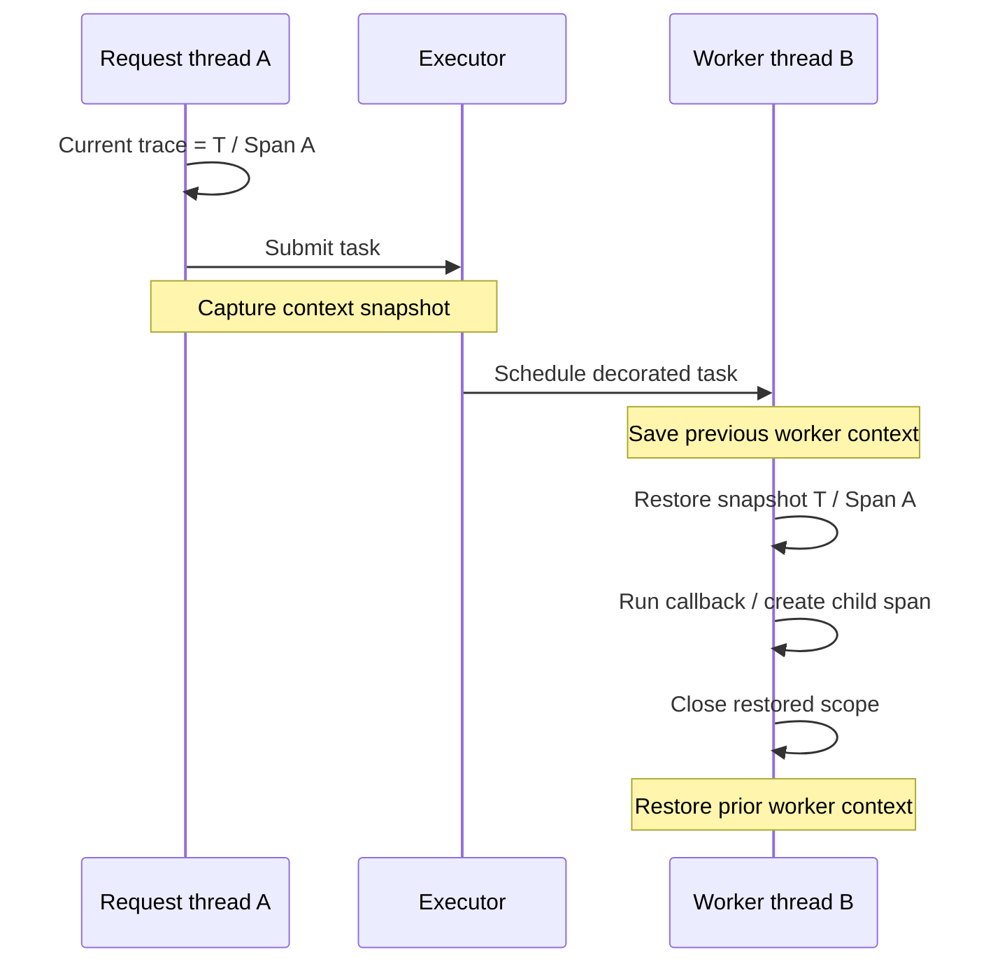

# Losing trace context when creating threads manually

A request enters a Spring Boot application, starts a trace, and begins processing checkout. Inside the service, a developer uses `new Thread(...)` to send work to another thread. The original request still has a trace ID, yet logs inside the new thread lack `traceId`; the background task's span appears as an independent trace, or fails to appear in Zipkin/the trace backend.

This is a common bug when **manually spawning threads or handing work to an executor without propagating context**. In Java, many tracing integrations store active context using `ThreadLocal` or a thread-bound mechanism. A new thread does not automatically inherit the calling thread's ThreadLocal values. Thus, an observation/span being current on thread A does not guarantee thread B sees the same trace context.

This lesson belongs to the **Context propagation** chapter of the **SPRING_BOOT_OBSERVABILITY** module. The module focuses on setting up observability for Spring Boot using Micrometer Observation, metrics, logs, and distributed tracing; learning how to propagate context, control tags/cardinality, exporters, sampling, and signal correlation to investigate errors, latency, and application behavior in production. The goal here is to understand why trace context is lost when spawning threads manually, how to restore context right where work runs, and how to verify traces after fixing it.

## Learning objectives

After this lesson, you will be able to:

1. Explain why trace context on the current thread does not automatically appear in a new thread.
2. Distinguish **passing business data**, **propagating trace context**, and **managing span/observation lifecycles**.
3. Identify pitfalls when using `new Thread`, `ExecutorService`, `CompletableFuture`, and `@Async`.
4. Use appropriate context propagation mechanisms such as Spring `TaskDecorator`, `ContextPropagatingTaskDecorator`, or Micrometer Context Propagation.
5. Ensure scopes are opened/closed on the executing thread and spans end only when actual work finishes.
6. Prevent trace context leakage between tasks when using reused thread pools.
7. Verify context across downstream HTTP, logs/MDC, and the tracing backend.
8. Distinguish in-thread context propagation from propagation over HTTP, message brokers, and Reactor.

## 1. Where does trace context live while an application is running?

When Spring Boot receives an instrumented HTTP request, tracing integration can create a server span and set the corresponding span context as the **current context** within the processing scope. Synchronous code called within that same scope can create child spans without passing a trace ID through every parameter.

Conceptual model:

```text
HTTP request thread A
  current trace context = Trace T / Span A
      |
      +-- controller
      +-- checkout service
      +-- payment application service
      +-- client call
```

When thread A calls synchronous methods, code running on that same thread can use the active context. However, if work moves to thread B:

```text
Thread A                              Thread B
------------------------------       ------------------------------
current = Trace T / Span A
executor.execute(task)  -----------> task starts running
                                     current = none (if not propagated)
                                     logs lack traceId
                                     new span may become a root
```

**Thread B has its own ThreadLocal.** Java does not automatically copy ThreadLocal values from the submitting thread to the executing thread. This is the fundamental reason tracing context can be lost when code switches threads.

### 1.1. Context is not a global variable

Trace context typically includes trace ID, span ID, and required sampling/parent metadata. It is managed by the tracing implementation and its corresponding scope. Applications must not treat a static variable or singleton field holding "current trace" as a solution; concurrent requests will overwrite one another.

Nor should you store a trace ID in an instance field of a Spring service for a later task to use. Singleton services serve many requests concurrently. Per-request data must be passed via business parameters or context propagation designed for execution boundaries.

### 1.2. Current context is only meaningful within an execution scope

A scope opened on thread A must be closed properly on the thread that owns it. Do not open a scope on thread A and pass the `Scope` object to thread B to close arbitrarily. Scopes can manage ThreadLocal or per-thread state; using the wrong thread easily causes corrupted or leaked context.

**Rule:** capture context on the submitting thread; restore context when the task begins running; close the scope/restore context right on the executing thread after the callback finishes.

## 2. Failure example: spawning a thread manually without propagating context

Suppose the controller already has an active server span. The service does the following:

```java
import org.springframework.stereotype.Service;

@Service
class ReceiptService {

    void scheduleReceipt(String orderId) {
        new Thread(() -> {
            sendReceipt(orderId);
        }).start();
    }

    private void sendReceipt(String orderId) {
        // Work to send email or generate invoice.
    }
}
```

This code illustrates the problem rather than a production-safe threading pattern. The new thread does not automatically inherit the calling request's trace context. Observable symptoms include:

- Logs in `sendReceipt` have no trace ID/span ID.
- An observation created in `sendReceipt` becomes a new root span instead of a child of the checkout request.
- The Trace UI only displays the checkout request; sending the receipt does not appear in the same trace.
- If you pass the trace ID manually via a variable without creating/restoring the corresponding context, logs may show the ID while the tracer still fails to establish a parent-child relationship.
- Request-spawned threads are not managed by an executor lifecycle, easily causing unbounded thread growth, hard shutdowns, and no load limiting.

### 2.1. Manually passing trace ID as a parameter is not enough

Example:

```java
void scheduleReceipt(String orderId, String traceId) {
    new Thread(() -> {
        log.info("traceId={}", traceId);
        sendReceipt(orderId);
    }).start();
}
```

This only passes a string for logging. It **does not restore the full trace context**, does not set the current span, does not establish a parent relationship, and does not automatically inject headers when the task calls downstream HTTP.

Manually stuffing IDs into logs can give the illusion that two operations are linked while the trace backend still records two separate traces. Let the tracing library capture/restore context instead of hand-rolling half of the mechanism.

## 3. Not just missing traces: span lifecycles can also be wrong

Another mistake is opening an observation on the calling thread and stopping it right after submitting the work:

```java
Observation observation = Observation.createNotStarted(
        "receipt.send", observationRegistry).start();

try (Observation.Scope scope = observation.openScope()) {
    executor.execute(() -> sendReceipt(orderId));
} finally {
    observation.stop();
}
```

`executor.execute(...)` usually just enqueues the task and returns. Thus `observation.stop()` can run **before `sendReceipt` actually starts or finishes**. When that happens, duration only measures submission time, not receipt-sending time. Moreover, the executing thread does not automatically receive the current context.

Separate three questions clearly:

| Question | What to do |
|---|---|
| Which request does the background task belong to? | Capture and propagate trace context or create an appropriate link relationship |
| How long does the background task take? | Create an observation/span whose lifecycle wraps the actual execution work |
| Who manages tasks and thread resources? | Use a managed executor/task executor with proper limits and shutdown |

### 3.1. Two common lifecycle models

**Model A — Task is child work within the parent request's lifetime.** The task runs and finishes before the parent request ends, and context can be captured/restored. The child span is created while the task executes.

**Model B — Task outlives the request.** The request only sends a command/enqueues and returns a response; actual work runs later. You should not keep the parent scope open until background work finishes minutes/hours later. Define the semantics: create a new trace for the consumer with a span link to the producer context, or use the messaging propagation model defined by the framework. Keeping relationships must reflect business lifecycles and retention limits.

## 4. Solution in Spring: managed executors and TaskDecorator

With Spring Framework, `TaskDecorator` lets you wrap a `Runnable` before the executor runs it. This is a natural extension point to capture context at submit time and restore it at execution time.

With Spring Framework 6.1 and later, `ContextPropagatingTaskDecorator` provides Micrometer Context Propagation integration. In Spring Boot 3.x applications, exact capabilities and behavior depend on the bundled Spring Framework/Micrometer versions.

### 4.1. Configuring TaskExecutor with context propagation

Configuration example:

```java
import org.springframework.context.annotation.Bean;
import org.springframework.context.annotation.Configuration;
import org.springframework.core.task.TaskExecutor;
import org.springframework.core.task.support.ContextPropagatingTaskDecorator;
import org.springframework.scheduling.concurrent.ThreadPoolTaskExecutor;

@Configuration(proxyBeanMethods = false)
class BackgroundTaskConfiguration {

    @Bean
    TaskExecutor applicationTaskExecutor() {
        ThreadPoolTaskExecutor executor = new ThreadPoolTaskExecutor();
        executor.setCorePoolSize(4);
        executor.setMaxPoolSize(16);
        executor.setQueueCapacity(200);
        executor.setThreadNamePrefix("app-worker-");
        executor.setTaskDecorator(new ContextPropagatingTaskDecorator());
        executor.initialize();
        return executor;
    }
}
```

In this example:

- The thread pool bounds thread count and queue size, avoiding uncontrolled per-request thread creation.
- `ContextPropagatingTaskDecorator` wraps tasks using the built-in context capture/restore mechanism.
- Context is restored when the task runs; once the callback finishes, the worker thread's previous context is restored.
- The accessors to propagate must be registered/supported by integrations. The decorator does not guess arbitrary custom application data types.

**Note:** `ContextPropagatingTaskDecorator` belongs to newer Spring Framework (6.1+). On Spring Boot 3.0/3.1 using an older Spring Framework, pick a compatible version or write a custom `TaskDecorator` using Micrometer Context Propagation. Do not manually override Spring Framework outside Boot's dependency management just to copy an example.

### 4.2. Submitting tasks via TaskExecutor

```java
import org.springframework.core.task.TaskExecutor;
import org.springframework.stereotype.Service;

@Service
class ReceiptService {
    private final TaskExecutor applicationTaskExecutor;

    ReceiptService(TaskExecutor applicationTaskExecutor) {
        this.applicationTaskExecutor = applicationTaskExecutor;
    }

    void scheduleReceipt(String orderId) {
        applicationTaskExecutor.execute(() -> sendReceipt(orderId));
    }

    private void sendReceipt(String orderId) {
        // Perform sending receipt.
    }
}
```

Here, the decorator is configured on the executor managing execution. If a task is submitted while the request has an active trace context, propagation can restore that context on the worker thread depending on installed accessors/integrations.

However, this example **does not create a dedicated observation to measure receipt-sending duration**. Propagating tracing context is one thing; measuring a unit of work's lifecycle is another. If you need a span representing the receipt-sending task, create an observation inside the callback so its lifecycle starts and ends properly on the worker.

### 4.3. Measuring the task on the executing thread

```java
import io.micrometer.observation.Observation;
import io.micrometer.observation.ObservationRegistry;
import org.springframework.core.task.TaskExecutor;
import org.springframework.stereotype.Service;

@Service
class ObservedReceiptService {
    private final TaskExecutor applicationTaskExecutor;
    private final ObservationRegistry observationRegistry;

    ObservedReceiptService(
            TaskExecutor applicationTaskExecutor,
            ObservationRegistry observationRegistry) {
        this.applicationTaskExecutor = applicationTaskExecutor;
        this.observationRegistry = observationRegistry;
    }

    void scheduleReceipt(String orderId) {
        applicationTaskExecutor.execute(() ->
                Observation.createNotStarted(
                                "receipt.send", observationRegistry)
                        .contextualName("send receipt")
                        .lowCardinalityKeyValue("operation", "send-receipt")
                        .observe(() -> {
                            sendReceipt(orderId);
                            return null;
                        })
        );
    }

    private void sendReceipt(String orderId) {
        // Call mail provider or generate actual invoice.
    }
}
```

With the decorator configured, upstream context can be restored when the callback starts. Observation `receipt.send` is created and runs **inside the worker thread**, so its duration reflects actual work. When a tracing handler is active, the task span can be created under the restored parent context.

This remains an illustrative example: `sendReceipt` must handle errors and retries per business policy; if the work outlives the request, consider a parent/link model rather than attaching a child span to an already-ended request. Do not put `orderId` into low-cardinality tags; if business correlation is needed, evaluate high-cardinality, privacy, and retention policies.

## 5. Micrometer Context Propagation: capture and restore

Micrometer Context Propagation provides abstractions to **capture context from the current source and restore it in another execution location**. It is useful when transitioning between ThreadLocal-based mechanisms and other context mechanisms.

Core concepts:

| Component | Role |
|---|---|
| `ThreadLocalAccessor` | Defines how to read/write/reset a type of ThreadLocal value |
| `ContextRegistry` | Registers accessors so context propagation knows which context types can be captured/restored |
| `ContextSnapshot` | Snapshot of captured context values |
| `ContextSnapshotFactory` | Creates snapshots according to the registry and configuration |
| `Scope` | Scope restoring a snapshot onto the current thread; closing the scope restores prior values |
| `TaskDecorator` | Wraps tasks to capture/restore across submit/execute boundaries |

A tracing integration can register accessors for trace context/MDC so context snapshots know how to capture and restore them. Not every ThreadLocal in the application is automatically captured. For custom contexts, register an appropriate accessor or use a dedicated integration mechanism.

### 5.1. Capture/restore model



The crux is **capture on the submitting side and restore on the running side**. Restoring only a default snapshot or a null context still loses context; capturing without restoring the worker's prior state causes context leakage.

### 5.2. Pattern for using snapshots when controlling Runnable directly

In cases where a built-in Spring `TaskDecorator` cannot be used, you can use Micrometer Context Propagation directly. Check exact APIs against your version; an illustrative pattern is:

```java
import io.micrometer.context.ContextSnapshot;
import io.micrometer.context.ContextSnapshotFactory;

ContextSnapshotFactory snapshotFactory =
        ContextSnapshotFactory.builder().build();

void submitWithContext(Executor executor, Runnable task) {
    ContextSnapshot snapshot = snapshotFactory.captureAll();
    executor.execute(snapshot.wrap(task));
}
```

`snapshot.wrap(task)` returns a task wrapped with logic to restore the snapshot when running and close the scope upon completion. For this to work properly, the relevant `ThreadLocalAccessor` implementations must be registered in the registry used by the factory. How factories are built, default accessors, and auto-registration timing depend on the Micrometer Context Propagation version and present integrations.

**Do not capture one snapshot once and reuse it for all requests.** Each submission must capture the context of the active request/task. A snapshot is not an application-wide shared object storing "the current trace."

### 5.3. Registering an accessor for a custom ThreadLocal

Suppose the system has a custom internal `TenantContext` stored in ThreadLocal. To propagate it, you need an accessor defining how to read, write, and reset it:

```java
import io.micrometer.context.ThreadLocalAccessor;

final class TenantContextAccessor
        implements ThreadLocalAccessor<String> {

    static final String KEY = "tenant";

    @Override
    public Object key() {
        return KEY;
    }

    @Override
    public String getValue() {
        return TenantContext.get();
    }

    @Override
    public void setValue(String value) {
        TenantContext.set(value);
    }

    @Override
    public void setValue() {
        TenantContext.clear();
    }
}
```

`TenantContext` is a hypothetical example. Once the accessor is registered in the appropriate `ContextRegistry`, snapshots can capture/restore that context value alongside other registered contexts.

Strictly control propagated data: a tenant identifier can be sensitive in some systems; do not automatically put it into span attributes/logs just because an accessor can transfer it across threads. **Propagation and exporting telemetry data are two separate decisions.**

## 6. Why not use InheritableThreadLocal as a general solution?

Java has `InheritableThreadLocal`, which lets a new thread inherit values from the parent thread at the time the thread is created. This appears to solve the problem, yet is unsuitable as a general solution for thread pools.

Reasons:

1. **Thread pools reuse threads:** workers are usually created at startup, before requests arrive. Values inherited when the worker was created do not reflect the context of requests submitting tasks later.
2. **Stale context:** a new thread can hold context copied from the parent thread at creation time even after the request ended or context changed.
3. **Does not cover all boundaries:** schedulers, executors, reactive contexts, or messaging do not necessarily spawn threads in a Java parent-child relationship.
4. **Reference retention risk:** inherited context can keep objects alive longer than intended.
5. **Does not manage span lifecycle:** inheriting a value does not create a child span, close scopes, or end observations at the right time.

Therefore, capturing/restoring **per task submission** and restoring the worker's prior state is far more appropriate. Even if a library or framework uses `InheritableThreadLocal` for another purpose, that does not mean you can rely on it to propagate traces across all threads.

## 7. Context propagation with CompletableFuture and @Async

### 7.1. `CompletableFuture`

An example that easily loses context:

```java
CompletableFuture.supplyAsync(
        () -> paymentClient.authorize(request),
        rawExecutor
);
```

If `rawExecutor` lacks a propagation decorator/wrapper, the task can run without the calling thread's trace context. Returning a `CompletableFuture` alone does not make context travel with it; a Future represents an asynchronous result, not a context container.

You can use an executor wrapped/configured with propagation:

```java
CompletableFuture.supplyAsync(
        () -> paymentClient.authorize(request),
        contextAwareExecutor
);
```

`contextAwareExecutor` must capture context at submission time and restore context when the callback executes. Verify the actual wrapper for the `Executor` in use; do not name a variable this way and assume a raw executor behaves like that.

If a chain has multiple `thenApplyAsync`/`thenComposeAsync` callbacks, each step can switch to a different executor. Ensure every participating executor has a propagation policy or callbacks explicitly establish appropriate context boundaries.

### 7.2. Spring `@Async`

`@Async` uses the executor selected/configured by Spring. Identify the actual executor bean being used and attach the corresponding `TaskDecorator` to that executor.

Example:

```java
import org.springframework.scheduling.annotation.Async;
import org.springframework.stereotype.Service;

@Service
class AsyncPaymentService {

    @Async("applicationTaskExecutor")
    public CompletableFuture<String> reconcile(String paymentId) {
        String result = doReconciliation(paymentId);
        return CompletableFuture.completedFuture(result);
    }

    private String doReconciliation(String paymentId) {
        return "reconciled";
    }
}
```

`@Async` must be enabled via appropriate Spring configuration and the method must be invoked through a Spring proxy; internal calls from the same object may bypass the proxy. `applicationTaskExecutor` is the example executor name from the configuration section.

When testing:

- Call the method from another bean through the proxy.
- Confirm the named executor is actually used.
- Check active context inside the callback.
- Verify span duration ends when work actually completes.
- Verify worker threads do not carry a previous task's trace ID into the next task.

**Do not infer from an executor name or annotation that propagation is working.** Only runtime measurement/observation verifies it.

## 8. Context propagation with Reactor vs. synchronous ThreadLocal

In Spring WebFlux/Reactor, execution can switch threads across schedulers and signals. Reactor uses subscription-bound `Context`; it is not equivalent to a fixed ThreadLocal.

If code does this:

```java
Mono<Order> pipeline;

try (Observation.Scope scope = observation.openScope()) {
    pipeline = orderService.loadOrder();
}
return pipeline;
```

the scope only wraps **publisher assembly**, while the publisher typically runs when a subscriber subscribes and may run on a different thread. Thus trace context is not guaranteed to remain accurate during signal processing.

For Reactor:

- Use built-in Spring Boot/Micrometer/Observation instrumentation compatible with your Reactor version.
- Understand how context propagates via `Reactor Context` and Micrometer Context Propagation mechanisms.
- Avoid manually opening a synchronous scope around `Mono`/`Flux` assembly and expecting it to cover the entire lifecycle.
- When using `publishOn`/`subscribeOn`, verify context is preserved across scheduler boundaries.
- Test completion, error, and cancellation paths because lifecycles can end on different signals.

A WebFlux HTTP endpoint may already be auto-instrumented. If traces break in custom callbacks or schedulers, isolate the exact context-transfer point rather than manually creating extra root spans for the entire pipeline.

## 9. Separating short-lived tasks from long-running background work

This is an important semantic decision, not merely a ThreadLocal technique.

### Case A: short task inside a request

For example, a request needs to run two computations in parallel and wait for both to finish before returning a response. Request context can be captured for each task; each task runs in a restored scope. Child spans can belong to the parent request trace. The parent span only finishes after the required work completes.

### Case B: request only enqueues work

For example, checkout emits a "send receipt" event and responds immediately, while a consumer processes it seconds later. Keeping the parent request span open until the email is sent may be inappropriate. A common model is:

```text
checkout request trace
  └─ producer span: publish receipt message

background consumer trace
  └─ consumer span: send receipt
       link -> producer span context
```

Propagation over message headers and parent-child or span links can follow the messaging stack's semantic conventions. When the consumer starts, it restores message context properly rather than relying on the ended request's ThreadLocal.

### Case C: periodic task without a parent request

A cron/job/batch triggered by a scheduler can start its own root span. It does not need to fabricate a trace ID from an earlier request. If the job processes multiple messages with source traces, span links can represent multiple inputs instead of arbitrarily picking one parent.

**Question to ask before choosing a technique:** is this task a synchronous part of the request, a short-lived child, or independent work after the request has already replied? The answer determines when spans start/end and which link type fits.

## 10. Context leakage in thread pools: a subtle bug

Thread pools reuse workers. If code sets a ThreadLocal manually without restoring/resetting it, the next task on the same worker can see stale context.

Anti-pattern example:

```java
executor.execute(() -> {
    TenantContext.set(tenantId);
    doWork();
    // Forgot TenantContext.clear()
});
```

The same situation happens with MDC or custom contexts. Consequences:

- Request B's logs carry Request A's trace ID or tenant.
- Child spans get created under the wrong parent.
- Tenant/request-specific data gets mixed across tasks.
- The bug only appears when the scheduler assigns two consecutive tasks to the same worker, making it hard to reproduce.

The safe pattern when managing ThreadLocal manually is to save the prior value, set the new value, and restore/clear it in `finally`. However, for trace context and multiple accessor types, prefer Micrometer/Spring mechanisms designed to capture/restore related contexts consistently.

### How to prove a worker was restored

A useful test:

1. Submit task A in trace A to the executor.
2. Submit task B in trace B to the same worker (you can use a single-thread executor to force reuse).
3. Record the current trace ID at the start of each task.
4. Assert task A sees A and task B sees B.
5. Submit a task C with no trace context and assert it **sees neither A nor B**.
6. Inspect logs/MDC and child spans, not only printed trace ID values.

Task C is crucial: it catches stale context left behind even when A and B individually look fine.

## 11. Investigation scenario: trace breaks after offloading work to an executor

A `POST /checkout` endpoint responds in 250 ms. Afterward, a worker sends a receipt and calls payment reconciliation. The dashboard shows the initial request has a trace, yet worker logs lack a trace ID and Zipkin displays a new root span.

### Initial data

```text
HTTP POST /checkout (SERVER)                 250 ms
  validate cart                               20 ms
  enqueue receipt task                         3 ms

worker thread:
  send receipt                                800 ms   (separate trace or missing)
  payment reconciliation                      500 ms   (no expected parent)
```

This is hypothetical data. It does not prove the executor is the sole cause, yet points out a boundary to inspect.

### Investigation workflow

**Step 1 — Confirm code actually switches threads.** Check `new Thread`, `ExecutorService`, `CompletableFuture`, `@Async`, or schedulers; note which executor runs the callback, thread names, and submit/start/end timestamps.

**Step 2 — Check context before submit.** On the request thread, confirm there is an active trace/span and proper observation scope at the submit point. If context is already missing here, a decorator cannot restore a non-existent context.

**Step 3 — Check executor wiring.** Confirm the task runs on the executor with `TaskDecorator` or propagation wrapper; rule out cases where a Spring bean is configured while code actually invokes a raw executor instantiated inside a class.

**Step 4 — Check accessors and integrations.** Context snapshots only restore contexts supported by the registry/accessors. Confirm the tracing bridge and logging integration registered the contexts to propagate.

**Step 5 — Check lifecycle.** The worker's Observation/span must start/end inside the actual callback. If the parent request already finished before the worker ran, revisit semantics: should the task be an independent trace with a span link to the producer?

**Step 6 — Check thread reuse.** Use a single-thread executor in tests to submit tasks with trace A, trace B, and then a task with no context. Verify no stale IDs appear in logs or spans.

**Step 7 — Verify on the backend.** Use a test trace with appropriate sampling enabled; verify trace ID, parent span ID, service name, duration, and related logs. If the exporter batches with a delay, wait per test pipeline policy instead of mistaking ingestion delay for lost context.

### Conclusions you can draw

If context is present on the request thread, the task decorator ran, the worker sees the right parent context, and spans appear with the right trace ID, propagation across the executor boundary worked in that test scenario.

If the task runs after the request finished, an independent trace connected via span link may be more accurate than a child span dangling under a completed parent. The goal is to **accurately describe work relationships**, not force every log/trace to share an ID at all costs.

## 12. Where is context lost? Quick diagnostic table

| Symptom | Possible cause | Check |
|---|---|---|
| Same thread has trace ID, new thread does not | ThreadLocal not captured/restored | Executor, TaskDecorator, ContextSnapshot |
| Logs have trace ID yet span is a new root | Only string ID passed, tracer context not restored | Current span and parent context inside worker |
| Worker span has wrong parent | Stale ThreadLocal/MDC leaked or snapshot at wrong time | Prior task on same worker, restore/clear |
| Very long async task yet short span | Observation stopped at submit or Future return | Place lifecycle inside executing callback |
| No trace after switching to WebFlux scheduler | Reactor Context not preserved properly | Reactor Context, instrumentation, and scheduler boundary |
| Downstream HTTP has new trace ID | Context not injected or headers stripped | Client instrumentation, propagator, gateway headers |
| Context present at submit yet missing when worker runs | Raw executor or decorator not applied | Thread name, actual executor bean, accessors |
| Task without trace carries old request ID | Worker thread context not reset | Task cleanup and reuse test |
| Only some async callbacks lose context | A callback uses another executor or API | Every executor in the CompletableFuture chain |
| Zipkin misses trace despite ID in logs | Sampling, reporter, exporter, collector, or retention | Sampling and pipeline independent of active context |

## 13. Context propagation does not replace security boundaries

Trace context often arrives from request headers or message headers. Values like `traceparent`, B3 headers, or baggage can be supplied by external clients. Never use them as proof of user authentication, tenant identity, or access authorization.

When an application serves external traffic:

- Apply a trust policy for inbound trace context; continue traces from trusted upstreams or start new traces depending on architecture.
- Never put tokens, session cookies, emails, payment data, or PII into baggage.
- Cap baggage size and allowlist propagated keys.
- Never turn a tenant ID from headers into a resource identity or metric tag without validation/normalization.
- Keep log correlation separate from log access permissions; a trace ID is not a credential to unlock data.
- Enforce redaction, retention, and access control at the collector/backend.

**Context propagation is a mechanism for linking telemetry and execution context, not a mechanism for delegating permissions.**

## 14. Fix checklist when creating threads manually

Before marking the incident resolved, verify:

1. **Context source:** right before submitting the task, does the request thread have the right current observation/span?
2. **Executor:** does code use the configured executor bean, or is it still creating raw `Thread`/`Executor` instances?
3. **Capture:** is context captured on each task submission?
4. **Restore:** does the worker restore the right trace context at the beginning of the callback?
5. **Accessors:** do required ThreadLocals have accessors/integrations in the context registry?
6. **Cleanup:** after the callback, is the scope closed and the worker's prior context state restored?
7. **Parent/lifecycle:** is the task truly a child of the request, or has the request finished and needs another trace/link?
8. **Span timing:** does the span wrap actual work, including proper async completion/error/cancellation handling?
9. **Logging:** does MDC have the right `traceId`/`spanId` inside the worker and get cleared/restored afterward?
10. **Downstream:** does the HTTP client inject B3/W3C context and does the server extract it properly?
11. **Reactor/messaging:** if the task moves into a publisher or consumer, is the corresponding propagation model used?
12. **Sampling/export:** do the sampler, reporter/exporter, and backend keep the test trace?
13. **Thread reuse:** test task A, task B, and a contextless task on the same worker; is there zero context leakage?
14. **Privacy/cardinality:** are sensitive data or request IDs kept out of unnecessary metric labels?
15. **Load:** does the executor have appropriate thread/queue bounds, rejection policy, and shutdown?

## 15. Common mistakes

| Anti-pattern | Consequence | Recommended practice |
|---|---|---|
| Using `new Thread` per request | No automatic context, hard resource management | Use Spring-managed executor and propagation |
| Passing only trace ID as a String | Logs have ID yet tracer lacks parent context | Capture/restore context snapshot/integration |
| Opening scope on calling thread and closing on worker | Violates thread scope/ownership | Each thread opens/closes scope within its own execution |
| Stopping observation right after `executor.execute` | Measures enqueue time instead of task duration | Create observation inside the executing callback |
| Assuming thread pool inherits ThreadLocal | Worker misses request context | TaskDecorator/ContextSnapshot |
| Using InheritableThreadLocal as a general solution | Reused workers hold stale or missing request context | Capture/restore per submission |
| Creating a second executor without decorator | Some callbacks have traces, others lose them | Audit every executor in async chains |
| Forgetting to reset custom ThreadLocal/MDC | Prior task's context leaks to next task | Scope/restore/clear in finally |
| Assuming @Async propagates all context automatically | Behavior depends on executor and integration | Verify selected executor and test at runtime |
| Wrapping Mono creation in synchronous scope | Scope ends before publisher runs | Use Reactor Context and proper instrumentation |
| Keeping parent request span open for multi-minute batch | Broken lifecycle and resource usage | Independent trace + links per semantics |
| Setting 100% sampling to fix lost context | Increases cost without fixing propagation | Verify context on worker first |
| Attaching trace ID to metric tags | Time-series cardinality explodes | Use trace/log correlation and exemplars if supported |

## 16. Self-assessment questions

**Question 1.** Why doesn't a new thread created via `new Thread(...)` automatically see the current request's trace ID?

**Hint:** Current trace context is typically managed per thread (e.g., ThreadLocal). A new thread has its own state; Java does not automatically copy context from the calling thread.

**Question 2.** Is passing `traceId` into a task and printing it in logs enough to create a proper child span?

**Hint:** Not yet. A string ID is not an active tracer context. Context capture/restore or an explicit parent/link span creation mechanism is required.

**Question 3.** Why is calling `observation.stop()` immediately after `executor.execute(...)` usually wrong when trying to measure task processing duration?

**Hint:** `execute` only submits the task and returns; the callback may run later. The observation ends before actual work, so duration is incomplete.

**Question 4.** What does `TaskDecorator` do in a Spring executor?

**Hint:** Wraps a `Runnable` to capture/restore selected contexts around task execution. Accessors/integrations must support the context types being propagated.

**Question 5.** Why shouldn't `InheritableThreadLocal` be used to propagate trace context into a thread pool?

**Hint:** Workers are typically created before requests arrive and reused; values inherited at creation time do not reflect per-submission context, easily going stale or leaking.

**Question 6.** A receipt-sending task runs several minutes after the checkout request has already returned a response. Is it always right to create a child span inside the original request trace?

**Hint:** No. Consider semantics and retention. An independent trace/consumer span with a link to the producer context may reflect the lifecycle more accurately.

**Question 7.** After fixing propagation, task A has trace A and task B has trace B. Why is it still necessary to test task C with no context?

**Hint:** Task C detects whether the worker thread retained ThreadLocal/MDC from a previous task. This checks context cleanup and thread reuse.

**Question 8.** Does using `ContextPropagatingTaskDecorator` guarantee every custom ThreadLocal in the application is propagated?

**Hint:** No. Only contexts registered and supported by accessors/integrations are captured/restored. Custom contexts require an appropriate accessor.

## Conclusion

**Losing trace context when creating threads manually happens because new threads or worker threads do not automatically inherit the request's active context**, especially when tracers store context via ThreadLocal. The fix requires capturing on the submitting thread, restoring on the executing thread, and restoring the prior state when the task completes; Spring `TaskDecorator`, `ContextPropagatingTaskDecorator`, and Micrometer Context Propagation help accomplish this when configured compatibly. At the same time, wrap observation/span lifecycles around actual work, distinguish short tasks from independent background jobs, and test thread reuse to catch context leakage. In Spring Boot observability, proper trace context links logs, spans, and downstream calls; however, sampling, exporters, and backends remain separate layers to verify before concluding traces are completely stored.
