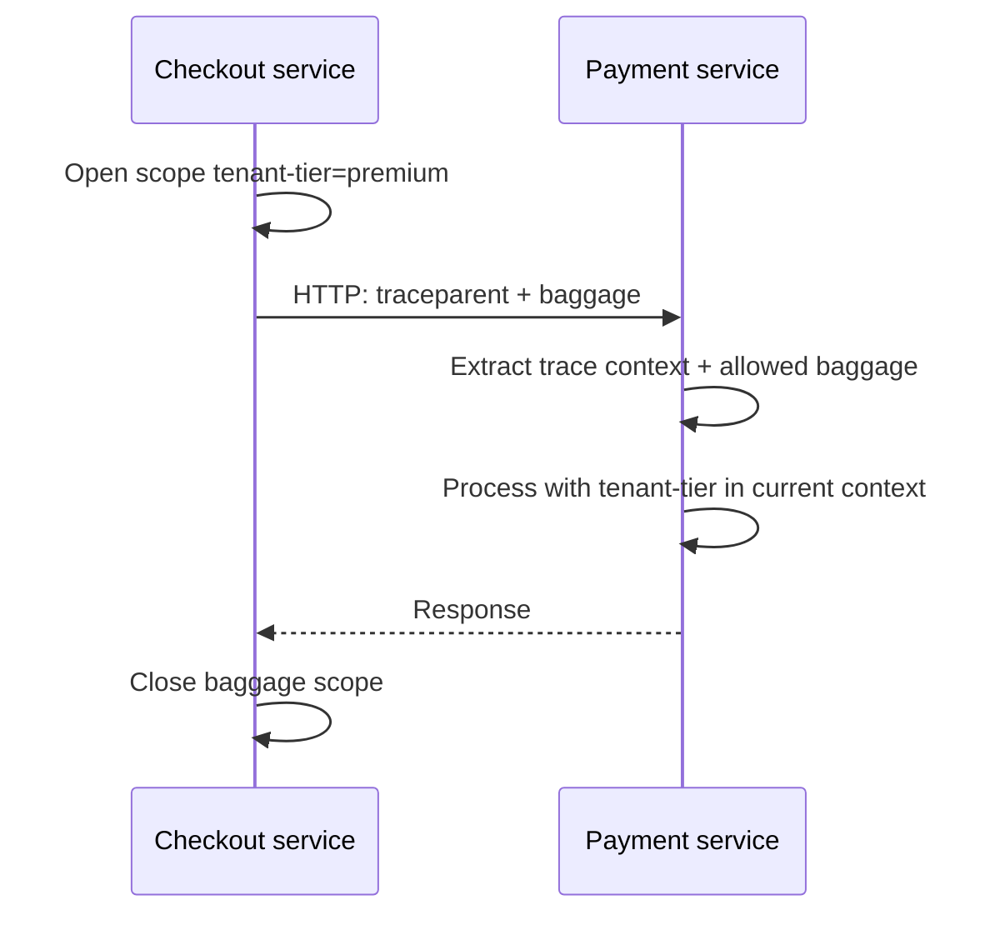

# Creating Baggage in Scope with Micrometer Tracing

## 1. Learning Objectives

When a request travels across multiple services, the trace context tells you which spans belong to the same journey. However, services sometimes also need a small amount of cross-cutting metadata, such as tenant tier, customer cohort, or an approved routing code. **Baggage** provides a mechanism to pass key-value pairs alongside the trace context across service boundaries.

In the **Baggage and Correlation** chapter of the **SPRING_BOOT_OBSERVABILITY** module, this lesson focuses on **creating baggage in scope** with Micrometer Tracing. After this lesson, you will be able to:

1. Explain how baggage differs from trace context, span attributes, metric tags, and MDC.
2. Create baggage using `Tracer.createBaggageInScope(...)` and manage its lifecycle with `try-with-resources`.
3. Distinguish between local baggage, remotely propagated baggage, and baggage included in log correlation.
4. Configure `management.tracing.baggage.local-fields`, `remote-fields`, and `correlation.fields` in Spring Boot.
5. Understand injecting/extracting the W3C `baggage` header over HTTP and limitations across async or message brokers.
6. Control sensitive data, header size, and cardinality when choosing baggage keys/values.
7. Verify baggage within the application, outbound requests, and logs, while handling common scope/propagation errors.

Examples use **Spring Boot 3.5.x, Java 17+, and Micrometer Tracing** as the baseline. Verify the starter, bridge, and property metadata for your running version, especially when upgrading to Spring Boot 4.x. This lesson belongs to the **SPRING_BOOT_OBSERVABILITY** module: setting up Micrometer Observation, metrics, logs, and distributed tracing, including context propagation, metadata, exporters, sampling, and signal correlation for investigating errors and latency.

## 2. What Is Baggage?

**Baggage** is a collection of key-value pairs attached to a trace context that can be propagated from one service to another when instrumentation/propagators are configured. Example:

```text
tenant-tier=standard
experiment-cohort=control
region-hint=ap-southeast
```

A service can read baggage received from upstream and forward selected allowlisted keys downstream. This is useful when steps in a journey need to share routing metadata, though baggage itself **does not replace business data** or a database.

### 2.1. Baggage Differs from Trace Context and Span Attributes

| Component | Role | Example |
| --- | --- | --- |
| Trace context | Identifies and links spans | `traceId`, `spanId`, parent, trace flags |
| Baggage | Small metadata propagated with context | `tenant-tier=premium` |
| Span attributes | Describes a single span for querying in the trace backend | `payment.provider=acquirer-a` |
| Metric tags | Groups aggregated measurements with low cardinality | `channel=web` |
| MDC/log correlation | Fields placed into log records when logging integration is configured | `tenant-tier` in MDC |
| Observation.Context map | Internal data for handlers of a single Observation | Business step state |

Baggage does not automatically become a span attribute or metric tag in every instrumentation. A tracing bridge can read baggage in scope; logging integration can put certain baggage keys into MDC; however, metrics only receive tags that instrumentation/handlers are designed to emit.

**Do not use baggage as a way to bypass cardinality limits.** Baggage data can be repeated across many services and appear in tracing/logging; if key-values contain unique IDs, backends still incur resource costs and face information disclosure risks.

### 2.2. Trace Context and Baggage Are Separate Parts

W3C Trace Context defines the primary headers:
- `traceparent`: trace ID, parent span ID, and trace flags.
- `tracestate`: standardized vendor-specific data.

W3C Baggage defines the header:
- `baggage`: list of key-value pairs allowed to propagate.

Thus a request can carry both headers:

```http
traceparent: 00-4bf92f3577b34da6a3ce929d0e0e4736-00f067aa0ba902b7-01
baggage: tenant-tier=premium,experiment-cohort=control
```

This is an illustrative header example only. `traceparent` connects spans; `baggage` carries additional metadata. Baggage does not create a new trace/span and does not determine parent-child relationships.

## 3. Baggage Scope: Creating, Using, and Closing

Micrometer Tracing provides `Tracer.createBaggageInScope(name, value)`. This method creates baggage and places it into the **current scope** for as long as the scope object remains open.

Common usage pattern:

```java
import io.micrometer.tracing.BaggageInScope;
import io.micrometer.tracing.Tracer;

public void processRequest(Tracer tracer) {
    try (BaggageInScope baggage =
                 tracer.createBaggageInScope("tenant-tier", "standard")) {
        doBusinessWork();
    }
}
```

Key points:

1. `createBaggageInScope` creates the baggage value and makes it current within the scope's extent.
2. Code executing inside the block can use the baggage; tracing instrumentation can read it when injecting context into HTTP/messages if the key is configured as remote.
3. Upon exiting the `try` block, `close()` restores the previous scope, preventing this request's baggage from leaking into the next piece of work on the same thread.
4. If not using `try-with-resources`, you must close `BaggageInScope` in a `finally` block.
5. Create baggage inside an active trace/observation scope so that baggage has a clear context and can be used by propagators when sending downstream requests.

**A baggage scope is not a span scope.** A baggage scope bounds the lifetime of a current baggage value; it does not start/end a span and does not replace `Observation.Scope` or `Tracer.SpanInScope`.

### 3.1. Setting Baggage from Normalized Data

For example, an API only accepts two tenant tier groups:

```java
private String normalizeTenantTier(String rawTier) {
    if ("premium".equalsIgnoreCase(rawTier)) {
        return "premium";
    }
    return "standard";
}
```

Then:

```java
String tier = normalizeTenantTier(request.tenantTier());

try (BaggageInScope ignored =
             tracer.createBaggageInScope("tenant-tier", tier)) {
    checkoutService.process(request);
}
```

All other values collapse to `standard`, keeping the baggage value set finite and stable. Do not feed arbitrary client headers directly into baggage. Clients must not be allowed to attach arbitrary values to alter routing, access permissions, or pricing policies.

### 3.2. Baggage Can Change or Have Nested Scopes

A request can create a new scope inside an outer scope:

```text
Scope A: tenant-tier=standard
  └─ Scope B: tenant-tier=premium
       └─ call a specific operation
  └─ Scope B closes
Scope A is current again
Scope A closes
No tenant-tier remains in the request scope
```

When the inner scope closes, the previous value is restored according to the tracing implementation's context mechanism. Do not store a `BaggageInScope` in a field of a singleton service; a scope is an object bound to a single execution, not shared state across requests.

## 4. Configuring Baggage in Spring Boot 3.5

Spring Boot supports three important property groups under `management.tracing.baggage`:

| Property | Meaning | When to use |
| --- | --- | --- |
| `management.tracing.baggage.local-fields` | Declares fields used in-process, not intended for external propagation | Metadata only needed for internal logic/logs |
| `management.tracing.baggage.remote-fields` | Declares fields propagated across service boundaries | Metadata needed by downstream services |
| `management.tracing.baggage.correlation.fields` | Selects baggage fields included in log correlation/MDC | Wanting to filter logs by allowlisted metadata |

Example `application.yml`:

```yaml
spring:
  application:
    name: checkout-service

management:
  tracing:
    baggage:
      local-fields:
        - operator-group
      remote-fields:
        - tenant-tier
        - experiment-cohort
      correlation:
        fields:
          - tenant-tier
```

This configuration specifies:
- `operator-group` is a local baggage field, used within the current application according to the configured integration.
- `tenant-tier` and `experiment-cohort` are marked as remote fields so tracing propagation can pass them to other services.
- Only `tenant-tier` is selected for correlation into log MDC.

Verify the property list against your project's Spring Boot version/BOM. Do not simply copy YAML from an example while ignoring whether the tracing bridge, propagation type, and logging integration are actually active.

### 4.1. Local, Remote, and Correlation Are Not Synonymous

| Configuration | Can propagate downstream? | Included in MDC/log correlation? |
| --- | --- | --- |
| Local field | Not when configured as local-only | Not automatically |
| Remote field | Yes, if propagator/client/server support it | Not automatically |
| Correlation field | Not automatically, since it only selects correlation | Yes, when the field is in baggage scope and integration supports it |

A field can be declared as both remote and correlation, such as `tenant-tier` in the example. In that case it can be propagated and also appear in MDC. Evaluate **permission to transmit data over the network** and **permission to write data to logs** separately; not every field that can be propagated should be logged.

### 4.2. Configuring via application.properties

The same example above can be expressed as:

```properties
management.tracing.baggage.local-fields[0]=operator-group
management.tracing.baggage.remote-fields[0]=tenant-tier
management.tracing.baggage.remote-fields[1]=experiment-cohort
management.tracing.baggage.correlation.fields[0]=tenant-tier
```

Spring Boot Binder supports collection/list binding; verify the result at startup and ensure it is not overridden by other profiles or environment variables.

## 5. Spring Boot Example: Creating Baggage During Request Processing

The example below uses Spring MVC and injects `Tracer` provided by Micrometer Tracing integration with Spring Boot. Assume the application already has Actuator, a tracing bridge, and the corresponding exporter dependencies.

### 5.1. Maven Dependencies

With Spring Boot 3.5.x and Boot dependency management:

```xml
<dependencies>
    <dependency>
        <groupId>org.springframework.boot</groupId>
        <artifactId>spring-boot-starter-web</artifactId>
    </dependency>
    <dependency>
        <groupId>org.springframework.boot</groupId>
        <artifactId>spring-boot-starter-actuator</artifactId>
    </dependency>
    <dependency>
        <groupId>io.micrometer</groupId>
        <artifactId>micrometer-tracing-bridge-otel</artifactId>
    </dependency>
    <dependency>
        <groupId>io.opentelemetry</groupId>
        <artifactId>opentelemetry-exporter-otlp</artifactId>
    </dependency>
</dependencies>
```

If using the Brave bridge, the corresponding dependencies and baggage integration will differ. Do not add both tracing bridges in the same application just to get baggage. A tracing exporter requires a real endpoint/collector; adding the dependency does not mean traces are already being stored.

### 5.2. Service Creating Scoped Baggage

```java
package com.example.checkout;

import io.micrometer.tracing.BaggageInScope;
import io.micrometer.tracing.Tracer;
import org.springframework.stereotype.Service;

@Service
public class CheckoutService {
    private final Tracer tracer;
    private final PaymentClient paymentClient;

    public CheckoutService(Tracer tracer, PaymentClient paymentClient) {
        this.tracer = tracer;
        this.paymentClient = paymentClient;
    }

    public String checkout(String rawTenantTier) {
        String tier = "premium".equalsIgnoreCase(rawTenantTier)
                ? "premium" : "standard";

        try (BaggageInScope baggage =
                     tracer.createBaggageInScope("tenant-tier", tier)) {
            return paymentClient.authorize();
        }
    }
}
```

In this example, `PaymentClient` must use an HTTP client configured/instrumented by Spring Boot. When outgoing tracing propagation is active and `tenant-tier` is declared as a remote field, baggage can be encoded into the `baggage` header.

Do not use `rawTenantTier` directly. By normalizing before creating the scope, the application keeps the value set bounded and prevents callers from sending arbitrary strings downstream.

### 5.3. HTTP Client Using Spring Boot's Builder

```java
package com.example.checkout;

import org.springframework.stereotype.Component;
import org.springframework.web.client.RestClient;

@Component
public class PaymentClient {
    private final RestClient client;

    public PaymentClient(RestClient.Builder builder) {
        this.client = builder
                .baseUrl("http://payment-service")
                .build();
    }

    public String authorize() {
        return client.post()
                .uri("/payments/authorize")
                .retrieve()
                .body(String.class);
    }
}
```

`RestClient.Builder` injected by Spring Boot can carry observation/tracing customizers and propagation. If you instantiate a standalone client yourself, you must verify interceptors/propagators; do not assume every `RestClient` injects `traceparent`/`baggage`.

### 5.4. Illustrative Controller

```java
package com.example.checkout;

import org.springframework.web.bind.annotation.GetMapping;
import org.springframework.web.bind.annotation.RequestParam;
import org.springframework.web.bind.annotation.RestController;

@RestController
public class CheckoutController {
    private final CheckoutService checkoutService;

    public CheckoutController(CheckoutService checkoutService) {
        this.checkoutService = checkoutService;
    }

    @GetMapping("/demo/checkout")
    public String checkout(
            @RequestParam(defaultValue = "standard") String tenantTier) {
        return checkoutService.checkout(tenantTier);
    }
}
```

Sending requests:

```text
GET /demo/checkout?tenantTier=standard
GET /demo/checkout?tenantTier=premium
```

The two requests will have separate traces. While `CheckoutService.checkout` holds the baggage scope open, outgoing calls can receive the corresponding baggage value. Span names, trace IDs, and whether traces are exported are still governed by tracing configuration, samplers, exporters, and the backend.

## 6. Reading and Using Baggage in the Receiving Service

In the receiving service, tracing instrumentation extracts `traceparent` to build the trace context and extracts configured remote baggage fields. Once the key is in the current scope, downstream code can use the tracing implementation's API to access baggage or use the correlation field in MDC if the goal is solely logging.

Crucially, **the receiving service must also configure the appropriate fields**. If the producer sends a key but the receiver does not allow or configure receiving that key, the application should not assume baggage will be available.

Model:



### 6.1. Do Not Use Manual Headers Instead of Propagation

Avoid doing this:

```java
// Wrong: manually attaching fixed baggage, bypassing scope and propagator.
request.header("baggage", "tenant-tier=premium");
```

This approach can overwrite existing baggage, violate encoding/multiple-member rules, or leak non-allowlisted values. Use `Tracer.createBaggageInScope` and configure remote fields; tracing instrumentation will inject/extract according to the selected propagator.

If you need to inspect headers in tests, use a mock server or local HTTP test fixture; do not log all headers in production.

## 7. Correlation: Putting Baggage into Log Context

A common reason to use baggage is to carry selected metadata into logs across services. Spring Boot/Micrometer Tracing supports configuring correlation fields so baggage is placed into **MDC** (Mapped Diagnostic Context) within the log scope.

For example, `tenant-tier` declared in:

```yaml
management:
  tracing:
    baggage:
      remote-fields:
        - tenant-tier
      correlation:
        fields:
          - tenant-tier
```

You can configure a Logback pattern containing the MDC key:

```xml
<configuration>
  <appender name="CONSOLE" class="ch.qos.logback.core.ConsoleAppender">
    <encoder>
      <pattern>%d{HH:mm:ss.SSS} %-5level [%thread]
traceId=%X{traceId} spanId=%X{spanId}
tenantTier=%X{tenant-tier} %logger - %msg%n</pattern>
    </encoder>
  </appender>
</configuration>
```

This XML snippet only illustrates the pattern; if using Spring Boot logging defaults, adjust your existing logging configuration rather than replacing the entire appender. The actual MDC key depends on the baggage field and tracing bridge; verify your runtime log output.

Example logs:

```text
INFO  traceId=4bf... spanId=00f... tenantTier=premium Authorize payment started
ERROR traceId=4bf... spanId=00f... tenantTier=premium Payment provider timeout
```

The trace IDs and logs above are illustrative only. If `tenant-tier` is not in scope, MDC may not contain that value; the log pattern will render empty or a fallback string depending on the encoder.

### 7.1. Correlation Fields Are Not Baggage Forwarding

- Declaring `correlation.fields` instructs the tracing/log integration to put the baggage field into the log context.
- Declaring `remote-fields` specifies that the field is allowed to propagate across service boundaries.
- The two lists serve two different purposes.

If you only need local logging, do not automatically enable remote forwarding. If downstream needs to read it, declare the remote field and allowlist on the receiving side; add correlation only on services that truly need to log the value.

### 7.2. Log Correlation with Trace ID

`traceId`/`spanId` originate from the tracing context and are usually integrated into MDC separately. Baggage adds selective business metadata, such as tier/region. During an investigation:
1. Search for the request by `traceId` to open the full trace.
2. Use `tenant-tier` or another correlation field to filter logs if authorized.
3. Rely on span names/durations to spot slow steps.
4. Compare with aggregated metrics using low-cardinality tags over the same time window.

Do not use a baggage key like `traceId` to build a parallel ID system. Also do not dump all baggage into logs; every key needs a clear purpose and policy.

## 8. Baggage in Executors, Async, and Reactive Pipelines

Baggage belongs to the current tracing context. Therefore, context propagation rules apply similarly to the current span.

### 8.1. Executors and `@Async`

ThreadLocal/current context does not automatically follow thread pools. If code opens a baggage scope on Thread A and submits a task to Thread B, the worker is unlikely to see the baggage unless context propagation is configured.

In Spring, you can use `ContextPropagatingTaskDecorator` on the actual executor:

```java
import org.springframework.context.annotation.Bean;
import org.springframework.context.annotation.Configuration;
import org.springframework.core.task.support.ContextPropagatingTaskDecorator;
import org.springframework.scheduling.concurrent.ThreadPoolTaskExecutor;

@Configuration
class AsyncContextConfiguration {
    @Bean
    ThreadPoolTaskExecutor applicationTaskExecutor() {
        ThreadPoolTaskExecutor executor = new ThreadPoolTaskExecutor();
        executor.setCorePoolSize(4);
        executor.setMaxPoolSize(16);
        executor.setQueueCapacity(200);
        executor.setTaskDecorator(new ContextPropagatingTaskDecorator());
        executor.initialize();
        return executor;
    }
}
```

The baggage scope should be opened where valid values and context exist; the decorator captures/restores context for the task using registered accessors. Verify the right executor is injected into `@Async`. The decorator does not automatically turn baggage into HTTP headers; outbound client instrumentation still handles propagation.

### 8.2. Reactor Context

In WebFlux, Reactor Context is tied to the subscription rather than a fixed ThreadLocal. Micrometer Context Propagation and appropriate Reactor configuration allow context (including tracing/baggage when supported by accessors) to follow the reactive chain even across scheduler hops.

Example auto propagation mode in Spring Boot 3.5:

```yaml
spring:
  reactor:
    context-propagation: auto
```

Check the exact property support/defaults for your Spring Boot version. Do not assume any arbitrary baggage/object placed in Reactor Context automatically becomes a W3C `baggage` header. Cross-service propagation is still performed by the tracing propagator.

### 8.3. Scope and Lifecycle of Reactive Work

Do not open a synchronous scope around **creating** a `Mono` and close it immediately when the method returns if the real work runs at subscription time. For reactive pipelines, create/attach baggage in the subscription context or use reactive-aware instrumentation so the scope lives properly during signals. Verify complete, error, and cancel paths; do not hold `BaggageInScope` across threads to close it manually on a different thread.

## 9. Baggage and Message Brokers

With Kafka/RabbitMQ or similar brokers, baggage must be injected into **message headers** via appropriate messaging instrumentation/propagators. The consumer extracts context and baggage from the carrier headers.

```text
Checkout producer
  trace context + allowed baggage
       |
       v
Message headers:
  traceparent: ...
  baggage: tenant-tier=premium
       |
       v
Payment consumer
  extract headers -> current trace/baggage scope
```

Messages can sit in a queue for a long time; keeping a parent-child trace across long delays is not always semantically appropriate. If a consumer processes multiple messages in a batch, span links may be a better fit. Baggage still requires an allowlist and size limits—do not put payloads or order/customer details into headers.

Do not manually copy the `baggage` header into the message body unless explicitly required by a contract; use carrier headers and supported instrumentation. Verify both producer and consumer use the same propagator and key configuration.

## 10. Security, Privacy, and Cardinality

Baggage can be propagated across multiple services, so data spreads much more widely than a local span attribute. Every baggage value must be treated as **data that can leave the service**.

Do not put in baggage:
- Access tokens, refresh tokens, passwords, API keys, cookies, or session secrets.
- Emails, phone numbers, addresses, account/card numbers, or personally identifiable information without clear justification and policy.
- Request bodies, payment data, exception messages, or stack traces.
- Unnecessary dynamic IDs solely to find requests; use trace ID and appropriate logs/audits.
- Arbitrary client content that has not been validated/normalized.

Baggage can:
- Increase header size and exceed proxy/gateway/server limits.
- Appear in logs, tracing exporters, or diagnostic captures.
- Be copied across many hops and become data stored in multiple external systems.
- Increase indexing costs and expose metadata if backends have broad access permissions.

### 10.1. Baggage Values Should Be Finite When Possible

Better examples:

| Key | Allowlisted values | Purpose |
| --- | --- | --- |
| `tenant-tier` | `standard`, `premium`, `enterprise` | Tier-based processing policy |
| `experiment-cohort` | `control`, `variant-a`, `variant-b` | Identify experiment group |
| `region-hint` | A set of deployment regions | Select service region if permitted |

Do not put `tenant-id` across millions of tenants into metric tags. If baggage by tenant ID is needed, there must be a concrete operational reason, policy-based allowlisting, length limits, access controls, and retention rules. Baggage is not a security/authorization mechanism; never trust upstream values to make access-control or pricing decisions without verification at the receiving service.

### 10.2. Length and Count of Baggage Members

W3C Baggage specifies formatting rules and processing limits to avoid unbounded headers. Proxies and HTTP servers also enforce their own header limits. Do not design large baggage; pass only a few short keys, never payloads or collections. When receiving invalid or oversized baggage, systems may drop part or all of it depending on the propagator/implementation.

Baggage propagation may be disabled or filtered across trust boundaries. Not every internal service needs to know every piece of metadata. Only propagate keys that downstream actually uses.

## 11. Sampling, Exporters, and Correlation

Baggage is metadata; it does not by itself decide whether a trace is sampled or exported. Distinct responsibilities:

| Mechanism | Question | Example |
| --- | --- | --- |
| Propagation | Do context/baggage reach the next service? | `traceparent`, `baggage` headers |
| Sampling | Is the span/trace recorded/kept? | Sampling probability |
| Exporter | Where are spans sent? | OTLP/Zipkin exporter |
| Correlation | Which logs relate to the trace/baggage? | MDC fields |
| Metrics | What is the aggregated frequency/latency? | Timer/Counter, low-cardinality tags |

A trace missing from the backend may be due to sampling or exporter failure; that does not prove baggage was not created in scope. Conversely, seeing a `baggage` header downstream does not prove spans were sampled and stored.

In Spring Boot 3.5, illustrative local sampling configuration:

```yaml
management:
  tracing:
    sampling:
      probability: 1.0
```

Use `1.0` only in controlled testing; production requires a sampling strategy suited to traffic, cost, and investigation needs. Metrics can still record all meter samples even when only a fraction of traces are sampled.

## 12. Verifying Baggage Creation in Scope

To test end-to-end, prepare two services with the appropriate tracing bridge/exporter and HTTP instrumentation.

### 12.1. Checking at the Producer

- Confirm `Tracer` is injected and `createBaggageInScope` creates the scope before the outbound call.
- Check that values are normalized/allowlisted.
- Confirm `tenant-tier` is declared in `remote-fields`.
- Invoke the outbound client instrumented by Spring Boot.
- In mock HTTP server tests, verify the request has the expected `baggage` header; avoid printing full headers in production.

### 12.2. Checking at the Receiver

- Confirm the server receives the header and has the matching remote field in its configuration.
- Check that code inside the request scope can read the baggage value via the chosen API/tracing integration.
- Confirm trace ID and parent span ID link properly with upstream.
- Confirm baggage is not retained on the next request on the same thread.
- If the field enters MDC, check that the log pattern only displays allowlisted fields.

### 12.3. Checking When Scope Closes

A test should include:
1. Open baggage `tenant-tier=premium`.
2. Execute code inside the scope.
3. Close the scope via `try-with-resources`.
4. Start a new execution without this baggage.
5. Verify the value does not leak from the earlier execution to the later one.

If tests only assert outbound headers without asserting cleanup, baggage leakage across thread pools can still slip through.

## 13. Troubleshooting

| Symptom | Common cause | Resolution |
| --- | --- | --- |
| Baggage not seen downstream | Field not declared remote, uninstrumented client, unsupported propagator | Check `remote-fields`, builder, and request headers |
| `traceparent` present but no `baggage` | Baggage not created, missing remote field, or baggage propagation filtered | Check scope and config on both sides |
| Baggage at producer but lost at service B | Receiver did not allowlist/extract key or ingress strips headers | Check receiver config and gateway |
| MDC lacks baggage | Missing correlation field, logging outside scope, or different MDC integration | Check `correlation.fields` and logging pattern |
| Baggage appears on next request | Scope not closed/restored properly | Use `try-with-resources`, check task decorator/thread reuse |
| Baggage lost in `@Async` | Current context not propagated across executor | Use `ContextPropagatingTaskDecorator` on the right executor |
| Baggage lost in WebFlux | Pure ThreadLocal code or unsuitable propagation mode | Check Reactor Context and context propagation |
| HTTP header too large | Too many keys or long values | Limit keys/length, remove payloads and unnecessary metadata |
| Sensitive metadata leaked in logs | `remote-fields`/`correlation.fields` too broad | Revoke keys, filter logging, review retention/access |
| Span missing while baggage header present | Sampling/exporter/backend issue | Check tracing pipeline separately |
| Metrics have too many series | Dynamic baggage copied into metric tags | Remove dynamic tags, use bounded groups |
| Untrusted downstream value | Trusting client/upstream headers as verified data | Validate/normalize and check authorization at the owning business service |

## 14. Production Checklist

- [ ] Every baggage key has a clear purpose and owner.
- [ ] Only a small set of remote fields is used; receiving services allow only necessary keys.
- [ ] Local fields are not unintentionally propagated.
- [ ] Correlation fields are selected separately and logged only when needed.
- [ ] Baggage scopes are managed with `try-with-resources`/`finally`.
- [ ] Do not store `BaggageInScope` in singletons or shared fields.
- [ ] Propagation in executors/reactive/message pipelines is tested.
- [ ] HTTP clients use builders/instrumentation with trace propagation.
- [ ] No tokens, passwords, cookies, PII, or payloads in baggage.
- [ ] Length and count limits on baggage values to avoid header bloat.
- [ ] Do not put dynamic baggage IDs into metric tags; enforce cardinality budgets.
- [ ] Sampling and exporters are tested independently from baggage propagation.
- [ ] Log MDC contains only allowlisted fields, never printing all headers.
- [ ] Tested success, exception, cancellation, thread reuse, and subsequent requests.

## 15. Self-Check Questions

1. What does `Tracer.createBaggageInScope("tenant-tier", "premium")` change in the current scope?
2. Why should `BaggageInScope` be closed in a `try-with-resources` block?
3. How do `remote-fields`, `local-fields`, and `correlation.fields` differ in purpose?
4. When a field is already a remote field, is it automatically placed into MDC?
5. What two types of data do the W3C `traceparent` and `baggage` headers carry?
6. Why should access tokens or emails not be put into baggage?
7. If baggage is lost in `@Async`, how should you inspect the executor and context propagation?
8. Why might a `Mono` need a scope tied to subscription rather than a synchronous scope around publisher creation?
9. The `baggage` header is present, yet no trace appears in the backend; how can sampling/exporters explain this?
10. To log by `tenant-tier`, how should remote fields, correlation fields, and the MDC pattern be configured?
11. Can a service receiving `tenant-tier=premium` baggage from an external Internet request use it immediately to grant permissions? Why or why not?
12. Why shouldn't `workflowId` be turned into a low-cardinality metric tag just because it is already in baggage?

## References

- [Micrometer Tracing — Baggage](https://docs.micrometer.io/tracing/reference/api.html)
- [Micrometer Tracing — Propagation](https://docs.micrometer.io/tracing/reference/propagation.html)
- [Spring Boot 3.5 — Tracing and Baggage](https://docs.spring.io/spring-boot/3.5/reference/actuator/tracing.html)
- [Spring Boot 3.5 — Common Application Properties](https://docs.spring.io/spring-boot/3.5/appendix/application-properties/index.html)
- [Spring Framework — Context Propagation](https://docs.spring.io/spring-framework/reference/integration/observability.html)
- [OpenTelemetry — Baggage](https://opentelemetry.io/docs/concepts/signals/baggage/)
- [W3C — Baggage Specification](https://www.w3.org/TR/baggage/)
- [W3C — Trace Context](https://www.w3.org/TR/trace-context/)
