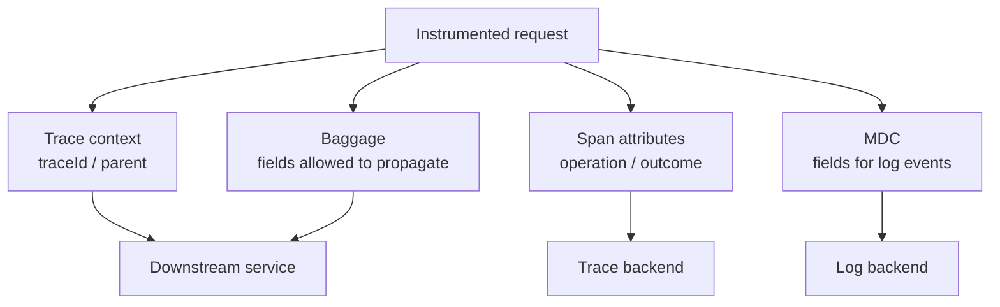
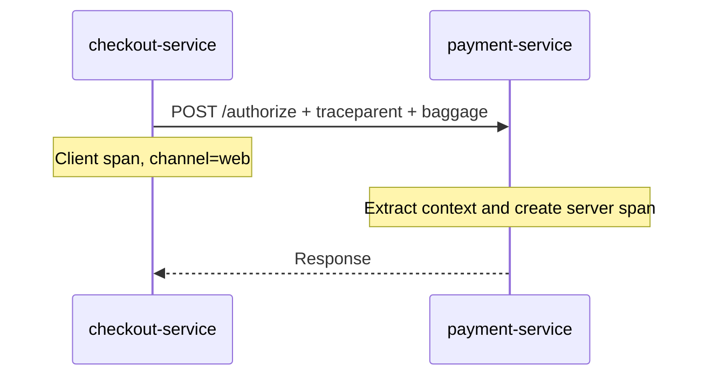
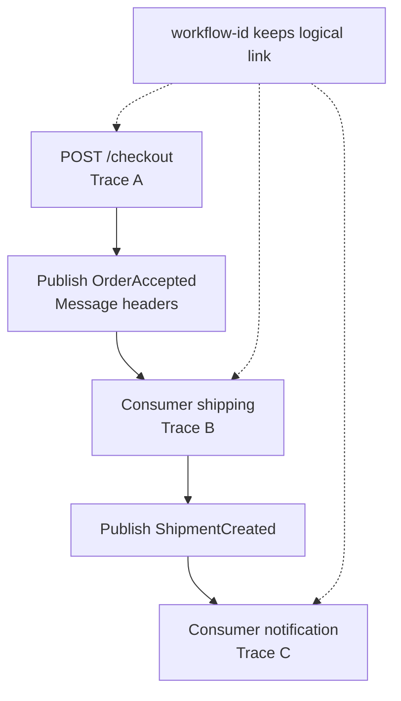

# Correlation Fields in Spring Boot Observability

When a `POST /checkout` request passes through gateway, `checkout-service`, `payment-service`, and `inventory-service`, the operations team needs to know which signals belong to the same request and which fields to use to locate the right events in logs/traces. Trace ID links spans of a distributed trace. In many situations, however, the operations team also needs meaningful correlation fields such as transaction channel, workflow key, or business group.

The **Correlation fields** lesson belongs to the **Baggage and Correlation** chapter of the **SPRING_BOOT_OBSERVABILITY** module. This module teaches how to build observability for Spring Boot using Micrometer Observation, metrics, logs, and distributed tracing; covering context propagation, tags/cardinality, exporters, sampling, and signal correlation to investigate errors, latency, and application behavior in production environments.

In this lesson, we design purposeful correlation fields, distinguish **trace context**, **span attributes**, **baggage**, and **MDC**, see how Spring Boot/Micrometer propagates correlation fields, and write tests to ensure data appears in the right places without leaking across service boundaries.

## 1. What Is a Correlation Field?

A **correlation field** is a data field selected to assist in searching or linking related log events, spans, or activities.

| Field | Possible purpose | Things to note |
| --- | --- | --- |
| `traceId` | Link spans in the same distributed trace | Managed by the tracing system; do not use as a metric label |
| `spanId` | Identify a specific span | Used to look up a processing segment, not a business identifier |
| `correlationId` | Link events within a business flow | Must define who generates it, its scope, and how it is propagated |
| `tenantTier` | Distinguish tenant tier at a shareable level | Use only if the value set is small and policy permits |
| `channel` | Group traffic source such as web/mobile/partner | Normalize to a finite set of values |
| `orderId` | Look up a transaction in business systems | High cardinality, potentially sensitive; not a default metric tag |
| `userEmail` | Identify a user | Personal data; do not use as a default correlation field |

There is no universal list of correlation fields that fits every application. A field must tie to **a concrete operational question**: which flow to filter logs by, which dimension to search spans by, or how to link an authorized transaction lookup.

Correlation fields do not always need to be propagated between services. A field needed only for grouping within a single span can stay a span attribute. A field that must appear in downstream logs may require baggage propagation. An identifier existing only inside business systems can be looked up via the database instead of carrying it on every request.

## 2. Trace Context, Span Attributes, Baggage, and MDC Are Not the Same

| Mechanism | What does it hold? | Propagated across services automatically? | Where typically used |
| --- | --- | --- | --- |
| **Trace context** | Trace ID, parent context, and sampling flags | Yes, when instrumentation injects/extracts properly | Linking spans across HTTP/messaging |
| **Span attributes** | Attributes describing a single span | Does not become baggage automatically | Filtering/searching spans in trace backend |
| **Baggage** | Context fields defined to cross process boundaries | Potentially, when remote propagation is declared | Carrying minimal correlation data across hops |
| **MDC** | Fields of the current logging context | Not sent over the network automatically | Adding trace/correlation fields to log events |

One field can be used in multiple places, but those are **separate configuration decisions**. For instance, `channel=web` can be a span attribute for searching traces, placed into MDC for searching logs, or carried as baggage if downstream truly needs that value. Do not enable all three merely out of convenience.



This diagram illustrates paths that can be configured; it does not mean every field automatically flows through every branch. The tracing SDK, Micrometer bridge, logging integration, and propagators must be configured accordingly.

## 3. Trace ID vs. Correlation ID: Which One to Use?

**Trace ID** is managed by the tracing implementation and identifies a single trace. When services propagate the same trace context, spans can be grouped into one unified trace.

**Correlation ID** is typically an application or workflow identifier, which may be generated by a gateway, upstream system, or business logic. It can exist before a trace is created, span across multiple different traces, or cover an asynchronous process longer than an HTTP request lifecycle.

| Comparison | Trace ID | Correlation ID |
| --- | --- | --- |
| Who manages it? | Tracer/SDK and propagator | Application contract or upstream system |
| Scope | One distributed trace | Across a defined business process |
| Parent/child spans? | Yes, in the trace model | No; purely a linking value |
| Sampled? | Traces may be dropped from storage | Correlation field is not itself sampled, though logs/records may not be stored |
| Interchangeable? | Not always | Not always |

For example: an order is processed synchronously, then placed on a queue for delivery several minutes later. There may be **two different traces** for the two stages, yet a workflow correlation ID may be retained to locate related log events. Trying to use a single trace ID as an order identifier confuses technical identity with business identity.

Do not accept a client-supplied correlation ID and trust it blindly. You can normalize it, constrain length/characters, generate a new ID at the trust boundary, or retain an upstream ID after validation. A correlation ID must not replace authentication, authorization, or an idempotency key unless explicitly designed for that purpose.

## 4. Designing a Small Set of Correlation Fields

Suppose `checkout-service` needs to:

- Find all spans of the same HTTP request: use the trace context managed by the tracer.
- Find logs for the same checkout attempt within the service: a validated/normalized correlation ID.
- Group transactions by channel: `channel` with values `web`, `mobile`, `partner`, `other`.
- Help downstream classify tasks: propagate `channel` only if downstream has a specific purpose and the field contains no personal data.

An illustrative contract:

```yaml
correlation:
  fields:
    workflow-id:
      source: generated-at-trusted-boundary
      log: true
      span: true
      baggage: false
    channel:
      source: normalized-request-metadata
      allowed-values: [web, mobile, partner, other]
      log: true
      span: true
      baggage: true
    order-id:
      source: business-database
      log: false
      span: false
      baggage: false
forbidden:
  - authorization
  - cookie
  - access-token
  - password
  - user-email
  - payment-card-data
```

This is a **team-defined contract template**, not configuration that Spring Boot/Micrometer reads directly. The organization must translate the contract into code, logging config, tracing/baggage config, collector policies, and tests.

### Every Field Needs an Owner and Limits

For each field, specify: who generates the value and at which boundary; which systems may overwrite it; whether it is trusted when arriving from external requests/headers; whether it may be exported to spans, logs, baggage, or metrics; what its allowed values/length/max size are; how long data is retained; and who is permitted to search it.

If you cannot answer these questions, do not propagate the field broadly across the system yet.

## 5. Baggage: Correlation Fields Across Multiple Services

**Baggage** consists of key/value pairs attached to a tracing context that can be propagated downstream. With W3C Baggage, data usually travels in the HTTP `baggage` header, while `traceparent` carries trace context information. The two headers have different purposes.

Illustrative example:

```text
traceparent: 00-<trace-id>-<parent-span-id>-01
baggage: channel=web,workflow-id=wf-7f29
```

These are hypothetical headers properly encoded for real values; do not copy placeholders into real requests. Never put access tokens, emails, addresses, card numbers, or transaction bodies into baggage.

Baggage is helpful when a downstream service genuinely needs a context value not contained in the trace ID, such as a normalized channel group. However, each hop can add header bytes, and a baggage field could leave the organization if a request calls a partner API. Constrain:

- Only keys on the allowlist.
- Number of fields and total header size.
- Length and character set of each value.
- Boundaries permitted for injection (internal, partner, internet).
- Extraction rules: do not automatically trust externally sent values.

**Baggage is not a store for user profiles or arbitrary business metadata.** Keep data minimal, non-sensitive, and backed by a clear forwarding purpose.

## 6. Configuring Baggage and Correlation Fields in Spring Boot

In Spring Boot 3.x lines with Micrometer Tracing auto-configuration, an illustrative configuration looks like:

```yaml
management:
  tracing:
    baggage:
      remote-fields:
        - channel
        - workflow-id
      local-fields:
        - internal-processing-mode
      correlation:
        fields:
          - channel
          - workflow-id
```

General meaning:

- **remote-fields**: baggage fields configured to propagate across process boundaries per the tracing implementation/propagator.
- **local-fields**: baggage fields used within the local context scope, not intended for remote transmission via this configuration.
- **correlation.fields**: baggage fields placed into the logging correlation context/MDC via Spring Boot integration.

Property names and behavior must be checked against your Spring Boot/Micrometer version. Not every field in `remote-fields` automatically becomes a span attribute, metric tag, or field in every logger; each feature has its own mechanism.

**Important:** declaring `workflow-id` in `remote-fields` means permitting it to leave the current service via propagation. Do so only after evaluating trust boundaries and downstream access permissions. If you only want the field in local logs, remote propagation is unnecessary.

### Choosing Where to Configure

| Requirement | Where to look |
| --- | --- |
| Enable tracing and sampling probability | `management.tracing.*` matching your version |
| Allow baggage across processes | `management.tracing.baggage.remote-fields` |
| Baggage used only in local context | `management.tracing.baggage.local-fields` |
| Attach baggage fields to log correlation | `management.tracing.baggage.correlation.fields` |
| Add attributes to observations/spans | Observation conventions or tracing instrumentation |
| Group metrics by stable dimensions | Low-cardinality Observation key-values / meter tags |
| Filter or limit data in pipeline | Logging/tracing exporters and collector processors |

Do not try to solve all correlation with a single property. Before adding a key to configuration, clarify whether the field needs to be **propagated**, **logged**, **stored on spans**, or **used for metric aggregation**.

## 7. Using Baggage Fields in Code

Micrometer Tracing provides abstractions to manipulate baggage, though exact APIs may vary by version and bridge. A suitable approach is injecting the Spring-configured `BaggageManager`/`Tracer` abstraction, creating or updating fields with proper lifecycle scoping, and closing the scope if the API returns one.

The example below is **illustrative code showing the processing flow**, not a fixed signature for every version:

```java
// Pseudocode: check the BaggageManager API of your active version.
try (BaggageInScope ignored =
         baggageManager.createBaggageInScope("channel", normalizedChannel)) {
    paymentClient.authorize();
}
```

The goal is for the field to exist only within the needed scope and be restored when the scope closes. Do not store a mutable baggage object in a singleton and overwrite its value per request; multiple requests can execute concurrently.

If code uses Observation, **span/observation attributes** can be added under a separate contract:

```java
Observation.createNotStarted("checkout.submit", observationRegistry)
    .lowCardinalityKeyValue("channel", normalizedChannel)
    .observe(() -> checkout());
```

This snippet illustrates a low-cardinality tag for metrics/observation handlers. It **does not replace baggage propagation** and does not guarantee the field appears in MDC. Using the same field name across signals requires a naming contract, yet each pipeline must still be configured separately.

## 8. Putting Correlation Fields into Logs with MDC

MDC (Mapped Diagnostic Context) is a logging mechanism commonly used to attach fields to log events on the current thread. Example Logback pattern:

```text
%d{yyyy-MM-dd HH:mm:ss.SSS} level=%-5level trace=%X{traceId:-} span=%X{spanId:-} workflow=%X{workflow-id:-} channel=%X{channel:-} %logger - %msg%n
```

When tracing/logging integration is configured, `traceId` and `spanId` can be populated in MDC while the current span scope is active. Correlation fields from baggage can be placed into MDC if declared via the correlation fields mechanism with proper integration.

A hypothetical log event:

```text
2026-11-22T09:45:01.230Z INFO trace=4b... span=91... workflow=wf-7f29 channel=web checkout.payment.authorized
```

The values above are illustrative only. Production logs should use structured fields with a stable schema if the backend supports JSON logs; avoid stuffing every field into plain-text messages.

### MDC Also Requires Context Propagation

MDC usually relies on ThreadLocal. If work moves to a worker thread, correlation fields can disappear or retain stale values if not restored/cleared. With `@Async`, executors, or reactive code, verify Micrometer Context Propagation and your actual logging integration.

Never call `MDC.put()` in a request and forget `MDC.remove()` or restoring the previous state. Prefer scope-aware integration; if managing manually, always use `try/finally` to revert. Do not copy all MDC fields from an incoming request to every background task or service.

## 9. Correlation Fields in Metrics: Be Strictly Selective

Metrics aggregate across many requests. Only fields with a **small, stable set of values** should become low-cardinality tags/dimensions.

| Field | Use as metric tag? | Reason |
| --- | --- | --- |
| `channel=web/mobile/partner/other` | Possibly | Finite set of values |
| `outcome=accepted/rejected/error` | Possibly | Stable operation classification |
| `region=ap-southeast-1` | Possibly, if region set is controlled | Supports regional comparison |
| `traceId` | No | Nearly unique per request |
| `workflowId` | Usually no | May be unique per flow |
| `orderId` | No | High cardinality and potentially sensitive |
| `email` or `token` | No | Personal data/secret |

Suppose a metric has 4 channels, 3 outcomes, and 5 regions; the maximum combinations from those three dimensions are:

\[
4 \times 3 \times 5 = 60
\]

Adding a `workflowId` with 100,000 values creates 6 million potential combinations before even counting other dimensions. This can increase memory usage, ingestion cost, and query latency.

**Correlation does not mean putting the same field into metrics.** Use trace IDs to investigate a single request; use low-cardinality dimensions for aggregation; use logs or authorized business systems for transaction-ID lookups.

## 10. Propagation over HTTP and Trust Boundaries

When service A calls service B, HTTP client instrumentation can inject trace context and baggage. Server B extracts them when creating the server span.



Rules:

1. Use HTTP clients managed/instrumented by Spring Boot to avoid bypassing observation/tracing configuration.
2. Use W3C Trace Context or a propagation format supported by both sides; trace context and baggage are separate parts.
3. Before calling external partners, filter baggage fields via an allowlist. Never send all internal baggage.
4. When receiving external headers, limit field count, size, and characters; never treat values as authorization claims.
5. If downstream does not need a correlation field, do not propagate it "just in case".

Client-supplied correlation fields can be spoofed to pollute log searches or drive up costs by inflating cardinality. At the ingress boundary, validate/normalize or replace them with IDs generated by trusted systems. Never rely on a correlation field to grant data access.

## 11. Async, Messaging, and Long-Running Workflows

Within a single trace, context is typically propagated via HTTP or message headers using instrumentation. However, **workflow correlation** sometimes spans multiple messages and multiple traces; this is why workflow ID should not be equated with trace ID.



In the diagram, `workflow-id` is a correlation field across the workflow; traces A, B, and C can be separated across asynchronous boundaries. Depending on tracing semantic conventions, producer/consumer span relationships may use parent-child links or span links. Do not force an entire long-lived workflow into a single trace if your backend, sampling, and retention are not designed for it.

For executors and async tasks:

- Capture context at submission, restore inside the task, and close scope upon completion.
- Decide whether the background task should be a child span of the request, a linked span, or a new trace sharing a correlation field.
- Do not keep a request scope open after the response finishes solely to preserve context for long-running tasks.
- Check both log MDC and trace parent inside the task; a field appearing in logs does not prove span relationships are correct.

With Kafka/RabbitMQ, use instrumentation/propagators for message headers if supported. Never serialize the entire MDC or baggage into message payloads manually.

## 12. Correlation and Sampling

Sampling decides which traces are recorded/exported per tracer policy. Correlation fields in logs may still be written even when a trace is not sampled. Therefore:

- A log containing a trace ID **does not guarantee** the trace exists in the backend.
- A correlation ID in logs can still link events even if the trace was dropped, provided logs are stored independently.
- Metrics can reflect all requests while the backend receives only a sampled subset of traces.
- Do not raise metric cardinality by putting trace ID/correlation ID into labels to compensate for sampling.
- If you must keep traces for failed or slow requests, consider appropriate samplers/pipelines such as tail-based sampling in the collector; do not treat correlation fields as a sampling mechanism.

A sensible strategy is using metrics to detect trends, logs with minimal correlation fields to locate events, and policy-sampled traces for detailed analysis. If an incident demands traces for every matching request, adjust the sampling policy in a controlled investigation window with bounded duration/traffic.

## 13. Testing Correlation Fields

Tests must verify that fields appear in the right signals, propagate across proper boundaries, and do not leak into other tasks.

| Test | What to prove |
| --- | --- |
| Normalization unit test | Untrusted input is mapped to permitted value set |
| Observation test | Span/observation has required name and low-cardinality fields |
| Baggage test | Only allowlisted remote fields are injected/extracted |
| Logging test | MDC/structured logs have trace/correlation fields in proper scope |
| Executor test | Context is captured/restored and workers do not retain stale values |
| HTTP integration test | Client injects and server extracts propagation headers |
| Message integration test | Producer/consumer propagate context/correlation per policy |
| Security test | Spoofed, oversized, or forbidden headers are neither trusted nor propagated |

### Field Normalization Test Example

```java
enum Channel {
    WEB, MOBILE, PARTNER, OTHER
}

final class CorrelationFields {
    private CorrelationFields() {}

    static Channel normalizeChannel(String raw) {
        if (raw == null) return Channel.OTHER;
        return switch (raw.toLowerCase(java.util.Locale.ROOT)) {
            case "web" -> Channel.WEB;
            case "mobile" -> Channel.MOBILE;
            case "partner" -> Channel.PARTNER;
            default -> Channel.OTHER;
        };
    }
}
```

```java
import org.junit.jupiter.api.Test;
import static org.junit.jupiter.api.Assertions.*;

class CorrelationFieldsTest {
    @Test
    void normalizesOnlyAllowedChannels() {
        assertEquals(Channel.WEB,
            CorrelationFields.normalizeChannel("WEB"));
        assertEquals(Channel.MOBILE,
            CorrelationFields.normalizeChannel("mobile"));
        assertEquals(Channel.PARTNER,
            CorrelationFields.normalizeChannel("partner"));
        assertEquals(Channel.OTHER,
            CorrelationFields.normalizeChannel("customer-92831"));
        assertEquals(Channel.OTHER,
            CorrelationFields.normalizeChannel("person@example.test"));
    }
}
```

This test demonstrates that arbitrary input does not become an arbitrary correlation tag. It does **not** prove the field was added to baggage, spans, or MDC; each pipeline needs its own integration test.

### Testing Cross-Request Leakage

On a single-threaded executor, run two consecutive tasks: the first sets `workflow-id`, and the second verifies the old value is gone. When using Micrometer Context Propagation, capture a snapshot in the first task and restore it within the task's scope; after closing the scope, the second task must see the prior context or empty state as designed. For MDC, capture log events to verify exact trace/workflow fields per task.

Never use real customer data or live tokens as test sentinels. Use identifiable dummy values, then scan outbound headers, logs, span attributes, and collector output to confirm forbidden fields never appear.

## 14. Common Issues

| Symptom | Possible cause | How to check |
| --- | --- | --- |
| Trace links up, but logs miss `workflow-id` | Field not in correlation fields/MDC integration | Check config and log pattern/encoder |
| Logs have `traceId`, but backend has no trace | Sampling or exporter/collector/backend | Check sampler and tracing pipeline |
| Downstream does not receive baggage | Field not declared remote, incompatible propagator, or uninstrumented client | Inspect inject/extract headers on both ends |
| Downstream receives unwanted field | Allowlist too broad or gateway forwards all baggage | Narrow remote fields at each trust boundary |
| Old correlation field appears in new request | MDC/ThreadLocal not restored/cleared | Check scope, executor, and `finally` blocks |
| One correlation ID spans multiple tenants | Client-supplied ID unvalidated or lacks namespacing | Generate/normalize ID at ingress and never use for permissions |
| Metric series grow rapidly | Using workflow/trace ID as dimensions | Remove field from low-cardinality metric tags |
| Correlation search returns too many results | Field is not unique enough for search scope | Combine time range, service, trace ID, or event code |
| `baggage` header too large | Too many fields or unbounded values | Limit size/key count and propagate minimally |
| Field has different values across services | Unclear source, multiple writers allowed | Define owner, source-of-truth, and trust rules |

## 15. Real-World Scenario: Tracing a Checkout Across Multiple Services

**Hypothetical scenario:** A customer submits a checkout. Gateway creates a workflow correlation ID, `checkout-service` calls payment, then publishes an event for `shipping` to process asynchronously. Payment times out and retries; minutes later `shipping` processes the message.

One design approach:

1. Gateway or `checkout-service` at the trust boundary generates a random, PII-free `workflow-id`; validate upstream headers if present.
2. Tracing instrumentation creates a trace ID for the HTTP request. Client/server spans connect via trace propagation.
3. `channel` is normalized to `web`/`mobile`/`partner`/`other` and attached to spans/metrics where appropriate.
4. If payment needs `channel`, only this field is permitted in baggage over internal HTTP. Do not propagate `workflow-id` if downstream does not need it.
5. Application logs include `traceId`, `spanId`, and `workflow-id` in MDC/structured fields per policy.
6. When publishing messages, only necessary correlation fields go into message headers; the consumer may start a new trace while keeping workflow correlation to connect the business journey.
7. During investigation, check metrics to gauge error frequency, traces to inspect each attempt, and logs by `workflow-id`/trace ID to connect recorded events.

Never put `workflow-id` into metric dimensions because each workflow can create a new value. Never store payment tokens or emails in baggage. If you need order details, use the workflow ID to query authorized business systems rather than turning telemetry into a copy of sensitive data.

## 16. Self-Check Exercises

**Exercise 1.** A service wants to find spans of the same request and logs of a business workflow spanning multiple messages. Which fields should be used?

*Hint:* Trace ID for spans belonging to the same trace; workflow correlation ID for a business flow that may span multiple traces.

**Exercise 2.** A field is listed in `correlation.fields` but does not appear in downstream HTTP requests. Why?

*Hint:* Correlation fields primarily serve logging/MDC. To propagate remotely, configure a baggage remote field and ensure instrumentation injects/extracts properly.

**Exercise 3.** Why should `workflow-id` not be added as a metric tag?

*Hint:* Nearly unique values increase cardinality/time series and cost, whereas metrics need dimensions suited for aggregation.

**Exercise 4.** Gateway receives `user-email` baggage from the Internet. Should it forward it verbatim to internal services?

*Hint:* No. Validate keys/values, strip unpermitted fields, and forward only an approved allowlist.

**Exercise 5.** Logs contain a trace ID, yet the trace backend has no trace. Is this contradictory?

*Hint:* Not necessarily. Sampling, exporters, collectors, or backends may drop or fail to store the trace; logs are an independent pipeline.

**Exercise 6.** A correlation field appears in the next request's logs even though the previous request finished. Where do you investigate first?

*Hint:* MDC/ThreadLocal cleanup, executor context restoration, and scope lifetime.

**Exercise 7.** `channel` is a field with four valid values. Can it be placed into both baggage and a metric tag simultaneously?

*Hint:* Yes, if there is a distinct purpose for both, the value set is normalized, and remote propagation is allowed. They remain two independent configurations.

**Exercise 8.** Why should a correlation ID not replace authorization or an idempotency key?

*Hint:* A correlation ID only serves search/linking. It lacks the security contract, uniqueness guarantee, or transactional semantics required for those two purposes.

## 17. Key Takeaways

- **Correlation fields** are fields chosen to search/link signals; each field needs a clear purpose, owner, source, and policy.
- **Trace context** links spans; **span attributes** describe spans; **baggage** can carry fields across processes; **MDC** puts fields into log events. They do not replace one another.
- **Trace ID** fits a single distributed trace; **workflow/correlation ID** can connect multiple traces across a long-running business process.
- In Spring Boot, `remote-fields`, `local-fields`, and `correlation.fields` serve distinct propagation/log-correlation roles; verify properties per version.
- Propagate only **minimal, allowlisted** baggage across trust boundaries; never transmit tokens, PII, or payment data.
- Use only **low-cardinality** correlation fields as metric dimensions; never use trace ID, workflow ID, or order ID as default metric labels.
- Test spans, baggage, MDC, executors, and HTTP/message boundaries separately; verify both proper propagation and cleanup so data does not leak between requests.
