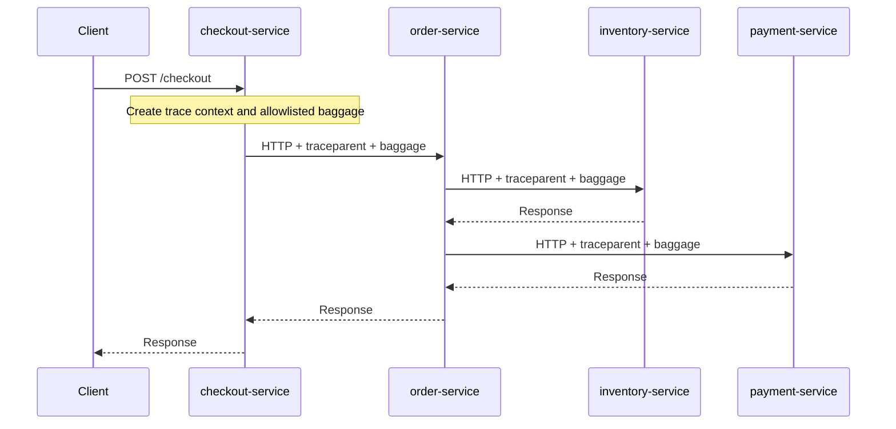

# Baggage in HTTP Headers with Spring Boot

**Baggage** is a set of key-value pairs propagated alongside a distributed trace across service boundaries. It allows a service to send a small, selected amount of metadata so downstream services can use it for logical routing, processing classification, or investigative support. In HTTP, W3C Baggage is represented by the **baggage** header; this header travels alongside but differs in meaning from **traceparent** and **tracestate**.

In the **SPRING_BOOT_OBSERVABILITY** module, baggage is part of the correlation system linking metrics, logs, and distributed tracing. Spring Boot with Micrometer Tracing can configure which baggage fields are propagated over HTTP and which are included in logging correlation. This lesson focuses on HTTP header syntax, propagation configuration, data selection, size/cardinality limits, and security risks when metadata travels across multiple services.

## 1. What Problem Does Baggage Solve?

Suppose a request starts at `checkout-service`, then passes through `order-service`, `inventory-service`, and `payment-service`. These services need to share certain common metadata to classify the processing flow, for example:

- Intake channel: `web` or `mobile`.
- Experiment group: `checkout-v2`.
- Logical region: `apac` or `eu`.
- An approved internal campaign code, if genuinely needed for diagnostics.

If every service reads business headers manually, renames fields, and forwards them ad hoc, metadata can be lost or become inconsistent. Baggage provides a standardized mechanism for permitted key-values to follow the trace context.



Each service can read configured baggage fields and continue propagating them when calling downstream with an instrumented HTTP client. Baggage does not replace request bodies, authorization, transaction contexts, or business data requiring durable persistence.

Baggage is useful when small metadata must cross services to help classify logs and investigate a single processing flow. Do not use it to pass large payloads, credentials, personal data, durable transaction state, or unique IDs into metric labels.

## 2. Distinguishing `traceparent`, `tracestate`, and `baggage`

These three headers often appear together, yet serve different purposes.

| HTTP header | Role | Typical content |
| --- | --- | --- |
| **traceparent** | Carries identity and relationship of the current trace/span | Version, Trace ID, Parent Span ID, trace flags |
| **tracestate** | Carries vendor- or tracing-system-specific state participating in the trace | Members following W3C/vendor conventions |
| **baggage** | Carries application key-value metadata across services | `channel=web`, `tenant-tier=standard` |

Example request:

```http
POST /orders HTTP/1.1
Host: order-service
traceparent: 00-4bf92f3577b34da6a3ce929d0e0e4736-00f067aa0ba902b7-01
tracestate: vendorA=opaque-state
baggage: channel=web,tenant-tier=standard
Content-Type: application/json

{"items":[{"sku":"A-100","quantity":1}]}
```

Here, `traceparent` helps the receiver attach a new span to the trace if the context is valid and accepted. `tracestate` is not a place for arbitrary business fields; `baggage` contains key-value pairs propagated per application policy.

**Baggage does not establish the parent span.** If `traceparent` is omitted while `baggage` is still sent, the receiving service may see the baggage without the intended trace parent relationship. Conversely, a trace can still link up even without baggage.

## 3. W3C Baggage Syntax in HTTP

W3C Baggage defines a header named `baggage`, carrying one or more comma-separated members. A member has the general form:

```text
key=value
key=value;property=value
```

Example:

```http
baggage: channel=web,tenant-tier=standard,region=apac
```

A member can include properties per the specification syntax, for example:

```http
baggage: channel=web;source=checkout,tenant-tier=standard
```

Notes:

- Keys/values follow W3C Baggage token and percent-encoding rules; do not concatenate strings arbitrarily when values contain special characters.
- Commas separate members; semicolons separate member properties.
- Headers may be represented across multiple header lines per HTTP rules; intermediaries/clients must handle valid combining.
- Do not write a naive comma-splitting parser if full compliance with escaping, encoding, and properties is required.
- Account for duplicate keys and library/implementation handling; avoid creating contracts dependent on ordering or duplicate keys.

Certain characters in values require percent-encoding per baggage rules. Example:

```text
baggage: campaign=summer%20sale,channel=web
```

This is an illustrative representation. Let the standard tracing/baggage library handle encoding rather than assembling headers with string concatenation.

Baggage is not arbitrary HTTP header forwarding. Do not copy all request headers into baggage. Headers such as `Authorization`, `Cookie`, `Set-Cookie`, or headers containing personal data have their own purpose and sensitivity. Baggage is a curated list of metadata, not a grab bag for every incoming header.

## 4. How Spring Boot and Micrometer Tracing Propagate Baggage

Spring Boot can auto-configure tracing when the appropriate dependencies are present. Micrometer Tracing provides the tracer abstraction; the corresponding bridge connects to a tracing implementation such as OpenTelemetry. HTTP client/server instrumentation handles injecting/extracting trace context and baggage via the configured propagator.

In Spring Boot 3.x, common properties include:

- **management.tracing.baggage.remote-fields**: baggage fields propagated across the network.
- **management.tracing.baggage.correlation.fields**: baggage fields included in logging correlation, typically via MDC integration.
- **management.tracing.baggage.local-fields**: baggage fields managed only locally, not propagated over the network automatically.

Verify exact property names and behavior against your Spring Boot/Micrometer version. Do not assume every 3.x version shares identical features or behavior.

### 4.1. Example `application.yml`

```yaml
spring:
  application:
    name: checkout-service

management:
  tracing:
    sampling:
      probability: 1.0
    baggage:
      remote-fields:
        - channel
        - tenant-tier
      correlation:
        fields:
          - channel
          - tenant-tier
      local-fields:
        - internal-debug-mode
```

Meaning:

| Configuration | Purpose |
| --- | --- |
| `remote-fields` | Allows baggage fields to propagate across network boundaries via tracing integration |
| `correlation.fields` | Allows fields into log correlation if logging integration supports it |
| `local-fields` | Manages fields in local context, without actively sending them to other services |
| `sampling.probability` | Configures tracing sampling; not a policy for selecting baggage |

Sampling `1.0` should only be used in labs or controlled test windows. In production, weigh traffic and trace storage costs. Baggage propagation and trace sampling are separate mechanisms: baggage can exist on a processed request even when the trace is not sampled for export.

### 4.2. Remote Fields Must Be an Allowlist

Do not add a field to `remote-fields` merely because it exists in the request. Identify which downstream services genuinely need the field, what valid values are, whether the field is sensitive, length and member-count limits, and how to handle missing or malformed fields.

For example, `channel=web/mobile/other` has a small value set and clear purpose. `customer-email`, `access-token`, or raw URLs are not appropriate baggage fields in a typical system.

## 5. Enabling Tracing Dependencies and HTTP Instrumentation

Example Maven dependencies with Spring Boot 3.x:

```xml
<dependencies>
    <dependency>
        <groupId>org.springframework.boot</groupId>
        <artifactId>spring-boot-starter-actuator</artifactId>
    </dependency>
    <dependency>
        <groupId>io.micrometer</groupId>
        <artifactId>micrometer-tracing-bridge-otel</artifactId>
    </dependency>
    <dependency>
        <groupId>io.opentelemetry</groupId>
        <artifactId>opentelemetry-exporter-otlp</artifactId>
    </dependency>
</dependencies>
```

The Spring Boot BOM/parent should manage compatible versions. If an application only installs a metrics registry without a tracing bridge/exporter, do not expect baggage to be automatically injected/extracted with the tracing context.

For HTTP clients, use a Spring Boot-managed builder so customizers and observation instrumentation are applied. Example for Spring Boot 3.2+ with Spring Framework 6.1+:

```java
import org.springframework.context.annotation.Bean;
import org.springframework.context.annotation.Configuration;
import org.springframework.web.client.RestClient;

@Configuration
public class HttpClientConfiguration {

    @Bean
    RestClient inventoryClient(RestClient.Builder builder) {
        return builder
                .baseUrl("http://inventory-service:8081")
                .build();
    }
}
```

When tracing instrumentation and propagation are configured, calls made through the instrumented client can inject `traceparent` and allowed `baggage`. If you construct a raw HTTP client outside auto-configuration, baggage/tracing context may not be injected as expected.

## 6. Creating and Reading Baggage in the Application

There are two separate tasks:

- **Reading extracted context:** a service receiving an HTTP request can use baggage already placed into the current context by the propagator.
- **Creating/updating baggage:** a service can set fields using the active tracing implementation's or Micrometer Tracing's API, which then propagates downstream if configuration permits.

Avoid writing code that manipulates the `baggage` header string directly inside controllers. Instead, use tracing/baggage APIs and scopes to ensure values exist only for the required duration.

Example using the Micrometer Tracing API:

```java
import io.micrometer.tracing.BaggageInScope;
import io.micrometer.tracing.Tracer;
import org.springframework.stereotype.Component;

@Component
public class CheckoutBaggage {

    private final Tracer tracer;

    public CheckoutBaggage(Tracer tracer) {
        this.tracer = tracer;
    }

    public void process(String channel, Runnable action) {
        String normalized = normalizeChannel(channel);

        try (BaggageInScope baggage =
                     tracer.createBaggageInScope("channel", normalized)) {
            action.run();
        }
    }

    private String normalizeChannel(String value) {
        if ("mobile".equalsIgnoreCase(value)) {
            return "mobile";
        }
        if ("web".equalsIgnoreCase(value)) {
            return "web";
        }
        return "other";
    }
}
```

This example illustrates the Micrometer Tracing API with `BaggageInScope`. Verify the exact interface/API against your bridge version. `createBaggageInScope` attaches the field to the current scope; when the scope closes, the previous context is restored. Sending the field over HTTP still requires remote propagation configuration and an instrumented client.

### 6.1. Baggage Scope Is Not Long-Term Storage

A baggage field's scope is tied to the current trace/context. It is not a place to store order state or tenant profiles. If work is enqueued to run hours later, define how to serialize/propagate context across the message broker under a dedicated contract; do not leave an HTTP request scope open indefinitely.

### 6.2. Normalize Before Writing

Never pass raw client-supplied strings verbatim. Normalize against an allowlist:

```java
String channel = switch (rawChannel.toLowerCase(Locale.ROOT)) {
    case "web" -> "web";
    case "mobile" -> "mobile";
    default -> "other";
};
```

The snippet above only illustrates value grouping. In real applications, handle `null`, whitespace, and appropriate business rules. Normalizing metadata must never alter business decisions or mask invalid input.

## 7. Baggage and Log Correlation

Baggage can be helpful for logs when selected fields are added to correlation fields. This lets logs across multiple services share common metadata such as `channel` or `tenant-tier`, alongside Trace ID/Span ID provided by tracing integration.

Example configuration:

```yaml
management:
  tracing:
    baggage:
      remote-fields:
        - channel
      correlation:
        fields:
          - channel
```

When logging correlation is configured and the current context is preserved, logs can look like:

```text
INFO  [checkout-service,4bf92f3577b34da6a3ce929d0e0e4736,00f067aa0ba902b7] channel=web Starting checkout
INFO  [order-service,4bf92f3577b34da6a3ce929d0e0e4736,19ac2efb45102d3a] channel=web Reserving order
INFO  [inventory-service,4bf92f3577b34da6a3ce929d0e0e4736,6ac51d4ae77e9102] channel=web Stock reserved
```

These are illustrative logs, not a mandatory default pattern. Actual format depends on logging configuration, MDC integration, and application layout.

### Baggage Correlation Differs from Trace ID

- Trace ID answers: which spans belong to the same trace?
- Span ID answers: which specific span is this?
- A baggage field such as `channel=web` answers: what metadata accompanied this processing flow?
- Log correlation places appropriate values into logs for filtering/searching.

Baggage does not replace Trace ID/Span ID. Two requests both having `channel=web` do not belong to the same trace. Never use a baggage value in place of a unique correlation identifier.

### Do Not Arbitrarily Attach Baggage to Metric Labels

Some low-cardinality baggage fields can serve as metric tags if explicitly designed to do so. Never convert all baggage into metrics automatically. If a field such as `order-id` or `customer-id` is used as a label, cardinality can grow with requests/customers. Keep metrics for aggregated groups, and use logs/traces to investigate individual requests.

## 8. Baggage, Trace Context, and Context Across Executors

Baggage is usually bound to the current tracing context. When work moves to an executor, context can be lost if ThreadLocal/tracing scopes are not propagated.

For example, an HTTP request sets `channel=web`, then submits a task:

```java
executor.execute(() -> processOrder());
```

If the executor does not propagate context, the worker may not see the baggage. In Spring Framework 6.1+ with Micrometer Context Propagation, you can configure `ContextPropagatingTaskDecorator` on `ThreadPoolTaskExecutor` to capture/restore contexts that have registered accessors.

```java
import org.springframework.context.annotation.Bean;
import org.springframework.context.annotation.Configuration;
import org.springframework.core.task.support.ContextPropagatingTaskDecorator;
import org.springframework.scheduling.concurrent.ThreadPoolTaskExecutor;

import java.util.concurrent.Executor;

@Configuration
public class AsyncConfiguration {

    @Bean("applicationTaskExecutor")
    Executor applicationTaskExecutor() {
        ThreadPoolTaskExecutor executor = new ThreadPoolTaskExecutor();
        executor.setCorePoolSize(8);
        executor.setMaxPoolSize(16);
        executor.setQueueCapacity(200);
        executor.setThreadNamePrefix("app-worker-");
        executor.setTaskDecorator(new ContextPropagatingTaskDecorator());
        executor.initialize();
        return executor;
    }
}
```

Propagation depends on registered accessors for the contexts being transferred. Having the decorator does not mean every custom ThreadLocal or custom baggage is automatically known. Verify the exact integration and version.

Worker threads must restore the previous context. Executors reuse worker threads; the decorator needs to restore context when the task finishes or throws an exception. Otherwise, request A's baggage can leak into task B on the same worker.

Never keep a `BaggageInScope` open on the submitting thread and close it from another thread. Use snapshots/context propagation or create a new scope inside the worker using the appropriate API; scopes must be opened and closed on the right thread/lifecycle.

If a task runs long after the original request finishes, the original request's baggage may no longer be valid. For long-running background jobs, consider passing needed metadata as immutable allowlisted inputs and designing a trace link or new root span rather than stretching the entire request context.

## 9. Baggage and Context Propagation over HTTP

An instrumented HTTP client/server can automatically inject/extract W3C Baggage. The basic flow:

1. The first service receives a request.
2. Tracing instrumentation extracts `traceparent` and `baggage` via the propagator.
3. The application validates/normalizes fields against its contract.
4. Baggage is attached within the current context scope.
5. The instrumented HTTP client injects permitted fields into the downstream request.
6. The next service extracts headers and uses baggage under the same policy.

Example headers:

```http
traceparent: 00-4bf92f3577b34da6a3ce929d0e0e4736-00f067aa0ba902b7-01
baggage: channel=web,tenant-tier=standard
```

Never assign the same Trace ID to every request of a tenant just because baggage contains `tenant-tier=standard`. Trace context is managed independently.

### 9.1. Baggage from External Clients Is Untrusted Input

A client can send:

```http
baggage: channel=web,tenant-tier=admin,debug=true
```

Never trust these values implicitly. If `tenant-tier` affects permissions or `debug=true` triggers sensitive behavior, the request can spoof metadata.

**Baggage is not an authorization mechanism.** Derive permissions and identity from trusted authentication/authorization systems. If clients are allowed to send certain baggage keys, validate values, strip non-allowlisted keys, and never let them determine privileges.

### 9.2. Gateways and Trust Boundaries

At the Internet edge or between trust domains, you may need to strip or overwrite baggage from untrusted sources before internal propagation. A gateway can drop unaccepted keys, normalize values against an allowlist, keep only fields downstream needs, limit member count and total size, and block sensitive data from crossing the boundary.

Policies must be enforced consistently; if one service filters while another trusts directly, baggage can still be abused.

## 10. Baggage Size Limits and Cardinality

Baggage travels in HTTP headers, so oversized baggage can be rejected by proxies, servers, or clients. Systems can enforce varying limits on total header size, member count, key/value lengths, and encoding.

Do not assume every service accepts an unbounded `baggage` header. Define a small system-wide budget, test through gateways/proxies, and monitor header rejections.

| Item | Recommended rule |
| --- | --- |
| Number of baggage members | Only a few fields with a clear need |
| Key | Short, stable name per contract |
| Value | Bounded length and approved value set |
| Total header size | Below the lowest limit along the entire path |
| Properties | Use only when compatibility requires it |
| Unknown keys | Drop at trust boundaries or ignore |
| Duplicate keys | Avoid creating; enforce consistent handling |

Specific limits depend on libraries, SDKs, proxies, and backends; measure in your real system rather than treating one component's configured limit as the network-wide ceiling.

### 10.1. Baggage Cardinality Differs from Metric Cardinality, Yet Still Has Cost

Baggage values do not automatically become metric labels. However, if applications copy baggage into span attributes or log fields, high diversity can increase indexing, storage, and search costs.

- `channel=web/mobile` has few values and is easy to aggregate.
- `order-id` changes per order.
- `request-id` is nearly unique per request.
- `email` is both high-cardinality and potentially PII.

Do not put unique values into baggage unless there is a clear correlation requirement, privacy approval, and retention limit. Trace ID already exists to identify traces.

## 11. Baggage and Sampling

Baggage propagation and tracing sampling are related yet independent.

- **Propagation** determines which boundaries metadata crosses.
- **Sampling** determines which traces/spans are recorded/exported per policy.
- **Baggage** carries key-value metadata.
- **Trace context** identifies spans and their relationships.

If a trace is not sampled at the head, baggage can still be processed within the request context depending on instrumentation/propagator, though a full trace will not appear in the backend. Conversely, a sampled trace can still lack a baggage field if the field was not configured or was stripped at a gateway.

Spring Boot 3.x lab example:

```yaml
management:
  tracing:
    sampling:
      probability: 1.0
    baggage:
      remote-fields:
        - channel
```

This configuration illustrates enabling full sampling and a remote baggage field in a test environment. Sampling `1.0` is not required for baggage to work; it simply makes exported traces easier to observe in a lab.

In production, evaluate sampling and tracing cost independently. Never allow a baggage value such as `debug=true` to force 100% sampling on every request without clear policy and trust-boundary protection.

## 12. Security and Privacy

Baggage can traverse multiple services, gateways, collectors, and tracing backends. Every service might log or store baggage if instrumentation/correlation is configured. Thus, a field that seems like "just internal metadata" can spread farther than intended.

Do not put into baggage:

- Passwords, API keys, secrets, access/refresh tokens.
- Cookies or `Authorization` headers.
- Card numbers, payment data, or authentication credentials.
- Emails, phone numbers, addresses, or personal identifiers without justification and approval.
- Request/response bodies, SQL parameters, or payloads.
- Security principals/roles that could be forged by clients.

Protection principles:

1. Allowlist fields: propagate only approved keys.
2. Validate values: check format, length, and allowed values.
3. Trust boundaries: strip or overwrite untrusted data upon entry.
4. Data minimization: avoid propagating fields downstream does not use.
5. Access control: restrict who can view trace/log backends.
6. Retention: set retention periods proportional to purpose.
7. TLS: protects transit, though encryption does not make sensitive data safe to record.
8. Redaction: filter attributes/log fields at the source and appropriate pipelines.

Never use baggage as the source to decide whether a `tenantId` has permission to access a resource. Permissions must be checked against authenticated identity and the system's authorization policy.

## 13. Troubleshooting Baggage in HTTP

| Symptom | Possible cause | How to check |
| --- | --- | --- |
| Receiving service has trace but no baggage | Remote field undeclared, unsupported propagator, or header filtered | Check config, boundary headers, and dependency/version |
| Baggage present at service A but lost at B | Uninstrumented HTTP client, gateway strips header, field not allowlisted | Use Boot-managed client builder, check each hop |
| Baggage present in header but missing in MDC | Correlation field undeclared or logging integration unconfigured | Check `correlation.fields`, MDC, and log pattern |
| Worker logs lack baggage | Context did not cross executor | Check `TaskDecorator`, accessors, and snapshots |
| Baggage value changed | Service normalized or overwrote value | Check field contract and ownership |
| Client-supplied baggage triggers privileged behavior | Trusting untrusted input | Strip/validate field; authorization must not rely on baggage |
| HTTP 431 or rejected requests | Header exceeded proxy/server limits | Reduce field count/length, check per-hop limits |
| Backend index grows rapidly | Baggage copied into attributes/logs with many distinct values | Reduce dynamic fields and restrict indexing |
| Trace exists without baggage field | Sampling does not guarantee all baggage is exported | Check remote fields and span attributes separately |
| Baggage arrives but trace is split | Trace context propagation error | Check `traceparent`, parent spans, and instrumented clients |
| Duplicate fields or inconsistent parsing | Duplicate members/implementation differences | Normalize header at boundary, avoid duplicate keys |
| Baggage leaks from previous request | Scope/ThreadLocal not restored | Check cleanup, worker reuse, and context decorator |

### Hop-by-Hop Debugging Workflow

1. Send a lab request with a valid `traceparent` and one allowlisted baggage field.
2. Inspect arrival at the first service; confirm the field was extracted into context via the appropriate API.
3. Call downstream via an instrumented HTTP client.
4. Inspect outgoing headers in a safe test/network log environment.
5. Confirm the downstream service extracts the field.
6. Check whether the baggage field appears in correlation/logs if configured.
7. Check the trace backend: matching Trace ID and expected span hierarchy.
8. Remove the field from `remote-fields` to verify it stops propagating.
9. Test oversized/invalid values in the lab to verify validation and limits.
10. Ensure tests do not print tokens, cookies, or sensitive data.

Never log full headers in production just to debug. Headers can contain credentials and personal information.

## 14. Hands-On Exercise: Propagating `channel` Across Multiple HTTP Services

The goal is to propagate a low-value-set `channel` baggage field from `checkout-service` to `order-service` and `inventory-service`, then verify log correlation and trace context.

### Preparation

- Spring Boot 3.x with Actuator.
- Micrometer Tracing bridge, such as OpenTelemetry.
- OTLP traces exporter and a lab trace backend/Collector.
- Spring Boot-managed HTTP client.
- Two lab services or a mock downstream.
- Never use customer PII or credentials as baggage.

### Step 1 — Declare Field Policy

On services that need to propagate, configure:

```yaml
management:
  tracing:
    baggage:
      remote-fields:
        - channel
      correlation:
        fields:
          - channel
```

Use only the `channel` field in this lab; do not add other headers automatically.

### Step 2 — Create Baggage in Scope

Use `Tracer` and `BaggageInScope` as in the Section 6 example, normalizing values to `web`, `mobile`, or `other`. Ensure the scope closes in `try-with-resources`.

### Step 3 — Create an Instrumented HTTP Client

Inject `RestClient.Builder` managed by Spring Boot and build the downstream client. Never assemble the `baggage` header by string concatenation in business methods.

### Step 4 — Send Requests Across Two Services

Call `checkout-service`, then have `order-service` call `inventory-service`. Confirm each boundary receives and forwards `channel` per the allowlist. Use network inspection in the lab if needed.

### Step 5 — Verify Trace Context

In the backend, confirm spans share the same Trace ID when propagation works; parent span IDs reflect the corresponding calls. Check the baggage field separately: it does not establish parent-child relationships.

### Step 6 — Check Log Correlation

When `channel` is configured as a correlation field and MDC integration is active, check each service's logs for the expected value. If worker threads participate, verify context propagation across the executor.

### Step 7 — Test Trust Boundaries

Send baggage from the client with a non-allowlisted key or invalid value. Confirm the gateway/service handles it per policy without using that field to grant permissions or alter tenant identity.

### Step 8 — Test Limits

Create baggage with many members or long values in a test environment. Note which layer rejects or drops the request. Set a low budget consistent with proxies and services along the path.

### Step 9 — Test Sampling Independently

Lower tracing sampling in the lab. Observe that exported traces in the backend decrease, while baggage validation/propagation does not necessarily drop at the same rate. Compare with logs and metrics to understand the separate pipelines.

### Acceptance Checklist

| What to demonstrate | Passing criterion |
| --- | --- |
| Distinguish headers | Correctly state roles of `traceparent`, `tracestate`, `baggage` |
| HTTP format | Read key-value members and understand encoding/properties |
| Allowlist | Only approved remote fields propagate |
| Instrumentation | HTTP client injects/extracts via tracing integration |
| Scope | Baggage is set and closed within proper lifecycle |
| Correlation | Selected field appears in logs when config supports it |
| Trace topology | Shared Trace ID/parent relations verified independently of baggage |
| Trust boundary | Untrusted input is validated or stripped |
| Security | No secrets/PII in baggage |
| Limits | Member count and header size stay within budget |
| Context across executor | Workers neither lose nor leak baggage |
| Sampling | Understand trace sampling is distinct from propagation |

## 15. Principles to Remember

1. **Baggage is key-value metadata carried with context**, not trace content, authorization tokens, or a business datastore.
2. **`traceparent`, `tracestate`, and `baggage` serve different purposes.** `traceparent` links spans; `tracestate` holds vendor state; `baggage` carries selected metadata.
3. **Use an allowlist for remote fields.** Only propagate fields downstream truly needs, with an explicit contract and valid values.
4. **Use tracing/baggage APIs instead of hand-assembling headers.** Close scopes properly so context does not leak to other requests.
5. **Use instrumented HTTP clients.** If a client bypasses tracing integration, trace/baggage headers may not be injected.
6. **Never trust baggage from external clients.** Validate at trust boundaries; access control must rely on real authentication/authorization.
7. **Keep payloads small and cardinality controlled.** Avoid dynamic IDs, raw URLs, PII, and secrets.
8. **Correlation fields are a separate choice.** Put only necessary fields into MDC/logs; do not copy all baggage.
9. **Context across executors needs capture/restore/cleanup.** Never let a prior task's baggage leak into the next worker task.
10. **Propagation, sampling, and metrics export are independent mechanisms.** Baggage may propagate while a trace is not stored; metrics can still record the request.
11. **Combine the three signals purposefully.** Metrics identify trends, traces describe journeys, logs explain events; baggage only adds controlled shared metadata.

Baggage in HTTP headers allows permitted metadata to travel alongside distributed traces across Spring Boot services. When fields are allowlisted, normalized, bounded, and properly scoped, it supports log correlation and flow analysis. Separating baggage from trace identifiers, authorization, and metric labels keeps observability connected while controlling cardinality, cost, and privacy.
