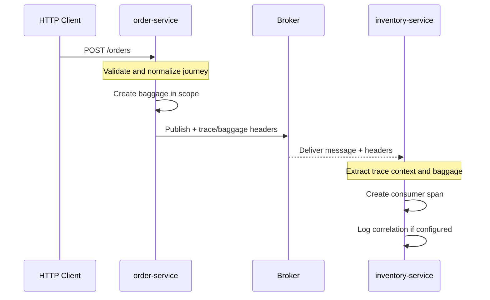

# How Does Baggage Differ from Trace Tags?

A request flows through `order-service`, `payment-service`, and `inventory-service`. The operations team wants to know which flow the request belongs to, such as `journey=partner-checkout`, so services can use the same information when processing and logging. One engineer adds `channel=partner` to a span, yet the next service does not see this value. Another puts `traceId` into a metric tag to locate specific requests, causing time series counts to skyrocket. Both situations stem from confusing **baggage**, **span tags/attributes**, and **metric tags**.

**Baggage** is metadata propagated with the trace context across boundaries when propagation is configured. A **span tag/attribute** describes a specific span within a trace. A **metric tag** classifies measurements into time series groups. They can carry the same business value, yet they have different goals, lifecycles, costs, and propagation scopes.

The **How Does Baggage Differ from Trace Tags?** lesson belongs to the **Baggage and Correlation** chapter of the **SPRING_BOOT_OBSERVABILITY** module. The module focuses on setting up observability for Spring Boot using Micrometer Observation, metrics, logs, and distributed tracing; covering context propagation, tags/cardinality, exporters, sampling, and signal correlation to investigate errors, latency, and application behavior in production environments.

## 1. Learning Objectives

After this lesson, you will be able to:

- Distinguish baggage, span tags/attributes, metric tags, and logging MDC.
- Explain why attaching a tag to a span does not mean that value automatically propagates to the next service.
- Describe how baggage is injected into and extracted from trace propagation headers.
- Configure baggage remote fields, local fields, and correlation fields in Spring Boot.
- Use baggage within a bounded scope and understand the lifecycle of the current value.
- Decide which metadata should be propagated, recorded on spans, logged, or used as metric tags.
- Assess risks around trust boundaries, header size, privacy, cardinality, and cost.
- Investigate cases where baggage fails to reach downstream, MDC becomes stale, or a span has an attribute that another service cannot see.

## 2. Comparing Four Concepts

| Concept | Purpose | Scope | Propagated across services automatically? |
| --- | --- | --- | --- |
| **Baggage** | Carries permitted metadata alongside trace context | Services participating in propagation, per configuration | Yes, if the field is configured remote and propagators inject/extract properly |
| **Span tag/attribute** | Describes one span: which step, what outcome, which dependency | Specific span | Not by default; other spans must attach their own tags or read from baggage/context |
| **Metric tag/label** | Splits measurements into time series groups | Meter/time series | No; registries/exporters emit only meter tags |
| **Logging MDC/correlation field** | Attaches correlation data to the current log record | Logging/thread scope or execution context | Does not cross the network automatically; can be copied from baggage when configured |

### One Value Passing Through Multiple Layers

Suppose an incoming request has been authenticated and the application permits propagating `journey=partner-checkout`:

- **Baggage:** this value travels with the trace context from `order-service` to `payment-service` if remote propagation is configured.
- **Span attribute:** the `payment.authorize` span can record `journey=partner-checkout` so the tracing backend can filter spans.
- **Metric tag:** the `payment.authorize.duration` timer can have `channel=partner` if the value set is bounded and an operational question requires grouping latency by channel.
- **MDC/logs:** logs in scope can contain `journey` or a configured correlation field, helping locate related records.

There is no automatic rule that **baggage always becomes a span attribute, span attributes always become baggage, or baggage always becomes a metric tag**. To make a value appear across multiple signals, explicitly configure or copy it into each layer per policy.

## 3. What Is Baggage?

In distributed tracing, **baggage** is a set of key/value pairs attached to a trace or execution context. Propagators can serialize permitted fields into propagation metadata, send them with requests/messages, and extract them at receiving services.

Baggage is helpful when multiple services need the same small metadata to pick a classified processing branch, enrich context for logs/spans, or support correlation via a normalized group key. Baggage is **not** a place to pass business objects, store request bodies, hold authorization tokens, or act as a user datastore. Every field needs an owner, trusted source, allowed value set/length, and lifetime.

### Baggage Is Not a Span

A span has a lifecycle: start, active, end. Baggage is context metadata that can remain present across multiple spans/services for as long as the context is held. A baggage field can be read by multiple spans, and each span can choose to record it as an attribute. Conversely, the current span having `payment.provider=bank-a` does not mean that tag automatically appears in child span contexts or outbound headers to other services.

### Baggage Is Not the Entire Trace Context

Trace context contains linking fields such as trace ID, span ID, and sampling flags. Baggage is supplementary metadata. Propagating trace context does not automatically mean all business variables or MDC fields are propagated too.

## 4. What Is a Span Tag/Attribute?

A span tag (the common name in Brave/Zipkin APIs) or span attribute (the standard term in OpenTelemetry) is a key/value pair describing a specific span:

| Span | Illustrative attribute/tag |
| --- | --- |
| `HTTP POST /orders` | `http.request.method=POST`, `http.route=/orders` |
| `inventory.reserve` | `operation=reserve`, `outcome=success` |
| `payment.authorize` | `payment.provider=partner-a`, `outcome=error` |

Span attributes support filtering/investigating traces in the backend. They do not have cardinality like metric labels: each span is an individual record. Even so, do not add arbitrary data to spans because storage/indexing/query costs, size limits, and risks of exposing PII/secrets still apply.

### Span Tags Do Not Propagate Automatically

Consider a producer span `order.submit` with tag `customer-tier=gold`, sending a message to a consumer:

1. The producer adds the tag to the current span.
2. The propagator injects trace context and configured baggage into message headers.
3. If `customer-tier` is only a span tag and was not turned into baggage/message metadata, the consumer has no automatic knowledge of it.
4. The consumer creates a new span. That new span gets `customer-tier=gold` only if it receives the value via a valid mechanism and explicitly attaches the attribute.

This is why span attributes should never be treated as an implicit communication channel between services.

## 5. Metric Tags/Labels Differ from Both Baggage and Span Tags

A metric tag identifies one dimension of a meter. Each distinct tag set creates a distinct time series, for example:

`payment.authorize.duration{channel="partner",outcome="error"}`

Metrics require a **stable, bounded** value set so aggregations remain useful and costs stay within budget. Never put `traceId`, `spanId`, `orderId`, emails, or per-request UUIDs into metric tags. Baggage can hold values that vary per trace; that does not make it safe as a metric tag.

| Data | Baggage | Span attribute | Metric tag |
| --- | --- | --- | --- |
| `channel=web/mobile/partner` | Can propagate if needed | Can record on span | Appropriate if finite set and analytically needed |
| `outcome=success/error` | Usually no need to propagate solely for metrics | Appropriate for span outcome | Appropriate if finite taxonomy |
| `traceId` | Already in trace context | Present in trace context | Never use |
| `orderId` | Should not propagate by default | Only when genuinely needed and permitted | Never use |
| `tenantId` with thousands of values | Consider very carefully | Only per policy | Usually inappropriate |
| `region=ap-southeast-1` | Propagate only if services need it | Can record attribute | Can be a common tag if region set is bounded |

One value can appear in all three layers when justified, but three independent decisions must be made: whether to transmit it, whether to store it on spans, and whether its cardinality is low enough to group metrics.

## 6. Remote Fields, Local Fields, and Correlation Fields in Spring Boot

Spring Boot exposes baggage configuration properties under `management.tracing.baggage`. Verify property names and auto-configuration against your Spring Boot/Micrometer version. Example configuration for Spring Boot 3.x:

```yaml
spring:
  application:
    name: order-service

management:
  tracing:
    sampling:
      probability: 0.1
    baggage:
      remote-fields:
        - journey
        - support-region
      local-fields:
        - internal-processing-mode
      correlation:
        fields:
          - journey
```

Meaning:

- **Remote fields:** fields permitted into propagation context to cross services when propagators support and are configured properly.
- **Local fields:** fields managed in the application's baggage context without intending remote propagation.
- **Correlation fields:** fields used to enrich logging context/MDC via the matching Spring Boot integration.
- **Sampling probability:** adjusts the rate of sampled traces per tracer/policy; does not govern which baggage is permitted to propagate.

The example only declares field names. It **does not generate values** for `journey` or `support-region`; the application must set baggage from a verified source or permitted context.

Remote baggage can be serialized into headers according to the active propagator. Do not assume the wire header looks identical to the YAML field name: formats/bridges may normalize names and encoding. Inspect actual headers on HTTP or message carriers in tests.

## 7. Creating and Using Baggage in Code

Micrometer Tracing provides the `Tracer` abstraction. With a configured baggage field and a trusted value source, code can create baggage within a scope:

```java
import io.micrometer.tracing.BaggageInScope;
import io.micrometer.tracing.Tracer;
import org.springframework.stereotype.Service;

@Service
public class OrderSubmissionService {
    private final Tracer tracer;
    private final PaymentGateway paymentGateway;

    public OrderSubmissionService(Tracer tracer,
                                  PaymentGateway paymentGateway) {
        this.tracer = tracer;
        this.paymentGateway = paymentGateway;
    }

    public PaymentResult submit(OrderCommand command) {
        // Validate/normalize before putting the value into baggage.
        String journey = command.channel().metricValue();
        try (BaggageInScope baggage =
                 tracer.createBaggageInScope("journey", journey)) {
            return paymentGateway.authorize(command);
        }
    }
}

interface PaymentGateway {
    PaymentResult authorize(OrderCommand command);
}

record PaymentResult(boolean accepted) {}
```

This example illustrates setting scoped baggage via the Micrometer Tracing API. `OrderCommand`, `channel()`, and `metricValue()` are hypothetical application types/methods; real code requires validation and value bounds. Check exact APIs against your Micrometer Tracing/bridge version.

### Scope Lifecycle

`BaggageInScope` closes upon exiting `try-with-resources`. Scoping restores the prior state and prevents baggage from leaking to other requests/tasks when threads are reused. Never keep a scope alive across asynchronous boundaries or multiple messages.

To propagate across a downstream HTTP call, all of these must hold simultaneously:

1. The field is in the appropriate remote propagation configuration.
2. Baggage is active at the time of sending.
3. The HTTP client is instrumented or uses a propagator to inject.
4. The receiving service has matching extraction configuration.

Calling `createBaggageInScope` alone does not make an uninstrumented HTTP client send headers automatically.

### Request Data Must Be Trusted Before Becoming Baggage

Never take arbitrary client headers straight into propagation:

```java
// Unsafe: clients can send arbitrary, oversized, or sensitive values.
String journey = request.getHeader("X-Journey");
tracer.createBaggageInScope("journey", journey);
```

Define the permitted value set first:

```java
static String normalizeJourney(String raw) {
    if (raw == null) {
        return "unknown";
    }
    return switch (raw.toLowerCase(java.util.Locale.ROOT)) {
        case "web", "mobile", "partner" ->
            raw.toLowerCase(java.util.Locale.ROOT);
        default -> "unknown";
    };
}
```

This normalizes observability metadata. If `journey` affects access rights or business decisions, still verify the source via a dedicated identity mechanism; baggage is not proof of authentication.

## 8. Baggage and Log Correlation via MDC

Log correlation lets log records include selected fields from the active context. In Spring Boot, `management.tracing.baggage.correlation.fields` can configure which baggage fields are placed into logging correlation when the integration matches.

For example, `journey` is configured as a correlation field. When the baggage scope is active, logs might look like:

```text
2026-11-22T10:12:30Z INFO traceId=4bf92f... spanId=00f067... journey=partner checkout accepted
```

This is an illustrative log; actual rendering depends on logging patterns/encoders, MDC integration, and versions. Configuring a correlation field does not guarantee log output prints every key: the logger needs a pattern or structured encoder reading that MDC field.

### Correlation Is Not Propagation

- `remote-fields`: allows baggage to cross propagation boundaries.
- `correlation.fields`: places fields into log correlation/MDC within the current scope.

A field might only be needed in one service's logs without needing remote propagation. Conversely, a field propagated downstream does not have to appear in every log. Choosing the right scope reduces header size and limits metadata leakage into logs.

### MDC and Async

MDC is typically bound to the execution context/thread. When work moves across an executor or reactive scheduler, correlation fields can disappear or mix if context is not captured/restored. Use Micrometer Context Propagation and matching executor/Reactor integrations; never copy MDC arbitrarily and leave values behind on thread pools.

When processing multiple messages concurrently, verify baggage/MDC is restored after each task. The `journey` value from message A must never appear in logs of message B running afterward on the same worker thread.

## 9. Propagation over HTTP and Messaging

Baggage follows trace context through propagators. For HTTP, context is typically injected into request headers; for Kafka/RabbitMQ, context is injected into message headers. The receiving service extracts it and places baggage into its execution context.



Only configured remote fields should cross boundaries. In the example, `journey` is a remote field; `internal-processing-mode` is a local field. Receiving services should not see local fields by default. To send a new field, add it to the propagation allowlist and perform a security review before rollout.

With messaging, the producer creates baggage in context or extracts from inbound trace context; instrumentation injects trace context and remote baggage into headers; the broker forwards headers; the consumer extracts before creating its processing span. Retries/redeliveries must preserve or adjust context per chosen semantics. If a batch combines multiple messages from different traces, no single baggage value accurately represents every source; consider span links and per-message metadata.

## 10. Sampling Does Not Decide Whether Baggage Is Valid

Sampling decides which traces are stored/exported per policy. Baggage decides which metadata travels with context when propagation is configured. The two mechanisms relate via trace context, yet are not synonymous:

- Unsampled requests can still carry context/baggage per policy.
- Sampled traces do not imply every baggage field is allowed to propagate.
- Logs having baggage correlation do not prove traces reached the backend.
- Metrics continue recording independently of whether traces are sampled.

If traces are missing from the backend while logs have trace IDs and `journey`, inspect sampling, reporters/exporters, network, and ingestion. Do not remove baggage or alter metric tags just to work around a reporter error.

## 11. Cardinality, Size, and Privacy

Baggage does not inherently become a metric tag, so it does not directly generate time series per value in every configuration. However, baggage is **not free**:

- Serialized fields enlarge HTTP/message headers.
- Values copied into span attributes increase storage/indexing.
- Values placed into MDC increase log volume and search cost.
- Baggage can travel across multiple services and cross trust boundaries.
- High-cardinality values hamper queries, create noise, or expose data.

| Data | Baggage | Span attribute | Metric tag | Log/MDC |
| --- | --- | --- | --- | --- |
| `journey=web/mobile/partner` | Possible if downstream needs it | Possible | Possible if analysis needs it | Possible |
| `region=ap-southeast-1` | Only if propagation needed | Possible | Often sensible as common tag | Possible |
| `traceId` | Already in trace context | No need to copy as business attribute | No | Usually supported by tracing integration |
| `orderId` | Usually no | Only with clear reason and permission | No | Only controlled/masked logging |
| Email/token | No | No | No | No |
| Free-form query string | No | No | No | Avoid or sanitize |

### Trust Boundaries

A baggage value sent by a client or external producer does not become trustworthy merely by sitting inside trace context. On inbound receipt:

1. Parse and enforce limits on length, field count, and allowed characters.
2. Explicitly choose which fields propagate across each boundary.
3. Never use baggage to authenticate users, check permissions, or determine authorized tenants.
4. Never propagate tokens, cookies, passwords, payment data, or personal information.
5. Strip/overwrite untrusted fields if a service is about to send context into another trust domain.
6. Set appropriate retention and access controls for traces/logs containing correlation metadata.

Trace ID only correlates telemetry. It is **not a credential, identity proof, or message signature**.

### Span Tags and High Cardinality

Span attributes like `order.id` do not spawn metric series the way metric tags do, yet trace backends still store many values and index broadly. Baggage can propagate that value to many services, multiplying the data footprint. Only put IDs into traces when a clear investigative use case exists and policy permits; usually prefer controlled correlation IDs or lookups inside business systems.

## 12. Common Design Mistakes

| Mistake | Symptom | Fix |
| --- | --- | --- |
| Assuming span tags propagate downstream automatically | Receiving service misses attribute | Propagate baggage/message metadata if genuinely needed |
| Assuming baggage appears on every span automatically | Span attributes lack field | Attach attributes intentionally or use conventions |
| Turning all baggage into metric tags | Cardinality spikes | Select only finite tags for analysis |
| Putting `traceId` into metric tags | Every trace creates a series | Use trace context and logs for correlation |
| Omitting remote field declaration | Downstream cannot extract baggage | Configure remote fields and verify propagators |
| Declaring only correlation fields | Logs and downstream have mismatched scopes | Distinguish correlation from remote propagation |
| Using local fields and expecting downstream visibility | Value vanishes at boundary | Use local only when scope is truly local |
| Taking client headers and propagating verbatim | Spoofed baggage/oversized values | Validate, normalize, and allowlist |
| Failing to close `BaggageInScope` | Metadata leaks to next task | Use `try-with-resources`, verify scopes |
| Using baggage for authorization | Trusting untrusted data | Base authorization on dedicated identity/security context |
| Putting tokens/PII in baggage | Data leaks across headers, traces, logs | Remove them and narrow allowlist |
| Copying MDC manually across thread pools | Stale trace IDs or mixed tasks | Use context propagation and proper restoration |
| Batching messages under one shared baggage | Message A's metadata assigned to message B | Use per-message context and span links |
| Missing trace leads to blaming baggage | Overlooked sampling/reporter issue | Check propagation and export separately |

## 13. Troubleshooting

| Symptom | Cause to check | Verification direction |
| --- | --- | --- |
| Baggage at producer but missing at consumer | Field not remote, inject/extract inactive, or header stripped | Compare configs and headers before/after broker |
| Trace ID preserved while baggage is lost | Trace context propagates while baggage lacks allowlist | Check `remote-fields` and propagators |
| Baggage at consumer but missing from span tags | Baggage does not become span attribute automatically | Attach attributes explicitly or use conventions |
| Baggage in app but missing from logs | Correlation field/encoder unconfigured | Check `correlation.fields`, MDC, and log pattern |
| Worker logs carry baggage from prior message | Scope/MDC not restored | Check `try-with-resources` and async propagation |
| HTTP has baggage but Kafka lacks it | Messaging instrumentation not injecting or converter drops headers | Check template/container and message headers |
| Field appears outside trust domain | Propagation allowlist too broad | Restrict fields and scrub at egress boundaries |
| Header too large | Too much baggage or long values | Reduce fields, cap size, exclude payloads |
| High metric cardinality after baggage change | Code copies baggage directly into metric tags | Remove dynamic labels, normalize enums |
| Trace missing while logs contain trace ID | Sampling, reporter, exporter, or ingestion | Check tracing pipeline independently |

### Investigation Order

1. **Value source:** where is the field created? Is it validated/normalized?
2. **Scope:** is baggage active when making outbound calls/messages?
3. **Configuration:** is the field remote, local, or correlation? Is scope misconfigured?
4. **Inject:** is the propagation header added to the carrier before sending?
5. **Transport:** do HTTP clients, brokers, converters, or proxies preserve headers?
6. **Extract:** does the receiving service use the same format/propagator and extract on time?
7. **Usage:** does code need to copy baggage to span attributes or log fields, or is it falsely assumed automatic?
8. **Cleanup:** are scopes/MDC restored after requests/tasks?
9. **Export:** did spans/logs reach the backend? Any sampling, reporter, or ingestion issues?

## 14. Practice: Using One Field Across Three Services

**Scenario:** `order-service` receives requests from three channels: `web`, `mobile`, `partner`. `payment-service` and `inventory-service` need the channel to enrich logs. Dashboards also want payment latency by channel, without storing every request ID.

### Part A — Metadata Design

1. Define `journey` accepting only `web`, `mobile`, `partner`, `unknown`.
2. Establish the source of `journey` as application-validated/normalized boundary data.
3. Declare `journey` as a remote baggage field only if downstream truly needs it.
4. Add `journey` to correlation fields only if downstream logs must filter by it.
5. Add `channel` to metric tags only if dashboards need latency breakdown and the value set remains finite.
6. Never put order IDs or trace IDs into metric labels.

### Part B — Verification Cases

| Case | Behavior | Expected outcome |
| --- | --- | --- |
| A — Web | Request hits `order-service` with channel `web` | Baggage normalized to `journey=web` |
| B — Propagation | Order sends HTTP to payment | Headers carry context/baggage per propagator |
| C — Consumer | Message reaches inventory | Consumer extracts `journey` if remote config and headers preserved |
| D — Correlation | Logs inside consumer scope | MDC has field if correlation configured and logger emits it |
| E — Span metadata | Payment span needs filtering by `journey` | Code/conventions explicitly attach attribute |
| F — Metrics | Payment timer by channel | Only four normalized channel values appear |
| G — Untrusted input | Client sends very long/spoofed channel | Value rejected or mapped to `unknown`; raw string never propagates |
| H — Async | Consumer processes via worker pool | Valid baggage preserved without leaking to next message |

### Part C — Classification Exercise

| Field | Questions to answer yourself |
| --- | --- |
| `channel=partner` | Does downstream need to know? Do we need a latency-by-channel dashboard? |
| `payment-provider=bank-a` | Describes only the payment span or needed by subsequent services too? |
| `orderId=ord-12345` | Permitted in logs/traces? Why unsuitable as a metric tag? |
| `traceId` | Already in trace context? Any need to copy into baggage? |
| `authorization token` | Ever permitted to propagate or export? |
| `region=ap-southeast-1` | Better as a common tag/resource metadata instead of baggage? |

### Part D — Self-Assessment Questions

1. Why does the span tag `channel=partner` on the producer not automatically appear on the consumer span?
2. How do `remote-fields`, `local-fields`, and `correlation.fields` differ?
3. When baggage is propagated, must it appear in the tracing backend as a span attribute?
4. Why does `traceId` belong in trace context yet should not be a metric tag?
5. If logs need `journey` while downstream does not, which configuration fits better than remote baggage?
6. Why must baggage from inbound requests be validated before propagation?
7. When a request is not sampled, does baggage necessarily disappear?
8. If baggage exists in the consumer yet MDC lacks it, which components should you inspect?
9. Why must `BaggageInScope` be closed after work finishes?
10. Should a batch of messages from different traces share one common baggage value or use per-message metadata/links?

## 15. Key Takeaways

**Baggage** is metadata that can travel with trace context across services when remote propagation is configured. **Span tags/attributes** describe a single span and do not automatically propagate downstream. **Metric tags** group measurements, so they must have low cardinality and never contain per-request IDs. **MDC/correlation fields** attach current context to logs, yet still require capture/restore mechanisms in async execution.

In Spring Boot, choose remote fields, local fields, and correlation fields deliberately; create baggage inside bounded scopes; validate data at trust boundaries; and intentionally decide when to copy metadata onto spans, logs, or metrics. Baggage is not authorization, business payloads, or secret storage. By cleanly separating these four roles and testing injection/extraction, sampling, context cleanup, and exporters, metrics, logs, and distributed tracing work together effectively for troubleshooting while keeping cardinality, security, and observability costs under control.
