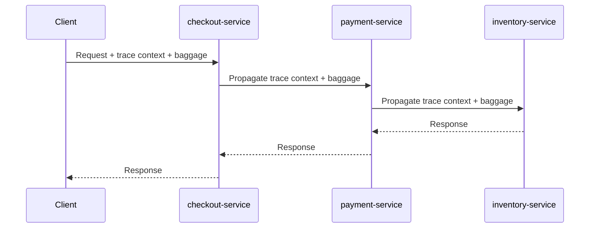
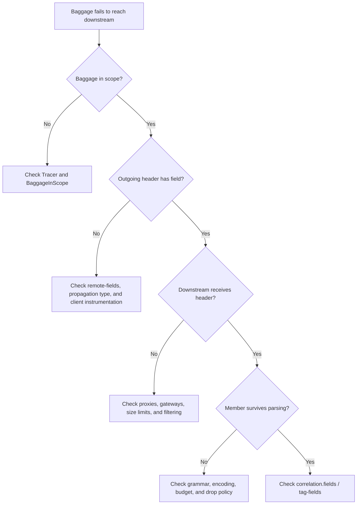

# Baggage Size Limits in Spring Boot

Baggage helps carry small metadata alongside a distributed trace, such as tenant tier, deployment region, or workflow name. When a request passes through multiple services, baggage can be transmitted in HTTP headers or transport metadata. However, baggage is not an arbitrary context store. Each member increases request size, risks proxy/server rejection, raises processing cost, and widens the scope of shared data.

The **"Baggage Size Limits"** lesson belongs to the **Baggage and Correlation** chapter of the **SPRING_BOOT_OBSERVABILITY** module. The module guides you through setting up observability for Spring Boot using Micrometer Observation, metrics, logs, and distributed tracing; this lesson explains W3C Baggage limits, how to calculate size in bytes and member counts, how to set budgets, configure Micrometer Tracing/Spring Boot, and test propagation across multiple services.

**Operational principle:** put into baggage only small, necessary metadata that is permitted to cross service boundaries. Set an internal budget lower than infrastructure limits, check size before injecting, and handle missing baggage safely.

## 1. What Is Baggage and Why Does Size Matter?

Baggage consists of key/value pairs carried with the trace context during propagation. Example:

```http
traceparent: 00-4bf92f3577b34da6a3ce929d0e0e4736-00f067aa0ba902b7-01
baggage: tenant.tier=premium,region=ap-southeast-1,workflow=checkout
```

`traceparent` carries the trace ID, parent span ID, and trace flags per W3C Trace Context. `baggage` carries supplementary metadata. The two headers serve two different purposes.

Baggage can pass through multiple services:



A member transmitted across multiple hops gets parsed, held in context, and potentially re-serialized at every hop. If baggage is large, the cost is not limited to the first request but repeats across many downstream calls.

Baggage size affects HTTP request header size, CPU/allocation during parsing and encoding, network bandwidth, log volume if copied into MDC, span size/indexing cost if converted into span attributes, and privacy/security because many systems can see that metadata.

**Never stuff request payloads, JWTs, access tokens, emails, addresses, stack traces, or large business data into baggage.**

## 2. Limits in W3C Baggage

W3C Baggage defines a baggage string consisting of a list of members. In the Limits section of the specification, a platform **MUST propagate all list-members** when both conditions hold simultaneously:

| Condition | W3C threshold |
| --- | ---: |
| Number of list-members | At most 64 |
| Size of baggage string | At most 8,192 bytes |

If either condition is not met, the platform **MAY drop list-members** until both conditions are satisfied. The specification does not dictate which member must be dropped first or the selection order. These thresholds are minimum interoperability guarantees; platforms may define higher limits, yet you should still transmit only a reasonable amount of information.

Three points to understand precisely:

1. **64 members and 8,192 bytes are two independent conditions.** Baggage with 10 members totaling 9,000 bytes still exceeds the size threshold; baggage with 65 very short members still exceeds the count threshold.
2. **8,192 bytes is the size of the baggage string**, not a guaranteed budget for all HTTP request headers combined. Cookies, authorization, `traceparent`, and application headers share the infrastructure's header limit.
3. **This is not a guarantee that every proxy accepts 8,192 bytes.** Gateways, web servers, ingress controllers, service meshes, and HTTP clients can enforce lower limits; requests can be rejected before reaching the application.

For example, if an ingress allows a maximum `baggage` header of 4 KiB, the application cannot use the W3C 8 KiB threshold as its practical budget. The budget must be based on the strictest component along the path and leave headroom for other headers.

Normative source: [W3C Baggage — Section 3.3.2 Limits](https://www.w3.org/TR/baggage/#limits).

## 3. Counting Members Differs from Counting Characters

Baggage typically takes the form of a comma-separated list of members:

```http
baggage: tenant.tier=premium,region=ap-southeast-1,workflow=checkout
```

This example has three members: `tenant.tier=premium`, `region=ap-southeast-1`, and `workflow=checkout`.

Each member consists of a key, value, and optional properties per W3C syntax. Size is measured in bytes of the serialized baggage string, so you cannot just count key/value pairs or visible characters.

### URL Encoding Increases Size

Certain characters require percent-encoding when serialized into baggage. Java `String.length()` counts UTF-16 code units, not bytes on the wire. Percent-encoded values can be longer than original values; keys, delimiters, equals signs, and properties also consume bytes.

**Do not use `String.length()` to claim baggage complies with W3C byte limits.** Measure the serialized representation from the actual propagator or use the corresponding serializer in tests.

## 4. Size Estimation Example

Suppose an application transmits three metadata items:

| Key | Value | Illustrative size (ASCII) |
| --- | --- | ---: |
| `tenant.tier` | `premium` | 18 bytes |
| `region` | `ap-southeast-1` | 22 bytes |
| `workflow` | `checkout` | 16 bytes |

Example total including member text and commas:

\[
18 + 22 + 16 + 2 = 58 \text{ bytes}
\]

These numbers are illustrative only; measure the exact serialized value in your real implementation.

**Exceeding member count:** 65 short members still exceed the count limit:

```text
baggage: k01=v1,k02=v1,...,k65=v1
```

**Exceeding byte size:** even a single member with a very long value can exceed the 8,192-byte limit.

Do not store a large JSON blob as a single baggage member. Even as one member, percent-encoded JSON can occupy thousands of bytes, forcing every downstream service to receive that data even if it needs only one field. When detailed data is needed, fetch it from the owning service via an API or authorized query.

## 5. Distinguishing W3C Limits, HTTP Limits, and Internal Budgets

There is no single HTTP header limit that applies to every deployment. Layers along the path can have different maximums and failure modes.

| Layer | What to check |
| --- | --- |
| Application creating baggage | Member count, byte size, key/value allowlist |
| HTTP client | Request header limit, how multiple baggage fields are merged |
| Sidecar/service mesh | Header size limit, forwarding and filtering |
| Ingress/reverse proxy | Total header limit, per-header limit, buffers |
| Load balancer/API gateway | Header budget and security policy |
| Web server/container | Parser limits and request rejection behavior |
| Downstream service | Whether it receives, parses, and drops baggage properly |
| Logs/tracing backend | Attribute size, indexing, and retention |

Consequences vary: proxies return 400 or 431, clients throw exceptions while building requests, services receive requests with baggage stripped, or propagators drop members. Measure on your exact stack rather than guessing from a generic number.

### Setting an Internal Budget Lower Than External Limits

Example policy:

| Metric | Illustrative budget |
| --- | ---: |
| Baggage members allowed by application | 8 |
| Total serialized baggage string | 1,024 bytes |
| Value size per member | 128 bytes |
| Allowed key names | Small allowlist |
| Personal identifiers | Do not propagate by default |

This is an illustrative budget, not a W3C standard or Spring Boot default. Organizations tune it based on proxies/servers, correlation needs, and telemetry costs. The budget must account for baggage received from upstream as well, not only members created by the current service.

## 6. Choosing Which Data Deserves to Enter Baggage

Baggage suits small metadata that is relatively stable across a trace and valuable to multiple services.

| Data | Should it propagate? | Reason |
| --- | --- | --- |
| `tenant.tier=premium` | Possibly, if approved | Finite group, useful for analysis |
| `region=ap-southeast-1` | Possibly | Small deployment metadata |
| `workflow=checkout` | Possibly | Low-cardinality business context |
| `feature.variant=b` | Consider | Useful if value set is finite |
| `request.id` | Consider | May already have dedicated correlation header/logging |
| `user.id` or email | Not by default | Potentially personally identifiable |
| JWT/access token/cookie | No | Authentication secrets |
| Full request body/JSON | No | Too large and potentially sensitive |
| `traceId` | No need to add manually | Already in trace context |
| SQL/exception text | No | Easily grows long and leaks data |

### Baggage Is Not a Metric Label

Baggage travels with trace context; metric labels serve aggregation. Putting `user.id` in baggage still carries data risk, though it does not automatically create metric series. If baggage is configured as span tags, values go to span attributes; if log correlation is enabled, they can become MDC fields.

A single baggage value can surface in multiple signals. Before permitting a key, decide whether it is sent over the network, added to spans, written to logs, or kept solely in the in-process scope.

## 7. Baggage in Spring Boot and Micrometer Tracing

Spring Boot provides Micrometer Tracing's `Tracer` API to create baggage in the current scope:

```java
import io.micrometer.tracing.BaggageInScope;
import io.micrometer.tracing.Tracer;
import org.springframework.stereotype.Component;

@Component
public class CheckoutBaggage {
    private final Tracer tracer;

    public CheckoutBaggage(Tracer tracer) {
        this.tracer = tracer;
    }

    public void process() {
        try (BaggageInScope baggage =
                     tracer.createBaggageInScope("workflow", "checkout")) {
            // Business logic executes while baggage is in scope.
        }
    }
}
```

`BaggageInScope` is a scope that must be closed to restore the prior context. `try-with-resources` ensures the scope closes even if business logic throws an exception.

Without a suitable tracer/trace scope or instrumented transport, creating and propagating baggage may not work as expected.

### Declaring Remote Fields

Example:

```yaml
management:
  tracing:
    baggage:
      remote-fields:
        - workflow
        - region
```

`remote-fields` declares fields transmitted across the network. With W3C propagation, baggage is automatically propagated according to W3C rules. With B3, baggage is not automatically propagated the same way; corresponding fields must be configured per Spring Boot and the tracing bridge. Exact behavior depends on propagation type and version.

To pass baggage over HTTP, use a Spring Boot auto-configured HTTP client builder such as `WebClient.Builder` or `RestClient.Builder`. Constructing uninstrumented clients manually can prevent traces and baggage from propagating.

### Correlation with MDC and Span Tags

Configuration groups serve distinct purposes:

```yaml
management:
  tracing:
    baggage:
      remote-fields:
        - workflow
      correlation:
        fields:
          - workflow
      tag-fields:
        - workflow
```

- `remote-fields`: sends the field across service boundaries.
- `correlation.fields`: places the value into the logging context/MDC if supported.
- `tag-fields`: adds the baggage value as a span tag/attribute if the bridge supports it.

Do not enable all three merely for debugging convenience. A single member can inflate header size, log volume, and trace storage when enabled in multiple places.

See [Spring Boot Tracing and Baggage](https://docs.spring.io/spring-boot/reference/actuator/tracing.html) and [Micrometer Tracing Baggage API](https://docs.micrometer.io/tracing/reference/api.html).

## 8. W3C Baggage on the Wire

W3C Baggage uses the HTTP `baggage` header with a list of members:

```http
baggage: tenant.tier=premium,region=ap-southeast-1
```

A member may contain properties after a semicolon per the spec grammar. Keys/values must be encoded properly; never concatenate untrusted input strings directly into headers.

Practical points:

- Headers may be split across multiple field lines at the HTTP layer; compute the baggage string after combining per protocol semantics.
- Do not assume member order stays preserved after services parse and re-serialize.
- If duplicate keys appear, handle per spec and library behavior; do not treat duplicates like a simple map entry.
- Properties are also part of a member; counting equals signs is insufficient to count members.
- HTTP intermediaries can filter or limit headers; inspect incoming and outgoing requests at each hop when debugging.

Use the Micrometer Tracing/bridge propagator instead of parsing and serializing W3C headers manually with string operations.

## 9. Controlling Externally Received Baggage

Baggage from clients or upstream should never be trusted by default. A client can send hundreds of members, very long values, unexpected keys, or spoofed metadata.

A service boundary should:

1. Accept only keys on the allowlist.
2. Enforce member count and byte limits lower than W3C/infrastructure limits if business rules permit.
3. Cap the value length of each member.
4. Drop or reject malformed values.
5. Never use baggage to decide authorization, tenant access, or transaction pricing.
6. Never echo raw incoming baggage into logs/responses.
7. Verify important fields from another trusted data source before using them.

**Baggage is not a security context.** A client-sent `tenant.id=tenant-a` does not prove the caller is allowed to access `tenant-a`. Authorization must rely on authenticated identity/credentials and application policy.

### Drop, Reject, or Truncate?

| Strategy | Behavior | When appropriate |
| --- | --- | --- |
| Drop member | Drop disallowed or over-budget members | Metadata is purely diagnostic and optional |
| Reject request | Reject request when header violates protocol/security policy | Oversized header violates infrastructure contract |
| Truncate value | Cut value per safe rules | Only when semantics allow |

Do not blindly slice strings in the middle of UTF-8 characters or percent escapes. Truncation can produce invalid syntax or misleading values. For observability baggage, it is usually safer to drop the entire invalid member than cut mid-key or mid-value.

W3C allows platforms to drop members when limits are exceeded, without specifying which member goes first. Applications need their own priority policy if they do not want outcomes to depend on implementation details.

## 10. Budgeting by Priority and Hop Count

Example policy:

| Priority | Field | Reason | When budget runs out |
| --- | --- | --- | --- |
| 1 | `workflow` | Distinguish processing flow | Keep if valid |
| 2 | `region` | Regional incident analysis | Keep if room remains |
| 3 | `tenant.tier` | Finite customer group | May drop |
| 4 | `feature.variant` | Needed only in select experiments | Drop first |
| — | user ID, token, email | Disallowed by default | Reject/drop |

This ordering is illustrative; W3C defines no priority. If an application needs a priority policy, enforce normalization before serialization and test it.

Suppose baggage traverses 6 service hops and adds 700 bytes per request:

\[
700 \times 6 = 4\,200 \text{ byte-hops/request}
\]

If a request fans out to 10 downstream services, transmitted data volume can be even higher. This illustrates network cost rather than an exact egress formula, as compression, framing, retries, and topology all affect the total.

## 11. Security and Privacy

Baggage can be sent to many services and appear in spans or logs if configured. Treat baggage as data likely to be shared across multiple trust boundaries.

Never put passwords, API keys, bearer tokens, cookies/session secrets, emails, phone numbers, addresses, request/response bodies, payment data, or long exception text into baggage.

Pseudonyms/hashes can still re-identify individuals. Adding a field to `correlation.fields` can surface the value in MDC/logs; adding it to `tag-fields` can send it to the span backend. Evaluate the entire pipeline, retention, viewing permissions, and external data processors.

**Never use baggage as an authorization source.** Every tenant access, role, or entitlement decision must be verified against a trusted security context/identity provider and policy.

## 12. Testing Baggage Size

Do not inspect only Java objects or `BaggageInScope.get()` values. Inspect the **actual serialized header** on outgoing and incoming requests.

### Step 1 — Confirm Transport

Use Spring Boot auto-configured HTTP client builders so tracing and propagation are attached. If using a custom client, verify Micrometer Tracing's interceptor/filter is active.

### Step 2 — Confirm Fields

Check `management.tracing.baggage.remote-fields`, propagation format (W3C vs. B3), and that fields are actually created in scope. Not every field belongs in remote propagation.

### Step 3 — Measure Bytes and Members

In integration tests, use a test HTTP server or mock server to observe the serialized `baggage` header. Verify:

- Member count after parsing per W3C grammar.
- Byte length of the `baggage` string on the wire, post-encoding.
- Values with Unicode/spaces/commas/semicolons are encoded properly.
- Multiple `baggage` header lines are handled properly.
- Whether any member is dropped at the client, proxy, or receiving service.

Do not use `String.length()` to determine byte size. Use the implementation's serializer/decoder or measure bytes of the wire value after combining headers per protocol rules.

### Step 4 — Check Hop by Hop

Send a request from service A through B to C. In the test environment, record only synthetic metadata and header sizes at each hop:

```text
A outgoing: 3 members, 58 bytes
B incoming: 3 members, 58 bytes
B outgoing: 3 members, 58 bytes
C incoming: 3 members, 58 bytes
```

Numbers are illustrative. If B only needs `workflow` and `region`, consider dropping surplus members before calling C to curb spread.

### Step 5 — Test Thresholds

| Test case | Goal |
| --- | --- |
| 1 member, short value | Baseline |
| 64 members | Verify W3C member threshold |
| 65 members | Verify drop/reject policy |
| 8,192-byte baggage string | Verify size boundary |
| Baggage string exceeding 8,192 bytes | Verify over-limit handling |
| Single very long value | Verify per-member budget |
| Key/value with characters needing encoding | Verify post-serialization size |
| Header near proxy limit | Ensure no unexpected 400/431 failures |
| Non-allowlisted incoming baggage | Verify service policy enforcement |

Base tests on the real serializer and actual byte counts; never assume source string length equals header byte length.

## 13. Diagnosing Missing Baggage or Rejected Requests

| Symptom | Possible cause | How to investigate |
| --- | --- | --- |
| A has baggage, B does not | Field not in remote propagation, B3/W3C config mismatch, or uninstrumented client | Inspect propagator and outgoing header at A |
| B receives it, C does not | B does not propagate, field dropped or filtered | Compare incoming/outgoing headers at B |
| HTTP 400/431 with large baggage | Proxy/server header size limit | Check ingress, gateway, server logs, and budget |
| Baggage in scope yet absent on wire | Field not declared remote or transport uninstrumented | Check `remote-fields`, tracer, and client builder |
| Baggage on wire yet absent in MDC | `correlation.fields` unconfigured or scope not open | Check MDC integration and field names |
| Span lacks baggage attribute | `tag-fields` unconfigured or bridge unsupported | Check `BaggageManager`/bridge |
| Member disappears at one hop | Platform dropped due to limit or local policy | Measure member count/byte size before and after hop |
| Duplicate baggage | Header appended in multiple places or middleware concatenates manually | Check injector/propagator and duplicate policy |
| Trace ID survives while baggage disappears | Trace context and baggage propagate separately | Inspect both headers independently |



Do not conclude trace propagation is broken just because baggage disappeared: `traceparent` can still arrive while baggage is dropped or unconfigured for propagation.

## 14. Observing Budgets Without Creating New Risks

You can track in the application/collector:

- Number of members created and number of members dropped.
- Serialized baggage size in bytes, as a histogram or buckets if truly needed.
- Requests rejected by proxies/servers due to oversized headers.
- Rate of downstream requests missing expected fields.
- Key names used, without recording sensitive values.

If creating a baggage-size metric, never attach the entire baggage value as a metric label. You can record an `observability.baggage.size` histogram or a counter by drop reason using a finite set of values. Actual meter names should follow your application's taxonomy.

Avoid logging raw `baggage` headers. For debugging, log only byte counts, member counts, allowlisted key names, or normalized drop reasons.

## 15. Hands-On Exercise: Enforcing a Baggage Budget

In local/test, build an A → B → C flow using Micrometer Tracing.

1. Create a short field using `Tracer.createBaggageInScope("workflow", "checkout")`.
2. Configure `workflow` in `management.tracing.baggage.remote-fields` if propagating per your active propagation strategy.
3. Use Spring Boot auto-configured `WebClient.Builder` or `RestClient.Builder`; verify baggage passes through B and C.
4. Add `workflow` to `correlation.fields` and check MDC. Try `tag-fields` in tests and confirm span attributes when supported by the bridge.
5. Generate 65 members or a baggage string exceeding 8,192 bytes using dummy data; measure the serialized value and observe implementation/gateway/downstream policy behavior.
6. Set an example budget of 8 members, 1 KiB total serialized size, and 128 bytes/value; normalize the allowlist and drop low-priority members.
7. Break the Collector/backend in a test; confirm business requests still meet SLOs and baggage is never used as an authorization condition.

Never send huge requests into shared/production environments.

## 16. Common Misconceptions

| Misconception | Accurate understanding |
| --- | --- |
| 8,192 bytes is the limit for all HTTP headers | That is the W3C baggage string threshold; proxies/servers may enforce lower limits |
| At most 64 members means total size is always safe | One very long member still exceeds the byte threshold |
| Counting Java String characters is enough | Must measure bytes of the serialized representation |
| W3C mandates dropping the 65th member | The spec allows dropping members until limits are met without prescribing order |
| Baggage always propagates under every propagation type | W3C carries baggage; B3 requires field configuration per implementation |
| Having `BaggageInScope` means every client sends headers | Transport/clients must be instrumented and fields must be configured |
| `remote-fields` automatically puts baggage into MDC | `correlation.fields` serves logs; `tag-fields` serves span tags |
| Trace ID disappears when baggage is dropped | Trace context and baggage are separate headers/contexts |
| Baggage is a place to store tenant authorization | Baggage is untrusted for access decisions |
| Hashing emails/user IDs solves privacy and size | Hashes can still re-identify individuals and consume header bytes |
| You can copy all baggage into logs for debugging | Log volume and data exposure grow; log only permitted metadata |

## 17. Self-Check Questions

1. What two conditions does W3C Baggage specify for a platform to be required to propagate all list-members?
2. Why must the 64-member and 8,192-byte limits be checked independently?
3. Why is 8,192 bytes not a guaranteed budget for all HTTP request headers?
4. How does `String.length()` differ from the wire byte length of baggage?
5. Which layers can limit or strip baggage along a request's path?
6. Why should an application set an internal budget lower than the strictest infrastructure limit?
7. What three distinct purposes do `remote-fields`, `correlation.fields`, and `tag-fields` serve?
8. Why do B3 and W3C exhibit different baggage propagation behavior in Spring Boot?
9. Why should JWTs, emails, request bodies, or user IDs not be put into baggage?
10. When baggage disappears while `traceparent` remains, what should you check?
11. Why can arbitrary truncation break encoding or semantics?
12. What must be tested to prove baggage propagates properly across A → B → C?
13. Which dimensions should a baggage-size metric attach, and which should it avoid?
14. When a proxy returns 431, which layers' budgets must be investigated?
15. Why must baggage never be used as a security/authorization context?

## References

- [W3C Baggage — Propagation format for distributed context](https://www.w3.org/TR/baggage/): grammar, list-members, and limits in Section 3.3.2.
- [Spring Boot — Tracing and Baggage](https://docs.spring.io/spring-boot/reference/actuator/tracing.html): creating baggage with `Tracer`, remote fields, MDC correlation, and span tags.
- [Micrometer Tracing — Baggage API](https://docs.micrometer.io/tracing/reference/api.html): creating/getting baggage in scope, propagation configuration, and baggage tags.
- [Spring Boot 3.5 — Tracing](https://docs.spring.io/spring-boot/3.5/reference/actuator/tracing.html): baggage configuration reference by release line.

## Conclusion

**Baggage limits must be managed by member count, post-serialization bytes, and the practical limits of the entire HTTP infrastructure.** W3C Baggage requires propagating all members when the baggage string has at most 64 members and at most 8,192 bytes; when either threshold is exceeded, platforms may drop members. Proxies, gateways, and servers can still enforce lower limits.

With Spring Boot, selectively declare `remote-fields`, `correlation.fields`, and `tag-fields`, use instrumented transports, and set an internal budget below infrastructure limits. Transmit only small, non-sensitive metadata useful to downstream; measure size on the wire, test hop by hop, and handle missing baggage safely. Baggage assists trace/log correlation, but it is not a datastore, metric label, or security context.
