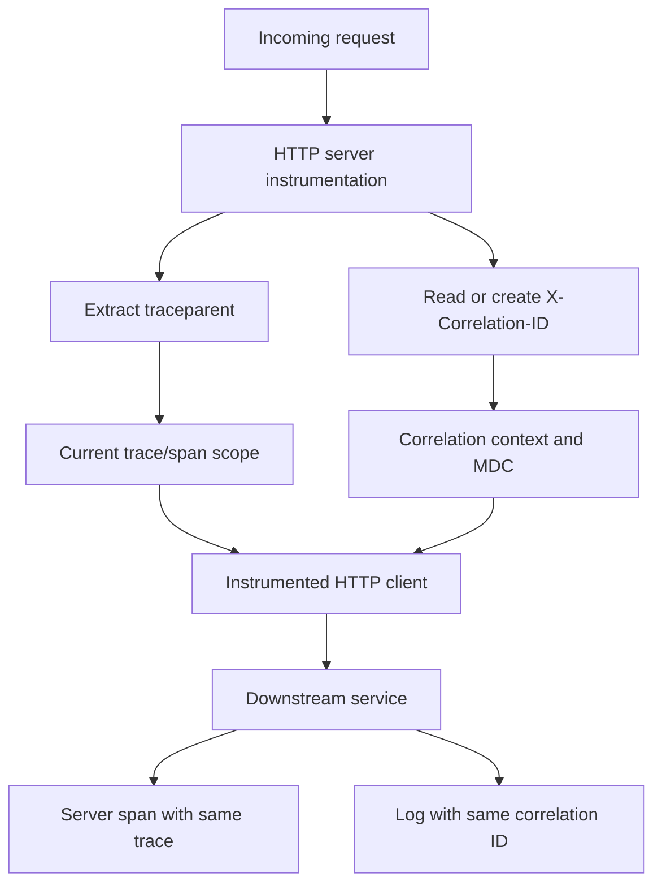

# Tracking Correlation IDs Across Services

## 1. Objectives and Context

A user request may travel through an API Gateway, order service, payment service, inventory service, and then continue on a message-processing worker. When a step fails, the operations team needs to locate logs across multiple services, open the corresponding trace, and distinguish retries belonging to the same journey. A **Correlation ID** is an identifier that links related records or events under an application convention.

This lesson belongs to the **Baggage and Correlation** chapter of the **SPRING_BOOT_OBSERVABILITY** module. The module teaches how to set up observability for Spring Boot using Micrometer Observation, metrics, logs, and distributed tracing; covering context propagation, tags/cardinality, exporters, sampling, and signal correlation to investigate errors, latency, and application behavior in production environments.

After this lesson, you will be able to:

1. Distinguish correlation ID, request ID, business ID, trace ID, and span ID.
2. Design a consistent correlation contract for HTTP requests, messages, and background jobs.
3. Accept IDs at ingress safely, validate formats, and generate new IDs when needed.
4. Propagate correlation IDs via HTTP clients and message headers without overwriting trace context.
5. Attach correlation IDs to MDC for logging and clean up properly after requests.
6. Understand how Spring Boot/Micrometer Tracing already provides log correlation from trace/span IDs.
7. Coordinate custom correlation IDs, baggage, tracing, logs, and metrics without inflating cardinality or leaking data.
8. Test end-to-end and handle propagation, retry, async, Reactor, and queue issues.

**Example baseline:** Spring Boot 3.5.x, Java 17+, Spring MVC, and Micrometer Tracing. This lesson uses the application header `X-Correlation-ID`, distinct from W3C Trace Context.

## 2. What Is a Correlation ID?

A Correlation ID is a technical identifier used to link log records, requests, or events belonging to the same journey under a system contract.

```text
Client
  |
  | X-Correlation-ID: corr-7f31a
  v
API Gateway
  |
  | X-Correlation-ID: corr-7f31a
  v
Order service
  |
  | X-Correlation-ID: corr-7f31a
  v
Payment service
  |
  | X-Correlation-ID: corr-7f31a
  v
Payment provider adapter
```

Services record the same ID so operators can find related logs. This ID does not necessarily represent temporal or parent-child relationships between operations; it is a correlation key by application convention.

### 2.1. Distinguishing ID Types

| ID Type | Scope | Purpose | Example |
| --- | --- | --- | --- |
| **Trace ID** | One distributed trace | Groups spans within a trace | 32-hex-character W3C trace ID |
| **Span ID** | One span | Identifies a specific operation | 16 hex characters |
| **Correlation ID** | Per application/business contract | Links logs or events of a workflow | `corr-7f31a` |
| **Request ID** | One request attempt | Identifies a single HTTP call | `req-9d8c` |
| **Business ID** | Business entity/transaction | Looks up an order or payment | `order-1042` |

IDs can relate yet are not synonymous:
- One trace can span multiple HTTP requests, messages, and spans.
- One correlation ID can persist across retries or async steps to link a long workflow.
- Each retry may get a new request ID and span; the business ID stays the same.
- One workflow can span multiple traces or jobs.
- Business IDs can have high cardinality or contain sensitive data; never use them as default metric tags.

**Do not call every ID a trace ID.** Using accurate terminology helps operators know whether to search the trace backend, log backend, or business systems.

### 2.2. When to Use Trace ID vs. When a Custom Correlation ID Is Needed

Once Micrometer Tracing is configured, Spring Boot can put `traceId` and `spanId` into MDC by default for log correlation. With a fully stored distributed trace, these two values are usually enough to open the trace and inspect the span tree.

A custom correlation ID remains helpful when:
- A business workflow spans multiple traces or long-lived queues.
- Multiple retries need to be linked into one journey.
- A support request carries a reference ID from a ticket or API contract.
- A batch/job must connect back to an initiating request long afterward.

If there is no clear need for a custom ID, prefer `traceId` to connect logs with traces. Avoid creating a second ID merely because logs need an identifier string.

## 3. Two Correlation Layers That Must Work Together

To observe a cross-service flow accurately, distinguish:

1. **Tracing propagation:** propagating trace context such as W3C `traceparent` to build parent-child span relationships.
2. **Application correlation propagation:** propagating a custom correlation ID such as `X-Correlation-ID` to link logs/events per business contract.



Both mechanisms must align within a request, yet they do not replace each other:

- `traceparent` holds trace ID, parent span ID, and flags per W3C Trace Context.
- `X-Correlation-ID` is an application-defined header, not part of W3C Trace Context.
- Tracing instrumentation automatically injects/extracts `traceparent`.
- Custom headers typically require filters/interceptors or messaging middleware.
- MDC only attaches data to logs in the current execution scope; it does not travel over the network automatically.

If downstream has the same correlation ID but a different trace ID, that may be a long-running workflow that started a new trace. This is valid under a clear convention; do not assume tracing broke based solely on the custom ID.

## 4. Contract for Correlation IDs

Pick one uniform header across the whole system, for example:

```http
X-Correlation-ID: corr-7f31a8f4
```

| Rule | Recommendation |
| --- | --- |
| Header name | Use one consistent name per existing contract |
| Who generates it? | Gateway or trusted ingress service |
| Keep client-supplied ID? | Only when trust boundary and format permit |
| Missing or invalid ID | Generate a new ID |
| Length | Explicit limit, e.g., max 64 characters |
| Characters | Allowlist ASCII letters, digits, dot, hyphen, underscore |
| Secret? | No; never use as a token or access permission |
| Downstream | Propagate only across permitted services |
| Logging | Emit as a dedicated structured field |
| Metrics | Never create a tag per correlation ID |

The header name `X-Correlation-ID` is an application convention, not W3C Trace Context. If the organization already has a standard header, use that exact header instead of inventing multiple variants for the same purpose.

### 4.1. Policy at Ingress

**Gateway as trusted source:** the gateway creates the correlation ID; downstream services receive and forward that ID.

**Allowing client-provided IDs:** the service accepts contract-valid values; if invalid or oversized, it generates a new ID. Externally supplied IDs remain correlation metadata only, not proof of user identity.

Never write arbitrary header values straight into logs or forward them unconditionally. Headers can contain CR/LF, oversized strings, control characters, or personal data. Validate and constrain before use. A character allowlist does not prove the sender is trustworthy; enforce network/authentication controls on the gateway if the gateway is authoritative.

## 5. Creating and Preserving IDs in Spring Boot 3.5

Example using `OncePerRequestFilter` to read the header, validate, generate a UUID if missing/invalid, attach the ID as a request attribute, put it into MDC, return it in the response, and clean up MDC.

### 5.1. Filter

```java
package com.example.observability;

import jakarta.servlet.FilterChain;
import jakarta.servlet.ServletException;
import jakarta.servlet.http.HttpServletRequest;
import jakarta.servlet.http.HttpServletResponse;
import org.slf4j.MDC;
import org.springframework.stereotype.Component;
import org.springframework.web.filter.OncePerRequestFilter;

import java.io.IOException;
import java.util.UUID;
import java.util.regex.Pattern;

@Component
public class CorrelationIdFilter extends OncePerRequestFilter {
    public static final String HEADER = "X-Correlation-ID";
    public static final String ATTRIBUTE =
            CorrelationIdFilter.class.getName() + ".correlationId";
    public static final String MDC_KEY = "correlationId";

    private static final Pattern SAFE_ID =
            Pattern.compile("[A-Za-z0-9._-]{1,64}");

    @Override
    protected void doFilterInternal(
            HttpServletRequest request,
            HttpServletResponse response,
            FilterChain chain)
            throws ServletException, IOException {

        String incoming = request.getHeader(HEADER);
        String correlationId = isSafe(incoming)
                ? incoming
                : UUID.randomUUID().toString();

        String previous = MDC.get(MDC_KEY);
        request.setAttribute(ATTRIBUTE, correlationId);
        response.setHeader(HEADER, correlationId);
        MDC.put(MDC_KEY, correlationId);

        try {
            chain.doFilter(request, response);
        } finally {
            if (previous == null) {
                MDC.remove(MDC_KEY);
            } else {
                MDC.put(MDC_KEY, previous);
            }
        }
    }

    private static boolean isSafe(String value) {
        return value != null && SAFE_ID.matcher(value).matches();
    }
}
```

Explanation:
- `SAFE_ID` limits length and characters, reducing header injection or log forging risks.
- Missing/invalid IDs are replaced with an application-generated UUID.
- The request attribute holds the normalized ID for controllers/services.
- The response header lets callers cite the ID in support and investigations.
- `try/finally` restores MDC even if the filter chain throws an exception.
- Never use correlation IDs for authentication, authorization, or pricing decisions.

This sample filter handles synchronous requests on the servlet thread. For Servlet async dispatch, executors, or callbacks, inspect actual lifecycles and context propagation; never assume MDC follows threads automatically.

### 5.2. Controller Reading the Normalized ID

```java
package com.example.observability;

import jakarta.servlet.http.HttpServletRequest;
import org.springframework.web.bind.annotation.GetMapping;
import org.springframework.web.bind.annotation.RestController;

@RestController
public class OrderController {
    private final OrderService orderService;

    public OrderController(OrderService orderService) {
        this.orderService = orderService;
    }

    @GetMapping("/orders/demo")
    public String createDemo(HttpServletRequest request) {
        String id = (String) request.getAttribute(
                CorrelationIdFilter.ATTRIBUTE);
        orderService.createOrder(id);
        return "accepted";
    }
}
```

The controller reads the ID after the filter has normalized it. Avoid re-reading raw headers in every service, which risks bypassing validation rules or using a value different from the one logged in MDC.

### 5.3. Passing the ID to Business Services

```java
package com.example.observability;

import org.springframework.stereotype.Service;

@Service
public class OrderService {
    private final PaymentClient paymentClient;

    public OrderService(PaymentClient paymentClient) {
        this.paymentClient = paymentClient;
    }

    public void createOrder(String correlationId) {
        // Process order...
        paymentClient.authorize(correlationId);
    }
}
```

Passing the ID as an explicit parameter makes code easier to test, especially when work leaves the request thread. Avoid sprinkling custom static `ThreadLocal`s across every service and assuming they always work.

## 6. Propagating Custom IDs over HTTP

Spring Boot tracing instrumentation automatically injects/extracts `traceparent` when clients are built from auto-configured builders. `X-Correlation-ID` is an application header and must be propagated separately.

Example `RestClient` adding the header on an outbound call:

```java
package com.example.observability;

import org.springframework.stereotype.Component;
import org.springframework.web.client.RestClient;

@Component
public class PaymentClient {
    private final RestClient client;

    public PaymentClient(RestClient.Builder builder) {
        this.client = builder
                .baseUrl("http://payment-service")
                .build();
    }

    public String authorize(String correlationId) {
        return client.post()
                .uri("/payments/authorize")
                .header(CorrelationIdFilter.HEADER, correlationId)
                .retrieve()
                .body(String.class);
    }
}
```

In this request:
- `X-Correlation-ID` is added by application code.
- `traceparent` is injected automatically by tracing instrumentation if Micrometer Tracing and the builder are configured.
- Never construct `traceparent` from a correlation ID.
- Never use a correlation ID in place of trace ID or span ID.

With `RestTemplate`, prefer Boot-injected `RestTemplateBuilder`; with `WebClient`, prefer auto-configured `WebClient.Builder`. Clients constructed manually outside Spring can bypass observation/tracing interceptors.

### 6.1. Downstream Service

The payment service can use the same filter. Upon receiving a request:
1. Validate `X-Correlation-ID`.
2. Keep the valid ID per workflow.
3. Put the ID into MDC within the request scope.
4. Let tracing server instrumentation extract `traceparent` separately.
5. Log the custom correlation ID and trace/span IDs if the pattern is configured.

There is no need to add a custom ID as baggage just to pass an application-controlled HTTP header. If metadata must travel with tracing context across multiple transports, baggage may fit; decide explicitly to avoid duplicate or inconsistent propagation.

## 7. When to Use Baggage for Correlation Metadata?

Micrometer Tracing supports creating baggage in scope:

```java
import io.micrometer.tracing.BaggageInScope;
import io.micrometer.tracing.Tracer;

public void processWithBaggage(Tracer tracer, String correlationId) {
    try (BaggageInScope baggage =
                 tracer.createBaggageInScope(
                         "correlation-id", correlationId)) {
        doBusinessWork();
    }
}
```

If the baggage field is configured to propagate, tracing instrumentation can carry metadata across transports instrumented by Micrometer Observation. Spring Boot can use:

```yaml
management:
  tracing:
    baggage:
      remote-fields:
        - correlation-id
      correlation:
        fields:
          - correlation-id
```

Distinguish clearly:
- `remote-fields` selects baggage fields that are propagated.
- `correlation.fields` selects baggage keys placed into MDC; it does not replace remote propagation.
- `tag-fields` can add baggage as span tags/attributes; use only when needed and after evaluating cardinality/privacy.
- With W3C propagation, baggage uses the W3C `baggage` header.
- With B3, baggage does not automatically propagate the same way as W3C; `remote-fields` can configure fields to send.

**Choose one authoritative source.** If a filter generates `X-Correlation-ID` while another service creates `correlation-id` baggage independently, logs may end up with two different IDs. If using both header and baggage, define mapping rules and test inbound/outbound flows.

| Requirement | Usually appropriate choice |
| --- | --- |
| API needs to return an ID for callers to contact support | Custom header `X-Correlation-ID` |
| Link logs with the active trace | Spring Boot default `traceId` + `spanId` MDC correlation |
| Small metadata following tracing context across instrumented transports | Micrometer baggage |
| Metadata used only within the current request | Request attribute/application context |
| Order lookup | Business ID in database/audit |
| Aggregated metrics grouping | Low-cardinality metric tags |

Do not propagate every type of ID just because you can. Each field needs a clear purpose, owner, format, trust boundary, and retention policy.

## 8. Log Correlation in Spring Boot

### 8.1. Default Correlation from Micrometer Tracing

When Micrometer Tracing is configured, Spring Boot adds default log correlation based on MDC `traceId` and `spanId`. The default format typically resembles:

```text
[803B448A0489F84084905D3093480352-3425F23BB2432450]
```

This is a concatenated string of trace ID and span ID to locate the matching span in the trace backend. You can customize the format via `logging.pattern.correlation`.

Example:

```yaml
logging:
  pattern:
    correlation: "[%X{traceId:-}-%X{spanId:-}] "
```

The trailing space separates the correlation prefix from the logger name. There is no need to write your own filter to assemble trace/span IDs just to alter log formatting when the default suffices.

### 8.2. Adding Custom Correlation IDs to Logback

If the application also uses a custom `X-Correlation-ID`, add the MDC key to your existing logging pattern:

```text
%d{yyyy-MM-dd HH:mm:ss.SSS} %-5level
[%X{traceId:-}-%X{spanId:-}]
[correlationId=%X{correlationId:-}]
%logger{36} - %msg%n
```

Example logs:

```text
INFO  [trace=4bf...,span=00f...] [correlationId=corr-7f31a8f4]
      Order accepted
INFO  [trace=4bf...,span=11a...] [correlationId=corr-7f31a8f4]
      Calling payment service
ERROR [trace=4bf...,span=22b...] [correlationId=corr-7f31a8f4]
      Payment provider timed out
```

Logs can belong to different spans while sharing the same custom correlation ID. `traceId` typically links spans within one trace; the custom ID can link multiple attempts or a longer workflow.

Do not replace your entire logging configuration just to add one field. Update the existing pattern and inspect actual output because Logback, Log4j2, JSON encoders, and profiles may differ.

### 8.3. MDC Does Not Propagate Across Threads Automatically

MDC typically relies on ThreadLocal. A filter setting MDC on a servlet thread does not make it automatically appear on worker threads of `@Async`, executors, or callbacks. When switching execution contexts:
- Use Micrometer Context Propagation / Spring `ContextPropagatingTaskDecorator` for contexts with registered accessors.
- Or pass the correlation ID explicitly as a parameter.
- Restore/clear MDC when the task completes.
- Never leave a previous request's ID behind in a thread pool.

For long-running async jobs, define whether the ID belongs to the workflow/job or the initial request. Store it in message metadata or job context rather than relying on an expired request ThreadLocal.

## 9. Propagation Across Message Brokers and Background Jobs

HTTP headers do not automatically travel through Kafka, RabbitMQ, or queues. To preserve a correlation ID across messages:
1. Producer retrieves the correlation ID from context or business parameter.
2. Writes it into the message header per contract.
3. Consumer validates the header and attaches it to the execution's context.
4. Logs the correlation ID within the consumer scope.
5. Tracing instrumentation/propagators handle `traceparent` and baggage separately.

```text
Order service
  correlationId = corr-7f31a8f4
  trace context = traceparent ...
       |
       v
Message headers:
  X-Correlation-ID: corr-7f31a8f4
  traceparent: ...
       |
       v
Payment worker
  correlationId = corr-7f31a8f4
  consumer span belongs to propagated trace or is linked
```

A consumer may process a batch containing multiple correlation IDs. Never store a single ID in singleton state or a thread pool; context must belong to each individual message/task.

### 9.1. Correlation ID Is Not an Idempotency Key

A correlation ID can stay the same across retries to connect logs. An idempotency key aims to prevent duplicate transaction processing; it has its own uniqueness and retention semantics. Never use a correlation ID in place of an idempotency key, since one correlation ID can group multiple distinct operations.

## 10. Metrics, Cardinality, and Tracing Sampling

Correlation IDs are great for logs and targeted searches, yet almost **never suitable as metric tags**.

Wrong example:

```java
registry.counter("payment.attempts",
        "correlationId", correlationId).increment();
```

Each request can create a new tag set, causing cardinality and time series to grow with traffic. Instead:

```java
registry.counter("payment.attempts",
        "outcome", success ? "success" : "failure",
        "provider", normalizedProvider).increment();
```

`outcome` and `provider` must have finite sets of values. Correlation IDs belong in logs and can propagate via baggage/trace context; metrics focus on aggregation.

Trace sampling is a separate mechanism:
- Metrics record all registered instrument invocations.
- Traces may export only a sampled fraction per sampler settings.
- A custom correlation ID can still appear in logs even if the corresponding trace was not sampled/exported.
- An ID in logs does not prove the trace exists in the backend.

In investigations, use logs to locate correlation IDs and events; use trace IDs to open the span tree if the trace was stored; use metrics to measure prevalence by time/service/route.

## 11. Security and Trustworthiness

A correlation ID is a technical identifier, not a secret. How it is accepted and propagated still requires control:

- Never use it for authentication or authorization.
- Validate headers, cap length/characters, prevent CR/LF and log forging.
- Never embed emails, phone numbers, addresses, account/card numbers, or tokens inside the ID.
- Distrust clients: a syntactically valid ID can still be reused to confuse logs.
- Never treat it as a secret; IDs can appear in response headers, logs, traces, and support tickets.
- Limit log exposure and retention.
- Never log all request headers because they can contain `Authorization`, `Cookie`, and sensitive data.
- Never let clients dictate routing, pricing, or quotas via the ID; services must verify business logic independently.

Random UUIDs are useful when unpredictable IDs are needed, though that does not turn a correlation ID into a security token.

## 12. Testing Correlation IDs Across Services

An end-to-end test must check both log correlation and propagation, not just assert a single header.

### 12.1. HTTP Flow

1. Send a request to order service with a valid `X-Correlation-ID`.
2. Verify the filter preserves the ID and the response carries the same header.
3. Send a request without an ID; verify the service generates a new ID.
4. Send an oversized ID or one with forbidden characters; verify the service generates a new ID.
5. Verify order service logs contain the custom correlation ID and trace/span IDs if tracing is enabled.
6. Use an instrumented `RestClient.Builder` to call payment service; verify the custom header is forwarded.
7. In payment service, verify the filter receives the same ID and logs contain the same correlation ID.
8. Verify `traceparent` is injected/extracted by tracing instrumentation; trace IDs and parent span IDs must align.
9. Trigger an exception/timeout; verify MDC cleanup and that the next request does not inherit the stale ID.

### 12.2. Async and Messaging

- Submit a task through an executor with context propagation; verify the custom ID in MDC/logic for the right task.
- Process two tasks concurrently with two different IDs; ensure logs never mix.
- Send a message with a correlation ID in headers; verify the consumer reads it accurately and cleans up after processing.
- Test retries: verify whether the ID stays shared across the workflow or each request attempt gets its own ID per contract.
- Test cancellation, timeouts, and rejected tasks to ensure proper cleanup.

### 12.3. Structured Logs

With JSON logs, you can have dedicated fields:

```json
{
  "timestamp": "2026-11-22T10:20:30Z",
  "level": "INFO",
  "service": "order-service",
  "correlationId": "corr-7f31a8f4",
  "traceId": "4bf92f3577b34da6a3ce929d0e0e4736",
  "spanId": "00f067aa0ba902b7",
  "message": "Order accepted"
}
```

This is an example schema, not a default Spring Boot format. Fields must be configured in your JSON encoder/structured logging. Use dedicated fields rather than parsing correlation IDs out of message strings.

## 13. Troubleshooting

| Symptom | Possible cause | How to check |
| --- | --- | --- |
| Each service generates a different correlation ID | Downstream fails to receive/forward header or filter always replaces it | Check header at each hop and trust policy |
| Logs share correlation ID yet have different trace IDs | Workflow spans multiple traces/retries/jobs or tracing context split | Compare business flow, parent/links, and ID definitions |
| Trace shares trace ID yet logs lack correlation ID | Filter/MDC did not run or logging occurred outside scope | Check filter order, logging pattern, and MDC lifecycle |
| Worker logs lack correlation ID | MDC not propagated or task never received ID | Pass explicitly or use `ContextPropagatingTaskDecorator` |
| Next request uses previous request's ID | MDC not cleaned up on thread pool | Use `finally`, check restore/clear |
| Outbound lacks `X-Correlation-ID` | `RestClient` did not attach header | Inspect request using mock server |
| Correlation ID present yet no trace | Uninstrumented client or tracing missing | Check `RestClient.Builder`, bridge, propagator |
| `traceparent` present yet custom ID missing | Only tracing propagation is active | Add app-level header or baggage per contract |
| `X-Correlation-ID` present yet downstream span is root | Custom header does not create trace parent | Inspect W3C `traceparent` separately |
| Header changes repeatedly | Upstream format fails validation | Align contract/allowlist |
| Log search by ID returns too much data | ID reused broadly or very long workflow | Check scope, time window, and event types |
| Metric series spike suddenly | Correlation ID used as metric tag | Remove dynamic tag, use finite tags |
| Trace missing even though logs have trace ID | Sampling, exporter, or retention | Inspect trace pipeline separately |
| Message consumer loses ID | Producer did not send header or consumer does not read it | Check message headers/middleware |
| ID appears outside intended services | Propagation crossed trust boundary | Allowlist services/hops and filter at gateway |

## 14. Production Rules

1. Choose one clear correlation ID owner: gateway or trusted ingress service.
2. Standardize header names and contracts across service teams.
3. Validate and limit length/characters; generate a new ID if missing or policy-violating.
4. Use correlation IDs to link workflows/logs; use trace IDs/span IDs to navigate inside the trace backend.
5. Let Micrometer Tracing handle `traceparent`; never construct trace headers out of correlation IDs.
6. Use filters/interceptors for HTTP; message headers/middleware for brokers.
7. Put IDs into MDC for short scopes and clean up with `finally`.
8. For async/reactive, use context propagation or pass IDs explicitly.
9. Never put correlation IDs into metric tags; never turn them into baggage/attributes without a use case.
10. Propagate metadata only across permitted trust boundaries; never use IDs as credentials.
11. Write tests covering success, exceptions, retries, async, thread reuse, and message consumption.
12. Use metrics to measure trends, logs to find events, and traces to understand timing/parent-child relationships.

## 15. Self-Check Questions

1. How do Trace ID and custom correlation ID differ in purpose?
2. A workflow spans three services and two retries: which IDs stay the same, and which can change?
3. Why might an organization still need `X-Correlation-ID` when Spring Boot already provides log correlation from `traceId`/`spanId`?
4. Why does `X-Correlation-ID` not automatically create a parent span downstream?
5. Why should you validate the header and generate a new ID when an inbound value is invalid?
6. Where must MDC be cleaned up inside a filter, and why?
7. When `RestClient` sends a custom correlation header, which component transmits `traceparent`?
8. When should you use baggage instead of a custom HTTP header?
9. Why is a correlation ID unsuitable as a metric tag?
10. Are logs sharing a correlation ID yet having different trace IDs always a bug?
11. What should you inspect when a correlation ID disappears inside an `@Async` worker?
12. Can a correlation ID and an idempotency key replace each other?

## References

- [Spring Boot 3.5 — Tracing and Logging Correlation IDs](https://docs.spring.io/spring-boot/3.5/reference/actuator/tracing.html)
- [Spring Boot 3.5 — Common Application Properties](https://docs.spring.io/spring-boot/3.5/appendix/application-properties/index.html)
- [Micrometer Tracing — Propagation](https://docs.micrometer.io/tracing/reference/propagation.html)
- [Micrometer Tracing — Baggage API](https://docs.micrometer.io/tracing/reference/api.html)
- [Spring Framework — Context Propagation](https://docs.spring.io/spring-framework/reference/integration/observability.html)
- [OpenTelemetry — W3C Trace Context](https://opentelemetry.io/docs/specs/otel/context/api-propagators/)
- [W3C — Trace Context](https://www.w3.org/TR/trace-context/)
- [W3C — Baggage](https://www.w3.org/TR/baggage/)
