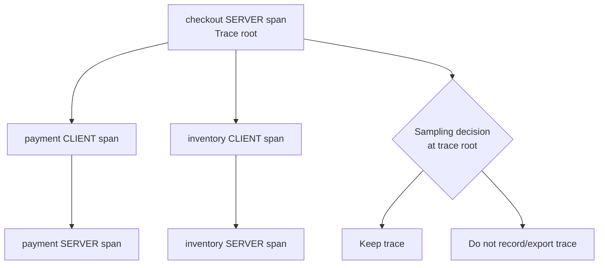
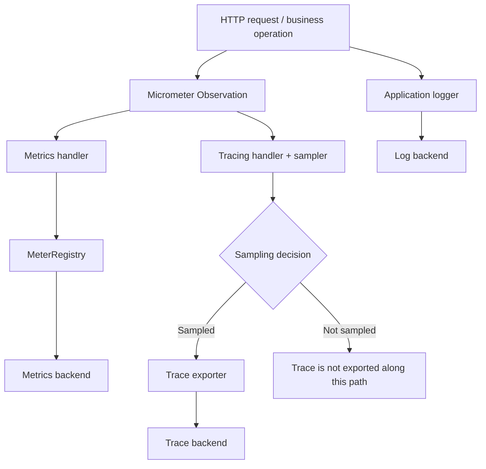
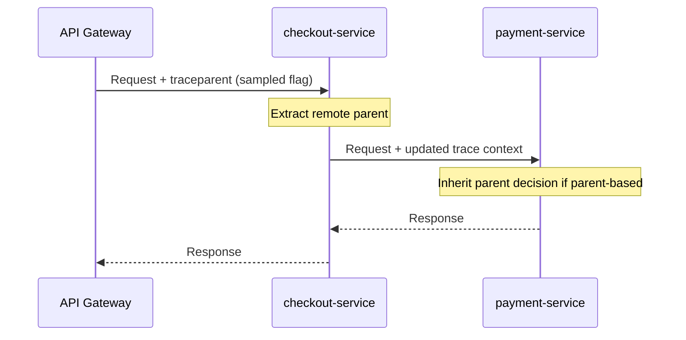
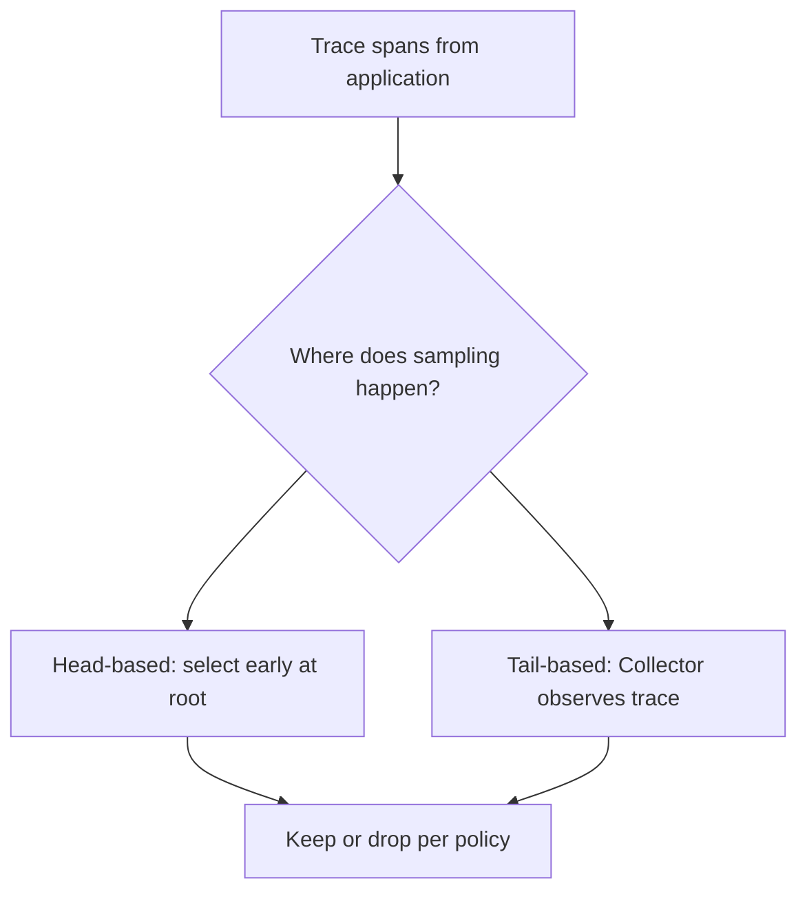

# The 10 Percent Default in Spring Boot Distributed Tracing

A Spring Boot application can receive tens of thousands of requests per minute. Storing every distributed trace can quickly drive up ingest, storage, and query costs. Capturing only a fraction of traces still gives an overall view while reducing tracing data volume. In the Spring Boot 3.x ecosystem with Micrometer Tracing, the default sampling probability is typically set to **10%**: an initial balance between investigative visibility and cost.

The **10 Percent Default** lesson belongs to the **Sampling** chapter of the **SPRING_BOOT_OBSERVABILITY** module. The module teaches how to set up observability for Spring Boot using Micrometer Observation, metrics, logs, and distributed tracing; covering context propagation, tags/cardinality, exporters, sampling, and signal correlation to investigate errors, latency, and application behavior in production environments.

The goal of this lesson is to understand the exact meaning of `management.tracing.sampling.probability=0.1`, know which traces this probability affects, distinguish a trace-start sampling decision from per-span decisions, understand parent-based relationships across multiple services, and avoid confusing tracing sampling with dropping metrics or logs.

## 1. What Does 10% Sampling Mean?

**Sampling** is the decision to select a subset of traces to record and/or export to a trace backend. When the sampling probability is configured to `0.1`, a probabilistic sampler selects approximately **10% of eligible root traces** over the long run.

It **does not mean**:

- Exactly 1 trace is always kept for every 10 requests.
- Every batch of 100 requests contains exactly 10 traces.
- Only 10% of spans in each trace are recorded while the other 90% are randomly dropped.
- Metrics or application logs are automatically reduced to 10% as well.
- Every selected trace is guaranteed to appear in the backend UI; exporters, collectors, and backends can still fail.

For example, in an independent set of 1,000 requests, if the sampler genuinely applies probability 0.1 to each root trace, the **expected** number of selected traces is 100. Actual counts can be lower or higher. Under an idealized independent probability model, the standard deviation of the number of selected traces is:

\[
\sqrt{n p (1-p)}
= \sqrt{1000 \times 0.1 \times 0.9}
\approx 9.49
\]

This is an illustrative probability model, not a guarantee for a real batch. Parent-based sampling, custom samplers, different SDKs, and upstream policies can make selection conditions more complex.

## 2. Configuring Sampling Probability in Spring Boot

For Spring Boot releases with Micrometer Tracing auto-configuration, the commonly used property is:

```yaml
management:
  tracing:
    sampling:
      probability: 0.1
```

`0.1` is a 10% probability according to the configured sampler. In Spring Boot 3.x, this is the common default value for sampling probability when using default tracing auto-configuration. Verify the documentation and effective configuration of the **exact Spring Boot version you are running**, because bridges, starters, or custom SDK configurations can alter the active sampler.

Example with an application name and OTLP endpoint:

```yaml
spring:
  application:
    name: checkout-service

management:
  tracing:
    sampling:
      probability: 0.1
  otlp:
    tracing:
      endpoint: http://localhost:4318/v1/traces
```

The address above illustrates OTLP/HTTP; the collector must accept the matching protocol and endpoint. `localhost` inside a container refers to the application container itself, not automatically the collector container. If you choose Zipkin/Brave or a custom OTel SDK, the corresponding properties/exporter must be configured separately.

### When to Change the Probability?

| Environment/situation | Direction | Reason |
| --- | --- | --- |
| Local development | 1.0 can be helpful | Easy to see spans while learning and debugging |
| Automated tests | 1.0 or deterministic sampler | Results are easy to verify |
| Staging with limited traffic | Higher rate can be chosen | Need to verify propagation and instrumentation |
| High-traffic production | 0.1 is a starting point, not a fixed answer | Balance observability, cost, and capacity |
| Incident needing full traces temporarily | Controlled adjustment or selective policy | Focus investigation and bound cost |

Do not raise production to 100% indefinitely just because one trace is missing. First check the sampler, exporter, collector, backend, and context propagation; raising sampling cannot fix a wrong OTLP endpoint or uninstrumented spans.

## 3. Root Trace and Child Spans

A checkout request may create a server span in `checkout-service`, then create client spans calling `payment-service` and `inventory-service`. **A single sampling decision at the start of the trace can affect the entire trace across multiple services**.



The diagram illustrates the trace-level outcome. If the trace is kept, instrumented spans within the trace can flow through the export pipeline. If the trace is dropped by the decision at the start, do not expect a child span in `payment` to appear on its own as a complete standalone trace unless another mechanism was explicitly designed.

With a **parent-based sampler**, child spans typically inherit the sampling decision from their parent. This keeps the trace consistent: a service does not arbitrarily decide to record child spans while the parent service dropped the trace under a parent-based policy. Exact mechanics depend on the sampler/bridge.

### Parent-Based vs. Probability-Based

- **Probability-based sampler** decides based on probability/sampling algorithm, usually at the root when no parent decision exists.
- **Parent-based sampler** checks the parent's decision first; only when there is no parent (root span) does it apply a root sampler such as a probability-based sampler.
- **Remote parent** can carry a sampling flag from an upstream service. The downstream service can inherit that decision instead of applying a new local ratio.

Therefore, if the gateway selects a trace, subsequent services typically need to keep recording that trace to complete the distributed trace. Conversely, if upstream did not sample, a downstream service should not unilaterally flip the trace to sampled unless the system's sampling architecture allows it and the impact has been verified.

## 4. Why Isn't There Exactly One Trace Every Ten Requests?

Sampling probability is a **probability**, not an evenly spaced counter. Suppose 10 requests pass through a root sampler with probability 0.1:

| Traces kept | Can it happen? | Explanation |
| --- | --- | --- |
| 0 | Yes | Every roll ended up not sampled |
| 1 | Yes | Outcome matches the 10% expectation |
| 2 or more | Yes | Multiple requests can happen to be selected |
| 10 | Probabilistically possible | Very rare if selections are independent, though never strictly zero |

Do not test sampling by writing a test that sends exactly 10 requests and asserts exactly 1 trace. Such a test is statistically flawed and will be flaky.

With an independent probabilistic sampler, the number of retained traces approaches `n × p` when `n` is sufficiently large. Observed trace counts are also affected by traffic, retries, parent decisions, exporter failures, dropped spans, and requests that do not create spans.

## 5. Sampling Is Not Metrics Sampling or Log Sampling

Spring Boot Observability has separate pipelines:



In standard configurations:

- **Metrics** can continue counting all instrumented requests, even though only a fraction of traces are sampled.
- **Logs** are written according to their own logging policy. They are not automatically reduced to 10% just because trace sampling is 0.1.
- **Traces** are subject to the sampling decision. The backend may receive only a subset of trace roots.

Do not infer request counts from trace counts in the backend without knowing the sampling rate and pipeline health. Also do not use `traceId` as a metric label to join individual requests; cardinality will be very high.

### Example of the Difference

Suppose in one hour there are 50,000 HTTP requests: the metrics Timer records all 50,000 calls, application logs write 3,000 events per log level, and tracing probability 0.1 selects about 5,000 traces in an ideal model. These three numbers differ because **they measure three different kinds of data**. If the trace backend only shows 4,600 traces, inspect sampling, root count, retries, exporter/collector, and ingest; do not jump to the conclusion that 400 requests are missing metrics.

## 6. Sampling and Context Propagation

Trace context typically travels via HTTP headers such as W3C `traceparent`. The header contains the trace ID, parent span ID, and flags related to sampling. Thanks to propagation, downstream services know whether the parent trace was decided to be sampled.



Key points to remember:

1. The sampling decision can be carried inside the trace context across process boundaries.
2. A parent-based sampler helps downstream obey the upstream decision when a valid parent exists.
3. W3C `traceparent` is part of tracing context; baggage is a separate mechanism.
4. Do not blindly trust arbitrary trace headers from the Internet as proof of identity or authorization.
5. If a service strips the header or uses an incompatible propagator, the trace can split and each service applies its sampler as an independent root.

Seeing the same trace ID in logs is not enough to prove parent-child relationships are right. Check spans/parent IDs and trace context at every hop in integration tests.

## 7. 10% Does Not Specify Head-Based or Tail-Based Sampling

`probability: 0.1` expresses a probability in sampler configuration, but **does not by itself state whether the overall architecture uses head-based or tail-based sampling**.

### Head-Based Sampling

The decision is made early when the trace starts or when the root span is created. Its advantage is reducing data right at the application, saving network and storage. Its limitation is not yet knowing whether the request will fail or become slow later.

For example, a request with a 0.9 probability of being dropped is discarded at the start; even if it times out after 5 seconds, the trace may not exist in the backend. Metrics/logs can still record the timeout.

### Tail-Based Sampling

Tail-based sampling is typically performed at a collector or a component capable of holding spans long enough to decide after observing the trace. It can prioritize keeping traces with errors or high latency, even if they were not part of the normal random sample. However, it requires more complex infrastructure, memory, buffering, trace completeness, and configuration.



If you want to **keep all error traces** with tail-based sampling, you cannot just set `management.tracing.sampling.probability=0.1` and expect default Spring Boot to do it automatically. You must configure a collector tail sampler, ensure enough spans arrive before the decision, and account for how application/parent samplers emit trace data. Once a head sampler drops data before the collector, the tail sampler cannot recover spans that were never sent.

## 8. 10% Probability and Tracing Cost

Suppose each request creates an average of 6 spans, traffic is 2,000 requests/second, and sampling probability is 0.1. In a simple model where 10% of root traces are kept and spans within each trace are kept in full:

\[
2{,}000 \times 0.1 = 200\ \text{traces/second}
\]

\[
200 \times 6 = 1{,}200\ \text{spans/second}
\]

If sampling is raised to 1.0, trace/span volume is projected to increase roughly 10x under the same assumptions. This is a **load estimate**, not a guaranteed figure; traces can vary in span count, instrumentation may be incomplete, sampler/parent decisions can differ, and exporters can drop data.

Costs are influenced by:

- The number of root traces kept.
- Average spans per trace and the size of attributes/events.
- Sampling rate, retry traffic, and number of hops in a distributed request.
- Export batches, collector buffers/queues, and throughput.
- Retention, indexing, queries, and dashboards in the trace backend.
- The number of custom attributes/high-cardinality values that are expensive to store/search.

Lowering sampling does not replace eliminating redundant span attributes, sensitive payloads, or dynamic span names. Tune instrumentation, tags/cardinality, and retention alongside sampling.

## 9. Choosing Probability by Goals and Traffic

There is no single sampling rate suitable for every system:

| Need | Consideration |
| --- | --- |
| Local debugging, propagation demo | 1.0 for a short period |
| Low-traffic staging, end-to-end checks | High rate for test coverage |
| Production, moderate traffic | 0.1 can be a starting point if budget permits |
| Production, very high traffic | Lower than 0.1 or selective/tail-based strategy |
| Investigating rare errors | Combine metrics/log alerts with collector error-retention policies if architecture supports it |
| Services with audit requirements | Use a dedicated audit/event pipeline with retention guarantees; do not treat trace sampling as an audit log |

When evaluating, monitor **actual trace volume**, export errors, collector drops, backend ingestion, and cost. Do not look only at the probability configuration to infer how much data is being stored.

If there are `N` eligible trace roots and sampling probability `p`, the expected number of selected trace roots is:

\[
E[\text{sampled roots}] = N \times p
\]

With 2,000,000 roots and `p=0.1`, the expected count is 200,000. This number does not mean 200,000 traces are guaranteed to appear in the backend; the exporter, collector, or backend can drop/lose data after the sampling decision.

## 10. Configuration and Operations in Spring Boot

An illustrative profile setup can separate development and production:

```yaml
# application-dev.yml
management:
  tracing:
    sampling:
      probability: 1.0
```

```yaml
# application-prod.yml
management:
  tracing:
    sampling:
      probability: 0.1
```

Profile files are only examples. Verify active profiles, externalized configuration, environment variables, and whether a custom tracer bean overrides the sampler. A properly named property in an inactive profile has no runtime effect.

In an OTel setup, if the application builds its SDK manually outside Spring Boot auto-configuration, the sampler may be set in the SDK rather than via properties. Avoid configuring it in two places and losing track of which sampler wins. Inspect startup configuration, beans, and a real test trace.

**Do not enable a high probability via hot change without assessing load:** increasing from 0.1 to 1.0 can multiply exporter/backend load by nearly 10x assuming steady trace counts. If sampling must be raised during an incident, scope it by service/traffic and duration, watch queues/backpressure, and restore operational settings after the investigation.

## 11. Testing Sampling Probability

Do not write a unit test that sends 10 requests and asserts exactly 1 trace. At probability 0.1, small-sample results fluctuate heavily. Separate verification into distinct test types:

| Test type | Goal | Approach |
| --- | --- | --- |
| Configuration test | Effective property equals expected value | Boot Spring context with profile and read config |
| Sampler unit test | Sampler decision for specific inputs | Use deterministic sampler/test fixture matching the SDK |
| Statistical test | Observed rate is close to configured probability on enough samples | Generate a large batch, use statistical tolerance bounds |
| Propagation integration test | Child spans inherit sampling decision | Send requests across client/server test and assert trace flags/IDs |
| Export pipeline test | Sampled data reaches collector | In-memory exporter or test receiver |

### Verifying Configuration and Metrics Independently

An integration test should verify two separate things:

1. The tracing sampling property is loaded correctly.
2. Metrics Timers are still recorded when the tracing sampler does not select a trace, provided the metrics pipeline is configured independently.

Do not assert that trace count equals metric count; they are two different quantities.

### Statistical Sanity Check

If testing an independent probabilistic sampler with `n=10,000` and `p=0.1`, expected traces = 1,000 and ideal standard deviation is:

\[
\sqrt{10{,}000 \times 0.1 \times 0.9} = 30
\]

You can define an acceptance band several standard deviations wide to reduce test flakiness. This test is only valid for samplers with independent probabilistic behavior; do not apply it blindly to parent-based/remote-sampled traffic or custom samplers.

Never call a real production exporter in unit tests. Use an in-memory exporter, mock/receiver, and an isolated test environment.

## 12. When Metrics and Traces Have Different Counts

Suppose the application has:

- 100,000 requests recorded by the HTTP server Timer.
- 10,000 trace roots selected by the sampler at probability 0.1 in an ideal model.
- An average of 5 spans per trace.

The trace backend may receive around 50,000 spans, not 10,000 spans; **trace count and span count are different**. Metrics count is the number of measurements as defined by the meter, whereas trace roots are the number of selected distributed traces.

If actual figures differ widely from expectations, check:

1. Whether metrics count retries/health checks/management requests.
2. Whether trace sampling is truly applied at the root or governed by an upstream parent decision.
3. Whether services create spans and propagate context completely.
4. Whether the exporter/collector has dropped spans, throttling, or full queues.
5. Whether the backend has ingest limits, filters, retention cuts, or wrong service/time-range queries.

A `traces / requests` ratio below 10% does not necessarily mean the sampler is broken: some requests may not start a trace root at this service because they are children of a gateway trace. A higher ratio can also come from services starting new roots due to broken propagation.

## 13. Sampling Does Not Protect Sensitive Data

Do not treat 10% as a privacy mechanism. If a request carries an access token in a span attribute and the sampler selects that trace, the secret is still exported. Sampling only decides **which traces are kept**; it does not sanitize the contents of retained traces.

Rules:

- Do not record `Authorization`, `Cookie`, passwords, tokens, or sensitive request/response bodies in spans.
- Use route templates instead of raw URLs with IDs/queries.
- Normalize exception categories instead of free-form exception messages when messages may contain PII/secrets.
- Keep span names stable; do not embed order IDs or user IDs.
- Carry only minimal fields in baggage, with allowlists and size limits.
- Use low-cardinality metric tags; never add trace ID as a dimension.

If sensitive data must be removed, do it at the instrumentation/source or a verified pipeline transformation. Never rely on "most traces are sampled out" as justification to collect secrets.

## 14. Common Issues

| Symptom | Possible cause | How to check |
| --- | --- | --- |
| Only ~10% of traces appear | Sampling is working as configured | Compare traffic roots with exporter/backend health |
| Sent 10 requests, saw 0 traces | Probabilistic outcome on small sample | Increase sample size or use deterministic test |
| Metrics count exceeds traces | Metrics do not follow tracing sampling | Normal; verify independent pipeline |
| Downstream has no spans while upstream does | Downstream propagation, instrumentation, or exporter | Check headers, client/server spans, and exporter |
| Downstream samples differently from upstream | Parent-based behavior unused or parent context lost | Check sampler and propagation format |
| More traces than expected | Multiple root traces from broken context, custom sampler | Check for new trace IDs at each service |
| Trace sampled but missing in backend | Exporter/collector/network/backend drop | Check export errors and dropped spans |
| Raised probability but no extra traces | Property inactive or custom SDK sampler overrides it | Check effective config and tracer bean |
| Backend shows few spans despite enough roots | Missing span instrumentation or collector drops | Check span counts and pipeline |
| Rare error lacks a trace | Head sampling dropped trace before error occurred | Combine logs/metrics or design tail-based sampling |
| Costs spike after deploy | Sampling rate raised, more spans/attributes | Measure root/trace/span volume and ingest cost |

## 15. Real-World Scenario: Payment Timeout with No Trace

**Hypothetical context:** `checkout-service` handles 20,000 requests in one hour. Metrics show 1.2% of payment calls time out. Tracing probability is 0.1, yet an operator searches for a specific timeout request and finds no trace.

Reasonable workflow:

1. Confirm whether the request is instrumented as a trace root or is a child of a gateway trace.
2. Check the trace decision from upstream; if the parent was not sampled and the sampler is parent-based, downstream may inherit the drop decision.
3. Check that the exporter/collector is healthy and not dropping spans; 10% sampling does not guarantee the backend always receives the full 10%.
4. Use metrics to determine the timeout rate by payment client and time window.
5. Use logs with trace/correlation fields per policy to find the timeout event, even if the trace was not stored.
6. If reproduction is needed, test in staging with higher sampling or a deterministic test; do not turn on 100% across production indefinitely.
7. If retaining error traces in production is required, evaluate tail-based sampling at the collector with adequate data, buffers, memory, and ensure spans are not dropped by a head sampler before reaching the collector.

An error request without a trace **does not prove the error did not happen**, nor does it necessarily prove the sampler is broken. Sampling is one part of observability design; metrics and logs must still provide independent evidence.

## 16. Self-Check Exercises

**Exercise 1.** Does `management.tracing.sampling.probability=0.1` guarantee that out of every 100 requests, exactly 10 traces are stored?

*Hint:* No. It is a probability/expectation over a sufficiently large sample, not even batch partitioning.

**Exercise 2.** Why might a metric Timer count be 50,000 while the trace backend only has 5,000 traces?

*Hint:* Metrics and tracing are two separate pipelines. Sampling may keep roughly 10% of root traces while metrics still measure all instrumented requests.

**Exercise 3.** The gateway already sampled a trace. Why shouldn't `payment-service` independently apply a 0.1 probability to the child span?

*Hint:* A parent-based sampler normally inherits the parent decision so the entire trace remains consistent. A child service should not arbitrarily split the trace with its own policy.

**Exercise 4.** A trace is dropped by a head sampler right at the root; can a collector tail sampler still keep the error spans of that trace?

*Hint:* No, if spans are never sent to the collector. A tail sampler can only decide on the data it receives.

**Exercise 5.** To test probability 0.1, should you send exactly 10 requests and assert exactly one trace?

*Hint:* No. The sample is too small and outcomes are random; use a deterministic sampler test or a statistical test over enough roots with tolerance bounds.

**Exercise 6.** What can increasing sampling from 0.1 to 1.0 affect?

*Hint:* Trace/span counts, network, exporter queues, collector memory, backend ingest/storage/indexing, and cost can increase by nearly 10x under the same assumptions.

**Exercise 7.** Does 10% sampling automatically drop 90% of application logs?

*Hint:* No. The logging pipeline is independent unless the system has a separate log sampling policy.

**Exercise 8.** Why is probability sampling not a safeguard for tokens inside traces?

*Hint:* Selected traces still retain sensitive data; sensitive fields must be stripped/masked at the source or in a verified pipeline.

## 17. Key Takeaways

- **Sampling probability 0.1** expresses roughly a 10% trace selection probability per the sampler; it is a statistical expectation, not a guarantee that every group of 10 requests produces exactly one trace.
- With **parent-based sampling**, child traces typically inherit the parent's decision so spans in a distributed trace remain consistent; check propagation if each service creates its own root.
- **Metrics, logs, and traces have independent pipelines.** Metrics can count all requests and logs can still be written even if only a subset of traces is kept.
- **Head-based sampling** decides early; **tail-based sampling** decides at the collector after observing data. Tail sampling cannot recover spans previously dropped by a head sampler.
- 10% is not the right rate for every environment. Choose based on traffic, investigation needs, exporter/collector capacity, storage, retention, and cost.
- Do not test probability by sending exactly 10 requests and demanding one trace; use deterministic samplers or statistical tests with sufficient samples.
- Sampling **is not a security mechanism**. Never put secrets/PII into spans, baggage, logs, or metric tags, even when most traces are dropped.
